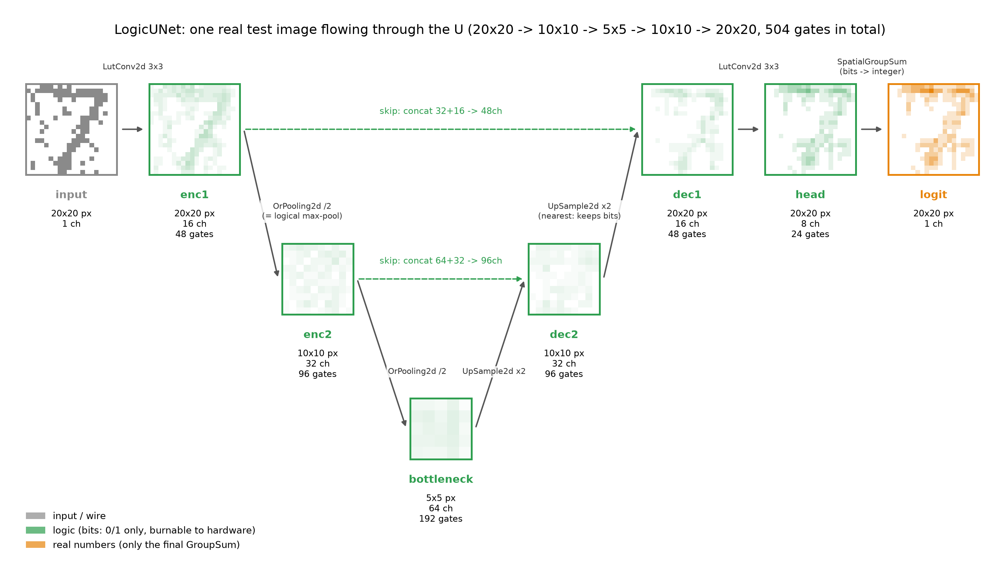
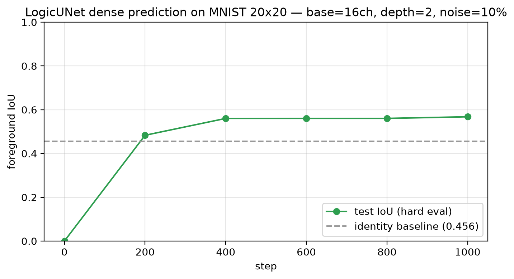
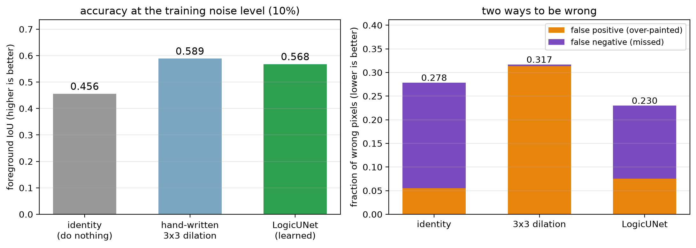
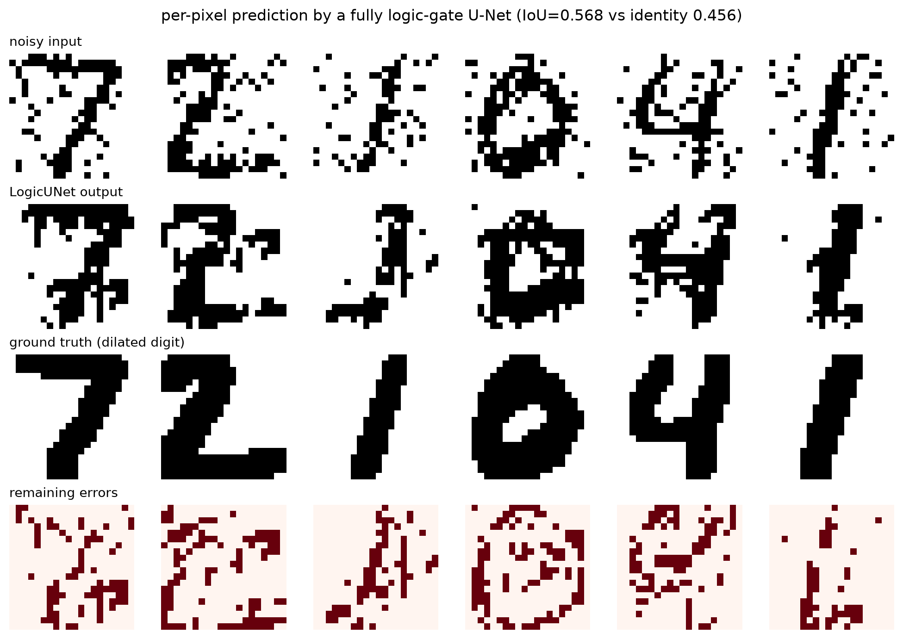
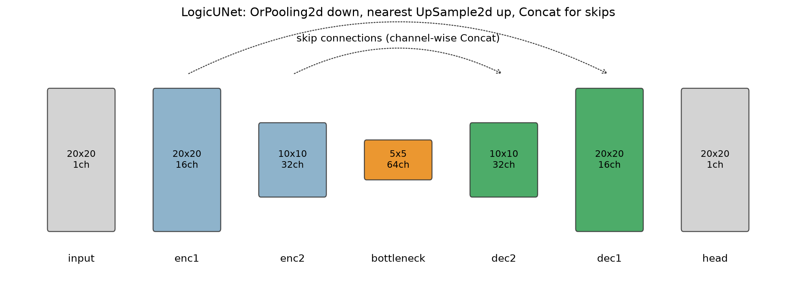

<!-- This file is auto-generated by scripts/build_tutorials.py.
     Do not edit it directly; edit examples/13_logic_unet.py and regenerate. -->

Instead of classification, we **answer pixel by pixel** (dense prediction) with logic gates. A U-Net that
recovers the digit region mask from noisy MNIST is built from OR pooling + nearest upsampling +
Concat skips, so the encoder and decoder round trip **without ever breaking the bits**.

It reaches a foreground IoU of 0.568 (identity baseline 0.456), and the intermediate representations at
eval time stay strictly in $\{0,1\}$. What the interpolation and average pooling taken for granted in a
real-valued U-Net get replaced with in a logic circuit is the heart of this page.

:::tip[What you'll learn]
1. How to build **an answer for every pixel** (dense prediction), not classification, out of logic gates
2. Why the average pooling and interpolation of a real-valued U-Net are replaced by OR pooling and nearest
3. Confirmation that the bits survive a Concat skip and the intermediate representations stay closed in $\{0,1\}$

**Prerequisites**

- [5. Exporting a CNN to HDL](/en/tutorials/cnn-hdl-export/) — the basics of logic gate convolution
- [1. Train on MNIST](/en/tutorials/mnist/)
:::

:::note[About this page]
Estimated time: **about 6 minutes** / Environment: CPU only (no GPU required)
Source script: [`examples/13_logic_unet.py`](https://github.com/tsukushi-gate/Griffith/blob/main/examples/13_logic_unet.py)
Try it yourself: [`notebooks/13_logic_unet.ipynb`](https://github.com/tsukushi-gate/Griffith/blob/main/notebooks/13_logic_unet.ipynb) (the same content as this page as an un-executed notebook; open it with `uv run --group docs jupyter lab notebooks/`)
Every code output below is the **actual result of running the code**, embedded verbatim.
:::

<!-- Colab badge: once the repository is public, replace this span with an <a> whose
     href is the data-colab-url value to enable "Open in Colab". -->
<span class="colab-badge" data-colab-url="https://colab.research.google.com/github/tsukushi-gate/Griffith/blob/main/notebooks/13_logic_unet.ipynb">▶ Open in Colab (enabled once the repository is public)</span>

An example of solving dense prediction on MNIST (region segmentation with denoising) using LogicUNet.

Up through 06_mnist.py the task was "one image -> one class" classification. Here we do
**dense prediction that produces an answer for every pixel** with a U-Net whose every stage is logic gates.

The task setup:

    input  … a noisy image made by flipping each pixel of binarized MNIST with probability 10%
    target … a "stroke region mask": the clean digit mask dilated by one pixel with a 3x3 kernel
    metric … foreground IoU (intersection over union)

The trick is that it is neither purely "remove the noise" nor purely "thicken the strokes" -- it has to do both at once.
The lazy answer of echoing the input back (i.e. the identity map) only reaches an IoU of about 0.46, so
the numbers tell us whether the circuit is really looking at the neighborhood and reasoning about it.

## Architecture at a glance: down the U and back up

The diagram below is the exact structure of this example's settings (base_channels=16 / depth=2 /
20x20 input). The image enters from the left, first shrinking 20x20 → 10x10 → 5x5, and then coming
back 10x10 → 20x20. This "go down and come back up" shape looks like the letter U, hence U-Net.
The dotted lines are the **skip connections** (a shortcut that hands the fine shapes from before the
shrinking over to the side that is coming back up).

```mermaid
flowchart LR
    IN["input image<br/>noisy binary mask<br/>1ch · 20x20 bits"]
    subgraph ENC["encoder (shrink to see a wider area)"]
        direction TB
        E1["enc1 · LutConv2d 3x3<br/>16ch · 20x20<br/>48 gates"]
        P1["OrPooling2d ÷2<br/>16ch · 10x10"]
        E2["enc2 · LutConv2d 3x3<br/>32ch · 10x10<br/>96 gates"]
        P2["OrPooling2d ÷2<br/>32ch · 5x5"]
        E1 --> P1 --> E2 --> P2
    end
    subgraph BOT["bottleneck (narrowest, and thickest)"]
        B["LutConv2d 3x3<br/>64ch · 5x5<br/>192 gates"]
    end
    subgraph DEC["decoder (grow back and restore the details)"]
        direction TB
        U2["UpSample2d ×2 nearest<br/>64ch · 10x10"]
        C2["Concat 64+32 = 96ch<br/>10x10"]
        D2["dec2 · LutConv2d 3x3<br/>32ch · 10x10<br/>96 gates"]
        U1["UpSample2d ×2 nearest<br/>32ch · 20x20"]
        C1["Concat 32+16 = 48ch<br/>20x20"]
        D1["dec1 · LutConv2d 3x3<br/>16ch · 20x20<br/>48 gates"]
        U2 --> C2 --> D2 --> U1 --> C1 --> D1
    end
    subgraph HEAD["head (count the bits into a real number)"]
        direction TB
        H["head · LutConv2d 3x3<br/>8ch · 20x20<br/>24 gates"]
        G["SpatialGroupSum<br/>count 8 bits per pixel"]
        H --> G
    end
    OUT["output<br/>per-pixel logit<br/>1ch · 20x20 real"]
    IN --> E1
    P2 --> B
    B --> U2
    D1 --> H
    G --> OUT
    E1 -. "skip: hand over the 16ch at 20x20 as is" .-> C1
    E2 -. "skip: hand over the 32ch at 10x10 as is" .-> C2

    classDef logic fill:#10b98126,stroke:#10b981
    classDef real fill:#f9731626,stroke:#f97316
    classDef io fill:#38bdf826,stroke:#38bdf8
    class E1,P1,E2,P2,B,U2,C2,D2,U1,C1,D1,H logic
    class G real
    class IN,OUT io
```



Every green box lives in a world where **nothing but 0/1 bits flow** (= it can be burned onto an FPGA
as is), and real numbers appear in exactly one place: the orange box at the very end, the addition
performed by SpatialGroupSum.

## How it works (in vocabulary for people new to NNs)

- **Channels (ch)** … how many black-and-white images of the same size are stacked. One sheet here is
  "a 0/1 sheet of paper on which the answer of some logic formula is written out per pixel", so 16ch
  means 16 sheets. Doubling the channels at deeper stages is a trade: "we give up fineness of position
  and make up for it with a greater variety of kinds".
- **LutConv2d (the green boxes)** … whereas the convolution of a real-valued CNN "multiplies the
  neighboring pixels by weights and sums them", this one picks two bits at a time out of the 3x3
  neighborhood and learns a **two-input truth table** (one of 16 possibilities) to emit a single bit.
  The only thing it shares with a convolution is that the same wiring and the same truth table slide
  over the whole image. After training it can be burned into hardware as a LUT exactly as it is.
- **Pooling is OR** (green, `OrPooling2d`) … the max pool of a real-valued CNN is "the largest of the
  four", but in a 0/1 world the maximum means "1 if any one of them is 1", which is **OR itself**.
  So OrPooling2d is the strict logical version of max pool: it halves the size while keeping bits as bits.
- **Upsampling is fixed to nearest** (green, `UpSample2d`) … one pixel is copied into a 2x2 block to
  double the size again. bilinear (which mixes the surroundings) would create intermediate values like
  0.5 and they would stop being bits, so it cannot be used.
- **Skip connections merge by Concat** (green, where the dotted lines land) … a real-valued U-Net
  merges by addition, but adding bits together would give 2. So we **line them up** along the channel
  axis and show the next LutConv2d both "the sheet from before the shrinking" and "the sheet that came back".
- **SpatialGroupSum (the orange box)** … only at the very end do we need a real number expressing how
  strong the judgment is. The 8 bits emitted by head are counted per pixel (0-8) and the middle is
  subtracted to make it signed. The larger this number, the more confident the circuit is that "this is a stroke".

As a result, every intermediate representation at eval time flows through strictly as {0,1} (we verify this below).

Five figures come out:

    Figure 1 … the architecture figure. One test image is pushed through the trained circuit and the
               actual feature maps of each stage are laid out in a U (watch the resolution shrink and return)
    Figure 2 … the learning curve (test IoU). When does it overtake the identity baseline?
    Figure 3 … a comparison against "do nothing" and "hand-written 3x3 dilation", plus the breakdown of
               the errors. Splitting them into over-painting and misses reveals how differently each
               method fails
    Figure 4 … a qualitative figure of input/output/ground truth/errors. Check it with your own eyes as digits
    Figure 5 … Figure 1 turned into a schematic of numbers only (how resolution and channel width move)

Run: uv run python examples/13_logic_unet.py
Expected result: foreground IoU around 0.57 (clearly above the identity baseline of 0.46 / 2-3 minutes on CPU)

## Getting ready: the dense prediction task and the tools for it

**Dense prediction** means, unlike classification which returns one answer per image, a task that
**returns an answer for every single pixel**. The answer here is the 0/1 of "is this pixel part of the
stroke region or not", so the output is again a 20x20 image just like the input.

All we use is PyTorch and matplotlib, plus this library's `LogicUNet` (a U-Net built purely out of
logic gates) and `load_mnist20x20` (MNIST shrunk to 20x20).

```python
import matplotlib.patches as mpatches
import matplotlib.pyplot as plt
import torch
import torch.nn as nn
import torch.nn.functional as F
from matplotlib.colors import LinearSegmentedColormap
from torch.utils.data import DataLoader, Subset

from griffith_logic.datasets import load_mnist20x20
from griffith_logic.models import LogicUNet, LogicUNetConfig
```

We fix the random seed. Which logic function each gate starts learning from, and where the noise
scattered over the input lands, are both decided at random, so without fixing the seed the results
would wobble from run to run.

```python
torch.manual_seed(0)
```

### Hyperparameters

`BASE_CHANNELS` is the logic channel width of the shallowest stage, `DEPTH` is the number of stages
that halve the image, and `NOISE` is the probability of flipping an input pixel. This is **a reduced
recipe that fits in 1-2 minutes on CPU**; the larger these and `STEPS` are, the higher the accuracy
(the full recipe is `experiments/train_logic_unet.py`).

```python
BASE_CHANNELS = 16   # logic channel width of the shallowest stage (doubled at deeper stages)
DEPTH = 2            # number of down/up sampling stages
NOISE = 0.10         # pixel flip noise rate
STEPS = 1000
BATCH = 32
N_TRAIN = 2048
N_TEST = 256
```

## Dataset: noisy inputs and dilated masks

A **binary mask** is an image in which every pixel takes only 0 or 1. With `binarize_threshold=0.5`
MNIST is turned into a binary mask of "digit=1 / background=0". The input of a logic gate NN must be
bits, so **this binarization is not preprocessing but a hard requirement**. We use the 20x20 version
rather than the 28x28 one because dense prediction computes pixel by pixel and is therefore heavy:
halving the area makes training about twice as fast.

```python
train_set, test_set = load_mnist20x20(binarize_threshold=0.5)
```

### Three tools for making the inputs and the targets

Data preparation splits into three small functions. `materialize` pulls out the binary masks,
`add_noise` corrupts the **input**, and `dilate` builds the **target**.

```python
def materialize(dataset, n):
    """Collect the first n items into an (N, 1, 20, 20) binary mask (class labels are unused)."""
    x, _ = next(iter(DataLoader(Subset(dataset, range(n)), batch_size=n)))
    return x
```

The noise does not **add** to the values, it **flips** them. Adding Gaussian noise would create
intermediate values like 0.3 and they would stop being bits, whereas flipping (addition mod 2 = XOR)
corrupts the image while keeping it 0/1. The result is white dots scattered over the background and
black holes punched into the strokes. Looking at a single pixel cannot tell which is noise, so the
circuit is forced to use the surrounding context.

```python
def add_noise(mask, seed):
    """Flip each pixel with probability NOISE (addition mod 2 = XOR).

    We flip instead of adding Gaussian noise in order to keep the values as bits.
    White dots get scattered over the background and black holes get punched into the strokes. Looking at
    a single pixel without its neighborhood cannot tell which is noise, so the circuit is forced to use
    the surrounding context.
    """
    g = torch.Generator().manual_seed(seed)
    flip = (torch.rand(mask.shape, generator=g) < NOISE).float()
    return (mask + flip) % 2
```

The target is not the "clean digit mask" itself but that mask thickened by one pixel with a 3x3
kernel: a **dilated mask**. This changes the task from "copy the input cleanly" into
"**look at the neighborhood and widen the region**", which stops the lazy solution of echoing the
input (the identity map) from being optimal. Dilation is the OR of the 9 neighboring pixels, so for
binary values `max_pool2d` is exactly OR.

```python
def dilate(mask):
    """3x3 dilation (= OR over the 9 neighboring pixels). For binary values max_pool2d is exactly OR.

    By making the target a "dilated" mask rather than the clean mask itself, the task changes from
    "copy the input cleanly" into "look at the neighborhood and widen the region".
    This one extra step is what stops the lazy identity map from being the optimal solution.
    """
    return F.max_pool2d(mask, kernel_size=3, stride=1, padding=1)
```

Now that the tools are ready, we build the pair of "noisy input" and "dilated target" for the training
set and the test set. The output below shows the foreground rate of the target mask (what fraction of
the image is stroke region) and the fraction of pixels the noise actually corrupted.

```python
train_clean = materialize(train_set, N_TRAIN)
test_clean = materialize(test_set, N_TEST)
train_input, test_input = add_noise(train_clean, 1), add_noise(test_clean, 2)
train_target, test_target = dilate(train_clean), dilate(test_clean)

print(f'train={tuple(train_input.shape)} test={tuple(test_input.shape)} '
      f'noise={NOISE:.0%}')
print(f'正解マスクの前景率={test_target.mean().item():.3f} / '
      f'ノイズで壊れた画素={(test_input != test_clean).float().mean().item():.3f}')
```

```text title="Output"
train=(2048, 1, 20, 20) test=(256, 1, 20, 20) noise=10%
正解マスクの前景率=0.456 / ノイズで壊れた画素=0.101
```

## Defining the model: a U-Net built purely out of logic gates

`LogicUNet` has the same "go down and come back up" skeleton as a real-valued U-Net, but **every part
is replaced by a logic operation**. Three pieces of vocabulary first.

- **Receptive field** … the range on the input side that one output pixel is "looking at". The more
  3x3 convolutions are stacked while the image shrinks, the wider that range effectively becomes
- **LUT tree** … unlike a real-valued CNN, `LutConv2d` does not multiply the pixels of the receptive
  field by weights and sum them. It picks bits at random out of the 3x3 receptive field, uses them as
  the leaves of a **complete tree of N-input LUTs (lookup tables = truth tables)**, and takes the
  single output bit of the tree as the value of the output channel. The truth tables are shared across
  every spatial position (that is what makes it a convolution). With `n_inputs=2` each gate learns one
  of the 16 two-input truth tables, so after training it can be burned onto an FPGA as is
- **Bottleneck** … the very bottom of the U, the stage with the smallest resolution and the thickest
  channels. Here it is 64ch at 5x5

Why the parts of a real-valued U-Net cannot be used as they are is the biggest highlight of this example.

- **Why OR pooling** … the average pooling of a real-valued U-Net creates intermediate values like 0.5
  and breaks the bits. In a 0/1 world "the maximum" means "1 if any bit in the neighborhood is set",
  which is **OR itself**. `OrPooling2d` is the strict logical version of max pool and can halve the
  image **while staying closed in {0,1}**
- **Why nearest upsampling** … bilinear interpolation mixes the surroundings and creates intermediate
  values, so it cannot be used. nearest merely **duplicates** one pixel into a 2x2 block, so the bits
  survive
- **Why Concat skips** … a **skip connection** is a shortcut that hands the fine shapes from before
  the shrinking over to the side that is coming back up. A real-valued U-Net merges them by addition,
  but adding bits together would give 1+1=2. With concatenation the bits stay bits and are merely
  **lined up sideways along the channel axis**, so the next `LutConv2d` can be shown both "the sheet
  from before the shrinking" and "the sheet that came back"

```python
config = LogicUNetConfig(
    in_channels=1,
    base_channels=BASE_CHANNELS,
    depth=DEPTH,
    n_inputs=2,       # number of bits one gate sees (= the size of the truth table being learned)
    out_channels=1,   # one channel for foreground/background (trained with BCEWithLogits)
    use_skip=True,    # turning off the skips means the fine details never come back (ablation flag)
)
model = LogicUNet(config)
```

### How resolution and channel width move

Let us print in numbers how the assembled circuit actually shrinks and comes back. This round trip of
20 → 10 → 5 → 10 → 20 looks like the letter U, hence U-Net. Doubling the channels at deeper stages is
a trade: **we give up fineness of position and make up for it with a greater variety of kinds**.

```python
# Show how the resolution shrinks and comes back (the "U" of U-Net).
sizes = [20]
for _ in range(DEPTH):
    sizes.append(sizes[-1] // 2)
print(f'\nencoder解像度: {" -> ".join(str(s) for s in sizes)} (OrPooling2d x{DEPTH})')
print(f'decoder解像度: {" -> ".join(str(s) for s in reversed(sizes))} '
      f'(UpSample2d x{DEPTH} + skip Concat)')
print(f'チャネル幅: {[BASE_CHANNELS * 2 ** i for i in range(DEPTH + 1)]}')
```

    
```text title="Output"
encoder解像度: 20 -> 10 -> 5 (OrPooling2d x2)
decoder解像度: 5 -> 10 -> 20 (UpSample2d x2 + skip Concat)
チャネル幅: [16, 32, 64]
```

## Training: loss, metric, and two baselines

Since this is dense prediction, the loss is computed **per pixel** rather than once per image. It is a
binary choice between foreground and background, so we use `BCEWithLogitsLoss` (binary cross entropy
that takes logits) and minimize the mean of the loss over all 20x20 = 400 pixels.

```python
opt = torch.optim.Adam(model.parameters(), lr=0.1)
loss_fn = nn.BCEWithLogitsLoss()
```

### Metric: foreground IoU

**IoU** (Intersection over Union) is the standard metric for dense prediction:
**IoU = the number of pixels where both prediction and target were foreground / the number of pixels
where either one was foreground**. Unlike accuracy, it stays at 0 when you answer "all background" on
an image with a wide background, so it does not let a lazy solution slip through. 1.0 is a perfect match.

```python
def foreground_iou(logits, target, threshold=0.0):
    """IoU of the foreground (logit > threshold). The standard metric for dense prediction.

    IoU = number of overlapping pixels / number of pixels where either one was foreground. Unlike
    accuracy, its advantage is that answering "all background" earns nothing on images with a wide background.
    """
    pred = (logits > threshold).float()
    inter = (pred * target).sum()
    union = ((pred + target) > 0).float().sum()
    return (inter / union.clamp(min=1)).item()
```

### Two baselines

Just saying "the trained circuit beat the baseline" does not tell us what it learned, so we split the
task into two components and measure up front the IoU of solving each with a fixed operation.

- **identity** … emit the noisy input as is. The **lower bound** that neither denoises nor dilates
- **hand-written dilation** … apply a 3x3 OR (the very operation used to make the target) to the noisy
  input. It can dilate, but it thickens the noise dots along with everything else

The latter is an extremely strong comparison point — the recipe for the ground truth handed over by a
human — an almost unfair opponent that would reach IoU 1.0 without noise. The circuit of this reduced
recipe only ties with it, but **the way it fails is a different thing entirely** (we take it apart on
the right of Figure 3 later).

```python
baseline_iou = foreground_iou(test_input * 2 - 1, test_target)
dilate_iou = foreground_iou(dilate(test_input) * 2 - 1, test_target)
print(f'\n恒等ベースライン(入力をそのまま出す)  の IoU = {baseline_iou:.4f}')
print(f'手書き膨張ベースライン(3x3のORを掛ける)の IoU = {dilate_iou:.4f}')

history = []
```

    
```text title="Output"
恒等ベースライン(入力をそのまま出す)  の IoU = 0.4556
手書き膨張ベースライン(3x3のORを掛ける)の IoU = 0.5887
```

### The training loop

Training runs in **soft eval** and evaluation in **hard eval**. soft means `train()` mode, where each
gate still behaves as a continuous mixture of the 16 logic functions (gradients flow, but it is not a
circuit yet). hard means `eval()` mode, that is **the pure Boolean circuit — exactly the one that can
be burned — with every gate fixed to a single logic function by argmax**.

Unlike classification, dense prediction judges every pixel, so any collapse at discretization shows up
in the IoU immediately. We measure with hard eval every 200 steps and proceed while confirming that
the two do not diverge.

```python
for step in range(STEPS + 1):
    if step % 200 == 0:
        model.eval()  # eval = the shape of the logic circuit once burned in
        with torch.no_grad():
            iou = foreground_iou(model(test_input), test_target)
        model.train()
        history.append((step, iou))
        print(f'step {step:>4}  test IoU={iou:.4f}')

    idx = torch.randint(0, N_TRAIN, (BATCH,))
    opt.zero_grad()
    loss = loss_fn(model(train_input[idx]), train_target[idx])
    loss.backward()
    opt.step()

steps, ious = zip(*history, strict=True)
final_iou = ious[-1]
print(f'\n最終 test IoU={final_iou:.4f}(恒等={baseline_iou:.4f} / 手書き膨張={dilate_iou:.4f})')
assert final_iou > baseline_iou, 'ノイズ入力をそのまま出すより悪い'
```

```text title="Output"
step    0  test IoU=0.0000

step  200  test IoU=0.4833

step  400  test IoU=0.5603

step  600  test IoU=0.5604

step  800  test IoU=0.5604

step 1000  test IoU=0.5678

最終 test IoU=0.5678(恒等=0.4556 / 手書き膨張=0.5887)
```

## Evaluation: the breakdown of the errors, and checking the bits are intact

### Splitting the errors into two kinds

IoU is a single number, so it cannot tell us where the difference between the three comes from.
Splitting the errors into two kinds makes each method's "way of failing" clear.

- **false positive (FP)** … pixels answered as foreground although they are background
  (= **over-painting** the foreground)
- **false negative (FN)** … pixels answered as background although they are foreground
  (= **missing** the foreground)

The expectation is that identity, which does not dilate, has many misses (FN), while hand-written
dilation, which thickens even the noise dots into 3x3 blobs, over-paints (FP). If the trained circuit
suppresses both at once, it has acquired **a process that no fixed operation could have written**.

```python
model.eval()
with torch.no_grad():
    model_pred = (model(test_input) > 0).float()
predictions = [('identity', test_input),
               ('3x3 dilation', dilate(test_input)),
               ('LogicUNet', model_pred)]
errors = []
for name, pred in predictions:
    fp = ((pred == 1) & (test_target == 0)).float().mean().item()
    fn = ((pred == 0) & (test_target == 1)).float().mean().item()
    errors.append((name, fp, fn))

print('\n誤り画素の内訳(全画素に対する割合):')
for name, fp, fn in errors:
    print(f'  {name:<14} 出しすぎ FP={fp:.3f} / 取りこぼし FN={fn:.3f} '
          f'/ 合計={fp + fn:.3f}')
```

    
```text title="Output"
誤り画素の内訳(全画素に対する割合):
  identity       出しすぎ FP=0.055 / 取りこぼし FN=0.223 / 合計=0.278
  3x3 dilation   出しすぎ FP=0.314 / 取りこぼし FN=0.003 / 合計=0.317
  LogicUNet      出しすぎ FP=0.076 / 取りこぼし FN=0.154 / 合計=0.230
```

### Checking that the intermediate representations stay in {0,1}

The claim that "every stage is logic gates" is not just something to say out loud — it can be
**verified at runtime**. We push the encoder forward one stage at a time in hard eval and check with
`assert` that each stage's output is strictly 0 or 1. OrPooling (= max), UpSample (nearest), and
Concat are all designed to leave the bits intact, so passing this check is proof that "exactly the
values you would get with the circuit burned onto an FPGA" are what flow through.

```python
model.eval()
with torch.no_grad():
    h = test_input[:8]
    for conv in model.enc_convs:
        h = conv(h)
        assert torch.all((h == 0) | (h == 1)), 'encoderの中間表現がビットでない'
        h = model.pool(h)
        assert torch.all((h == 0) | (h == 1)), 'OrPooling後がビットでない'
print('eval時のencoder中間表現・OrPooling出力はすべて厳密に {0,1}: OK')
```

```text title="Output"
eval時のencoder中間表現・OrPooling出力はすべて厳密に {0,1}: OK
```

## Visualization: looking inside the trained circuit

### Material for Figure 1: capturing the feature maps of each stage

From here on we produce five figures. For the first one, we push one test image through the trained
circuit and pull out the intermediate results of each stage. We are merely walking the `forward` pass
stage by stage with our own hands, calling the same parts in the same order as the model itself. Each
stage has several channels, so what we display is the mean over the channel axis (= the fraction of
"sheets" emitting a 1 at that position).

```python
# By walking the forward pass stage by stage with our own hands, we can pull out the contents along the way
# (we are just calling the same parts in the same order as the forward of logic_unet.py).
# Each stage has several channels, so what we display is the mean over the channel axis (= the fraction of
# sheets emitting a "1" at that position). The closer to 0 the whiter, the closer to 1 the darker.
LOGIC_GREEN = '#2e9e4f'   # logic (the part where only bits flow)
REAL_ORANGE = '#e8850c'   # real numbers (from SpatialGroupSum onward)
WIRE_GRAY = '#8a8a8a'     # input / wiring
STAGE_CMAPS = {
    'input': LinearSegmentedColormap.from_list('i', ['#ffffff', WIRE_GRAY]),
    'logic': LinearSegmentedColormap.from_list('l', ['#ffffff', LOGIC_GREEN]),
    'real': LinearSegmentedColormap.from_list('r', ['#ffffff', REAL_ORANGE]),
}
STAGE_EDGE = {'input': WIRE_GRAY, 'logic': LOGIC_GREEN, 'real': REAL_ORANGE}

model.eval()
stages = []  # (display name, tensor of that stage, gate count, kind)
with torch.no_grad():
    probe = test_input[0:1]
    h = probe
    stages.append(('input', h, 0, 'input'))
    probe_skips = []
    for i, conv in enumerate(model.enc_convs):
        h = conv(h)
        probe_skips.append(h)
        stages.append((f'enc{i + 1}', h, conv.num_gates, 'logic'))
        h = model.pool(h)
    h = model.bottleneck(h)
    stages.append(('bottleneck', h, model.bottleneck.num_gates, 'logic'))
    for i, conv in enumerate(model.dec_convs):
        skip = probe_skips[DEPTH - 1 - i]
        h = model.up(h)
        assert h.shape[-2:] == skip.shape[-2:], '偶数解像度なら寸法合わせは不要'
        h = conv(torch.cat([h, skip], dim=1))
        stages.append((f'dec{DEPTH - i}', h, conv.num_gates, 'logic'))
    head_bits = model.head_conv(h)
    assert torch.all((head_bits == 0) | (head_bits == 1)), 'head直前がビットでない'
    stages.append(('head', head_bits, model.head_conv.num_gates, 'logic'))
    stages.append(('logit', model(probe), 0, 'real'))
```

```python
# Decide the drawing information of each stage first. The row (vertical position) is determined by the
# resolution: 20x20 on the top row, 5x5 (the bottleneck) on the bottom row. That alone makes the layout of
# the boxes into the letter "U".
FIG_W, FIG_H = 13.5, 7.6
ROW_Y = {20: 0.78, 10: 0.51, 5: 0.24}
boxes = []  # (center x, center y, box width, box height, display name, feature map, resolution, ch, gate count, kind)
for i, (name, tensor, gates, kind) in enumerate(stages):
    res, ch = tensor.shape[-1], tensor.shape[1]
    bw = 0.052 + 0.040 * (res / 20)          # a box with a smaller resolution is drawn physically smaller too
    bh = bw * FIG_W / FIG_H
    fmap = tensor[0].mean(dim=0).numpy()
    boxes.append((0.065 + i * 0.125, ROW_Y[res], bw, bh, name, fmap,
                  res, ch, gates, kind))
```

```python
# Names of the operations attached to the arrows between stages. Text inside figures is ASCII only
# (there are no Japanese glyphs).
# (string, position along the arrow 0-1, horizontal offset, vertical offset). The offsets are measured
# values that avoid overlapping the boxes and annotations.
ARROW_OPS = [('LutConv2d 3x3', 0.5, 0.0, 0.112),
             ('OrPooling2d /2\n(= logical max-pool)', 0.55, 0.04, 0.0),
             ('OrPooling2d /2', 0.62, 0.03, 0.0),
             ('UpSample2d x2', 0.38, 0.0, 0.0),
             ('UpSample2d x2\n(nearest: keeps bits)', 0.45, -0.04, 0.0),
             ('LutConv2d 3x3', 0.5, 0.0, 0.112),
             ('SpatialGroupSum\n(bits -> integer)', 0.5, 0.0, 0.112)]
SKIP_LINKS = [(1, 5, 'skip: concat 32+16 -> 48ch'),
              (2, 4, 'skip: concat 64+32 -> 96ch')]
```

### Figure 1: an architecture figure with real data flowing through it

**What to look at**: the contents of each stage when one test image is pushed through the trained
circuit. This is **a real signal**, not a schematic. The top row is 20x20, the middle row 10x10, and
the bottom row 5x5; it descends from the left, passes through the bottleneck, and climbs back to the
right to the original resolution. The box colors are green = logic (only bits flow), orange = real
numbers (from the final `SpatialGroupSum` onward), gray = input. The dashed horizontal arrows are the
skip connections, handing the feature maps from before the shrinking straight to the Concat on the
decoder side.

```python
# The top row is 20x20, the middle row 10x10, the bottom row 5x5. It descends from the left, passes through
# the bottom (bottleneck), and climbs back to the right to the original resolution. Each panel is the
# content (channel mean) when one actual test image is pushed through the trained circuit: this is a real
# signal, not a schematic.
# The dashed horizontal arrows are the skip connections, handing the feature maps from before the shrinking
# straight to the Concat on the decoder side.
fig = plt.figure(figsize=(FIG_W, FIG_H))
ax_bg = fig.add_axes((0.0, 0.0, 1.0, 1.0))
ax_bg.set_xlim(0, 1)
ax_bg.set_ylim(0, 1)
ax_bg.set_axis_off()
ax_bg.patch.set_alpha(0.0)
for cx, cy, bw, bh, name, fmap, res, ch, gates, kind in boxes:
    axp = fig.add_axes((cx - bw / 2, cy - bh / 2, bw, bh))
    vmin = 0.0 if kind != 'real' else float(fmap.min())
    vmax = 1.0 if kind != 'real' else float(fmap.max())
    axp.imshow(fmap, cmap=STAGE_CMAPS[kind], vmin=vmin, vmax=vmax,
               interpolation='nearest')
    axp.set_xticks([])
    axp.set_yticks([])
    for spine in axp.spines.values():
        spine.set_edgecolor(STAGE_EDGE[kind])
        spine.set_linewidth(1.8)
    ax_bg.text(cx, cy - bh / 2 - 0.028, name, ha='center', va='top',
               fontsize=10.5, fontweight='bold', color=STAGE_EDGE[kind])
    detail = f'{res}x{res} px\n{ch} ch'
    if gates:
        detail += f'\n{gates} gates'
    ax_bg.text(cx, cy - bh / 2 - 0.062, detail, ha='center', va='top', fontsize=8.5)
for i, (op, t, dx, dy) in enumerate(ARROW_OPS):
    ax0, ay, aw = boxes[i][0], boxes[i][1], boxes[i][2]
    bx, by, bw2 = boxes[i + 1][0], boxes[i + 1][1], boxes[i + 1][2]
    start = (ax0 + aw / 2 + 0.004, ay)
    end = (bx - bw2 / 2 - 0.004, by)
    ax_bg.annotate('', xy=end, xytext=start,
                   arrowprops={'arrowstyle': '-|>', 'color': '#555555', 'lw': 1.4})
    mx = start[0] + (end[0] - start[0]) * t + dx
    my = start[1] + (end[1] - start[1]) * t + dy
    ax_bg.text(mx, my, op, ha='center', va='center', fontsize=8, color='#333333',
               bbox={'facecolor': 'white', 'alpha': 0.85, 'edgecolor': 'none',
                     'pad': 1.5})
for src, dst, label in SKIP_LINKS:
    sx, sy, sw = boxes[src][0], boxes[src][1], boxes[src][2]
    dx, dw = boxes[dst][0], boxes[dst][2]
    ax_bg.annotate('', xy=(dx - dw / 2 - 0.004, sy), xytext=(sx + sw / 2 + 0.004, sy),
                   arrowprops={'arrowstyle': '-|>', 'ls': '--', 'color': LOGIC_GREEN,
                               'lw': 1.3})
    ax_bg.text((sx + dx) / 2, sy + 0.024, label, ha='center', va='bottom',
               fontsize=8.5, color=LOGIC_GREEN,
               bbox={'facecolor': 'white', 'alpha': 0.85, 'edgecolor': 'none',
                     'pad': 1.5})
ax_bg.legend(handles=[
    mpatches.Patch(facecolor=WIRE_GRAY, alpha=0.7, label='input / wire'),
    mpatches.Patch(facecolor=LOGIC_GREEN, alpha=0.7,
                   label='logic (bits: 0/1 only, burnable to hardware)'),
    mpatches.Patch(facecolor=REAL_ORANGE, alpha=0.7,
                   label='real numbers (only the final GroupSum)'),
], loc='lower left', bbox_to_anchor=(0.01, 0.005), frameon=False, fontsize=9.5)
fig.suptitle('LogicUNet: one real test image flowing through the U '
             f'(20x20 -> 10x10 -> 5x5 -> 10x10 -> 20x20, {sum(b[8] for b in boxes)} '
             'gates in total)', fontsize=13, y=0.97)
plt.show()
```

    

    

**How to read it**: the isolated noise present in the input at the far left disappears as we go
through enc1 and enc2, leaving only the shape of the digit. At the bottleneck (5x5) the fine detail of
the strokes is already lost and only "roughly where the character is" remains. That the 20x20 contours
still come back on the right is thanks to the dashed skip connections handing over the fine shapes
from before the shrinking. Only the orange `logit` is real-valued; **every value that flowed through
the green boxes was strictly 0/1** (confirmed by the assert just above).

### Figure 2: the learning curve (IoU)

**What to look at**: how the test IoU measured in hard eval (= the shape of the burnable circuit)
rises with the training steps. The gray dashed line is the lower bound of "do nothing" (identity), and
**only once that line is overtaken has "neighborhood-based reasoning" happened**.

```python
# The dashed line is the "do nothing" lower bound. At step 0 the circuit is still randomly initialized, so
# it starts from almost zero; only once it overtakes the dashed line has "neighborhood-based reasoning" happened.
fig, ax = plt.subplots(figsize=(7, 4))
ax.plot(steps, ious, 'o-', color='#2e9e4f', label='test IoU (hard eval)')
ax.axhline(baseline_iou, color='#999999', ls='--',
           label=f'identity baseline ({baseline_iou:.3f})')
ax.set_xlabel('step')
ax.set_ylabel('foreground IoU')
ax.set_ylim(0, 1)
ax.grid(alpha=0.3)
ax.legend(loc='lower right')
ax.set_title(f'LogicUNet dense prediction on MNIST 20x20 — '
             f'base={BASE_CHANNELS}ch, depth={DEPTH}, noise={NOISE:.0%}')
fig.tight_layout()
plt.show()
```

    

    

**How to read it**: the initial circuit at step 0 is random, so the IoU starts from nearly zero, and
within a few hundred steps it overtakes the dashed line and plateaus around 0.57. What matters is that
**this is the hard eval curve, not the soft one**: it means what was learned by continuous relaxation
survives discretization as it is.

### Figure 3: baseline comparison and the breakdown of the errors

**What to look at**: on the left, the IoU comparison of the three (identity / hand-written dilation /
the trained circuit); on the right, a stacked bar decomposing that difference into FP (over-painting)
and FN (misses). The lower the bar, the better.

```python
# Left: the three-way IoU comparison. The circuit is far above "do nothing". Hand-written dilation is a
#     strong comparison point — the recipe for the ground truth handed over by a human — and in this
#     reduced recipe it is a tie.
# Right: what is inside that difference. Splitting the bars into over-painting (FP) and misses (FN) shows
#     that identity is the missing type and hand-written dilation the over-painting type: exactly opposite
#     ways of failing. The trained circuit stands at a position biased toward neither.
comparison = [('identity\n(do nothing)', baseline_iou, '#999999'),
              ('hand-written\n3x3 dilation', dilate_iou, '#7aa6c2'),
              ('LogicUNet\n(learned)', final_iou, '#2e9e4f')]
fig, (ax_bar, ax_err) = plt.subplots(1, 2, figsize=(11, 4))
for i, (name, value, color) in enumerate(comparison):
    ax_bar.bar(i, value, width=0.6, color=color)
    ax_bar.text(i, value + 0.015, f'{value:.3f}', ha='center', fontsize=11)
ax_bar.set_xticks(range(len(comparison)))
ax_bar.set_xticklabels([c[0] for c in comparison])
ax_bar.set_ylim(0, max(c[1] for c in comparison) * 1.25)
ax_bar.set_ylabel('foreground IoU (higher is better)')
ax_bar.grid(alpha=0.3, axis='y')
ax_bar.set_title(f'accuracy at the training noise level ({NOISE:.0%})')
ax_err.bar(range(len(errors)), [e[1] for e in errors], width=0.6,
           color='#e8850c', label='false positive (over-painted)')
ax_err.bar(range(len(errors)), [e[2] for e in errors], width=0.6,
           bottom=[e[1] for e in errors],
           color='#7a4bbf', label='false negative (missed)')
for i, (name, fp, fn) in enumerate(errors):
    ax_err.text(i, fp + fn + 0.004, f'{fp + fn:.3f}', ha='center', fontsize=10)
ax_err.set_xticks(range(len(errors)))
ax_err.set_xticklabels([e[0] for e in errors])
ax_err.set_ylim(0, max(e[1] + e[2] for e in errors) * 1.3)
ax_err.set_ylabel('fraction of wrong pixels (lower is better)')
ax_err.grid(alpha=0.3, axis='y')
ax_err.legend(loc='upper right', fontsize=9)
ax_err.set_title('two ways to be wrong')
fig.tight_layout()
plt.show()
```

    

    

**How to read it**: in the left bar chart the trained circuit is far above "do nothing" and nearly
ties with hand-written dilation, the recipe for the ground truth handed over by a human. But the right
shows that **the ways of failing are exactly opposite**. Identity does not dilate, so it leans toward
misses (FN, purple); hand-written dilation thickens even the noise dots, so it leans toward
over-painting (FP, orange). Only the trained circuit stands at **a position biased toward neither**,
and that is the evidence that it acquired a process no fixed operation could have written.

### Figure 4: input, output, and ground truth side by side

**What to look at**: a qualitative figure to check with your own eyes as digits. From the top, four
rows — "noisy input / circuit output / ground truth mask / remaining errors" — for six test images.
**The darker the fourth row (red), the better.**

```python
# From the top: "noisy input / circuit output / ground truth mask / remaining errors".
# The darker the fourth row, the better. Success means isolated noise is gone and the strokes are painted as thick regions.
# Errors tend to remain faintly along the contours (judging the one pixel at the dilation boundary is hard).
# Conversely, red dots scattered in the middle of the background mean the denoising is not working.
model.eval()
with torch.no_grad():
    pred_mask = (model(test_input[:6]) > 0).float()

rows = [
    ('noisy input', test_input[:6], 'gray_r'),
    ('LogicUNet output', pred_mask, 'gray_r'),
    ('ground truth (dilated digit)', test_target[:6], 'gray_r'),
    ('remaining errors', (pred_mask != test_target[:6]).float(), 'Reds'),
]
fig, axes = plt.subplots(len(rows), 6, figsize=(10, 7))
for r, (name, imgs, cmap) in enumerate(rows):
    for c in range(6):
        axes[r, c].imshow(imgs[c, 0], cmap=cmap, vmin=0, vmax=1)
        axes[r, c].set_axis_off()
    axes[r, 0].set_title(name, fontsize=10, loc='left')
fig.suptitle(f'per-pixel prediction by a fully logic-gate U-Net '
             f'(IoU={final_iou:.3f} vs identity {baseline_iou:.3f})', fontsize=12)
fig.tight_layout()
plt.show()
```

    

    

**How to read it**: success means the isolated noise scattered in the first row is gone in the second,
and the strokes are painted as the same thick regions as the ground truth in the third. The errors in
the fourth row **tend to remain faintly along the contours** — the one pixel at the dilation boundary
is inherently hard to judge. Conversely, if red dots are scattered in the middle of the background,
that is a sign the denoising is not working.

## Architecture at a glance: the shape of the U and the skip connections

### Figure 5: how resolution and channel width move (a schematic of numbers only)

**What to look at**: finally, a schematic that strips the real data out of Figure 1 and leaves only the
skeleton, to review the whole thing. The box height is the resolution of the feature map, the numbers
inside the box are the resolution and channel width, and the dotted lines are the skip connections.

There are two **things worth noticing**. One is that **the boxes get shorter as the image shrinks
while the channel count doubles instead** — exactly the standard U-Net move of "give up positional
detail in exchange for seeing a wider area, and make up for it with representational width". The other
is that, because the positional information lost while shrinking never comes back, **the encoder output
at the same resolution is handed to the decoder along the dotted lines to restore the fine details of
the contours**. The one decisive difference from a real-valued U-Net is that this merge is a Concat
rather than an addition (bits cannot be added).

```python
# Box height = the resolution of the feature map, the numbers inside = resolution and channel width.
# Doubling the channels (= the number of logic wires) as the resolution shrinks is the standard U-Net move:
# a trade in which "we give up positional detail in exchange for seeing a wider area, and make up for it
# with representational width". But the positional information lost while shrinking never comes back, so
# skip connections (dotted) Concat the encoder output at the same resolution into the decoder and restore
# the fine details of the contours. The difference from a real-valued U-Net is that this merge is a Concat
# rather than an addition (bits cannot be added).
stage_h = [('input', 20, 1)]
stage_h += [(f'enc{i + 1}', 20 // 2 ** i, BASE_CHANNELS * 2 ** i) for i in range(DEPTH)]
stage_h += [('bottleneck', 20 // 2 ** DEPTH, BASE_CHANNELS * 2 ** DEPTH)]
stage_h += [(f'dec{i + 1}', 20 // 2 ** i, BASE_CHANNELS * 2 ** i)
            for i in reversed(range(DEPTH))]
stage_h += [('head', 20, 1)]
skip_pairs = [(1 + i, len(stage_h) - 2 - i) for i in range(DEPTH)]
colors = {'input': '#cccccc', 'head': '#cccccc', 'bottleneck': '#e8850c'}

fig, ax = plt.subplots(figsize=(11, 4.2))
for x, (name, res, ch) in enumerate(stage_h):
    height = res / 20
    color = colors.get(name, '#7aa6c2' if name.startswith('enc') else '#2e9e4f')
    ax.add_patch(mpatches.FancyBboxPatch(
        (x - 0.3, -height / 2), 0.6, height, boxstyle='round,pad=0.02',
        facecolor=color, edgecolor='#333', alpha=0.85))
    ax.text(x, 0, f'{res}x{res}\n{ch}ch', ha='center', va='center', fontsize=9)
    ax.text(x, -0.72, name, ha='center', va='center', fontsize=10)
for src, dst in skip_pairs:
    ax.annotate('', xy=(dst, 0.62), xytext=(src, 0.62),
                arrowprops={'arrowstyle': '->', 'ls': ':', 'color': '#444',
                            'connectionstyle': 'arc3,rad=-0.25'})
ax.text((1 + len(stage_h) - 2) / 2, 0.86, 'skip connections (channel-wise Concat)',
        ha='center', fontsize=10)
ax.set_xlim(-0.7, len(stage_h) - 0.3)
ax.set_ylim(-0.95, 1.0)
ax.set_axis_off()
ax.set_title('LogicUNet: OrPooling2d down, nearest UpSample2d up, Concat for skips')
fig.tight_layout()
plt.show()
```

    


## Read next

- [Object Detection with Zero Multipliers](/en/tutorials/detection/) — reuse the dense prediction head directly for detection
- [Residual Connections in Logic NNs](/en/tutorials/logic-resnet/) — the exact properties of skip connections
- [5. Exporting a CNN to HDL](/en/tutorials/cnn-hdl-export/)

<!-- i18n:source=tutorials/logic-unet.md hash=ec8fe3187775 -->
