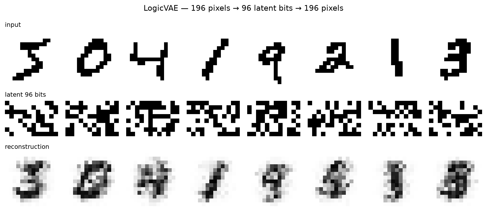
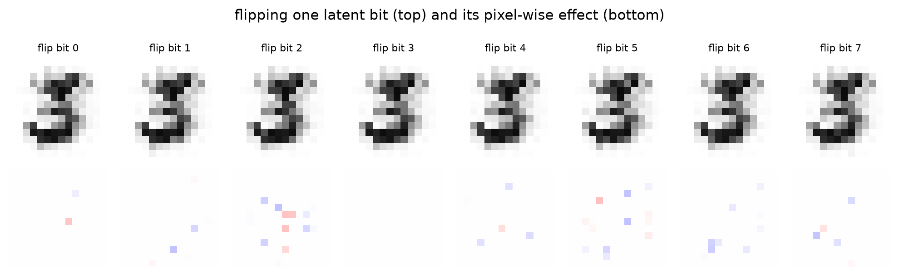
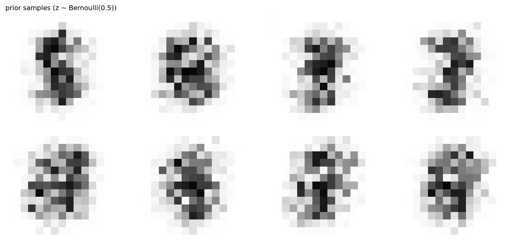
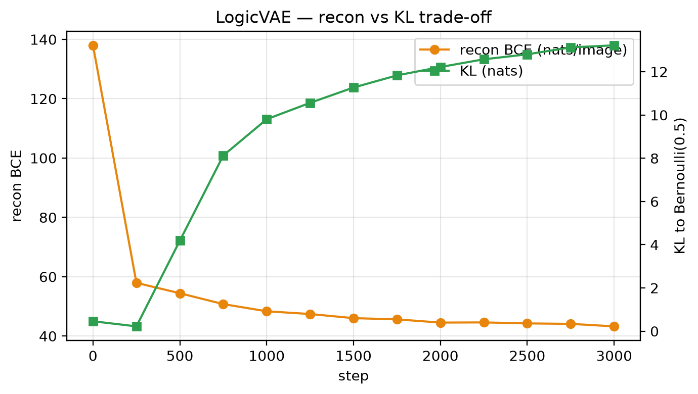
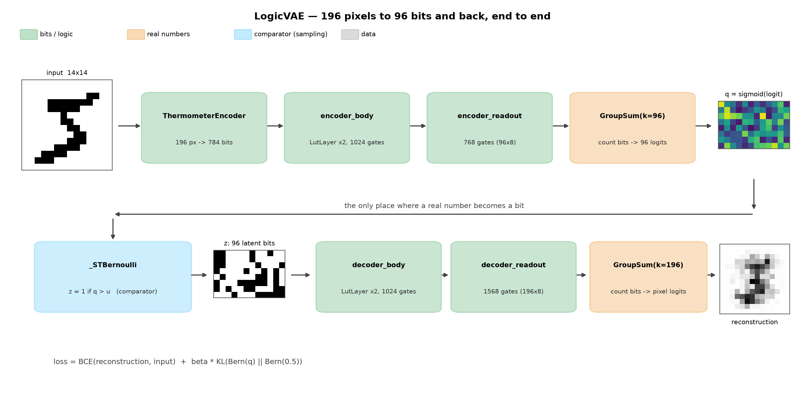
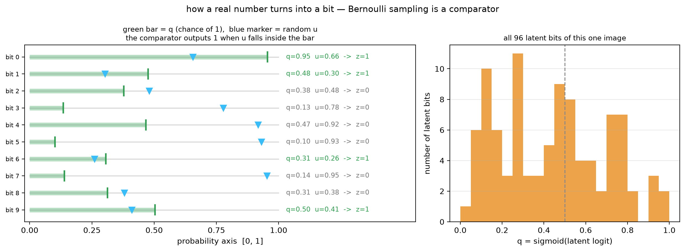
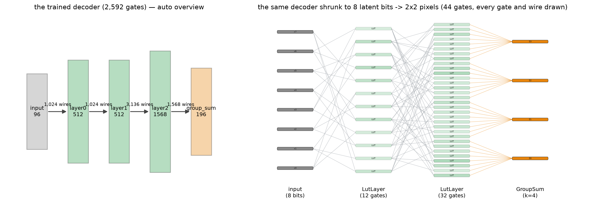

<!-- This file is generated automatically by scripts/build_tutorials.py.
     Do not edit it directly; edit examples/18_logic_vae.py and regenerate. -->

**Throw away** the VAE reparameterization trick (the multiplication and square root of a Gaussian
latent). Replace the latent with a Bernoulli bit string — which is literally a comparator — and the
whole VAE fits onto a logic circuit: a 196-pixel digit is folded into **96 bits** and reconstructed.

recon BCE 43.27 / pixel agreement 0.907. The reconstruction is clearly readable as a digit.
A difference map of **how the image changes when one latent bit is flipped** (red = turned on,
blue = turned off) lets you peek at what each of the 96 bits is responsible for.

:::tip[What you'll learn]
1. How to throw away the reparameterization of a Gaussian latent and replace the latent with a Bernoulli bit string
2. The structure of a binary-latent autoencoder that folds a 196-pixel digit into 96 bits and reconstructs it
3. How to read "what each bit is responsible for" from a difference map made by flipping one latent bit

**Prerequisites**

- [1. Train on MNIST](/en/tutorials/mnist/)
- [Answering Pixel by Pixel with a Logic Gate U-Net](/en/tutorials/logic-unet/) — the structure on the decoder side
:::

:::note[About this page]
Estimated time: **about 7 minutes** / Environment: CPU only (no GPU needed)
Source script: [`examples/18_logic_vae.py`](https://github.com/tsukushi-gate/Griffith/blob/main/examples/18_logic_vae.py)
Try it yourself: [`notebooks/18_logic_vae.ipynb`](https://github.com/tsukushi-gate/Griffith/blob/main/notebooks/18_logic_vae.ipynb) (an unexecuted notebook with the same content as this page; open it with `uv run --group docs jupyter lab notebooks/`)
Every code output is the **actual result of running the code**, embedded verbatim.
:::

<!-- Colab badge: once the repository is public, replace this span with an <a> whose href is
     data-colab-url and "Open in Colab" becomes active. -->
<span class="colab-badge" data-colab-url="https://colab.research.google.com/github/tsukushi-gate/Griffith/blob/main/notebooks/18_logic_vae.ipynb">▶ Open in Colab (enabled once the repository is public)</span>

LogicVAE — an example of building a binary-latent VAE out of logic gates alone.

The classifier in 06_mnist.py went one way: image → class. Here we step into the opposite direction,
**making an image from a circuit**. We build a VAE (variational autoencoder) purely from LutLayer
stacks, compressing an image into a **96-bit latent bit string** and then reconstructing it.

Why a "binary latent" (the subject of this example):
    An ordinary VAE's latent is a continuous Gaussian, and the reparameterization z = μ + σ·ε needs
    **multiplication and a square root**. For a logic circuit this is the worst possible partner; it
    simply does not map onto a circuit. LogicVAE avoids that wall by swapping the latent for a Bernoulli
    bit string. Bernoulli sampling is z = 1{q > u} for u ~ U(0,1) — that is,
    **a stochastic threshold comparison = a comparator**, which is a logic circuit in itself.
    Gradients reach the encoder via straight-through (forward = comparator / backward = the gradient of σ)
    (see _STBernoulli in griffith_logic/models/logic_vae.py).

## Data flow (with the real class names)

```mermaid
flowchart LR
    X["input image [0,1]<br/>14x14 = 196 pixels"] --> TH
    TH["ThermometerEncoder<br/>1 pixel → 4 bits (784 bits total)"]
    TH --> ENC["encoder_body<br/>LutLayer x2 (1,024 gates)"]
    ENC --> ERO["encoder_readout<br/>LutLayer (768 gates = 96x8)"]
    ERO --> EGS["encoder_group = GroupSum<br/>add up 8 bits into a real number"]
    EGS --> QL["q = sigmoid(logit)<br/>96 probabilities (real)"]
    U["u ~ uniform random U(0,1)"] --> ST
    QL --> ST["_STBernoulli<br/>z = 1 if q &gt; u (= a comparator)"]
    ST --> Z["latent bits z<br/>96 bits (0/1)"]
    Z --> DEC["decoder_body<br/>LutLayer x2 (1,024 gates)"]
    DEC --> DRO["decoder_readout<br/>LutLayer (1,568 gates = 196x8)"]
    DRO --> DGS["decoder_group = GroupSum"]
    DGS --> REC["pixel logits → reconstruction"]
    REC -.->|"BCEWithLogits"| L["ELBO = recon + beta·KL"]
    QL -.->|"KL has a closed form"| L

    style TH fill:#10b98126,stroke:#10b981
    style ENC fill:#10b98126,stroke:#10b981
    style ERO fill:#10b98126,stroke:#10b981
    style Z fill:#10b98126,stroke:#10b981
    style DEC fill:#10b98126,stroke:#10b981
    style DRO fill:#10b98126,stroke:#10b981
    style EGS fill:#f9731626,stroke:#f97316
    style QL fill:#f9731626,stroke:#f97316
    style DGS fill:#f9731626,stroke:#f97316
    style REC fill:#f9731626,stroke:#f97316
    style ST fill:#38bdf826,stroke:#38bdf8
```



Green is **the logic circuit, where everything stays in bits**, orange is **where real numbers
appear**, and blue is **the comparator that drops a real number back into a bit**. Real numbers only
ever appear as logits (the result of an addition), and the moment they pass the comparator they are
bits again.

## How it actually works (in four lines)

1. **The encoder**. Pixels are turned into bits by a thermometer code (brightness written as a
   monotone string of 0/1) and pushed through a stack of LutLayers. At the end GroupSum counts "how
   many gates fired" and produces 96 real-valued logits.
2. **Reading a real number as a probability**. q = σ(logit) is read directly as "the probability that
   this bit is 1". Unlike a Gaussian latent there is no pair of mean and variance — a **single
   probability** is all a bit latent carries.
3. **Turning it into a bit with a comparator**. Draw one uniform random number u and set
   z = 1 if q > u. This is both an exact sample from Bernoulli(q) and, literally, **a threshold
   comparison = a comparator**; at inference time a random source and one comparator are enough.
   Gradients flow via straight-through: the hard bit goes forward, and ∂q/∂logit = q(1−q) comes back.
4. **Decoder and loss**. The 96 bits go through a LutLayer stack and GroupSum turns them into pixel
   logits. The loss is ELBO = recon + β·KL, where recon is the pixel BCE and KL is
   KL(Bern(q) ‖ Bern(0.5)) = q·log(q/0.5) + (1−q)·log((1−q)/0.5), a **closed form** that needs
   neither integration nor sampling.

Words you may be meeting for the first time:

- **latent** — the compressed "inner representation" of an image; here, a string of 96 bits.
- **logit** — a real-valued score meaning "the larger, the more it looks like a 1"; a sigmoid turns
  it into a probability.
- **straight-through (ST)** — using the discretized value in the forward pass while sending the
  gradient of a smooth approximation backwards, so discrete sampling does not cut the gradient.
- **KL** — how far apart two probability distributions are; here, how far a latent bit has drifted
  from a fair coin (Bern(0.5)).

## Differences from an ordinary VAE

| What to look at | Ordinary VAE | LogicVAE |
|---|---|---|
| Shape of the latent | continuous Gaussian z ∈ R^d | bit string z ∈ {0,1}^96 |
| Encoder output | mean μ and variance σ², two of them | the probability q of being 1, one of them |
| Sampling | reparameterization z = μ + σ·ε (multiply and square root) | comparator z = 1 if q > u |
| How gradients pass | differentiable through the reparameterization | straight-through (comparator + the gradient of σ) |
| KL term | closed form between Gaussians | closed form for Bern(q) ‖ Bern(0.5) |
| Moving the latent | nudge the vector (continuous) | flip a bit (discrete) |
| Arithmetic required | floating-point multiplication | truth-table lookup and comparison (real numbers only in the sums) |

At the end of this page you will find an **architecture figure with real data flowing through it**,
a figure that shows **the moment a real number becomes a bit** on a number line, and a picture of the
**real circuit**.

The reduced recipe used in this example:
    The full run (experiments/train_logic_vae.py) trains 30 epochs on 28x28 binary MNIST, but here we
    use "shrink to 14x14, 8000 training images, 3000 steps" so it fits in 2-3 minutes on CPU.
    What you get is the level where "reconstructions are readable as digits"; prior generation only gets
    as far as the "seeds" of digits starting to appear (for a recipe aimed at generation quality, see the full-run script).

Run: uv run python examples/18_logic_vae.py
Expected result (measured with seed=0, about 80 seconds on CPU): recon BCE=43.3 / KL=13.2 /
          pixel agreement of the reconstruction=0.907 / active bits=1.00 (all 96 latent bits are doing work)

## Setup: imports and the random seed

All we use is PyTorch and matplotlib, plus three things from this library: `LogicVAE` (the model
itself), `load_mnist` (the data) and `plot_circuit` (drawing the circuit). No special VAE framework
is required.

Let us line up the vocabulary first.

- **autoencoder** — a model trained to squeeze an image into a small representation and then restore
  the original image from it. The "squeezing" half is called the encoder, the "restoring" half the decoder.
- **VAE (variational autoencoder)** — an autoencoder with one extra constraint: the squeezed
  representation must stay close to a distribution decided in advance (the prior). Thanks to that
  constraint, once training is done you can **make new images simply by drawing at random from the
  distribution**.
- **latent** — the squeezed representation itself. In this example it is **a string of 96 zeros and ones**.
- **prior** — the distribution the latent is expected to follow. Here it is a Bernoulli(0.5) on every
  bit, a fair coin — in other words, "96 coin flips".

```python
import matplotlib.pyplot as plt
import torch
import torch.nn as nn
import torch.nn.functional as F
from matplotlib.patches import FancyBboxPatch
from torch.utils.data import DataLoader, Subset

from griffith_logic.analysis.circuit_viz import plot_circuit
from griffith_logic.datasets import load_mnist
from griffith_logic.models import LogicVAE, LogicVAEConfig
```

```python
# The LUTs' initial truth values, the random wiring, and the Bernoulli noise all depend on randomness, so fix the seed.
torch.manual_seed(0)
```

## Hyperparameters and data

A reduced recipe that fits in 2-3 minutes on CPU. The larger `IMG` / `LATENT` / `STEPS` are, the
cleaner the reconstructions become — and the longer this page takes to build.

The one that matters most is **`LATENT = 96`**, which is **the width of the circuit's information
channel**. The picture drawn by 196 pixels must always pass through these 96 wires before it is
restored. `KL_WEIGHT` is the **β** (the weight of the penalty that pulls the latent towards the
prior) that appears later in the "Training" section.

### The settings of the reduced recipe

```python
# A reduced recipe that fits in 2-3 minutes on CPU. Raising IMG/LATENT/STEPS makes reconstructions cleaner.
IMG = 14          # image size (28x28 shrunk by 2x2 average pooling)
LATENT = 96       # number of binary latent bits (= the width of this circuit's "information channel")
HIDDEN = 512      # LutLayer width of the encoder/decoder
DEPTH = 2         # number of layers in the LutLayer stack
STEPS = 3000      # number of training iterations
BATCH = 128
N_TRAIN = 8000    # number of images used for training
KL_WEIGHT = 0.1   # the β of β-VAE. Larger pulls the latent towards the prior (= discards information)
```

### Data: 14x14 binary MNIST

We use the handwritten digits as **binary images**. The VAE reconstruction loss is a per-pixel BCE
(explained below), so the target pixels must be strictly 0 or 1.

Keeping 28x28 would mean squeezing 784 pixels into 96 bits, and the shapes collapse within 3000
steps. We shrink to **14x14 = 196 pixels** with 2x2 average pooling, binarize at threshold 0.3, and
end up with the straightforward compression problem "**196 pixels → 96 bits → 196 pixels**".

```python
# Binary MNIST. The VAE reconstruction loss is BCE, so target pixels must be strictly {0,1}.
# Keeping 28x28 makes compressing 784 pixels into a 96-bit latent too harsh, and the shapes
# collapse within 3000 steps. We drop it to 14x14 (196 pixels) with 2x2 average pooling,
# then binarize at threshold 0.3, giving a straightforward "196 pixels → 96 bits → 196 pixels" compression.
train_set, _test_set = load_mnist(binarize_threshold=None)
raw, _labels = next(iter(DataLoader(Subset(train_set, range(N_TRAIN)),
                                    batch_size=N_TRAIN)))
data = (F.avg_pool2d(raw, 2) > 0.3).float()   # (N, 1, 14, 14) {0,1}
print(f'data={tuple(data.shape)} 前景画素率={data.mean():.3f} '
      f'({IMG}x{IMG}={IMG * IMG}画素 → {LATENT}ビット潜在)')
```

```text title="Output"
data=(8000, 1, 14, 14) 前景画素率=0.169 (14x14=196画素 → 96ビット潜在)
```

## The model: encoder, comparator sampler, decoder

This page uses exactly three symbols — **q / u / z**. **Let us define all of them here, once.**

- **q** — what the encoder emits: **the probability that each latent bit is 1** (a real number
  between 0 and 1). The latent has 96 bits, so there are 96 values of q as well. It is a number you
  read as "for this image, bit number 3 is 1 with probability 0.8".
- **u** — the **uniform random number** drawn for the sampling (a number picked with equal
  probability from between 0 and 1). One is drawn **for each bit**, so there are 96 of them too.
- **z** — the **latent bit string** actually sampled (96 zeros and ones). Making it takes a single
  line: `z = 1 if u < q else 0`. The larger q is, the more likely that bit becomes 1.

This **single comparison** `u < q` is by itself **a sample from Bernoulli(q)** (**Bernoulli** = a coin
whose chance of heads is q). In other words, **a circuit that carries a probability q is physically
nothing more than "one random source and one comparator"** — no multiplication and no exponentials
are needed. The number line in Figure 5 below is exactly a picture of this comparison.

**Why Bernoulli (a binary latent) instead of a Gaussian latent?** An ordinary VAE's latent is a
real-valued vector, and its sampling uses **reparameterization** (the standard trick of feeding
randomness in from outside to keep things differentiable), `z = μ + σ·ε` — a formula containing
**a multiplication and a square root**. The moment you choose a real-valued latent, **floating-point
numbers take up residence in the middle of the circuit**, and it can no longer be burned into
hardware as it stands. Replace the latent with a bit string and **everything from the encoder's exit
to the decoder's entrance becomes exactly 96 wires**, closing the circuit cleanly.

**straight-through** — an approximation that rounds to 0/1 in the forward pass (inference) but, in
the backward pass (gradients) alone, pretends the rounding never happened. Discretization would
otherwise make the gradient exactly zero and stop learning; this trick delivers the gradient to
"the far side of the comparator". It is the standard way of handling discrete sampling differentiably.

Let us also look at the names of the parts.

- **ThermometerEncoder** — an encoding that converts brightness into a string of 0/1 like a
  thermometer bar. It turns 1 pixel into 4 bits, so 196 pixels become 784 bits.
- **GroupSum** — the exit of the logic gates. It splits the output bits into k groups and
  **counts how many ones are in each group**, turning them into real numbers. This is the border
  between "the world of bits" and "the world of real numbers".

```python
# Encoder:  pixels → thermometer encoding → LutLayer stack → GroupSum, producing
#           real-valued logits for the latent bits.
# Sampler:  straight-through Bernoulli (= a comparator). This is the only stochastic part.
# Decoder:  latent bits {0,1} → LutLayer stack → GroupSum, producing pixel logits.
# At eval time every LutLayer acts as a pure Boolean circuit with a fixed truth table,
# and intermediate representations stay strictly in {0,1} (reals appear only in the final sum = the peripheral-FP policy).
model = LogicVAE(LogicVAEConfig(
    image_size=IMG,
    in_channels=1,
    encode_bits=4,       # thermometer bits per pixel
    latent_bits=LATENT,
    hidden=HIDDEN,
    depth=DEPTH,
    n_inputs=2,          # number of input lines one LUT sees
    kl_weight=KL_WEIGHT,
))
n_params = sum(p.numel() for p in model.parameters())
print(f'LogicVAE: hidden={HIDDEN} depth={DEPTH} latent_bits={LATENT} '
      f'params={n_params:,}')
```

```text title="Output"
LogicVAE: hidden=512 depth=2 latent_bits=96 params=70,436
```

### The evaluation function: measuring it as a pure Boolean circuit

Quality is always measured along the **hard eval** path. **hard eval** means fixing every LUT to a
single truth table by argmax and using none of the continuous relaxation used for training — that
is, running it as the same pure Boolean circuit you would burn onto an FPGA.

There are two numbers to watch. **pix_acc** is the pixel agreement when the reconstruction is
thresholded at 0.5. **active** is the fraction of the 96 latent bits that are "not stuck at always-0
or always-1"; it is the watchdog for **posterior collapse** (the phenomenon where the latent stops
being used and the decoder ignores its input, emitting only average-looking pictures). The closer to
1.0, the healthier.

```python
@torch.no_grad()
def evaluate(n: int = 512) -> dict:
    """Measure reconstruction quality along the eval (pure Boolean circuit) path.

    - pix_acc: pixel agreement after thresholding the reconstruction at 0.5
    - active : the fraction of latent bits that are "not stuck at always-0/always-1".
               The closer to 1.0, the less posterior collapse (the latent is being used).
    """
    model.eval()
    x = data[:n]
    out = model(x)
    recon_bits = (torch.sigmoid(out['recon_logits']) > 0.5).float()
    pix_acc = (recon_bits == x).float().mean().item()
    rate = out['z'].mean(dim=0)                      # firing rate of each bit
    active = ((rate > 0.01) & (rate < 0.99)).float().mean().item()
    model.train()
    return {'pix_acc': pix_acc, 'active': active}
```

## Training: ELBO = recon + β·KL

The loss is the **ELBO** (evidence lower bound, the standard objective minimized in a VAE), and its
body is nothing but the sum of two terms, **`recon + β·KL`**.

- **recon (the reconstruction term)** — the penalty for how well the original image was restored.
  It is measured as the sum over pixels of the **BCE** (binary cross entropy = a loss measuring the
  mismatch of two binary values). The implementation uses **BCEWithLogits**, the numerically stable
  version with the sigmoid folded inside.
- **KL (the KL divergence)** — how far apart two probability distributions are. Here it is the
  penalty for how far the latent distribution Bern(q) emitted by the encoder has moved away from the
  prior Bern(0.5) — put plainly, **"the cost of packing information into the latent"**. The further a
  bit strays from a fair coin, the more it costs.
- **β** — the weight applied to that KL (`KL_WEIGHT = 0.1` in this code). Making it larger pulls the
  latent towards the prior, discarding information and leaning towards generation. Making it smaller
  improves reconstruction, but the latent drifts away from the prior and generating from coin flips
  stops working.

The KL between two Bernoullis can be written as the **closed form**
`q·log(q/0.5) + (1−q)·log((1−q)/0.5)`, so neither integration nor sampling is needed. Just as with a
Gaussian VAE, the KL term takes one line.

```python
# The loss is ELBO = recon (the pixel sum of BCEWithLogits) + β · KL(Bern(q) ‖ Bern(0.5)).
# The body is ordinary PyTorch. Nowhere do you have to be aware that this is a logic-gate network.
opt = torch.optim.Adam(model.parameters(), lr=0.01)
history = []  # (step, recon, kl, pix_acc)

for step in range(STEPS + 1):
    if step % 250 == 0:
        m = evaluate()
        with torch.no_grad():
            probe = model(data[:256])
            parts = model.elbo_loss(data[:256], probe)
        history.append((step, parts['recon'].item(), parts['kl'].item(),
                        m['pix_acc']))
        if step % 500 == 0:
            print(f'step {step:>5}  recon={parts["recon"].item():7.2f}  '
                  f'kl={parts["kl"].item():6.2f}  '
                  f'pix acc={m["pix_acc"]:.4f}  active bits={m["active"]:.2f}')

    idx = torch.randint(0, N_TRAIN, (BATCH,))
    x = data[idx]
    out = model(x)
    loss = model.elbo_loss(x, out)['loss']
    opt.zero_grad()
    loss.backward()
    opt.step()

final = evaluate()
steps, recon_hist, kl_hist, acc_hist = zip(*history, strict=True)
print(f'\n最終 recon BCE={recon_hist[-1]:.2f} / KL={kl_hist[-1]:.2f} / '
      f'画素一致率={final["pix_acc"]:.4f} / active bits={final["active"]:.2f}')
```

```text title="Output"
step     0  recon= 137.98  kl=  0.46  pix acc=0.6313  active bits=0.75

step   500  recon=  54.43  kl=  4.19  pix acc=0.8593  active bits=1.00

step  1000  recon=  48.35  kl=  9.81  pix acc=0.8891  active bits=1.00

step  1500  recon=  46.04  kl= 11.27  pix acc=0.8992  active bits=1.00

step  2000  recon=  44.54  kl= 12.22  pix acc=0.9037  active bits=1.00

step  2500  recon=  44.27  kl= 12.81  pix acc=0.9054  active bits=1.00

step  3000  recon=  43.27  kl= 13.22  pix acc=0.9071  active bits=1.00

最終 recon BCE=43.27 / KL=13.22 / 画素一致率=0.9073 / active bits=1.00
```

The thing to watch in the log above is that **recon falls while KL rises**. The rising KL is the sign
that "the latent bits have been pushed away from a fair coin to pack information in", and the
reconstruction improves as the payoff. That tug-of-war between the two terms is training itself.

As long as `active bits` stays at 1.00, no posterior collapse has occurred and all 96 bits are doing
work.

```python
# Even the trivial solution of emitting all-zero pixels earns agreement equal to the background ratio.
# The minimum conditions are that we clearly exceed that level and that the latent has not collapsed.
assert final['pix_acc'] > 0.85, f'再構成が弱すぎる: {final["pix_acc"]:.4f}'
assert final['active'] > 0.5, f'潜在が collapse している: {final["active"]:.2f}'
```

## Visualization: reconstruction, bit flips, generation

### Figure 1: original / 96-bit latent / reconstruction

For eight digits we line up the **original image** on the top row, the **latent bit string z** in the
middle (the 96 bits folded into 8x12 to form a band), and the **reconstruction** at the bottom.

The middle row is what to look at. The monochrome dots there are **all the information the circuit
carries around**, and the pictures at the bottom are made from those 96 zeros and ones alone.

```python
model.eval()
with torch.no_grad():
    x_ref = data[:8]
    out = model(x_ref)
    recon = torch.sigmoid(out['recon_logits'])
    z_ref = out['z']

fig, axes = plt.subplots(3, 8, figsize=(10, 4.4))
for i in range(8):
    axes[0, i].imshow(x_ref[i, 0], cmap='gray_r', vmin=0, vmax=1)
    # Fold the 96 latent bits into 8x12 and show them as a "band of bits".
    axes[1, i].imshow(z_ref[i].reshape(8, 12), cmap='gray_r', vmin=0, vmax=1)
    axes[2, i].imshow(recon[i, 0], cmap='gray_r', vmin=0, vmax=1)
for ax in axes.ravel():
    ax.set_axis_off()
axes[0, 0].set_title('input', loc='left', fontsize=9)
axes[1, 0].set_title(f'latent {LATENT} bits', loc='left', fontsize=9)
axes[2, 0].set_title('reconstruction', loc='left', fontsize=9)
fig.suptitle('LogicVAE — 196 pixels → 96 latent bits → 196 pixels', fontsize=11)
fig.tight_layout()
plt.show()
```

    

    

The reconstructions on the bottom row are readable as digits, but the strokes are thicker than the
originals and the fine flicks are rounded off. We are dropping 196 pixels down to 96 bits, so
**the discarded information disappears as "detail"**. Comparing the bands in the middle, even two
copies of the same digit have different patterns — the latent encodes "this one picture", not "the
class".

### Figure 2: flipping the latent bits one at a time

We pick one latent from the trained model and **flip each of the first 8 bits in turn**, decoding
again each time. The top row is the image after the flip, the bottom row its difference from the
original (red = pixels newly turned on / blue = pixels turned off).

**Why can't we "nudge the latent a little"?** With a continuous-latent VAE you can shift the latent
vector slightly to make an in-between picture, but with a binary latent **the only operation allowed
is a bit flip**. This one-bit flip is what corresponds to interpolation in a continuous latent, and
it makes **the controls of generation completely discrete**. Flipping one bit is, in the end,
**swapping the 0/1 of one input wire into the circuit**.

```python
with torch.no_grad():
    base_z = z_ref[:1]                                   # the latent for one image
    base_img = torch.sigmoid(model.decode(base_z))[0, 0]
    flip_bits = [0, 1, 2, 3, 4, 5, 6, 7]                 # flip the first 8 bits
    flipped = []
    for b in flip_bits:
        z = base_z.clone()
        z[0, b] = 1.0 - z[0, b]
        flipped.append(torch.sigmoid(model.decode(z))[0, 0])

fig, axes = plt.subplots(2, 8, figsize=(10, 3.2))
for i, (b, img) in enumerate(zip(flip_bits, flipped, strict=True)):
    axes[0, i].imshow(img, cmap='gray_r', vmin=0, vmax=1)
    axes[0, i].set_title(f'flip bit {b}', fontsize=8)
    # Difference: +1 (newly lit) in red, -1 (turned off) in blue
    axes[1, i].imshow(img - base_img, cmap='bwr', vmin=-1, vmax=1)
for ax in axes.ravel():
    ax.set_axis_off()
fig.suptitle('flipping one latent bit (top) and its pixel-wise effect (bottom)',
             fontsize=11)
fig.tight_layout()
plt.show()
```

    

    

Looking at the differences on the bottom row, **each bit is clearly in charge of a different place**.
One bit repaints the upper half of the digit, another the sweep at the lower left. Every single one
takes charge of some feature of the image, so the 96 bits are not merely a compression result but
**a representation whose parts carry meaning**. It is also characteristic of a binary latent that
moving one bit can make the picture jump a long way; the gradual change of a continuous latent is
impossible here in principle.

### Figure 3: generation from the prior, and the learning curves

The first figure is **generation from the prior Bernoulli(0.5)**: the latent z is made by **96 coin
flips** and simply pushed through the decoder — new pictures unlike any of the training images.
The second is the learning curve, with recon (orange) on the left axis and KL (green) on the right.

```python
with torch.no_grad():
    gen = model.generate(8, generator=torch.Generator().manual_seed(5))

fig, axes = plt.subplots(2, 4, figsize=(10, 4.6))
for ax, img in zip(axes.ravel()[:4], gen[:4], strict=False):
    ax.imshow(img[0], cmap='gray_r', vmin=0, vmax=1)
    ax.set_axis_off()
axes[0, 0].set_title('prior samples (z ~ Bernoulli(0.5))', loc='left', fontsize=9)
for ax, img in zip(axes.ravel()[4:], gen[4:], strict=False):
    ax.imshow(img[0], cmap='gray_r', vmin=0, vmax=1)
    ax.set_axis_off()
fig.tight_layout()
plt.show()

fig, ax = plt.subplots(figsize=(7, 4))
ax.plot(steps, recon_hist, 'o-', color='#e8850c', label='recon BCE (nats/image)')
ax.set_xlabel('step')
ax.set_ylabel('recon BCE')
ax.grid(alpha=0.3)
ax2 = ax.twinx()
ax2.plot(steps, kl_hist, 's-', color='#2e9e4f', label='KL (nats)')
ax2.set_ylabel('KL to Bernoulli(0.5)')
lines = ax.get_lines() + ax2.get_lines()
ax.legend(lines, [ln.get_label() for ln in lines], loc='upper right')
ax.set_title('LogicVAE — recon vs KL trade-off')
fig.tight_layout()
plt.show()
```

    

    

    

    

As for the generation, the 3000-step reduced recipe only gets as far as **"the seed of a digit"
starting to show**; it does not become a clear digit. That is because the latent has not yet been
pulled close enough to the prior — for a recipe aimed at generation quality, see the full-run script
(`experiments/train_logic_vae.py`).

The learning curve, on the other hand, is unambiguous. **KL rises while recon falls** — we pay the
penalty of pushing the latent bits away from a fair coin and buy reconstruction quality with it. This
is exactly the tug-of-war that the β knob adjusts.

## The architecture illustrated, and the real circuit

### The parts of the figures (helper functions)

From here on we prepare to draw the architecture figure. We define three functions — one for the
rounded boxes, one for the arrows and one for the small pictures of real data embedded in the figure
(they only concern how the figure looks, so feel free to skip them).

```python
def draw_block(ax, x, y, w, h, name, sub, color):
    """A piece of the architecture figure: a rounded box carrying the class name and its size (gate count)."""
    ax.add_patch(FancyBboxPatch(
        (x - w / 2, y - h / 2), w, h,
        boxstyle='round,pad=0.004,rounding_size=0.012',
        facecolor=color, alpha=0.25, edgecolor=color, lw=1.4, zorder=2))
    ax.text(x, y + h * 0.17, name, ha='center', va='center', fontsize=8.4,
            fontweight='bold', zorder=3)
    ax.text(x, y - h * 0.22, sub, ha='center', va='center', fontsize=7.4,
            color='#333333', zorder=3)
```

```python
def draw_arrow(ax, x0, y0, x1, y1, text='', rad=0.0):
    """An arrow between blocks (with an optional label above it)."""
    ax.annotate('', xy=(x1, y1), xytext=(x0, y0), arrowprops=dict(
        arrowstyle='-|>', color='#444444', lw=1.3,
        connectionstyle=f'arc3,rad={rad}'))
    if text:
        ax.text((x0 + x1) / 2, (y0 + y1) / 2 + 0.015, text, ha='center',
                va='bottom', fontsize=7.5, color='#444444')
```

```python
def put_image(fig, img, rect, caption, cmap='gray_r', vmin=0.0, vmax=1.0):
    """Paste a small picture of the real data into the architecture figure."""
    ax = fig.add_axes(rect)
    ax.imshow(img, cmap=cmap, vmin=vmin, vmax=vmax)
    ax.set_xticks([])
    ax.set_yticks([])
    for spine in ax.spines.values():
        spine.set_edgecolor('#555555')
    ax.set_title(caption, fontsize=7.8)
    return ax
```

### Figure 4: one real image passing through, end to end

We draw **one actual image passing through the model** exactly as it happens. The top row is the
encoder (image → bits → gate network → 96 probabilities q); the bottom row is the sampler and the
decoder (q → comparator → latent bits z → gate network → restored image).

The small pictures inside the figure are not explanatory illustrations but **the real values computed
by this code**. The numbers inside the boxes are the real gate counts (= the output neurons of each
LutLayer).

The palette is the project-wide one: **green = logic gates (staying in bits) / orange = where real
numbers appear / blue = the comparator (dropping a real number into a bit) / grey = data**. It lets
you follow by colour how far the section that can be burned as a circuit extends.

```python
# Top row = the encoder (image -> bits -> gate network -> 96 probabilities);
# bottom row = the sampler and decoder (probabilities -> comparator -> 96 bits -> gate network -> image).
# The numbers inside the boxes are the real gate counts (= the output neurons of each LutLayer).
# Project-wide palette: green = logic gates / orange = the real-valued part / blue = comparator / grey = data.
C_LOGIC, C_REAL, C_SAMPLE, C_DATA = '#2e9e4f', '#e8850c', '#38bdf8', '#8a8a8a'
model.eval()
with torch.no_grad():
    x_arch = data[:1]
    lat_logits = model.encode(x_arch)
    q_arch = torch.sigmoid(lat_logits)[0]
    u_arch = torch.rand(LATENT, generator=torch.Generator().manual_seed(9))
    z_arch = (q_arch > u_arch).float()
    recon_arch = torch.sigmoid(model.decode(z_arch[None, :]))[0, 0]
enc_gates = sum(int(m.out_dim) for m in model.encoder_body)
dec_gates = sum(int(m.out_dim) for m in model.decoder_body)
print(f'ゲート数: encoder_body={enc_gates} / encoder_readout='
      f'{int(model.encoder_readout.out_dim)} / decoder_body={dec_gates} / '
      f'decoder_readout={int(model.decoder_readout.out_dim)}')

fig = plt.figure(figsize=(13.5, 6.6))
bg = fig.add_axes([0, 0, 1, 1])
bg.set_xlim(0, 1)
bg.set_ylim(0, 1)
bg.set_axis_off()
bg.text(0.5, 0.965, 'LogicVAE — 196 pixels to 96 bits and back, end to end',
        ha='center', fontsize=12, fontweight='bold')
for i, (label, color) in enumerate((('bits / logic', C_LOGIC),
                                    ('real numbers', C_REAL),
                                    ('comparator (sampling)', C_SAMPLE),
                                    ('data', C_DATA))):
    bg.add_patch(FancyBboxPatch((0.02 + 0.135 * i, 0.915), 0.018, 0.022,
                                boxstyle='round,pad=0.002',
                                facecolor=color, alpha=0.3, edgecolor=color))
    bg.text(0.043 + 0.135 * i, 0.926, label, va='center', fontsize=8)

put_image(fig, x_arch[0, 0], [0.020, 0.575, 0.114, 0.235], 'input  14x14')
draw_arrow(bg, 0.140, 0.69, 0.172, 0.69)
draw_block(bg, 0.250, 0.685, 0.150, 0.175, 'ThermometerEncoder',
           '196 px -> 784 bits', C_LOGIC)
draw_arrow(bg, 0.328, 0.69, 0.352, 0.69)
draw_block(bg, 0.430, 0.685, 0.150, 0.175, 'encoder_body',
           f'LutLayer x{DEPTH}, {enc_gates} gates', C_LOGIC)
draw_arrow(bg, 0.508, 0.69, 0.532, 0.69)
draw_block(bg, 0.610, 0.685, 0.150, 0.175, 'encoder_readout',
           f'{int(model.encoder_readout.out_dim)} gates (96x8)', C_LOGIC)
draw_arrow(bg, 0.688, 0.69, 0.712, 0.69)
draw_block(bg, 0.790, 0.685, 0.150, 0.175, 'GroupSum(k=96)',
           'count bits -> 96 logits', C_REAL)
draw_arrow(bg, 0.868, 0.69, 0.892, 0.69)
put_image(fig, q_arch.reshape(8, 12), [0.898, 0.575, 0.090, 0.235],
          'q = sigmoid(logit)', cmap='viridis')

draw_arrow(bg, 0.943, 0.556, 0.943, 0.470)
draw_arrow(bg, 0.943, 0.462, 0.135, 0.462)
draw_arrow(bg, 0.135, 0.454, 0.135, 0.392)
bg.text(0.540, 0.478, 'the only place where a real number becomes a bit',
        ha='center', fontsize=8.5, color='#444444')
draw_block(bg, 0.135, 0.300, 0.190, 0.175, '_STBernoulli',
           'z = 1 if q > u   (comparator)', C_SAMPLE)
draw_arrow(bg, 0.232, 0.305, 0.256, 0.305)
put_image(fig, z_arch.reshape(8, 12), [0.262, 0.190, 0.090, 0.235],
          'z: 96 latent bits')
draw_arrow(bg, 0.358, 0.305, 0.386, 0.305)
draw_block(bg, 0.470, 0.300, 0.150, 0.175, 'decoder_body',
           f'LutLayer x{DEPTH}, {dec_gates} gates', C_LOGIC)
draw_arrow(bg, 0.548, 0.305, 0.560, 0.305)
draw_block(bg, 0.640, 0.300, 0.150, 0.175, 'decoder_readout',
           f'{int(model.decoder_readout.out_dim)} gates (196x8)', C_LOGIC)
draw_arrow(bg, 0.718, 0.305, 0.734, 0.305)
draw_block(bg, 0.810, 0.300, 0.140, 0.175, 'GroupSum(k=196)',
           'count bits -> pixel logits', C_REAL)
draw_arrow(bg, 0.883, 0.305, 0.897, 0.305)
put_image(fig, recon_arch, [0.900, 0.202, 0.088, 0.185], '')
bg.text(0.944, 0.178, 'reconstruction', ha='center', fontsize=7.8)
bg.text(0.06, 0.075, 'loss = BCE(reconstruction, input)  +  beta * '
        'KL(Bern(q) || Bern(0.5))', fontsize=9, color='#444444')
plt.show()
```

```text title="Output"
ゲート数: encoder_body=1024 / encoder_readout=768 / decoder_body=1024 / decoder_readout=1568
```

    

    

The point of this figure is that there are **only two orange boxes**. Only where GroupSum counts "how
many gates fired" is a real number involved; everything else flows on as bits. **Real numbers appear
only as logits (the result of an addition), and the instant they pass the blue comparator they are
bits again** (= the peripheral-FP policy: a design policy that banishes real numbers to the periphery
of the circuit and keeps the centre closed in bits).

Compare the picture of `q` at the exit of the top row with the picture of `z` on the bottom row: the
smooth shading of q turns, immediately after the comparator, into 96 black-and-white dots. This is
**the one place in this circuit where a real number becomes a bit**.

### Figure 5: the moment a continuous value becomes a bit

We zoom in on the blue box of the previous figure — **the inside of the comparator** — on a number line.

On the left are the first 10 latent bits. The length of the green bar is **q** (the probability that
the bit is 1) and the blue triangle is the position of the **uniform random number u** that was
drawn; if u falls inside the bar then **z = 1**, otherwise **z = 0**.
**Why can one comparator produce a probability?** Because this single comparison `u < q` is itself
sampling from Bernoulli(q) (a random source + a comparator = a stochastic bit source).

On the right is a histogram of q over all 96 bits for the same single image. The closer a bit is to
either end, 0 or 1, the more it is "decided regardless of the random number"; the closer to the
middle, the more it fluctuates.

```python
# Left: for the first 10 latent bits, put the probability q (green bar) and the random u that was drawn (vertical line) on a number line.
# Right: the distribution of q over all 96 bits. The closer to either end, 0 or 1, the more "made up its mind" that bit is.
fig, axes = plt.subplots(1, 2, figsize=(12.5, 4.6),
                         gridspec_kw={'width_ratios': [1.7, 1.0]})
n_line = 10
for b in range(n_line):
    y = n_line - 1 - b
    q_b, u_b = float(q_arch[b]), float(u_arch[b])
    axes[0].plot([0, 1], [y, y], color='#cccccc', lw=1.0, zorder=1)
    axes[0].plot([0, q_b], [y, y], color=C_LOGIC, lw=6, alpha=0.35, zorder=2,
                 solid_capstyle='butt')
    axes[0].plot([q_b, q_b], [y - 0.28, y + 0.28], color=C_LOGIC, lw=2,
                 zorder=3)
    axes[0].plot([u_b], [y], marker='v', color=C_SAMPLE, ms=8, zorder=4)
    bit = int(q_b > u_b)
    axes[0].text(1.03, y, f'q={q_b:.2f}  u={u_b:.2f}  ->  z={bit}',
                 va='center', fontsize=8.5,
                 color=C_LOGIC if bit else '#777777')
axes[0].set_yticks(range(n_line))
axes[0].set_yticklabels([f'bit {n_line - 1 - i}' for i in range(n_line)],
                        fontsize=8)
axes[0].set_xlim(-0.02, 1.55)
axes[0].set_ylim(-0.7, n_line - 0.3)
axes[0].set_xticks([0, 0.25, 0.5, 0.75, 1.0])
axes[0].set_xlabel('probability axis  [0, 1]')
axes[0].set_title('green bar = q (chance of 1),  blue marker = random u\n'
                  'the comparator outputs 1 when u falls inside the bar',
                  fontsize=9.5)
axes[1].hist(q_arch.numpy(), bins=20, range=(0, 1), color=C_REAL, alpha=0.75)
axes[1].axvline(0.5, color='#888888', ls='--', lw=1.2)
axes[1].set_xlabel('q = sigmoid(latent logit)')
axes[1].set_ylabel('number of latent bits')
axes[1].set_title(f'all {LATENT} latent bits of this one image', fontsize=9.5)
axes[1].grid(alpha=0.3, axis='y')
fig.suptitle('how a real number turns into a bit — Bernoulli sampling is a '
             'comparator', fontsize=11)
fig.tight_layout()
plt.show()
```

    

    

On the right-hand side of the number line, the bits whose q has swung all the way to 0 or 1 give the
same answer wherever the random u lands. The further training proceeds the more such "decided bits"
there are, but the KL term pushes back against them, so **not every bit swings to an extreme** — and
that balance is what β decides.

### Figure 6: the real circuit of the trained decoder

Finally we draw **the inside itself** of what we have been calling "the decoder".

On the left is the trained decoder. It has 2,592 gates, so `plot_circuit` automatically switches to
the overview (layers = boxes, arrows = wire counts). On the right is a **shrunken version** built
from the same classes and the same wiring rule (8 latent bits → 2x2 pixels, 44 gates), where one node
= one LUT and every line is an actual wire.

Let us say in advance what to read from it. In the right-hand figure, **the 8 inputs lined up on the
left edge are the latent bits z**, and the bundle of wires heading right from them is exactly what
"the decoder = a logic circuit" looks like. This single picture shows that a VAE decoder exists as
**a mesh of gates and wires** rather than a chain of matrix products. The shrunken version is
untrained, so its nodes are still shown as `LUT` (a mixture of the 16 logic functions); as training
proceeds each one of them resolves into a concrete logic function such as AND or XOR.
The wire counts written on the arrows of the left-hand overview show, in numbers, the very subject of
this example: **from the encoder's exit to here it stays closed at 96 wires**.

```python
decoder_circuit = nn.Sequential(*model.decoder_body, model.decoder_readout,
                                model.decoder_group)
mini = LogicVAE(LogicVAEConfig(
    image_size=2, in_channels=1, encode_bits=2, latent_bits=8,
    hidden=12, depth=1, n_inputs=2,
))
mini_decoder = nn.Sequential(*mini.decoder_body, mini.decoder_readout,
                             mini.decoder_group)
fig, axes = plt.subplots(1, 2, figsize=(14, 5.0),
                         gridspec_kw={'width_ratios': [1.0, 1.5]})
plot_circuit(decoder_circuit, ax=axes[0],
             title='the trained decoder (2,592 gates) — auto overview')
plot_circuit(mini_decoder, resolve=False, ax=axes[1],
             title='the same decoder shrunk to 8 latent bits -> 2x2 pixels '
                   '(44 gates, every gate and wire drawn)')
fig.tight_layout()
plt.show()
```

    


## What to read next

- [Stabilizing LogicGAN](/en/tutorials/logic-gan/) — making images from a random bit string
- [Turning a diffusion model into a Boolean circuit](/en/tutorials/logic-diffusion/)
- [A logic-gate U-Net](/en/tutorials/logic-unet/) — digging into the decoder-side structure

<!-- i18n:source=tutorials/logic-vae.md hash=e28995343495 -->
