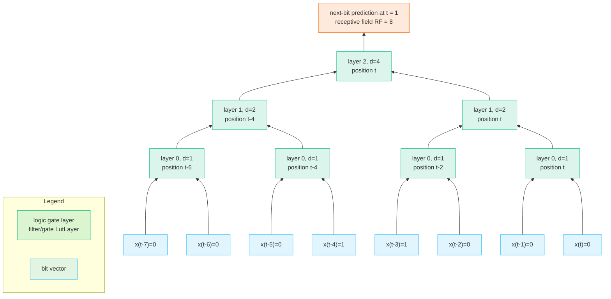
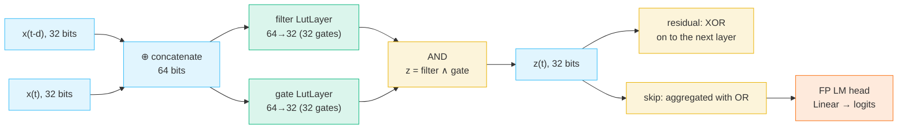
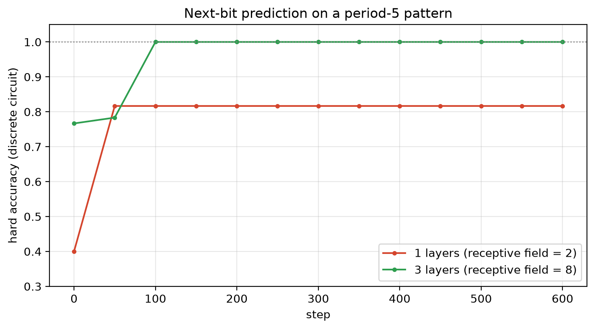
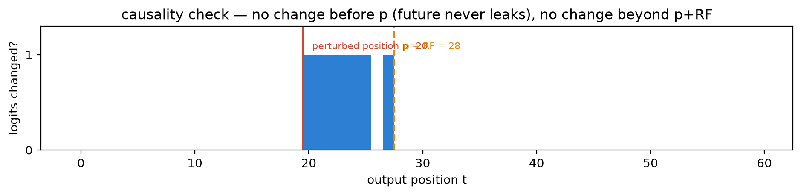
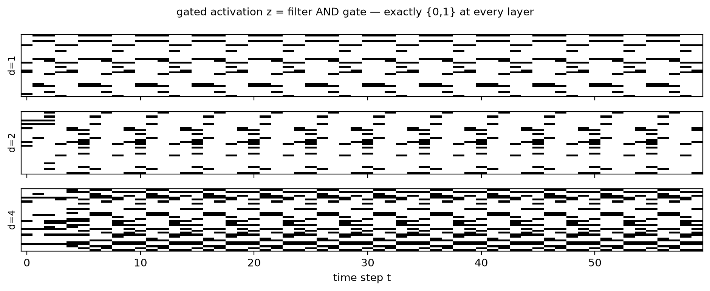

<!-- This file is auto-generated by scripts/build_tutorials.py.
     Do not edit it directly; edit examples/10_logic_wavenet.py and regenerate. -->

WaveNet's gated activation $z = \tanh(\cdot) \odot \sigma(\cdot)$ is,
over $\{0,1\}$, **isomorphic to a bitwise AND**. Using this fact we build causal convolution
out of logic gates and ablate **how the receptive field matters** in next-token prediction of a periodic bit pattern.

With 1 layer (receptive field RF=2) the answer is not determined by the single previous bit and it plateaus at 0.817; with 3 layers (RF=8) it reaches 1.000.
We further flip the input at position $p$ and measure that "the outputs that change are exactly those in $[p, p+RF)$",
confirming that causality is preserved at the circuit level.

:::tip[What you'll learn]
1. That the gated activation $\tanh \odot \sigma$ is isomorphic to a bitwise AND over $\{0,1\}$
2. How to read an ablation that grows the receptive field (RF) by stacking layers (0.817 at RF=2 → 1.000 at RF=8)
3. How to flip a single input bit and measure that causality is preserved at the circuit level

**Prerequisites**

- [RNN: Logicizing LSTM / GRU](/en/tutorials/logic-lstm/) — the case of holding history with recurrence
- [5. Exporting a CNN to HDL](/en/tutorials/cnn-hdl-export/) — the basics of logic gate convolution
:::

:::note[About this page]
Estimated time: **about 5 minutes** / Environment: CPU only (no GPU required)
Source script: [`examples/10_logic_wavenet.py`](https://github.com/tsukushi-gate/Griffith/blob/main/examples/10_logic_wavenet.py)
Try it yourself: [`notebooks/10_logic_wavenet.ipynb`](https://github.com/tsukushi-gate/Griffith/blob/main/notebooks/10_logic_wavenet.ipynb) (the same content as this page as an un-executed notebook; open it with `uv run --group docs jupyter lab notebooks/`)
Every code output below is the **actual result of running the code**, embedded verbatim.
:::

<!-- Colab badge: once the repository is public, replace this span with an <a> whose
     href is the data-colab-url value to enable "Open in Colab". -->
<span class="colab-badge" data-colab-url="https://colab.research.google.com/github/tsukushi-gate/Griffith/blob/main/notebooks/10_logic_wavenet.ipynb">▶ Open in Colab (enabled once the repository is public)</span>

LogicWaveNet: an example of building "causal convolution" out of logic gates.

The recurrence (LSTM/GRU) in 09_logic_lstm.py carried state by looping along the time axis.
Another standard way to handle sequences is **dilated causal convolution** —— the WaveNet
(van den Oord et al., 2016) approach. It has no loop;
each position looks only at "itself and taps exponentially far in the past":

    layer 0 (dilation 1): x_t sees  x_{t-1}, x_t
    layer 1 (dilation 2): x_t sees  x_{t-2}, x_t
    layer 2 (dilation 4): x_t sees  x_{t-4}, x_t
        ...
    → stacking L layers gives a receptive field of 2^L (when kernel_size=2)

Each WaveNet layer uses a **gated activation** z = tanh(Wf·x) ⊙ σ(Wg·x).
The claim of LogicWaveNet follows the same line of reasoning as 09:

    **On {0,1}, z = filter ⊙ gate is isomorphic to z = AND(filter, gate).**

So neither tanh nor sigmoid is needed. Both the filter and the gate are built with LutLayer,
and the multiplication reads directly as a bitwise AND. At eval (hard) time, z is exactly {0,1}.

What we train is "next-token prediction of a periodic bit pattern". We feed a sequence that endlessly
repeats 0,0,1,1,0 with period 5, and have it predict the next bit at each position.
The single previous bit alone does not determine the answer (the bit after a given 0 is sometimes 1 and sometimes 0), so
**whether the receptive field is large enough** decides success or failure —— that is what the ablation shows.

## Architecture, illustrated 1: the receptive field (the dilation 1, 2, 4 triangle)

The figure below draws, as a plain tree, **how far back the prediction at position t looks**
in the 3-layer configuration (kernel_size=2). Every layer up doubles the reach, so three layers
give a receptive field of 2³ = 8 steps. The 0/1 values written in the figure are eight bits cut
out of the real data (the repetition of `0 0 1 1 0`); the correct next bit is 1.



Note that the tree only ever grows **to the left**. That is what "causal" means: the output at
position t never touches an input later than t (implemented with left zero-padding).
With only one layer (RF=2) the tree can grab just `x(t-1), x(t)`, and in a period-5 pattern
`(0,0)` is followed by 1 in some places and by 0 in others, so it cannot be decided ── that is
exactly what the ablation is about.

## Architecture, illustrated 2: inside one layer (gated activation = bit AND)

Inside each layer there is nothing but "concatenate → two paths, filter and gate → AND →
residual/skip". In this sample d_channels=32 and conv_depth=1, so filter and gate are one
LutLayer each, `64 bits (= 2 taps × 32 channels) → 32 gates`.



An ordinary WaveNet multiplies `tanh(...) ⊙ σ(...)`, but on {0,1} multiplication *is* bit AND.
**It does not approximate the activation function; it coincides with it.**

**How it actually works** (the points that matter on a first read)

- **No recurrence**. There is no loop along time, so every position can be computed at once
  (the contrast with the LSTM in 09).
- **dilated = skip-reading**. Layer l looks only `d = 2^l` steps back. Instead of seeing every
  consecutive past step it skips exponentially, so few layers reach far.
- **Weights are shared across positions**. One LutLayer is reused at every time step (just like
  a 1-D convolution). As a circuit, one set of gates lined up along time is all you need.
- **residual is XOR, skip is OR**. Even the part that corresponds to addition in a real-valued
  NN is replaced here by a Boolean operation that does not destroy information.
- **Only the ends are real-valued**: the embedding and the final LM head stay FP (the same
  policy as LogicGPT). Every convolution in between is a LUT.

Run: uv run python examples/10_logic_wavenet.py
Expected result: hard accuracy 1.00 with RF=8 (3 layers) / RF=2 (1 layer) plateaus at 0.8 (about 20 seconds on CPU)

## Setup: imports and hyperparameters

All we need is `LogicWaveNet` and `LogicWaveNetConfig`, which fixes its configuration.
The model has no recurrence, so we do not even need a helper to run a loop over time.

```python
import matplotlib.pyplot as plt
import torch
import torch.nn.functional as F

from griffith_logic.models import LogicWaveNet, LogicWaveNetConfig
```

### Hyperparameters

The training data is nothing more than a period-5 bit pattern repeated over and over.
`D_CHANNELS` is the number of bits that represent each position (= the logic channel width),
which corresponds to the channel count of a real-valued NN. The only thing this page varies
is the number of layers; everything else is held fixed for the comparison.

```python
SEED = 0
UNIT = [0, 0, 1, 1, 0]   # bit pattern with period 5
SEQ_LEN = 60             # sequence length used for training (12 periods)
D_CHANNELS = 32          # logic channel width (= number of bits per position)
STEPS = 600
LR = 0.01
```

## Data: predicting "the next bit" on a period-5 bit stream

The input is a 60-step sequence made by repeating `0 0 1 1 0`, and the target is that same
sequence shifted one step to the left. In other words, next-token prediction of "the bit one
step ahead" at every position.

**Why period 5?** In this pattern, `(0,0)` is sometimes followed by `1` and sometimes by `0`.
So the previous single bit cannot decide the answer in principle, and **how far back you can
look** translates directly into accuracy — exactly the right rig for measuring how the
receptive field matters.

```python
def periodic_data() -> tuple[torch.Tensor, torch.Tensor]:
    """Build (input, next-token target) for the periodic pattern.

    x = data[0:T], y = data[1:T+1]. That is, predict "one step ahead" at each position.
    There is only one batch item. The sequence itself contains enough training examples (60 positions).
    """
    data = torch.tensor(UNIT * 40, dtype=torch.long)
    x = data[:SEQ_LEN].unsqueeze(0)
    y = data[1:SEQ_LEN + 1].unsqueeze(0)
    return x, y
```

## Model: dilated causal convolution

Three terms up front.

- **causal** — the output at position $t$ never looks beyond $t$. In next-token prediction a
  break here would let the model read the answer directly, so it is an absolute design constraint
- **dilation (the stride of the skip-reading)** — layer $l$ looks only $d = 2^l$ steps back.
  Rather than sweeping every contiguous past step it skips exponentially, so few layers reach far
- **receptive field (RF)** — the length of the past that one output point actually sees. With
  2 taps and dilations $1, 2, 4, \dots$, $n$ layers give $\mathrm{RF} = 2^n$

**Why does the gated activation become an AND?** WaveNet's $\tanh(\cdot) \odot \sigma(\cdot)$
is a multiplication, and if the values are closed in $\{0,1\}$ then multiplication *is* a bitwise
AND. It does not approximate the activation function — it **coincides** with it, and that is the
crux of this model. The addition is handled the same way: the residual is XOR and the skip
aggregation is OR, both Boolean operations that do not destroy information.

```python
def build(n_layers: int) -> LogicWaveNet:
    """Deterministically build an n_layers-stage LogicWaveNet.

    The vocabulary is 2 (the bits themselves). Only the embedding and the LM head are ordinary
    floating point (the same "FP only at the periphery" policy as LogicGPT); every intermediate convolution is a LUT.
    """
    torch.manual_seed(SEED)
    return LogicWaveNet(LogicWaveNetConfig(
        vocab_size=2,
        d_channels=D_CHANNELS,
        n_layers=n_layers,
        kernel_size=2,        # each layer takes 2 taps: "now" and "d in the past"
        skip_mode='or',       # aggregate the skip outputs of all layers with OR
        residual_mode='xor',  # the residual is XOR (so as not to destroy information)
    ))
```

## Training loop

With no recurrence, every position can be computed at once, so it is enough to flatten the
sequence to $(T, 2)$ and take an ordinary cross entropy (there is a single batch item, but the
sequence itself contains 60 training examples). We record only the hard (eval) accuracy — all
that matters is that the baked circuit gives the same answer.

```python
def train(model: LogicWaveNet, x, y) -> list[tuple[int, float]]:
    """Train and return the history of (step, hard accuracy)."""
    opt = torch.optim.AdamW(model.parameters(), lr=LR)
    history = []
    for step in range(STEPS + 1):
        if step % 50 == 0:
            model.eval()
            with torch.no_grad():
                acc = (model(x).argmax(-1) == y).float().mean().item()
            history.append((step, acc))
        model.train()
        logits = model(x)
        # Binary classification per position. Flatten the sequence to (T, 2) and take cross entropy.
        loss = F.cross_entropy(logits.reshape(-1, 2), y.reshape(-1))
        opt.zero_grad()
        loss.backward()
        opt.step()
    return history
```

## Running it: varying the receptive field

### Data

Print the first 15 steps of the input and the target, to see with your own eyes that they are
"the same sequence, shifted by one".

```python
x, y = periodic_data()
print(f'周期パターン {UNIT} × 繰り返し / 系列長 {SEQ_LEN}')
print(f'入力(先頭15) = {x[0, :15].tolist()}')
print(f'正解(先頭15) = {y[0, :15].tolist()}')
```

```text title="Output"
周期パターン [0, 0, 1, 1, 0] × 繰り返し / 系列長 60
入力(先頭15) = [0, 0, 1, 1, 0, 0, 0, 1, 1, 0, 0, 0, 1, 1, 0]
正解(先頭15) = [0, 1, 1, 0, 0, 0, 1, 1, 0, 0, 0, 1, 1, 0, 0]
```

### Receptive field ablation

An **ablation** is a comparison in which exactly one part is removed and the change in the
result is observed. Here we vary only the number of layers, 1 versus 3, giving RF=2 and RF=8,
and let both solve the same task. One layer sees only "the previous bit and itself", so the
period-5 pattern cannot be decided in principle; three layers see across the period, so it is
uniquely determined — the point is to check whether that prediction holds.

```python
results = {}
for n_layers in (1, 3):
    model = build(n_layers)
    rf = model.receptive_field
    counts = model.count_parameters()
    print(f'\n[{n_layers}層] 受容野 RF={rf} / dilations={model.dilations} / '
          f'ゲートパラメータ filters={counts["filters"]:,} gates={counts["gates"]:,}')
    hist = train(model, x, y)
    results[n_layers] = (rf, hist, model)
    print(f'[{n_layers}層] 最終 hard acc = {hist[-1][1]:.4f}')

rf_small, hist_small, _ = results[1]
rf_big, hist_big, model_big = results[3]
final_small = hist_small[-1][1]
final_big = hist_big[-1][1]
```

    
```text title="Output"
[1層] 受容野 RF=2 / dilations=[1] / ゲートパラメータ filters=512 gates=512

[1層] 最終 hard acc = 0.8167

[3層] 受容野 RF=8 / dilations=[1, 2, 4] / ゲートパラメータ filters=1,536 gates=1,536

[3層] 最終 hard acc = 1.0000
```

In the output above, RF=8 reaches 1.0000 while RF=2 stops around 0.8. **What is missing is not
expressive power but the width of the window** — the same gate types and the same learning rule,
with only the field of view separating the two results. The two asserts below pin this contrast
down as an acceptance condition.

```python
# Full marks if the receptive field is large enough, a plateau if it is not. That is the point of this example.
assert final_big == 1.0, f'RF={rf_big} でも満点に届かない: {final_big}'
assert final_small < 1.0, f'RF={rf_small} で満点(ablationの前提が崩れた): {final_small}'
```

## Visualization: receptive field, causality, bit-ness

### Figure 1: the result splits depending on whether the receptive field suffices

**What to look at**: the vertical axis is hard accuracy, red is 1 layer (RF=2) and green is
3 layers (RF=8); the dotted line marks full marks. The thing to watch is not "does green reach
1.0" but rather **how far red stays from 1.0 no matter how long it trains**.

```python
fig, ax = plt.subplots(figsize=(7.5, 4.2))
for n_layers, color in ((1, '#d4452d'), (3, '#2e9e4f')):
    rf, hist, _ = results[n_layers]
    steps, accs = zip(*hist, strict=True)
    ax.plot(steps, accs, 'o-', ms=3, color=color,
            label=f'{n_layers} layers (receptive field = {rf})')
ax.axhline(1.0, color='gray', ls=':', lw=1)
ax.set_xlabel('step')
ax.set_ylabel('hard accuracy (discrete circuit)')
ax.set_ylim(0.3, 1.05)
ax.grid(alpha=0.3)
ax.legend(loc='lower right')
ax.set_title(f'Next-bit prediction on a period-{len(UNIT)} pattern')
fig.tight_layout()
plt.show()
```

    

    

**Reading it**: red flattens out around 0.8. That is roughly the fraction of the period-5
pattern in which "the previous single bit cannot tell the cases apart" — a ceiling caused by
**information never arriving**, not by insufficient training. Green climbs to full marks and
stops there. The lesson of this figure: when accuracy will not improve, suspect the receptive
field before the learning rate or the layer width.

### Figure 2: measuring causality (does the future really not leak?)

**What to look at**: we flip the input at position $p=20$ only, and color in which output
positions changed. The expected picture is "**pure white to the left** of $p$ (the future does
not leak into the past), black for RF positions from $p$ (the range the influence reaches)".

Causality is a property guaranteed by the structure of the code, but the aim here is to
**confirm a design claim by measurement**. The very same check still applies once the model is
baked into a circuit.

```python
model_big.eval()
p = 20
with torch.no_grad():
    base = model_big(x)
    x_mod = x.clone()
    x_mod[0, p] = 1 - x_mod[0, p]     # vocabulary is 2, so this is a bit flip
    mod = model_big(x_mod)
changed = (base != mod).any(-1)[0].float().numpy()

fig, ax = plt.subplots(figsize=(9.5, 2.4))
ax.bar(range(SEQ_LEN), changed, width=1.0, color='#2d7fd4')
ax.axvline(p - 0.5, color='#d4452d', lw=1.5)
ax.axvline(p + rf_big - 0.5, color='#e8850c', lw=1.5, ls='--')
ax.text(p + 0.3, 1.06, f'perturbed position p={p}', color='#d4452d', fontsize=8)
ax.text(p + rf_big + 0.3, 1.06, f'p + RF = {p + rf_big}',
        color='#e8850c', fontsize=8)
ax.set_xlabel('output position t')
ax.set_ylabel('logits changed?')
ax.set_yticks([0, 1])
ax.set_ylim(0, 1.3)
ax.set_title('causality check — no change before p (future never leaks), '
             'no change beyond p+RF')
fig.tight_layout()
plt.show()
```

    

    

**Reading it**: not a single bar stands to the left of the red vertical line ($p$) — a direct
measurement that no information from the future leaked into the past. Nor is there any bar to
the right of the orange dashed line ($p + \mathrm{RF}$): the influence stops exactly at the width
of the receptive field. The two asserts below fix both of these mechanically.

```python
# Causality is guaranteed by design. Let us confirm it by measurement too.
assert changed[:p].sum() == 0, '位置pより前のlogitsが変化した(因果性の破れ)'
assert changed[p + rf_big:].sum() == 0, '受容野の外まで影響が届いた'
print(f'因果性OK: 変化した位置は [{p}, {p + rf_big}) の範囲のみ')
```

```text title="Output"
因果性OK: 変化した位置は [20, 28) の範囲のみ
```

### Figure 3: is the gated activation z = filter AND gate really a bit?

**How to read it, and what it says** (the last figure on this page). The gated activation $z$ of
each layer is drawn as a black-and-white time × channel image, stacked from the smallest dilation
down. Black is 1, white is 0.

Two things to read off. **(1) There is not a single grey pixel** — $z$ is exactly $\{0,1\}$,
which is the measurement behind the claim that "$\tanh \odot \sigma$ coincides with a bitwise
AND" (the assert just before checks the same thing mechanically). **(2) The lower layers have
coarser patterns** — dilation doubles with depth, so deeper layers capture longer-period structure.

```python
with torch.no_grad():
    emb = model_big.embed(x)                      # (1,T,C) boolean-relaxed
    batch, seq_len, _ = emb.shape
    zs = []
    h = emb
    for dilation, filt, gate, res in zip(
        model_big.dilations, model_big.filters, model_big.gates,
        model_big.residual_merges, strict=True,
    ):
        concat = model_big._dilated_concat(h, dilation)
        flat = concat.reshape(batch * seq_len, -1)
        z = (filt(flat) * gate(flat)).reshape(batch, seq_len, -1)
        zs.append(z)
        h = res([h, z])                            # residual passed to the next layer

for dilation, z in zip(model_big.dilations, zs, strict=True):
    assert bool(((z == 0.0) | (z == 1.0)).all()), \
        f'dilation={dilation} の z が二値でない'
print(f'ゲート付き活性 z は全層で厳密に {{0,1}}({len(zs)}層ぶん確認)')

fig, axes = plt.subplots(len(zs), 1, figsize=(9.5, 1.3 * len(zs)), sharex=True)
for ax, dilation, z in zip(axes, model_big.dilations, zs, strict=True):
    ax.imshow(z[0].T, cmap='binary', aspect='auto', interpolation='nearest')
    ax.set_ylabel(f'd={dilation}', fontsize=9)
    ax.set_yticks([])
axes[-1].set_xlabel('time step t')
fig.suptitle('gated activation z = filter AND gate — exactly {0,1} at every layer',
             fontsize=10)
fig.tight_layout()
plt.show()

print('\n--- まとめ ---')
print(f'1層 (RF={rf_small}): hard acc = {final_small:.4f}(受容野不足で頭打ち)')
print(f'3層 (RF={rf_big}): hard acc = {final_big:.4f}')
```

```text title="Output"
ゲート付き活性 z は全層で厳密に {0,1}(3層ぶん確認)
```

    

    

    
```text title="Output"
--- まとめ ---
1層 (RF=2): hard acc = 0.8167(受容野不足で頭打ち)
3層 (RF=8): hard acc = 1.0000
```

## Read next

- [Logic gate U-Net](/en/tutorials/logic-unet/) — extend the same convolution to 2-D dense prediction
- [RNN: Logicizing LSTM / GRU](/en/tutorials/logic-lstm/) — compare with the recurrent type
- [5. Exporting a CNN to HDL](/en/tutorials/cnn-hdl-export/) — see how convolution unrolls into a circuit

<!-- i18n:source=tutorials/logic-wavenet.md hash=2f810ecd8c98 -->
