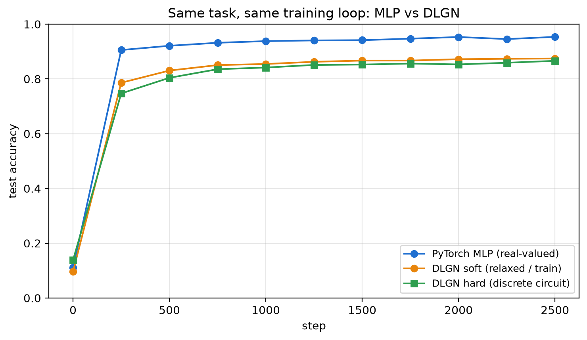
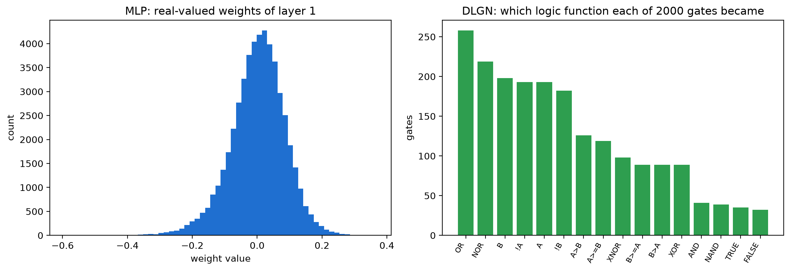
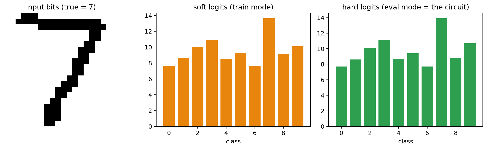

<!-- This file is generated by scripts/build_tutorials.py.
     Do not edit it directly; edit examples/26_mlp_to_dlgn.py and regenerate. -->

**Keep the same data and the same training loop as the previous page, and change only the inside of the model into logic gates.**
`nn.Linear + ReLU` → `LutLayer`, and the output `nn.Linear` (+softmax) → `GroupSum`:
this page shows that one-to-one replacement in real code and overlays both training curves on a single graph.

Measured: MLP 0.9535 versus DLGN soft 0.8745 / **hard 0.8660** (discretization gap +0.0085).
A circuit that performs not a single multiplication gets 90% of the way to the real-valued NN.
We look side by side at the difference between "weights (real numbers you multiply by)" and
"truth tables (which logic function it is)", and at the **two phases, soft and hard**, that appear
for the first time with a DLGN — then close with a replacement checklist.

:::note[About this page]
Estimated time: **about 10 minutes** / Environment: CPU only (no GPU required)
Source script: [`examples/26_mlp_to_dlgn.py`](https://github.com/tsukushi-gate/Griffith/blob/main/examples/26_mlp_to_dlgn.py)
Try it locally: [`notebooks/26_mlp_to_dlgn.ipynb`](https://github.com/tsukushi-gate/Griffith/blob/main/notebooks/26_mlp_to_dlgn.ipynb) (an unexecuted notebook with the same content as this page; open it with `uv run --group docs jupyter lab notebooks/`)
Every code output below is **the result of an actual run**, embedded verbatim.
:::

<!-- Colab badge: once the repository is public, replace this span with an <a> whose href
     is data-colab-url to enable "Open in Colab". -->
<span class="colab-badge" data-colab-url="https://colab.research.google.com/github/tsukushi-gate/Griffith/blob/main/notebooks/26_mlp_to_dlgn.ipynb">▶ Open in Colab (enabled once the repository is public)</span>

Replacing an MLP with a DLGN — solving the same problem with logic gates (beginner course 3/3).

Take the MNIST 20x20 MLP built on the [previous page](/en/tutorials/pytorch-mlp/) and,
**keeping the same data and the same training loop, change only the inside of the model**
into logic gates. In practice only two lines are rewritten.

```python
# PyTorch (real-valued MLP)          # DLGN (logic gates)
nn.Linear(400, 128), nn.ReLU()  →  LutLayer(400, 2000, n_inputs=2)
nn.Linear(64, 10)               →  GroupSum(k=10, tau=10.0)
```

The point of this page is to line up, with measurements, what actually changes when you replace them.

- **The way you write training does not change** — `cross_entropy`, `backward()` and `Adam` all stay the same
- **What gets learned changes** — instead of real-valued weights (numbers used for multiplication),
  it is the **truth table** of each gate (the choice of logic function: is it AND, or XOR?)
- **You now have two accuracies** — always report both the continuous relaxation used during
  training (soft) and the circuit fixed to a single logic function by argmax (hard).
  That difference is the **discretization gap**, the one and only biggest gotcha specific to DLGNs

We close with a "checklist for porting an MLP to a DLGN".

Run: uv run python examples/26_mlp_to_dlgn.py
Expected result: MLP test acc around 0.95 / DLGN hard acc around 0.87 (about a minute on CPU)

## Setup: bring in the tools for both the real-valued and the logic side

On top of the PyTorch set used up to the previous page, we add three things from this library.

- `LutLayer` … **a layer that learns a LUT (lookup table = truth table)**.
  It drops straight into the place of `nn.Linear + activation`
- `GroupSum` … the **exit** from the world of logic to classification scores. It counts the output bits per class
- `gate_labels` … returns, by name, which of the 16 logic functions each gate settled on after training

```python
import matplotlib.pyplot as plt
import torch
import torch.nn as nn
import torch.nn.functional as F
from torch.utils.data import DataLoader, Subset

from griffith_logic import GroupSum, LutLayer
from griffith_logic.analysis.circuit_viz import gate_labels
from griffith_logic.datasets import load_mnist20x20
```

```python
# We want to compare two models under identical conditions, so always fix the seed.
torch.manual_seed(0)
```

### Hyperparameters

```python
# A reduced recipe that fits in about a minute on CPU. Increasing K (number of gates) or STEPS improves the DLGN side.
HIDDEN = 128      # width of the MLP hidden layer
K = 2000          # number of gates per DLGN layer
STEPS = 2500      # training iterations, shared by both models
BATCH = 128
N_TRAIN = 20000
N_TEST = 2000
```

## Dataset: exactly the same input as the previous page

**Fairness of the comparison is the lifeline of this page**, so the data does not change by a single byte
from the previous page. The same MNIST 20x20, the same number of images, the same random seed.
The only difference is what is inside the model.

### Data (exactly the same as the previous page)

```python
train_set, test_set = load_mnist20x20(binarize_threshold=None)
```

```python
def materialize(dataset, n):
    """Pack the first n items into an (N, 400) tensor and labels."""
    subset = Subset(dataset, range(n))
    x, y = next(iter(DataLoader(subset, batch_size=n)))
    return x.reshape(n, -1), y
```

```python
train_x, train_y = materialize(train_set, N_TRAIN)
test_x, test_y = materialize(test_set, N_TEST)
```

### Drop the inputs to bits for hard evaluation

There is exactly one preprocessing step that only the DLGN needs. In **hard evaluation**
(= evaluation as the burned circuit itself) the input must be 0/1 bits as well. What enters an actual FPGA
are the High/Low levels of signal wires, not real numbers like "0.37".
We build `test_bits` by binarizing with `round()`.

```python
# In DLGN hard eval the inputs must be real bits too, because what enters
# "the circuit actually burned onto an FPGA" are 0/1 signal wires, not real numbers.
test_bits = test_x.round()
print(f'train={tuple(train_x.shape)} test={tuple(test_x.shape)}')
```

```text title="Output"
train=(20000, 400) test=(2000, 400)
```

## Model definitions: two models solving the same problem

We line up two subjects for comparison. **Model A** is the identical real-valued MLP from the previous page (the baseline).

### Model A: the same real-valued MLP as the previous page

```python
mlp = nn.Sequential(
    nn.Linear(400, HIDDEN),
    nn.ReLU(),
    nn.Linear(HIDDEN, 64),
    nn.ReLU(),
    nn.Linear(64, 10),
)
```

### Model B: a DLGN solving the same problem

**Model B** is the main topic. There are only two replacement rules.

- `nn.Linear + activation` → `LutLayer(in, out, n_inputs=2)`.
  **No activation function is attached** — the non-linearity is held by the gates (AND / XOR …) themselves
- The output `nn.Linear(h, 10)` → `GroupSum(k=10, tau=10.0)`.
  A layer that merely splits the final-layer bits into 10 classes x 200 wires and counts "how many 1s stand",
  **holding not a single weight** (a single adder on the hardware side)

**Why does the width grow from 128 to 2000?** — one gate with `n_inputs=2` **looks at only 2 wires**
of the previous layer. Its information content is orders of magnitude below that of an `nn.Linear` neuron
which sees all 400 inputs, so you have to compensate with sheer numbers.
"Take a width one or two orders of magnitude larger" becomes the basic DLGN practice.

```python
# Each nn.Linear + ReLU pair becomes one LutLayer, and the final nn.Linear (→softmax) becomes GroupSum.
# LutLayer(400, 2000, n_inputs=2) is a layer that lines up 2000 gates, each looking at only 2 of the 400 inputs.
# No activation function is needed — the non-linearity is held by the gates (AND/OR/XOR…) themselves.
# GroupSum(k=10, tau=10.0) merely splits the final 2000 gates into 10 classes x 200 gates and counts them,
# holding no weights at all (a single adder on the circuit side).
dlgn = nn.Sequential(
    LutLayer(400, K, n_inputs=2),
    LutLayer(K, K, n_inputs=2),
    GroupSum(k=10, tau=10.0),
)
print(dlgn)

mlp_params = sum(p.numel() for p in mlp.parameters())
dlgn_params = sum(p.numel() for p in dlgn.parameters())
print(f'\nMLP  の学習パラメータ: {mlp_params:,} 個 = 掛け算に使う実数の重み')
print(f'DLGN の学習パラメータ: {dlgn_params:,} 個 = 各ゲートが16種の論理関数の'
      f'どれになるかの点数(2層 x {K}ゲート x 16)')
print('同じ「パラメータ」でも意味が違う: 前者は掛ける数、後者は真理値表の選択。')
```

```text title="Output"
Sequential(
  (0): LutLayer(in=400, out=2000, n_inputs=2, entries=4, param=softmax/16gate)
  (1): LutLayer(in=2000, out=2000, n_inputs=2, entries=4, param=softmax/16gate)
  (2): GroupSum(k=10, tau=10.0)
)

MLP  の学習パラメータ: 60,234 個 = 掛け算に使う実数の重み
DLGN の学習パラメータ: 64,000 個 = 各ゲートが16種の論理関数のどれになるかの点数(2層 x 2000ゲート x 16)
同じ「パラメータ」でも意味が違う: 前者は掛ける数、後者は真理値表の選択。
```

```python
def evaluate(model, x, y):
    """Return the test accuracy (the model's mode follows the caller's setting)."""
    with torch.no_grad():
        return (model(x).argmax(-1) == y).float().mean().item()
```

## Training: run both models in the same loop

We update A and B side by side inside the same `for`. **Not one character of the training loop code changes** —
`cross_entropy`, `backward()` and `Adam` can all be used as they are. This is the demonstration of this library's
claim that "you can bring your PyTorch assets over untouched".

There are only two differences. (1) The learning rate on the DLGN side is 10x larger (the reason is in the comment below).
(2) The DLGN measures **two accuracies, soft and hard**. Soft is the continuous relaxation in `train()` mode;
hard is the accuracy of "the burnable circuit itself", with every gate fixed to a single logic function in `eval()` mode.

```python
# The only difference is lr. Logic-side weights prefer a learning rate one or two orders of
# magnitude larger than real-valued weights, so the MLP uses 1e-3 and the DLGN 0.01
# (this is a rule of thumb; see the training guide for details).
# For the DLGN we measure both soft (train mode) and hard (eval mode) at every checkpoint.
opt_mlp = torch.optim.Adam(mlp.parameters(), lr=1e-3)
opt_dlgn = torch.optim.Adam(dlgn.parameters(), lr=0.01)
history = []  # (step, mlp acc, dlgn soft acc, dlgn hard acc)

for step in range(STEPS + 1):
    if step % 250 == 0:
        mlp.eval()
        mlp_acc = evaluate(mlp, test_x, test_y)
        mlp.train()
        dlgn.train()
        soft_acc = evaluate(dlgn, test_x, test_y)
        dlgn.eval()
        hard_acc = evaluate(dlgn, test_bits, test_y)
        dlgn.train()
        history.append((step, mlp_acc, soft_acc, hard_acc))
        print(f'step {step:>5}  MLP={mlp_acc:.4f}  '
              f'DLGN soft={soft_acc:.4f}  DLGN hard={hard_acc:.4f}')

    idx = torch.randint(0, N_TRAIN, (BATCH,))
    for model, opt in ((mlp, opt_mlp), (dlgn, opt_dlgn)):
        opt.zero_grad()
        F.cross_entropy(model(train_x[idx]), train_y[idx]).backward()
        opt.step()

steps, mlp_hist, soft_hist, hard_hist = zip(*history, strict=True)
final_mlp, final_soft, final_hard = mlp_hist[-1], soft_hist[-1], hard_hist[-1]
gap = final_soft - final_hard
print(f'\n最終: MLP={final_mlp:.4f} / DLGN soft={final_soft:.4f} / '
      f'DLGN hard={final_hard:.4f}')
print(f'離散化ギャップ(soft - hard)= {gap:+.4f}')
assert final_hard > 0.70, f'DLGN hard acc={final_hard:.4f} が低すぎる'
```

```text title="Output"
step     0  MLP=0.1105  DLGN soft=0.0960  DLGN hard=0.1380

step   250  MLP=0.9055  DLGN soft=0.7860  DLGN hard=0.7470

step   500  MLP=0.9210  DLGN soft=0.8305  DLGN hard=0.8040

step   750  MLP=0.9320  DLGN soft=0.8505  DLGN hard=0.8355

step  1000  MLP=0.9380  DLGN soft=0.8545  DLGN hard=0.8415

step  1250  MLP=0.9405  DLGN soft=0.8625  DLGN hard=0.8510

step  1500  MLP=0.9415  DLGN soft=0.8670  DLGN hard=0.8525

step  1750  MLP=0.9470  DLGN soft=0.8670  DLGN hard=0.8560

step  2000  MLP=0.9530  DLGN soft=0.8720  DLGN hard=0.8530

step  2250  MLP=0.9455  DLGN soft=0.8735  DLGN hard=0.8590

step  2500  MLP=0.9535  DLGN soft=0.8745  DLGN hard=0.8660

最終: MLP=0.9535 / DLGN soft=0.8745 / DLGN hard=0.8660
離散化ギャップ(soft - hard)= +0.0085
```

## Visualization: reading the MLP and the DLGN side by side

### Figure 1: training curves on the same task with the same training loop

Three lines are overlaid on one figure. Blue = the real-valued MLP, orange = the DLGN's soft, green = the DLGN's hard.
**What to look at is green**, since that is the true score as "a circuit that holds not a single multiplier".

```python
# Blue is the real-valued MLP, orange is the DLGN's soft (the continuous relaxation used during
# training), green is the DLGN's hard (the circuit that actually gets burned).
# What to look at is green — that is the true score as "a circuit that uses not a single multiplier".
# The gap between orange and green is the discretization gap; when it is too wide, it is a sign
# the circuit has not made up its mind.
fig, ax = plt.subplots(figsize=(7.5, 4.4))
ax.plot(steps, mlp_hist, 'o-', color='#1f6fd0', label='PyTorch MLP (real-valued)')
ax.plot(steps, soft_hist, 'o-', color='#e8850c', label='DLGN soft (relaxed / train)')
ax.plot(steps, hard_hist, 's-', color='#2e9e4f', label='DLGN hard (discrete circuit)')
ax.set_xlabel('step')
ax.set_ylabel('test accuracy')
ax.set_ylim(0, 1)
ax.grid(alpha=0.3)
ax.legend(loc='lower right', fontsize=9)
ax.set_title('Same task, same training loop: MLP vs DLGN')
fig.tight_layout()
plt.show()
```

    

    

**What to read here**: the MLP (blue) plateaus around 0.95, while the DLGN's hard (green) climbs to about 0.87.
The difference is roughly 0.08 — **a circuit performing not a single multiplication reaches 90% of the way
to the real-valued NN**. The space between orange (soft) and green (hard) is the **discretization gap**,
and in this run it is only about +0.01 — meaning that the model being trained and the burned circuit are
almost the same thing. When this gap opens wide, the gates have not made up their minds about
"which logic function" they are.

### Figure 2: the learned "real-valued weights" and "chosen gates"

We put the shape of "what got learned" side by side. On the left, a histogram of the MLP's first-layer weights;
on the right, the breakdown of **which logic function** each of the 2000 gates in the DLGN's first layer settled on.
The point is to see that even under the same phrase "we learned parameters", what you end up with is completely different.

```python
# On the left, the distribution of the MLP's first-layer weights. They are real numbers spread
# continuously around 0, and every inference multiplies by them (which is why multipliers are needed).
# On the right, how many of the 2000 gates in the DLGN's first layer ended up as each logic function.
# The result of training appears not as "real numbers" but as a **discrete choice: AND / XOR / NAND …**.
# (Sorted by descending count, then by name, so that gates with equal counts keep a fixed order.)
mlp.eval()
w1 = mlp[0].weight.detach().flatten()
dlgn.eval()
labels = gate_labels(dlgn[0])
names = sorted(set(labels), key=lambda n: (-labels.count(n), n))
counts = [labels.count(n) for n in names]
fig, axes = plt.subplots(1, 2, figsize=(12, 4.2))
axes[0].hist(w1.numpy(), bins=60, color='#1f6fd0')
axes[0].set_xlabel('weight value')
axes[0].set_ylabel('count')
axes[0].set_title('MLP: real-valued weights of layer 1')
axes[1].bar(range(len(names)), counts, color='#2e9e4f')
axes[1].set_xticks(range(len(names)))
axes[1].set_xticklabels(names, rotation=60, ha='right', fontsize=8)
axes[1].set_ylabel('gates')
axes[1].set_title(f'DLGN: which logic function each of {K} gates became')
fig.tight_layout()
plt.show()

print('DLGN 1層目で選ばれたゲート(上位5種): '
      + ', '.join(f'{n}={c}' for n, c in zip(names[:5], counts[:5], strict=True)))
```

    

    

```text title="Output"
DLGN 1層目で選ばれたゲート(上位5種): OR=258, NOR=219, B=198, !A=193, A=193
```

**What to read here**: the left is a continuous distribution spreading smoothly around 0 — every value is
a "half-hearted real number", and every inference needs a multiplication. The right is a **discrete breakdown**
with only 16 bars (or fewer), where each gate has landed on a **logic function with a name** such as
OR / NOR / pass-through (passing A or B straight on); the top five are printed in the output right below.
The point of this one figure is that the product of training has changed from "a vector of real numbers"
into "a bill of materials for a circuit".

### Figure 3: soft and hard are "different models"

We line up the 10-class scores for one and the same test image under soft (left) and hard (right).
In ordinary PyTorch, `eval()` only changes the behaviour of BatchNorm or Dropout, but
**in a DLGN, `eval()` swaps out the mathematics of the model itself**. This figure is there to make that difference tangible.

```python
# Line up the 10-class scores for one and the same image under soft (the continuous relaxation)
# and hard (the fixed circuit). In a DLGN, eval() changes the mathematics of the model itself,
# so the two scores are similar but not identical. This is the biggest place where
# PyTorch common sense does not apply.
sample = 0
dlgn.train()
with torch.no_grad():
    soft_logits = dlgn(test_x[sample:sample + 1])[0]
dlgn.eval()
with torch.no_grad():
    hard_logits = dlgn(test_bits[sample:sample + 1])[0]
fig, axes = plt.subplots(1, 3, figsize=(12, 3.6))
axes[0].imshow(test_bits[sample].reshape(20, 20), cmap='gray_r')
axes[0].set_title(f'input bits (true = {int(test_y[sample])})')
axes[0].set_axis_off()
axes[1].bar(range(10), soft_logits.numpy(), color='#e8850c')
axes[1].set_title('soft logits (train mode)')
axes[1].set_xlabel('class')
axes[2].bar(range(10), hard_logits.numpy(), color='#2e9e4f')
axes[2].set_title('hard logits (eval mode = the circuit)')
axes[2].set_xlabel('class')
fig.tight_layout()
plt.show()

print(f'soft の予測={int(soft_logits.argmax())} / '
      f'hard の予測={int(hard_logits.argmax())} / 正解={int(test_y[sample])}')
```

    

    

```text title="Output"
soft の予測=7 / hard の予測=7 / 正解=7
```

**What to read here**: the two bar charts are similar in shape but **their values do not match**. Soft is a
continuous value produced by the mixture of 16 logic functions, while hard is "how many of the 200 wires stood at 1"
divided by tau — they are simply different computations. Even so, the highest class agrees: the output right below
shows soft, hard and the ground truth all lining up.

## Summary: the replacement checklist

Finally we print the eight items to check every time you port an MLP to a DLGN.
The background of each item is what this page has been showing, and the detailed
layer correspondence table is in [Migrating from PyTorch](/en/guides/from-pytorch/).

```python
# The items to check every time you port an MLP to a DLGN. The guide "Migrating from PyTorch"
# has the full correspondence table.
print('''
=== MLP → DLGN 置き換えチェックリスト ===
1. nn.Linear + 活性化 → LutLayer(in, out, n_inputs=2)。活性化関数は付けない
2. 出力の nn.Linear(h, C) → GroupSum(k=C, tau)。out_dim は C で割り切れること
3. 幅を1〜2桁大きく取る(1ゲートは入力を2本しか見ないため)
4. 学習率を上げる(1e-3 ではなく 0.01 前後から)
5. 入力は [0,1] の実数か 0/1 のビット。hard 評価では round() したビットを入れる
6. 精度は soft と hard の2本を必ずログする(hard が本当の成績)
7. 離散化ギャップが大きいなら学習量・tau・パラメータ化を疑う
8. 焼く前に export_ir → validate → simulate で回路として検証する''')
```

    
```text title="Output"
=== MLP → DLGN 置き換えチェックリスト ===
1. nn.Linear + 活性化 → LutLayer(in, out, n_inputs=2)。活性化関数は付けない
2. 出力の nn.Linear(h, C) → GroupSum(k=C, tau)。out_dim は C で割り切れること
3. 幅を1〜2桁大きく取る(1ゲートは入力を2本しか見ないため)
4. 学習率を上げる(1e-3 ではなく 0.01 前後から)
5. 入力は [0,1] の実数か 0/1 のビット。hard 評価では round() したビットを入れる
6. 精度は soft と hard の2本を必ずログする(hard が本当の成績)
7. 離散化ギャップが大きいなら学習量・tau・パラメータ化を疑う
8. 焼く前に export_ir → validate → simulate で回路として検証する
```

## What to read next

- [1. Train on MNIST](/en/tutorials/mnist/) — dig one level deeper into the logic gate version (with an overview of the circuit)
- [Migrating from PyTorch](/en/guides/from-pytorch/) — the full correspondence table for layers, training and export
- [From NN to DLGN](/en/explanation/nn-to-dlgn/) — the thinking behind the replacement
- [Reading Training Curves](/en/guides/training-curves/) — telling soft and hard apart

<!-- i18n:source=tutorials/mlp-to-dlgn.md hash=8cf3e818ca10 -->
