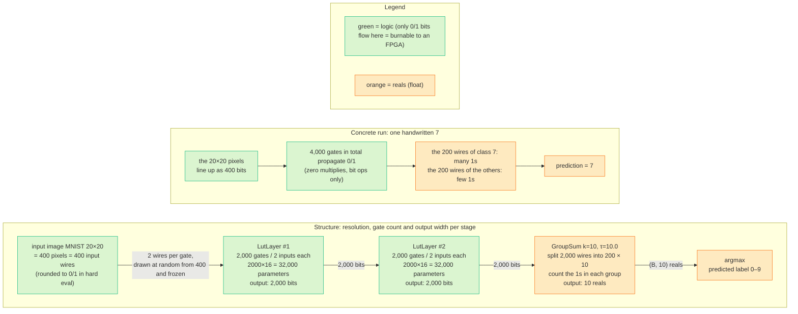
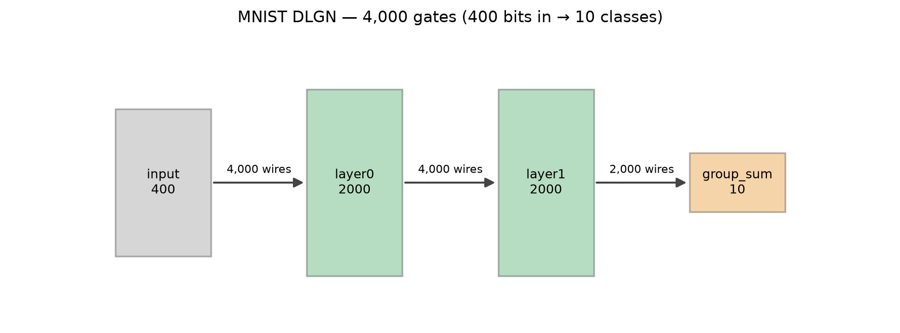
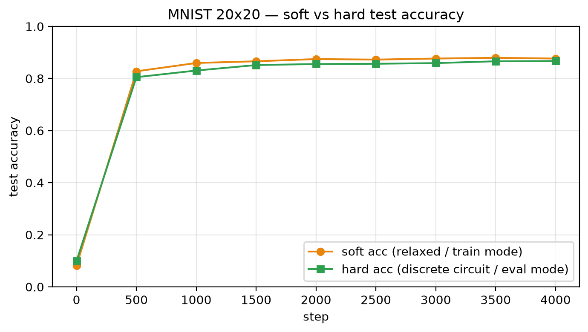
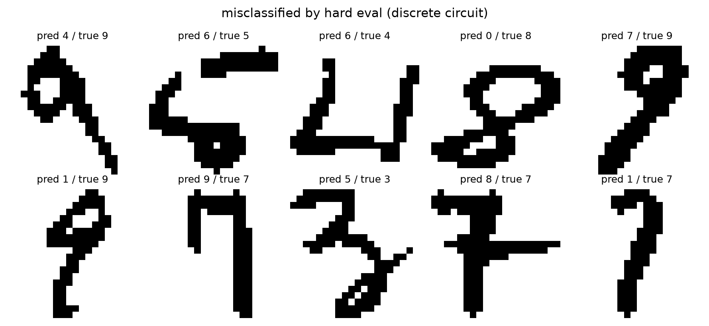
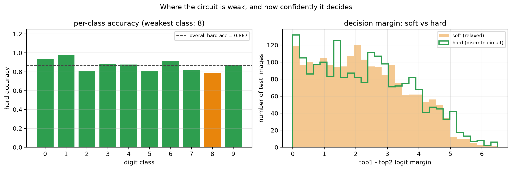

<!-- This file is generated by scripts/build_tutorials.py.
     Do not edit it directly; edit examples/06_mnist.py and regenerate. -->

**A plain pile of logic gates learns to read handwritten digits.**
4000 AND / OR / XOR gates that hold no real-valued weights and perform no multiplication
decide their truth tables by gradient descent alone — and end up getting 86% of MNIST right.
This page runs that for real so you can check it yourself.

The toolkit is just two `LutLayer`s + `GroupSum` + an ordinary PyTorch training loop.
Three figures — **an overview of the circuit, the training curves (soft/hard), and misclassified examples** —
show what a "learned circuit" actually looks like.

:::tip[What you'll learn]
1. That simply running two `LutLayer`s + `GroupSum` in **an ordinary PyTorch training loop** makes 4000 logic gates able to read handwritten digits
2. Why you must always look at soft (continuous relaxation) and hard (discrete circuit) accuracy side by side, and how to tell them apart
3. What a learned circuit looks like — how to read the overview, the training curves, and the misclassified examples

**Prerequisites**

- [Core Concepts](/en/getting-started/concepts/) — the five concepts soft/hard, LutLayer, GroupSum, IR, HDL
- [Intro 3. Replacing an MLP with a DLGN](/en/tutorials/mlp-to-dlgn/) — start here if neural networks are new to you
:::

:::note[About this page]
Estimated time: **about 10 minutes** / Environment: CPU only (no GPU required)
Source script: [`examples/06_mnist.py`](https://github.com/tsukushi-gate/Griffith/blob/main/examples/06_mnist.py)
Try it locally: [`notebooks/06_mnist.ipynb`](https://github.com/tsukushi-gate/Griffith/blob/main/notebooks/06_mnist.ipynb) (an unexecuted notebook with the same content as this page; open it with `uv run --group docs jupyter lab notebooks/`)
Every code output below is **the result of an actual run**, embedded verbatim.
:::

<!-- Colab badge: once the repository is public, replace this span with an <a> whose href
     is data-colab-url to enable "Open in Colab". -->
<span class="colab-badge" data-colab-url="https://colab.research.google.com/github/tsukushi-gate/Griffith/blob/main/notebooks/06_mnist.ipynb">▶ Open in Colab (enabled once the repository is public)</span>

An example of training MNIST (20x20) with a differentiable logic gate network.

XOR (examples/01_xor.py) was a toy problem with four patterns. Here the same toolkit
(LutLayer + GroupSum + an ordinary PyTorch training loop) is scaled up to real data with
400 input bits and 10 classes, until **a circuit of 4000 gates reads handwritten digits**.

The official difflogic recipe (6 layers x 8000 gates, 200k iters) reaches the paper-level 97.7%,
but it takes hours on a GPU. This example is shrunk to
"2 layers x 2000 gates, 20000 training images, 4000 iters" so it finishes in 1-2 minutes on CPU,
and the hard accuracy it reaches is around 0.86 (for an accuracy-oriented recipe, see
DLGN_FULL=1 in tests/l3_paper/test_dlgn_mnist.py).

The single most important concept on this page is **the two faces, soft and hard**.

- **soft** (the training-time face) ... each gate is a continuous mixture of the 16 logic functions.
  It is differentiable so it can be trained, but in this state it cannot be burned onto hardware
- **hard** (the face as a circuit) ... a genuine logic circuit with the mixture fixed to one function
  by argmax. Inference is nothing but bit operations, but it cannot be differentiated

Training proceeds in soft, while what you actually use is hard. You therefore have to keep checking
that **the gap between the two accuracies (the discretization gap)** is small. The figures below are
the tools for doing exactly that.

**The whole circuit (exactly the same shape as XOR, only the numbers grow)**



There is no convolution and no matrix product — note that the whole thing is
**4,000 two-input gates**, and that reals only appear from GroupSum onwards.

**How it is done**

- **One pixel = one input wire.** The 20×20 image is fed into the circuit directly as 400 bit
  lines (the border of the 28×28 original is dropped as a black frame, as in the official
  difflogic recipe)
- **Each gate looks at only 2 wires of the previous layer.** Instead of a dense connection, the
  2 inputs of every gate are drawn at random and frozen (sparse wiring). That is why 2,000 gates
  still cost only 2000×16 = 32,000 parameters
- **Classification is just counting.** GroupSum splits the 2,000 outputs into 10 groups of 200 and
  counts how many 1s stand in each group; the class with the most is the answer. τ=10 is the
  temperature that count is divided by, which flattens the softmax and stabilizes training
- **The two faces, soft and hard.** During training (soft) each gate is a mixture of the 16 logic
  functions; at inference (hard) argmax fixes one, giving a genuine circuit. Measuring the gap
  between the two (the discretization gap) is the theme of this example

Run: uv run python examples/06_mnist.py
Expected result: hard accuracy around 0.86 (the assert is loosely set at 0.70)

## Setup: imports and the random seed

All you need is the usual PyTorch set plus three things from this library.

- `LutLayer` … the layer where one neuron = one **LUT (lookup table, i.e. a truth table)**
- `GroupSum` … the exit from the world of logic to class scores (it counts bits per class)
- `plot_circuit` … draws the trained model as a circuit diagram

No dedicated training framework appears. The training loop below is plain PyTorch.

```python
import matplotlib.pyplot as plt
import torch
import torch.nn as nn
import torch.nn.functional as F
from torch.utils.data import DataLoader, Subset

from griffith_logic import GroupSum, LutLayer
from griffith_logic.analysis.circuit_viz import plot_circuit
from griffith_logic.datasets import load_mnist20x20
```

```python
# The initial gate distribution depends on randomness, so fix the seed for reproducibility.
torch.manual_seed(0)
```

### Hyperparameters

**K is the most important knob.** K is the number of gates per layer, and it translates directly
into "the number of gates once burned onto an FPGA" — that is, silicon area. In a real-valued NN
width trades accuracy against compute time, but in a logic gate network **width *is* the
implementation cost**, so balancing accuracy against K is the center of tuning.

```python
# A reduced recipe that fits in 1-2 minutes on CPU. Accuracy rises as you increase
# K (width), the number of layers, and STEPS.
# In a logic gate network the "width K" translates almost directly into implementation cost
# (= the number of gates once burned), so the trade-off between accuracy and K is the center of tuning.
K = 2000          # gates per layer
STEPS = 4000      # training iterations
BATCH = 128       # mini-batch size
N_TRAIN = 20000   # number of training images (a subset of all 60000)
N_TEST = 2000     # number of images used for evaluation
```

## Dataset: reading an image as 400 input wires

We use MNIST cropped from 28x28 to 20x20 by dropping the black border — **400 pixels**, the same
preprocessing as the official difflogic recipe. Those 400 pixels become **400 input wires** of the
circuit directly: one pixel = one wire.

`binarize_threshold=None` keeps the values continuous in $[0,1]$ on load. Training on continuous
values and binarizing only for evaluation with `round()` is the practice of the official recipe.

```python
# load_mnist20x20 returns MNIST cropped from 28x28 to 20x20 by dropping the black
# border, matching difflogic. 400 bits = one bit per pixel become the input wires
# of the circuit directly.
# binarize_threshold=None keeps the values continuous in [0,1] (as in the official
# recipe, training uses continuous values and evaluation binarizes with round()).
train_set, test_set = load_mnist20x20(binarize_threshold=None)
```

```python
def materialize(dataset, n):
    """Pack the first n items into an (N, 400) tensor and labels (skips per-step preprocessing)."""
    subset = Subset(dataset, range(n))
    x, y = next(iter(DataLoader(subset, batch_size=n)))
    return x.reshape(n, -1), y
```

```python
train_x, train_y = materialize(train_set, N_TRAIN)
test_x, test_y = materialize(test_set, N_TEST)
```

### Dropping the evaluation inputs to bits

**Why binarize only for evaluation** — hard eval is a measurement that imitates "the circuit
actually burned onto an FPGA". What enters the input pins of a circuit is only the High/Low of a
wire, so feeding it a real number like 0.37 would overstate the real-world performance.

```python
# Evaluation inputs are dropped to {0,1} bits with round(). Hard eval imitates
# "the circuit actually burned onto an FPGA", so its inputs must be real bits too.
test_bits = test_x.round()
print(f'train={tuple(train_x.shape)} test={tuple(test_x.shape)} '
      f'(20x20=400ビット入力 / 10クラス)')
```

```text title="Output"
train=(20000, 400) test=(2000, 400) (20x20=400ビット入力 / 10クラス)
```

## Model definition: two LutLayers + GroupSum

The three lines below are the entire circuit this page deals with (4,000 gates in total).

- `LutLayer(400, K, n_inputs=2)` … lines up K gates that each look at **only 2** of the 400 input
  wires. Which 2 (the wiring) is drawn randomly at initialization and **fixed**; what training
  moves is only "the truth table for those 2 inputs"
- The second `LutLayer(K, K)` … complex logic such as XOR is built by this **composition of gates**
- `GroupSum(k=10, tau=10.0)` … splits the final 2000 bits into 10 classes x 200 wires and counts
  how many ones are standing in each group. `tau` is the temperature the count is divided by;
  larger values make the softmax gentler and stabilize training

**Why 2 inputs instead of a full connection** — there are only 16 two-input logic functions in
total, so learning "a weighting over those 16" is differentiable (16 parameters per gate). A fully
connected gate would make the truth table explode exponentially and kill that trick.

```python
# Structurally identical to the XOR case. Only the width and the class count changed.
# Worth noting: there is "no convolution, no normalization, no activation function". All there is
# is layers of 2-input gates and a GroupSum that counts the gate outputs at the end.
# And it still reads handwritten digits.
model = nn.Sequential(
    # 400 bits -> 2000 gates. Each gate looks at only 2 of the 400 input wires
    # (sparse random wiring). What gets learned is "the truth table for those 2 inputs".
    LutLayer(400, K, n_inputs=2),
    # Second stage. Another 2000 gates taking the 2000 bits of the first stage as input.
    LutLayer(K, K, n_inputs=2),
    # Aggregate the final 2000 gates as 10 classes x 200 gates.
    # tau is the logit temperature (10.0, same as the official difflogic recipe).
    GroupSum(k=10, tau=10.0),
)
print(model)
```

```text title="Output"
Sequential(
  (0): LutLayer(in=400, out=2000, n_inputs=2, entries=4, param=softmax/16gate)
  (1): LutLayer(in=2000, out=2000, n_inputs=2, entries=4, param=softmax/16gate)
  (2): GroupSum(k=10, tau=10.0)
)
```

## Training: an ordinary PyTorch loop measuring both soft and hard

The training itself is completely ordinary PyTorch (`cross_entropy` + `Adam`); nowhere do you have
to be aware that this is a logic gate network. **That is the practical advantage of the method.**

The one convention is the use of `model.train()` / `model.eval()`, which is the switch between soft
and hard. This is not a matter of statistics as with BatchNorm: **`eval()` changes the mathematics
of the model itself**, from "a mixture of 16 functions" to "one function fixed by argmax". So both
are measured every time, and the gap between them (the discretization gap) is monitored.

```python
# This is plain PyTorch. Nowhere do you have to be aware that it is a logic gate network.
# The one convention is the distinction between model.train() and model.eval(), which acts as the
# switch between soft and hard (note that this is not about statistics as it would be for BatchNorm).
opt = torch.optim.Adam(model.parameters(), lr=0.01)
history = []  # (step, soft acc, hard acc)

for step in range(STEPS + 1):
    if step % 500 == 0:
        # soft = still continuously relaxed (the training-time face) /
        # hard = the circuit fixed by argmax. Always look at these two side by side.
        # Their difference is the "discretization gap"; if only soft is high while hard
        # lags, that is a sign the circuit has not made up its mind.
        with torch.no_grad():
            model.train()
            soft_acc = (model(test_x).argmax(-1) == test_y).float().mean().item()
            model.eval()
            hard_acc = (model(test_bits).argmax(-1) == test_y).float().mean().item()
        model.train()
        history.append((step, soft_acc, hard_acc))
        print(f'step {step:>5}  soft acc={soft_acc:.4f}  hard acc={hard_acc:.4f}')

    # Mini-batches are drawn at random with replacement (the difflogic style of looping,
    # which has no notion of epochs).
    idx = torch.randint(0, N_TRAIN, (BATCH,))
    opt.zero_grad()
    loss = F.cross_entropy(model(train_x[idx]), train_y[idx])
    loss.backward()
    opt.step()
```

```text title="Output"
step     0  soft acc=0.0815  hard acc=0.0990

step   500  soft acc=0.8275  hard acc=0.8050

step  1000  soft acc=0.8595  hard acc=0.8305

step  1500  soft acc=0.8660  hard acc=0.8515

step  2000  soft acc=0.8745  hard acc=0.8555

step  2500  soft acc=0.8725  hard acc=0.8565

step  3000  soft acc=0.8765  hard acc=0.8590

step  3500  soft acc=0.8795  hard acc=0.8660

step  4000  soft acc=0.8765  hard acc=0.8670
```

```python
# Wall-clock time is about a minute on CPU (it varies by machine, so it is kept out of the output).
steps, soft_hist, hard_hist = zip(*history, strict=True)
final_soft, final_hard = soft_hist[-1], hard_hist[-1]
print(f'\n最終 soft acc={final_soft:.4f} / hard acc={final_hard:.4f}')
```

    
```text title="Output"
最終 soft acc=0.8765 / hard acc=0.8670
```

```python
# hard is what counts. Even the reduced recipe reaches about 0.86 (the threshold is
# loosely set to 0.70 to absorb machine-to-machine variation).
assert final_hard > 0.70, f'hard acc={final_hard:.4f} が低すぎる'
```

## Visualization: what the learned circuit looks like

**What to read from the log above**: soft and hard rise almost together, and hard accuracy ends up
around 0.86. That is: 4,000 gates that hold no real-valued weights and perform no multiplication
get 86% of handwritten digits right. Below, three figures show what this circuit looks like.

### Figure 1: an overview of the learned circuit

The whole picture first. With 4,000 gates all nodes cannot be drawn, so `plot_circuit` switches
automatically to an **overview** (layers as boxes, arrows annotated with the number of wires).
Comparing it with the all-node drawing in [Appendix: XOR](/en/tutorials/xor/) shows how the same
API changes its display with scale.

```python
# With 4000 gates, plot_circuit gives up on drawing every node and automatically
# switches to an overview (layers = boxes, arrows between them = wire counts).
# Compare it with the XOR figure (16 gates) to see how the same API changes its
# rendering with scale.
fig, ax = plt.subplots(figsize=(9, 3.4))
plot_circuit(model, resolve=True, ax=ax,
             title=f'MNIST DLGN — {2 * K:,} gates (400 bits in → 10 classes)')
fig.tight_layout()
plt.show()
```

    

    

**What to read from it**: 400 input wires pass through two LutLayers (2,000 gates each) and drop
into 10 classes at the GroupSum — a single straight path. No branches, no convolutions, no
normalization; 86% comes out of exactly this simplicity.

### Figure 2: training curves (soft and hard)

The two curves soft (orange) and hard (green) are overlaid. **Hard is the real one**: it is the
score of the circuit you can burn. The gap between the two curves is the discretization gap.

```python
# What to look at is hard (green). If only soft (orange) rises while hard fails to follow,
# the gate mixtures are camped out in intermediate states (= they cannot decide which logic function to be).
# Conversely, if the two lines rise almost on top of each other, the training-time face and the
# burned face agree, and you can tell it is ready to be taken out as a circuit as is. In this figure
# you can see the small gap opened early on closing as training progresses.
fig, ax = plt.subplots(figsize=(7, 4))
ax.plot(steps, soft_hist, 'o-', color='#e8850c',
        label='soft acc (relaxed / train mode)')
ax.plot(steps, hard_hist, 's-', color='#2e9e4f',
        label='hard acc (discrete circuit / eval mode)')
ax.set_xlabel('step')
ax.set_ylabel('test accuracy')
ax.set_ylim(0, 1)
ax.grid(alpha=0.3)
ax.legend(loc='lower right')
ax.set_title('MNIST 20x20 — soft vs hard test accuracy')
fig.tight_layout()
plt.show()
```

    

    

**What to read from it**: the small gap the two curves open early on closes as training proceeds.
In other words "the model being trained" and "the circuit after burning" converge to the same
thing, and it is in a state where you can take it out as a circuit as is. If only orange rose and
green failed to follow, that would be a sign that the gate mixtures are sitting in an intermediate
state (undecided about which logic function to be), and you would suspect the amount of training,
`tau`, or the parameterization.

### Figure 3: the digits the circuit got wrong

Ten images hard eval got wrong, shown as **the bit patterns the circuit actually received**
(after `round()`). You cannot judge "why it got them wrong" unless you look at the post-processing
form.

```python
# Line up the misclassifications of hard eval (= the burned circuit itself). If they
# concentrate on pairs that are confusing for humans too, such as 1 vs 7 or 4 vs 9,
# the circuit is capturing shape sensibly.
# Conversely, if they are all completely unrelated pairs (reading a 0 as a 7 and so on), suspect
# under-training. What is displayed is the bit pattern after round(), i.e. exactly the input the
# circuit actually received. The reduced recipe gets a little over one in ten wrong, so lining up
# 10 images finds them immediately.
model.eval()
with torch.no_grad():
    pred = model(test_bits).argmax(-1)
wrong = (pred != test_y).nonzero(as_tuple=True)[0][:10]
print(f'誤分類 {int((pred != test_y).sum())} / {N_TEST} 枚(先頭10枚を表示)')

fig, axes = plt.subplots(2, 5, figsize=(9, 4.2))
for ax, i in zip(axes.ravel(), wrong.tolist(), strict=False):
    # What is displayed is exactly the bit pattern the circuit saw (after round()).
    ax.imshow(test_bits[i].reshape(20, 20), cmap='gray_r')
    ax.set_title(f'pred {int(pred[i])} / true {int(test_y[i])}', fontsize=9)
    ax.set_axis_off()
for ax in axes.ravel()[len(wrong):]:
    ax.set_axis_off()
fig.suptitle('misclassified by hard eval (discrete circuit)', fontsize=11)
fig.tight_layout()
plt.show()
```

```text title="Output"
誤分類 266 / 2000 枚(先頭10枚を表示)
```

    

    

**What to read from it**: what lines up is mostly pairs a human would hesitate over too — 4 and 9,
7 and 1, 5 and 3 — which shows the circuit is capturing shape properly. If it were full of
unrelated pairs (reading a 0 as a 7, say), you would suspect undertraining.

## Digging deeper into the evaluation: weak spots and decisiveness

A single overall accuracy number tells you neither "which class is weak" nor "how confidently it
answers". So two more quantities are measured.

- **Per-class hard accuracy** … identifies the digits it is bad at
- **Margin** … the top-1 logit $-$ the top-2 logit. It expresses by how much that one image was
  won. A GroupSum logit is "how many of the 200 gates for that class emitted a 1" divided by `tau`,
  so the margin reads plainly as a **vote difference**

Putting the margin side by side for soft and hard measures **how much of the decision's sharpness
was lost by discretization**, from an angle independent of the accuracy number.

### Groundwork for Figure 4: computing per-class accuracy and the margins

```python
# A single overall accuracy tells you neither "where it is weak" nor "how confidently it answers".
# So measure two things.
#   (1) per-class hard accuracy ... shows which digits it is bad at
#   (2) margin = top-1 logit - top-2 logit ... by how much it managed to pick that one image
# Putting (2) side by side for soft and hard measures how much of the sharpness of the decision was
# lost in discretization.
# A GroupSum logit is "how many of the 200 gates assigned to that class output a 1", divided by tau,
# so the margin can be read naively as a "vote difference".
per_class = []
for c in range(10):
    mask = test_y == c
    per_class.append((pred[mask] == c).float().mean().item())

with torch.no_grad():
    model.train()
    soft_logits = model(test_x)
    model.eval()
    hard_logits = model(test_bits)
```

```python
def top2_margin(logits):
    """The logit gap between 1st and 2nd place (the larger, the more confidently one class was picked)."""
    top2 = logits.topk(2, dim=-1).values
    return (top2[:, 0] - top2[:, 1]).numpy()
```

```python
soft_margin, hard_margin = top2_margin(soft_logits), top2_margin(hard_logits)
worst = min(range(10), key=lambda c: per_class[c])
print(f'クラス別hard正解率で最も苦手なのは "{worst}"(acc={per_class[worst]:.3f})')
print(f'マージン中央値: soft={float(torch.tensor(soft_margin).median()):.3f} / '
      f'hard={float(torch.tensor(hard_margin).median()):.3f}')
```

```text title="Output"
クラス別hard正解率で最も苦手なのは "8"(acc=0.786)
マージン中央値: soft=2.111 / hard=2.200
```

### Figure 4: which class it is weak at (left) and the sharpness of its decisions (right)

On the left, per-class hard accuracy (dashed line = overall average, orange = the weakest class);
on the right, a histogram of the margins (orange fill = soft, green outline = hard).

**What to read from it (written up front, since this is the last figure)**: on the left, 0 and 1
are easy while classes with many look-alike siblings — 8, 5, 2 — sink; a bias that a single overall
accuracy cannot show becomes visible here for the first time. On the right, the soft and hard
distributions **almost coincide**. That means the sharpness of the decision was not lost by
discretization — that is, it is fine to turn this into a circuit as is. If only the hard side had
piled up near 0, that would be a sign of information being dropped by the argmax.

```python
# Left: per-class hard accuracy. The dashed line is the overall average, and only the weakest class
#       is painted orange. 0 and 1 are easy, while classes with many similarly shaped siblings —
#       8, 5, 2 — sink. A bias invisible in a single overall accuracy shows up here for the first time.
# Right: a histogram of the margin (the top1 - top2 logit gap). The number of images piled at the
#       left edge (near 0) corresponds to the amount of "picked by a hair = easily flipped" decisions.
#       What matters is that the soft (orange fill) and hard (green outline) distributions almost
#       overlap; that means the sharpness of the decision is not lost under discretization, i.e. it
#       is fine to turn it into a circuit as is.
#       If only the hard side were bunched near 0, it would be a sign that argmax is dropping information.
hi = float(max(soft_margin.max(), hard_margin.max()))

fig, (ax_cls, ax_margin) = plt.subplots(1, 2, figsize=(12, 4.0))

bar_colors = ['#e8850c' if c == worst else '#2e9e4f' for c in range(10)]
ax_cls.bar(range(10), per_class, color=bar_colors)
ax_cls.axhline(final_hard, color='#444', linestyle='--', lw=1.2,
               label=f'overall hard acc = {final_hard:.3f}')
ax_cls.set_xticks(range(10))
ax_cls.set_xlabel('digit class')
ax_cls.set_ylabel('hard accuracy')
ax_cls.set_ylim(0, 1.25)
ax_cls.set_title(f'per-class accuracy (weakest class: {worst})')
ax_cls.grid(alpha=0.3, axis='y')
ax_cls.legend(fontsize=8, loc='upper right')

ax_margin.hist(soft_margin, bins=30, range=(0, hi), color='#e8850c', alpha=0.45,
               label='soft (relaxed)')
ax_margin.hist(hard_margin, bins=30, range=(0, hi), histtype='step', lw=2.0,
               color='#2e9e4f', label='hard (discrete circuit)')
ax_margin.set_xlabel('top1 - top2 logit margin')
ax_margin.set_ylabel('number of test images')
ax_margin.set_title('decision margin: soft vs hard')
ax_margin.grid(alpha=0.3)
ax_margin.legend(fontsize=8)

fig.suptitle('Where the circuit is weak, and how confidently it decides', fontsize=11)
fig.tight_layout()
plt.show()
```

    


## What to read next

- [2. Build a Hybrid NN](/en/tutorials/hybrid/) — turn only part of an existing model into logic gates
- [3. Export to HDL](/en/tutorials/hdl-export/) — turn the learned circuit into Verilog
- [Reading Training Curves](/en/guides/training-curves/) — telling soft and hard apart
- [Appendix: XOR Internals](/en/tutorials/xor/) — watch what happened here with just 16 gates
- [Logic Gate U-Net](/en/tutorials/logic-unet/) — after classification, move on to answering per pixel (dense prediction)
- [DWN](/en/tutorials/dwn/) — solve the same MNIST with a zero discretization gap

<!-- i18n:source=tutorials/mnist.md hash=e4ad811324cc -->
