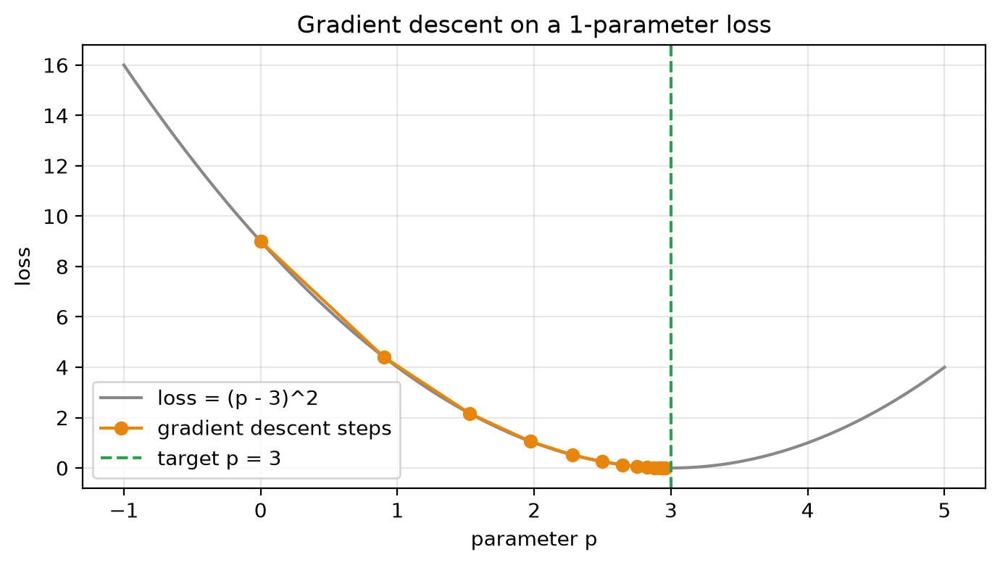
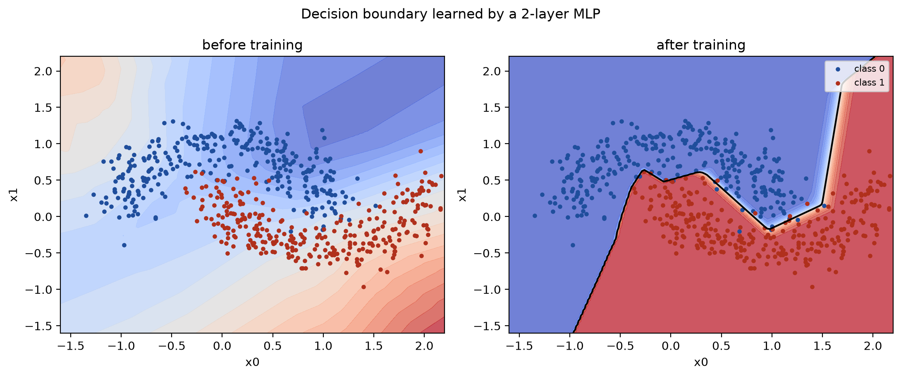
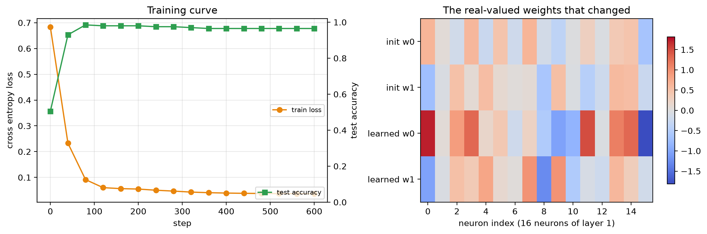

<!-- This file is generated by scripts/build_tutorials.py.
     Do not edit it directly; edit examples/24_nn_basics.py and regenerate. -->

**The very first page for people who have never done machine learning.** No DLGN appears here.
Tensors → autograd → `nn.Module` → the training loop: the whole picture of PyTorch in one pass,
on a 2-D toy classification problem (two interlocking crescents that no straight line can separate).

The subject is not accuracy but seeing with your own eyes **what training actually does**.
Three figures — gradient descent walking down a 1-parameter loss, the decision boundary before and
after training, and **the real-valued weights that actually moved** — confirm that a NN lives in the
world of real numbers.

:::note[About this page]
Estimated time: **about 8 minutes** / Environment: CPU only (no GPU required)
Source script: [`examples/24_nn_basics.py`](https://github.com/tsukushi-gate/Griffith/blob/main/examples/24_nn_basics.py)
Try it locally: [`notebooks/24_nn_basics.ipynb`](https://github.com/tsukushi-gate/Griffith/blob/main/notebooks/24_nn_basics.ipynb) (an unexecuted notebook with the same content as this page; open it with `uv run --group docs jupyter lab notebooks/`)
Every code output below is **the result of an actual run**, embedded verbatim.
:::

<!-- Colab badge: once the repository is public, replace this span with an <a> whose href
     is data-colab-url to enable "Open in Colab". -->
<span class="colab-badge" data-colab-url="https://colab.research.google.com/github/tsukushi-gate/Griffith/blob/main/notebooks/24_nn_basics.ipynb">▶ Open in Colab (enabled once the repository is public)</span>

What a neural network is — PyTorch fundamentals from zero (intro course 1/3).

**This page is the first one for people who have never done machine learning.**
Nothing about DLGNs (differentiable logic gate networks) shows up. All we do here is write and run
an ordinary neural network (NN) in PyTorch and **see for ourselves what training actually does**.

We cover the following four things, which together are the whole picture of PyTorch.

1. **Tensors** — the containers for the numbers a NN handles (spreadsheet cells gone multidimensional)
2. **Autograd** — the machinery by which PyTorch works out "which way should I move this to get closer to the answer"
3. **nn.Module** — the way to build a model by combining layers
4. **The training loop** — predict → error → correct, repeated hundreds of times, in a five-line pattern

The subject is classifying 2-D toy data (two interlocking crescents; no straight line separates them),
and we look side by side at **how the decision boundary bends** and at
**how the real-valued weights changed** behind the scenes while it did.

Run: uv run python examples/24_nn_basics.py
Expected result: test accuracy of 0.95 or more (a small 2-layer MLP, a few seconds on CPU)

In the next page, examples/25_pytorch_mlp.py, the same style of code moves on to handwritten digits (MNIST),
and after that examples/26_mlp_to_dlgn.py **replaces the same problem with logic gates**.

## Setup: the tools used on this page

All we use is PyTorch (`torch`) and matplotlib for the figures. The DLGN library never
appears on this page — first we go once around an **ordinary neural network**.

- `torch` … the core, providing tensors (multidimensional arrays of numbers) and autograd
- `torch.nn` … layers (`nn.Linear` and friends) and the way to assemble a model
- `torch.nn.functional` (`F`) … stateless functions such as loss functions

```python
import copy
import math

import matplotlib.pyplot as plt
import torch
import torch.nn as nn
import torch.nn.functional as F
```

Training results depend on randomness. Both the **initial weights** (the starting point for the
numbers a layer holds) and the **noise in the data** are drawn at random, so without fixing the
seed the numbers change on every run and you can no longer tell "did it change because I edited
the code, or because of the random numbers?"

```python
# Fix the random seed. Both the initial weights and the data noise are random,
# so without fixing it the result changes on every run (the ritual for reproducibility).
torch.manual_seed(0)
```

## Tensors: the containers for the numbers a NN handles

A **tensor** is a multidimensional array of numbers, and every NN computation happens on top of one.
0-D = scalar, 1-D = vector, 2-D = matrix, and so on as the dimensions grow.

Here we place by hand an input `x` of "3 samples x 2 features", a **weight** `w` mapping
"2 features → 1 output", and a **bias** `b` that shifts the output, then check what one NN layer
does in the single line `x @ w + b` (a matrix product plus an addition). That is all a layer really is.

### Build tensors, multiply, and add

```python
# A tensor is a "multidimensional array of numbers". 0-D = scalar, 1-D = vector, 2-D = matrix.
# Almost the same as a NumPy array, but it can live on the GPU and comes with the autograd below.
x = torch.tensor([[1.0, 2.0],
                  [3.0, 4.0],
                  [5.0, 6.0]])   # 3 samples x 2 features
w = torch.tensor([[0.5],
                  [-1.0]])       # the "weights" for 2 features -> 1 output
b = torch.tensor([0.1])          # the offset (bias)
print(f'x.shape={tuple(x.shape)}  w.shape={tuple(w.shape)}')
```

```text title="Output"
x.shape=(3, 2)  w.shape=(2, 1)
```

`@` is the matrix product operator. The answer on the first row is
$1.0 \times 0.5 + 2.0 \times (-1.0) + 0.1 = -1.4$, which matches the hand computation.
**Multiply and add** is all there is inside a layer, and training is nothing more than
"changing the values of this `w` and `b` into good ones".

```python
# All a NN really computes is this "multiply and add" (a matrix product).
# The first row is 1.0*0.5 + 2.0*(-1.0) + 0.1 = -1.4.
print(f'x @ w + b =\n{x @ w + b}')
```

```text title="Output"
x @ w + b =
tensor([[-1.4000],
        [-2.4000],
        [-3.4000]])
```

## Autograd: let the machine work out which way to move

Searching for a good `w` by hand is impossible, so we let the machine compute "which way would
make this better". That information is the **gradient**: a single number saying "how much does the
loss increase if I increase this parameter a little".

As the smallest possible example we use a loss with just one parameter $p$,
$\mathrm{loss} = (p-3)^2$. It is a plain quadratic, minimized at $p=3$.
A tensor marked `requires_grad=True` remembers the history of the computation, and calling
`loss.backward()` puts the gradient into `p.grad`.

### Compute a single gradient

```python
# For a tensor marked requires_grad=True, PyTorch can trace the values computed from it
# and later work out "how much does the result change if I nudge this number"(= the gradient).
p = torch.tensor(0.0, requires_grad=True)
loss = (p - 3.0) ** 2            # just a quadratic that gets smaller as p approaches 3
loss.backward()                  # compute the gradient and put it in p.grad
```

Differentiating by hand gives $\frac{d}{dp}(p-3)^2 = 2(p-3) = 2(0-3) = -6$.
The value autograd returns matches it — confirmation that PyTorch is not magic, just the chain
rule applied mechanically.

```python
# By hand, d/dp (p-3)^2 = 2(p-3) = 2*(0-3) = -6. The same value is in there.
print(f'\nloss={loss.item():.1f}  dloss/dp={p.grad.item():.1f}')
print('勾配が負 = p を増やせば損失が減る、という向きの情報')
```

    
```text title="Output"
loss=9.0  dloss/dp=-6.0
勾配が負 = p を増やせば損失が減る、という向きの情報
```

### Gradient descent: step a little in the direction opposite the gradient

Once you know the gradient, all that is left is to **move a little in the opposite direction**.
That is **gradient descent**, with the update rule
$p \leftarrow p - \eta \cdot \frac{d\mathrm{loss}}{dp}$.
$\eta$ (`lr` in the code) is the **learning rate**, the size of one step: too large and you jump
over the valley and diverge, too small and you never arrive.

We move in the opposite direction because the gradient points "the way that increases the loss".
Since we want to **decrease** the loss, the sign has to be flipped.

```python
# That is all training really is: "measure the slope, take a step down the hill", repeated.
# lr (the learning rate) is the step size; too large and you overshoot, too small and you go nowhere.
lr = 0.15
p = torch.tensor(0.0, requires_grad=True)
trajectory = [p.item()]
for _ in range(12):
    loss = (p - 3.0) ** 2
    loss.backward()
    with torch.no_grad():        # this is the training update, so no need to record derivatives
        p -= lr * p.grad         # move in the direction "opposite" the gradient
    p.grad = None                # gradients accumulate, so clear them every time
    trajectory.append(p.item())
print('\np の軌跡: ' + ' → '.join(f'{v:.2f}' for v in trajectory[:6]) + ' → ...')
print(f'12ステップ後: p={trajectory[-1]:.4f}(正解は 3.0)')
```

    
```text title="Output"
p の軌跡: 0.00 → 0.90 → 1.53 → 1.97 → 2.28 → 2.50 → ...
12ステップ後: p=2.9585(正解は 3.0)
```

### Figure 1: gradient descent walking down the valley

The grey curve is the loss $(p-3)^2$ and the orange dots are the position of $p$ at each step.
Watch the twelve steps' worth of dots being drawn into the bottom of the valley
(the green dashed line $p=3$).

```python
# The curve is the loss, the dots are the position of p at each step. The further right,
# the closer to the bottom of the valley (= the answer).
# This is the smallest unit of "training"; in a NN there are just tens of thousands to
# hundreds of millions of this p.
grid = torch.linspace(-1.0, 5.0, 200)
fig, ax = plt.subplots(figsize=(7, 4))
ax.plot(grid, (grid - 3.0) ** 2, color='#888888', label='loss = (p - 3)^2')
traj = torch.tensor(trajectory)
ax.plot(traj, (traj - 3.0) ** 2, 'o-', color='#e8850c', label='gradient descent steps')
ax.axvline(3.0, ls='--', color='#2e9e4f', label='target p = 3')
ax.set_xlabel('parameter p')
ax.set_ylabel('loss')
ax.set_title('Gradient descent on a 1-parameter loss')
ax.legend()
ax.grid(alpha=0.3)
fig.tight_layout()
plt.show()
```

    

    

**What to read from it**: the dots get closer together as they approach the bottom of the valley.
That is because the gradient $2(p-3)$ shrinks as it nears the bottom, so the stride
$\eta \cdot 2(p-3)$ automatically shrinks too. "Big steps at first, careful ones once you are close"
is behaviour nobody wrote explicitly; gradient descent produces it on its own. Training a NN just
has tens of thousands to hundreds of millions of these dots — what happens is the same as this
figure all the way through.

## Dataset: two classes that no straight line can separate

We prepare one classification problem. **two moons** (two interlocking crescents) is toy data
deliberately shaped so that **no single straight line can ever separate it**, the standard way to
test "can the model build a curved boundary".

If the problem were linearly separable there would be no need to stack layers. We pick this shape
precisely so that **the reason for stacking layers** is visible.

```python
# We build the two interlocking crescents (two moons) ourselves.
# The point is that the shape is deliberately impossible to separate with a single straight line.
N_PER_CLASS = 300
```

```python
def make_moons(n_per_class, noise=0.18):
    """Build a two-class toy dataset made of two crescents."""
    t = torch.rand(n_per_class) * math.pi
    outer = torch.stack([torch.cos(t), torch.sin(t)], dim=1)
    inner = torch.stack([1.0 - torch.cos(t), 0.5 - torch.sin(t)], dim=1)
    points = torch.cat([outer, inner], dim=0) + noise * torch.randn(2 * n_per_class, 2)
    labels = torch.cat([torch.zeros(n_per_class), torch.ones(n_per_class)]).long()
    return points, labels
```

```python
points, labels = make_moons(N_PER_CLASS)
```

### Split into training data and test data

Of the 600 points, 400 go to **training** and the remaining 200 to **test**. The test set consists
of problems never used in training, set aside to measure whether the model learned the rule rather
than memorizing by rote. Accuracy measured on the training data alone can be pushed arbitrarily
high by memorization, so it is not a useful metric.

```python
# Split into training data and test data. The test set is "problems not used in training",
# set aside to measure whether the model learned the rule rather than memorizing.
perm = torch.randperm(points.shape[0])
train_idx, test_idx = perm[:400], perm[400:]
train_x, train_y = points[train_idx], labels[train_idx]
test_x, test_y = points[test_idx], labels[test_idx]
print(f'\ntrain={tuple(train_x.shape)} test={tuple(test_x.shape)}(2次元入力 / 2クラス)')
```

    
```text title="Output"
train=(400, 2) test=(200, 2)(2次元入力 / 2クラス)
```

## Model definition: stack layers with nn.Module

`nn.Sequential` is the way of assembling "pass through the layers from top to bottom". Here we
stack three `nn.Linear` layers (multiply and add) alternating with `nn.ReLU` (zero out negatives).

**Why insert ReLU** — no matter how many `nn.Linear` layers you stack, composing them collapses
into a single `nn.Linear` (the composition of linear maps is a linear map). In other words the
boundary would stay a straight line. Inserting a single **nonlinear function** in between stops
that collapse and makes it possible to build a curved boundary stitched together from line
segments. ReLU $\max(0, z)$ is the cheapest way to do it.

The two outputs of the final `nn.Linear(16, 2)` are **logits**, the raw score for each class; the
larger one becomes the predicted class.

```python
# nn.Linear(2, 16) is a layer that "multiplies and adds 2 inputs into 16 neurons".
# Inside it are a 2x16 weight matrix and 16 biases, and those are all the numbers training moves.
# ReLU adds nonlinearity (it zeroes out negatives). Without it, no matter how many layers you
# stack the result stays a straight line and a curved boundary like the crescents is impossible.
model = nn.Sequential(
    nn.Linear(2, 16),
    nn.ReLU(),
    nn.Linear(16, 16),
    nn.ReLU(),
    nn.Linear(16, 2),   # 2 outputs = a score (logit) per class
)
print(model)
n_params = sum(p.numel() for p in model.parameters())
print(f'学習される実数パラメータ: {n_params} 個')
```

```text title="Output"
Sequential(
  (0): Linear(in_features=2, out_features=16, bias=True)
  (1): ReLU()
  (2): Linear(in_features=16, out_features=16, bias=True)
  (3): ReLU()
  (4): Linear(in_features=16, out_features=2, bias=True)
)
学習される実数パラメータ: 354 個
```

```python
# Keep a copy of the model before training (so we can put the decision boundaries
# before and after training side by side later).
model_init = copy.deepcopy(model)
```

## The training loop: predict → error → correct

This is the heart of training, and yet there are only four lines to write. What is more,
**this pattern does not change whatever the model is** — in intro 3, where the insides are
replaced by logic gates, this loop needs no rewriting at all.

- `F.cross_entropy` … the classic **loss** for classification. It gets smaller the higher the
  score of the correct class is compared to the others, and lowering it is the goal of training
- `opt.step()` … updates every parameter according to its gradient. Here we use not plain
  gradient descent but **Adam** (an improved version that adjusts the stride automatically for
  each parameter). It reduces the work of tuning learning rates by hand, so in practice it is
  the first choice

```python
# Whatever the model, a PyTorch training loop fits into this five-line pattern.
#   1. opt.zero_grad()  clear the previous gradients
#   2. loss = ...       predict and measure the error (cross_entropy = the classic for classification)
#   3. loss.backward()  compute the gradients of every parameter automatically
#   4. opt.step()       nudge every parameter in the direction opposite its gradient
# Running this hundreds of times is "training".
opt = torch.optim.Adam(model.parameters(), lr=0.01)
history = []
for step in range(601):
    opt.zero_grad()
    loss = F.cross_entropy(model(train_x), train_y)
    loss.backward()
    opt.step()
    if step % 40 == 0:
        with torch.no_grad():
            test_acc = (model(test_x).argmax(-1) == test_y).float().mean().item()
        history.append((step, loss.item(), test_acc))
        print(f'step {step:>4}  loss={loss.item():.4f}  test acc={test_acc:.4f}')

steps, losses, accs = zip(*history, strict=True)
final_acc = accs[-1]
print(f'\n最終 test accuracy = {final_acc:.4f}')
assert final_acc > 0.90, f'test acc={final_acc:.4f} が低すぎる'
```

```text title="Output"
step    0  loss=0.6836  test acc=0.5050
step   40  loss=0.2326  test acc=0.9300
step   80  loss=0.0914  test acc=0.9850
step  120  loss=0.0602  test acc=0.9800
step  160  loss=0.0565  test acc=0.9800
step  200  loss=0.0548  test acc=0.9800
step  240  loss=0.0503  test acc=0.9750
step  280  loss=0.0469  test acc=0.9750
step  320  loss=0.0430  test acc=0.9700
step  360  loss=0.0407  test acc=0.9650
step  400  loss=0.0392  test acc=0.9650
step  440  loss=0.0382  test acc=0.9650
step  480  loss=0.0376  test acc=0.9650
step  520  loss=0.0371  test acc=0.9650
step  560  loss=0.0366  test acc=0.9650
step  600  loss=0.0363  test acc=0.9650

最終 test accuracy = 0.9650
```

## Evaluation and visualization: how did the boundary bend?

**What to read from it**: in the log above the loss falls monotonically and the test accuracy
climbs from 0.5 (= random guessing) to over 0.95. "Training progressed" means exactly that these
two numbers moved this way.

Numbers alone, though, do not tell you **what kind of boundary was drawn**. So we apply the model
over the whole plane and paint the prediction at each position as a color. The next function
returns the grid for that.

### A helper that applies the model over the whole plane

```python
def decision_grid(net, span=2.2, n=160):
    """Apply the model over the whole plane and return a grid of the probability of class 1."""
    axis = torch.linspace(-1.6, span, n)
    gx, gy = torch.meshgrid(axis, axis, indexing='xy')
    flat = torch.stack([gx.reshape(-1), gy.reshape(-1)], dim=1)
    with torch.no_grad():
        prob = F.softmax(net(flat), dim=-1)[:, 1]
    return axis, prob.reshape(n, n)
```

### Figure 2: training makes the decision boundary "bend"

The background color is "which class the model would answer if a point were at that position":
redder is class 1, bluer is class 0. The solid black line is the **decision boundary** (where the
prediction switches). Left is before training, right is after. The scattered dots are the original
data itself.

```python
# The background color is "which class the model thinks it is". On the left, before training
# (nonsense); on the right, after training, the boundary bends to thread between the two crescents.
# What bends it is ReLU, and what decides how it bends are the learned weights.
axis_init, prob_init = decision_grid(model_init)
axis_done, prob_done = decision_grid(model)
fig, axes = plt.subplots(1, 2, figsize=(11, 4.6))
for ax, axis, prob, name in (
    (axes[0], axis_init, prob_init, 'before training'),
    (axes[1], axis_done, prob_done, 'after training'),
):
    ax.contourf(axis, axis, prob, levels=20, cmap='coolwarm', alpha=0.75)
    ax.contour(axis, axis, prob, levels=[0.5], colors='k', linewidths=1.5)
    for cls, color in ((0, '#1f4e9c'), (1, '#b0301c')):
        sel = labels == cls
        ax.scatter(points[sel, 0], points[sel, 1], s=8, c=color, label=f'class {cls}')
    ax.set_title(name)
    ax.set_xlabel('x0')
    ax.set_ylabel('x1')
    ax.set_xlim(-1.6, 2.2)  # match the range of the grid we painted the background over
    ax.set_ylim(-1.6, 2.2)
axes[1].legend(loc='upper right', fontsize=8)
fig.suptitle('Decision boundary learned by a 2-layer MLP', fontsize=12)
fig.tight_layout()
plt.show()
```

    

    

**What to read from it**: before training (left) the boundary is close to a straight line left to
chance, cutting the crescents clean in half. After training (right) it **bends** so as to thread
between the two crescents. What creates that bend is the kink of ReLU, and what decides where to
kink are the learned weights. Intro 3 redraws this same figure in its logic gate version.

### Figure 3: the training curve, and the "weights" that moved

On the left is how training progresses (orange = loss, green = test accuracy). On the right is a
heatmap of the $2 \times 16$ weight matrix of the first layer, stacked before and after training,
with red for positive and blue for negative values. It is the figure that confirms
**the change of the boundary above is nothing but the result of these 32 numbers moving**.

**What to read from it (stated in advance)**: on the left the loss falls monotonically and the
accuracy climbs in steps before topping out above 0.95. On the right, the top two rows (before
training) are an almost uniform pale color, while the bottom two rows (after training) separate
clearly into deep red and deep blue — meaning each neuron has begun to take on a role such as
"responds more the larger $x_0$ is / is suppressed when $x_1$ is large".
And **what moved are real numbers with awkward values**, not expressible as 0/1.
From the next page on, these real-valued weights are replaced wholesale by
**the truth tables of logic gates**.

```python
# On the left, how training progresses (the loss goes down, the accuracy goes up).
# On the right, the 2x16 weight matrix of the first layer before and after training. Just those
# 32 real numbers moving is what bent the boundary above — **what a NN learns is real-valued
# weights**, which is the point this figure makes.
w_init = model_init[0].weight.detach().T
w_done = model[0].weight.detach().T
vmax = float(max(w_init.abs().max(), w_done.abs().max()))
fig, axes = plt.subplots(1, 2, figsize=(12, 4))
axes[0].plot(steps, losses, 'o-', color='#e8850c', label='train loss')
axes[0].set_xlabel('step')
axes[0].set_ylabel('cross entropy loss')
axes[0].grid(alpha=0.3)
twin = axes[0].twinx()
twin.plot(steps, accs, 's-', color='#2e9e4f', label='test accuracy')
twin.set_ylabel('test accuracy')
twin.set_ylim(0, 1.02)
axes[0].set_title('Training curve')
axes[0].legend(loc='center right', fontsize=8)
twin.legend(loc='lower right', fontsize=8)
stacked = torch.cat([w_init, w_done], dim=0)
im = axes[1].imshow(stacked, cmap='coolwarm', vmin=-vmax, vmax=vmax, aspect='auto')
axes[1].set_yticks([0, 1, 2, 3])
axes[1].set_yticklabels(['init w0', 'init w1', 'learned w0', 'learned w1'])
axes[1].set_xlabel('neuron index (16 neurons of layer 1)')
axes[1].set_title('The real-valued weights that changed')
fig.colorbar(im, ax=axes[1], shrink=0.8)
fig.tight_layout()
plt.show()

moved = (w_done - w_init).abs().mean().item()
print(f'1層目の重みの平均移動量: {moved:.4f}')
print('この「実数の重み」が、次のページ以降で論理ゲートの真理値表へ置き換わる。')
```

    

    

```text title="Output"
1層目の重みの平均移動量: 0.4260
この「実数の重み」が、次のページ以降で論理ゲートの真理値表へ置き換わる。
```

## What to read next

- [Intro 2. Build an MLP in PyTorch](/en/tutorials/pytorch-mlp/) — the same style of code, applied to handwritten digits
- [What is a neural network, really?](/en/explanation/ai-basics/) — a read for those who want the math
- [From NN to DLGN](/en/explanation/nn-to-dlgn/) — a map of what stays the same and what changes

<!-- i18n:source=tutorials/nn-basics.md hash=5a4783bc0f57 -->
