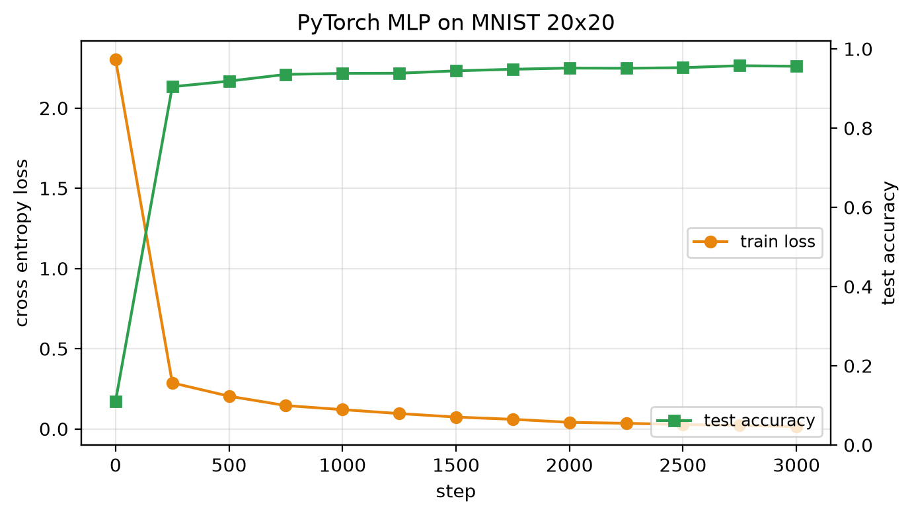
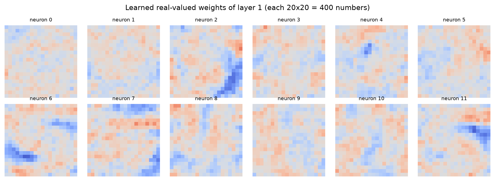
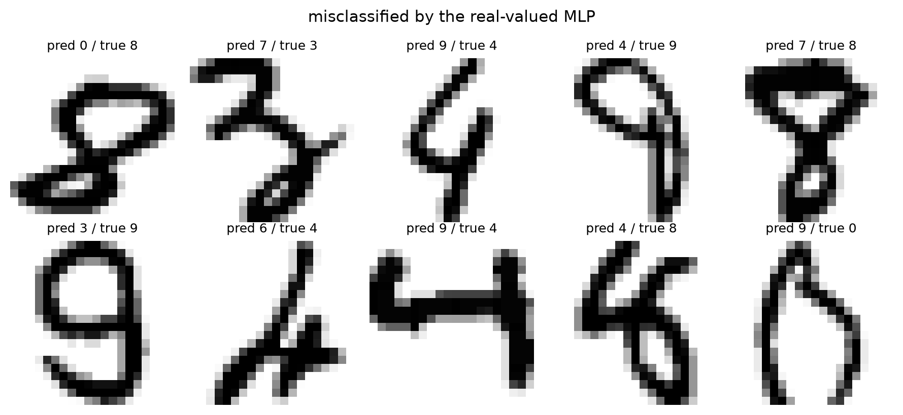

<!-- This file is generated by scripts/build_tutorials.py.
     Do not edit it directly; edit examples/25_pytorch_mlp.py and regenerate. -->

With the same toolkit as the previous page, we scale up to handwritten digits (MNIST 20x20).
An MLP that is nothing but three stacked `nn.Linear` layers reaches test accuracy 0.95.

The highlight of this page is that **"where the real-valued weights live"** becomes a picture.
The first-layer weights have the same 400 dimensions as the input, so laying them back out as
20x20 shows **the shape that neuron is looking for** directly. On the next page,
these weights are replaced wholesale by **the truth tables of logic gates**.

:::note[About this page]
Estimated time: **about 8 minutes** / Environment: CPU only (no GPU required)
Source script: [`examples/25_pytorch_mlp.py`](https://github.com/tsukushi-gate/Griffith/blob/main/examples/25_pytorch_mlp.py)
Try it locally: [`notebooks/25_pytorch_mlp.ipynb`](https://github.com/tsukushi-gate/Griffith/blob/main/notebooks/25_pytorch_mlp.ipynb) (an unexecuted notebook with the same content as this page; open it with `uv run --group docs jupyter lab notebooks/`)
Every code output below is **the result of an actual run**, embedded verbatim.
:::

<!-- Colab badge: once the repository is public, replace this span with an <a> whose href
     is data-colab-url to enable "Open in Colab". -->
<span class="colab-badge" data-colab-url="https://colab.research.google.com/github/tsukushi-gate/Griffith/blob/main/notebooks/25_pytorch_mlp.ipynb">▶ Open in Colab (enabled once the repository is public)</span>

Build a small MLP in PyTorch and read handwritten digits (introductory course 2/3).

The "tensors, autograd, nn.Module, training loop" you saw on the [previous page](/en/tutorials/nn-basics/)
are carried over as-is to **real data**. The subject is MNIST handwritten digits cropped to 20x20:
the input is 400 numbers (pixel brightness) and the output is the 10 classes 0-9.

There are only three things to write, and all of them use the same tools as the previous page.

- An **MLP (multilayer perceptron)** of three stacked `nn.Linear` layers
- A loss from `F.cross_entropy`
- The `opt.zero_grad() → backward() → step()` training loop

The theme of this page is not accuracy itself but grasping with your own eyes
**"where the real-valued weights live"**. The first-layer weights have the same 400 dimensions
as the input, so laying them back out as a 20x20 image turns **"the shape that neuron is looking for"**
into a picture. On the next page, examples/26_mlp_to_dlgn.py, the weights seen here are replaced
wholesale by **the truth tables of logic gates**.

Run: uv run python examples/25_pytorch_mlp.py
Expected result: test accuracy around 0.95 (an MLP with 2 hidden layers, about 10 seconds on CPU)

## Setup: imports and the random seed

The tools are exactly the same as in [intro 1](/en/tutorials/nn-basics/); the only addition is
loading the data. `load_mnist20x20` is the MNIST loader bundled with this library, and it returns
images with the black border dropped from 28x28 down to **20x20 = 400 pixels**.

We go down to 400 pixels to match the official recipe of the difflogic paper, and using the
**same input** as the logic gate version on the next page keeps the comparison fair.

```python
import matplotlib.pyplot as plt
import torch
import torch.nn as nn
import torch.nn.functional as F
from torch.utils.data import DataLoader, Subset

from griffith_logic.datasets import load_mnist20x20
```

```python
# Both the initial weights and the mini-batch selection are random, so fix the seed for reproducibility.
torch.manual_seed(0)
```

### Hyperparameters (the numbers a human decides before training)

A **hyperparameter** is a setting that training does not move and a human fixes in advance
(what training moves are the "parameters" = the weights). Here there are four of them — the width
of the hidden layer, the number of iterations, the mini-batch size, and how many images to use —
all pinned to values that fit in about 10 seconds on CPU.

```python
# A reduced recipe that fits in about 10 seconds on CPU. Accuracy rises as you increase HIDDEN or STEPS.
HIDDEN = 128      # number of neurons in the hidden layer
STEPS = 3000      # training iterations
BATCH = 128       # mini-batch size
N_TRAIN = 20000   # number of training images (a subset of all 60000)
N_TEST = 2000     # number of images used for evaluation
```

## Dataset: handwritten digits, MNIST 20x20

One image consists of 20x20 pixels, and we stretch it into a single row and feed it to the model
as a **400-dimensional vector**. Each pixel value is a **real number** from 0 (white) to 1 (black).

Note that we pass `binarize_threshold=None` and keep the values real rather than binarizing them.
A real-valued NN can eat real-valued input directly — and this is exactly the place where the
logic gate version on the next page will have to "drop down to bits".

```python
# load_mnist20x20 returns MNIST cropped from 28x28 to 20x20 by dropping the black border.
# The 400 pixel values (real numbers in [0,1]) become the model input directly.
# Exactly the same data is used by the logic gate version on the next page, so the comparison is fair.
train_set, test_set = load_mnist20x20(binarize_threshold=None)
```

```python
def materialize(dataset, n):
    """Pack the first n items into an (N, 400) tensor and labels (skips per-step preprocessing)."""
    subset = Subset(dataset, range(n))
    x, y = next(iter(DataLoader(subset, batch_size=n)))
    return x.reshape(n, -1), y
```

```python
train_x, train_y = materialize(train_set, N_TRAIN)
test_x, test_y = materialize(test_set, N_TEST)
print(f'train={tuple(train_x.shape)} test={tuple(test_x.shape)} '
      f'(20x20=400次元入力 / 10クラス)')
print(f'ピクセル値の範囲: {train_x.min():.2f} 〜 {train_x.max():.2f}(実数)')
```

```text title="Output"
train=(20000, 400) test=(2000, 400) (20x20=400次元入力 / 10クラス)
ピクセル値の範囲: 0.00 〜 1.00(実数)
```

## Model definition: an MLP of three nn.Linear layers

An **MLP (multilayer perceptron)** is the most naive kind of NN: nothing but `nn.Linear` layers
and activation functions stacked alternately. Here we stack three of them while narrowing the
width, 400 → 128 → 64 → 10.

**Why narrow the width** — the earlier layers build features such as "lines and curves" out of
"collections of pixels", and the later ones judge "which digit that combination of features is";
writing that division of labour down plainly gives this shape. The final 10 outputs are the
per-class logits (raw scores), and passing them through `softmax` turns them into
"the probability of being that digit".

```python
# 400 → 128 → 64 → 10. What each nn.Linear holds is a weight matrix and a bias;
# the first layer, for instance, holds 51200 real numbers in a 400x128 matrix. That is all of
# "the quantity that gets learned".
# The final 10 outputs are per-class scores (logits), and passing them through
# softmax turns them into "the probability of being that digit".
model = nn.Sequential(
    nn.Linear(400, HIDDEN),
    nn.ReLU(),
    nn.Linear(HIDDEN, 64),
    nn.ReLU(),
    nn.Linear(64, 10),
)
print(model)
n_params = sum(p.numel() for p in model.parameters())
print(f'学習される実数パラメータ: {n_params:,} 個(すべて掛け算に使われる)')
```

```text title="Output"
Sequential(
  (0): Linear(in_features=400, out_features=128, bias=True)
  (1): ReLU()
  (2): Linear(in_features=128, out_features=64, bias=True)
  (3): ReLU()
  (4): Linear(in_features=64, out_features=10, bias=True)
)
学習される実数パラメータ: 60,234 個(すべて掛け算に使われる)
```

## Training: run it with mini-batches

The body of the loop is identical to intro 1, with a single difference — instead of using all the
data every time, we draw only `BATCH` images at random and update from them, which is
**mini-batch training**.

**Why mini-batches** — computing the gradient over all 20000 images makes one step far too heavy.
A gradient computed from only part of the data is a noisy approximation of the true gradient, but
it buys you many more steps, so for the same amount of compute time it gets further. The noise
itself also helps escape local minima.

```python
# Exactly the same 5-line pattern as the previous page. The only difference is that, since there is
# a lot of data, each iteration randomly draws only BATCH images instead of all of them (mini-batch training).
# F.cross_entropy applies softmax internally, so the model can just return raw logits.
opt = torch.optim.Adam(model.parameters(), lr=1e-3)
history = []  # (step, train loss, test acc)

for step in range(STEPS + 1):
    if step % 250 == 0:
        with torch.no_grad():
            test_acc = (model(test_x).argmax(-1) == test_y).float().mean().item()
            train_loss = F.cross_entropy(model(train_x[:2000]), train_y[:2000]).item()
        history.append((step, train_loss, test_acc))
        print(f'step {step:>5}  loss={train_loss:.4f}  test acc={test_acc:.4f}')

    idx = torch.randint(0, N_TRAIN, (BATCH,))
    opt.zero_grad()
    loss = F.cross_entropy(model(train_x[idx]), train_y[idx])
    loss.backward()
    opt.step()

steps, losses, accs = zip(*history, strict=True)
final_acc = accs[-1]
print(f'\n最終 test accuracy = {final_acc:.4f}')
assert final_acc > 0.88, f'test acc={final_acc:.4f} が低すぎる'
```

```text title="Output"
step     0  loss=2.3037  test acc=0.1105
step   250  loss=0.2868  test acc=0.9045

step   500  loss=0.2039  test acc=0.9185
step   750  loss=0.1454  test acc=0.9355

step  1000  loss=0.1200  test acc=0.9380
step  1250  loss=0.0955  test acc=0.9385

step  1500  loss=0.0735  test acc=0.9440
step  1750  loss=0.0599  test acc=0.9470

step  2000  loss=0.0408  test acc=0.9525
step  2250  loss=0.0355  test acc=0.9500

step  2500  loss=0.0275  test acc=0.9515
step  2750  loss=0.0210  test acc=0.9570

step  3000  loss=0.0140  test acc=0.9540

最終 test accuracy = 0.9540
```

## Evaluation: reading the training curve

### Figure 1: loss and test accuracy

Orange is the loss on the training data (left axis), green is the test accuracy (right axis).
Overlaying the two axes lets a single figure confirm "when the loss falls, does the accuracy
really rise".

```python
# The loss (orange) falls and the test accuracy (green) rises. That is the evidence learning is progressing.
# In a real-valued NN there is only one such line — in the logic gate version on the next page
# it becomes two, "soft and hard", and that is the biggest difference.
fig, ax = plt.subplots(figsize=(7, 4))
ax.plot(steps, losses, 'o-', color='#e8850c', label='train loss')
ax.set_xlabel('step')
ax.set_ylabel('cross entropy loss')
ax.grid(alpha=0.3)
twin = ax.twinx()
twin.plot(steps, accs, 's-', color='#2e9e4f', label='test accuracy')
twin.set_ylabel('test accuracy')
twin.set_ylim(0, 1.02)
ax.set_title('PyTorch MLP on MNIST 20x20')
ax.legend(loc='center right', fontsize=9)
twin.legend(loc='lower right', fontsize=9)
fig.tight_layout()
plt.show()
```

    

    

**What to read from it**: in the first few hundred steps the loss plunges and the accuracy passes
0.9. After that it settles gently onto around 0.95. Notice that there is **only one curve** —
in a real-valued NN "the model being trained" and "the model you use" are the same thing, so one
kind of accuracy is enough to measure. In the DLGN on the next page this becomes **two** curves,
soft and hard.

## Looking at the learned "real-valued weights"

The theme of this page. We look at what the NN learned directly, as a **picture** rather than as numbers.

### Figure 2: lay the first-layer weights back out as 20x20

The first-layer weights amount to 400 numbers per neuron, the same number of dimensions as the
input image. So laying those 400 numbers back out as 20x20 gives a map of **where in the image
that neuron looks and responds**. Red is a positive weight (a dark spot there strengthens the
response), blue a negative one (a dark spot there suppresses it). We lay out twelve neurons.

```python
# The first-layer weights amount to 400 numbers per neuron. Since the input is a 20x20 image,
# laying those 400 numbers back out as 20x20 turns "the shape that neuron prefers" into a picture.
# Red = positive weight (it responds when that spot is bright), blue = negative weight (it is suppressed when that spot is bright).
# **What the NN learns is this shading of color**, not the structure (what connects to what).
w1 = model[0].weight.detach()
vmax = float(w1.abs().max())
fig, axes = plt.subplots(2, 6, figsize=(11, 4))
for j, ax in enumerate(axes.ravel()):
    ax.imshow(w1[j].reshape(20, 20), cmap='coolwarm', vmin=-vmax, vmax=vmax)
    ax.set_title(f'neuron {j}', fontsize=8)
    ax.set_axis_off()
fig.suptitle('Learned real-valued weights of layer 1 (each 20x20 = 400 numbers)',
             fontsize=11)
fig.tight_layout()
plt.show()

print(f'1層目の重み: 最小 {w1.min():.3f} / 最大 {w1.max():.3f} / '
      f'平均絶対値 {w1.abs().mean():.3f}')
print('どれも中途半端な実数であることに注目(0/1 では表せない)。')
```

    

    

```text title="Output"
1層目の重み: 最小 -0.553 / 最大 0.407 / 平均絶対値 0.070
どれも中途半端な実数であることに注目(0/1 では表せない)。
```

**What to read from it**: in every neuron a pattern that looks like a "template" emerges, with red
and blue speckled around the center of the image. What was learned is not the **structure** (what
connects to what) but this **shading of color = the real values**, and those values are awkward
decimals averaging 0.07 in absolute value (see the output just above). It is precisely this real
number, which 0/1 cannot express, that requires a multiplication at every inference — that is, the
very reason multipliers are needed.

## Looking at the misclassifications

### Figure 3: the digits it got wrong

Finally we lay out ten images the model got wrong. "How it fails" says more about a model's
character than the accuracy number does — if it fails on shapes a human would hesitate over too,
the model is capturing shape.

**What to read from it (stated in advance)**: what lines up are only pairs a human would waver
over for a moment as well, such as 4 and 9, 7 and 1, or 3 and 5; unrelated errors such as reading
a 0 as a 7 do not appear. It gets roughly 100 of 2000 images wrong — that is the level an
"ordinary MLP with real-valued weights" reaches, and it becomes the **baseline for comparison**
when we replace it with logic gates on the next page.

```python
# Line up the misclassifications. If they concentrate on pairs that are confusing for humans too,
# such as 1 vs 7 or 4 vs 9, the model is capturing shape sensibly.
with torch.no_grad():
    pred = model(test_x).argmax(-1)
wrong = (pred != test_y).nonzero(as_tuple=True)[0][:10]
print(f'誤分類 {int((pred != test_y).sum())} / {N_TEST} 枚(先頭10枚を表示)')

fig, axes = plt.subplots(2, 5, figsize=(9, 4.2))
for ax, i in zip(axes.ravel(), wrong.tolist(), strict=False):
    ax.imshow(test_x[i].reshape(20, 20), cmap='gray_r')
    ax.set_title(f'pred {int(pred[i])} / true {int(test_y[i])}', fontsize=9)
    ax.set_axis_off()
for ax in axes.ravel()[len(wrong):]:
    ax.set_axis_off()
fig.suptitle('misclassified by the real-valued MLP', fontsize=11)
fig.tight_layout()
plt.show()

print('\nここまでが「普通の NN」。次のページで、この同じ問題を')
print('nn.Linear → LutLayer / softmax出力 → GroupSum と置き換えて論理ゲートで解く。')
```

```text title="Output"
誤分類 93 / 2000 枚(先頭10枚を表示)
```

    

    

    
```text title="Output"
ここまでが「普通の NN」。次のページで、この同じ問題を
nn.Linear → LutLayer / softmax出力 → GroupSum と置き換えて論理ゲートで解く。
```

## What to read next

- [Intro 3. Replace the MLP with a DLGN](/en/tutorials/mlp-to-dlgn/) — solve the same problem with logic gates
- [Intro 1. NN & PyTorch Basics](/en/tutorials/nn-basics/)
- [1. Train on MNIST](/en/tutorials/mnist/) — the main track, solving the same MNIST with logic gates from the start

<!-- i18n:source=tutorials/pytorch-mlp.md hash=119bc0a9ed2a -->
