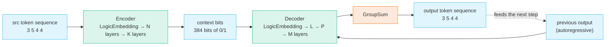
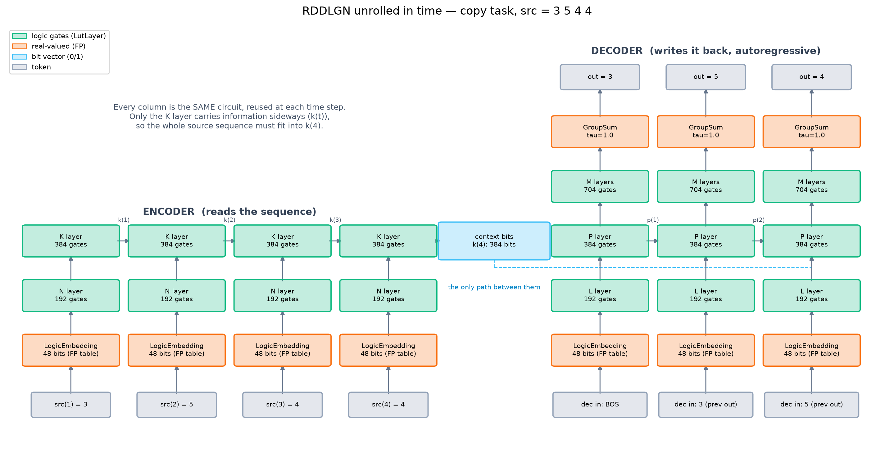
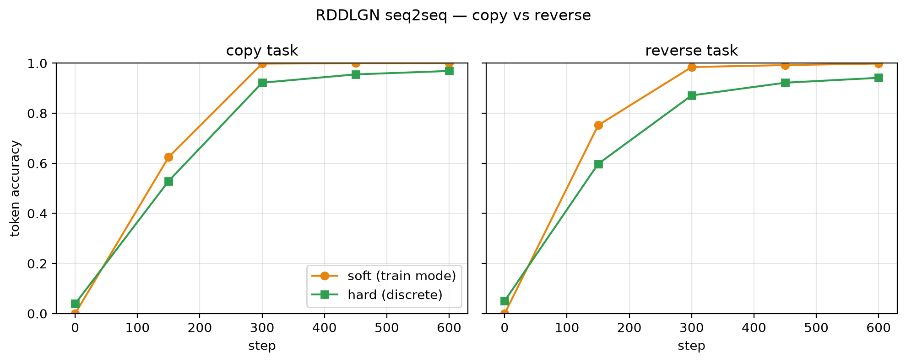
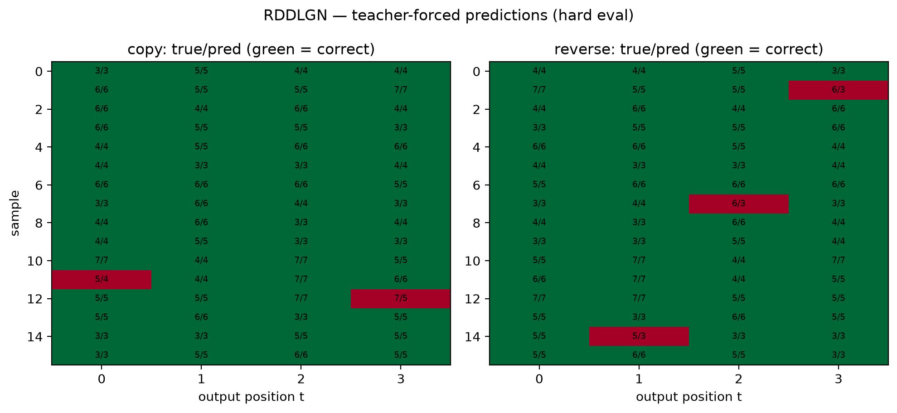
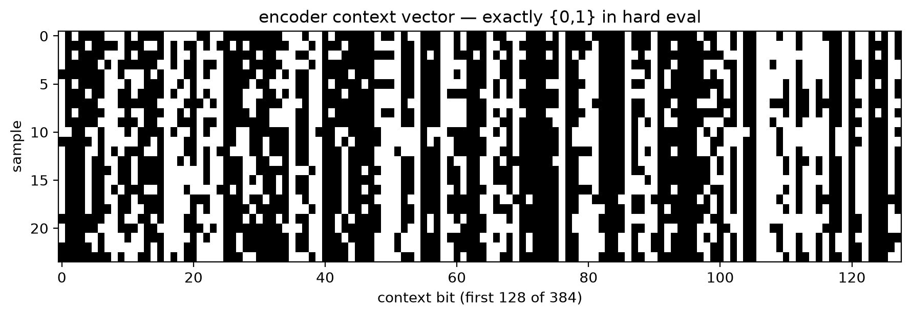

<!-- This file is auto-generated by scripts/build_tutorials.py.
     Do not edit it directly; edit examples/08_rddlgn_seq2seq.py and regenerate. -->

Using **RDDLGN**, where every fully connected layer of the encoder and decoder is replaced
wholesale by LUTs, we train the sequence transformation tasks copy / reverse. This installment
measures how far a fixed-length bottleneck without attention (a 384-bit context vector) can carry a sequence.

**The pitfall is part of the lesson too**: the default `'zero'` of `RDDLGNConfig.init_mode`
sets the initial state to 0.5 (a neutral value), so non-binary values flow into the context vector even though it should be hard eval.
Setting `init_mode='one'` closes the hard path as purely Boolean and even raises accuracy (0.938 → 0.969).

:::tip[What you'll learn]
1. How to build a sequence transformation model with an RNN whose fully connected layers are replaced wholesale by LUTs (RDDLGN)
2. A measurement of how far a fixed-length bottleneck without attention can carry a sequence
3. That the choice of `init_mode` governs both the pure Booleanness of the hard path and the accuracy (0.938 → 0.969)

**Prerequisites**

- [1. Training on MNIST](/en/tutorials/mnist/)
- [Choosing a Parameterization](/en/guides/parameterization/) — why init_mode matters
:::

:::note[About this page]
Estimated time: **about 8 minutes** / Environment: CPU only (no GPU required)
Source script: [`examples/08_rddlgn_seq2seq.py`](https://github.com/tsukushi-gate/Griffith/blob/main/examples/08_rddlgn_seq2seq.py)
Try it yourself: [`notebooks/08_rddlgn_seq2seq.ipynb`](https://github.com/tsukushi-gate/Griffith/blob/main/notebooks/08_rddlgn_seq2seq.ipynb) (the same content as this page as an un-executed notebook; open it with `uv run --group docs jupyter lab notebooks/`)
Every code output below is the **actual result of running the code**, embedded verbatim.
:::

<!-- Colab badge: once the repository is public, replace this span with an <a> whose
     href is the data-colab-url value to enable "Open in Colab". -->
<span class="colab-badge" data-colab-url="https://colab.research.google.com/github/tsukushi-gate/Griffith/blob/main/notebooks/08_rddlgn_seq2seq.ipynb">▶ Open in Colab (enabled once the repository is public)</span>

An example of training seq2seq with RDDLGN (recurrent differentiable logic gate network).

The samples so far (XOR, MNIST) were classifiers of the form "one input → one output".
This sample builds **sequence → sequence**, that is, an encoder-decoder shaped just like a
translator, out of nothing but logic gates (LutLayer) instead of fully connected layers.

The model is RDDLGN (Bührer et al., 2025 / arXiv:2508.06097). It consists of five groups of logic gates:

    encoder  N layers … transform each token embedding per time step (feed-forward)
             K layers … recurrence along time. k_t = K([n_t ; k_{t-1}])
                        → the final k_T is the fixed-length "context vector"
    decoder  L layers … transform the output-side token embeddings (feed-forward)
             P layers … autoregressive recurrence. p_t = P([p_{t-1} ; context ; l_t])
             M layers … build the vocabulary logits from [p_t ; context ; l_t] (aggregated by GroupSum)

There is no attention. The sequence read by the encoder is **compressed into a single context vector**,
and the decoder assembles its output relying on that alone. This is the highlight of this sample:
we check whether "memory through a fixed-length bottleneck can be done with logic gates alone".

The tasks are copy (emit the input as-is) and reverse (emit the input in reverse order).
Both use synthetic data with vocabulary 8 and length 4, and the example is self-contained,
building the data the same way as CopyDataset / ReverseDataset in experiments/data/synthetic.py.

## Architecture, illustrated

First the block-level overview. Green is logic gates (LutLayer), orange is the parts that stay
real-valued, and blue is a bit vector.



Because there is no attention, everything the encoder read from the four tokens
**has to pass through these 384 bits**. That this is the only path across is the single most
important property of this model.

The detailed view, unrolled along time, is drawn as "Figure 0" below (the horizontal axis is
time, showing how the same box — the same circuit — is reused at every step, together with the
gate count of each block). What flows through it is the first real data point of the copy task,
`3 5 4 4` → `3 5 4 4`.

`⊕` means **concatenation**, not addition. The P and M layers take the long bit vector
`[p(t-1) ⊕ context ⊕ l(t)]` as their input directly.

**How it actually works** (the points that matter on a first read)

- **Token → bit vector**: a word ID is turned into a real-valued vector by an embedding table,
  then squeezed into 0–1 by a sigmoid. That is the "logic value". At eval time it is rounded to
  0/1 at the 0.5 boundary (LogicEmbedding). This is the only place that behaves like an ordinary
  real-valued NN (orange).
- **A layer is a bundle of logic gates**: N/K/L/P/M are nothing but stacked LutLayers. One
  LutLayer picks two input bits at random per gate and learns which of the 16 two-input Boolean
  functions to use, out_dim gates side by side. There is not a single matrix product.
- **Memory along time**: the K layer receives the previous step's output k(t-1)
  **concatenated onto its input** (the horizontal arrows in the figure). That alone is the path
  that carries a bit seen earlier into the next step.
- **The bottleneck**: k(T), produced after reading the whole sequence, is the context bits. The
  decoder sees only those 384 bits. Longer sequences and reordering (reverse) come down to
  whether they fit into those 384 bits.
- **Output**: GroupSum splits the bits produced by the M layers into one group per vocabulary
  entry and counts the ones, using the counts as scores. Only the counting is real-valued (orange).

Run: uv run python examples/08_rddlgn_seq2seq.py
Expected result: hard token accuracy around 0.95 for both copy / reverse (about a minute and a half on CPU)

## Setup and configuration

All we need is `RDDLGN` and `RDDLGNConfig`. Since figure 0 (the unrolled architecture diagram) is
drawn by hand, we also import matplotlib's shape parts.

```python
import matplotlib.pyplot as plt
import torch
import torch.nn.functional as F
from matplotlib.patches import FancyBboxPatch, Patch

from griffith_logic import RDDLGN, RDDLGNConfig
```

### Reproducibility

Both the initial truth tables of the logic gates and the **random wiring** between gates (which gate
looks at which two lines of the previous stage) are decided by random numbers. The wiring stays fixed
during training, so changing the seed makes the circuit itself a different object.

```python
# Without a fixed seed, a completely different circuit is generated every time.
SEED = 0
```

### Task and hyperparameters

A minimal setting with a vocabulary of 8 and a length of 4, aimed purely at whether a whole sequence
can be carried across. The special tokens `PAD`, `BOS` (start-of-sequence marker) and `EOS` (end
marker) follow the same conventions as an ordinary seq2seq.

```python
# The assignment of special tokens matches experiments/data/synthetic.py (PAD=0, BOS=1, EOS=2).
TOKEN_PAD, TOKEN_BOS, TOKEN_EOS = 0, 1, 2
N_SPECIAL = 3
VOCAB = 8       # Vocabulary size (3 special + 5 kinds of real tokens)
SEQ_LEN = 4     # Length of input and output
N_DATA = 256    # Number of synthetic data items
STEPS = 600     # Number of training iterations
N_EVAL = 128    # Number of items used for intermediate evaluation (with all of them, evaluation costs more than training)
BATCH = 64
LR = 0.03
```

**Why is a binarization regularizer needed?** LogicEmbedding uses `sigmoid(embedding)` as its logic
value, so if the value settles near 0.5 by the end of training, the Heaviside binarization at eval
time throws the information away wholesale. This weight lightly penalizes $x(1-x)$ to push the values
toward the ends, 0 or 1.

```python
# Weight of the binarization regularizer for the embeddings. RDDLGN's LogicEmbedding
# uses sigmoid(embedding) as a logic value, so if it lingers around 0.5,
# information is lost in the Heaviside binarization at eval time. We penalize x*(1-x) lightly to push it toward 0/1.
EMB_REG_WEIGHT = 0.01
```

## Data: copy and reverse

There are two tasks. **copy** emits the input as is (the identity map), and **reverse** emits it in
reverse order. Neither can be solved without remembering the whole input, so both probe the capacity
of the context vector directly.

The difference between them matters. copy emits what was read first, first, so it can get by even
while the state is being overwritten. reverse has to **emit the last token read first**, so the order
information of the sequence must also survive in the 384 bits — a strictly harder demand on the
bottleneck.

```python
def make_task(task: str) -> tuple[torch.Tensor, torch.Tensor]:
    """Build the synthetic data for copy / reverse.

    Returns:
        src: (N, SEQ_LEN) input token sequence
        tgt: (N, SEQ_LEN) ground-truth output token sequence
    """
    # Keep the Generator for data generation separate from the RNG for model initialization.
    # This way you can "change only the model seed and compare on the same data".
    gen = torch.Generator().manual_seed(7)
    src = torch.randint(N_SPECIAL, VOCAB, (N_DATA, SEQ_LEN), generator=gen)
    # copy = identity map. reverse = time reversal. Both are tasks you cannot solve
    # unless you remember the whole input, so they directly test the capacity of the context vector.
    tgt = src.clone() if task == 'copy' else src.flip(1)
    return src, tgt
```

## Model: five groups of layers and init_mode

RDDLGN is made of five groups of layers. The **N layers** transform the input-side tokens, the
**K layers** are the recurrence along time (receiving the previous step's output concatenated onto
the input), the **L layers** transform the output-side tokens, the **P layers** are the decoder-side
recurrence, and the **M layers** are the output stage that produces the vocabulary logits. Every one
of them is just a stack of LutLayers; not a single matrix product appears.

One more thing matters in this cell: `init_mode` — the choice of the **initial value** of the
recurrent hidden state, which decides whether the hard path closes as a pure Boolean circuit. The
reason is spelled out in the comments in the code, and the result is measured in figure 3.

```python
def make_config() -> RDDLGNConfig:
    """A minimal RDDLGN configuration that finishes in tens of seconds on CPU.

    Even smaller than RDDLGNConfig.tiny(). Table 1 of the paper (from_paper) has
    more than a million gates in total, so it does not run on CPU. Here each layer group
    is trimmed to "the smallest width where its role is still visible".
    """
    return RDDLGNConfig(
        vocab_size=VOCAB,
        d_emb=48,               # Embedding = a 48-bit logic vector
        seq_len=SEQ_LEN,
        n_layer_sizes=[192],    # Encoder front stage (feed-forward)
        k_layer_sizes=[384],    # Encoder recurrence. Final width = context vector width
        l_layer_sizes=[192],    # Decoder front stage
        p_layer_sizes=[384],    # Decoder recurrent state
        m_layer_sizes=[512, VOCAB * 24],  # Output layer. The final width must be a multiple of the vocabulary
        tau=1.0,                # Temperature of GroupSum
        # Initial value of the recurrent hidden state. The default 'zero' is 0.5 (logically "undefined"),
        # which is fine and neutral for training, but **non-binary values flow into the circuit at eval time**. A LUT that
        # receives 0.5 as input emits intermediate values like 0.25 / 0.75 …, and those propagate along the time direction,
        # producing a state where "the context vector that should be a discrete circuit is continuous-valued".
        # With 'one' (fixed at 1.0), the initial state is a genuine bit too, so hard evaluation
        # closes as a purely Boolean circuit from start to finish (we confirm this in Figure 3).
        init_mode='one',
    )
```

### Teacher forcing (showing the answer during training only)

An autoregressive model normally takes "the token it emitted one step earlier" as input, but doing
that during training makes early mistakes snowball and learning never progresses. So during training
only, we **shift the ground-truth sequence one step to the right** and use it as input. That is
teacher forcing, the standard practice for seq2seq.

```python
def shifted_decoder_input(tgt: torch.Tensor) -> torch.Tensor:
    """For teacher forcing, shift the ground-truth sequence one step right and put BOS at the head.

    The decoder is trained in the state of "when emitting the t-th token, it sees the ground truth up to t-1"
    (the standard practice for autoregressive models). Without the shift it would see the answer directly.
    """
    bos = torch.full((tgt.shape[0], 1), TOKEN_BOS, dtype=tgt.dtype)
    return torch.cat([bos, tgt[:, :-1]], dim=1)
```

## Training loop

Ordinary PyTorch inside. The loss is the per-time-step token classification cross entropy plus the
binarization regularizer on the embeddings. Every 150 steps we record both **soft** (the shape it has
while training, still continuously relaxed) and **hard** (the shape of the "baked circuit", with both
embeddings and gates binarized) accuracy, and figure 1 shows how the two lines approach each other as
training proceeds.

```python
def train(task: str) -> tuple[list, torch.Tensor, RDDLGN]:
    """Train one task and return (history, final predictions, model)."""
    torch.manual_seed(SEED)
    model = RDDLGN(make_config())
    src, tgt = make_task(task)
    dec_in = shifted_decoder_input(tgt)

    counts = model.count_parameters()
    print(f'[{task}] ゲートパラメータ {counts["total"]:,} '
          f'(N={counts["n_layers"]:,} K={counts["k_layers"]:,} '
          f'L={counts["l_layers"]:,} P={counts["p_layers"]:,} '
          f'M={counts["m_layers"]:,})')

    opt = torch.optim.AdamW(model.parameters(), lr=LR)
    history = []  # (step, soft acc, hard acc)

    for step in range(STEPS + 1):
        if step % 150 == 0:
            # soft = with the continuous relaxation used in training / hard = the shape of the
            # "burned circuit" with both embeddings and gates binarized. Showing both side by side is the same practice as the MNIST example.
            with torch.no_grad():
                model.train()
                soft = accuracy(model, src[:N_EVAL], dec_in[:N_EVAL], tgt[:N_EVAL])
                model.eval()
                hard = accuracy(model, src[:N_EVAL], dec_in[:N_EVAL], tgt[:N_EVAL])
            history.append((step, soft, hard))
            print(f'[{task}] step {step:>4}  soft={soft:.4f}  hard={hard:.4f}')

        model.train()
        idx = torch.randint(0, N_DATA, (BATCH,))
        logits, emb_reg = model(src[idx], dec_in[idx])
        # Main loss: token classification at each time step. Flatten the sequence into (B*T, V) and pass it in one go.
        loss = F.cross_entropy(
            logits.reshape(-1, VOCAB), tgt[idx].reshape(-1)
        )
        # Add the regularizer that pushes the embeddings toward 0/1 (to close the gap with hard evaluation).
        loss = loss + EMB_REG_WEIGHT * emb_reg
        opt.zero_grad()
        loss.backward()
        opt.step()

    model.eval()
    with torch.no_grad():
        pred = model(src, dec_in)[0].argmax(-1)
    return history, pred, model
```

The metric is **token-level accuracy** (averaging, position by position, whether that one token was
right). It is more lenient than counting whole-sequence matches, but it lets figure 2 trace **where**
the output breaks down.

```python
def accuracy(model: RDDLGN, src, dec_in, tgt) -> float:
    """Token-level accuracy under teacher forcing."""
    logits, _ = model(src, dec_in)
    return (logits.argmax(-1) == tgt).float().mean().item()
```

## Diagram: unrolling the architecture along time

The next two are drawing helpers (boxes and arrows). The colors follow the same legend as the Mermaid
diagram at the top — green = logic gates, orange = real-valued computation, blue = bit vectors,
gray = tokens.

```python
def arch_box(ax, x, y, text, kind, w=1.55, h=0.66):
    """Draw one block of the architecture figure (the color follows the kind).

    kind: 'logic' (logic gates = green) / 'fp' (real-valued = orange) /
          'bits' (bit vector = blue) / 'token' (token = gray)
    """
    palette = {
        'logic': ('#10b981', '#10b98140'),
        'fp': ('#f97316', '#f9731640'),
        'bits': ('#38bdf8', '#38bdf840'),
        'token': ('#94a3b8', '#94a3b840'),
    }
    edge, face = palette[kind]
    ax.add_patch(FancyBboxPatch(
        (x - w / 2, y - h / 2), w, h, boxstyle='round,pad=0.05',
        linewidth=1.4, edgecolor=edge, facecolor=face, zorder=3))
    ax.text(x, y, text, ha='center', va='center', fontsize=7.5, zorder=4)
```

```python
def arch_arrow(ax, p0, p1, label=None, dashed=False):
    """An arrow between blocks (with an optional label placed in the middle)."""
    ax.annotate('', xy=p1, xytext=p0, zorder=2, arrowprops=dict(
        arrowstyle='-|>', lw=1.1, color='#64748b', shrinkA=1, shrinkB=1,
        linestyle='--' if dashed else '-'))
    if label:
        ax.text((p0[0] + p1[0]) / 2, (p0[1] + p1[1]) / 2 + 0.42, label,
                ha='center', va='bottom', fontsize=7, color='#475569')
```

### Figure 0: the architecture unrolled in time

**What to look at**: time runs along the horizontal axis and layers along the vertical one. The left
half is the encoder (reading four tokens), the right half the decoder (writing one token at a time),
and the blue box in the middle is the context bit vector — **the only path** between the two. What
flows through is the first real data point of the copy task, `3 5 4 4`.

Three things to notice. **(1) Every column is the same circuit**, merely reused at each time step
(which is why unrolling in time does not multiply the hardware). **(2) The horizontal arrows exist
only in the K and P layers** — that is the sole road along which information travels through time.
**(3) The width of the blue box, 384 bits**, is the size of the hole through which the information of
the entire sequence has to squeeze.

```python
cfg = make_config()
src_demo, _tgt_demo = make_task('copy')
demo = [int(v) for v in src_demo[0]]
n_gates, k_gates = cfg.n_layer_sizes[-1], cfg.k_layer_sizes[-1]
l_gates, p_gates = cfg.l_layer_sizes[-1], cfg.p_layer_sizes[-1]
m_gates = sum(cfg.m_layer_sizes)
enc_x = [1.1, 2.9, 4.7, 6.5]
dec_x = [10.1, 11.9, 13.7]
ctx_x = 8.3
y_tok, y_emb, y_first, y_rec, y_m, y_gs, y_out = 0.6, 1.9, 3.2, 4.5, 5.8, 7.1, 8.4

fig, ax = plt.subplots(figsize=(14.5, 7.4))
for i, x in enumerate(enc_x):
    arch_box(ax, x, y_tok, f'src({i + 1}) = {demo[i]}', 'token', w=1.25, h=0.5)
    arch_box(ax, x, y_emb, f'LogicEmbedding\n{cfg.d_emb} bits (FP table)', 'fp')
    arch_box(ax, x, y_first, f'N layer\n{n_gates} gates', 'logic')
    arch_box(ax, x, y_rec, f'K layer\n{k_gates} gates', 'logic')
    arch_arrow(ax, (x, y_tok + 0.25), (x, y_emb - 0.33))
    arch_arrow(ax, (x, y_emb + 0.33), (x, y_first - 0.33))
    arch_arrow(ax, (x, y_first + 0.33), (x, y_rec - 0.33))
    if i:
        arch_arrow(ax, (enc_x[i - 1] + 0.78, y_rec), (x - 0.78, y_rec),
                   label=f'k({i})')
arch_arrow(ax, (enc_x[-1] + 0.78, y_rec), (ctx_x - 0.9, y_rec))
arch_box(ax, ctx_x, y_rec, f'context bits\nk(4): {k_gates} bits', 'bits',
         w=1.8, h=0.8)

for i, x in enumerate(dec_x):
    token = 'BOS' if i == 0 else f'{demo[i - 1]} (prev out)'
    arch_box(ax, x, y_tok, f'dec in: {token}', 'token', w=1.5, h=0.5)
    arch_box(ax, x, y_emb, f'LogicEmbedding\n{cfg.d_emb} bits (FP table)', 'fp')
    arch_box(ax, x, y_first, f'L layer\n{l_gates} gates', 'logic')
    arch_box(ax, x, y_rec, f'P layer\n{p_gates} gates', 'logic')
    arch_box(ax, x, y_m, f'M layers\n{m_gates} gates', 'logic')
    arch_box(ax, x, y_gs, f'GroupSum\ntau={cfg.tau}', 'fp')
    arch_box(ax, x, y_out, f'out = {demo[i]}', 'token', w=1.25, h=0.5)
    arch_arrow(ax, (x, y_tok + 0.25), (x, y_emb - 0.33))
    arch_arrow(ax, (x, y_emb + 0.33), (x, y_first - 0.33))
    arch_arrow(ax, (x, y_first + 0.33), (x, y_rec - 0.33))
    arch_arrow(ax, (x, y_rec + 0.33), (x, y_m - 0.33))
    arch_arrow(ax, (x, y_m + 0.33), (x, y_gs - 0.33))
    arch_arrow(ax, (x, y_gs + 0.33), (x, y_out - 0.25))
    if i:
        arch_arrow(ax, (dec_x[i - 1] + 0.78, y_rec), (x - 0.78, y_rec),
                   label=f'p({i})')
    ax.plot([ctx_x, x], [y_rec - 0.62, y_rec - 0.62], color='#38bdf8',
            lw=1.0, ls='--', zorder=1)
    arch_arrow(ax, (x, y_rec - 0.62), (x, y_rec - 0.33), dashed=True)
ax.plot([ctx_x, ctx_x], [y_rec - 0.62, y_rec - 0.4], color='#38bdf8', lw=1.0,
        ls='--', zorder=1)

ax.text((enc_x[0] + enc_x[-1]) / 2, y_rec + 0.62,
        'ENCODER  (reads the sequence)',
        ha='center', fontsize=11, weight='bold', color='#334155')
ax.text((dec_x[0] + dec_x[-1]) / 2, y_out + 0.55,
        'DECODER  (writes it back, autoregressive)',
        ha='center', fontsize=11, weight='bold', color='#334155')
ax.text(ctx_x, y_rec - 1.15, 'the only path between them',
        ha='center', fontsize=7.5, color='#0284c7')
ax.text((enc_x[0] + enc_x[-1]) / 2, y_gs + 0.35,
        'Every column is the SAME circuit, reused at each time step.\n'
        'Only the K layer carries information sideways (k(t)),\n'
        'so the whole source sequence must fit into k(4).',
        ha='center', va='center', fontsize=9, color='#475569')
handles = [
    Patch(facecolor='#10b98140', edgecolor='#10b981', label='logic gates (LutLayer)'),
    Patch(facecolor='#f9731640', edgecolor='#f97316', label='real-valued (FP)'),
    Patch(facecolor='#38bdf840', edgecolor='#38bdf8', label='bit vector (0/1)'),
    Patch(facecolor='#94a3b840', edgecolor='#94a3b8', label='token'),
]
ax.legend(handles=handles, loc='upper left', fontsize=8, framealpha=0.9,
          bbox_to_anchor=(0.0, 1.0))
ax.set_xlim(0, 15)
ax.set_ylim(-0.4, 9.6)
ax.axis('off')
fig.suptitle('RDDLGN unrolled in time — copy task, src = '
             + ' '.join(str(v) for v in demo), fontsize=13)
fig.tight_layout()
plt.show()
```

    

    

**Reading it**: on the encoder side only the K layer extends sideways, advancing as
`k(1) -> k(2) -> k(3) -> k(4)` while being overwritten. All three columns on the decoder side are fed
from the same blue box (dotted lines) — that is, the decoder never sees the original sequence and
writes relying only on **the 384 bits it was folded into**. Comparing this with an attention-based
model (the logic-gate GPT), which replaces those dotted lines with direct paths to every time step,
makes the difference between the two vivid.

## Running training and the results

We train copy and reverse in turn with the same settings and the same seed. Whether both are solvable
at the same circuit capacity, or whether reversing the order bites into the bottleneck, is what the
output below and figure 1 compare.

```python
results = {}
for task_name in ('copy', 'reverse'):
    results[task_name] = train(task_name)

for task_name, (hist, _pred, _m) in results.items():
    print(f'最終 [{task_name}] soft={hist[-1][1]:.4f} / hard={hist[-1][2]:.4f}')
```

```text title="Output"
[copy] ゲートパラメータ 30,080 (N=3,072 K=6,144 L=3,072 P=6,144 M=11,264)

[copy] step    0  soft=0.0000  hard=0.0391

[copy] step  150  soft=0.6250  hard=0.5293

[copy] step  300  soft=0.9980  hard=0.9219

[copy] step  450  soft=1.0000  hard=0.9551

[copy] step  600  soft=1.0000  hard=0.9688
[reverse] ゲートパラメータ 30,080 (N=3,072 K=6,144 L=3,072 P=6,144 M=11,264)
[reverse] step    0  soft=0.0000  hard=0.0508

[reverse] step  150  soft=0.7520  hard=0.5977

[reverse] step  300  soft=0.9844  hard=0.8711

[reverse] step  450  soft=0.9922  hard=0.9219

[reverse] step  600  soft=0.9980  hard=0.9414
最終 [copy] soft=1.0000 / hard=0.9688
最終 [reverse] soft=0.9980 / hard=0.9414
```

If hard accuracy comes in around 0.95, that means **a sequence transformation through a fixed-length
bottleneck was achieved with logic gates alone**. The threshold of 0.80 in the assert below is a loose
line allowing for environment differences, set as the minimum bar for "the circuit can read".

```python
# It reaches around 0.95. The threshold is set loosely to allow for environment differences (a check that the circuit "can read").
for task_name, (hist, _pred, _m) in results.items():
    assert hist[-1][2] > 0.80, f'{task_name} の hard acc={hist[-1][2]:.4f} が低すぎる'
```

## Visualization: how much the bottleneck could carry

### Figure 1: Learning curves (copy vs reverse)

**What to look at**: copy on the left, reverse on the right, with token accuracy on the vertical axis.
Orange is soft (the shape it has while training) and green is hard (the real circuit settled by
argmax). If the two overlap as they rise, it means "the performance that was learned survives in the
circuit as it is".

```python
# (Avoid starting a line with a shell command name such as copy/cat/ls, since jupytext would strip the comment marker)
fig, axes = plt.subplots(1, 2, figsize=(10, 4), sharey=True)
for ax, task_name in zip(axes, ('copy', 'reverse'), strict=True):
    hist = results[task_name][0]
    steps, soft_hist, hard_hist = zip(*hist, strict=True)
    ax.plot(steps, soft_hist, 'o-', color='#e8850c', label='soft (train mode)')
    ax.plot(steps, hard_hist, 's-', color='#2e9e4f', label='hard (discrete)')
    ax.set_title(f'{task_name} task')
    ax.set_xlabel('step')
    ax.set_ylim(0, 1)
    ax.grid(alpha=0.3)
axes[0].set_ylabel('token accuracy')
axes[0].legend(loc='lower right')
fig.suptitle('RDDLGN seq2seq — copy vs reverse', fontsize=12)
fig.tight_layout()
plt.show()
```

    

    

**Reading it**: both panels climb to roughly the same height — at this length (4 tokens), even
reverse, which flips the order, fits comfortably into 384 bits. If reverse alone were to stall here,
that would be the sign that the width of the context vector (`k_layer_sizes`) or the sequence length
has hit the bottleneck. Soft and hard stay close because the embedding binarization regularizer and
`init_mode='one'` are doing their job.

### Figure 2: Checking the predicted sequences

**What to look at**: for the first 16 samples, "ground truth / prediction" is laid out position by
position as a grid. Green is a match, red a miss. The figure exists to show not just the overall mean
but **where** things break down. A model without attention tends to drop the middle of a sequence,
which is the typical expectation.

```python
n_show = 16
fig, axes = plt.subplots(1, 2, figsize=(10, 4.6))
for ax, task_name in zip(axes, ('copy', 'reverse'), strict=True):
    _hist, pred, _m = results[task_name]
    _src, tgt = make_task(task_name)
    ok = (pred[:n_show] == tgt[:n_show]).numpy()
    ax.imshow(ok, cmap='RdYlGn', vmin=0, vmax=1, aspect='auto')
    for i in range(n_show):
        for t in range(SEQ_LEN):
            # Top = ground truth, bottom = prediction. If the digits match, the cell is green.
            ax.text(t, i, f'{int(tgt[i, t])}/{int(pred[i, t])}',
                    ha='center', va='center', fontsize=7)
    ax.set_xticks(range(SEQ_LEN))
    ax.set_xlabel('output position t')
    ax.set_title(f'{task_name}: true/pred (green = correct)')
axes[0].set_ylabel('sample')
fig.suptitle('RDDLGN — teacher-forced predictions (hard eval)', fontsize=12)
fig.tight_layout()
plt.show()
```

    

    

**Reading it**: if the red cells are scattered around, the errors are uniform — a plain shortage of
capacity rather than "a particular position being hard". If instead red concentrated in one column
(one position t), the information for that time step would be getting pushed out of the bottleneck;
that is how things start to break as the sequence grows longer.

### Figure 3: Is the context vector really a "discrete bit string"?

**What to look at**: the context vector emitted by the encoder, drawn directly as a black-and-white
image. Black is 1, white is 0. That there is **not a single grey pixel** here is what guarantees the
model "drops straight into HDL" (any grey would be an intermediate value that does not exist in a
circuit).

The `assert` just before performs exactly that check. With `init_mode='zero'`, the initial state of
0.5 propagates through time and breaks this — which is precisely why `init_mode` is a choice exposed
in the config.

```python
model = results['copy'][2]
src, tgt = make_task('copy')
model.eval()
with torch.no_grad():
    context = model.encoder(model.src_embedding(src[:24]))
uniq = torch.unique(context)
print(f'文脈ベクトル: shape={tuple(context.shape)} 出現値={uniq.tolist()[:5]}')
assert bool(((context == 0.0) | (context == 1.0)).all()), \
    'hard eval なのに文脈ベクトルが二値でない'
```

```text title="Output"
文脈ベクトル: shape=(24, 384) 出現値=[0.0, 1.0]
```

**Reading it** (the last figure on this page): there should be only black and white, with no
intermediate grey at all. Notice further that although the pattern differs from row to row (= from
sample to sample), some columns line up like vertical stripes — those are "unused bits" that take the
same value for any input, and they are the slack in the bottleneck. Lengthen the sequence and this
slack is eaten up first; only then do the red cells of figure 2 start to multiply.

```python
# Show only the first 128 bits out of the 384-wide vector (all of them would be squashed).
fig, ax = plt.subplots(figsize=(9, 3.2))
ax.imshow(context[:, :128], cmap='binary', aspect='auto', interpolation='nearest')
ax.set_xlabel('context bit (first 128 of 384)')
ax.set_ylabel('sample')
ax.set_title('encoder context vector — exactly {0,1} in hard eval')
fig.tight_layout()
plt.show()
```

    


## Read next

- [RNN: Logicizing LSTM / GRU](/en/tutorials/logic-lstm/) — implementing gating as Boolean operations
- [Logic Gate GPT](/en/tutorials/logic-gpt/) — comparing with a sequence model that has attention
- [Choosing a Parameterization](/en/guides/parameterization/) — why init_mode / parameterization matters for the hard path

<!-- i18n:source=tutorials/rddlgn-seq2seq.md hash=a6fa4b18b7b2 -->
