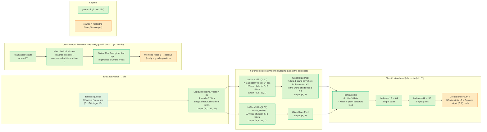
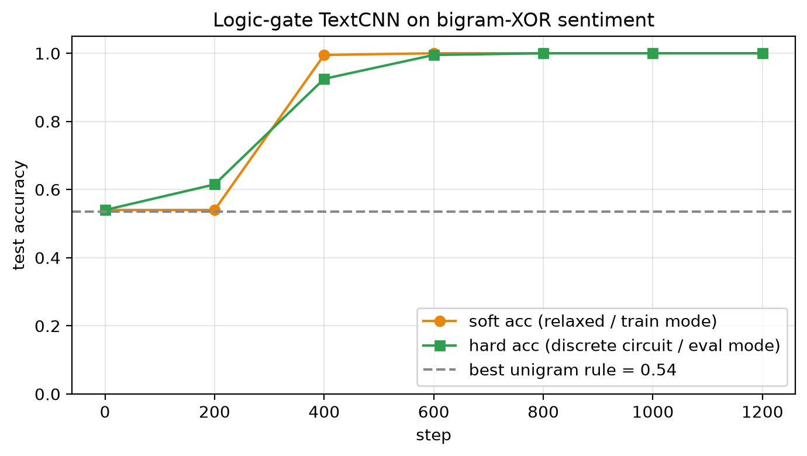
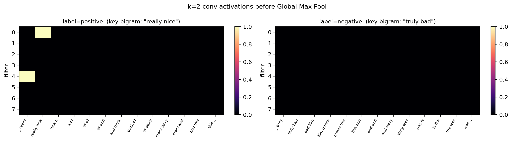
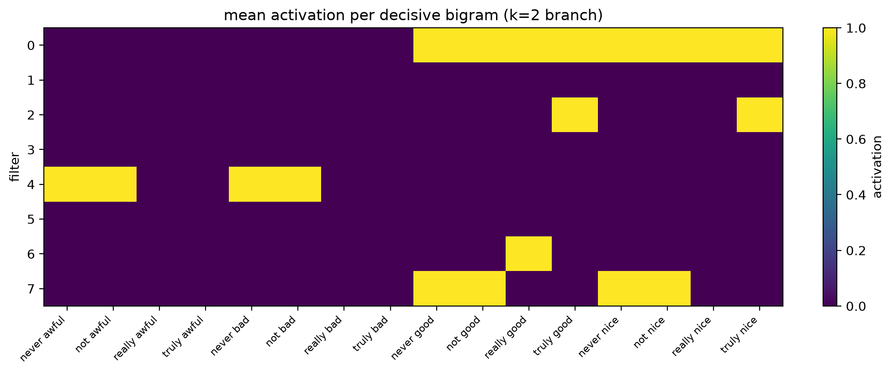

<!-- This file is generated automatically by scripts/build_tutorials.py.
     Do not edit it directly; edit examples/23_textcnn.py and regenerate. -->

We set up a problem that **counting words alone can never solve**, and show in an irrefutable form
that convolution works as an n-gram detector. In bigram-XOR classification, where the label is
decided by the XNOR of affirmative × good word / negative × bad word, every word appears equally
often in both classes — that is, **unigrams carry zero information** (the ceiling for any rule based
on word frequency is 0.535 = essentially chance).

The logic-gate TextCNN solves it at **1.000** in both soft and hard. And peeking at the filters after
training, filter 6 is "really good" and filter 4 is "never awful" — they have grown into
**detectors for specific pairs of words**. A natural sequel to [Appendix: XOR](/en/tutorials/xor/).

:::tip[What you'll learn]
1. How to build a task that word frequency cannot solve in principle (bigram-XOR classification), and what that means
2. How the logic-gate TextCNN is put together, and that it solves the task at 1.000 in both soft and hard
3. How to peek at the filters after training and confirm they have grown into "detectors for specific pairs of words"

**Prerequisites**

- [Appendix: peeking at the mechanism with a minimal XOR](/en/tutorials/xor/) — the minimal version of the same XOR structure
- [1. Train on MNIST](/en/tutorials/mnist/)
:::

:::note[About this page]
Estimated time: **about 5 minutes** / Environment: CPU only (no GPU needed)
Source script: [`examples/23_textcnn.py`](https://github.com/tsukushi-gate/Griffith/blob/main/examples/23_textcnn.py)
Try it yourself: [`notebooks/23_textcnn.ipynb`](https://github.com/tsukushi-gate/Griffith/blob/main/notebooks/23_textcnn.ipynb) (an unexecuted notebook with the same content as this page; open it with `uv run --group docs jupyter lab notebooks/`)
Every code output is the **actual result of running the code**, embedded verbatim.
:::

<!-- Colab badge: once the repository is public, replace this span with an <a> whose href is
     data-colab-url and "Open in Colab" becomes active. -->
<span class="colab-badge" data-colab-url="https://colab.research.google.com/github/tsukushi-gate/Griffith/blob/main/notebooks/23_textcnn.ipynb">▶ Open in Colab (enabled once the repository is public)</span>

An example of training text classification with a TextCNN (logic-gate version) and visualizing how
convolution works as an n-gram detector.

TextCNN (Kim 2014) is a model that "convolves a width-k window over a sequence of embeddings and,
with Global Max Pool, picks up only the position that responded most strongly", so each filter is
effectively **a circuit that detects whether a specific n-gram appeared anywhere in the sentence**.
This example replaces that convolution with LutConv2d (a tree of differentiable logic gates), and the
embeddings too are dropped to {0,1} bit vectors by LogicEmbedding.
In other words the whole sentence is classified by a logic circuit that uses not a single multiplication.

**The model lives in experiments/train_textcnn.py, not inside the package**

TextCNNModel is placed on the experiment-script side (outside the package), so you cannot get it via
`from griffith_logic import ...`. Here we add experiments/ to sys.path and import it the same way
tests/test_textcnn.py does.
(Loading the experiment script triggers reading .env and importing the wandb utilities, but no logs
 are sent unless init_wandb is called.)

**The subject: bigram XOR**

Upstream uses the Japanese sentiment dataset WRIME, but downloading and training take time.
Here, so it runs in a few minutes, we set up a synthetic task that is **impossible to solve with unigrams alone**:

    really good -> positive      not good  -> negative
    really bad  -> negative      not bad   -> positive

The label is decided by the XOR of two words: an affirmative modifier (really / truly) or a negative
one (not / never), combined with a good word (good / nice) or a bad word (bad / awful).
Every word appears equally often in both classes, so no amount of counting word occurrences
(= unigrams) gets you above 50%. The only way to solve it is to **look at two adjacent words as a
set**, which is exactly the shape a width-2 convolution is good at.
Think of it as the XOR of example 01 having moved into the world of words.

**The whole circuit (actual sizes: 12 words per sentence, 32-bit embeddings)**



**Where the concrete example shows up as a figure**: the EX flow above can be seen for real in the
second figure on this page, "k=2 conv activations before Global Max Pool". The horizontal axis is the
window position and the vertical axis is the filter index, and **only the column at the position of
the decisive bigram lights up**. The third figure averages that over every test sentence, showing
that different filters respond to different combinations such as "really good" and "not bad".

**How it is done**

- **The embedding is made of bits too.** LogicEmbedding assigns 32 bit lines to each word. During
  training they are reals in [0,1], but a regularizer pushes them to the extremes, so in the end
  a word is literally "a 32-bit code"
- **The window covers the entire embedding dimension.** With kernel=(k, 32) matching the embedding
  width, the horizontal output width becomes 1, so a 2D convolution turns into a 1D n-gram sweep
- **One filter = one n-gram detection circuit.** For k=2 it is a LUT tree that looks at
  2 words × 32 bits = 64 wires and returns 0 or 1. Logic such as "1 if the code of *really* and the
  code of *good*" is learned as a table
- **Global Max Pool is OR.** In the world of bits max = OR, so "did this n-gram appear anywhere in
  the sentence?" can be folded into a single bit, discarding position. This is also why TextCNN is
  strong on word order but insensitive to location
- **Unigrams cap out at 50%.** Every word appears equally often in both classes, so a circuit that
  merely counts word occurrences cannot solve this in principle. Needing to **look at two adjacent
  words as a set** — a width-2 window — is the essence of this task

Run: uv run python examples/23_textcnn.py
Expected result: hard accuracy 1.00 (about 1 minute on CPU)

## Setup: imports and the random seed

The model itself, `TextCNNModel`, lives in `experiments/train_textcnn.py`, which is outside the
package, so we extend `sys.path` before importing it. Both the gates' initial wiring and the
embeddings are randomly initialised, so we fix both PyTorch's and Python's own RNG for reproducibility.

```python
import os
import random
import sys

import matplotlib.pyplot as plt
import torch
import torch.nn.functional as F
```

```python
# experiments/ is outside the package, so add it to sys.path before importing
# (the same trick as tests/test_textcnn.py).
# In a notebook __file__ is undefined, in which case we treat the current directory as the
# repository root (examples are run from the repository root by convention).
_REPO_ROOT = (
    os.path.dirname(os.path.dirname(os.path.abspath(__file__)))
    if '__file__' in globals()
    else os.getcwd()
)
sys.path.insert(0, os.path.join(_REPO_ROOT, 'experiments'))
from train_textcnn import TextCNNModel  # noqa: E402
```

```python
# The gates' initial connections and the embeddings are both randomly initialized, so fix the seed for reproducibility.
SEED = 0
torch.manual_seed(SEED)
rng = random.Random(SEED)
```

### Hyperparameters

An **n-gram** is a run of n consecutive words (two words make a **bigram**).
`KERNELS = [2, 3]` means "run a width-2 window and a width-3 window side by side"; since the answer
to this task lives in a bigram, the k=2 branch is the protagonist. `D_EMB` is how many bit lines
represent one word — here a word becomes a 32-bit code.

```python
SEQ_LEN = 12      # tokens per sentence (shorter is faster)
N_TRAIN = 600     # number of training sentences
N_TEST = 200      # number of evaluation sentences
D_EMB = 32        # LogicEmbedding dimension (= bits per token)
N_FILTERS = 8     # filters per branch
KERNELS = [2, 3]  # n-gram widths. The answer is in the bigram, so k=2 is the lead
STEPS = 1200      # number of training iterations
BATCH = 32
LR = 0.01
```

## Data: building a task unigrams can never solve

The label is the XOR of "modifier × meaning word": `really good` and `not bad` are positive,
`not good` and `really bad` are negative. **Every word appears equally often in both classes** by
construction, so no amount of counting word frequencies (**unigrams**, features that look at one word
at a time) can push accuracy past 50%.

**Why this task**: by artificially creating a situation where no solution exists other than
"looking at two adjacent words together", any accuracy gained after training becomes **evidence that
the convolution really captured an n-gram**. Think of it as the XOR of example 01 moving into the
world of words.

```python
# The XOR structure: affirmative x good = positive, negative x bad = positive.
AFFIRM = ['really', 'truly']    # affirmative modifiers
NEGATE = ['not', 'never']       # negating modifiers
GOOD = ['good', 'nice']         # words with a good meaning
BAD = ['bad', 'awful']          # words with a bad meaning
```

```python
# Meaningless filler. Kept uncorrelated with the label.
FILLER = ['the', 'movie', 'was', 'i', 'think', 'it', 'and', 'story',
          'is', 'this', 'film', 'a', 'of', 'to', 'that', 'seemed']
```

```python
def make_sentence():
    """Build one sentence and return (token list, label, start position of the bigram).

    Label = 1 (positive) when it is "affirmative + good word" or "negative + bad word".
    Either modifier and either meaning word appears with equal probability in positive and negative.
    """
    modifier_is_affirm = rng.random() < 0.5
    word_is_good = rng.random() < 0.5
    modifier = rng.choice(AFFIRM if modifier_is_affirm else NEGATE)
    word = rng.choice(GOOD if word_is_good else BAD)
    # XNOR: affirmative x good → positive, negative x bad → positive, anything else negative
    label = int(modifier_is_affirm == word_is_good)

    tokens = [rng.choice(FILLER) for _ in range(SEQ_LEN - 2)]
    start = rng.randrange(0, SEQ_LEN - 1)   # where to insert the bigram
    tokens = tokens[:start] + [modifier, word] + tokens[start:]
    return tokens[:SEQ_LEN], label, start
```

```python
def make_dataset(n):
    sents, labels, starts = [], [], []
    for _ in range(n):
        s, y, st = make_sentence()
        sents.append(s)
        labels.append(y)
        starts.append(st)
    return sents, labels, starts
```

```python
train_sents, train_labels, _ = make_dataset(N_TRAIN)
test_sents, test_labels, test_starts = make_dataset(N_TEST)
```

### Vocabulary and IDs

We build the dictionary that maps words to integer IDs. The embedding layer looks these IDs up and
returns bit strings, so this is the boundary between "the world of strings" and "the world of circuits".

```python
# 0 is left free for padding (in this example every sentence has the same length, so it is never actually used).
vocab = sorted({w for s in train_sents + test_sents for w in s})
stoi = {w: i + 1 for i, w in enumerate(vocab)}
itos = {i: w for w, i in stoi.items()}
VOCAB_SIZE = len(stoi) + 1
```

```python
def encode(sents):
    return torch.tensor([[stoi[w] for w in s] for s in sents])
```

```python
train_x, train_y = encode(train_sents), torch.tensor(train_labels)
test_x, test_y = encode(test_sents), torch.tensor(test_labels)
print(f'train={tuple(train_x.shape)} test={tuple(test_x.shape)} '
      f'語彙={VOCAB_SIZE}語 / 2クラス')
```

```text title="Output"
train=(600, 12) test=(200, 12) 語彙=25語 / 2クラス
```

### Measuring the unigram ceiling up front

We actually run the **best unigram rule** — "positive if it contains a good word" — and record its
accuracy. Later we draw that value as a dashed line on the learning curve, so that **whatever rises
above it can be read as the contribution of the n-gram**. Measuring the claim first keeps the result
from being confused with "it just happened to go up".

```python
good_ids = {stoi[w] for w in GOOD}
unigram_pred = torch.tensor(
    [int(any(int(t) in good_ids for t in row)) for row in test_x]
)
unigram_acc = (unigram_pred == test_y).float().mean().item()
print(f'ユニグラム規則(良い語を含めばポジ)の精度={unigram_acc:.3f} '
      f'← 偶然と同じ。単語を数えるだけでは解けない')
```

```text title="Output"
ユニグラム規則(良い語を含めばポジ)の精度=0.535 ← 偶然と同じ。単語を数えるだけでは解けない
```

## Model: a logic-gate TextCNN

The structure is `LogicEmbedding` → a `LutConv2d` branch per k → Global Max Pool → concatenate →
a `LutLayer` stack → `GroupSum`. There are three points to it.

- **The embeddings are bits too**. `LogicEmbedding` assigns 32 bit lines to each word. During
  training they are real values in [0,1], but a regularizer pushes them towards both ends, so in the
  end a word literally becomes a 32-bit code
- **The window covers the whole embedding dimension**. With `kernel_size=(k, d_emb)` the width
  matches the embedding dimension, so the horizontal output width is 1 and the 2D convolution becomes
  **a 1D scan over n-grams**. One filter is "a LUT tree that looks at 2 words × 32 bits = 64 wires and
  returns 0/1" = **one n-gram detector circuit**
- **Global Max Pool is OR**. In the world of bits, max is "1 if any of them is 1" = OR. This is where
  **why max pooling is OR** starts to matter: it lets us discard position and fold "did this n-gram
  appear anywhere in the sentence" into a single bit. No comparators and no adders needed

```python
# The structure of TextCNNModel:
#   LogicEmbedding → a LutConv2d branch per k → Global Max Pool
#   → concatenate → LutLayer stack → GroupSum
# The point is using LutConv2d with kernel_size=(k, d_emb): because it covers the whole embedding
# dimension the output width becomes 1, making it effectively a 1D convolution.
model = TextCNNModel(
    vocab_size=VOCAB_SIZE,
    d_emb=D_EMB,
    n_filters=N_FILTERS,
    kernel_sizes=KERNELS,
    dense_dims=[64, 32],
    n_classes=2,
    tree_depth=2,     # each filter is a depth-2 gate tree (= a logic function of 4 inputs)
    n_inputs=2,       # 2-input gates
    device='cpu',
)
print(model)
```

```text title="Output"
TextCNNModel(
  (embedding): LogicEmbedding(
    (embedding): Embedding(25, 32)
  )
  (branches): ModuleList(
    (0): LutConv2d(in_channels=1, out_channels=8, kernel_size=(2, 32), tree_depth=2, stride=(1, 1), padding=(1, 0), n_inputs=2, n_leaves=4, n_internal=3, input_ch_per_tree=1, param=softmax)
    (1): LutConv2d(in_channels=1, out_channels=8, kernel_size=(3, 32), tree_depth=2, stride=(1, 1), padding=(1, 0), n_inputs=2, n_leaves=4, n_internal=3, input_ch_per_tree=1, param=softmax)
  )
  (dense_layers): ModuleList(
    (0): LutLayer(in=16, out=64, n_inputs=2, entries=4, param=softmax/16gate)
    (1): LutLayer(in=64, out=32, n_inputs=2, entries=4, param=softmax/16gate)
  )
  (group_sum): GroupSum(k=2, tau=4.0)
)
```

## Training: cross entropy plus a binarization regularizer on the embeddings

The loss is cross entropy with a little `emb_reg` (**a regularizer that pushes the embeddings towards
0/1**) mixed in. **Why it is needed**: at inference `LogicEmbedding` is binarized with a Heaviside
step (a step function that cuts at a threshold), so if the values stay half-way during training the
codes flip the moment they are discretized and hard accuracy alone collapses. Pushing them to the
ends in advance keeps soft and hard in agreement.
Accuracy is likewise measured both ways: `soft` (the continuous relaxation) and `hard` (the
discretized circuit).

```python
# TextCNNModel's convention is that forward returns two values, (logits, emb_reg_loss).
opt = torch.optim.AdamW(model.parameters(), lr=LR, weight_decay=0.001)
history = []  # (step, soft acc, hard acc)
```

```python
@torch.no_grad()
def accuracy(train_mode):
    """Accuracy in soft (train mode = continuous relaxation) / hard (eval mode = the discretized circuit)."""
    was_training = model.training
    model.train(mode=train_mode)
    logits, _ = model(test_x)
    acc = (logits.argmax(-1) == test_y).float().mean().item()
    model.train(mode=was_training)
    return acc
```

```python
for step in range(STEPS + 1):
    if step % 200 == 0:
        soft_acc = accuracy(train_mode=True)
        hard_acc = accuracy(train_mode=False)
        history.append((step, soft_acc, hard_acc))
        print(f'step {step:>5}  soft acc={soft_acc:.4f}  hard acc={hard_acc:.4f}')

    idx = torch.randint(0, N_TRAIN, (BATCH,))
    logits, emb_reg = model(train_x[idx])
    # Mix in a little embedding binarization regularization (the weight is around the end value of upstream's ramp).
    loss = F.cross_entropy(logits, train_y[idx]) + 0.05 * emb_reg
    opt.zero_grad()
    loss.backward()
    opt.step()

steps, soft_hist, hard_hist = zip(*history, strict=True)
final_soft, final_hard = soft_hist[-1], hard_hist[-1]
print(f'\n最終 soft acc={final_soft:.4f} / hard acc={final_hard:.4f}')
print(f'ユニグラム上限={unigram_acc:.4f} → 回路はバイグラムを見つけている')
assert final_hard > 0.85, f'hard acc={final_hard:.4f} が低すぎる'
```

```text title="Output"
step     0  soft acc=0.5400  hard acc=0.5400

step   200  soft acc=0.5400  hard acc=0.6150

step   400  soft acc=0.9950  hard acc=0.9250

step   600  soft acc=1.0000  hard acc=0.9950

step   800  soft acc=1.0000  hard acc=1.0000

step  1000  soft acc=1.0000  hard acc=1.0000

step  1200  soft acc=1.0000  hard acc=1.0000

最終 soft acc=1.0000 / hard acc=1.0000
ユニグラム上限=0.5350 → 回路はバイグラムを見つけている
```

## Peeking inside the convolution

From here we do not stop at "it solved the task" but check **what the circuit looked at in order to
solve it**. `TextCNNModel.forward` only returns values that have already gone through Global Max Pool,
so we extract the pre-pool activations (the 0/1 per window position) ourselves. What we do is the
same as the first half of forward.

```python
@torch.no_grad()
def branch_activations(tokens, branch_idx):
    """Return the pre-pool activations of the specified branch.

    Returns:
        (B, n_filters, H_out) — H_out is the number of window positions
    """
    model.eval()   # look at "the circuit itself", with both embeddings and gates discretized
    emb = model.embedding(tokens)          # (B, L, d_emb)
    h = model.branches[branch_idx](emb.unsqueeze(1))   # (B, n_filters, H_out, 1)
    return h.squeeze(-1)
```

```python
# The k=2 branch is the lead. Since padding=(k//2, 0), the window at output position p covers
# input tokens [p - 1, p] (the window at p=0 covers the left padding and token 0).
K2_BRANCH = KERNELS.index(2)
PAD2 = 2 // 2
```

## Visualization: learning curves and what the filters learned

### Figure 1: learning curves

**What to look for**: orange is soft (the continuous relaxation), green is hard (the discretized
logic circuit) and the grey dashed line is the unigram ceiling we measured earlier. The thing to
watch is **green clearly overtaking the grey dashed line**; whatever it gains above that line is the
contribution of the n-gram.

```python
fig, ax = plt.subplots(figsize=(7, 4))
ax.plot(steps, soft_hist, 'o-', color='#e8850c',
        label='soft acc (relaxed / train mode)')
ax.plot(steps, hard_hist, 's-', color='#2e9e4f',
        label='hard acc (discrete circuit / eval mode)')
ax.axhline(unigram_acc, ls='--', color='#888888',
           label=f'best unigram rule = {unigram_acc:.2f}')
ax.set_xlabel('step')
ax.set_ylabel('test accuracy')
ax.set_ylim(0, 1.05)
ax.grid(alpha=0.3)
ax.legend(loc='lower right')
ax.set_title('Logic-gate TextCNN on bigram-XOR sentiment')
fig.tight_layout()
plt.show()
```

    

    

**What it says**: soft and hard rise together, almost on top of each other, and go well past the
unigram ceiling (the grey dashed line). **The circuit reached territory that counting words cannot
touch, and it did so while staying intact under discretization.** If soft were high and hard were
left behind, that would be a sign of the embeddings or the gates lingering in an intermediate state
(which is not what happens here).

### Figure 2: where in the sentence the filters fire

**What to look for**: the vertical axis is the filter index and the horizontal axis is the window
position (labelled with the two words that window covers). The pre-pool activations for one positive
and one negative sentence are laid out as they are. The thing to watch is that **only the column at
the position of the decisive bigram lights up** — that is the evidence that the convolution captured
those two words as a detector. Note that Global Max Pool passes only the maximum of each row
downstream, so what matters for classification is not "where it lit up" but "whether it lit up somewhere".

```python
examples = []
for want in (1, 0):   # one positive sentence and one negative sentence
    i = next(j for j in range(N_TEST) if test_labels[j] == want)
    examples.append(i)

fig, axes = plt.subplots(1, 2, figsize=(13, 3.6))
for ax, i in zip(axes, examples, strict=True):
    acts = branch_activations(test_x[i:i + 1], K2_BRANCH)[0]   # (n_filters, H_out)
    im = ax.imshow(acts.numpy(), aspect='auto', cmap='magma', vmin=0, vmax=1)
    # Label output position p with the two words its window covers.
    labels = []
    for p in range(acts.shape[1]):
        lo, hi = p - PAD2, p - PAD2 + 1
        words = [itos[int(test_x[i, t])] if 0 <= t < SEQ_LEN else '_'
                 for t in (lo, hi)]
        labels.append(' '.join(words))
    ax.set_xticks(range(acts.shape[1]))
    ax.set_xticklabels(labels, rotation=60, ha='right', fontsize=7)
    ax.set_yticks(range(N_FILTERS))
    ax.set_ylabel('filter')
    key = ' '.join(test_sents[i][test_starts[i]:test_starts[i] + 2])
    ax.set_title(f'label={"positive" if test_labels[i] else "negative"}'
                 f'  (key bigram: "{key}")', fontsize=10)
    fig.colorbar(im, ax=ax, fraction=0.03)
fig.suptitle('k=2 conv activations before Global Max Pool', fontsize=11)
fig.tight_layout()
plt.show()
```

    

    

**What it says**: check that the lit column matches the position of that sentence's decisive bigram
(the key bigram in the title). If the same filter responds in two sentences where the position
differs, that filter is looking at **the combination of words, not the position**.
Rows that never light are normal too; the next figure counts them as "dead filters".

### Figure 3: which filter responds to which bigram

**What to look for**: for each decisive combination (the `really good` / `not good` / `really bad` /
`not bad` families) we average the activation at the position where that bigram was placed, over the
whole test set. The vertical axis is the filter and the horizontal axis the bigram. The thing to
watch is that **each row lights a different column**; if they separate, each filter has grown into a
detector for a specific n-gram. Conversely, a row where every column is equally bright is a
"dead filter" that distinguishes nothing.

```python
key_bigrams = {}
for i in range(N_TEST):
    st = test_starts[i]
    name = ' '.join(test_sents[i][st:st + 2])
    acts = branch_activations(test_x[i:i + 1], K2_BRANCH)[0]   # (n_filters, H_out)
    p = st + PAD2                                  # the output position covering that bigram
    key_bigrams.setdefault(name, []).append(acts[:, p])

names = sorted(key_bigrams, key=lambda n: (n.split()[1], n.split()[0]))
matrix = torch.stack([torch.stack(key_bigrams[n]).mean(0) for n in names], dim=1)

fig, ax = plt.subplots(figsize=(max(7, 0.62 * len(names)), 4.2))
im = ax.imshow(matrix.numpy(), aspect='auto', cmap='viridis', vmin=0, vmax=1)
ax.set_xticks(range(len(names)))
ax.set_xticklabels(names, rotation=45, ha='right', fontsize=8)
ax.set_yticks(range(N_FILTERS))
ax.set_ylabel('filter')
ax.set_title('mean activation per decisive bigram (k=2 branch)')
fig.colorbar(im, ax=ax, fraction=0.03, label='activation')
fig.tight_layout()
plt.show()
```

    

    

**What it says**: reading the table above row by row puts into words which bigram each filter became
a detector for. The larger the "max − min" spread, the more selective the filter; a row whose spread
is nearly 0 returns the same value for every bigram and is a **dead filter**. It is perfectly normal
for some of the redundantly provided filters to end up that way, because the stage after
Global Max Pool only needs to use the filters that are alive.

```python
# Show the bigram each filter responded to most strongly.
# The larger the "max - min", the more the filter is a selective detector responding only to a
# specific bigram. A filter whose spread is nearly 0 returns the same value for every bigram
# = a dead filter that distinguishes nothing, and it is perfectly normal for some of the
# redundantly provided filters to end up like this
# (because the stage after Global Max Pool only needs to use the filters that are alive).
print('\nフィルタごとの最反応バイグラム:')
n_dead = 0
for f in range(N_FILTERS):
    row = matrix[f]
    best = int(row.argmax())
    spread = float(row[best] - row.min())
    if spread < 1e-3:
        n_dead += 1
        print(f'  filter {f}: 反応なし(全バイグラムで {row[best]:.3f} — '
              f'死んだフィルタ)')
    else:
        print(f'  filter {f}: "{names[best]}" (activation={row[best]:.3f}, '
              f'最小={row.min():.3f} → 差={spread:.3f})')
print(f'選択的なフィルタ {N_FILTERS - n_dead}/{N_FILTERS} 個で hard acc='
      f'{final_hard:.4f} を達成')
```

    
```text title="Output"
フィルタごとの最反応バイグラム:
  filter 0: "never good" (activation=1.000, 最小=0.000 → 差=1.000)
  filter 1: 反応なし(全バイグラムで 0.000 — 死んだフィルタ)
  filter 2: "truly good" (activation=1.000, 最小=0.000 → 差=1.000)
  filter 3: 反応なし(全バイグラムで 0.000 — 死んだフィルタ)
  filter 4: "never awful" (activation=1.000, 最小=0.000 → 差=1.000)
  filter 5: 反応なし(全バイグラムで 0.000 — 死んだフィルタ)
  filter 6: "really good" (activation=1.000, 最小=0.000 → 差=1.000)
  filter 7: "never good" (activation=1.000, 最小=0.000 → 差=1.000)
選択的なフィルタ 5/8 個で hard acc=1.0000 を達成
```

## What to read next

- [Appendix: peeking at the mechanism with a minimal XOR](/en/tutorials/xor/) — the same XOR structure of this page, shrunk to 4 samples
- [A logic-gate GPT](/en/tutorials/logic-gpt/) — generation instead of classification
- [Causal convolution with logic gates](/en/tutorials/logic-wavenet/) — the same 1D convolution applied to sequence prediction

<!-- i18n:source=tutorials/textcnn.md hash=04eb92b8a446 -->
