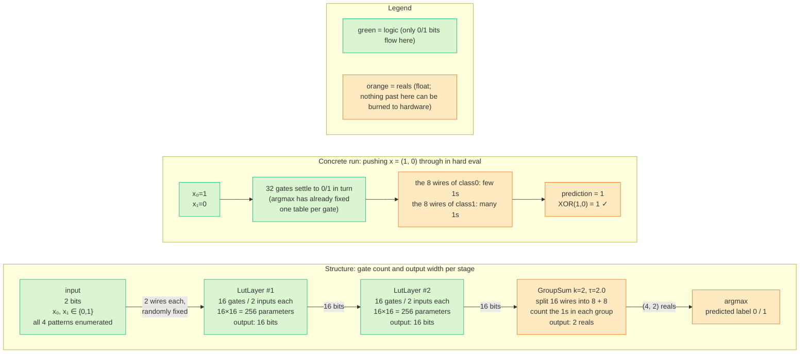
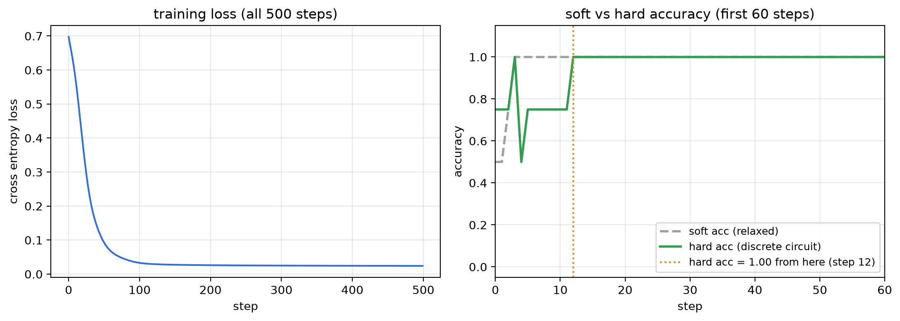
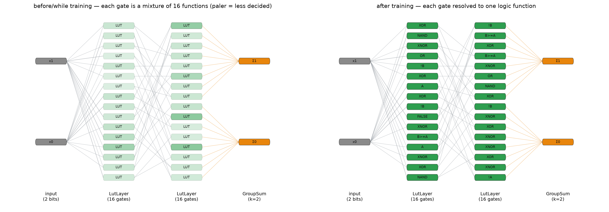
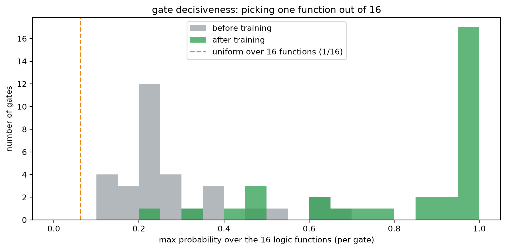

<!-- This file is generated by scripts/build_tutorials.py.
     Do not edit it directly; edit examples/01_xor.py and regenerate. -->

An appendix that **peeks at the mechanism of the collapse from soft (continuous relaxation)
to hard (a discrete circuit) in the smallest possible setting**.
With only 2 input bits and 16 gates, the circuit before and after training can be drawn
**node by node**, so the claim "training is the work of picking one gate out of sixteen candidates,
one gate at a time" turns straight into a picture.
This is the round where what happened in [MNIST](/en/tutorials/mnist/) is shrunk to 4 samples and a few dozen lines.

:::tip[What you'll learn]
1. See the whole moment of dropping from soft (continuous relaxation) to hard (a discrete circuit), in a minimal 16-gate setting
2. The view that training is "picking one logic function per gate out of the 16 candidates"
3. How to read the circuit diagram (the mixture before training with `resolve=False` / the fixed gates after training with `resolve=True`)

**Prerequisites**

- [Core Concepts](/en/getting-started/concepts/) — just get the soft/hard vocabulary down first
:::

:::note[About this page]
Estimated time: **about 5 minutes** / Environment: CPU only (no GPU required)
Source script: [`examples/01_xor.py`](https://github.com/tsukushi-gate/Griffith/blob/main/examples/01_xor.py)
Try it locally: [`notebooks/01_xor.ipynb`](https://github.com/tsukushi-gate/Griffith/blob/main/notebooks/01_xor.ipynb) (an unexecuted notebook with the same content as this page; open it with `uv run --group docs jupyter lab notebooks/`)
Every code output below is **the result of an actual run**, embedded verbatim.
:::

<!-- Colab badge: once the repository is public, replace this span with an <a> whose href
     is data-colab-url to enable "Open in Colab". -->
<span class="colab-badge" data-colab-url="https://colab.research.google.com/github/tsukushi-gate/Griffith/blob/main/notebooks/01_xor.ipynb">▶ Open in Colab (enabled once the repository is public)</span>

The smallest example of learning XOR.

Train XOR in soft mode with a differentiable logic gate layer (LutLayer) and confirm
that it stays at 100% as a discrete circuit (hard eval) too.

This script lets you experience the library's central claim — "a logic gate network trained
by gradients under continuous relaxation loses no accuracy when it is discretized with argmax
into a pure Boolean circuit" — in a minimal setting of 4 patterns and 40 lines. XOR is the
smallest problem that a single linear separation cannot solve, which makes it a touchstone for
"did it really learn a nonlinear logic?".

**The whole circuit (32 gates, 2 inputs, 2 output classes)**



Only bits flow through the green stretch, so it can be burned onto FPGA LUTs as is.
Reals appear only at the very end, where the wires are counted and compared.
The wiring and gate types that were actually learned can be inspected in the second
circuit diagram on this page (before vs. after training).

**How it is done**

- **One neuron = one truth table.** An ordinary NN neuron is "weighted sum → activation";
  a LutLayer neuron is replaced by a table that looks at 2 wires and returns 0 or 1
- **Only the contents of the table are learned.** Which 2 wires of the previous layer a neuron
  looks at (the wiring) is chosen randomly at the start and then frozen. What moves is only
  "is this table an AND or an XOR?"
- **The table is held as a blend of 16 candidates.** There are only 16 possible 2-input logic
  functions, so learning "a weighting over those 16" (= 16 parameters per gate) makes it
  differentiable. At inference the heaviest one is fixed — that is the soft → hard discretization
- **Depth is what builds expressive power.** The second layer reads the 16 bits of the first,
  so more complex logic is assembled as a composition of gates. XOR has 2 inputs, so a single
  table would suffice; here we use the same 2-layer structure as MNIST (example 06) at its
  smallest possible size

Run: uv run python examples/01_xor.py
Expected result: accuracy 1.00 in both soft and hard

## Setup: imports and the random seed

All you need is PyTorch, matplotlib, and four things from this library: `LutLayer`,
`GroupSum`, the dataset, and the circuit plotter. No special training framework is required.

The idiomatic way to load the library is `import griffith_logic as gl`, and public symbols are
referenced as `gl.LutLayer` (writing `from griffith_logic import LutLayer` gives you the same
object).

```python
import copy

import matplotlib.pyplot as plt
import torch
import torch.nn as nn
import torch.nn.functional as F

import griffith_logic as gl
from griffith_logic.analysis.circuit_viz import plot_circuit
from griffith_logic.datasets import xor2
```

```python
# Fix the random seed. LutLayer's initial parameters (= which logic function each gate
# starts learning from) depend on randomness, so without fixing them the speed of
# convergence changes from run to run.
torch.manual_seed(0)
```

## Dataset: the 4 patterns of XOR

XOR takes 2 input bits, so the possible inputs are `(0,0) / (0,1) / (1,0) / (1,1)` — **that is
all of them**. There is therefore no need to split train and test data: what we want to see is
not "did it memorize" but **did it land on the correct truth table as a circuit**.

```python
x, y_bits = xor2().dataset.tensors
y = y_bits.squeeze(-1).long()  # convert to class labels {0,1} for cross_entropy
```

## Model definition: two LutLayers + GroupSum

`LutLayer` is a layer where "one output neuron = one N-input LUT (lookup table = truth table)",
sitting where `nn.Linear + activation` would be in an ordinary NN. `GroupSum` is the **exit**
from the world of logic gates to classification scores: it counts the bits of the final layer
per class.

The three lines below are the entire circuit this page deals with (32 gates in total).

```python
model = nn.Sequential(
    # 2 input bits -> 16 gates. Each gate is learned as a soft mixture of the 16
    # two-input logic functions (AND/OR/XOR etc.). Which 2 input wires it looks at
    # is also fixed at random.
    gl.LutLayer(2, 16, n_inputs=2),   # 16-gate softmax (difflogic compatible)
    # Second stage. Another 16 gates taking the 16 output bits of the first stage as input.
    # Nonlinearity such as XOR is expressed by this depth (composition of gates).
    gl.LutLayer(16, 16, n_inputs=2),
    # Split the outputs of the final 16 gates evenly into 2 classes and aggregate (group sum).
    # tau is the logit temperature; the larger it is, the smoother the softmax
    # (which helps training stability).
    gl.GroupSum(k=2, tau=2.0),
)
```

```python
# A snapshot of the pre-training state to plot later (training proceeds on the original model).
model_init = copy.deepcopy(model)
```

```python
# What is optimized are the continuous parameters expressing "which logic function each gate is".
# The wiring is fixed, so what is being learned is effectively only the contents of the truth tables.
opt = torch.optim.Adam(model.parameters(), lr=0.05)
```

## Preparing to train: how to measure soft/hard, and gate decisiveness

In this library accuracy is **always measured in two ways**.

- **soft** = `train()` mode. Each gate is still a "probabilistic mixture" of the 16 logic
  functions (= continuous relaxation). Gradients flow, but it is not a circuit yet
- **hard** = `eval()` mode. Each gate is fixed to a single logic function with argmax.
  From here on it is not a training-time approximation but the same pure Boolean circuit
  you would burn onto an FPGA

**Being happy about soft alone is the most common failure in this field**, so build the habit
of measuring both from the start.

```python
def accuracy(m: nn.Module, mode: str) -> float:
    """Return the accuracy over the 4 patterns for mode='soft' (mixture) / 'hard' (argmax)."""
    m.eval() if mode == 'hard' else m.train()
    with torch.no_grad():
        acc = (m(x).argmax(-1) == y).float().mean().item()
    m.train()  # return to train() so as not to disturb the caller's training
    return acc
```

```python
# Measure "how decisively each gate has picked one logic function".
# What is learned is a distribution (softmax) over the 16 logic functions, so its maximum
# probability is exactly the degree of certainty. 1/16 = 0.0625 means completely undecided
# (a uniform distribution); 1.0 means it can assert "this gate is XOR".
def gate_confidence(m: nn.Module) -> torch.Tensor:
    """Return the max probability of the logic-function distribution for every gate of every LutLayer."""
    probs = [F.softmax(layer.weights.detach(), dim=-1).max(dim=-1).values
             for layer in m if isinstance(layer, gl.LutLayer)]
    return torch.cat(probs)
```

```python
# Certainty before training. Right after initialization almost every gate should sit near 1/16.
conf_before = gate_confidence(model).numpy()
```

## Training loop

The body is **entirely ordinary PyTorch**. No special learning rule is needed (that is an
advantage of this method). To draw the learning curves, record the loss and both soft/hard
accuracies at every step. hard is re-measured by switching to `eval()` each time, so you can
see step by step **when it reached the correct answer as a circuit** (typically it rises later
than soft). There are only 4 patterns of data, so measuring every step barely increases the
runtime.

```python
STEPS = 500
ZOOM_STEPS = 60  # accuracy only moves in the first few dozen steps, so the figure zooms in there
hist_step: list[int] = []
hist_loss: list[float] = []
hist_soft: list[float] = []
hist_hard: list[float] = []

for step in range(STEPS):
    opt.zero_grad()
    # The loss is the cross entropy of classification. backward() flows the gradient in the order
    # GroupSum -> the gate distribution of the second stage -> that of the first stage
    # (differentiable thanks to the continuous relaxation).
    loss = F.cross_entropy(model(x), y)
    loss.backward()
    opt.step()
    hist_step.append(step)
    hist_loss.append(loss.item())
    hist_soft.append(accuracy(model, 'soft'))
    hist_hard.append(accuracy(model, 'hard'))
```

## Evaluation: always look at both soft and hard

Once training is done, put the two numbers side by side. **The essential point is that hard is
1.00**; if only soft is high and hard drops, it is a sign that the mixture is camped out in an
intermediate state, i.e. "not decided as a circuit".

```python
acc_soft = accuracy(model, 'soft')
acc_hard = accuracy(model, 'hard')
print(f'XOR: soft acc={acc_soft:.2f}, hard acc={acc_hard:.2f}')
```

```text title="Output"
XOR: soft acc=1.00, hard acc=1.00
```

```python
# The essential point is that hard is 1.00. If only soft is high and hard drops, it is a sign
# that the mixture is camped out in an intermediate state, i.e. "not decided as a circuit".
assert acc_hard == 1.0
```

```python
# Find the step from which hard accuracy stays at 1.00 forever.
# We take the step after the last failure rather than the first time it touches 1.00 because
# early in training argmax may point at the correct circuit by chance (and move away right
# afterwards); reading that as "it learned" would be an overestimate.
last_fail = max((i for i, a in enumerate(hist_hard) if a < 1.0), default=-1)
stable_hard = hist_step[last_fail + 1] if last_fail + 1 < len(hist_step) else None
print(f'hard acc が以後ずっと 1.00 になったステップ: {stable_hard} / {STEPS}')
```

```text title="Output"
hard acc が以後ずっと 1.00 になったステップ: 12 / 500
```

## Visualization: learning curves, circuit diagram, gate decisiveness

### Figure 1: learning curves (loss and soft/hard accuracy)

Left is the loss (all 500 steps), right is the two kinds of accuracy. Accuracy only moves in the
first few dozen steps, so the right panel zooms into the beginning (both stay flat at 1.00
afterwards).

The highlight is on the right: **hard (solid, dark green) chases soft (dashed, gray) and in the
end both overlap at 1.0**. That is exactly the central claim of this library — "train under
continuous relaxation → discretize with argmax and nothing breaks".

```python
fig, axes = plt.subplots(1, 2, figsize=(11, 4))
axes[0].plot(hist_step, hist_loss, color='#2e6fdb')
axes[0].set_xlabel('step')
axes[0].set_ylabel('cross entropy loss')
axes[0].set_title('training loss (all 500 steps)')
axes[0].grid(alpha=0.3)
axes[1].plot(hist_step, hist_soft, '--', color='#9aa0a6', lw=2, label='soft acc (relaxed)')
axes[1].plot(hist_step, hist_hard, '-', color='#2e9e4f', lw=2, label='hard acc (discrete circuit)')
if stable_hard is not None:
    axes[1].axvline(stable_hard, color='#e8850c', ls=':', lw=1.5,
                    label=f'hard acc = 1.00 from here (step {stable_hard})')
axes[1].set_xlim(0, ZOOM_STEPS)
axes[1].set_ylim(-0.05, 1.15)  # margin so the lines pinned at 0/1 are not squashed
axes[1].set_xlabel('step')
axes[1].set_ylabel('accuracy')
axes[1].set_title(f'soft vs hard accuracy (first {ZOOM_STEPS} steps)')
axes[1].legend(loc='lower right', fontsize=9)
axes[1].grid(alpha=0.3)
fig.tight_layout()
plt.show()
```

    

    

On the right, hard **jumps in steps** because the output only changes at the moment the argmax
result switches: it is not a continuous quantity moving smoothly, **the circuit itself is
rewritten discretely**. The vertical dotted line is the step from which hard stays at 1.00
"forever after"; just before it the curve touches 1.00 once and falls again — that is merely
passing by the correct circuit.

### Figure 2: circuit diagram (the same code becomes this circuit)

The three-line `nn.Sequential` written above is in fact "gate nodes and the wires connecting
them", i.e. the circuit itself. Put the before/after side by side to see in one picture what
training did.

- **left (`resolve=False`)** — before training. Each node is a **mixture** of 16 logic functions,
  hence shown as `LUT`. The color intensity is the degree of certainty (distribution entropy);
  the paler it is, the more undecided
- **right (`resolve=True`)** — after training. The name of the logic function fixed by argmax
  (`AND` / `XOR` / `NAND` / `!A` / `A>=B` …) goes into the node

The truth tables the names come from are the very ones `export_ir` uses when emitting Verilog,
so **the gates in this figure = the gates of the circuit actually burned**.

```python
fig, axes = plt.subplots(1, 2, figsize=(17, 6))
plot_circuit(model_init, resolve=False, ax=axes[0])
plot_circuit(model, resolve=True, ax=axes[1])
fig.tight_layout()
plt.show()
```

    

    

Comparing left and right, before training every node is a pale `LUT`, while after training
**concrete logic-function names** such as `XOR` and `NAND` line up. The claim that training is
"picking one gate at a time out of 16 candidates" is drawn literally as a picture.

### Figure 3: seeing "did it pick one out of 16?" as numbers

Quantify the color intensity (certainty) of Figure 2 as a histogram over all 32 gates. The x axis
is the max probability of each gate's logic-function distribution, the y axis is how many gates
fall there.

- **before training (gray)** — a hill on the left. Initialization is random, so it is slightly
  more biased than perfectly uniform (the dashed 1/16 = 0.0625), but every gate is still an
  ambiguous mixture that is "nothing in particular"
- **after training (green)** — the whole distribution moves right and many gates exceed 0.9,
  meaning each gate can now assert "I am XOR" / "I am AND"

If this is not pushed to the right edge yet hard acc is 1.00, it was merely luck, and a slight
perturbation can turn the circuit into something else. Conversely, if it is at the right edge,
discretization by argmax "throws almost nothing away", so hard eval does not break.

```python
conf_after = gate_confidence(model).numpy()
print(f'ゲート確定度(最大確率)の平均: 学習前 {conf_before.mean():.3f} '
      f'→ 学習後 {conf_after.mean():.3f} (一様分布なら 1/16 = 0.0625)')
print(f'確定度 0.9 超のゲート数: 学習前 {(conf_before > 0.9).sum()} / {conf_before.size}'
      f' → 学習後 {(conf_after > 0.9).sum()} / {conf_after.size}')

bins = [i / 20 for i in range(21)]
fig, ax = plt.subplots(figsize=(9, 4.5))
ax.hist(conf_before, bins=bins, color='#9aa0a6', alpha=0.75, label='before training')
ax.hist(conf_after, bins=bins, color='#2e9e4f', alpha=0.75, label='after training')
ax.axvline(1 / 16, color='#e8850c', ls='--', lw=1.5, label='uniform over 16 functions (1/16)')
ax.set_xlabel('max probability over the 16 logic functions (per gate)')
ax.set_ylabel('number of gates')
ax.set_title('gate decisiveness: picking one function out of 16')
ax.legend()
fig.tight_layout()
plt.show()
```

```text title="Output"
ゲート確定度(最大確率)の平均: 学習前 0.289 → 学習後 0.822 (一様分布なら 1/16 = 0.0625)
確定度 0.9 超のゲート数: 学習前 0 / 32 → 学習後 19 / 32
```

    


## What to read next

- [1. Train on MNIST](/en/tutorials/mnist/) — scale the same mechanism to real data
- [7. End-to-End Walkthrough](/en/tutorials/full-pipeline/) — go from training to Verilog generation in one pass
- [The Mathematics of LutLayer](/en/explanation/lut-layer/) — the continuous relaxation formulas themselves
- [Logic Gate TextCNN](/en/tutorials/textcnn/) — solve the same XOR structure, this time over word sequences

<!-- i18n:source=tutorials/xor.md hash=3df88ea031d8 -->
