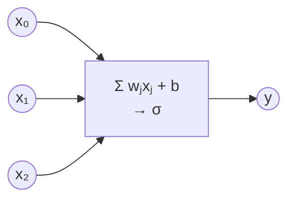

このページは **機械学習をやったことがない読者** に向けて、ニューラルネットワーク(NN)の仕組みを
最短距離で説明する。ゴールは「NN は実数の世界の計算である」という一点を腹落ちさせること。
そこが分かると、[DLGN(微分可能論理ゲートNN)](/explanation/dlgn/) が何を壊して何を作り直したのかが
一目で分かる。

すでに NN を知っている読者は、このページを飛ばして [DLGNとは何か](/explanation/dlgn/) へ進んでよい。

## 1. パーセプトロン — 一番小さい部品

NN の最小部品は **ニューロン**(パーセプトロン)である。やっていることは驚くほど単純で、
入力に数を掛けて足すだけ。

$$
y = \sigma\!\left( \sum_{j} w_j x_j + b \right)
$$

- $x_j$ … 入力(例: 画像のピクセルの明るさ)
- $w_j$ … **重み**。その入力をどれくらい重視するか
- $b$ … バイアス。全体の下駄
- $\sigma$ … 活性化関数。出力を非線形に曲げる(これが無いと何層重ねても直線のまま)

掛けて足す、つまり **積和演算(MAC: Multiply-Accumulate)** である。GPU が NN に強いのは、
この MAC を何十億回も並列に回せるからだ。逆に言えば **NN が GPU を要求する理由は、計算の正体が
掛け算だから** に他ならない。

ニューロンを横に並べたものが「層」、層を縦に積んだものが「深層ニューラルネットワーク」になる。

## 2. 「学習」とは重みを少しずつ動かすこと

構造(どのニューロンがどこに繋がるか)は人間が決める。**学習で決まるのは重み $w$ だけ** である。

学習は次の 3 ステップの繰り返しにすぎない。

1. **予測する** — 入力を流して出力 $y$ を得る(forward)
2. **どれくらい間違えたかを測る** — 正解との差を **損失(loss)** という 1 つの数にする
3. **損失が減る方向へ重みを少し動かす** — これを何百万回も繰り返す

犬猫分類なら「猫の画像を入れたら猫のスコアが上がるように、全部の重みをほんの少しずつずらす」
という作業を、データの数だけ延々とやっている、というのが学習の実体である。

## 3. 勾配降下 — 「どっちへ動かすか」を微分で決める

問題は 3 の「どっちへ、どれだけ動かすか」だ。重みは数百万個あるので、当てずっぽうに試す
(全部の組合せを探索する)ことは絶対にできない。

ここで効くのが **微分** である。損失 $L$ を重み $w$ で微分した値 $\partial L / \partial w$ は
「$w$ をほんの少し増やしたとき、損失がどれだけ増えるか」を表す。これを **勾配** と呼ぶ。
勾配が分かれば、損失が減る向き(勾配の逆向き)へ進めばよい。

$$
w \leftarrow w - \eta \, \frac{\partial L}{\partial w}
$$

$\eta$ は学習率(1 歩の大きさ)。これが **勾配降下法** で、深層学習のほぼ全てはこの 1 行の反復である。

イメージとしては、霧の中の山で足元の傾きだけを頼りに谷底へ下りていく作業に近い。地図(全体像)は
無くても、**傾きさえ測れれば** 下れる。そして数百万次元の重み空間でも、傾きの計算は
**誤差逆伝播法(backpropagation)** によって、forward とほぼ同じコストで一括に求まる。

## 4. なぜ「微分可能性」が絶対条件なのか

ここが本サイトで最も重要な段落である。

勾配降下が成立するには、**損失が重みに対してなめらかに変化する** 必要がある。
$w$ を 0.001 動かしたら損失が 0.0004 減った、という「連続的な手応え」が要る。

もし出力が「0 か 1 か」のような **離散的な** 量だったらどうなるか。$w$ を少し動かしても出力は
0 のまま変わらず、ある一点を越えた瞬間にいきなり 1 へ飛ぶ。傾きは **ほとんどの場所で 0、
一点で無限大** になり、「どっちへ動かせばよいか」という情報がまったく得られない。
これが「離散的なものは勾配で学習できない」という深層学習の根本制約である。

:::note[覚えておくこと]
**学習できる = 微分できる**。微分できるためには、値が連続的に(実数として)動く必要がある。
:::

## 5. だから NN は「実数の世界」に住んでいる

以上を踏まえると、NN の姿はこう整理できる。

| | 中身 | 帰結 |
|---|---|---|
| 計算の単位 | 実数の掛け算と足し算(MAC) | 乗算器が要る → GPU / DSP が要る |
| 学習される量 | 実数の重み行列 | 微分可能なので勾配降下が使える |
| 推論時の姿 | 学習時と同じ実数演算 | 電力・メモリ帯域を大量に消費する |

推論(学習が終わった後の実運用)でも、NN は実数の掛け算をし続ける。だから
スマートフォンでもデータセンターでも、電力の大半は乗算とメモリ転送に消えていく。
量子化(8bit 化など)はこの乗算を軽くする工夫だが、**乗算という計算様式そのものは残る**。

## 6. ここから先 — 論理ゲートで NN を作る

ハードウェアの立場から見ると、これは奇妙な話でもある。デジタル回路が最も得意なのは
掛け算ではなく **AND / OR / XOR といった論理演算** だからだ。FPGA は LUT(ルックアップテーブル)
という「任意の論理関数を 1 個実現する小さな箱」を数万〜数百万個並べたデバイスであり、
乗算器は貴重な資源として少数しか載っていない。

そこで浮かぶ問いが本プロジェクトの出発点である。

> **ニューロンを「積和演算」ではなく「論理ゲート」そのものにできないか?**

できれば推論は乗算ゼロのビット演算になり、FPGA に直接焼ける。しかし §4 で見たとおり、
論理ゲートの選択は離散的な選択であり、そのままでは勾配が流れない ── 学習できない。

この矛盾を **連続緩和(soft)と離散化(hard)の二相** で解いたのが DLGN である。
続きは [DLGNとは何か・NNとの違い](/explanation/dlgn/) へ。
