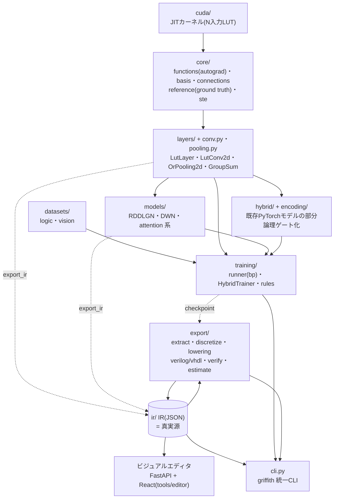
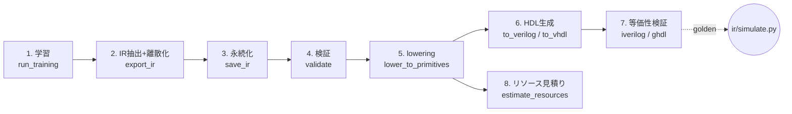

griffith-logic は **PyTorch で微分可能論理ゲート NN を学習し、その結果を IR(JSON)へ抽出して
Verilog/VHDL を生成し、HDL シミュレータで等価性を検証する** フレームワークである。
学習時は連続緩和で勾配を流し、推論時は argmax 離散化で純粋な Boolean 回路へ崩壊させる
(→ [DLGNとは何か](/explanation/dlgn/))。

このページは **「なぜこの構造か・データがどう流れるか」** を説明する。

## 全体像 — IR が真実源

中心に **IR(中間表現)** を据え、上流(学習)と下流(export / エディタ / コード生成)を
疎結合にするのが基本設計である。学習フレームワークを差し替えても IR より下流は不変、
HDL ターゲットを増やしても学習側は不変でいられる。



- `core/` は数式の心臓部で、`nn.Module` を含まない純粋な関数と autograd 定義だけを持つ。
  カスタム autograd(`LutFunction` ほか)が学習速度とメモリ効率の要になっている。
- `cuda/` は葉モジュール。CUDA 非対応環境では自動的に Python 実装へフォールバックする
  (**CUDA は必須ではない**。CPU / MPS でも動く)。
- `layers/` が `core` を組み合わせて `nn.Module` 部品を作り、`models/` がそれらを積む。
- `ir/` は学習系(torch)にも下流系(HDL / エディタ)にも属さない **共通契約** である。
  `export/`・エディタ・CLI はすべて同じ IR を共有する。

## データフロー — 学習から HDL 等価性検証までの 8 段

学習済みモデルを HDL に落とすまでの主経路は次の 8 段。各段は独立した純関数 / モジュールとして
単体で呼べる。

### 主経路の全体図



### 各段の入出力と要点

次の表は 8 段それぞれについて、何を受け取り何を返すか、実装上の勘所は何かをまとめたもの。

| 段 | 入力 → 出力 | 要点 |
|---|---|---|
| **1. 学習** | `TrainConfig` → checkpoint + metrics | 共通ランナーは `bp` のみ。ap/dfa/eggroll は `HybridTrainer`。学習中は soft の loss/acc、評価は離散化した **hard eval** |
| **2. IR抽出 + 離散化** | `nn.Module` → `IRGraph` | レジストリ方式で各層を IR ノードへ変換。離散化は「`eval()` 済みのプローブに全 2^N パターンを流して真理値表化」する。**パラメータ化方式ごとの離散化規則を下流に複製しない**のが要点 |
| **3. 永続化** | `IRGraph` ⇔ JSON | 真理値表は hex 文字列化(N=6 は 64bit で JS の安全整数を超えるため)。大きな配列は npz サイドカーへ外部化 |
| **4. 検証** | `IRGraph` → 警告リスト | `target='hdl'` で HDL 生成不可能な構成を拒否。幅・スロット・DAG 循環を検査 |
| **5. lowering** | `IRGraph` → `IRGraph` | 純関数。`conv2d` / `or_pool2d` のネイティブノードを `lut_layer` 列へ展開する。padding は「真理値表の特殊化」で処理し、定数線を使わない |
| **6. HDL生成** | `IRGraph` → HDL 文字列 | Verilog-2001 / VHDL-2008。`conv2d` を含む IR は拒否するため、事前に段 5 を通す必要がある |
| **7. 等価性検証** | `IRGraph` + 入力ベクトル → pass/fail | 内部で lowering → `simulate`(golden)→ 自己検証テストベンチを生成し、`iverilog` / `ghdl` で照合 |
| **8. リソース見積り** | `IRGraph` → LUT 数・論理深さ・配線数 | conv/pool を含む場合は lowering 後に計測。シンセサイザ非依存の一次見積り |

### CLI から見た入口

統一 CLI はこの経路の入口を提供する(`griffith train` = 段 1、`griffith export-hdl` = 段 4→6)。
実際の回し方は [HDLエクスポートと等価性検証](/guides/hdl-export/) を参照。

## 学習の 3 軸

同じ「N 入力 LUT を学習する」目的でも、先行研究(difflogic / BinaryBrain / DWN / LDDLGN / WARP / CAGE)
ごとに緩和と学習の方法が異なる。それらを 1 つの `LutLayer` に集約するため、**直交する 3 軸** を設けている。
3 軸を分離することで、離散化ギャップ・学習安定性・ハードウェア展開性のトレードオフを実験で切り分けられる。

| 軸 | 選択肢 | 何を決めるか |
|---|---|---|
| **パラメータ化** | `softmax` / `independent` / `iwp` / `raw` / `warp` | 真理値表をどの連続空間で表現し、どう緩和するか |
| **選択(selection)** | `soft` / `hard_st` | 訓練時に softmax 混合で通すか、argmax forward + STE backward で通すか |
| **学習則** | `bp` / `ap` / `dfa` / `eggroll` | 勾配の作り方。BP 以外は層単位で混在できる |

パラメータ化と選択は `LutLayer` の引数、学習則は `with_learning` + `HybridTrainer` で層に付与する。
各用語の定義は [用語集](/explanation/glossary/)。

## 設計思想

このフレームワークの構造は、次の 4 つの原則から導かれている。

### IR が真実源

学習後のモデルの意味は IR に固定される。`export/`・エディタ・コード生成は
すべて IR だけを見る。学習フレームワークと出力ターゲットを直交させ、片方の変更が他方に波及しない
ようにするための中心設計。IR のノード粒度は **レイヤ単位**(ゲート単位には展開しない。
ゲートビューは配線 `indices` と `truth_tables` から導出する)。

### 参照実装が ground truth

`core/reference.py` は素朴な純 autograd 実装であり、
最適化版(カスタム autograd・CUDA カーネル)が数学的に正しいことを float64 gradcheck と
1e-10 の照合で保証する。**参照実装は高速化目的では書き換えない**(素朴さそのものが検証価値)。

### 3段等価性

同じ回路が 3 つの経路で一致することを保証する。

```
PyTorch hard eval  ⇔  ir/simulate.py(numpy golden)  ⇔  HDL シミュレーション
```

段 2 の離散化(torch eval)と段 7 の照合(simulate vs HDL)がこの鎖を閉じる。

### 離散化ギャップの最小化

学習時の連続緩和と推論時の Boolean 回路の性能差を抑えることが
品質指標そのものである。パラメータ化方式と選択方式の選択がここに効く。

## 次に読む

- [DLGNとは何か](/explanation/dlgn/) — soft/hard の二相と、なぜ FPGA 直行なのか
- [LutLayerの数理](/explanation/lut-layer/) — forward/backward の導出
- [HDLエクスポートと等価性検証](/guides/hdl-export/) — 8 段の下流側を実際に回す
- [用語集](/explanation/glossary/)
