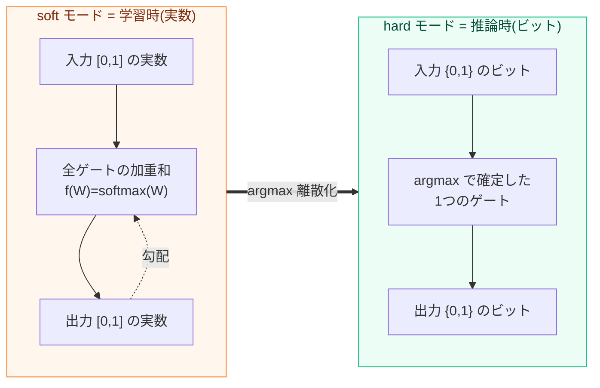
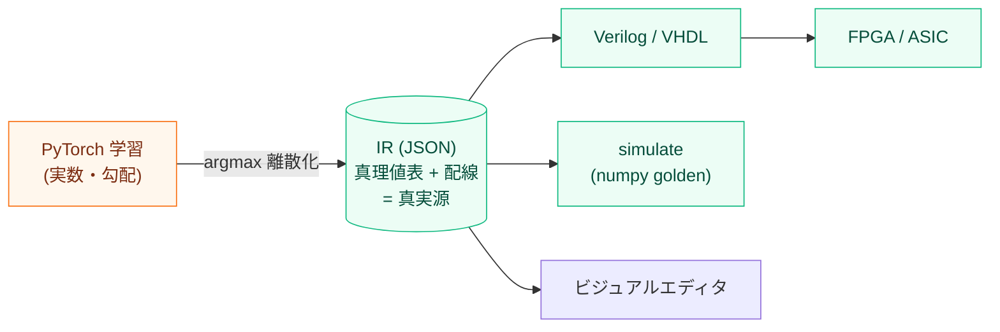

**DLGN(Deep Differentiable Logic Gate Network / 微分可能論理ゲートネットワーク)** は、
ニューラルネットワークの計算単位を「積和演算(MAC)」から「論理ゲート」に置き換えたネットワークである。
学習は勾配降下でそのまま行い、**学習が終わった瞬間にモデルは純粋なブール回路になる**。

普通の NN の前提(実数の重み・乗算・GPU)がまだ頭に入っていない場合は、先に
[そもそもニューラルネットとは](/explanation/ai-basics/) を読むと差分が鮮明になる。

:::note[このサイトの色の約束]
本サイトでは <span style="color:#f97316;font-weight:600">橙 = 実数の世界(MAC・勾配・学習時のsoft値)</span>、
<span style="color:#10b981;font-weight:600">緑 = 論理の世界(ビット・ゲート・推論時のhard値)</span> を一貫して使う。
図の色を見れば、どこまでが実数でどこからがビットかが分かる。
:::

## 1. 一言でいうと

| | 普通の NN | DLGN |
|---|---|---|
| ニューロン | $y=\sigma(\sum_j w_j x_j + b)$ (積和) | $y = g(x_{i_1}, \dots, x_{i_N})$ (ブール関数) |
| 学習されるもの | **重み行列**(実数) | **どのゲート(真理値表)になるか** の分布 |
| 配線 | 全結合(密行列) | 各ゲートが N 本だけ拾う(疎・固定ランダムが既定) |
| 推論の計算 | 実数の乗算・加算 | AND / OR / XOR …の **ビット演算のみ** |
| 学習後の重み | そのまま推論で使う | **捨てる**(argmax でゲートを1つ確定させたら不要) |
| 相性の良いHW | GPU / DSP(乗算器) | **FPGA / ASIC**(LUT に直マップ) |

最後の行が重要である。**学習後に残るのは「どのゲートを、どこに繋いだか」だけ** なので、
成果物はニューラルネットの重みファイルではなく **回路図** になる。

## 2. なぜ「学習できる」のか — 連続緩和

ゲートを選ぶという操作は本質的に離散的で、そのままでは勾配が流れない。
DLGN はこれを **「16 個(N=2 の場合)のゲートすべてを同時に少しずつ使う」** ことで回避する。

各ニューロンはゲート候補ごとの重み $W$ を持ち、それを **確率分布**(softmax)に変換して、
全候補の出力を加重平均する。

$$
y = \sum_{k=0}^{2^N-1} f(W)_k \prod_{j=0}^{N-1}
\bigl( x_j \bigr)^{b_j(k)} \bigl( 1 - x_j \bigr)^{1 - b_j(k)}
$$

- $b_j(k)$ … 真理値表の $k$ 番目のエントリの、第 $j$ ビット
- $f(W)$ … パラメータ化。既定は $\mathrm{softmax}(W)$(合計 1 の分布)
- 入力 $x_j$ も $[0,1]$ の実数(1 に近い = そのビットが立っている確からしさ)

第 2 項は「入力パターンが $k$ である確からしさ」を積で表したもので、$x_j\in\{0,1\}$ を代入すると
ちょうど 1 つの項だけが 1 になり、残りは 0 になる ── つまりこの式は **通常の真理値表引きの、
そのままの連続拡張** である。ブール代数の意味を壊していないのに、$W$ についても $x$ についても
なめらかに微分できる。だから普通の PyTorch の学習ループがそのまま使える。

## 3. soft(学習時) と hard(推論時) の二相

DLGN のモデルは 2 つの姿を持つ。この切り替えは PyTorch の `train()` / `eval()` にそのまま対応する。



| | soft(学習時) | hard(推論時) |
|---|---|---|
| 値 | $[0,1]$ の実数 | $\{0,1\}$ のビット |
| ゲート | 全候補の混合 | argmax で 1 つに確定 |
| 微分 | 可能(勾配が流れる) | 不要(そもそも学習しない) |
| コード | `model.train()` | `model.eval()` |

```python
y_soft = model(x)   # 学習時: 連続緩和。勾配が流れる
model.eval()
y_hard = model(x)   # 推論時: 純粋な Boolean 回路として動く
```

**soft と hard の精度差を「離散化ギャップ」と呼び、これを小さくすることが DLGN の品質そのもの** である。
学習中に見るべきなのは soft 精度ではなく **hard 精度** であり、本ライブラリの学習ログが
`test_acc`(hard)と `test_acc_soft` を必ず併記するのはこのためである
(→ [学習曲線の見方](/guides/training-curves/))。

離散化ギャップを最初から 0 にする流儀もある。forward では argmax で 1 つのゲートを通し、
backward だけ softmax の勾配で近似する **Hard-ST**(CAGE 方式)で、
本ライブラリでは `selection='hard_st'` に対応する。

## 4. fan-in(N)というノブ

difflogic(DLGN の原典、Petersen et al., NeurIPS 2022)は **2 入力ゲート固定** で、
候補は 2 入力ブール関数 16 種(AND, OR, XOR, パススルー, 定数…)である。
本ライブラリはこの制約を外し、**N 入力 LUT(N = 2 / 4 / 6)** に一般化している。

| N | 候補エントリ数 $2^N$ | 位置づけ |
|---|---|---|
| 2 | 4 (= 16 ゲート) | difflogic 互換。勾配が厳密・CPU/GPU で速い |
| 4 | 16 | バランス型 |
| 6 | 64 | **FPGA の LUT6 に 1 セル直マップ** |

fan-in は「どちらが偉いか」ではなく **デプロイ先で決まるノブ** である。FPGA 実装面積を詰めるなら
6 入力が有利(物理セルが LUT6 なので 2 入力では持て余す)。一方で訓練の安定性と CPU/GPU 速度では
2 入力が有利。詳しくは [DLGNの分類と系譜](/explanation/taxonomy/) を参照。

## 5. 推論はビット演算 = FPGA 直行

hard モードのモデルは、実数を一切含まない **有向非巡回グラフ状のブール回路** である。
これは「NN を FPGA 向けにコンパイルする」のではなく、**最初から回路を学習していた** ということだ。

本ライブラリは学習結果を **IR(中間表現、JSON)** に固定し、そこから下流を分岐させる。



橙(実数)から緑(ビット)への境界は **IR ただ 1 箇所** に集約されている。この設計のおかげで、
学習側を差し替えても IR より下流は不変、HDL ターゲットを増やしても学習側は不変でいられる
(→ [アーキテクチャ全体像](/explanation/architecture/))。

生成した回路が本当に元のモデルと同じ振る舞いをすることは、**3 段等価性** で保証する。

```
PyTorch hard eval  ⇔  ir/simulate.py(numpy golden)  ⇔  HDL シミュレーション
```

3 つが全ベクトルで一致して初めて「焼ける」と言える(→ [HDLエクスポートと等価性検証](/guides/hdl-export/))。

## 6. DLGN が向く場面・向かない場面

**向く**

- 推論を **FPGA / ASIC** で回したい(乗算器不要、LUT に直マップ、低消費電力)
- レイテンシが厳しい(組合せ回路なので数クロックで答えが出る)
- クラウドに出せないデータを手元のデバイスで処理したい

**向かない / 注意**

- 巨大な事前学習モデルからの流用が効きにくい。**既存の重みを DLGN に「変換」しても基本的に負ける**
  ── native DLGN の強みは自由にブール論理を学ぶことで、算術構造を転写するとその自由を縛るため
  (実測の失敗例は [分類と系譜 §3](/explanation/taxonomy/))
- 精度あたりのパラメータ効率は密な実数 NN に劣る場面がある。実数のまま残すべき部分
  (Attention など)は残す **ハイブリッド化** が現実解になることが多い
- 学習そのものは PyTorch 上の実数計算なので、**学習時は GPU があると速い**。
  GPU が要らなくなるのは推論側である

## 次に読む

- [DLGNの分類と系譜](/explanation/taxonomy/) — 算術演算DLGN / native DLGN / 6-LUT DLGN の違い
- [LutLayerの数理](/explanation/lut-layer/) — forward/backward の導出と butterfly 基底
- [アーキテクチャ全体像](/explanation/architecture/) — 学習から HDL までの 8 段データフロー
- [MNISTを学習する](/tutorials/mnist/) — 動かしながら確かめる
- [付録: XORで仕組みを覗く](/tutorials/xor/) — 同じ原理を16ゲートの全ノード図で見る
