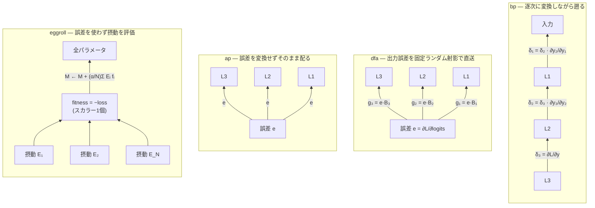
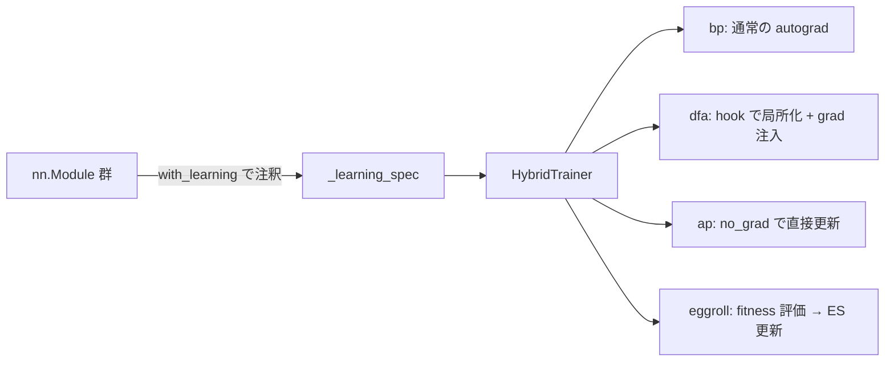

「どの論理関数になるか」を学ぶには、各ゲートの重みへ **どうやって責任(誤差)を配るか** を決めなければならない。
これが **信用割当(credit assignment)** の問題であり、本ライブラリはその方式を
**レイヤ単位で差し替えられる** 3 軸目として持っている(→ [アーキテクチャ全体像](/explanation/architecture/))。

backprop 以外を用意する動機は明快で、**微分可能回路をハードウェアに載せたとき、逆伝播の経路まで
実装したくない**からである。順伝播だけで学習できるなら、学習そのものを回路側へ寄せられる。

## 4 つの学習則

| 学習則 | 誤差の流し方 | 微分は要るか | 実装上の制約 | 使いどころ |
|---|---|---|---|---|
| **`bp`**(backprop) | 出力の誤差を層ごとに変換しながら逆向きに伝播 | **要る**(全経路) | 特になし。共通ランナー `run_training` が扱う唯一の則 | **既定**。精度が最優先のとき |
| **`ap`**(Akiho Propagation) | 出力の誤差を、到達可能な全 LUT へ**同じ値のまま配る** | **不要**(autograd を一切使わない) | `parameterization='independent'` 前提。`nn.Sequential(Flatten, LutLayer…, GroupSum)` の直列形 | backprop 非依存を実証したいとき。全結合構成に限る |
| **`dfa`**(Direct Feedback Alignment) | 出力の誤差を**固定ランダム行列**で各層の出力空間へ直接射影 | 局所的にのみ要る(層内 1 段) | 出力が 2D `(B,D)` か 3D `(B,S,D)`、`block_upstream=True` のみ | 層間の逆伝播を切りたいとき。並列化・生物学的妥当性の文脈 |
| **`eggroll`**(進化戦略) | 誤差を使わない。**低ランク摂動を撒いて fitness で選択**する | **不要**(forward のみ) | 2D パラメータのみ。評価回数がコストに直結 | 勾配が定義できない/信頼できない目的関数のとき |

### 信用割当の対比

同じ「3 層の LUT ネットワーク」に対して、誤差がどう届くかを並べる。



要点は「**誤差が層を通るたびに変換されるか**」である。
`bp` は毎層でヤコビアンを掛け、`dfa` は 1 回だけ固定ランダム行列を掛け、`ap` は何も掛けない。
`eggroll` はそもそも誤差ベクトルを作らず、スカラー 1 個(fitness)だけで更新する。

---

## bp — backprop

既定であり、比較の基準線。`LutLayer` はカスタム autograd(`LutFunction`)を持っているので、
backprop 経路も butterfly 基底を逆にたどる自前実装が走る
(→ [LutLayerの数理](/explanation/lut-layer/))。

共通ランナー `training/runner.py::run_training` が扱うのは `bp` のみで、
それ以外は次節の `HybridTrainer` 経路になる。

## ap — Akiho Propagation

自社発の学習則。**backprop を一切使わない**。出力の誤差を、接続をたどって到達できる
全 LUT へ**同じ値のまま**配り(ブロードキャスト)、各ゲートの重みを直接更新する。

$$
w_k \;\leftarrow\; w_k + \eta \cdot e \cdot \mathrm{basis}_k(x)
$$

$\mathrm{basis}_k(x)$ は「そのエントリがどれだけ読み出されたか」なので、
更新は**実際に使われたエントリにだけ**入る。全処理が `torch.no_grad()` 内で完結し、
計算グラフを一切作らない。`update_mode=2` にすると最大 basis のエントリのみを更新する。

`parameterization='independent'` と対応する規則だが、sigmoid 変換を介さず重みを
$[0,1]$ の確率値として直接扱う点が異なる。

### 到達点と限界

:::caution[実験知見 — AP 法の到達点と限界]
MNIST の全結合(flat)構成では **soft ≈ 0.90 / hard ≈ 0.85** で安定し、深さ 2→8 のどこでも崩壊しない。
一方で同条件の BP 法は soft 0.983 / hard 0.977 であり、**BP に対しておよそ 6〜8pt 届かない**。
さらに **Conv ツリー + OrPooling 構成では accuracy ≈ 0.11(chance)へ崩壊する**。
原因は当初疑った「単調性の破れ」ではなく(39 run・3 シードの介入実験で棄却)、
**OR 系の集約を経由した誤差ルーティングが有用な学習信号を作らないこと**にあった。
つまり **接続構造と学習則は独立には設計できない** — これが AP 法から得られた最大の教訓である。
RNN でも適格度トレース(e-prop 型)を入れて T≥2 で chance のままで、時間方向の信用割当は成立していない。
:::

### 対外的に数字を出すときの注意

:::note[対外的な数字の扱い]
「AP 法で MNIST 98%」は誤りである。98% はすべて **BP 法(backprop 使用)** または外部論文の引用値で、
リポジトリ内に AP 法で 90% 台の記録は存在しない。数字を出すときは必ず学習則を明記する
(「BP 法で 98.3%、backprop 不使用の AP 法では現状 90%」)。
一次ソースはリポジトリ内部の監査記録(AUDIT_98)。
:::

## dfa — Direct Feedback Alignment

Lillicrap et al. 2016 / Nøkland 2016 に基づく。出力誤差 $e = \partial L/\partial \mathrm{logits}$ を、
層ごとに用意した**固定ランダム行列** $B_l$ で各層の出力空間へ直接射影し、局所勾配として使う。

$$
g_l = e B_l, \qquad \frac{\partial L}{\partial \theta_l} \approx \frac{\partial\, \mathrm{out}_l}{\partial \theta_l} \cdot g_l
$$

$B_l$ は学習しない。それでも学習が進むのは、**前向きの重みが $B_l$ の方向へ整列していく**
(feedback alignment)ためである。$B_l$ の seed は決定的ハッシュから作られるので、
実行をまたいで再現する。

実装は「局所グラフ分離」で行っている。

1. `forward_pre_hook` で入力を `detach()` し、上流へ BP 勾配を流さない
2. モジュール自身の forward が「detach 済み入力 → 出力」の**局所グラフ**を作る
3. `forward_hook` で局所出力を保持し、下流へは `detach()` して渡す
4. loss 計算後、`autograd.grad(local_out, params, grad_outputs=g_l)` で勾配を注入する

4 の一手で、**検証済みのカスタム backward 資産(`LutFunction`)をそのまま再利用**できるのが設計上の要点である。
層をまたぐ逆伝播だけが消え、層内の正確な勾配計算は残る。
系列出力 `(B,S,D)` は内部で `(B*S,D)` へ flatten して 2D と同様に扱う(数式は変わらない)。

## eggroll — 進化戦略

EGGROLL(Sarkar et al., 2026)の Algorithm 1 を実装したもの。勾配を一切使わず、
**低ランク摂動を撒いて fitness で選ぶ**。

$$
E = \tfrac{1}{\sqrt{r}} A B^\top \ (A \in \mathbb{R}^{m \times r},\ B \in \mathbb{R}^{n \times r}),
\qquad
M \leftarrow M + \frac{\alpha}{N}\sum_i E_i f_i
$$

低ランクにすることで摂動の生成コストが下がり、counter-based RNG により
**seed から摂動を決定的に再構築**できる。ワーカー間で共有するのは fitness スカラーだけで済むため、
分散実行との相性が良い。対象パラメータは `requires_grad=False` にされ、autograd から外れる。

`train`/`eval` モードは呼び出し側の状態を尊重するので、`eval()` で回せば
**hard 離散化後の性能を直接 fitness にする**こともできる。連続緩和を経由せずに
Boolean 回路そのものを最適化したい場合の選択肢になる。

---

## レイヤ単位で混ぜる — with_learning と HybridTrainer

学習則はモデル全体ではなく **モジュールごと**に指定する。`with_learning` は
モジュールを**ラップせず**、`_learning_spec` 属性を注釈するだけである。
forward も `repr` も `state_dict` も一切変わらないので、既存モデルへ後付けできる。

```python
from griffith_logic import GroupSum, HybridTrainer, LearningSpec, LutLayer, with_learning

model = nn.Sequential(
    with_learning(LutLayer(2, 32, n_inputs=2), LearningSpec(rule='dfa')),
    with_learning(LutLayer(32, 16, n_inputs=2), LearningSpec(rule='dfa')),
    GroupSum(k=2, tau=2.0),
)
trainer = HybridTrainer(model, torch.optim.Adam(model.parameters(), lr=0.05))
for _ in range(600):
    metrics = trainer.train_step(x, y)
trainer.close()
```

注釈のないモジュールは `bp` として扱われる。したがって
**「特徴抽出は bp、出力ヘッドだけ dfa」といった混在**が自然に書ける。
`HybridTrainer` が各則のフック管理・勾配注入・ES 更新の順序を調停する。



`LearningSpec` の主なフィールド:

| フィールド | 対象 | 意味 |
|---|---|---|
| `rule` | 全体 | `'bp'` / `'ap'` / `'dfa'` / `'eggroll'` |
| `lr` | 全体 | 則固有の学習率(`None` ならトレーナ既定) |
| `update_mode` | ap | `1`=全重み更新 / `2`=最大 basis のエントリのみ |
| `feedback_init` | dfa | 固定ランダムフィードバックの初期化 |
| `block_upstream` | dfa | 現実装は `True` のみ対応 |
| `eggroll` | eggroll | `EGGROLLConfig`(rank / sigma / alpha / n_workers …) |

## どれを選ぶか

- **まず `bp`** — 精度の基準線を取る。共通ランナーで回せるのもここだけ。
- **`dfa`** — 層間の逆伝播を切りたい、あるいは層並列を狙うとき。層内の勾配は正確なままなので、
  AP ほど精度を落とさずに「backprop の連鎖」だけを外せる。
- **`ap`** — backprop 完全非依存を実証したいとき。**全結合構成に限る**。
  Conv / OrPooling / 再帰を含む構成では現状崩壊する。
- **`eggroll`** — 勾配が定義できない目的関数(hard 離散化後の精度そのもの等)を直接最適化したいとき。

実際に動かす手順は [チュートリアル 6. 学習則(DFA/AP)](/tutorials/learning-rules/) と
リポジトリの `examples/03_learning_rules.py` にある。

## 次に読む

- [LutLayerの数理](/explanation/lut-layer/) — bp が実際にたどる backward の中身
- [学習を回す](/guides/training/) — `run_training` と `TrainConfig`
- [学習曲線の読み方](/guides/training-curves/) — soft/hard の乖離をどう読むか
- [設計判断の記録](/explanation/design-decisions/) — 3 軸を直交させた理由
