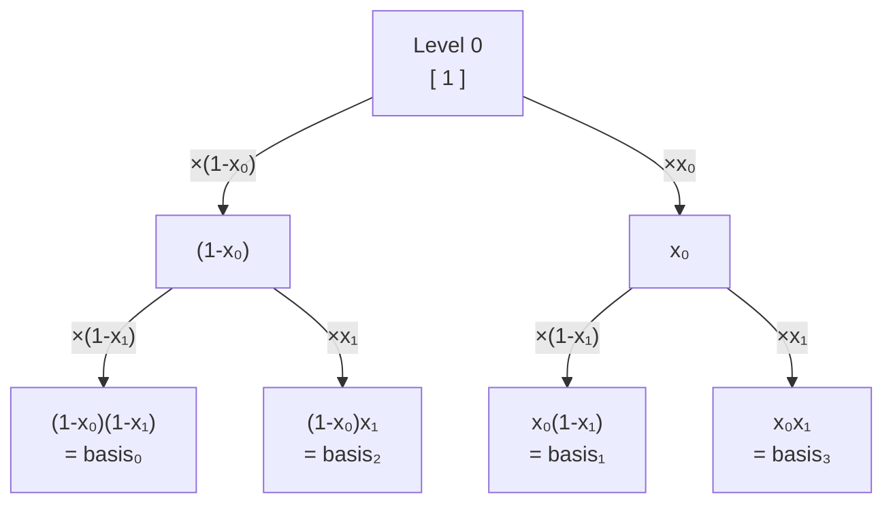
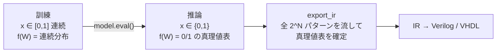

`LutLayer` は本ライブラリの最小構成要素であり、**N 入力 LUT(Look-Up Table)を微分可能にした層**である。
このページでは「なぜこの式なのか」「なぜ backward を手で書いているのか」を数式から追う。

## 1. 出発点 — LUT は微分できない

N 個のバイナリ入力に対して 1 ビットを返す早見表が LUT である。N=2 なら 4 エントリの真理値表で、
その埋め方は $2^4 = 16$ 通り、つまり AND / OR / XOR / NAND … という **16 種の 2 入力 Boolean 関数**が
すべて表現できる。N=6 なら $2^{64} \approx 1.8 \times 10^{19}$ 通りで、これは FPGA の LUT6 と同じ表現力である。

問題は、真理値表の中身が 0 か 1 の**離散値**であること。勾配降下法が使えない。
そこで訓練中だけ 0 と 1 の間の連続値を許し、推論時に離散へ戻す。この「連続値の持ち方」が
パラメータ化方式であり、本ライブラリの設計の核心にあたる。

## 2. 中心の式

各ニューロンは次式で計算される。

$$
y \;=\; \sum_{k=0}^{2^N-1} f(W)_k \cdot \mathrm{basis}_k(x_0, \dots, x_{N-1})
$$

$$
\mathrm{basis}_k(x) \;=\; \prod_{j=0}^{N-1} x_j^{\,b_j(k)} \,(1 - x_j)^{\,1 - b_j(k)}
$$

ここで $b_j(k)$ は $k$ の第 $j$ ビット、$f$ はパラメータ $W$ を「重み」へ写す関数
(既定は $\mathrm{softmax}$)である。

$\mathrm{basis}_k(x)$ は「入力が **ちょうどパターン $k$ である度合い**」を表す。
入力が 0/1 に確定していれば $\mathrm{basis}$ はワンホットになり、式は
「真理値表の $k$ 行目を読み出す」という LUT の定義そのものへ一致する。
入力が中間値なら、複数のエントリが同時に部分的に読み出される — これが連続緩和である。

N=2 で展開すると意味がはっきりする。

$$
\begin{aligned}
\mathrm{basis}_0 &= (1-x_0)(1-x_1) &&\text{両方 0 のとき 1} \\
\mathrm{basis}_1 &= x_0 (1-x_1) &&\text{$x_0$ だけ 1 のとき 1} \\
\mathrm{basis}_2 &= (1-x_0) x_1 &&\text{$x_1$ だけ 1 のとき 1} \\
\mathrm{basis}_3 &= x_0 x_1 &&\text{両方 1 のとき 1}
\end{aligned}
$$

$w_3$ だけ大きければ $y \approx x_0 \land x_1$(AND)、$w_1, w_2$ が大きければ $y \approx x_0 \oplus x_1$(XOR)になる。

:::note[difflogic との関係]
difflogic(NeurIPS 2022)は 16 種のゲートを直接列挙して softmax 混合する。上の式は
**同じものを 4 つの基底の線形結合で書き直した**もので、N=2 では等価かつパラメータが 16 → 4 に減る。
そして重要なのは、この形なら **N=4, 6 へそのまま一般化できる**点である
(16 ゲート列挙は N=6 で $2^{64}$ 個になり破綻する)。
:::

### 層としての構成

`LutLayer` が持つテンソルは 2 つだけである。

| テンソル | 形状 | 学習 |
|---|---|---|
| `weights` | `(out_dim, 2^N)` | **する**(パラメータ化前のロジット) |
| `indices` | `(N, out_dim)` | **しない**(各ニューロンがどの入力を見るかの配線) |

配線 `indices` を固定して重みだけを学習するのが DLGN 系の基本姿勢である
(`connections='unique'` にすると全入力が最低 1 回は使われることを保証する)。
つまり **学習しているのは「配線」ではなく「各ゲートがどの論理関数になるか」** である。

## 3. Butterfly 基底 — $2^N$ 個の積を分割統治で作る

$\mathrm{basis}_k$ を定義どおり個別に計算すると、エントリごとに N 回の乗算が要る。
代わりに**中間結果を再利用して段階的にサイズを倍々にする**のが butterfly 基底である
(名前の由来は FFT のバタフライ演算と同じ分割統治構造)。



実装は素直な 4 行である(`core/basis.py`)。

```python
def _compute_basis_butterfly(gathered, n_inputs):
    basis = torch.ones(..., 1)              # Level 0: [1]
    for j in range(n_inputs):
        xj = gathered[..., j:j+1]
        basis = torch.cat([basis * (1.0 - xj), basis * xj], dim=-1)
    return basis                            # サイズ 2^n_inputs
```

計算量そのものは素朴版と同じ $O(N \cdot 2^N)$ である。butterfly を選ぶ理由は 3 つとも
**backward 側の都合**である。

- 各レベルの中間状態を保存でき、backward で再利用できる(メモリ効率)
- $\sum_k \mathrm{basis}_k = 1$ が構造的に保証される(各レベルで $(1-x_j) + x_j = 1$ が掛かるだけなので、数値誤差が積み上がらない)
- backward で**除算が要らない**(素朴版は $\mathrm{basis}_k / x_j$ のような割り算が必要になり、$x_j \to 0$ で壊れる)

## 4. パラメータ化 — 5 つの $f(W)$

同じ中心式でも、$W$ をどう重みへ写すか($f$ の選び方)で**表現力・離散化のしやすさ・パラメータ数**が変わる。
`LutLayer(parameterization=...)` で 5 方式を選べる。

| 方式 | $f(W)$ | パラメータ数/ゲート | 制約 | 出自 |
|---|---|---|---|---|
| `softmax`(既定) | $\mathrm{softmax}(W)$ | $2^N$($N{=}2$ は 16) | $\sum_k w_k = 1$ | difflogic |
| `independent` | $\sigma(W)$ | $2^N$ | 各エントリ独立 | BinaryBrain |
| `raw` | $W$ をそのまま | $2^N$ | $[0,1]$ を直接保持 | BinaryBrain |
| `iwp` | 入力ごとの $\sigma(\alpha_j)$ | $N$ | 分解可能な関数のみ | LDDLGN |
| `warp` | Walsh–Hadamard 係数 | $2^N$ | 制約なし実数 | WARP |

数理的な違いは「エントリ同士が競合するか」に集約される。以下、方式ごとに見ていく。

### `softmax` — エントリが競合する

$\sum_k w_k = 1$ の**単体(simplex)上**に重みが載る。100 円を $2^N$ 個の箱へ分配するイメージで、
1 つを上げると他が自動的に下がる。1 回の backward で全パラメータへ勾配が届く反面、
**hard 表として選べるのは高々 1 エントリ**という強い制約が付く(後述)。

### `independent` / `raw` — エントリが独立

各エントリが独立に「1 になる確率」を持ち、合計は 1 にならない。
$2^N$ 個の任意の 0/1 表を表現できるので、**hard 表の表現力は softmax より広い**。
勾配は $\partial L/\partial p_k = \partial L/\partial y \cdot \mathrm{basis}_k$ で、該当エントリにしか届かない。

### `iwp` — 入力ごとに 1 パラメータ

エントリではなく**入力ごと**に 1 パラメータしか持たない($N$ 個)。
「$x_j$ をそのまま使うか、反転して使うか」の重みだけを学び、リテラルの積として関数を作る。
極端に軽いが、XOR のように「組み合わせが本質」の関数は表現できない
(学習済みモデルのゲートは大多数が AND/OR/NOT 系に収束するという LDDLGN の実証が根拠)。

### `warp` — 周波数領域で学ぶ

真理値表そのものではなく、その **Walsh–Hadamard 変換の係数** $\theta$ を学ぶ。
出力は $\mathrm{logit} = \sum_k \theta_k \cdot \mathrm{wh}_k(x)$ を経由し、Gumbel-Sigmoid で平滑化される。
制約なし実数を扱えるため N=4, 6 で安定しやすい。
`wh_degree_cap` で $\mathrm{popcount}(k) > d$ の係数を恒等的に 0 に落とすと、
hard 表を**次数 d の多項式閾値関数**へ制限できる(PolyLUT 式)。

使い分けの実務は [パラメータ化を選ぶ](/guides/parameterization/) を参照。

## 5. soft → hard 崩壊 — 推論時に何が起きるか

`model.eval()` に切り替えると、`LutLayer` は緩和をやめて**確定した Boolean 回路**になる。
このとき何をどう丸めるかは**パラメータ化ごとに違う**。



| 方式 | 離散化規則 | hard 表として何が選べるか |
|---|---|---|
| `softmax`(N=2) | 16 ゲートのロジットを $\arg\max$ | **16 種の Boolean 関数すべて** |
| `softmax`(N>2) | $\mathrm{softmax}(W)_k > 0.5$ のエントリだけ 1 | $\sum_k w_k = 1$ なので 1 になるのは高々 1 エントリ。**単一 minterm か恒偽のみ** |
| `independent` | $\sigma(W) > 0.5$ | 任意の $2^N$ 真理値表 |
| `iwp` | $\sigma(\alpha) > 0.5$ → リテラルの積 | 分解可能な関数のみ |
| `warp` | $\mathrm{logit} > 0$ で閾値化 | 次数制限内の任意関数 |

:::caution[N>2 の softmax は離散化ギャップが大きい]
上表が示すとおり、`softmax` は N=2 では 16 ゲート表を直接 $\arg\max$ するので損失がないが、
**N>2 では hard 表が「単一 minterm か FALSE」に構造的に縮退する**。
soft の性能が hard に載らない(= 離散化ギャップが開く)ので、
N=4/6 でハードウェア展開するなら `independent` / `iwp` / `warp` を選ぶ。
:::

`hard` 側の性能低下(**離散化ギャップ**)を抑えることが、このライブラリの品質指標そのものである。
そして下流(IR 抽出・HDL 生成)はこれらの規則を**一切複製しない**。
`export_ir` は `eval()` 済みのモデルへ全 $2^N$ パターンを流して観測された出力を真理値表とするので、
パラメータ化を増やしても下流は無変更で済む(→ [アーキテクチャ全体像](/explanation/architecture/))。

## 6. Backward — なぜ手で書くのか

`LutFunction`(`core/functions.py`)は PyTorch の autograd に任せず、backward を自前で書いている。
理由は「butterfly の計算グラフを丸ごと保持したくない」「softmax の逆伝播を解析的に閉じたい」の 2 点である。

### 重みの勾配

出力は $y = \langle \mathrm{basis},\, \mathrm{softmax}(W) \rangle$ なので、まず softmax 出力に対する勾配を集め、
softmax の Jacobian $J_{ij} = w_i(\delta_{ij} - w_j)$ を解析的に適用する。

$$
\tilde{g} = \sum_{b} \frac{\partial L}{\partial y_b} \,\mathrm{basis}_b,
\qquad
\frac{\partial L}{\partial W} = w \odot \bigl(\tilde{g} - \langle \tilde{g}, w \rangle\bigr)
$$

```python
grad_w_soft = einsum('bo,boe->oe', grad_output, basis)
dot = (grad_w_soft * w).sum(dim=-1, keepdim=True)
grad_weights = w * (grad_w_soft - dot)
```

### 入力の勾配 — butterfly を逆にたどる

forward で「分岐して広がった」ものを、backward では「統合して戻す」。
各レベル $j$ で、上半分($x_j$ 側)と下半分($1-x_j$ 側)の差が $x_j$ の勾配になる。

```python
grad_cur = einsum('bo,oe->boe', grad_output, w)
for j in reversed(range(n_inputs)):
    half = grad_cur.shape[-1] // 2
    grad_lo, grad_hi = grad_cur[..., :half], grad_cur[..., half:]
    grad_gathered[:, :, j] = ((grad_hi - grad_lo) * intermediates[j]).sum(-1)
    grad_cur = grad_lo * (1 - xj) + grad_hi * xj     # 前段へ
```

forward で保存した `intermediates[j]`(各レベルの中間状態)をそのまま使うので、**除算が現れない**。
最後に、複数のニューロンが同じ入力を参照している分を `scatter_add_` で加算集約して `grad_x` を得る。

| 項目 | PyTorch デフォルト | `LutFunction` |
|---|---|---|
| 計算グラフ | butterfly 全体を保持 | 中間状態のみ保存 |
| softmax 逆伝播 | グラフ経由 | 解析的 Jacobian |
| 数値安定性 | 除算あり | 除算なし |
| メモリ | ベースライン | 約 50–80% 削減 |

:::note[正しさはどう担保しているか]
この最適化された backward が数学的に正しいことは、素朴な純 autograd 実装
`core/reference.py` との照合で保証される(float64 gradcheck + 1e-10 の一致、`tests/l2_grad/`)。
参照実装は**高速化目的で書き換えない** — 素朴さそのものが検証価値だからである
(→ [設計判断の記録](/explanation/design-decisions/))。
:::

## 7. 深い構成のための Residual Initialization

論理ゲートを深く積むと、初期状態ではランダムな関数の連鎖になって信号が奥まで届かない。
そこで **初期重みを「第 1 入力をそのまま通す」関数へ寄せる**のが Residual Initialization(CDDLGN §3.2)である。

$$
\mathrm{softmax}([5, 0, 0, 0]) \approx [0.993,\ 0.002,\ 0.002,\ 0.002]
$$

パススルー相当のエントリだけロジットを 5.0 にしておけば、初期のネットワークはほぼ恒等写像として
振る舞い、勾配が深いツリーを通り抜けられる。
`LutConv2d` はツリーが構造的に深いため **既定で ON**、`LutLayer` は既定 OFF で必要に応じて
`residual_init=True` を指定する。

## 8. 畳み込みへの拡張 — LutConv2d

`LutConv2d` は各出力チャンネルを 1 本の**論理ゲートツリー**(完全 N 分木)に対応させる。
深さ $d$ なら $N^d$ 個のリーフが受容野からランダムに入力を取り、
$(N^d - 1)/(N-1)$ 個の内部ゲートがボトムアップに畳み込む。
各ゲートの計算は `LutLayer` とまったく同じ「butterfly 基底 × 重み」であり、
推論時に $\arg\max$ で離散 Boolean 演算へ崩壊する点も共通である。

プーリングは `OrPooling2d` = `F.max_pool2d` のラッパで、これは
**maximum t-conorm = 確率的論理 OR** にあたる。バイナリ値では文字どおり Boolean OR として動く。

## 次に読む

- [パラメータ化を選ぶ](/guides/parameterization/) — 5 方式の実務的な使い分け
- [学習則(BP/AP/DFA/ES)](/explanation/learning-rules/) — 勾配の作り方をどう差し替えるか
- [アーキテクチャ全体像](/explanation/architecture/) — 学習から HDL までの 8 段
- [設計判断の記録](/explanation/design-decisions/) — 参照実装を素朴に保つ理由
