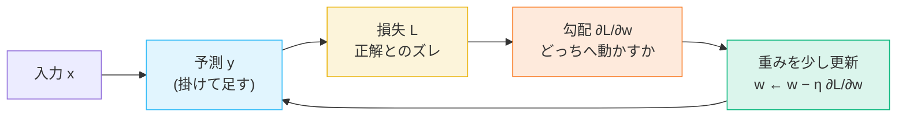
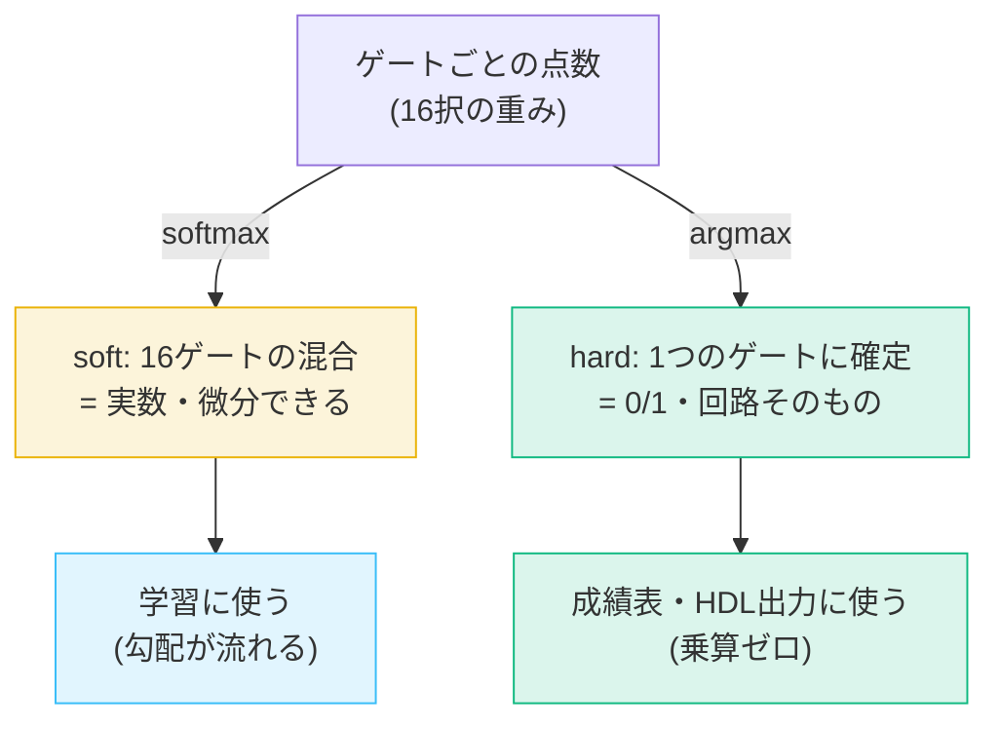

このページは **コードを1行も書かずに読む**ための解説である。
[入門コース](/tutorials/nn-basics/)を走らせる前に全体の地図が欲しい人、
あるいは走らせた後で「結局あれは何だったのか」を言葉で押さえたい人に向けている。

扱う問いはひとつだけ。

> 普通のニューラルネット(NN)から微分可能論理ゲートNN(DLGN)へ移るとき、
> **何がそのまま残り、何が入れ替わるのか。**

:::note[前提]
NN そのものが初めてなら、先に [そもそもニューラルネットとは](/explanation/ai-basics/) を読むと速い。
このページはその続きとして、**NN と DLGN を並べて比べる**ことに集中する。
:::

## 1. NN の気持ち — 重み・損失・勾配

NN の中身は「掛けて足す」だけである。入力 $x_j$ に **重み** $w_j$ を掛けて合計し、
活性化関数 $\sigma$ で曲げる。

$$
y = \sigma\!\left( \sum_j w_j x_j + b \right)
$$

人間が決めるのは**構造**(何層か・何個並べるか)で、学習で決まるのは**重み $w$ だけ**。
その重みをどう動かすかは、次の4ステップのループで決まる。

このループが回るための条件はただ1つ、**損失が重みに対してなめらかに変わること**である。
$w$ を 0.001 動かしたら損失が 0.0004 減った、という「連続的な手応え」がないと、
どちらへ動かせばよいか分からない。だから NN は実数の世界に住んでいる。

## 2. DLGN は「掛ける数」ではなく「ゲートの種類」を学ぶ

DLGN では、1つのニューロンが **2本の入力線だけを見る論理ゲート**になる。
このゲートが AND なのか OR なのか XOR なのか ── それを学習で決める。
掛け算は1つも登場しない。

ここで壁にぶつかる。「AND か XOR か」は**16択の飛び飛びの選択**であって、
なめらかに動かせない。少し動かしても AND のまま、ある瞬間にいきなり XOR へ飛ぶ。
勾配が取れないので、§1 のループが回らない。

### たとえ話: つまみと、迷っているスイッチ

普通の NN の学習は、**音量つまみを少しずつ回して音を合わせる作業**に似ている。
つまみは連続的に動くので、「少し回してみて、良くなった方へさらに回す」ができる。

DLGN が回したいのは、つまみではなく **「AND / OR / XOR …」と書かれた16接点のスイッチ**である。
スイッチは中間に置けない。そこで DLGN はこうする ──
**学習中だけ「どの接点にどれくらい気持ちが傾いているか」という点数を実数で持つ**。
点数は連続なので、つまみと同じようになめらかに動かせる。
学習が終わったら、**一番点数の高い接点へカチッと倒す**。それが焼かれる回路になる。

この「迷っている状態(soft)」と「倒しきった状態(hard)」の二相こそ、DLGN の心臓部である。

soft と hard は**同じモデルの2つの姿**であって、同じ関数ではない。
両者の精度差を **離散化ギャップ(discretization gap)** と呼び、
DLGN で唯一かつ最大の注意点になる(→ [離散化ギャップ](/explanation/results/discretization-gap/))。

## 3. 対応表 — 残るもの・入れ替わるもの

| | 普通の NN | DLGN | 変わるか |
|---|---|---|---|
| 学習の枠組み | 予測 → 損失 → 勾配 → 更新 | **まったく同じ** | 同じ |
| 損失関数・最適化 | cross entropy / Adam | **まったく同じ** | 同じ |
| フレームワーク | PyTorch | **同じ PyTorch**(`nn.Module`) | 同じ |
| 1ニューロンの計算 | 入力全部の重み付き和(積和) | 入力2本を見る論理ゲート1個 | 入れ替わる |
| 学習される量 | 実数の**重み** | 各ゲートの**真理値表**(どの論理関数か) | 入れ替わる |
| 活性化関数 | ReLU などが必要 | **不要**(非線形性はゲートが内包) | 消える |
| 出力層 | 全結合 + softmax | `GroupSum`(群ごとに数えるだけ・重みなし) | 入れ替わる |
| 推論時の演算 | 実数の掛け算(乗算器が要る) | ビット演算のみ(**乗算ゼロ**) | 入れ替わる |
| `model.eval()` | Dropout/BN の挙動が変わるだけ | **モデルの数学そのものが変わる** | 意味が違う |
| 成績の見方 | accuracy 1本 | soft と hard の**2本**(hard が本命) | 増える |
| 学習率の相場 | 1e-3 前後 | **0.01〜0.3** | 桁が違う |
| 層の幅 | 隠れ次元 数百 | ゲート数 数千〜数万(= 回路の面積) | 桁が違う |
| 最終成果物 | `state_dict` / ONNX | **IR(JSON)→ Verilog / VHDL** | 行き先が違う |

要点を1行にすると ── **学習のやり方は何も変わらない。学ぶ対象が「重み」から「ゲートの種類」へ変わるだけ**。

## 4. なぜそんな面倒をするのか

デジタル回路が得意なのは掛け算ではなく AND / OR / XOR である。
FPGA は LUT(任意の論理関数を1つ実現する小さな箱)を数万〜数百万個並べたデバイスで、
乗算器は貴重な資源として少数しか載っていない。

NN を論理ゲートで組めれば、学習の成果物が**そのまま回路**になる ──
乗算器なし・GPU なしで、低消費電力かつ高速に推論できる。
それが DLGN の動機であり、このライブラリが `export_ir()` から Verilog までを
一続きに用意している理由でもある(→ [DLGNとは何か](/explanation/dlgn/))。

## 次に読む

- [入門1. ニューラルネットとPyTorchの基礎](/tutorials/nn-basics/) — §1 を実際に走らせて確かめる
- [入門3. MLPをDLGNへ置き換える](/tutorials/mlp-to-dlgn/) — §3 の対応表をコードで1対1に見る
- [PyTorchからの移行](/guides/from-pytorch/) — 層・学習・エクスポートの**全**対応表(実務用)
- [DLGNとは何か](/explanation/dlgn/) — なぜ離散なのに勾配が流れるのか、数式で
- [学習曲線の読み方](/guides/training-curves/) — soft と hard の読み分け
