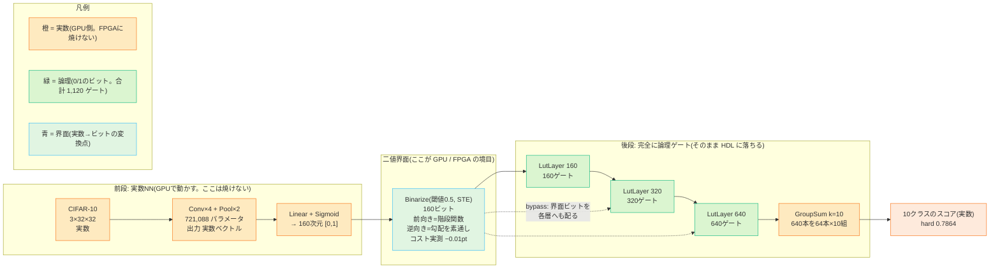
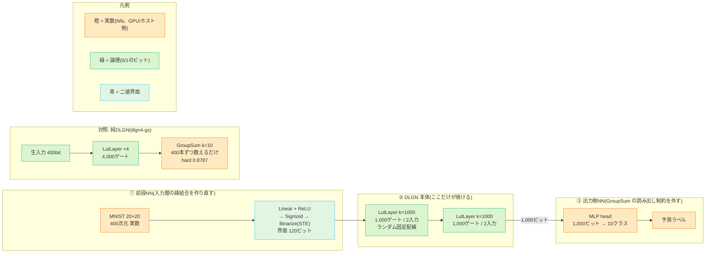
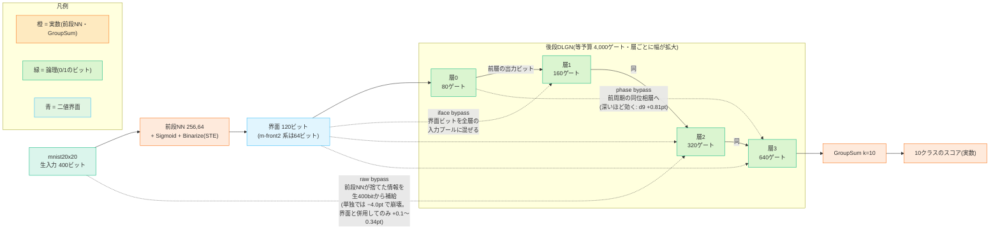
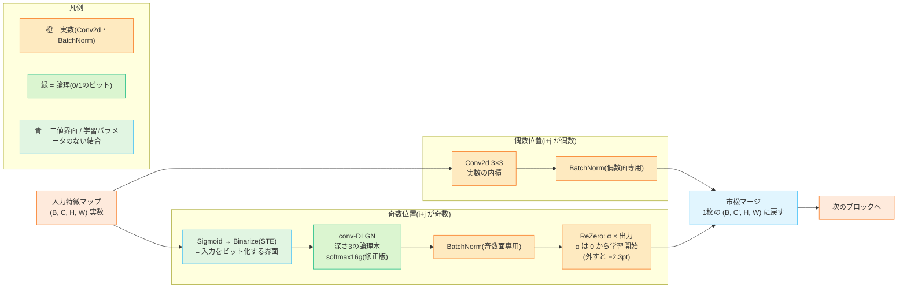

パッケージ本体に入っているモデル(= [モデル動物園](/reference/model-zoo/) の前半)とは別に、
**実験ブランチ上でだけ走らせた構成**が多数ある。ここはその置き場である。
本流のページと違い、**負の結果とその理由**を主役として書く。
「効かなかった」で終わらせず、**なぜ効かなかったか**を毎回残すのがこのページの目的である。

収録は **11系統・81構成**(実験系列ID で数えると 24 系列)。
すべて `experiments/` 配下のスクリプトで実行し、指標は wandb に記録してある。

:::caution[全系統に共通する読み方の注意]
- **seed 1本が大半**。seed 3本を取ったのは LUT6-1(1層条件)・HYBRID-4b・RES-LN-2(rezero-n2)・
  VAE-1(logic-n6 / float-bern-match)のみ。**上位帯 0.980〜0.984 の 0.3pt 以内の順位は主張できない**。
- **等ゲート予算 ≠ 等パラメータ**。N=2 softmax は 16 パラメータ/ゲート、N=6 は 64、
  AP 法の `independent` は 4。表をまたぐときは必ず確認すること。
- **エポック非等の暫定値が混ざる**: 後段スケールの 16M(10ep)・61M(5ep 途中打切)、
  Logic-DenseNet の CIFAR dense/plain(61ep 打切)。
- **FPGA の数値はすべて理論値**(200MHz・1層1クロックの完全パイプライン、未配置配線の上限)。
  Vivado 合成による実測は未実施。
- **ハイブリッド系は文献と土俵が違う**。前段に浮動小数 NN(約20万〜165万パラメータ)を含み、
  ハードウェア化できるのは二値界面から後ろだけである。ネットワーク全体が論理ゲートである
  文献(difflogic / DWN / LogicTreeNet / LILogicNet)と**ゲート数だけを横並びにした比較は成立しない**。
  同条件で言えるのは「同じ前段・同じ界面での後段の寄与」と「純 DLGN との相対」までである。
:::

## 1. 純DLGN / 入力バイパス — 固定配線の工夫は一度も勝てなかった

**何を試したか**: 純 DLGN(入力 400bit → LutLayer×L → GroupSum、学習するのはゲート種別のみ)の
弱点は入力層のランダム疎結合にあるという仮説を立て、**生入力を各層へ配り直す配線の工夫**を
5 ラウンド(R1〜R5)・約30 run 試した。条件は mnist20x20(400bit)・`n_inputs=2`・τ=10・bs=128・
seed 0・配線 fixed で固定。

| 構成 | 構造の要点 | MNIST 20×20 hard | 分かったこと |
|---|---|---|---|
| **純DLGN(基準)** | k1000×4層 = 4,000ゲート、ランダム固定配線 | **0.8994**(lr0.03/30k iter) | 等予算ではこれが最強。初期基準は 0.8939 |
| concat-random バイパス | 隠れ層入力を `concat([h,x])` に(出力幅は不変) | 4層 0.9077 / 20層 0.7963 | **深いほど悪化**。fan-in の17〜44%が生入力に奪われる |
| IALGN型 spine+anchor | slot0=前層同indexの恒等、slot1のみ元入力 | random 0.8724 / split 0.8663 / butterfly 0.8655 / coverage 0.8293 | 「入力を偏りなく配る」ほど悪い(coverage が最下位 −6.5pt) |
| OR残差 | `h_new = OR(h_prev, lut_out)` | 0.7654(residual_init有)/ 0.8416(無) | `OR(h,h)=h` で層が恒等に潰れ、spine と役割重複 |
| XNOR残差 | `h_new = XNOR(h_prev, lut_out)` | 0.7731 | `XNOR(h,h)=1` で定数飽和 |
| 層間バイパス prev2 / dense | anchor 先を2つ前 / 全先行層 | 0.8779 / 0.8727 | 元入力バイパスよりは良いが基準未達 |
| 土台スイープ | thermometer 2/4段・augment・τ30・gumbel・lr0.03 | lr0.03 **0.8993** のみ改善。therm2 0.8885 / aug 0.8873 / gumbel 0.8494 / τ30 0.8299 | 効いたのは学習率だけ(+0.54pt) |
| 深層化(6層 6,000ゲート) | lr0.03+温度計2段 | 0.9095 | ただしゲート数1.5倍。等予算では 0.8994 が上 |
| 等予算深層化+部分spine | 総≈4,000ゲート固定で k660×6 / k500×8 / k400×10 | none: 0.8696 / 0.8477、spine50: 0.8429 / 0.8227 / 0.8012 | **層数を増やすほど単調悪化**。幅が深さに勝つ |
| anchor選択の学習 | anchor スロットだけ K=32候補から softmax+STE | 0.8968 | spine の害をほぼ打ち消すが上回らない(−0.26pt) |
| 配線選択のST化 | Hard-ST / Gumbel-ST | 0.8875 / 0.8648 | 離散化を早める方向は不利 |
| **mnist784(決定的証拠)** | クロップなし784入力 | 0.8683(20×20 比 −3.11pt) | **入力次元が増えるほど疎結合が取りこぼす** |

**なぜ効かなかったか**: 入力バイパスは「情報が届いていない」問題への処方だが、
実際のボトルネックは**配線構造ではなく入力層そのもの**だった。
fan-in が 2 しかない層に生入力を混ぜると、前層の特徴を受け取る枠がそのぶん失われる。
`OR`/`XNOR` の固定論理残差は、恒等パスを作るどころか **`OR(h,h)=h` / `XNOR(h,h)=1` で
層を潰す**(残差初期化と組むと縮退が加速する)。mnist784 で悪化した事実が決め手となり、
「前段に密結合 NN を置いて入力層を作り直す」ハイブリッド系列へ動機が移った。

wandb group `input-bypass-dlgn`(tags `input-bypass` / `series:BYPASS-*`)。
実装は `experiments/train_input_bypass.py`。

## 2. ハイブリッド — 前段NN/CNN + 二値界面 + 後段DLGN

**何を試したか**: 前段 NN(Linear+ReLU または Conv)→ Sigmoid → `Binarize(0.5, STE)` の
**ビット界面**を立て、その先を完全に論理ゲート(LutLayer 列 → GroupSum)にする。
界面から後ろはそのまま HDL に落ちる。前段MLP(HYBRID-1)、前段CNN(HYBRID-2)、
後段の形状探索(HYBRID-3)、配線と LUT6 の決着(HYBRID-4/4b)、GPU/FPGA 境界の掃引(HYBRID-5/6)
の6段構成。

**構造図(系列最良の h2-cnn-dlgn-expand = CIFAR-10 hard 0.7864 の実寸)**

**読み方**: 界面より右(緑)だけが 1,120 個の2入力 LUT で、Verilog に落ちる。
左(橙)は普通の CNN なので GPU が要る。
全 NN 対照(h2-cnn-mlp, 0.7425)と比べたとき、**前段を同じにしたまま
後段だけ MLP → DLGN に差し替えて +4.39pt** というのがこの系列の主張であり、
「ネットワーク全体が論理ゲートである文献とゲート数を横並びにできない」理由でもある。

### 2.1 前段MLP(HYBRID-1)

| 構成 | 前段NN → 界面 | 後段DLGN | hard | ゲート数 |
|---|---|---|---|---|
| **m-front2-wide** | 256,128 → 128bit | 1000,1000 | **0.9714**(MNIST) | 2,000 |
| **m-front2-expand-bypass** | 256,64 → 64bit | 80,160,320(bypass) | **0.9703** | **560**(純DLGNの1/7) |
| m-front1-wide | 128 → 128bit | 1000,1000 | 0.9616 | 2,000 |
| m-front1-compress | 256 → 256bit | 120,60 | 0.9556 | **180**(1/22) |
| m-mlp-control(後段なし) | 256,64 → 64bit | — | 0.9203 | 0 |
| c-front2-wide | 512,128 → 128bit | 1000,1000 | **0.5446**(CIFAR-10) | 2,000 |
| c-front2-compress | 512,256 → 256bit | 200,100 | 0.5057(最下位) | 300 |

**分かったこと**: 疎結合ボトルネックは解消し、等予算純 DLGN 0.8994 に対し **+7.20pt**、
しかも 560 ゲート(1/7)で 0.9703 に届く。同一前段・同一界面での**後段 DLGN の寄与は +5.00pt**
(0.9703 対 MLP 対照 0.9203)。分業仮説「圧縮=密結合NN / 拡散=疎結合DLGN」は CIFAR で
圧縮型が明確に最下位になることで支持された。CIFAR では前段の学習率分離(`--front-lr 1e-3`)が必須。

### 2.2 前段CNN(HYBRID-2) — 「普通のNN」に真っ向勝ち

| run | head | 界面 | 後段 | CIFAR-10 hard | ゲート | NNパラメータ |
|---|---|---|---|---|---|---|
| **h2-cnn-dlgn-expand** | dlgn | 160bit | 160,320,640(bypass) | **0.7864** | 1,120 | 721,088 |
| h2-cnn-dlgn-wide | dlgn | 256bit | 1000,1000 | 0.7775 | 2,000 | 1,114,400 |
| h2-cnn-dlgn-compress | dlgn | 256bit | 200,100 | 0.7562 | **300** | 1,114,400 |
| h2-cnn-mlp-bin | mlp-bin | 256bit | MLP(256) | 0.7426 | 0 | 1,182,762 |
| h2-cnn-mlp(全NN対照) | mlp | 実数256 | MLP(256) | 0.7425 | 0 | 1,182,762 |

**分かったこと**: CNN+DLGN が CNN+MLP に **+4.39pt** 勝った。勝った側の後段は 1,120 個の
2入力 LUT だけで、前段 CNN も対照より4割少ない。要因分解では
**二値化界面のコストは実質ゼロ(−0.01pt)/ 後段DLGNの寄与 +4.38pt**。
スループット計測では律速が全バッチサイズで GPU の CNN 前段にあり、全 NN 比は 0.98〜1.28倍
(=ほぼ改善なし)、同一ハイブリッドを丸ごと GPU で回す場合との比で 1.48〜2.30倍。
FPGA 後段のレイテンシは 20ns(5段 @200MHz)。

### 2.3 後段の形状(HYBRID-3) — 形状が支配的、深さは形状に従属

前段 "256,64"(界面64bit)固定・全 run N=6・softmax。

| run | dlgn-widths | 軸 | MNIST hard | LUT数 |
|---|---|---|---|---|
| l6-expand | 80,160,320(bypass) | 拡散・中 | **0.9703** | 560 |
| l6-deep-expand | 80,160,320,640 | 拡散・深 | 0.9696 | 1,200 |
| l6-flat-narrow | 250,250 | 一定・浅・小 | 0.9618 | 500 |
| l6-compress | 120,60 | 収束・浅 | 0.9542 | **180** |
| l6-deep-narrow | 250,250,250,250 | 一定・深・小 | 0.9506 | 1,000 |
| l6-flat-wide | 1000,1000 | 一定・浅・大 | 0.9178 | 2,000 |
| l6-tiny | 60,30 | 収束・極小 | 0.8558 | **90** |
| l6-deep-compress | 320,160,80,40 | 収束・深 | **0.6460**(soft 0.8185) | 600 |
| (較正)warp パラメータ化 | 1000,1000 | — | 0.2027(学習崩壊) | 2,000 |

**分かったこと**: 軸内で **32pt** の開きがあり、形状が支配的(拡散 ≫ 一定 > 収束)。
深さの符号は形状に従属する(拡散 −0.07pt / 一定 −1.12pt / 収束 **−30.8pt**)ので、
「深いほど良い」はどの形状でも成立しない。一定形状では幅と精度が逆相関し、
500ゲート 0.9618 が 2,000ゲート 0.9178 に勝つ。l6-expand は n=2 と **±0.00pt の完全同値**で、
この設定では LUT6 の表現力はボトルネックではない。LUT6 の価値は
「同じ精度をより少ないゲートで」(560 対 2,000 = 3.6倍削減)側にある。

### 2.4 配線と LUT6 の決着(HYBRID-4 / 4b)

前段 "256,120"(界面120bit)/ 後段 "120,240,480"(840 LUT)固定。

| run | N | 配線 | 追加 | MNIST hard |
|---|---|---|---|---|
| h4-n2-i120 | 2 | bypass | — | **0.9746** |
| h4-l6-i120 | 6 | bypass | — | 0.9739(best 0.9766) |
| h4-n2-balanced | 2 | balanced | — | 0.9734 |
| h4-l6-bypass-bb-nolast | 6 | bypass | BB再二値化(最終層除く) | 0.9721 |
| h4-l6-balanced | 6 | balanced | — | 0.9646 |
| h4-l6-i240 | 6 | balanced | 界面240bit・1,680 LUT | 0.9617 |
| h4-l6-balanced-dwn | 6 | balanced | DWN流 第1層配線学習 | 0.9610 |
| h4-l6-unique-i120 | 6 | unique | — | 0.9597 |
| h4-l6-bb-nolast / -balanced-bb / -full | 6 | balanced | BB再二値化 | **0.1135 / 0.0891 / 0.1010**(崩壊) |

**要因分解**: 層またぎショートカット **+0.93pt** > 均等被覆 +0.49pt(LUT6 にのみ効く) >
界面 64→120bit +0.36pt。界面 120→240bit は **−0.29pt(飽和)**、DWN 流の配線学習は **−0.36pt**。

**なぜ崩壊したか**: BinaryBrain 流の**層間再二値化はスキップ経路が無いと死ぬ**。
balanced(前層のみ)と組むと hard 0.089〜0.114 まで落ち、bypass 併用なら 0.9721 と普通に学習する。
多段の STE を迂回路なしに通すと勾配が消えるためである。

**HYBRID-4b(seed3本+CIFAR で決着)**: MNIST legacy bypass は n=2 0.97430 対 LUT6 0.97450 で
範囲が完全に重なり差なし。balanced+bypass では n=2 0.97487 > LUT6 0.97300。
CIFAR-10 では n=2 0.7864 > LUT6(balanced+bypass) 0.78230 > LUT6(legacy) 0.77555。
**このハイブリッド構成では「LUT6 > LUT2」は成立しない**(LUT6 は常に4倍のパラメータで同等以下)。
balanced+bypass の符号はデータセットで反転する(MNIST −0.150pt / CIFAR +0.675pt)。

### 2.5 GPU/FPGA境界の掃引とパイプライン実証(HYBRID-5 / 6)

CIFAR-10、balanced+bypass、`--front-lr 1e-3`。

| run | 境界 | 界面 | 後段DLGN | hard | ゲート | 全NN比(bs=1024) |
|---|---|---|---|---|---|---|
| h5-conv4-dlgn | Conv×4+Pool×2 | 160bit | 160,320,640 | **0.7795** | 1,120 | 1.01x |
| h5-conv2-dlgn-deep | Conv×2+Pool×1 | 240bit | 240,480,960,960 | 0.7103 | 2,640 | 1.66x |
| h5-conv2-dlgn | Conv×2+Pool×1 | 240bit | 240,480,960 | 0.7051 | 1,680 | 1.67x |
| h5-conv1-dlgn-wide | Conv×1+Pool×1 | 360bit | 360,720,1440 | 0.6957 | 2,520 | 3.07x |
| **h5-conv1-dlgn** | Conv×1+Pool×1 | 240bit | 240,480,960,960 | 0.6925 | 2,640 | **3.40x**(567,289 sps) |
| (参考)h5-fullnn | 全部GPU | 実数256 | なし | 0.7425 | 0 | 1.00x |

**分かったこと**: スイートスポットは「速度なら Conv1、精度なら Conv4」。
中間の Conv2 は 1pt あたりの速度リターンが15倍悪く買い得でない。
「conv 1枚+Linear 1層+残り全部DLGN」は**速度目的なら成立(3.40倍)、精度目的なら不成立**
(全NN比 −5.0pt / Conv4比 −8.7pt)。境界を浅くして失った情報は、後段の深さ(+0.52pt)でも
界面幅(+0.32pt)でも埋まらない。train_acc は全 run 0.983〜0.999 なので、
**精度差は容量不足ではなく汎化の差**である。律速は常に GPU 部(FPGA 5.1µs・PCIe 9.1µs に対し
GPU 部は最速でも 1,805µs)。

HYBRID-6 では二重バッファのイベント駆動スケジュールで理論 3.40倍を **3.23〜3.41倍**として実証し、
レイテンシは bs=1 で **11.35倍**(0.939ms → 0.083ms)改善した。
`T_fpga` を100倍振っても 15構成×4点=60点すべてで律速は GPU 前段のままで、
**FPGA を速くしても系は速くならない**。効くレバーは「GPU 前段を削る」と
「PCIe 固定項(6〜13µs)を大バッチで償却する」の2つだけである。
LLM プロキシ(d384/L6/vocab50k)では同時系列 k=1→64 で LM head 比率が 20→49% になり、
FPGA オフロード利得は prefill 1.25x→1.95x。

wandb group `hybrid-front-dlgn`。実装は `experiments/train_hybrid_front.py` /
`train_hybrid_cnn.py` / `bench_hybrid_throughput.py` / `bench_pipeline_overlap.py`。

## 3. 後段スケール(HS-1) — 逆スケーリング

**何を試したか**: HYBRID-2 の前段 CNN と界面を固定したまま、**後段 DLGN のゲート数だけを
1,120 から 61,000,000 まで4桁振る**。文献の LogicTreeNet-B(16M)・G(61M)と同じ予算帯まで
届かせて、「ゲートを増やせば伸びるのか」を直接確かめた。CIFAR-10・seed 0。

| 後段ゲート | 深さ | best hard | エポック |
|---|---|---|---|
| 1,120(対照=HYBRID-2構成) | 3 | **0.7806** | 20 |
| 100,000 | 2 / 4 / 8 | 0.7793 / **0.7808** / 0.7762 | 20 |
| 1,000,000 | 4 / 8 | 0.7724 / 0.7679 | 20 |
| 8,000,000 | 8 | 0.7627 | 20 |
| 16,000,000(=LogicTreeNet-B予算) | 8 | 0.7305 | 10 |
| 61,000,000(=LogicTreeNet-G予算) | 8 | 0.6008 | 5(途中打切) |

**なぜ伸びなかったか**: 等 20 エポック同士で 0.7806 → 0.7808 → 0.7724 → 0.7627 と単調に悪化する
**逆スケーリング**が起きた。前段 CNN の土俵では後段は約 1,000 ゲートで飽和している。
深さの効果も全予算帯でゼロ〜負(どの帯でも d4 ≧ d8)。
ただし 61M の 0.6008 は**容量が無効なのではなく学習不足**である
(打切時点で 0.293→0.396→0.479→0.548→0.601 と毎エポック +5〜7pt 伸びていた)。
比較相手の LogicTreeNet-G 86.29% は 700〜1000 エポックの産物であり、
**巨大ゲート網の真のコストはゲートではなく学習量**だと分かる。
工学的には 61M ゲート(9.8億パラメータ)は A100-80GB・bs32 でピーク 52GB、
実務のボトルネックは hard eval が1点10分かかる Python 経路のほうだった。

wandb group `hybrid2-scale-v1`。実装は `experiments/train_hybrid2_scale.py`。

## 4. 出力層NN / 逆ハイブリッド(HYBRID-R)

**何を試したか**: 前段ではなく**出力側**に実数 NN を置く。純 DLGN の読み出しである
`GroupSum` を Linear / MLP ヘッドへ差し替え、さらに両端に NN を置く sandwich も試した。
mnist20x20・12,000 iters・seed 0・Modal A10G・DLGN k=1000 random 固定配線・
学習率分離(DLGN 0.03 / NN 1e-3)。

### 構造 — 系列最良の sandwich

下図は系列最良の sandwich 構成(MNIST hard 0.9731)である。

**読み方**: 下の対照(純DLGN)との差は「両端に橙のNNを1枚ずつ挟んだか」だけである。
③だけを足すと 0.8787 → 0.954(+7.5pt)、①だけを足すと 0.9714、
両方足した sandwich が 0.9731。つまり **入口の疎結合(①が直す)と
出口の読み出し制約(③が直す)は別々のボトルネック**で、
③は最小の Linear 1枚でも回収できる ── これが「FPGA前段 + 微小NNヘッド」という
配備形態(逆ハイブリッド)の根拠になっている。

### 構成別の結果

| 構成 | 構造 | best hard | soft-hard gap |
|---|---|---|---|
| **sandwich** | NN前段120bit + DLGN 2層 + MLP head | **0.9731** | ≈0 |
| sandwich-4 | 同、DLGN 4層 | 0.9716 | ≈0 |
| dlgn4-mlp-n6 | LUT6 indep、lut-lr 0.15 + MLP head | 0.9549 | 0.033 |
| dlgn2-mlp | DLGN 2層 + MLP head | 0.9548 | 0.024 |
| dlgn4-linear | DLGN 4層 + Linear head | 0.9540 | 0.026 |
| dlgn4-mlp | DLGN 4層 + MLP head | 0.9516 | 0.028 |
| dlgn4-gs(対照) | 純DLGN + GroupSum | 0.8787 | 0.008 |

**分かったこと**: NN ヘッドを足すだけで **+7.5pt**(0.8787→0.954)。しかもヘッドの種類
(Linear / MLP)にも DLGN の深さにもほとんど依存しない。つまり利得の正体は
**`GroupSum` の読み出し制約が外れたこと**そのもので、最小の Linear 1枚で回収できる。
一方で上限 0.955 は前段 NN 型の 0.9714 に届かず、**入力層の疎結合はヘッドでは埋まらない**
(入力バイパス系列の結論を反対側から再確認した形になる)。
両端に置く sandwich が 0.9731 で系列最高、soft-hard gap ≈ 0。ただし seed 1本で +0.17pt は誤差域。
配備上の含意として、**逆ハイブリッド(FPGA 前段 + 微小 NN ヘッド)は 0.954 で成立する** —
重い計算を全部 FPGA に置き、ホストは10クラスの読み出しだけ、という形が実用ラインに乗る。

wandb group `reverse-hybrid-v1`。実装は `experiments/train_reverse_hybrid.py`。

## 5. LUT6 vs LUT2 の決着(LUT6-1) — 真因はパラメータ化だった

**何を試したか**: 「6入力 LUT は2入力 LUT より強いのか」を土俵ごとに検証する。
まず出力スケールと勾配の5分診断(in_dim=400, out_dim=1000, seed 0)を行い、
その後に純DLGN・1層/2層・DWN・ハイブリッドの4土俵で比較した。

| 構成 | out.mean | \|dL/dW\| 平均 | N=2 softmax 比 |
|---|---|---|---|
| N=2 softmax 連続入力 | 0.50155 | 3.041e+00 | 1.0000 |
| **N=6 softmax 連続入力** | **0.01562**(=1/64に張り付き) | 6.817e-03 | **1/446** |
| N=6 softmax 二値入力 | 0.01561 | 2.508e-02 | 1/121 |
| N=6 independent 連続入力 | 0.49921 | 8.266e-01 | 1/3.7 |
| N=2 independent 連続入力 | 0.49772 | 1.327e+01 | 4.3640 |

**真因**: N=6 softmax は ΣW=1 かつ Σbasis=1 の**二重 simplex 制約**により出力が 1/64 に張り付く。
N=2 softmax は difflogic 互換の16ゲートモードで構造が違うため ≈0.5 に収まり、この問題が起きない。
旧仮説「基底減衰 1/16 を学習率で補正すればよい」は棄却された(lr 16倍は **−3.05pt** と単調悪化)。

| トラック | 構成 | hard |
|---|---|---|
| A: 純DLGN 4,000 LUT 4層 | **pA-n6-indep**(independent、lr0.48) | **0.9565** |
| | pA-n2-base(softmax 16ゲート、lr0.03) | 0.8846 |
| | pA-n6-samelr / lr8x / lr16x(softmax) | 0.7961 / 0.7828 / 0.7656 |
| pM: 1層 | 2,000 LUT6 indep / 8,000 LUT2 softmax | **0.9496** / 0.9315 |
| pM: 2層 | 同上 | **0.9697** / 0.9553 |
| pM: seed 0/1/2(1層) | 2,000 LUT6 indep | **0.95040** [0.9496, 0.9519] |
| | 8,000 LUT2 softmax | 0.92920 [0.9272, 0.9315] |
| pD: DWN(EFD+Thermometer) | n6 / n2 | 0.9312 / 0.9273 |
| B: ハイブリッド(840 LUT) | hB-n2-indep / hB-l6-lr16x / hB-l6-indep | **0.9764** / 0.9759 / 0.9683 |
| | hB-l6-indep-bb / bb-lr16x / bb-lr1x(層間再二値化) | 0.3910 / 0.3331 / 0.1771 |

**成立条件**: **前段NNなしの純DLGN**で **`independent`(sigmoid)パラメータ化**を使い、
ランダム固定結線・浅い層(1〜2層)・LUT6 の個数を LUT2 の 1/4 にする。
この条件で seed 3本平均 **+2.12pt・範囲重なりなし**。LUT パラメータは 2000×64 = 8000×16 = 128,000 で
完全に同数=パラメータ対等の勝利である。同一ゲート数の4層でも **+7.19pt**。

**成立しない条件**: softmax のままでは N=6 は原理的に不利(学習率では埋まらない)。
前段 NN 付きハイブリッドでは LUT2 と互角のまま(0.9759 対 0.9764)。
つまり **HYBRID-3〜4b で見えた「LUT6 が勝てない」は表現力の問題ではなく、
softmax パラメータ化という実装選択の問題だった**。

実装は `experiments/diagnose_lut_output_scale.py` / `train_dwn_lut_compare.py`。

## 6. 深層拡散(DD-1〜DD-6) — 形状 × バイパス × 配線のMECE分解

**何を試したか**: 等予算 4,000 ゲート・前段NN "256,120"(界面120bit)を固定し、
**後段の形状・バイパス源・配線規則**を総当たりで振った(mnist20x20、MPS 4〜6並列、seed 1本)。
対照(論文構成・純DLGN)は const d4 0.8956(既知 0.8994 を再現)、const d8 0.7932
(純 DLGN の深層化は −10pt の害)。

### バイパス配線の構造

次は expand-bypass 型の構造図。矢印の実線が主経路、破線がバイパスである。

**読み方**: 各ゲートは fan-in が2しか無いので、「入力プールに何を混ぜるか」がそのまま
**前層の特徴を受け取る枠をいくつ手放すか**になる。純DLGN(§1)で生入力バイパスが全敗したのは
このためで、前段NNが作った界面ビットという**質の高い120本**がプールの主役になって初めて、
バイパスは微増(+0.1〜0.34pt)として効く。
配線規則の側でも、破線を「1ずらしの決定的配線(shift1)」にした const+shift1 が 0.9828 と
ランダム結線に並ぶ ── **深層拡散ではランダム結線は不要**というのが FPGA 実装上の収穫である。

### 形状の総当たり

まず後段 DLGN の幅の振り方(形状)だけを振った結果。

| 形状 | 構造の要点 | best hard |
|---|---|---|
| **const** | 幅一定(論文構成と同形) | 0.9804(+ raw_iface で **0.9838** = 全56run最良)。shift1配線でも 0.9828 |
| expand2 | 層ごとに幅2倍(63→2030) | 0.9811 |
| expand4 / expand8 | 傾きの急な拡散 | 0.9620 / 0.9689(層0が幅10のボトルネック・被覆16.7%) |
| shrink+input_all | 収束型(2035→60) | 0.9723 |
| cycle(cyc6/9/12) | 小→中→大(190→381→765)を反復 | 0.9822 / 0.9750 / 0.9704(単調劣化) |
| **cycle + phase** | 前周期の同位相層へ接続 | **0.9831**(d9)。d6 0.9804 / d12 0.9800 / d15 0.9784 の単峰 |
| hourglass(砂時計) | VAE型 大→小→大(1146→286→1140) | 0.9812〜**0.9829**(鏡映+raw_iface / 振幅8:2:1)。6構成すべて expand2 以上 |
| diamond | 小→大→小(286→1143→290) | 0.9780 / 0.9786(鏡映)。**形状の向きは 砂時計 > expand2 > diamond** |

### バイパス源と配線規則

次に、形状を固定してバイパスの取り方と配線規則を振った結果。

| バリエーション | 内容 | best hard | 分かったこと |
|---|---|---|---|
| chain / input_all / none / far_first | 界面ビットからのバイパス源違い | 0.9822 / 0.9820 / 0.9811 / 0.9800 | 差 0.2pt 内で有意差小 |
| **phase** | 前周期の同位相へ接続 | d9 +0.81pt / d12 +0.96pt / d6 −0.18pt | **深い繰り返しほど効く=深さ耐性を与える機構** |
| mirror(鏡映) | U-Net型: 後半層←鏡映位置の前半層 | 単独 +0.08pt | 効いたのは raw_iface 併用と振幅増 |
| **raw(生入力バイパス)** | 前段NNが捨てた情報を生400bitから補給 | const+raw_iface **0.9838** | +0.1〜0.34pt級の微増 |
| raw のみ(界面を置換) | 生入力だけにする | **0.9418(−4.0pt 崩壊)** | 主情報は前段NNの界面ビット。生入力は補助 |
| **shift1** | 1ずらしの決定的配線 | const+shift1 **0.9828** ≈ random | **深層拡散ではランダム結線は不要**(FPGA実装上の収穫) |
| shift1 + 広いプール | raw_iface 併用(プール520bit) | 0.8810(被覆10%で崩壊) | 適用条件は「プール幅 ≦ ゲート数」 |

### スケール則 — 深さも予算も早々に飽和する

深さ(expand2+iface、4k固定)は d2 0.9816 / d4 0.9804 / d6 0.9820 / d8 0.9810 /
d12 0.9814 と**完全にフラット**(純DLGNの −10pt 崩壊と対照的に深さ頑健だが、利得もゼロ)。
予算(cyc9-phase)は 1k 0.9793 / **4k 0.9831** / 16k 0.9809 / 64k 0.9812 で **4k で飽和**
(64k は過学習の兆候)。結論として MNIST + 界面120bit では約4,000ゲート・**0.983 が天井**であり、
律速は後段容量ではなく**界面幅か前段NN**である。

### 前段NNを外すと何が起きるか(DD-6)

生入力400bit直結の純DLGN版では
pure-hg-amp-mirror 0.8991 / pure-hg 0.8988 / pure-hg-mirror 0.8850 / pure-hg-mirror-inp 0.8688 /
pure-exp2 0.8665 / pure-dia-mirror 0.7913。砂時計は純 DLGN でも最良形状(土俵不問)だが、
**鏡映バイパスと生入力バイパスは純DLGNでは逆効果**である(入力バイパス系列の全敗を再確認)。
鏡映の利得は前段NN(圧縮界面)の存在が前提であり、
**ハイブリッド 0.9820 対 純最良 0.8991 の約9pt 差は形状やバイパスでは埋まらない**。

実行効率の較正として、MPS 4並列では1本あたりの it/s 劣化がゼロ、6並列でも −3〜−5%
(63.5〜65.6 it/s)にとどまった(26run=42分 / 16run=44分)。

wandb group `deep-diffusion-v1`〜`v6`。実装は `experiments/train_deep_diffusion.py`。

## 7. 市松混成conv(CHECKER-1/2/3) — 配置そのものが効く

**何を試したか**: conv の**出力位置を市松(チェッカーボード)に2分割**し、
偶数位置を通常 Conv2d(GPU)、奇数位置を conv-DLGN(深さ3の論理木、`softmax16g` 修正版、
STE界面 + rezero + 半面別 BN)にする。CIFAR-10・Modal A10G・seed 1本。

### 何が「市松」なのか

出力特徴マップの1ブロックを上から見ると、次のようになる。
出力位置 (i, j) を `(i + j) % 2` で2色に塗り分け、**色ごとに違う計算器で埋める**。
下は 8×8 の出力マップの実際の割り当てである(市松50%の場合)。

| i \\ j | 0 | 1 | 2 | 3 | 4 | 5 | 6 | 7 |
|---|---|---|---|---|---|---|---|---|
| **0** | 🟧 | 🟩 | 🟧 | 🟩 | 🟧 | 🟩 | 🟧 | 🟩 |
| **1** | 🟩 | 🟧 | 🟩 | 🟧 | 🟩 | 🟧 | 🟩 | 🟧 |
| **2** | 🟧 | 🟩 | 🟧 | 🟩 | 🟧 | 🟩 | 🟧 | 🟩 |
| **3** | 🟩 | 🟧 | 🟩 | 🟧 | 🟩 | 🟧 | 🟩 | 🟧 |
| **4** | 🟧 | 🟩 | 🟧 | 🟩 | 🟧 | 🟩 | 🟧 | 🟩 |
| **5** | 🟩 | 🟧 | 🟩 | 🟧 | 🟩 | 🟧 | 🟩 | 🟧 |
| **6** | 🟧 | 🟩 | 🟧 | 🟩 | 🟧 | 🟩 | 🟧 | 🟩 |
| **7** | 🟩 | 🟧 | 🟩 | 🟧 | 🟩 | 🟧 | 🟩 | 🟧 |

🟧 = 通常 Conv2d(実数・GPU) / 🟩 = conv-DLGN(論理ゲートの木)。
**両者は同じ入力を見て、違う出力位置を埋める**(重なりも隙間も無い)。
GPU が担当するのは半分の位置だけなので `conv_macs` は 0.5 になる。
比較対象の「チャネル分割」は同じ 50% でも**全位置を両方が埋めて特徴次元で分ける**方式で、
これは単純平均どまり(0.5766)だった ── 効いているのは混ぜること自体ではなく、
**空間的に交互という配置そのもの**である。

### 1ブロックの中身

実装は実験ブランチの `experiments/train_checker_conv.py`。以下は構成要素の模式図である。

BN を半面ごとに分けているのは、実数 Conv と論理木では出力の統計量がまったく違うためである。
**学習ゲート版(gated)はこの市松パターンを発見できなかった**(市松性スコア ≈ 0.0001〜0.0003 の
滑らかな内容混合へ収束、hard 0.6741)。市松はゲート学習の到達可能域の外にある、
人手で与えるべき事前構造だと分かる。

### CHECKER-1 — 市松は単純平均も全CNN対照も超える

まず 2 ブロック・20 エポックで、混ぜ方の違いを比べた。

| 構成(CHECKER-1、20ep・2ブロック) | best hard | soft-hard gap |
|---|---|---|
| **checker(市松50%)** | **0.7173** | ≈0 |
| checker-norez(rezeroなし) | 0.6946 | 0.015 |
| checker-75(DLGN 75%) | 0.6813 | 0.003 |
| cnn(全CNN対照) | 0.6710 | 0 |
| channel(チャネル分割50%) | 0.5766 | 0.193 |
| dlgn(全conv-DLGN) | 0.4740 | 0.173 |

市松は単純平均(0.572)を +14.5pt 超え、**全CNN対照すら +4.6pt 上回った** = 補間ではなく相乗である。
チャネル分割はほぼ単純平均どまりで、効いているのは「混ぜること」ではなく
**空間交互という配置そのもの**だと分かる。checker-75 は GPU 演算 1/4 でも全CNN超え。rezero は +2.3pt。

### CHECKER-2 — 配置バリエーションの網羅

次に「市松以外の配置なら勝てるのか」を8通りで確かめた。

| 配置バリエーション(CHECKER-2) | best hard | conv_macs比 |
|---|---|---|
| (参照)市松50% | **0.7173** | 0.5 |
| cross(相互注入) | 0.6778 | 1.72 |
| gated(学習ゲート) | 0.6741 | 1.02 |
| (参照)全CNN | 0.6710 | 1.0 |
| freq-swap(CNN=全解像 / DLGN=低解像) | 0.6540 | 1.0 |
| boost-half(等演算dense加算) | 0.6528 | 0.69 |
| boost(dense加算) | 0.6350 | 1.0 |
| freq(CNN=低周波 / DLGN=高周波) | 0.5560 | 0.25 |

固定市松が全配置の勝者で、**周波数分割仮説は棄却**された。
注目すべきは **学習ゲートが市松を発見しない**こと(市松性スコア ≈ 0.0001〜0.0003 の
滑らかな内容混合へ収束する) — 市松はゲート学習の到達可能域の外にある優れた事前構造である。
dense 加算は演算量を等化しても届かず、相乗の正体は**排他的な空間交互配置そのもの**だった。

### CHECKER-3 — 深く積んだときの到達点

最後に data augmentation を入れて 30 エポック・最大9ブロックまで深くした。

| 深化(CHECKER-3、augment+30ep) | best hard |
|---|---|
| **cyc6-phase-cnn**(全CNN 6ブロック cycle+phase) | **0.8525** |
| **cyc9-phase**(市松9ブロック3周期+phase) | **0.8512** |
| cyc6-phase(市松6ブロック) | 0.8281 |
| plain6(市松6・単調増ch) | 0.8267 |
| cyc6-nophase(市松6・skipなし) | 0.8247 |
| base-aug(市松2ブロック+aug) | 0.7660 |
| cnn-aug(全CNN 2ブロック+aug) | 0.7118 |

市松の CIFAR-10 到達点 **0.8512** はハイブリッド系の新記録である
(HYBRID-2 0.7864 に +6.48pt、CHECKER-1 に +13.39pt)。
浅い構成では市松優位が持続する(2ブロックで +5.42pt)一方、
**深い構成では優位が消えてイーブンになる**(市松9blk 0.8512 ≈ 全CNN 6blk 0.8525)。
したがって主張は「勝つ」から「**同じ精度を GPU 演算半分で達成する**」へ移す必要がある。
caveat: 9ブロックの全CNN対照は未測定で、seed も1本である。

wandb group `checker-conv-v1`。実装は `experiments/train_checker_conv.py`。

## 8. Transformer内蔵 / ReZero(GPT-FFN-1/2、RES-LN-1/2)

**何を試したか**: (a) nanoGPT の FFN だけを LUT 網に置き換える(Attention・LayerNorm・residual は
実数のまま。FFN 入口で Linear+Sigmoid → Binarize(STE) の界面を立て、出口で実数へ戻して residual に加算)、
(b) 視覚側で residual / LayerNorm / zero-init の3仮説を分離する、の2本立て。

### GPT-FFN-1 — FFN の LUT 置換は成立する

まず言語モデルの FFN を置き換え、LUT2 と LUT6 を比べた。

| GPT-FFN-1(shakespeare-char、d=128、4ブロック、5,000 iters) | best val_ppl | params(うちLUT) |
|---|---|---|
| MLP対照 | **4.62** | 528k(0) |
| LUT2(softmax、128-256-128) | **6.94** | 455k(24.6k) |
| LUT6(independent、x1,x2,x1) | 9.01 | 528k(98.3k) |
| LUT6(independent、x2,x4,x2) | 8.90 | 758k(197k) |

FFN の DLGN 置換自体は成立する(発散・NaN なし、単調改善)。幅2倍でも 9.01→8.90 にしかならず
**容量律速ではない**。ここでは **LUT2 が LUT6 に +2.07 ppl 勝ち、純DLGNの結論と符号が逆転する**
(「LUT6 と LUT2 の優劣は土俵で反転する」の3例目)。

### RES-LN-1 — 効いたのは zero-init だった

次に視覚側で residual / LayerNorm / zero-init を1つずつ分離した。

| RES-LN-1(mnist20x20、8,000 iters) | best hard | gap | 位置づけ |
|---|---|---|---|
| mlp-ctrl(同構造MLPブロック 1.37Mパラメータ) | 0.9865 | 0 | 上限の目安 |
| **rezero-n2**(residual+LN+α zero-init) | **0.9583** | 0.023 | 系列最良 |
| seq-ln-n2(直列=residualなし) | 0.9428 | 0.053 | H1対照 |
| res-nonorm-n2(residual、normなし) | 0.9335 | 0.050 | H2対照 |
| res-ln-n2(residual+LN、α=1) | 0.9106 | 0.086 | 素直な移植 |
| rezero-n6(LUT6 independent) | 0.8950 | 0.150 | |
| res-ln-n6(LUT6、α=1) | **0.6849** | 0.294 | |

**仮説判定**: H1(residual=勾配ハイウェイ)は**条件付き棄却**(α=1 の residual は直列に −3.2pt 負ける)。
H2(LayerNorm が効く)は**棄却**(−2.3pt)。H3(zero-init が効く)は**強く支持**
(LUT2 +4.8pt / **LUT6 +21.0pt**、gap も 0.294→0.150 に半減)。
初期出力分散が大きい LUT6 ほど救済幅が大きいのが決定的な傍証である。
つまり効いたのは residual でも LayerNorm でもなく **α の zero-init** だった。

### RES-LN-2 — LUT6 の劣位を2要因に分解する

掃引(RES-LN-2)では **LUT6 の劣位が「初期出力ノイズ + 学習率不足」の2要因に分解**され、
両方を処方した rezero-n6 + lut-lr 0.05 が **0.9711**(gap 0.008)で LUT2 最良 0.9658 を逆転した
(ハイブリッド直結型 0.9714 と実質同水準)。
一方で深さ・界面幅はすべて逆効果で、「rezero を入れれば深く積める」は成立しない
(rezero-n6-B8 は 0.8870、gap 0.145)。

### GPT-FFN-2 — ReZero は言語でも効く

視覚で得た ReZero の処方を、そのまま言語ドメインへ移植して確かめた。

| GPT-FFN-2(言語ドメインへの移植) | iters | best val_ppl |
|---|---|---|
| MLP対照 | 15,000 | **4.21** |
| **LUT2 softmax + rezero** | 15,000 | **5.37** |
| LUT2 softmax + rezero | 5,000 | 5.85 |
| LUT2 independent + rezero | 5,000 | 6.13 |
| LUT6 independent + rezero | 5,000 | 6.61 |
| LUT6 indep + rezero + 幅2倍 | 5,000 | 6.61 |
| LUT2 independent(rezeroなし) | 5,000 | 7.50 |
| LUT6 softmax(rezeroなし) | 5,000 | 8.22 |

ReZero は言語でも成立し(LUT2 −1.09 / **LUT6 −2.40**、救済幅が LUT6 で最大=視覚と同型)、
15,000 iters で MLP 対照との残差は 2.32 → **1.16 ppl** に半減した。
「N=2 は softmax、N≥6 は independent」の使い分けも言語で支持される。
**ただし順位は反転せず、言語では依然として LUT2 が勝つ**。

wandb group `gpt-ffn-dlgn` / `residual-ln-v1` / `residual-ln-v2`。
実装は `experiments/train_nanogpt_ffn_dlgn.py` / `train_residual_dlgn.py`。

## 9. AP法(Akiho Propagation、BP-free)とスキップの交互作用(AP-1)

**何を試したか**: backprop を使わない AP 法(Akiho Propagation。誤差を到達マップで全層へ配る学習則)を、
純DLGN・等ゲート予算4,000・15,000 iter・mnist20x20 で BP と直接比較する。
接続構造(なし / input_all / chain / OR残差)との交互作用も見る。
学習率は bp=0.03 / ap=0.1、パラメータ化は bp=softmax(16/ゲート)/ ap=independent(4/ゲート、AP法の要件)。

| run-tag | rule | depth | 接続 | best hard | soft | gap |
|---|---|---|---|---|---|---|
| ap1-bp-d2 | bp | 2 | none | **0.9150** | 0.9147 | −0.0003 |
| ap1-ap-d2 | ap | 2 | none | 0.8403 | 0.8593 | +0.0189 |
| ap1-bp-d4 | bp | 4 | none | 0.8970 | 0.8976 | +0.0013 |
| ap1-ap-d4 | ap | 4 | none | 0.8180 | 0.8362 | +0.0182 |
| ap1-bp-d4-inp | bp | 4 | input_all | 0.8775 | 0.8772 | −0.0003 |
| ap1-ap-d4-inp | ap | 4 | input_all | 0.8185 | 0.8329 | +0.0144 |
| ap1-ap-d4-chain | ap | 4 | chain | 0.8132 | 0.8246 | +0.0114 |
| ap1-bp-d4-res | bp | 4 | OR残差 | 0.8776 | 0.8784 | +0.0008 |
| **ap1-ap-d4-res** | ap | 4 | OR残差 | **0.3912** | 0.4442 | +0.0530 |
| ap1-ap-d2-inp | ap | 2 | input_all | 0.8430 | 0.8578 | +0.0147 |

**分かったこと**: AP と BP の差は構成によらず **−6〜8pt** で安定している。
それでも chance 0.10 から 0.82〜0.84 まで学習しており、「BP-free でも実用域」は再確認できた。
スキップの価値は学習則で変わらない(入力バイパスは両則とも無効=深層拡散 DD-6 の結論を
学習則非依存として追認)。

**唯一の交互作用が OR残差**である。BP では −1.9pt にとどまるのに、**AP では −42.7pt と壊滅**した。
AP は出力誤差を到達マップで全層へ同一値 scatter するため、OR 合流によって到達経路が急増し
(層0の到達ペア数 7,987→26,714)、誤差が飽和・重複計上されるからである。
深さは両則とも d2 > d4。soft-hard ギャップは BP ≈ 0 に対し AP +0.011〜+0.019
(OR残差では +0.053)で、**AP の重みは二値化耐性がやや低い**。

注記: BP 側は softmax のため同一ゲート数でもパラメータ数は4倍(64,000 対 16,000)であり、
これは等ゲート予算の比較であって等パラメータ比較ではない。seed 1本。
副産物として、Modal イメージに `figures` extra(matplotlib/pillow)が欠けており
図を出す学習スクリプトが ImportError になる問題を発見・修正した。

wandb group `ap-mnist-v1`(tags `series:AP-1`)。実装は `experiments/train_ap_mnist.py`。

## 10. タスク拡張(U-Net / VAE / DenseNet)

### 10.1 LogicUNet(UNET-1) — skip は密予測にだけ効く

**何を試したか**: エンコーダ・デコーダとも `LutConv2d`(実数演算ゼロ)で構成し、
skip はエンコーダの同解像度出力をデコーダへ concat する。分類版はヘッドを
「LUT conv → 空間和 → GroupSum(τ=√(head_group·H·W))」に差し替える。
`LutConv2d` のパラメータ数は入力チャネル数に依存しないため、**skip の有無でパラメータ数が変わらず、
アブレーションが自動的に等予算になる**(15,745 / 15,745)。

| セグメンテーション | データ | skip | epoch | best IoU | 最終 test IoU | test Dice |
|---|---|---|---|---|---|---|
| u1-seg-mnist | mnist-mask | あり | 10 | **0.8203** | 0.8107 | 0.8955 |
| u1-seg-mnist-noskip | mnist-mask | なし | 10 | 0.6579 | 0.6392 | 0.7799 |
| u1-seg-pet | pet64 | あり | 40 | 0.5512 | 0.5162 | 0.6809 |
| u1-seg-pet-noskip | pet64 | なし | 40 | 0.5580 | 0.4654 | 0.6352 |
| **u1-seg-pet-n6** | pet64 | あり(LUT6) | 40 | **0.5813** | 0.5364 | 0.6982 |

| 分類 | データ | 構成 | パラメータ | best test acc | soft |
|---|---|---|---|---|---|
| u1-cls-mnist-unet | MNIST | U-Net(skip あり) | 19,210 | 0.6870 | 0.8652 |
| u1-cls-mnist-noskip | MNIST | U-Net(skip なし) | 19,210 | 0.7348 | 0.8914 |
| **u1-cls-mnist-enc** | MNIST | encoder のみ | 19,200 | **0.7388** | 0.7609 |
| u1-cls-cifar-unet | CIFAR-10 | U-Net(skip あり) | 71,434 | 0.2598 | 0.4517 |
| u1-cls-cifar-noskip | CIFAR-10 | U-Net(skip なし) | 71,434 | 0.2450 | 0.4837 |
| **u1-cls-cifar-enc** | CIFAR-10 | encoder のみ | 71,424 | **0.3814** | 0.4080 |

**分かったこと**: **デコーダ+skip は「密予測に効く」のであって「一般に良い構造」ではない**。
同一実装・同一パラメータ数で、密予測では **+16.24pt**、分類では −5.18pt(MNIST)/
−12.16pt(CIFAR)と符号が反転する。skip が運ぶのは位置情報であり、
密予測ではそれが答えそのもの、分類では捨てたい情報だからである。
pet64 では skip の効果が消え(3.0pt 幅で順序も逆転)、代わりに **LUT6 化が最も効いた**(0.5813) —
難しいデータでは構造より1ゲートあたりの表現力が効く。
CIFAR-10 分類の soft-hard ギャップ 19pt は未解明のまま残っている。
caveat: 掲載11run はすべて seed 1本(重複 run と途中終了 run は非掲載)。

wandb group `unet1`(tags `series:UNET-1`)。実装は `experiments/unet1_common.py` /
`train_unet1_classify.py` / `train_unet1_seg.py`(ライブラリ本体は無改造でモンキーパッチのみ)。

### 10.2 LogicVAE(VAE-1) — 二値潜在は安い、ネットワークの論理化が高い

**何を試したか**: 入力 thermo4 → エンコーダ LUT 3層×1024 → GroupSum →
**ST-Bernoulli 二値潜在 z∈{0,1}⁶⁴** → デコーダ LUT 3層×1024 → GroupSum → 784画素ロジット。
実数は GroupSum の2箇所だけである。Bernoulli 潜在のサンプリング `z = 1[q > u]` が
**比較器そのもの**である点を使い、論理回路と最も相性の悪い再パラメータ化 μ+σ·ε
(乗算・平方根)を回避している。binarized MNIST / Fashion-MNIST、50ep、seed 0。

| run | 構成 | パラメータ | test ELBO | recon | KL | active bits |
|---|---|---|---|---|---|---|
| v1-float-gauss64 | 実数MLP・連続64次元潜在 | 1,953,680 | **88.76** | 71.98 | 16.78 | — |
| v1-float-bern | 実数MLP・Bernoulli潜在 | 1,920,848 | 92.21 | 74.90 | 17.31 | 0.651 |
| v1-float-gauss16 | 実数MLP・連続16次元潜在 | 1,879,856 | 93.54 | 77.79 | 15.75 | — |
| **v1-float-bern-match** | 実数MLP・Bernoulli潜在・等パラメータ | 208,550 | **104.52**(seed1/2: 102.18 / 104.00) | 87.54 | 16.02 | 0.692 |
| **v1-logic-n6** | LogicVAE・LUT6/independent・lr 0.05(勝ち処方) | 828,240 | **142.85**(seed1/2: 145.71 / 141.40) | 127.55 | 15.30 | 0.719 |
| v1-logic-base | LogicVAE・LUT2/softmax | 207,696 | 218.47 | 208.55 | 9.92 | 0.919 |
| v1-logic-hg | LogicVAE・砂時計形状 | 224,080 | 223.92 | 214.48 | 9.44 | 0.929 |
| v1-logic-lronly | lr 0.05 のみ | 207,696 | 233.01 | 222.78 | 10.23 | 0.915 |
| v1-logic-n6only | LUT6+independent のみ | 828,240 | 235.78 | 225.85 | 9.93 | 0.931 |
| v1-logic-beta4 | LUT2/softmax・beta=4 | 207,696 | 241.14 | 231.65 | 9.49 | 0.941 |
| v1-logic-fashion | LogicVAE・Fashion-MNIST | 207,696 | 274.56 | 262.39 | 12.17 | 0.851 |
| v1-float-bern-fashion | 実数MLP・Bernoulli潜在・Fashion | 1,920,848 | 136.16 | 119.31 | 16.85 | 0.665 |

**分かったこと**: **LUT6 + independent + 学習率増(ReZero系・LUT6系で得た処方)は生成モデルでも決定打**
(−75.63 nat、系列最大の改善)。要因分離すると n6 のみ(235.78)も lr のみ(233.01)も単体では効かず、
**組合せが必須**である。また**潜在の二値化コストは小さい**(gauss64 88.76 対 bern 92.21 = +3.5 nat)
一方、**ネットワークの論理ゲート化コストは等パラメータ・等潜在で +38〜39.75 nat**
(bern-match 104.5 対 logic-n6 142.8) — ギャップの主因はネットワーク側にある。
砂時計形状と β=4 は無効〜悪化。Fashion ではギャップが拡大する(+138 nat)。
全 run で posterior collapse は起きていない(active_bits 0.65〜0.94)。
ただし `v1-logic-n6only` は prior 生成64セルがすべて同一像でログ画像がファイル単位で一致しており、
**デコーダが潜在ビットをほとんど使っていない**兆候が出ている。
新規性については、論理ゲート VAE は 2026-09 時点で世界初を維持している
(arXiv 全文検索0件 + 統一フレームワーク系サーベイが生成モデルの不在を裏書き)。

wandb group `vae1`(16run)。実装は `experiments/train_vae1.py`。

### 10.3 Logic-DenseNet(DENSE-1) — concat がゼロコストという土俵

**何を試したか**: 入力 thermo → DenseBlock(3層・concat)→ transition(1×1+pool)→
DenseBlock(3層・concat)→ GroupSum。bottleneck 1×1 → LUT conv 3×3(成長率 k)。
**論理ゲートでは concat が完全にゼロコスト**(配線を束ねるだけでゲートを1個も消費しない)である点が
土俵設計の要で、dense / plain / pyramid の3アームを等予算(±0.16%、ゲート数の厳密一致 assert)で比較した。

| tag | 予算 | bs | 到達 | best hard | 状態 |
|---|---|---|---|---|---|
| d1-mnist-pyr | 146,272 | 128 | 30ep | **0.9679** | 完走 |
| d1-mnist-dense | 146,186 | 128 | 30ep | 0.9647 | 完走 |
| d1-mnist-plain | 146,186 | 128 | 30ep | **0.7833** | 完走(soft 0.9669 ⇔ hard 0.7543 の大乖離) |
| d1-cifar-pyr | 399,952 | 128 | 100ep | **0.5902** | 完走(文献 60.4% 比 −1.4pt) |
| d1-cifar-dense | 400,264 | 32 | 61ep | 0.5671 | 24h打切 |
| d1-cifar-plain | 400,264 | 32 | 61ep | **0.3948** | 24h打切。best は epoch3 で以降停滞 |
| d1-cifar-pyr-b2 | 799,904 | 64 | 100ep | **0.6130** | 完走(13.7h) |

**分かったこと**: **dense 接続の効果は本物**である(MNIST plain 0.7833 → dense 0.9647 で **+18.1pt**、
CIFAR 0.3948 → 0.5671 で **+17.2pt**)。破綻の内実は「soft は学習できるが hard に落ちない」乖離であり、
concat が勾配・情報のハイウェイとして**離散化耐性**を与えている(深層拡散系のバイパス知見と同型)。
ただし **等予算ではピラミッド型(CDDLGN型)に届かない**(MNIST −0.3pt、CIFAR −2.3pt)。
そして**予算を増やすなら dense ではなく pyramid** である
(0.40M dense 0.5671 に対し 0.80M pyr-b2 **0.6130** = +4.6pt)。
caveat: dense / plain は 24h タイムアウトで 61ep 打切(pyramid は 100ep 完走)のためエポック非等の暫定値、
OOM 回避で bs もアーム間で非等(pyr 128 / dense・plain 32 / pyr-b2 64)、seed 1本。
12run のうち5run は OOM 由来の実質失敗 run。
唯一残った空白は dense-b2(0.80M)= pyr-b2 との等予算・等 bs の直接比較である。

wandb group `logic_densenet`。実装は `experiments/train_logic_densenet.py`。

## 11. FPGAゲート予算・電力(Web調査)

**何を試したか**: 上記の実験結果を FPGA に載せる前提で、
ゲート予算・パッキング・電力の相場を文献調査でまとめた(実測ではない)。

| 論点 | 結論 |
|---|---|
| CNN 前段を FPGA に載せられるか | **載る**。hls4ml(7bit QAT)で同規模 conv 前段が 5.2µs / 約19.4万img/s / VU9P で LUT 12.8%・DSP 2.5%。PCIe 往復が消える(**第1優先**) |
| CNN を DLGN 化できるか | できるが 100万ゲートでは CIFAR-10 ≈65%(LogicTreeNet 内挿)。MNIST 級は **566Kゲートで99.23%** = 予算内 |
| 予算効率の最善手 | **6-LUT ニューロン化**。100万2入力ゲート ≈ LUT6 換算43万個で、**FPGN-6-L が 434k LUT で CIFAR-10 76.72%**(2入力比 **+12pt**) |
| 100万ゲートは物理的に載るか | 空間展開で推定33〜50万LUT → **VU9P級(1.18M LUT)なら折り畳み不要**。fold が要るのはエッジ配備時だけ |
| conv 段の fold | **ほぼ無償**(真理値表が空間位置で共有済み。16Mゲートでもユニークは16kゲート ≈ 5,500 LUT。fold=H·W=1024、200MHz で約19.5万img/s) |
| FC 段の fold | 「層をまたいだ配線パターンの共有(butterfly化)」が成立条件。ランダム配線のままだと命令メモリ 44Mbit の壁で破綻 |
| ランダム配線の実装コスト | post-P&R で HPWL 3.5倍・**Fmax 298MHz 止まり**(構造化配線なら 526MHz)= 実装周波数を 0.57倍にする |
| トレードオフ式 | `T·G ≤ f_clk · p · L / r`(T=サンプル/s、G=ゲート数、p=パッキング率[gate/LUT]、L=LUT数、r=fold オーバヘッド) |

文献側の相場として、LogicTreeNet(2入力ゲート)は 0.40M(S) 60.4% / 1.0M(内挿) ≈64〜66% /
3.08M(M) 71.0% / 16M(B) 80.2% / 61M(G) 86.3%。必須テクは residual init(なしで −9%)・
or-pooling(なしで −3.5%)・カーネル入力2ch制限 + k/8 グループ分割(配線輻輳回避)。
第1層は **thermometer 符号化(R=8, 96ch)一択**である(8bit 第1層は LUT 6.2倍・DSP 96倍・
レイテンシ33倍。thermometer なら精度劣化 0.0pt)。

**優先順位**: ①conv 前段の FPGA 同居(PCIe 消滅・3桁のレイテンシ改善)> ②conv-DLGN の位置 fold >
③6-LUT 化。
**限界**: パッキング率 p は推定値であり、`export/` の Verilog を Vivado 合成して実測するまで
**すべての面積見積もりは仮**である。

**一族の中での現在地**: CIFAR の精度×ゲート数は LogicTreeNet の対数直線
(10倍ゲートあたり +11.9pt)が基準線で、difflogic も結線学習系も外挿比 +2.9pt 程度=
**まだ誰も桁で線を破っていない**。線を動かせたと確認できているのは 6-LUT 化だけである。
逆に二値/量子化 CNN は同じ精度をゲート換算で 29〜56倍多く使っており、
ゲート効率に限れば論理ネット側が明確に有利。
速度は **ns級**(全空間展開・II=1)と **µs級**(folding / 量子化CNN / GPU)の2クラスタに割れ、
間の 10²〜10⁴ ns はほぼ空白である。
そして**我々のハイブリッド/市松は土俵が違う** — 横軸に載るのは後段 DLGN 部だけで、
実数 NN 前段が残る限り ns 級クラスタには原理的に入れない。
純ゲート勢との正面比較が成立するのは「conv 段の DLGN 化 + 6-LUT 化」で基準線に乗ってからである。

## 次に読む

- [モデル動物園](/reference/model-zoo/) — パッケージ本体を含む全モデルの一覧
- [アーキテクチャ横断の到達点](/explanation/results/architecture-survey/) — 本流モデルの達成済み/未達
- [離散化ギャップの実態と対策](/explanation/results/discretization-gap/) — 本ページで繰り返し出てくる soft⇔hard 乖離の総論
- [ベンチマーク一覧](/reference/benchmarks/) — 本流の実測値の単一情報源
- [「世界初」主張の監査](/explanation/results/world-firsts/) — LogicVAE など本ページの新規性主張の判定根拠
