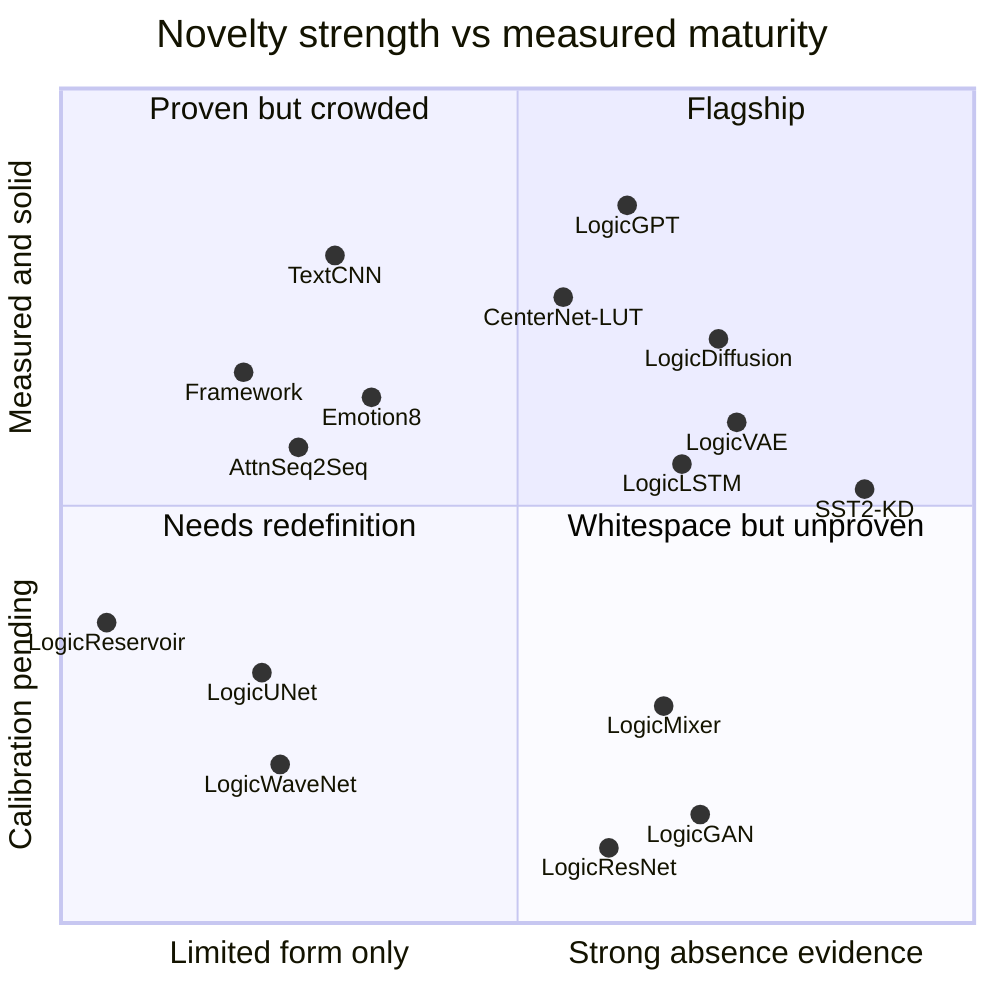

このプロジェクトは「論理ゲートで◯◯を実現したのは世界初」という主張を複数持っている。
本ページは、それらを**擁護する**ためではなく**反証を探した**結果の記録である。
判定・最近接文献・限定形の文言・**撤回した主張**まで、そのまま公開する。

主張の強度を横並びで比較できることが目的なので、判定の根拠(検索クエリ・調査日・
限定の生命線)を主張ごとに明示し、根拠が薄い主張は薄いと分かる形で並べている。

## 1. 監査の手法

### 1.1 反証探索(裏付けではなく反例を探す)

主張の裏付けを集めると、確証バイアスによって「見つからなかった」が
「存在しない」にすり替わる。そこで各主張について、**その主張を殺す論文を探す**
姿勢で検索を実行している。

- 主張ごとに **4〜10 本のクエリ**を実行する(汎用Web検索 + arXiv API の全文/abstract検索 + 個別 abs ページの精読)
- **ヒットしなかったこと自体を陰性所見として記録**する
  (例: arXiv API `abs:"logic gate" AND abs:"text classification"` は **総ヒット0件**、
  `abs:"logic gate network" AND abs:"distillation"` も **総ヒット0件**)
- 関連論文の Related Work を辿り、隠れた直接競合がいないかを二次的に確認する
- 使用クエリの全リストと調査日を、主張ごとに残す(後から第三者が同じ検索を再実行できる形にする)

### 1.2 3値判定

| 判定 | 意味 |
|---|---|
| **生存(反例なし)** | 網羅検索の範囲で反例が見つからなかった |
| **条件付き生存(近接あり)** | 限定語を維持すれば生存する。限定を1つでも外すと死亡する |
| **死亡(反例あり)** | 反例が存在する。主張を撤回または縮小する |

「条件付き生存」では、**どの限定語が生命線か**を必ず書く。
たとえば FPGA 上での自己回帰生成の主張は「FPGA実機 × テキスト生成 × 非命令セット型」の
**三重限定**が生命線で、どれか1つを外すと既存研究に直撃される。

### 1.3 鮮度の再確認

この分野は進行が速く、2025〜2026年に空白が次々と埋まった実績がある。
そのため過去の判定を固定せず、**定期的に再監査して格下げする**運用にしている。
直近の再確認(2026-09-05)では、2ヶ月間で死亡した主張は0件だったが、
1件が ✅ → 🟡 に格下げされ、1件が対比記述の改訂を要すると判定された。

### 1.4 この監査の限界(先に書いておく)

- **直近数週のプレプリントは網羅外**。査読中・未公開の並行研究は捕捉できない
- **非英語文献は網羅外**(日本語は一部のみ実施。中国語・ポルトガル語などは未調査)
- **非 arXiv・ペイウォール文献の全文検索は間接的**。とくに FPGA 系ワークショップ
  (FPL / FCCM / ASAP / ICFPT)と組込系ジャーナルは arXiv 化率が低く、埋もれている可能性がある
- **特許文献の体系的調査は未実施**。RAM型NN分類器の特許は実在するため、
  出願を検討する場合は別途の専門調査が必要
- **abstract 止まりの判定が一部ある**。本文精読で限定形をさらに狭める必要が出る場合がある

## 2. 強度バッジの定義

主張の「証拠の強さ」を、判定そのものとは別の軸として明示する。

| バッジ | 意味 |
|---|---|
| **S1** | 論文級不在証明あり(検索クエリ・調査日・主張範囲の限定を明文化) |
| **S2** | 反証探索監査済み(最近接文献明記・限定形必須) |
| **🟡** | 近接文献あり(限定形でのみ生存) |
| **S3** | 主張のみ・未監査 |
| **撤回** | 反例発見により撤回済み |
| **—** | 再現・移植(世界初主張なし) |

S3 と — はこの表には現れない。**S3** は監査を通していない主張に付くバッジで、
本ページに載せる前に監査へ回す運用にしている。**—** は DLGN 再現や既存手法の
移植のように、そもそも世界初を主張していない成果物に付く。

## 3. 判定表

いずれの行も「調査日時点で、記載の限定形において、網羅検索で反例が見つからなかった」
という意味であり、絶対的な不在の証明ではない(§6)。

### 3.1 アーキテクチャ族(13主張・調査日 2026-07-10 / 再確認 2026-09-05)

| # | 主張(限定形の文言) | 強度 | 最近接文献 | 監査日 |
|---|---|---|---|---|
| A1 | **自己回帰 decoder-only** の論理ゲート言語モデルで、**attentionブロック全体(射影・スコア・正規化)を回路化**した初のモデル。「世界初のGPT」とは書かない | S2 | RDDLGN 2508.06097 / LL-ViT 2511.00812 / Boolean attention **2511.17550** | 2026-07-10 / 再確認 2026-09-05 |
| A2 | 分類でのみ実証されていた Gumbel ゲート選択較正を、**LM の attention 射影へ転用**した初の例 | S2 | Mind the Gap 2506.07500(NeurIPS 2025) / Align Forward 2603.14157 | 2026-07-10 / 再確認 2026-09-05 |
| A3 | **forget/input/output の三ゲート構造**を LutLayer で実現し、eval で厳密な MUX 回路に崩壊する初の再帰セル | S2 | RDDLGN 2508.06097(Elman型) / R-DTLGN 2605.24649 | 2026-07-10 / 再確認 2026-09-05 |
| A4 | ~~論理ゲートリザバーは世界初~~ → **撤回**(§4)。貢献は「微分可能FWへの統合・同一IRからのHDL出力・他部品との学習則共有」に限定 | **撤回** | LUTNet-RC(IEEE ICFPT 2023) / RBNリザバー(2000年代〜) / CMOSゲートRC(ACM 2021) | 2026-07-10 |
| B1 | **前向き・逆過程・デノイザの3要素を同時にブール回路で閉じた**初の拡散モデル | S2 | LogicIR 2606.26609(識別的復元・生成過程なし) / BDPM 2501.13915(デノイザは通常NN) / p-bit拡散 2603.27996 | 2026-07-10 / 再確認 2026-09-05 |
| B2 | 「**二値潜在**」×「**論理回路 encoder/decoder**」の交差点に先行研究は確認できていない | S2 | Latent Bernoulli AE(ICML 2020、二値潜在×通常NN) / DiffLogic CA 2506.04912 | 2026-07-10 / 再確認 2026-09-05 |
| B3 | **G/D の双方が学習された論理回路**である GAN は不在 | S2 | BinaryGAN 1810.04714(出力層のみ二値、G/DはMLP) | 2026-07-10 / 再確認 2026-09-05 |
| B4a | **token-mix / channel-mix の分解**×学習論理ゲートは初 | S2 | CDDLGN 2411.04732(畳込であり mixer 分解ではない) | 2026-07-10 / 再確認 2026-09-05 |
| B4b | **畳込み論理ゲートネットにおける層間の構造的残差合流(OR/XOR結合)と、pass-through 初期化による恒等冪等性の保証**に先行研究は確認できていない。既存の深化手法は初期化バイアスとしての残差か、入力への直結アンカーによるトポロジ変更であり、層間の恒等パスを結線として持たない | S2 | CDDLGN 2411.04732(residual *initialization*) / **IALGN 2607.21633**(input anchor による構造的トポロジ変更、150層) | 2026-07-10 / **改訂 2026-09-05** |
| B4c | 論理ゲートのみの encoder-decoder に、{0,1} を厳密保存する nearest upsample と skip concat を導入し、**セグメンテーション(離散クラスの密予測)**へ適用した初のモデル。~~論理ネットの密予測自体に先行研究がない~~ という根拠は**成立しない** | **🟡** | **LogicIR 2606.26609**(全ゲート構成の UNet 型で per-pixel 密予測を実施。ただしタスクは画像復元) | 2026-07-10 / **格下げ 2026-09-05** |
| B4d | **DLGN でバックボーンから検出ヘッド(centerヒートマップ+サイズ/オフセット回帰)までを構成し mAP で評価した検出器**は外部に不在。当方の CenterNet-LUT が自己先行 | S2 | LGN Video Copy Detection 2604.21694(検索タスク・bbox なし) / CDDLGN 原著が localization を future work と自認 | 2026-07-10 / 再確認 2026-09-05 |
| B4e | 「論理ゲート音声生成」一般ではなく「**WaveNet 構造(dilated causal conv + ゲート活性)の論理写像**」に力点 | **🟡** | GSoC 2024 bytebeat difflogic 音声(Ian Clester。**無状態 f(t) 型・非自己回帰**) | 2026-07-10 / 再確認 2026-09-05 |
| B5 | 「統一+HDL」単独ではなく「**アーキテクチャ族の網羅幅**(生成+系列+検出を単一 LutLayer・IR・HDL で)」に力点 | **🟡** | **BitLogic 2602.07400**(統一+HDL。ただし v2 でも "all evaluations are limited to two-layer feed-forward networks" と原著が明記) / BinaryBrain | 2026-07-10 / 再確認 2026-09-05 |

> 一次記録では本節を「14主張」と数えているが、実際の判定表は上記 13 行である
> (A4 の撤回に伴う整理の名残)。

### 3.2 attention 系(3主張・調査日 2026-07-03 / 再確認 2026-09-05)

| # | 主張(限定形の文言) | 強度 | 最近接文献 | 監査日 |
|---|---|---|---|---|
| C1 | **Q/K/V 射影行列そのもの**を学習された微分可能論理ゲート/LUT層で置換し、内積型の重み乗算を排した attention は存在しない。既存研究は射影後の**活性のみ**を二値化するか、LUT化を **FFN/MLP に限定**する | S2 | DWN 2410.11112(部品を提供・Transformer拡張を future work に明示) / BinaryFormer・HAD・BinaryAttention(活性のみ二値) / LL-ViT 2511.00812(FFNのみ) | 2026-07-03 / 再確認 2026-09-05 |
| C2 | 射影・スコア・正規化の**3要素すべて**を、量子化(sign/三値)ではなく**学習された論理ゲート/LUT層**で構成し、**attention を撤廃せずに** end-to-end 学習した例は存在しない | S2 | MatMul-free LM 2406.02528(三値量子化 + attention 撤廃) / 2607.01798(softmax の LUT 区分線形**近似**) / 2511.17550 | 2026-07-03 / 再確認 2026-09-05 |
| C3 | 学習論理回路を **collapse(argmax離散化)した固定の組合せ論理回路**として、**自己回帰テキスト生成**を **FPGA実機上**で実行した例は存在しない。命令セット型アクセラレータ・attention専用コプロセッサ・ソフトウェア上の collapse 実証はいずれも同時には満たさない | **🟡** | **RDDLGN 2508.06097**(collapse+自己回帰生成をソフトで実証済み、FPGA は future work。ACM EMFM'26 採録) / MatMul-free LM(FPGA だが命令セット型) / CAMformer(ASIC) | 2026-07-03 / 再確認 2026-09-05 |

> **C3 には賞味期限がある。** RDDLGN 系が FPGA 実装を出した瞬間に死亡する。
> また当リポジトリは**ソフトウェア上の collapse まで**であり、FPGA 実機で動くとは主張しない。

### 3.3 NLP・検出系(5主張・調査日 2026-09-05)

| # | 主張(限定形の文言) | 強度 | 最近接文献 | 監査日 |
|---|---|---|---|---|
| W1 | **微分可能論理ゲートNN(DLGN、勾配学習+argmax離散化)**を**テキスト分類**へ適用した初の事例。「LUTベースのテキスト分類が初」と広く読むと**死亡**する | **🟡** | WiSARD tf-idf テキスト分類(ESANN 2021、一発学習・非勾配) / Tsetlin Machine Embedding 2301.00709 / RDDLGN 2508.06097(翻訳・分類でない) | 2026-09-05 |
| W2 | **テキストを入力とする多クラス(8感情)感情分類**を DLGN で実施し離散化後精度を報告した例は不在。「DLGN による感情認識」一般は**初ではない** | **🟡** | **2607.18149**(DLGN × EEG からの3クラス感情認識、2026-07) / WRIME 上の既存研究は BERT/DeBERTa 系のみ | 2026-09-05 |
| W3 | **微分可能論理ゲートNNを生徒(student)とする知識蒸留を、言語タスク(SST-2 文分類)で定量検証**した公開文献は不在。既存の言語 KD は生徒が量子化/二値化 Transformer か BiLSTM であり、真理値表を勾配学習して argmax で回路へ離散化する生徒ではない | **S1** | GSoC 2024 difflogic KD 構想(音響/生成音楽・査読外・定量評価なし) / TernaryBERT 2009.12812(三値量子化) — arXiv `abs:"logic gate network" AND abs:"distillation"` は**0件** | 2026-09-05 |
| W4 | **encoder-decoder 型 seq2seq(機械翻訳)の cross-attention を XNOR 類似度の論理ゲート回路で構成し、微分可能緩和による勾配学習と argmax 離散化を両立**させた実装。「論理ゲートによる attention の世界初実装」は**維持できない** | **🟡** | **2511.17550**(XNOR型 Boolean Q-K attention。**当方より約5ヶ月先行**。ただし画像・self-attention 型・**進化計算**学習・自己回帰生成なし) / RDDLGN(attention 不在) | 2026-09-05 |
| W5 | **DLGN でバックボーンから検出ヘッドまでを構成し mAP で評価した物体検出器**は外部に不在。RAM(LUT)ベースの**物体追跡・監視**は 2014年以来存在するため「LUT による物体検出は世界初」とは書かない | **🟡** | 2604.21694(検索) / LogicIR 2606.26609(復元) / GLANCE 2603.15717(weightless 化は視線推定のみ、検出器本体は通常NN) / WiSARD object tracker 1403.3118 | 2026-09-05 |

> **W4 の教訓**: 無限定の「世界初実装」は、5ヶ月前の先行公開1本で崩れる。
> 着想の一次性を主張できない代わりに、差分(cross-attention である・勾配学習である・
> 同条件比較で優位を示した)を限定形として明記する形へ書き換えた。

## 4. 撤回の記録 — A4「論理リザバー」

**この節を残すことが、他の判定を信じてよい根拠になる。**
撤回した主張を消して回るなら、生存している主張も同じように扱われている可能性がある。

- **もとの主張**: 凍結したランダム論理回路をリザバーとし、読み出し層のみを学習する構成は世界初
- **判定**: **死亡(反例あり)**。2026-07-10 の再調査で発見
- **反例**:
  - **LUTNet-RC**(IEEE ICFPT 2023) — LUT ベースのリザバーコンピューティング
  - **Random Boolean Network(RBN)リザバー** — 2000年代からの古典研究(Snyder ら ~2013 ほか、20年来の蓄積)
  - **CMOS ゲートによるリザバー**(ACM 2021)
- **なぜ見落としたか**: 「微分可能論理ゲートNN」という自分たちの語彙で検索していたため、
  **RBN / reservoir computing 側の語彙**(周辺分野の別系統)に到達していなかった。
  反証探索を「隣接分野の語彙でも検索する」形に広げたのは、この失敗が契機である
- **修正後の主張**: 「凍結ランダム論理回路+学習 readout」の中核は先行研究に帰属する。
  当方の貢献は **微分可能フレームワークへの統合・同一 IR からの HDL 出力・
  他部品(GPT/LSTM)との学習則の共有**に限定する。論文化する際は LUTNet-RC と RBN リザバーを必ず引用する
- **波及**: モデルの docstring・ロードマップ・報告書に残っていた「世界初」表現を撤回・書き換えた。
  同種の言い過ぎ(WaveNet・検出・テキスト分類)も、その後の監査で順次限定形へ直している

## 5. 4象限マップ

**横軸 = 新規性の強度**(左: 限定形でのみ生存 → 右: 強い不在証拠)、
**縦軸 = 実測の到達度**(下: 較正中・本走未 → 上: 実測で確定)。

象限ごとの意味と所属を、テキストでも示す。

| | **実測で確定している(上)** | **較正中・本走未(下)** |
|---|---|---|
| **新規性が強い(右)** | **主力**。LogicGPT(A1/A2)・完全論理拡散(B1)・LogicVAE(B2)・LogicLSTM(A3)・SST-2 KD(W3)。論文化の第一候補はここから選ぶ | **空白地帯だが未実証**。LogicMixer(B4a)・LogicGAN(B3)・LogicResNet(B4b)。**新規性で語らず、まず数値を出す**べき領域 |
| **限定形でのみ生存(左)** | **実績で戦う**。TextCNN(W1)・8感情(W2)・CenterNet-LUT(B4d/W5)・Attention Seq2Seq(W4)・フレームワーク幅(B5)。「初」ではなく**到達した数値と差分**を前面に出す | **要再定義**。LogicUNet(B4c)・LogicWaveNet(B4e)・LogicReservoir(A4、撤回済み)。限定形を狭めるか、主張を降ろす |

読み方の要点は 2 つある。

- **右上が薄いことが現状の正直な姿**である。新規性が強い主張ほど実測が浅い傾向があり、
  逆に実測が固いテキスト分類・検出は先行研究が近い
- **左下は「主張を降ろす」判断の対象**。撤回した A4 がここに残っているのは、
  撤回後も実装と実測(凍結性・fading memory・readout 学習のみでの収束)自体は
  価値として残るためで、新規性の主張だけを取り下げている

## 6. 「世界初」は絶対不在の証明ではない

本ページのすべての判定は、次の意味に限られる。

> **調査日時点で、記載の限定形において、記載のクエリによる網羅検索では反例を発見できなかった。**

これは「存在しないことの証明」ではない。上の §1.4 のとおり、直近数週のプレプリント・
非英語文献・ペイウォール文献・特許・未論文化の実装は網羅外である。

したがって、対外資料・論文・発表で本プロジェクトの新規性に触れる場合は、
次の 3 点を守ることを運用ルールとしている。

1. **限定形で書く**。判定表の「限定形の文言」をそのまま使い、限定語を落とさない
   (限定語を1つ外すだけで死亡する主張が複数ある)
2. **最近接文献を必ず併記する**。差分を示さずに「初」だけを書かない
3. **調査日を添える**。判定には賞味期限がある。分野の進行は速く、
   2ヶ月の再確認で 1 件が格下げされている

新しい主張を立てるときは、まず反証を探す。見つかったら、隠さずにこのページへ書く。
