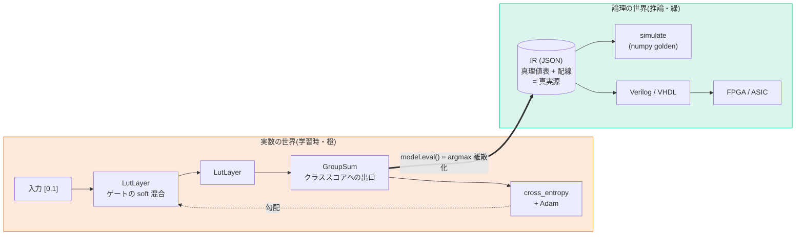

このページは **概念の地図** である。名前の意味と互いの関係だけを最短で示し、
中身の数理や手順は各解説ページに委ねる。

このライブラリがやっていることは、一文で言えば次のとおり。

> **論理回路そのものを勾配降下で学習し、学習が終わった瞬間に純粋なブール回路として取り出す。**

学習中は実数(橙)、取り出したあとはビット(緑)。本サイトはこの2つの世界を
**橙=実数 / 緑=論理** の色で一貫して区別する。

## 全体の地図



橙から緑へ渡る橋は **`eval()` による離散化と IR** のただ1箇所。
ここが単一の境界になっているおかげで、学習側を差し替えても回路側は不変でいられる。

## 5つの概念

| 概念 | 一言でいうと | どこで効くか | 詳しく |
|---|---|---|---|
| **soft / hard 二相** | 学習時は全ゲートの加重平均(微分可能)、推論時は argmax で1つに確定 | `model.train()` / `model.eval()` | [DLGNとは](/explanation/dlgn/) |
| **LutLayer** | 出力1ニューロン = N入力 LUT(真理値表)1個。学習されるのは重みではなく「どのゲートか」 | モデル定義 | [LutLayerの数理](/explanation/lut-layer/) |
| **GroupSum** | 最終層のゲート出力を k クラスへ均等分割して合計し `tau` で割る。論理→分類スコアの出口 | モデル末尾 | [パラメータ化を選ぶ](/guides/parameterization/) |
| **IR** | 真理値表と配線だけの JSON。**下流すべての真実源** | 学習後 | [IRを扱う](/guides/ir/) |
| **HDL** | IR から生成する合成可能な Verilog / VHDL | デプロイ | [HDLエクスポート](/guides/hdl-export/) |

### 1. soft / hard 二相

「ゲートを選ぶ」は離散的な操作なので、そのままでは勾配が流れない。
そこで学習時は候補ゲート全部を確率分布(softmax)で混ぜ、**推論時に argmax で1つに確定**させる。

```python
model.train()
acc_soft = (model(x).argmax(-1) == y).float().mean()   # 連続緩和のままの精度
model.eval()                                            # ← ここで回路に崩壊する
acc_hard = (model(x).argmax(-1) == y).float().mean()   # 焼いたのと同じ回路の精度
```

**見るべきは常に hard。** soft と hard の差を「離散化ギャップ」と呼び、
これを小さく保つことが品質そのもの(→ [学習曲線の読み方](/guides/training-curves/))。

### 2. LutLayer — 重みではなく「ゲートの種類」を学ぶ

`LutLayer(in_dim, out_dim, n_inputs=N)` の出力ニューロン1個は、N 入力の LUT 1個。
各ゲートは入力線のうち **N 本だけ**を疎に拾い(配線は初期化時に固定)、
学習されるのはその N 入力に対する真理値表の中身である。

| N | 候補の数 | 位置づけ |
|---|---|---|
| 2 | 16種の2入力ブール関数 | difflogic 互換。勾配が厳密で速い |
| 4 | 2^16 | バランス型 |
| 6 | 2^64 | **FPGA の LUT6 に1セル直マップ** |

### 3. GroupSum — 論理からスコアへの出口

分類には「クラスごとのスコア」が要るが、論理ゲートが出すのはビットだけ。
`GroupSum(k, tau)` は最終層の出力を k 個のグループに均等分割し、各グループの合計を
`tau` で割ってロジットにする。加算器1つで済むので回路側でも安い。

```python
model = nn.Sequential(
    LutLayer(400, 2000, n_inputs=2),
    LutLayer(2000, 2000, n_inputs=2),
    GroupSum(k=10, tau=10.0),   # 2000ゲート → 10クラス(1クラス200ゲート)
)
```

### 4. IR — 下流すべての真実源

`export_ir()` は学習済みモデルを走査し、どのパラメータ化で学習していても
**真理値表の集まり**へ正規化した JSON を吐く。Verilog も VHDL もシミュレータも
ビジュアルエディタも、すべてこの IR から派生する。

```python
ir = export_ir(model, input_width=400, name='mnist')
validate(ir, target='hdl')   # ビット幅・トポロジ順序を先に検査
```

### 5. HDL — そして回路になる

生成した Verilog / VHDL は合成可能な RTL で、ベンダーツールにそのまま渡せる。
「元のモデルと同じ振る舞い」であることは **3段等価性**で機械的に保証する。

```
PyTorch hard eval  ⇔  ir/simulate(numpy golden)  ⇔  HDL シミュレーション
```

3つが全ベクトルで一致して初めて「焼ける」と言える。

## 次に読む

- [1. MNISTを学習する](/tutorials/mnist/) — この5概念が全部出てくる実行済みチュートリアル
- [何を使えばいいのか(選択ガイド)](/guides/choosing/) — アーキテクチャ・パラメータ化・N・学習則の決め方
- [DLGNとは何か・NNとの違い](/explanation/dlgn/) — なぜ勾配が流れるのか(連続緩和の式)
- [アーキテクチャ全体像](/explanation/architecture/) — 学習から HDL までの8段データフロー
- [用語集](/explanation/glossary/) — soft/hard、fan-in、離散化ギャップ等の定義
