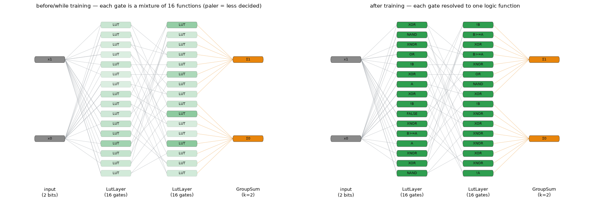
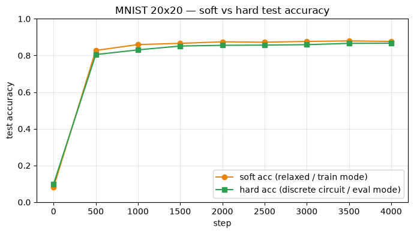

import { Steps, Aside, LinkCard, CardGrid } from '@astrojs/starlight/components';

インストール済みであることが前提([インストール](/getting-started/installation/))。
ここでは **5分で XOR を論理ゲートで解く**ところまで進む。

<Aside type="note" title="ニューラルネットが初めてなら">
PyTorch や NN を触ったことがないなら、先に
[入門コース](/tutorials/nn-basics/)(全3本)を通すのが近道。
**PyTorchの基礎 → 小さなMLPでMNIST → 同じ問題をDLGNへ置き換え**の順で、
このページに出てくる `LutLayer` / `GroupSum` / `model.eval()` の意味が先に腹落ちする。
</Aside>

## 30秒で全体像

```bash
uv sync --extra dev --extra cpu     # セットアップ(GPU機は --extra cu128)
uv run python examples/01_xor.py    # XOR学習 → 離散回路(hard eval)で accuracy 1.00
make test                           # 高速テストスイート(2分以内・常時グリーン)
```

## 論理ゲート層を積む

`LutLayer` は普通の `nn.Module` なので、既存のモデルの途中にそのまま挟める。
下は MNIST を想定した 3層の N=4 LUT ネットワーク。

```python
import torch
import griffith_logic as gl   # 公式の慣用別名は gl

# 3層のN=4 LUTネットワーク(MNIST想定)
model = torch.nn.Sequential(
    torch.nn.Flatten(),
    gl.LutLayer(in_dim=784, out_dim=16000, n_inputs=4),
    gl.LutLayer(in_dim=16000, out_dim=16000, n_inputs=4),
    gl.LutLayer(in_dim=16000, out_dim=16000, n_inputs=4),
    gl.GroupSum(k=10, tau=30.0),
)
y = model(torch.rand(32, 784))   # (32, 10) クラスロジット
```

押さえるべきは次の3点。

- **`gl.LutLayer(in_dim, out_dim, n_inputs=N)`** — 出力ニューロン1個が N 入力の LUT(真理値表)1個に対応する。`N=2` は difflogic 互換、`N=6` は FPGA の LUT6 互換。
- **`gl.GroupSum(k, tau)`** — 最終層のゲート出力を k クラスへ均等に分けて合計し、`tau` で割ってロジットにする。論理ゲートの世界から「分類スコア」への出口。
- **`model.eval()`** — 学習時は softmax などの連続緩和で勾配を流し、**eval に切り替えると argmax 離散化されて純粋な Boolean 回路に崩壊する**。この崩壊後の精度(hard accuracy)が本当の性能。

<Aside type="tip" title="soft と hard を必ず両方見る">
`model.train()` での精度(soft)が高くても、`model.eval()`(hard)で落ちるなら
連続緩和が中間状態に居座っている。学習中も定期的に hard accuracy をログするのが定石。
</Aside>

## 5分で XOR を解く

XOR は線形分離できない最小の問題で、論理ゲート回路の表現力を確かめる定番タスク。

<Steps>

1. サンプルをそのまま実行する。

   ```bash
   uv run python examples/01_xor.py
   ```

2. 出力を確認する。

   ```text
   XOR: soft acc=1.00, hard acc=1.00
   ```

   `hard acc=1.00` は、**離散化して純粋な Boolean 回路にしても 4パターン全問正解**という意味。

3. 中身を1セルずつ読む。実行済みの出力つきで解説したページがある。

   → [付録: XORで仕組みを最小で覗く](/tutorials/xor/)

</Steps>

コードの実体は 30行ほどで、要点は「連続緩和で学習 → `eval()` で回路に崩壊」だけ。

```python
model = nn.Sequential(
    gl.LutLayer(2, 16, n_inputs=2),   # 16ゲートsoftmax(difflogic互換)
    gl.LutLayer(16, 16, n_inputs=2),
    gl.GroupSum(k=2, tau=2.0),
)
opt = torch.optim.Adam(model.parameters(), lr=0.05)
for step in range(500):
    opt.zero_grad()
    F.cross_entropy(model(x), y).backward()
    opt.step()

model.eval()   # 離散化(argmaxで完全なBoolean回路に崩壊)
acc_hard = (model(x).argmax(-1) == y).float().mean()
```

### この30行がこの回路になる



左が学習前。各ノードはまだ16種の論理関数の**混合**なので `LUT` としか呼べず、
色が薄いほど「どの関数か決まっていない」。右が学習後で、argmax で確定した
論理関数名(`AND` / `XOR` / `NAND` / `!A` …)がノードに入っている。
**学習とは、16の候補からゲートを1つずつ選び切る作業**である。
緑=論理ゲート、橙=実数部(GroupSum)、灰=入力ビットと配線。

### 見るべきは soft ではなく hard

同じ書き方のまま MNIST(400ビット入力・4000ゲート)へスケールさせたときの
テスト精度がこれ。橙が学習時の連続緩和(soft)、緑が **argmax で離散化した
回路そのもの**(hard)で、後者が本当の性能になる。



→ 実行済みの全手順は [1. MNISTを学習する](/tutorials/mnist/) にある。

## 回路として書き出す

学習したモデルは IR(JSON)経由で Verilog / VHDL にできる。ここが GPU を捨てられる出口。

```python
from griffith_logic.export import export_ir
from griffith_logic.export.verilog import write_verilog
from griffith_logic.ir import validate

model.eval()
ir = export_ir(model, input_width=2, name='xor')
validate(ir, target='hdl')
write_verilog(ir, 'out_examples/xor.v')
```

学習から Verilog 生成・等価性照合までを1本で通したい場合は
[通しチュートリアル](/tutorials/full-pipeline/)へ。

## 次のステップ

<CardGrid>
  <LinkCard title="入門コース(NN未経験者向け)" href="/tutorials/nn-basics/" description="全3本。PyTorchの基礎 → MLPでMNIST → 同じ問題をDLGNへ置き換える。" />
  <LinkCard title="1. MNISTを学習する" href="/tutorials/mnist/" description="10分。4000ゲートの回路が手書き数字を読むまで(図3枚つき)。" />
  <LinkCard title="付録: XORで仕組みを最小で覗く" href="/tutorials/xor/" description="5分。16ゲートの全ノード図で soft→hard の崩壊を観察する。" />
  <LinkCard title="通しチュートリアル" href="/tutorials/full-pipeline/" description="学習 → 損失ログの読み方 → HDL エクスポート → FPGA。" />
  <LinkCard title="基本コンセプト" href="/getting-started/concepts/" description="連続緩和と離散化、N入力LUT、IRが真実源。" />
  <LinkCard title="学習を回す" href="/guides/training/" description="MNIST など実タスクの訓練コマンドと設定。" />
</CardGrid>
