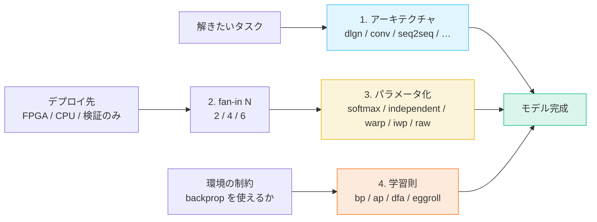
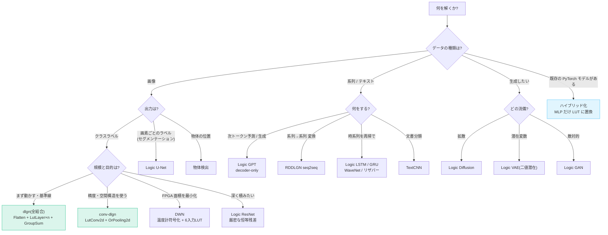
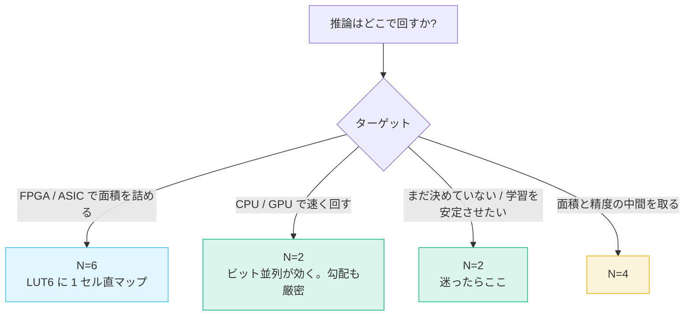
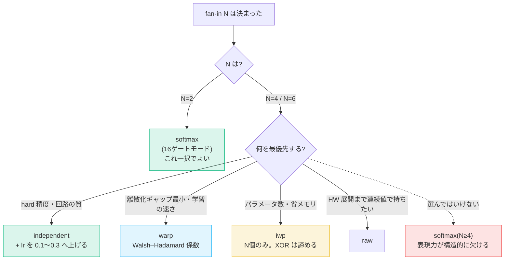
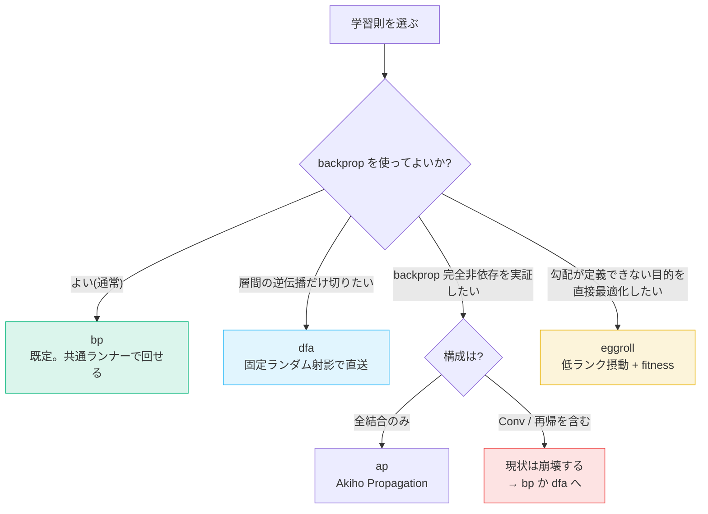

このライブラリは選択肢が多い。**アーキテクチャ 20 種以上 × パラメータ化 5 種 ×
fan-in(N)3 種 × 学習則 4 種**。全部を理解してから始める必要はなく、
実際には **タスク** と **デプロイ先の制約** の 2 つでほぼ決まる。

このページは「私は何を使えばいいのか」に **1 ページで答える** ための決定表である。

:::tip[まず迷ったらこれ]
**`LutLayer(n_inputs=2, parameterization='softmax')` を数段 + `GroupSum(k, tau=10)`、学習則は `bp`。**

```python
import torch.nn as nn
from griffith_logic import GroupSum, LutLayer

model = nn.Sequential(
    nn.Flatten(),
    LutLayer(784, 8000, n_inputs=2),   # parameterization='softmax' が既定
    LutLayer(8000, 8000, n_inputs=2),
    LutLayer(8000, 8000, n_inputs=2),
    GroupSum(k=10, tau=10.0),          # 10クラス分類の出口
)
```

```bash
uv run griffith train configs/recipes/dlgn_mnist_quick.yaml
```

これが difflogic 互換の基準線で、**精度で頭一つ抜ける構成**でもある
(MNIST 6層 50ep で hard 97.74%)。ここから外れる理由ができたときだけ、
以下のフローチャートで選び直せばよい。
:::

## 選択は 4 つしかない



4 つは **直交**している(→ [アーキテクチャ全体像](/explanation/architecture/))。
アーキテクチャを変えてもパラメータ化の選び方は変わらないし、その逆も同じである。
なので順に決めてよい。

---

## 1. タスク → アーキテクチャ



| 行き先 | 使う部品 | 読むページ |
|---|---|---|
| dlgn(全結合) | `LutLayer` + `GroupSum` | [1. MNISTを学習する](/tutorials/mnist/) |
| conv-dlgn | `LutConv2d` + `OrPooling2d` | [5. CNNのHDLエクスポート](/tutorials/cnn-hdl-export/) |
| DWN | `ThermometerEncoder` + `DWNLayer` | [DWN(温度計符号化)](/tutorials/dwn/) |
| Logic ResNet | 残差ブロック(厳密な恒等) | [ResNet(厳密な恒等)](/tutorials/logic-resnet/) |
| Logic U-Net | エンコーダ/デコーダ + 空間出力 | [U-Net(密予測)](/tutorials/logic-unet/) |
| 物体検出 | 検出ヘッド | [物体検出](/tutorials/detection/) |
| Logic GPT | `LutStack` + 因果 self-attention | [論理ゲートGPT](/tutorials/logic-gpt/) |
| RDDLGN | リカレント encoder-decoder | [seq2seq(RDDLGN)](/tutorials/rddlgn-seq2seq/) |
| 再帰系 | LSTM/GRU・因果 conv・リザバー | [LSTM / GRU](/tutorials/logic-lstm/) ・ [WaveNet](/tutorials/logic-wavenet/) ・ [リザバー](/tutorials/logic-reservoir/) |
| TextCNN | 文字/語 conv | [TextCNN](/tutorials/textcnn/) |
| 生成系 | 拡散 / VAE / GAN | [拡散モデル](/tutorials/logic-diffusion/) ・ [VAE](/tutorials/logic-vae/) ・ [GAN](/tutorials/logic-gan/) |
| ハイブリッド | `replace_mlp_with_lut` | [2. ハイブリッドNNを作る](/tutorials/hybrid/) |
| Mixer | トークン混合を論理で | [Mixer](/tutorials/logic-mixer/) |

:::caution[事前学習モデルからの「変換」は近道にならない]
「強い MLP を DLGN へ変換すれば強くなる」は成り立たない。社内で 3 経路
(蒸留 / 疎化 fan-in 集合の転写初期化 / 層別二値蒸留)を実測したが、
**いずれもスクラッチ学習を上回らなかった**。転写初期化は大きく劣化した。
native DLGN の強みは「ゲートを自由なブール論理として学べること」にあり、
算術構造を転写するとその自由が制約になるためである
(→ [DLGNの分類と系譜](/explanation/taxonomy/))。

**現実解は 2 つ**: スクラッチ学習するか、実数のまま残すべき部分を残す
[ハイブリッド化](/tutorials/hybrid/)。「どこまで論理化できるか」を段階的に測りたいなら
[論理化の梯子](/tutorials/logic-ladder/) が実験の型になる。
:::

---

## 2. デプロイ先 → fan-in(N)

1 ゲートが何本の入力を読むか。**「どちらが偉いか」ではなくデプロイ先で決まるノブ**である。



| 目的 | 有利な N |
|---|---|
| FPGA 実装面積 | 6 |
| CPU / GPU 推論速度 | 2 |
| 訓練の安定性 | 2 |

N が増えるとゲートあたりのパラメータが $2^N$ で増え、訓練メモリも増える。
difflogic が 2 入力を選んだのは「FPGA に最適だから」ではなく、
**訓練の綺麗さ(厳密勾配の 16 ゲート)と CPU/GPU 速度**のためである
(→ [DLGNの分類と系譜](/explanation/taxonomy/))。

---

## 3. N → パラメータ化

真理値表をどの連続空間で持つか。**ここでの選択が離散化ギャップを直接決める。**



### 5方式の性格

| 方式 | 重みの持ち方 | パラメータ数/ゲート | 表せる hard 関数 | 由来 |
|---|---|---|---|---|
| `softmax`(N=2) | 16 ゲート上の softmax | 16 | **全 16 関数** | difflogic(DLGN) |
| `softmax`(N≥4) | $2^N$ エントリ上の softmax | $2^N$ | **単一 minterm か FALSE のみ** | — |
| `independent` | エントリごとの sigmoid | $2^N$ | 全 $2^{2^N}$ 関数 | BinaryBrain |
| `iwp` | 入力ごとの sigmoid の積 | $N$ | 積形の関数のみ(XOR 不可) | LDDLGN |
| `raw` | $[0,1]$ の実数を直接保持 | $2^N$ | 全 $2^{2^N}$ 関数 | BinaryBrain |
| `warp` | Walsh–Hadamard 係数 + Gumbel | $2^N$ | 全 $2^{2^N}$ 関数 | WARP |

**競合するか独立か**が本質的な違いである。

```
softmax:      [0.01, 0.02, 0.07, 0.90]  合計=1  「100円を4つの箱に分配する」
independent:  [0.10, 0.80, 0.30, 0.95]  独立    「4つのスイッチを別々に入れる」
```

softmax は 1 つ上げると他が下がるので、**1 回の backward で全パラメータへ勾配が連動して届く**。
independent は該当エントリにだけ届く代わりに、**任意のビットパターンを作れる**。

### パラメータ数の勘定

ゲートあたりの数(1 万ゲートのモデルなら 1 万倍する)。

| N | `softmax` | `independent` / `raw` / `warp` | `iwp` |
|---|---|---|---|
| 2 | 16(16ゲート表) | 4 | 2 |
| 4 | 16 | 16 | 4 |
| 6 | 64 | 64 | **6** |

N=6 で 1 万ゲートなら **64 万 vs 6 万**。`iwp` は 10 倍以上軽く学習も速いが、
XOR のような「組み合わせが本質」の関数を表現できないのが代償である。
LDDLGN の論拠は「学習済みモデルのゲートは大半が AND/OR/NOT に収束する」という観察で、
実際に XOR 系に収束するゲートはごく少数だった、という実証に賭けている。

### 確定知見: N≥4 の softmax は選んではいけない

N≥4 の softmax は 16 ゲート表ではなく **$2^N$ エントリ上の単体(simplex)** になる。
合計が 1 なので離散化(確率 > 0.5)で立てられるビットは高々 1 個 ──
つまり hard 表として作れるのは **単一 minterm か恒偽(FALSE)だけ**である。
パススルー・OR・XOR といった日常的な関数が構造的に作れない。

実験でも、畳み込み構成で `softmax` を `independent` に替えただけで
**半分のエポック数にもかかわらず精度 +3.2pt**。全結合 MNIST でも softmax N=4 は
hard 94.54% / ギャップ 1.12pp にとどまり、同条件の warp N=4(95.50% / 0.14pp)に劣る。
**表現力の欠落は学習量では埋まらない**、というのがこの知見の要点である。

### 確定知見: independent は学習率を上げる

`independent` は sigmoid 経由で、飽和気味の初期化と組み合わさると
**深い直列合成で勾配が急速に減衰する**。実測では勾配ノルムが $10^{-5}$ 程度まで落ち、
既定の lr=0.02 では 10 エポック回しても soft 精度が動かなかった。**lr ≥ 0.3 で学習が進む**。

```bash
uv run griffith train configs/recipes/dlgn_mnist_quick.yaml \
    model.n_inputs=6 model.k=4000 model.parameterization=independent optim.lr=0.3
```

### 離散化ギャップで選ぶなら

| 選択 | 実測ギャップ | 備考 |
|---|---|---|
| `warp` N=2 | **−0.06pp** | hard が soft を上回る |
| `warp` N=4 | **0.14pp** | softmax の 11〜48% の FLOPs |
| `softmax` N=2 | 0.56pp | 精度は最高(hard 97.74%) |
| `softmax` N=4 | 1.12pp | 上記の理由で非推奨 |
| DWN | **0.0** | 構造的にギャップが存在しない |
| `selection='hard_st'` | **0** | forward=argmax / backward=STE(CAGE 方式) |

詳細と全比較は [パラメータ化を選ぶ](/guides/parameterization/) にある。

---

## 4. 環境の制約 → 学習則

「どのゲートになるか」を学ぶには、各ゲートの重みへ**誤差をどう配るか**を決める必要がある。
既定は `bp` で、それ以外を選ぶ動機は **「逆伝播の経路まで回路に実装したくない」** という一点にある。



| 学習則 | 微分は要るか | 制約 | 使いどころ |
|---|---|---|---|
| `bp` | 要る(全経路) | なし。共通ランナー `run_training` が扱う唯一の則 | **既定**。精度が最優先のとき |
| `dfa` | 局所的にのみ | 出力が 2D/3D、`block_upstream=True` のみ | 層間の逆伝播を切りたい。層内の勾配は正確なまま |
| `ap` | 不要 | `parameterization='independent'` 前提。全結合の直列形のみ | backprop 非依存の実証 |
| `eggroll` | 不要(forward のみ) | 2D パラメータのみ。評価回数がコスト | hard 精度そのものを直接最適化したいとき |

:::caution[AP 法の到達点と限界(数字を出すときの注意)]
MNIST 全結合で **soft ≈ 0.90 / hard ≈ 0.85** で安定する一方、同条件の BP 法は
soft 0.983 / hard 0.977 で、**BP に 6〜8pt 届かない**。
さらに **Conv ツリー + OrPooling 構成では accuracy ≈ 0.11(chance)へ崩壊する**。
原因は「単調性の破れ」ではなく、**OR 系の集約を経由した誤差ルーティングが
有用な学習信号を作らないこと**にあった ── つまり **接続構造と学習則は独立に設計できない**。

「AP 法で MNIST 98%」は誤り。98% はすべて BP 法の数字である。
数字を出すときは必ず学習則を明記すること。
:::

学習則はモデル全体ではなく **層ごと**に指定でき、`with_learning` + `HybridTrainer` で
「特徴抽出は bp、出力ヘッドだけ dfa」といった混在が書ける
(→ [学習則(BP/AP/DFA/ES)](/explanation/learning-rules/))。

---

## 決めた後にやること

| やること | ページ |
|---|---|
| ハイパーパラメータの相場(lr / τ / k / 層数 / エポック) | [学習を回す](/guides/training/) |
| soft と hard の曲線をどう読むか | [学習曲線の読み方](/guides/training-curves/) |
| 学習結果を IR(JSON)へ落として検証する | [IRを扱う](/guides/ir/) |
| Verilog / VHDL を生成して等価性を確かめる | [HDLエクスポートと等価性検証](/guides/hdl-export/) |
| FPGA 実機へ焼く | [FPGAに焼く](/guides/fpga/) |
| 大規模学習をクラウドへ投げる | [クラウドGPU](/guides/cloud-gpu/) |
| 構造をブラウザで組み替えて試す | [ビジュアルエディタ](/guides/editor/) |

:::note[選択に共通する原則]
**焼く前に必ず hard eval を見る。** soft の成績は連続近似の成績であって、
回路の成績ではない。連続の真理値表が 0.5 付近に密集したまま丸めると精度は崩壊する
(実例: eval acc 0.803 → 丸めると 0.211)。
このライブラリで「良い選択」とは、hard 精度が高く、かつ soft と hard の差が小さい選択のことである。
:::

## 次に読む

- [学習ロードマップ](/guides/roadmap/) — 出発点別の読む順と、一般名(RNN/CNN/Transformer…)→チュートリアルの対応表
- [基本コンセプト](/getting-started/concepts/) — soft/hard・LutLayer・GroupSum・IR・HDL の 5 概念
- [PyTorchからの移行](/guides/from-pytorch/) — `nn.Linear` などの対応表
- [パラメータ化を選ぶ](/guides/parameterization/) — 5 方式の詳細と実測比較表
- [DLGNの分類と系譜](/explanation/taxonomy/) — 3 系統の違いと、変換が効かない理由
- [用語集](/explanation/glossary/) — soft/hard、fan-in、離散化ギャップ等の定義
