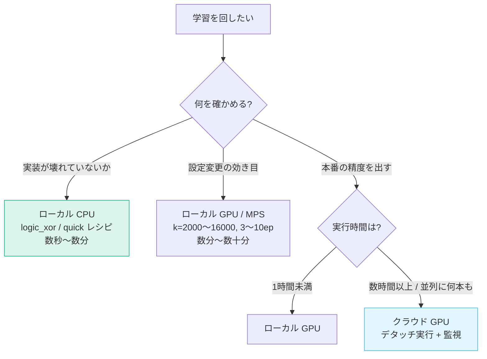

論理ゲートネットワークは **推論には GPU が要らない**(それが売りである)が、
**学習には GPU が効く**。とくに 6 万ゲート級・200 エポック級の再現実験は、
ローカル CPU では現実的な時間に収まらない。
このページは「どこで回すか」を決めるためのガイドである。

:::note[このページで分かること]
1. **デバイスの使い分け** — CPU / MPS(Apple Silicon)/ CUDA をどの規模で選ぶか
2. **クラウドへ投げる手順** — 同じスクリプト・同じ引数のままクラウド GPU で走らせる実行例
3. **長時間ジョブの作法** — デタッチ実行・成果物の回収・監視の考え方
:::

## まずローカルで動く

本ライブラリは **CUDA を必須にしていない**。CUDA カーネルは高速化のための任意機能で、
利用できない環境では自動的に Python 実装へフォールバックする。

```bash
uv sync --extra dev --extra cpu    # CPU / MPS 環境
uv sync --extra dev --extra cu128  # CUDA 12.8 環境
```

デバイスは指定しなければ **cuda → mps → cpu の順に自動検出**される。
明示したいときは設定の `run.device` に書く。

```bash
uv run griffith train configs/recipes/logic_xor.yaml run.device=cpu
```

### デバイス選択の目安

| デバイス | 何に使うか | 目安の規模 | 備考 |
|---|---|---|---|
| **CPU** | 実装の健全性チェック、XOR・パリティなど論理関数の学習、CI | 〜数千ゲート・数分 | 決定的に回るので回帰テスト向き。`logic_xor` レシピは数秒 |
| **MPS**(Apple Silicon) | ローカルでの MNIST スモーク、UI・エディタの動作確認 | 〜1万ゲート・十数分 | CUDA カーネルは使われず Python 実装で動く |
| **CUDA**(ローカル GPU) | 標準的な実験の主戦場 | 1万〜6万ゲート・数十分 | LUT カーネルが JIT コンパイルされ最速 |
| **クラウド GPU** | 論文再現、長時間 run、ハイパーパラメータ掃引 | 6万ゲート以上・時間単位 | 手元を閉じても走り続けられる |



:::tip[推論側に GPU は要らない]
学習が終わって IR → HDL へ落とした後の回路は、FPGA でも CPU のビット演算でも動く。
GPU が要るのは**訓練時の連続緩和を回している間だけ**である
(→ [パラメータ化を選ぶ](/guides/parameterization/) の「推論時の性能差はゼロ」)。
:::

## クラウド GPU で回す

サーバレス GPU 実行基盤([Modal](https://modal.com/))向けのラッパを同梱している。
**既存の学習スクリプトは無改造のまま**、ローカルと同じ引数で走る。

### 準備

```bash
# クラウド用の依存を入れる
uv sync --extra cpu --extra dev --extra cloud

# 認証(ブラウザが開く)
uv run modal setup

# 実験ログ用のシークレットを登録(wandb を使う場合)
uv run modal secret create wandb WANDB_API_KEY=<your-key>
```

### 実行例

```bash
# ローカル(従来どおり)
uv run python experiments/train.py --dataset mnist -e 20

# クラウド GPU(同じスクリプト・同じ引数)
uv run modal run scripts/modal_app.py --script train.py --args "--dataset mnist -e 20"
```

GPU の種別は環境変数で選ぶ。

```bash
MODAL_GPU=T4        uv run modal run scripts/modal_app.py --script train.py --args "..."
MODAL_GPU=A100-80GB uv run modal run scripts/modal_app.py --script train_cnn.py --args "..."
```

| GPU | 用途 |
|---|---|
| T4 | スモークテスト・デバッグ(最安) |
| A10G | 標準訓練(既定) |
| A100-80GB | 大規模モデル・大バッチ |
| H100 | 最速が必要な場合 |

### 統一CLIから投げる

掃引やグリッド実験は `griffith` の CLI から直接クラウドへ投入できる。

```bash
# グリッド(直積)展開して投入
uv run griffith launch --grid "optim.lr=[0.001,0.01] model.k=[64,256]" \
    configs/recipes/dlgn_mnist_quick.yaml --modal

# 何が展開されるかだけ見る(実行しない)
uv run griffith launch --grid "optim.lr=[0.001,0.01]" \
    configs/recipes/dlgn_mnist_quick.yaml --dry-run

# 掃引(wandb sweep)を並列エージェントで回す
uv run griffith sweep configs/sweeps/example_mnist.yaml --count 8 --modal --parallel 2
```

## 長時間ジョブの作法

数時間走るジョブでは、次の 3 点を守ると事故が減る。


### 1. デタッチして投入する

```bash
# ローカルを切ってもクラウド側で走り続ける
uv run modal run --detach scripts/modal_app.py --background \
    --script train_cnn.py --args "-e 200"

# タイムアウトを延ばす(既定6時間)
MODAL_TIMEOUT=43200 uv run modal run --detach scripts/modal_app.py --background --script ...
```

:::caution[同期呼び出しは避ける]
クラウド関数を同期的に呼ぶ(結果をポーリングして待つ)形にすると、
**クライアント側がポーリングを止めた時点でジョブごとキャンセルされ得る**。
投入は非同期(spawn)経由にし、待ちたい場合だけ明示的に結果を取りに行くこと。
同梱のエントリポイントと `griffith launch --modal` / `griffith sweep --modal` はこの形になっている。
:::

### 2. 監視を張る

投入したら放置せず、ログを追うか無出力検知を同時に回す。

```bash
# ログを追う
uv run modal app logs -f <app_id>

# 一定時間ログが伸びなければ警告する(停止はしない)
uv run python scripts/modal_watch.py <app_id> --interval 60 --stall-min 15
```

「静かだから順調」とは限らない。ハートビート(epoch / step / loss)が
数サイクル同じ値なら、直接ログを見に行くこと。

### 3. 成果物を回収する

学習の成果はコンテナと一緒に消えては困るので、永続ボリュームと実験トラッキングの
両方に残す設計になっている。

```bash
# 永続ボリューム上のチェックポイントを確認・取得(<your-volume> は自分の Modal Volume 名)
uv run modal volume ls  <your-volume> checkpoints/
uv run modal volume get <your-volume> checkpoints/<run_dir>/best.pt ./checkpoints/

# 統一CLIでローカル未取得の run ディレクトリをまとめて回収
uv run griffith collect
```

ボリューム名は環境変数 `MD_MODAL_VOLUME` で指定する(未設定なら既定名が使われる)。
`griffith collect` も同じ変数を見るので、シェルの初期化ファイルか `.env` に一度書いておけばよい。

```bash
export MD_MODAL_VOLUME=<your-volume>
```

チェックポイントは実験トラッキング側(wandb Artifacts)にも上げられる。
アップロード量は環境変数で制御する。

| `WANDB_ARTIFACTS` | 動作 |
|---|---|
| `off` | アップロードしない |
| `best`(既定) | 訓練終了時に best のみ 1 回 |
| `all` | 定期保存もすべて |

## つまずきどころ

| 症状 | 原因 | 対処 |
|---|---|---|
| 手元を閉じたらジョブが消えた | デタッチせずに投入した | `--detach` と `--background` をセットで付ける |
| コールドスタートが毎回 2〜3 分遅い | CUDA カーネルのJITコンパイル(キャッシュはコンテナローカル) | 想定どおり。多数を並列投入する前に 1 本だけ先に走らせる |
| 投入したのに始まらない | 同時実行 GPU 数の上限に達してキューで待っている | 投入前チェック(`scripts/modal_preflight.py`)で上限超過を検出する |
| ローカルでは動くのにクラウドで落ちる | データやチェックポイントを絶対パスで参照している | 相対パス規約に従う(スクリプトは無改造で動く前提) |
| GPU を使っているはずが遅い | CPU にフォールバックしている | 起動ログの「デバイス: ...」行を確認する |

## 次に読む

- [学習を回す](/guides/training/) — 何をどれだけ回すかの相場
- [パラメータ化を選ぶ](/guides/parameterization/) — 計算量に直結する選択
- [griffith CLI リファレンス](/reference/cli/) — `launch` / `sweep` / `collect` / `report` の全フラグ
- [IRを扱う](/guides/ir/) — 回収したチェックポイントを回路へ落とす
