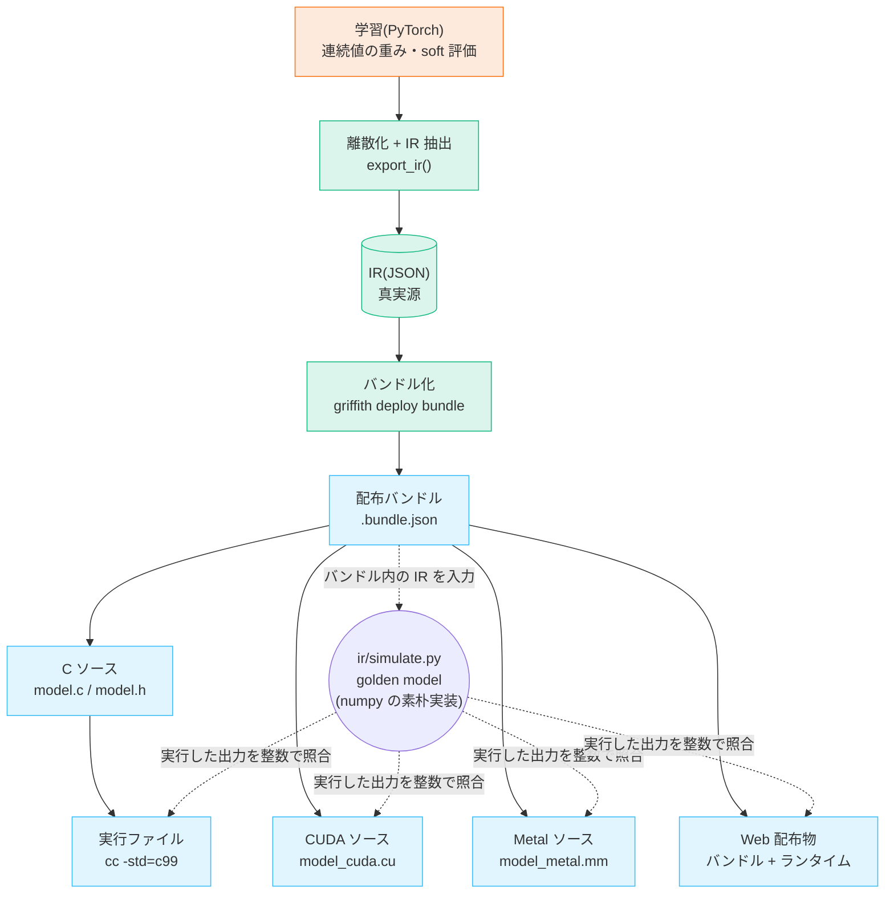

学習済みの DLGN を **C / CUDA / Metal / Web** のコードにして、組み込み・モバイル・ブラウザ・GPU で動かす仕組みが
**デプロイキット**である。このページは、学習済みモデル(IR)から **依存ゼロの C 実行ファイル** まで通す最短経路を、
XOR の最小モデルで実際に動かして示す。全ステップで 10 分もかからない。

[HDLエクスポート](/guides/hdl-export/) が「回路にして FPGA/ASIC へ」の道なら、デプロイキットは
「ソフトウェアとして既存のデバイスへ」の道である。どちらも同じ IR を起点にし、同じ golden model で検証する。

## デプロイキットでできること

学習側は一切変えない。`export_ir()` で取り出した **IR(JSON)を真実源** として、次の 5 つのターゲットへ分岐する。

| ターゲット | 生成コマンド | 出力 | 必要なツール | 出荷前の検証 |
|---|---|---|---|---|
| **C**(組み込み・モバイル・デスクトップ) | `griffith deploy codegen-c` | `model.c` / `model.h` + ランタイム | C99 コンパイラ(`cc`) | `verify-c` |
| **CUDA**(NVIDIA GPU) | `griffith deploy codegen-cuda` | `model_cuda.cu` + ランタイム | `nvcc` | 検証コマンドは無く、テストスイートで固定 |
| **Metal**(Apple GPU) | `griffith deploy codegen-metal` | `model_metal.mm` + ランタイム | `clang++`(macOS) | `verify-metal` |
| **Web**(ブラウザ) | `griffith deploy codegen-web` | バンドル + WASM/JS ランタイム一式 | 静的ホスティング | `verify-web` |
| **HDL**(FPGA/ASIC) | `griffith export-hdl` | Verilog / VHDL | iverilog / ghdl ほか | [3段等価性](/guides/hdl-export/) |

各ターゲットで **どこまで実機検証できているか** は [対応プラットフォーム](/reference/platform-support/) に
検証段階つきで一覧してある。ESP32 と iPhone の実機手順は [ESP32 に載せる](/guides/deploy-esp32/) と
[iPhone に載せる](/guides/deploy-ios/) を参照。

:::note[C ランタイムの性質]
C ランタイムは **依存ゼロの C99**(依存ヘッダは `<stdint.h>` と `<stddef.h>` だけ)、**実行時のヒープ確保ゼロ**、
**浮動小数点演算ゼロ** で、機械語サイズは約 6KB である。SIMD(NEON / SSE2 / AVX2)はコンパイル時に自動で選ばれ、
無い環境ではスカラー実装へ落ちる。**どの経路でも整数出力は完全に同一**で、速くなるだけで正しさは変わらない。
:::

## 全体の流れ

学習から実行までの流れは次のとおり。**橙 = 実数の世界、緑 = 論理ゲートの世界、青 = ビット列・成果物** である。



図の中央の `ir/simulate.py` が **golden model**(正解を出す基準)である。バンドルに入っている IR をそのまま入力に取り、
各ターゲットの生成物は **ソースではなく、ビルドして実行した出力** をこれと突き合わせる
(C の点線が「C ソース」ではなく「実行ファイル」につながっているのはそのため)。

### 各段の役割

流れ図の各段が何をして、何を保証するかを次の表にまとめる。

| 段 | 何をするか | 保証すること |
|---|---|---|
| 離散化 + IR 抽出 | パラメータ化の違い(softmax / warp など)を **真理値表に確定** させる | 書き出し前に **PyTorch hard eval ⇔ IR simulate を整数で照合** し、合わなければ中止する |
| バンドル化 | conv の重み共有ゲート木を **命令列へ縮約**(ゲート数が 59.7〜95.1% 減)し、前処理を **整数記述子** にコンパイルする | 全数の真理値表照合でセルフチェックしてから書き出す |
| コード生成 | バンドルを **自己完結したソース** にする。最適化はここまでで終わっており、ターゲット側は命令列を順に実行するだけ | 対応外の形は **生成時に例外**(黙って別経路へ落とさない) |
| 検証(`verify-*`) | 生成物をビルドして実行し、`ir/simulate.py` と突き合わせる | 整数出力が **1 ビットも違わない** |

### 全段を golden model と整数一致で検証する

どのターゲットも、**常に `ir/simulate.py`(numpy の素朴実装)を基準** に、整数が完全に一致することで検証する。

```
PyTorch hard eval ⇔ ir/simulate ⇔ C(スカラー / NEON / SSE2)
                            ⇔ CUDA
                            ⇔ Metal
                            ⇔ TS / WASM / WebGPU
                            ⇔ Verilog / VHDL
```

鉄則は **「検証対象自身から golden を作らない」** ことである。エクスポート済み IR の自己整合性しか見ていなかったために、
壊れた IR 同士が一致して全テスト緑のまま壊れたモデルを配信した過去があり、以後は常に独立した素朴実装を基準にしている。

## ステップ0: セットアップ

```bash
uv sync --extra dev --extra cpu
```

C のビルドには `cc`(clang / gcc。macOS は標準で入っている)が要る。

## ステップ1: 学習済みモデル → IR → モデル JSON

`griffith deploy bundle` が読むのは「webbench 形式のモデル JSON」だが、最小構成は `{"ir": <IR の dict>}` だけでよい。
学習済みモデルから `export_ir()` で IR を取り出し、`ir_to_dict()` で JSON 化してラップする。

```python
import json
from griffith_logic.export import export_ir
from griffith_logic.ir.serialize import ir_to_dict

model.eval()  # 離散化(Boolean 回路に崩壊)
ir = export_ir(model, input_width=2, name='xor')
doc = {'ir': ir_to_dict(ir)}
with open('out_examples/xor_model.json', 'w', encoding='utf-8') as f:
    json.dump(doc, f)
```

XOR を学習してここまでを行う完全なスクリプトが `examples/06_deploy_c/export_model.py` にある。

```bash
uv run python examples/06_deploy_c/export_model.py
# → out_examples/xor_model.json
```

自前のモデルでも同じ形(`{"ir": ir_to_dict(export_ir(model, input_width=..., name=...))}`)で書き出せばよい。
画像入力なら `preproc` キー(`kind` / `mean` / `std` / `thresholds` など)を足すと、
前処理も整数記述子としてバンドルに焼き込まれる。

## ステップ2: バンドル化

```bash
uv run griffith deploy bundle out_examples/xor_model.json -o out_examples/xor.bundle.json
```

`--compress` は、モデルの種類(dense でも conv2d でも)にかかわらず同じ意味で効く。既定の `fast` は **秒で終わる lossless な削減をすべて自動で行う**(精度は変わらない)。dense のモデルはゲートの無駄を除く(sweep。XOR は 32 → 22 ゲート)。conv2d のモデルはゲートの木を作り直して減らす(再合成)。
conv2d のゲート木は、どの `--compress` でも命令列へ縮約される(IR は変わらない)。
何もしたくなければ `--compress none`、探索をもう少し深くして分オーダーまで使うなら `--compress max` である(詳細は [デモモデルを用意する](/guides/deploy-models/#ゲート数を減らすlossless)。何が自動で行われるかの全体は [圧縮と最適化の一覧](/reference/deploy-optimizations/))。
`griffith deploy info out_examples/xor.bundle.json --strict` で、バンドルの中身と IR との整合をいつでも確認できる
(`--strict` は命令列を IR から再構築して完全一致まで確かめる)。
バンドルの形式は [配布バンドル仕様](/reference/deploy-bundle/) を参照。

## ステップ3: C ソース生成

```bash
uv run griffith deploy codegen-c out_examples/xor.bundle.json -o out_examples/xor_c
```

`out_examples/xor_c/` に次のファイルが出る。

| ファイル | 役割 |
|---|---|
| `model.h` / `model.c` | 生成されたモデル本体。重みと命令列は `static const`(組み込みではフラッシュの `.rodata`)に載る |
| `mdl_kernels.h` / `mdl_kernels.c` | 共通のカーネル(ランタイム) |
| `mdl_simd.h` | SIMD 経路の選択(アーキ固有コードはこの 1 ファイルだけ) |
| `mdl_threads.h` / `mdl_threads.c` | 任意。マルチコアで N 枚を並列に回すヘルパ |

必須なのは `model.*` と `mdl_kernels.*` と `mdl_simd.h` だけで、`mdl_threads.*` は使わなければリンクしなくてよい。

`codegen-c` は既定(`--dense-flat auto`)で、dense の回路を **C 生成時に平坦化(`lut_flat`)するかを、実効ゲートの削減率で自動判定**する。
XOR は 22 → 3 ゲート(削減率 86%)で採用され、結果は標準出力と `model.h` の先頭コメント・`#define MDL_DENSE_FLAT 1` に出る(バンドルは変わらない)。
作業 RAM を優先したいときは `--dense-flat off` で従来の C にできる。

## ステップ4: ビルドして実行

```bash
cc -std=c99 -O2 -I out_examples/xor_c \
   out_examples/xor_c/model.c out_examples/xor_c/mdl_kernels.c \
   examples/06_deploy_c/main.c -o out_examples/xor_c/xor_demo
./out_examples/xor_c/xor_demo
```

`examples/06_deploy_c/main.c` は XOR の 4 パターンを推論して期待値と突き合わせるだけの最小ドライバである。
期待される出力は次のとおり(`scores` の具体値は PyTorch のバージョンで多少ずれることがあるが、
分類結果が 4 パターンとも期待値と一致していれば成功)。

```
xor(0,0) = 0 (scores=8,1) expected=0 OK
xor(0,1) = 1 (scores=0,8) expected=1 OK
xor(1,0) = 1 (scores=0,8) expected=1 OK
xor(1,1) = 0 (scores=8,1) expected=0 OK
全4パターン一致
```

自分のモデルで試すときは、`model.h` の `MDL_INPUT_WIDTH` / `MDL_OUTPUT_WIDTH` に合わせて入出力の配列を書き換える。

## ステップ5: 出荷前ゲート(verify-c)

生成した C が `ir/simulate.py` と **整数で厳密に一致** することを、ランダム入力で確かめる。

```bash
uv run griffith deploy verify-c out_examples/xor.bundle.json -n 8 --seed 1
```

```
C等価性検証: out_examples/xor.bundle.json(サンプル8件)
  dense-flat(auto): 採用 — 実効ゲート 22 → 3(削減率 86.4%)。削減率が閾値以上(86.4% >= 25%)
  サンプル1/8: 一致(2要素)
  ...
  mdl_infer_batch_packed: 33枚 一致(2要素/枚)
一致: 経路=bits + dense-flat(lut_flat) 出力2要素 × 8サンプル、mdl_infer_batch_packed 33枚(整数厳密、ゴールデンは元バンドルIRのsimulate)
```

最後の行が出れば、生成 C は golden model と 1 ビットも違わない。`verify-c` は `codegen-c` と同じ平坦化の判定で C を作り、
**平坦化する前のバンドルの IR を `simulate` したもの** と突き合わせるので、自動の平坦化が lossless であることの実証にもなる。
`codegen-c` が平坦化と一緒に生やすバッチ入口 `mdl_infer_batch_packed` も、1 枚ずつの `mdl_infer` とは別に 33 枚(32 枚 / 語の境界を跨ぐ枚数)で照合する。
出荷前にここを通す習慣にするとよい。

## C API

生成された `model.h` が公開する API の要点は次のとおり。

```c
#include "model.h"

/* 符号化済みビット列から推論(MDL_INPUT_WIDTH 個の 0/1) */
int mdl_infer(const uint8_t *input_bits, int32_t *scores);

/* 画像から推論(前処理込み)。画像モデルでのみ生成される */
int mdl_infer_image(const uint8_t *image, int32_t *scores);
```

作業領域を **自分で持つコンテキスト版** もある。ヒープ確保を一切しない(メモリは呼び出し側が用意する)ので、
マイコンでもそのまま使える。

```c
static uint32_t work[MDL_CTX_BYTES / 4];
mdl_ctx ctx;
mdl_ctx_init(&ctx, work, sizeof(work));      /* 4バイト整列が要る */
mdl_infer_ctx(&ctx, input_bits, scores);
mdl_infer_image_ctx(&ctx, image, scores);    /* 画像モデルのみ */
```

`mdl_infer` / `mdl_infer_image` は既定コンテキスト(static)を使うだけの薄いラッパで、
`-DMDL_NO_DEFAULT_CTX` を付けると既定コンテキストごと消え、生成物の static RAM が 0 になる。
**コンテキストが別なら並行に呼んでよい**(共有されるのは読み取り専用の重みだけ)。

入出力サイズは `MDL_INPUT_WIDTH` / `MDL_OUTPUT_WIDTH` などのマクロで公開され、クラス名があれば `mdl_labels[]` も生成される。
読み出しの補助として `mdl_argmax()`(分類)と `mdl_argmax_spatial()`(セグメンテーション)がある。

:::caution[検出モデルのボックス復号は含まれない]
検出モデル(CenterNet 系)の **ピーク抽出 + NMS によるボックス復号はランタイムに入っていない**。
モデルの出力はスコアマップまでで、そこから先はアプリ側の後処理である。
復号の仕様は [デモモデルを用意する](/guides/deploy-models/) にまとめてある。
:::

## C 以外のターゲット

### CUDA(NVIDIA GPU)

```bash
uv run griffith deploy codegen-cuda out_examples/xor.bundle.json -o out_examples/xor_cuda
nvcc -O2 -arch=sm_89 -I. out_examples/xor_cuda/model_cuda.cu out_examples/xor_cuda/mdl_cuda.cu your_main.cu -o app
```

`-arch` は自分の GPU の compute capability に合わせる(`sm_89` は RTX 4070 Ti 向けの例)。
`--batch N` で同時に流せる最大枚数を増やせる。**このモデル規模では GPU が圧勝しない** ことも多いので、
速度が目的なら先に測ること(検証済みの GPU / CUDA バージョンは [対応プラットフォーム](/reference/platform-support/#gpu-cuda) を参照)。

### Metal(Apple GPU)

```bash
uv run griffith deploy codegen-metal out_examples/xor.bundle.json -o out_examples/xor_metal
uv run griffith deploy verify-metal out_examples/xor.bundle.json   # macOS + Apple GPU + clang++ が必要
```

シェーダは実行時にソースからコンパイルするので、Xcode の metal ツールチェーンは要らない。

### Web(ブラウザ)

```bash
make web-runtime   # 初回のみ: runtime/web/dist をビルド
uv run griffith deploy codegen-web out_examples/xor.bundle.json -o out_examples/xor_web
uv run griffith deploy verify-web out_examples/xor.bundle.json --engine wasm
python -m http.server -d out_examples/xor_web
```

Web ターゲットはソースを生成せず、**バンドルそのものを配布用 JSON として書き出す**(ブラウザ側で縮約をやり直さない)。
`threads=1` が既定なので COOP/COEP ヘッダは不要で、素の静的配信で動く。配信量の見積りは
「バンドルサイズ + 約 279KB(ランタイム、全モデル共通)」である。

## 次に読む

- [MNIST をデプロイする](/tutorials/deploy-mnist/) — 実データの画像モデルで、学習から C 実行までを通しで追う
- [行動認識(UCI-HAR)](/tutorials/har/) — センサ入力の dense モデルをデプロイする
- [デモモデルを用意する](/guides/deploy-models/) — MNIST / 行動認識 / 顔検出の 3 モデルを揃える手順
- [ESP32 に載せる](/guides/deploy-esp32/) / [iPhone に載せる](/guides/deploy-ios/) — 実機での手順
- [対応プラットフォーム](/reference/platform-support/) — どこまで検証済みかの一覧
- [配布バンドル仕様](/reference/deploy-bundle/) — バンドルの形式と検証の規則
- [griffith CLI](/reference/cli/#griffith-deploy) — `griffith deploy` の全サブコマンド
- [HDLエクスポート](/guides/hdl-export/) — 同じ IR から FPGA/ASIC へ進む道
