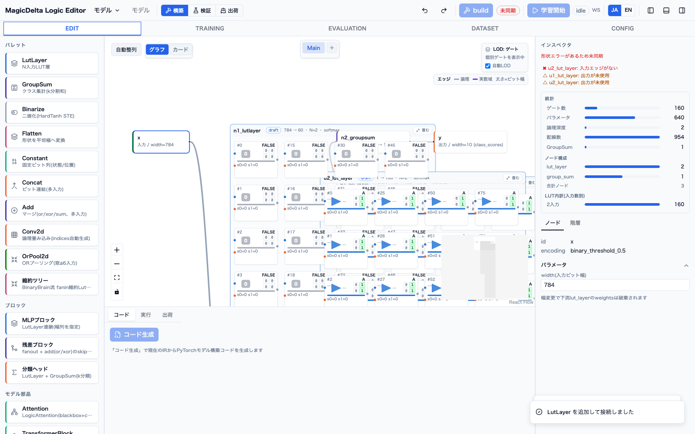
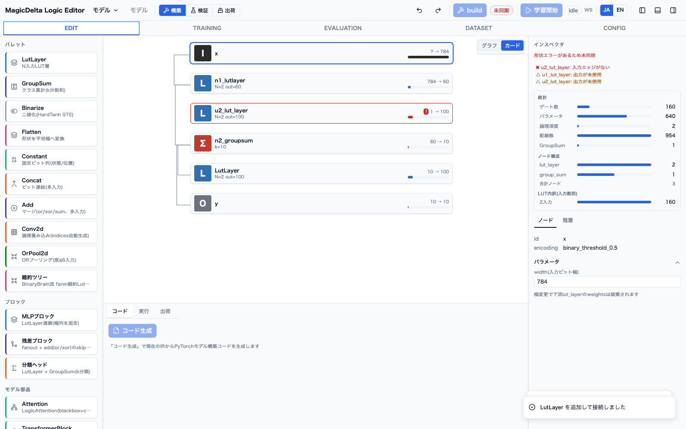
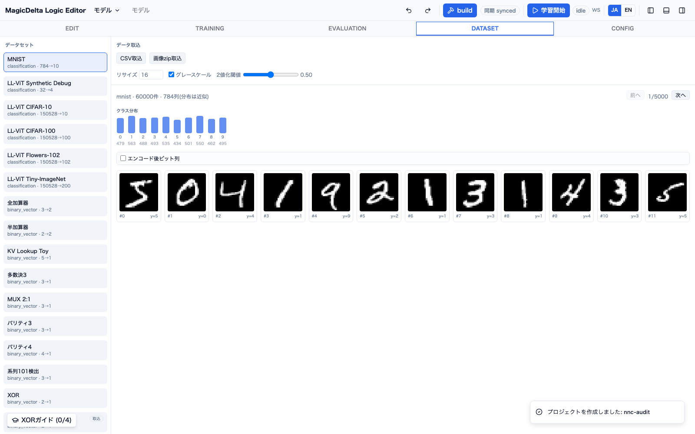
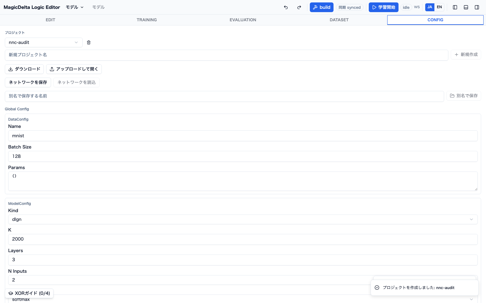
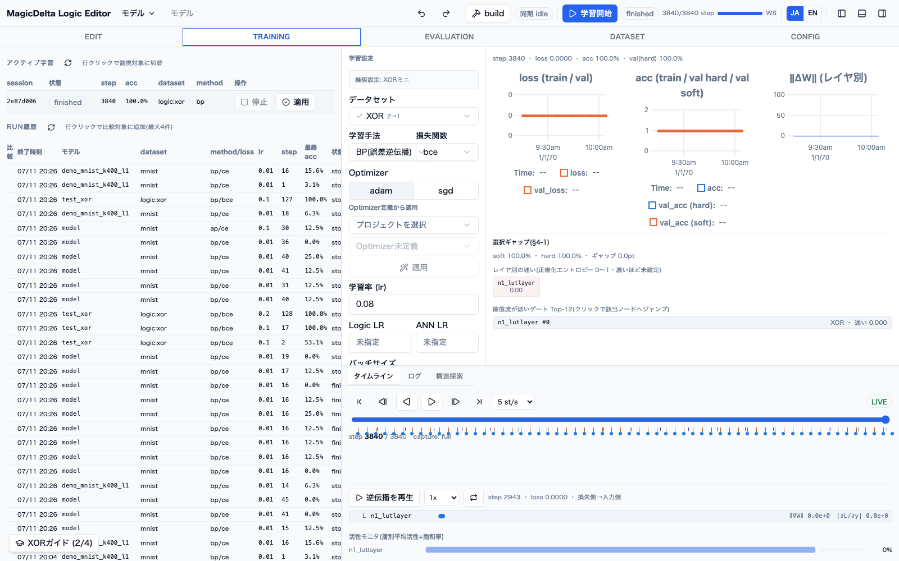
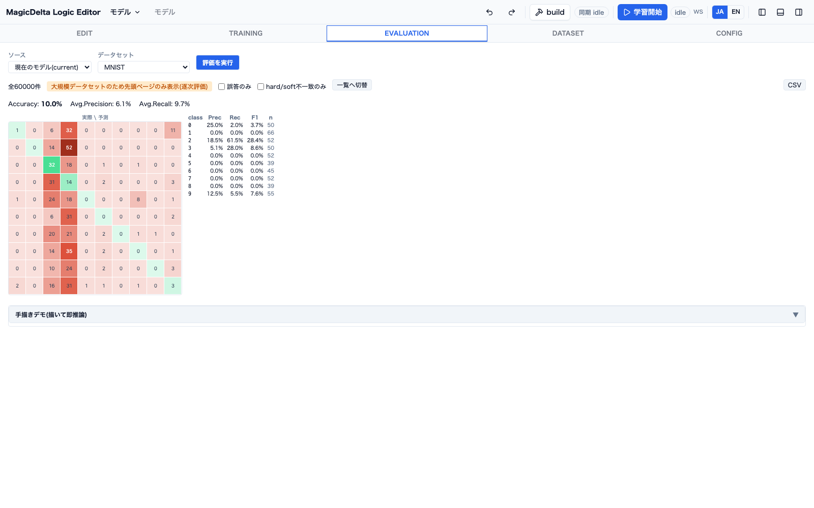

:::note[エディタはリポジトリを clone すれば使える]
ビジュアルエディタは**このリポジトリに含まれている**(`tools/editor/`)。
PyPI の `griffith-logic` パッケージには入らないので、使うにはリポジトリを clone して
`uv sync --extra editor` でバックエンドの依存を入れ、`make editor` で起動する。
ライブラリ本体(`griffith_logic`)と IR の仕様は本ドキュメントの他ページで完結しており、
エディタが無くても Python から同じことができる。
:::

ビジュアルエディタは、**IR(中間表現)を共通契約として、モデルのグラフ編集・学習のライブ監視・
評価・HDL 出力までを 1 画面で行う**ブラウザアプリである。バックエンドは FastAPI、
フロントエンドは React + React Flow。参考にした UX は ComfyUI / Sony Neural Network Console /
TensorFlow Playground の 3 つで、特に **NNC の「ワークフローをタブで段階分けする」構成**を踏襲している。

Python でモデルを書いても、エディタで組んでも、**保存されるものは同じ IR**である
(→ [アーキテクチャ全体像](/explanation/architecture/))。エディタは IR の GUI フロントエンドであり、
別系統のモデル定義ではない。

## 起動する

依存を入れる。`editor` extra には FastAPI/uvicorn しか入っていないので、
PyTorch を持つ `cpu`(または `cu128`)extra と併せて指定する。

```bash
uv sync --extra editor --extra cpu --extra dev   # GPU機は --extra cpu を --extra cu128 に
```

フロントエンドの依存はエディタ配布物側の `frontend/` で `npm install` する。

リポジトリルートで 1 コマンド起動する。

```bash
make editor    # backend(8765) + frontend(5173) を同時起動
```

ブラウザで `http://localhost:5173` を開く。個別に起動したい場合は
`make backend` / `make front`(バックエンドの uvicorn とフロントの `npm run dev`)を使う。

:::caution[必ず localhost:5173 経由で開く]
REST(`/api`)も学習 WebSocket(`/ws`)も、vite dev server が同一オリジンでバックエンドへ
proxy する。`ws://127.0.0.1:8765/...` へ直結すると、巨大 Cookie 環境で
`400 line too long` が出て WS だけ落ちる事故がある(vite proxy は学習 WS から Cookie を
除去してこれを免疫化している)。別ホストのバックエンドへ繋ぐときだけ
`VITE_EDITOR_WS_BASE_URL=ws://host:port` を明示する。
:::

## 画面の骨格 — 5 つのトップタブ

ヘッダのタブ帯がワークフローの段階そのものになっている。並びはキーボードの `1`〜`5` と一致する。

| # | タブ | 段階 | 主に見るもの |
|---|---|---|---|
| 1 | **EDIT** | 組む | グラフ / カード、部品パレット、統計(LUT 数・論理深さ・配線数) |
| 2 | **TRAINING** | 回す | loss/acc 曲線、レイヤ別 ‖ΔW‖、タイムマシン、run 履歴 |
| 3 | **EVALUATION** | 測る | 一括評価、混同行列、離散化ギャップ、手描き推論デモ |
| 4 | **DATASET** | 与える | 組込カタログ、CSV/画像 zip 取込、エンコードプレビュー |
| 5 | **CONFIG** | 決める | `TrainConfig` スキーマ駆動フォーム、プロジェクト保存 |

EDIT タブの内部はさらに **レンズ**(`Q`/`W`/`E`)で切り替わる。グラフ自体は同一のまま、
着色・バッジ・下部ドックのタブが一括で変わるオーバーレイ文脈である。

- **Build**(`Q`) — 構築とコード生成
- **Probe**(`W`) — プレイグラウンド推論
- **Ship**(`E`) — 出荷前チェックと HDL / コード出力

---

## 1. EDIT — グラフを組む

左の**部品パレット**から DnD でノードを置き、ポートをドラッグして繋ぐ。形状(shape)の
不整合はキャンバス上に赤バッジで即座に出る。右の**インスペクタ**に統計
(ゲート数・パラメータ数・論理深さ・配線数)がライブ表示される。



*グラフビュー。ズームすると LOD が切り替わり、`LutLayer` が **1 ゲート = 1 カード**まで展開される。
各カードには現在の真理値表(`FALSE` / `A` など確定した論理関数)と入力スロット `s0`/`s1` が出る。
エッジの色は「論理(灰)/実数域(青)」、太さはビット幅を表す。*

置ける部品は LutLayer / GroupSum / Binarize / Flatten / Constant / Concat / Add に加えて、
Conv2d・OrPool2d・縮約ツリー、MLP ブロック・残差ブロック・分類ヘッドといった複合ブロック、
さらに Attention / TransformerBlock(blackbox 扱い)まで揃っている。

### カードモード — NNC 流の縦積みビュー

右上のトグルで **カード**表示に切り替えると、レイヤが上から下へ 1 枚ずつ積まれた
NNC 風のリストになる。配線が単純な直列モデルでは、こちらの方が構造を追いやすい。



*カードモード。各カードに `784 → 60`・`N=2 out=60` といった形状と設定が出る。
入力エッジが無いノードは赤枠+エラーアイコンで示され、右のインスペクタに
「u2_lut_layer: 入力エッジがない」と理由が列挙される。`A` キーでトポロジカル順に縦整列する。*

このほか EDIT では、**真理値表の直接編集**(hex をセル単位で書き換える)、
**手動配線**(SVG 二部グラフ上で入力スロットを付け替える)、
**Unit**(引数付き再利用サブネットの定義とインスタンス化)、
**複数ネットワーク**(タブで持ち、同名レイヤ間で重み転写)が使える。
`⌘K` のコマンドパレット、右クリック QuickAdd、undo/redo もある。

下部ドックの「コード」タブで、現在の IR から **PyTorch モデル構築コードを生成**できる。
GUI で組んだものをそのままスクリプトへ持ち出す経路である。

### 構造化配線と、IR 経由で持ち込める部品

インスペクタの `connections` は `random` / `unique` のほかに、乱数を引かず式で決まる
**構造化配線**(`rot`・`rot_n`・`butterfly`・`local1d`・`local2d`)を選べる。
種を選ぶと引数欄(rot の `s_a`/`s_b`/`step`、butterfly の `stride`、local2d の
`offsets`/`grid` など)が出て、「配線を生成して適用」でバックエンドの生成器
(`POST /api/wiring/generate`。レシピの `model.connections` と同じ関数)が indices を作り、
IR に書き込む。真理値表は保たれ、被覆率・未使用入力・同一入力ゲート数が 1 行で出る。
draft(未 build)のノードは build 時に同じ規則で再生成されるので、引数だけ決めておいてもよい。

モデルメニューの「学習デモ」「画像」群には、構造化配線を段ごとに変えたサンプルが 3 本ある
(構造は `tools/editor/frontend/src/samples/wiringSamples.json`)。

- **2bit 加算器 rot 配線 学習**(4 → 16 → 16 × 4 → 3): 層 0 は rot(0,2) で a_i と b_i を対にし、
  隠れ層のずらし量は 1 / 2 / 4 / 8 と倍々、出力段は rot(0,8, step 5)。論理プリセット
  (lr 0.08 / batch 16 / 60 epoch)で全 16 行が exact 一致になる(4 seed で確認)。層 0 は 4 → 16 の
  射影なので、そこでのずらし量は到達範囲を広げる stride ではなく「どの対を作るか」の選択である
- **MNIST rot 1000 学習**(784 → 6 層 × 1000 → GroupSum k=10 tau 3.75): 層 0 は 2D 近傍の rot(1,28)
  (右 1 画素と 1 行下)、隠れ層はクラス受容野が 100% になるずらし量 6 / 30 / 150 / 750 / 500
- **MNIST butterfly(4 入力)1000 学習**: 層 0 は rot_n で 4 bit ずつ gather、隠れ層は
  stride 1 / 4 / 16 / 64 / 256 の循環 radix-4 バタフライ(4^5 ≥ 1000 で 5 段全到達)

MNIST の 2 本は `configs/recipes/fmc_w1000_{rot,bf4}.yaml` と同じ配線で、レシピ側
(`griffith train`、入力を 0.5 で二値化、8 epoch)の hard 精度は rot 92.3% / butterfly 89.2%
(固定ランダム配線 90.7%、各 2 seed の平均)。エディタのプリセットは lr 0.01 / batch 100 / 2 epoch で、
入力はグレースケールのまま与える。ずらし量は入力の平坦化順の中で意味のある距離で決める
(加算器の 2 = 相手オペランドの同じ桁、MNIST の 28 = 1 行下)。本リポジトリの `butterfly` は
循環シフト(radix-n の rot_n)であり、FFT の XOR 対ではない。

エディタは IR を `build_torch` で PyTorch モデルに組んで学習・評価・HDL 生成するので、
Python や CLI で作った IR JSON(`POST /api/models/ir/load`)から次の部品も扱える。

- **conv2d / or_pool2d**(conv-DLGN など)はノードのまま保たれ、学習・評価できる。
  build のたびに再抽出しても `lut_layer` 列へ展開されない(HDL 生成時に展開する)
- **permute**(`GroupSum(assign='stride')` のネイティブ抽出など)と、
  2 / 4 / 6 以外の入力数を持つ `lut_layer`(ThermometerEncoder の 8 入力、stride 割当の
  1 入力恒等)は、学習パラメータを持たない**凍結 LUT**として組まれる(下流の層は学習できる)
- **group_sum の `bias`**(クラスごとの整数の判定バイアス)はインスペクタで編集でき、
  Probe レンズの評価とコード生成にも乗る
- **LTT 層**や DWN の `lut_layer` は「任意の表を持てる LUT 層」として復元される
  (再学習は DWN の規則になる)

---

## 2. DATASET — データを与える

組込カタログ(MNIST、`logic:*` の論理関数群、真理値表)と、取り込んだデータセットを
一覧・プレビューする。CSV と画像 zip をアップロードすると動的カタログへ登録される。



*DATASET タブ。上部の「リサイズ / グレースケール / 2値化閾値」が取込設定で、
論理ゲート NN の入力は 0/1 なので **2値化閾値が実質的な前処理の主役**になる。
クラス分布バーで偏りを確認し、下のグリッドで実サンプルを見る。
「エンコード後ビット列」にチェックを入れると、実数値がどの 0/1 グリッドへ変換されるかを
そのまま確認できる。*

---

## 3. CONFIG — 学習設定を決める

`TrainConfig` の JSON Schema(`GET /api/config/schema`)からフォームを自動生成している。
バックエンドの型定義が真実源なので、**設定項目がコードとずれない**。



*CONFIG タブ。上段がプロジェクト(作成・ダウンロード・アップロード・ネットワークの別名保存)、
下段が Global Config。`ModelConfig` の `Kind`(dlgn 等)・`K`(層幅)・`Layers`・`N Inputs`・
パラメータ化(softmax ほか)がここで決まる。設定はプロジェクトへ保存され、
TRAINING タブから呼び出せる。*

---

## 4. TRAINING — 学習を回して覗く

dataset・method(`bp`/`ap`/`bb`)・lr・batch・epochs・optimizer・loss を指定して開始する。
**各ランは編集中モデルの独立コピーを学習する**(非破壊探索)。気に入った結果だけを
`適用` で編集中モデルへ取り込む。



*TRAINING タブ。右上 3 枚が WebSocket でライブ更新される曲線
(loss、acc の train/val hard/val soft、レイヤ別 ‖ΔW‖)。
その下の **「選択ギャップ」** が論理ゲート NN 固有の指標で、`soft 100.0% · hard 100.0% · ギャップ 0.0pt` は
「連続緩和の性能がそのまま Boolean 回路になっても落ちていない」ことを意味する
(→ [学習曲線の読み方](/guides/training-curves/))。
「レイヤ別の迷い」は正規化エントロピーで、濃いほどそのレイヤのゲートが未確定である。
下部ドックのタイムラインが**タイムマシン**で、任意ステップへスクラブして当時のスナップショットを
read-only で閲覧できる。pause 中なら巻き戻して再学習の起点にもできる。*

TRAINING でできることの要点:

- **pause / resume / stop** に加えて **ステップ実行**(n ステップ進めて自動 pause)
- **誤差逆伝播リプレイ** — 勾配フローを再生し、層の発光と勾配パーティクルで可視化する
- **ゲート分布のライブ追従** — ミニバー / ヒートマップが最大 5Hz で更新される
- **run 履歴** — プロセスをまたいで永続する run サマリを一覧・比較する

---

## 5. EVALUATION — 測る

run または現行モデルを指定データセットで一括評価する。精度・混同行列(P/R/F1)に加えて、
**離散化ギャップ**(hard 離散化の結果が soft argmax と食い違ったサンプル)の列が出るのが特徴。



*EVALUATION タブ。10×10 の混同行列(縦=実際、横=予測)とクラス別 P/R/F1。
この図は**未学習モデル**を評価したもので、accuracy 10.0% = ランダム相当、
予測が特定の列(2 と 3)へ吸い込まれている典型的な崩壊パターンが読み取れる。
「誤答のみ」「hard/soft 不一致のみ」でフィルタでき、誤答サンプルの入力ビット列は
プレイグラウンドへ注入して回路を辿れる(反例トレース)。結果は CSV でエクスポートできる。*

下部の「手描きデモ」を開くと 28×28 キャンバスに手描きし、2値化 → 推論 → クラス確率バーまで
即座に確認できる。学習中のライブ推論にも対応している。

---

## 構造探索(NAS)

`POST /api/nas/start` で genome 進化による構造探索を回すと、
**精度 × 回路面積(LUT 数)の Trade-off グラフとパレート前線**が出る。
中断再開・JSONL 台帳・決定性ゴールデンに対応している。

## キーボードショートカット

| キー | 動作 |
|---|---|
| `1`〜`5` | トップタブ切替(EDIT/TRAINING/EVALUATION/DATASET/CONFIG) |
| `Q`/`W`/`E` | EDIT 内レンズ切替(Build / Probe / Ship) |
| `F` / `L` | 全体表示(fitView) / 自動整列 |
| `A` | NNC 縦整列(トポロジカル順に座標更新) |
| `⌘K` / `Ctrl+K` | コマンドパレット |
| `⌘Z` / `⇧⌘Z` | undo / redo |
| `⌘S` | 即時同期 |

input/textarea/select にフォーカス中は無効。単一情報源は
`frontend/src/hooks/useShortcuts.ts` 冒頭のキー割当表。
URL ハッシュ(`#edit` / `#training` 等)とタブは双方向同期し、ブラウザの戻る/進むが効く。

## API — エージェントから叩く

エディタが使う REST/WS は、そのまま**エージェントがモデル構築〜学習〜改変を完結させるための API**
でもある。全エンドポイント表・リクエスト/レスポンス形・curl/Python の完全例・WS フレーム型は
エディタ配布物に同梱の API リファレンスを参照。主要なものは以下のとおり。

| カテゴリ | 主なエンドポイント |
|---|---|
| モデル | `POST /api/models/demo` `import` `import/python`、`GET /api/models/current/ir` |
| 編集 | `PUT /api/models/current/ir`、`POST .../nodes/{id}/truth_table` `.../indices`、`.../build`、`.../codegen` |
| データセット | `GET /api/datasets`、`POST /api/datasets/import/csv` `.../import/images`、`.../encoding-preview` |
| 学習 | `POST /api/train/start` `.../pause` `.../step` `.../apply`、`GET /api/train/{sid}/history` |
| 評価 | `POST /api/evaluate`、`POST /api/evaluate/export.csv` |
| 出力 | `POST /api/export/hdl`(Verilog/VHDL + リソース見積り)、`POST /api/probe` |
| WS | `/ws/train/{sid}`(metrics / layer_summary / history_index / grad_flow) |

レイヤ名は IR ノード id(`n{i}_{クラス名}`)で、`export_ir` と同一規約である。
API 契約の TS 型は `make gen-types` で `backend/schemas.py` から自動生成され、
CI が `gen-types → git diff --exit-code` でドリフトを検出する。

## 既知の制限

- **学習は CPU 固定**(スレッド実行の安定性優先)。GPU 学習はエディタ外
  (→ [クラウドGPU](/guides/cloud-gpu/))で行う。
- **Attention / Transformer は blackbox** としてのみ扱う。エディタ内では学習不可・HDL 生成不可・
  IR 単体からの build 不可で、実行の正は Python モデル側にある。
- **訓練セッションはプロセス内メモリにのみ存在**し、バックエンド再起動で消える
  (永続記録は `GET /api/runs`。`/api/health` の `server_epoch` で再起動を検出できる)。
- ステップ実行と巻き戻し(restore)は **paused 状態でのみ**許可される。
- checkpoint インポートは `nn.Sequential` 直列 + モデルオブジェクト全体保存の `.pt` のみ
  (state_dict だけのチェックポイントは未対応)。
- warp / raw パラメータ化の確信度は定義が自明でないため中立値(0.5)で表示する。
- **凍結 LUT**(thermometer の 8 入力 `lut_layer` や permute)はエディタ内では学習しない
  (パラメータを持たない)。`group_sum` の `bias` 付き IR は HDL / C 生成で拒否される。
- 学習監視(レイヤ別 ‖ΔW‖・ゲート分布)は `LutLayer` だけが対象で、conv2d や凍結 LUT は出ない。

## トラブルシューティング

**`ModuleNotFoundError: No module named 'torch'`** — `editor` extra に PyTorch は入っていない。
`uv sync --extra editor --extra cpu --extra dev`(CUDA 機は `cpu` を `cu128` に)を実行する。
`cpu` と `cu128` は同時指定できない。

**WebSocket が `400 Bad Request` / UI で「WS 未接続」** — 順に確認する。

1. `curl http://127.0.0.1:8765/api/health` でバックエンドの生存を見る
2. フロントを `http://localhost:5173` 経由で開いているか
3. DevTools → Network → WS で接続先が同一オリジン(`ws://localhost:5173/ws/train/{sid}`)か。
   `ws://127.0.0.1:8765/...` へ直結していたら古いフロントなので再読み込み / 再起動する
4. `400 line too long` は巨大 Cookie(他プロジェクトの認証 Cookie 等)が原因。vite proxy 経由なら
   免疫化されているので、3 の直結へ逸れていないかを再確認する

## 次に読む

- [学習曲線の読み方](/guides/training-curves/) — TRAINING タブの曲線と選択ギャップの解釈
- [IRを扱う](/guides/ir/) — エディタが保存している IR そのものの構造
- [HDLエクスポートと等価性検証](/guides/hdl-export/) — Ship レンズの先にある工程
- [アーキテクチャ全体像](/explanation/architecture/) — なぜ IR を中心に据えたのか
