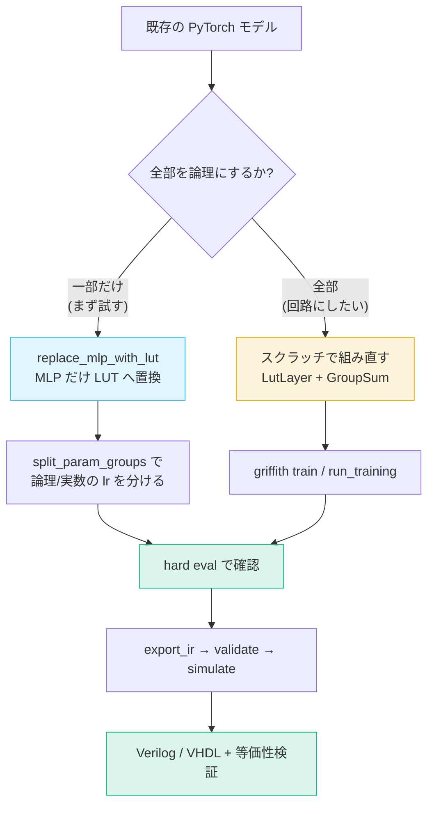

このライブラリは **普通の PyTorch** である。`nn.Module` を継承し、`loss.backward()` が通り、
`torch.optim` がそのまま使える。だから移行は速い。

一方で **意味が違うだけで名前が同じ**ものがいくつかあり、そこが事故の温床になる。
最たるものが `model.eval()` で、PyTorch では Dropout と BatchNorm の挙動が変わるだけだが、
ここでは **モデルの数学そのものが変わる**(実数の混合 → ブール回路)。

このページは PyTorch の語彙から本ライブラリの語彙への **翻訳表**である。

:::tip[PyTorch もこれからなら]
このページは **PyTorch を書ける人**向けの翻訳表である。NN 自体が初めてなら、
先に [入門コース](/tutorials/nn-basics/)(全3本)を走らせるのが近道
── PyTorch の基礎 → MLP で MNIST → **同じ問題を DLGN へ置き換え**、まで実行つきで通る。
考え方だけ先に掴みたいなら [NNからDLGNへ](/explanation/nn-to-dlgn/)。
:::

:::note[このページで分かること]
1. **対応表** — `nn.Linear` / `nn.Conv2d` / 出力層 / 最適化 / エクスポートの置き換え先
2. **`model.eval()` の意味の違い** — soft から hard への切り替えと離散化ギャップ
3. **PyTorch の常識が通じない点** — 浮動小数点前提の技法、pretrained 資産がないこと
:::

## 最小の対応 — 同じネットを 2 通りで書く

```python
# PyTorch(実数の MLP)
import torch.nn as nn

model = nn.Sequential(
    nn.Flatten(),
    nn.Linear(784, 256), nn.ReLU(),
    nn.Linear(256, 256), nn.ReLU(),
    nn.Linear(256, 10),          # → cross_entropy へ
)
```

```python
# griffith-logic(論理ゲートのネット)
import torch.nn as nn
from griffith_logic import GroupSum, LutLayer

model = nn.Sequential(
    nn.Flatten(),
    LutLayer(784, 8000, n_inputs=2),    # 活性化関数は要らない
    LutLayer(8000, 8000, n_inputs=2),   # 非線形性はゲートそのものが持つ
    GroupSum(k=10, tau=10.0),           # → cross_entropy へ
)
```

見た目はほとんど同じで、`loss.backward()` も `optimizer.step()` も変わらない。
違うのは **1 ニューロンの中身**である。`nn.Linear` の 1 出力が「入力全部の重み付き和」なのに対し、
`LutLayer` の 1 出力は **入力線のうち N 本だけを疎に拾う LUT(真理値表)1 個**であり、
学習されるのは重みではなく **「どの論理関数になるか」** である。

---

## 対応表

### 層

| PyTorch | ここでは | 何が違うか | 参照 |
|---|---|---|---|
| `nn.Linear(i, o)` | `LutLayer(i, o, n_inputs=2)` | 全結合の積和ではなく、N 本だけ拾う LUT。学習対象は真理値表。配線は初期化時に固定(`wiring='learnable'` で学習も可) | [LutLayerの数理](/explanation/lut-layer/) |
| `nn.ReLU` / `nn.GELU` | **不要** | 非線形性は LUT が内包する。活性化関数という概念自体がない | [DLGNとは](/explanation/dlgn/) |
| `nn.Conv2d` | `LutConv2d(in_ch, out_ch, kernel_size, tree_depth=3)` | カーネルは積和ではなく **ゲートのツリー**。`tree_depth` で深さを決める | [畳み込み・空間処理 API](/reference/api/conv/) |
| `nn.MaxPool2d` | `OrPooling2d` | max は算術。論理側では OR で集約する | [5. CNNのHDLエクスポート](/tutorials/cnn-hdl-export/) |
| `nn.BatchNorm` / `nn.LayerNorm` | `LogicLayerNorm` ほか | 統計量による正規化は回路に落ちない。論理で置き換えた版を使う | [一般NN部品 API](/reference/api/blocks/) |
| 出力の `nn.Linear(h, C)` + softmax | `GroupSum(k=C, tau)` | 最終層のゲート出力を C 群に**均等分割して合計し τ で割る**だけ。重みを持たず、回路側は加算器 1 つ | [基本コンセプト](/getting-started/concepts/) |
| `nn.MultiheadAttention` | `LogicAttention` 系 | Attention ごと論理化した実装がある(スコアは XNOR-popcount、softmax は MUX) | [Attentionツアー](/tutorials/attention-tour/) |
| `nn.Embedding` / 入力の正規化 | `ThermometerEncoder` ほか | 実数入力はビット列へ符号化してから入れる。入力は $[0,1]$ の実数か 0/1 のビット。`ThermometerEncoder(bits, input_bits=8)` のように入力の量子化ビット数を指定すると、しきい値比較ごと 8 入力 LUT として IR に含められる(未指定なら IR の外の前処理) | [DWN(温度計符号化)](/tutorials/dwn/) |
| `nn.Linear(i, o)` + `sign` (パーセプトロン層) | `LTTLayer(i, o, n_inputs=6)` | N 本の入力の**線形閾値関数** $1[w\cdot x + b > 0]$ をゲートにする。パラメータはゲートあたり N+1 個で、表現できるのは閾値関数(線形分離可能なブール関数)だけ。学習は STE、IR では N 入力 LUT | [API: コア層](/reference/api/core/) |
| `nn.Dropout` | **通常は使わない** | 正則化は容量(ゲート数 k)と学習量で調整するのが基本 | [学習を回す](/guides/training/) |

`GroupSum` の中身はこれだけである。

$$
\text{logit}_c = \frac{1}{\tau}\sum_{i \in \text{group}_c} y_i
$$

出力次元がクラス数で割り切れないと assert で落ちる。τ は精度に直接効き、
MNIST 6層 k=8000 では経験則 $\tau=\sqrt{k/C}$ より **固定値 τ=10 の方が約 1.0pt 高い**。

### 学習

| PyTorch | ここでは | 何が違うか | 参照 |
|---|---|---|---|
| 自作 train ループ | `run_training(cfg)` / `uv run griffith train recipe.yaml` | 設定は pydantic 検証(未知キーは開始前にエラー)。CLI は API の薄いラッパで中身は同一 | [学習を回す](/guides/training/) |
| `torch.optim.Adam(model.parameters(), lr=1e-3)` | 同じ。ただし **lr は 0.01〜0.3** | 論理側の重みは実数重みより 1〜2 桁大きい学習率を好む。`independent` は lr ≥ 0.3 が必要な場面がある | [パラメータ化を選ぶ](/guides/parameterization/) |
| param group の手書き | `split_param_groups(model, logic_lr=0.02, ann_lr=1e-3)` | ハイブリッド構成で論理側と実数側の lr を自動で分ける。同じ lr で回すと論理側が動かない | [2. ハイブリッドNNを作る](/tutorials/hybrid/) |
| backprop 一択 | `with_learning(module, LearningSpec(rule=...))` + `HybridTrainer` | **層ごとに** bp / ap / dfa / eggroll を混ぜられる。`with_learning` はラップせず属性を注釈するだけなので既存モデルに後付けできる | [学習則(BP/AP/DFA/ES)](/explanation/learning-rules/) |
| `acc` を 1 つ報告 | **soft と hard の 2 つ**を必ず併記 | `test_acc_soft` は連続近似の成績、`test_acc`(hard)が**回路としての真の成績** | [学習曲線の読み方](/guides/training-curves/) |
| `model.eval()` | `model.eval()` — ただし意味が違う | **argmax 離散化してブール回路になる**。下記参照 | [DLGNとは](/explanation/dlgn/) |

### エクスポート

| PyTorch | ここでは | 何が違うか | 参照 |
|---|---|---|---|
| `torch.onnx.export(model, ...)` | `export_ir(model, input_width=..., name=...)` | 出力は **IR(JSON)**。真理値表と配線だけを持つ、torch にも HDL にも属さない中立表現。conv 系は `export_ir(model, input_shape=(C, H, W), native_conv=True)` で `conv2d` / `or_pool2d` ノードのまま(重み共有が残る) | [IRを扱う](/guides/ir/) |
| ONNX Runtime で推論 | `simulate(ir)`(numpy でビット厳密) | IR 自身が **golden model** になり、照合の基準として使える | [IRを扱う](/guides/ir/) |
| TorchScript / TensorRT | `griffith export-hdl ir.json --lang verilog` | 行き先が実行エンジンではなく **合成可能な Verilog / VHDL** | [HDLエクスポートと等価性検証](/guides/hdl-export/) |
| `state_dict` が真実源 | **IR が真実源** | 学習後のモデルの意味は IR に固定される。HDL 生成もエディタもシミュレータも IR だけを見る | [アーキテクチャ全体像](/explanation/architecture/) |
| `load_state_dict` | `build_torch(ir)` | IR から PyTorch モデルへ戻せる(IR を編集して学習を続けられる) | [IRを扱う](/guides/ir/) |
| 「たぶん同じ動作」 | **3段等価性で機械検証** | `PyTorch hard eval ⇔ ir/simulate ⇔ HDL シミュレーション` の 3 経路が全ベクトルで一致することを検証する | [HDLエクスポートと等価性検証](/guides/hdl-export/) |

なお ONNX は **教師モデルの入口**としてなら使える(`resolve_teacher('onnx:<path>')` 等)。
ただし後述のとおり、事前学習モデルからの変換・蒸留は万能薬ではない。

---

## `model.eval()` の意味が違う

PyTorch で `eval()` が変えるのは Dropout と BatchNorm の挙動だけで、
**同じ関数の近似**が返る。ここでは違う。

```python
model.train()
y_soft = model(x)   # 実数 [0,1]。全ゲートの softmax 混合。勾配が流れる
model.eval()
y_hard = model(x)   # ビット 0/1。argmax で確定した 1 ゲートだけが通る
```

| | soft(`train()`) | hard(`eval()`) |
|---|---|---|
| 入力 | $[0,1]$ の実数 | `round()` で 0/1 のビット |
| LUT 重み | `softmax(W)`(全 $2^N$ エントリに配分) | `one_hot(argmax(W))`(1 エントリのみ) |
| 出力 | 実数 | ビット |
| 意味 | 連続近似がどれだけフィットしているか | **論理回路としての真の性能** |

この 2 つの精度差を **離散化ギャップ** と呼ぶ。

| ギャップ | 解釈 | 打ち手 |
|---|---|---|
| 0〜0.5pt | 健全。ゲートが特定のエントリへ十分収束している | そのまま |
| 1pt 以上 | 連続近似には効いているが回路になると崩れる | エポック増 / パラメータ化を見直す |
| soft も低い | そもそも学習できていない | lr・τ・容量(k, 層数)を疑う |

:::caution[焼く前に必ず hard eval を見る]
連続の真理値表が 0.5 付近に密集したまま丸めると精度は崩壊する。
実例として、eval acc 0.803 のモデルがエントリを丸めた途端 **0.211 まで落ちた**ケースがある
(BatchNorm 統計を再較正しても 0.632 止まり)。
**soft の成績は回路の成績ではない。**
:::

ギャップを構造的に 0 にする選択肢もある。`selection='hard_st'`(forward は argmax、
backward だけ softmax の勾配で近似する CAGE 方式)、`warp` パラメータ化(実測 −0.06pp)、
DWN(train/eval のロジット差 0.0)がそれにあたる。

---

## PyTorch の常識が通じない点

正直に列挙する。ここを知らずに始めると必ず詰まる。

### 1. 見るべき指標は soft ではなく hard

学習は soft でしか進まないが、**成績表として意味があるのは hard の方**である。
`test_acc` が hard、`test_acc_soft` が soft。慣れるまでは逆に読みがちなので注意。

### 2. 事前学習資産が使えない

timm / torchvision / HuggingFace のような **pretrained の生態系が存在しない**。
しかも「強い実数モデルを変換すれば済む」も成り立たない ── 蒸留 / 転写初期化 / 層別二値蒸留の
3 経路を実測して、**いずれもスクラッチ学習を上回らなかった**(転写初期化は大きく劣化)。
native DLGN の強みは自由なブール論理を学べることで、算術構造の転写はその自由を縛るためである
(→ [DLGNの分類と系譜](/explanation/taxonomy/))。

現実解は **スクラッチ学習**か、実数のまま残すべき部分を残す
**[ハイブリッド化](/tutorials/hybrid/)**(Transformer の MLP だけ LUT へ置換する等)。

### 3. 浮動小数点前提の技法が意味を失う

最終成果物は乗算を含まないブール回路である。したがって

- **精度(FP16/BF16/量子化)のチューニングは推論側では無意味** ── 出力は 0/1 のビットしかない
- **重みの大きさ**そのものに意味がない。意味を持つのは「どのエントリが最大か」だけ
- **正則化の主戦場は離散化ギャップの管理**であって、重みのノルムではない
- **数値誤差ではなくビット一致**で正しさを測る(3段等価性)

### 4. 学習率のスケールが違う

Adam で 1e-3 前後という感覚は通じない。**0.01 が既定**で、
`independent` や深い直列構成では **0.1〜0.3** まで上げる。
「損失が初期値から動かない」の第一容疑者は常に学習率である。

### 5. 「層の幅」の意味が違う

`LutLayer(in, out)` の `out` は **ゲート数**であり、そのまま回路の面積になる。
MNIST では 2,000(スモーク)〜 64,000(論文再現)の桁で動かす。
`nn.Linear` の隠れ次元より 1〜2 桁大きい数字が普通、という点で見た目が驚く。

### 6. GPU が要らないのは推論側だけ

学習は PyTorch 上の実数計算なので、**学習時は GPU があると速い**。
「GPU 不要」は焼いた後の回路の話である(CUDA は必須ではなく、CPU / MPS でも動く)。

### 7. アーキテクチャ以外に 3 つの軸がある

PyTorch では「層の選択」がほぼ設計のすべてだが、ここでは
**パラメータ化 / 選択(selection)/ 学習則**という直交する 3 軸が加わる。
何を選べばよいかは [何を使えばいいのか(選択ガイド)](/guides/choosing/) にまとめてある。

### 8. `nn.Linear` の置き換えは 1:1 ではない

`nn.Linear(784, 256)` を `LutLayer(784, 256)` に置き換えても等価にはならない。
1 ゲートは N 本しか入力を見ないので、**同じ表現力を得るにはゲート数を大きく取り、層を重ねる**
必要がある。ハイブリッド化 API(`LogicSpec(n_inputs=2, depth=2, neurons_per_output=8)`)が
`depth` と `neurons_per_output` というつまみを持つのはこのためである。

---

## 移行の手順



1. **[クイックスタート](/getting-started/quickstart/)** で 1 本動かす
2. **[何を使えばいいのか](/guides/choosing/)** でアーキテクチャ・N・パラメータ化・学習則を決める
3. **[学習を回す](/guides/training/)** で lr・τ・k の相場に合わせる
4. **[学習曲線の読み方](/guides/training-curves/)** で soft/hard を読み分ける
5. **[IRを扱う](/guides/ir/)** → **[HDLエクスポート](/guides/hdl-export/)** で回路にする

## 次に読む

- [入門3. MLPをDLGNへ置き換える](/tutorials/mlp-to-dlgn/) — この対応表を実行つきで 1 対 1 に見る
- [何を使えばいいのか(選択ガイド)](/guides/choosing/) — 4 つの選択をフローチャートで決める
- [基本コンセプト](/getting-started/concepts/) — soft/hard・LutLayer・GroupSum・IR・HDL
- [DLGNとは何か](/explanation/dlgn/) — なぜ勾配が流れるのか
- [2. ハイブリッドNNを作る](/tutorials/hybrid/) — 既存モデルに 1 行差し込む移行の最短路
- [コア層 API](/reference/api/core/) — `LutLayer` / `GroupSum` の全引数
