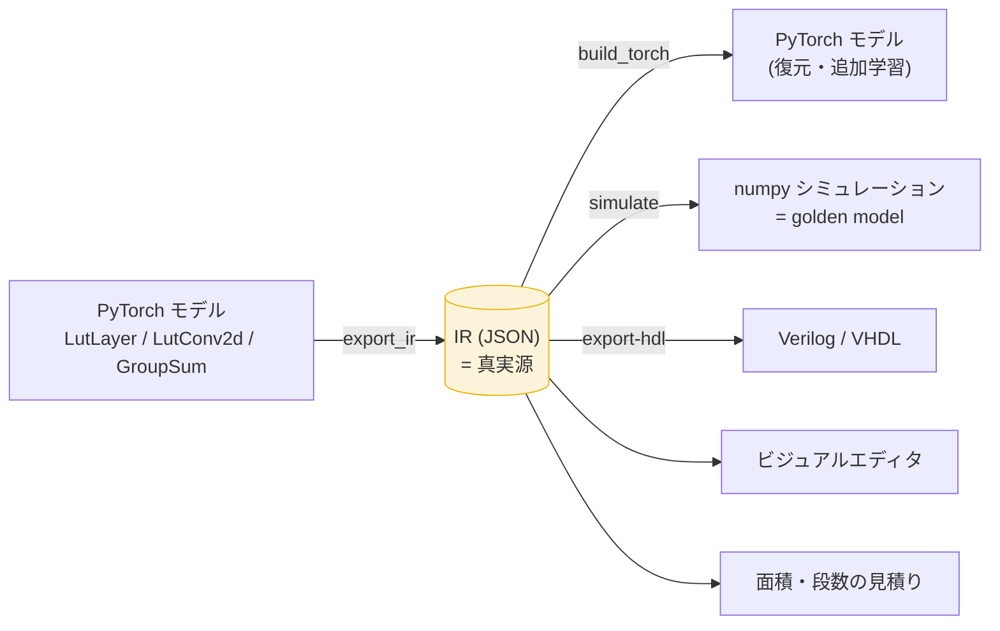
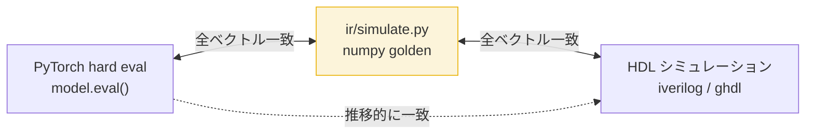

**IR(Intermediate Representation / 中間表現)** は、学習済みの論理回路を
PyTorch からもハードウェアからも独立した **JSON** として表したものである。
本ライブラリでは IR が上流(学習)と下流(HDL 生成・エディタ・シミュレーション)を
つなぐ唯一の契約であり、**IR が真実源(single source of truth)** と位置づけられている。

:::note[このページで分かること]
1. **IR の扱い方** — `export_ir` → `validate` → `simulate` → `save_ir` / `load_ir` の一連の流れ
2. **IR JSON の中身** — 実際に生成した最小サンプルを読み解く
3. **なぜ IR を挟むのか** — 疎結合設計の狙いと、3段等価性による正しさの担保
:::

## IR が真実源であるという設計

学習フレームワークと HDL ターゲットを直結すると、片方を変えるたびにもう片方が壊れる。
IR を中心に据えると、**上流を差し替えても下流は不変、下流を増やしても上流は不変**でいられる。



要点は 3 つ。

- **IR は torch にも HDL にも属さない**。どちらの都合も持ち込まない中立な表現である。
- **IR は往復できる**。`build_torch()` で PyTorch モデルへ戻せるので、
  IR を編集してから学習を続ける(回復学習)といった操作が成立する。
- **IR は実行できる**。`simulate()` が numpy でビット厳密に走るので、
  IR 自身が照合の基準(golden model)になる。

## 基本の流れ

```mermaid
flowchart LR
    A["学習済み<br/>nn.Sequential"] -->|export_ir| B["IRGraph"]
    B -->|validate| C["検証<br/>エラー=例外 / 警告=リスト"]
    C -->|simulate| D["0/1 で実行<br/>golden 出力"]
    C -->|save_ir| E["model.json<br/>(+ model.npz)"]
    E -->|load_ir| B
```



### 1. 抽出する — `export_ir`

```python
import torch
import torch.nn as nn
from griffith_logic.layers.lut import LutLayer
from griffith_logic.export import export_ir

model = nn.Sequential(
    LutLayer(in_dim=2, out_dim=4, n_inputs=2),
    LutLayer(in_dim=4, out_dim=1, n_inputs=2),
)
# ... ここで学習 ...
model.eval()

graph = export_ir(model, input_width=2, name='xor')
```

| 引数 | 意味 |
|---|---|
| `model` | `nn.Sequential`(直列モデル) |
| `input_width` | 平坦入力のビット幅。`input_shape` とは排他 |
| `input_shape` | conv 系モデル用の `(C, H, W)`。width は自動計算 |
| `name` | `metadata.name` に入る名前 |
| `native_conv` | `True` で `LutConv2d` / `OrPooling2d` をネイティブノードのまま抽出。既定 `False` は `lut_layer` 列へ展開する |

抽出は **hard(離散化後)の姿**を取り出す操作である。連続値の重みは
真理値表(hex 文字列)へ確定され、以後 IR に「学習中の確率」は残らない。

### 2. 検証する — `validate`

```python
from griffith_logic.ir import validate

warnings = validate(graph)              # 汎用チェック
warnings = validate(graph, target='hdl')  # HDL 生成の追加制約つき
```

- **構造的に壊れている**(未知のノード型、id 重複、エッジの端点が存在しない、幅の不整合など)場合は `IRValidationError` を送出する。
- **動くが下流で困る**構成は警告文字列のリストとして返る。
- `target='hdl'` を指定すると、HDL では表現できない構成(`blackbox`、`add(mode='sum')` など)を追加で禁止する。**HDL に落とす前は必ずこちらで検証する**。

### 3. 実行する — `simulate`

```python
import numpy as np
from griffith_logic.ir import simulate, simulate_trace

X = np.array([[0, 0], [0, 1], [1, 0], [1, 1]])
y = simulate(graph, X)          # array([0, 1, 1, 0]) — XOR
trace = simulate_trace(graph, X)  # {node_id: (batch, width) の中間出力}
```

入力は **0/1 のみ**を受け付ける(連続値を渡すと assert で弾かれる)。
numpy でビット厳密に計算されるため、この出力が照合の基準になる。
`simulate_trace` は全ノードの中間値を返すので、どの層でビットが化けたかを追える。

### 4. 保存・読み込み — `save_ir` / `load_ir`

```python
from griffith_logic.ir import save_ir, load_ir, ir_to_dict, ir_from_dict

path = save_ir(graph, 'outputs/xor.json')   # 返り値は実際に書いた json のパス
graph2 = load_ir(path)

d = ir_to_dict(graph)      # dict へ(API レスポンス等)
graph3 = ir_from_dict(d)
```

:::caution[大きな配列は .npz へ退避される]
`indices` のような大配列は要素数が閾値(既定 65,536)を超えると
サイドカーの `.npz` へ外部化され、JSON 側には `{"$data": "xor.npz#n0_lutlayer_indices"}`
という参照だけが残る。**`.json` と `.npz` は必ずセットで持ち運ぶこと。**
`truth_tables` は N=6 の 64bit 値を JSON で安全に扱うため、常に hex 文字列で書かれる。
:::

## 実際の IR JSON

上のコードで XOR を学習させて `export_ir` したものが、そのまま以下になる
(2層 × 2入力 LUT、`simulate` の出力は `[0, 1, 1, 0]`、`validate` の警告は 0 件)。

```json
{
  "format": "magicdelta-ir",
  "version": "0.2.0",
  "metadata": { "name": "xor", "created_at": "2026-09-03T20:39:56+09:00" },
  "inputs": [
    { "id": "x", "width": 2, "shape": null,
      "encoding": "binary_threshold_0.5", "semantics": null }
  ],
  "outputs": [
    { "id": "y", "width": 1, "shape": null,
      "encoding": null, "semantics": null }
  ],
  "nodes": [
    {
      "id": "n0_lutlayer",
      "type": "lut_layer",
      "params": {
        "in_width": 2,
        "out_width": 4,
        "n_inputs": 2,
        "indices": [[0, 0, 1, 0], [1, 1, 1, 0]],
        "truth_tables": ["0x6", "0xe", "0xd", "0xb"]
      },
      "train_info": { "parameterization": "softmax", "selection": "soft" },
      "meta": {}
    },
    {
      "id": "n1_lutlayer",
      "type": "lut_layer",
      "params": {
        "in_width": 4,
        "out_width": 1,
        "n_inputs": 2,
        "indices": [[0], [2]],
        "truth_tables": ["0xa"]
      },
      "train_info": { "parameterization": "softmax", "selection": "soft" },
      "meta": {}
    }
  ],
  "edges": [
    { "src": "x", "dst": "n0_lutlayer" },
    { "src": "n0_lutlayer", "dst": "n1_lutlayer" },
    { "src": "n1_lutlayer", "dst": "y" }
  ]
}
```

### 読み方

| フィールド | 意味 |
|---|---|
| `format` / `version` | IR のフォーマット識別子とバージョン(`magicdelta-ir` / `0.2.0`) |
| `inputs[].encoding` | 入力の符号化。`binary_threshold_0.5` = 0.5 で二値化した入力を前提とする |
| `params.indices` | **配線表**。形状は `(n_inputs, out_width)`。`indices[j][o]` = 出力ニューロン `o` の第 `j` 入力が、前段のどのビットから来るか |
| `params.truth_tables` | **各ゲートの真理値表**を $2^N$ bit の hex で表したもの。要素数は `out_width` |
| `train_info` | 学習側のメタ情報(どのパラメータ化で学習されたか)。`build_torch` で PyTorch へ戻すときに使う |
| `edges` | ノード間の接続。`x` が入力ポート、`y` が出力ポート |

1つ目の LUT を手で読むと、出力ニューロン 0 は
`indices[0][0]=0`, `indices[1][0]=1` すなわち入力 $(x_0, x_1)$ を受け、
真理値表 `0x6 = 0b0110` は $(0,0)\to0,\ (1,0)\to1,\ (0,1)\to1,\ (1,1)\to0$ ——
**XOR そのもの**である。JSON を眺めるだけで回路の意味が読み取れる。

### 主なノード型

`lut_layer` / `group_sum` / `binarize` / `flatten` / `concat` / `add` /
`conv2d` / `or_pool2d` / `constant` / `blackbox`。
畳み込み系(`conv2d` / `or_pool2d`)は **lowering** で `lut_layer` の列へ展開してから
HDL 生成へ渡す(HDL 生成器はネイティブ conv ノードを含む IR を明示的に拒否する)。

## 3段等価性 — IR の正しさを担保する

IR を真実源と言い切るには、「IR が torch とも HDL とも一致する」ことが検証されている必要がある。
本ライブラリは同じ回路を **3 つの独立した経路**で実行し、全ベクトルでの一致を要求する。



| 経路 | 実体 | 役割 |
|---|---|---|
| PyTorch hard eval | `model.eval()` した torch モデル | 学習側の真実 |
| simulate | `ir/simulate.py`(numpy でビット厳密) | **golden model**(照合の基準) |
| HDL シミュレーション | iverilog(Verilog)/ ghdl(VHDL) | 生成物の真実 |

3つが一致して初めて「HDL は元のモデルと等価」と言える。
この検証はテストスイート(`-m hdl` / `-m hdl_vhdl`)として常時回っている。

## IR から戻す・回す

```python
from griffith_logic.ir import build_torch, probe

# IR → PyTorch モデル(復元・追加学習・回復学習)
module = build_torch(graph)
out = module(torch.tensor([[0., 1.]]))

# 中間ビットのプローブ(hard / soft)
values = probe(graph, X)
```

`build_torch()` が使う `train_info.parameterization` は重要で、
たとえば任意の真理値表を厳密に再現するには `independent` 系のパラメータ化が要る
(→ [パラメータ化を選ぶ](/guides/parameterization/))。
IR 側にこの情報が入っているため、往復しても回路が壊れない。

## CLI から扱う

```bash
# IR を検証して Verilog / VHDL へ変換する
uv run griffith export-hdl outputs/xor.json --lang verilog
uv run griffith export-hdl outputs/xor.json --lang vhdl -o build/xor.vhdl
```

`griffith export-hdl` は **IR → HDL 変換のみ**を行う。シミュレータ照合まで含めた手順は
[HDLエクスポート](/guides/hdl-export/) を参照。

## つまずきどころ

| 症状 | 原因 | 対処 |
|---|---|---|
| `export_ir` が `NotImplementedError` | 論理層以外(抽出器が未登録の層)が混ざっている | 論理部分だけを渡す、または `register_extractor` で拡張する |
| `simulate` が assert で落ちる | 入力に 0/1 以外が入っている | `round()` などで二値化してから渡す |
| 別マシンで `load_ir` が失敗する | `.npz` サイドカーを持ってきていない | `.json` と `.npz` をセットで運ぶ |
| HDL 生成が IR を拒否する | `conv2d` / `or_pool2d` が残っている | lowering を先に通す(`native_conv=False` で抽出する) |
| torch と simulate が食い違う | soft(学習モード)の出力と比べている | 比較対象は必ず `model.eval()` の hard eval |

## 次に読む

- [IRスキーマ(リファレンス)](/reference/ir-schema/) — ノード型・パラメータの完全な仕様
- [アーキテクチャ全体像](/explanation/architecture/) — 8段データフローの中での IR の位置
- [HDLエクスポート](/guides/hdl-export/) — IR から Verilog/VHDL を作り等価性を検証する
- [学習を回す](/guides/training/) — IR に落とす前段の学習手順
