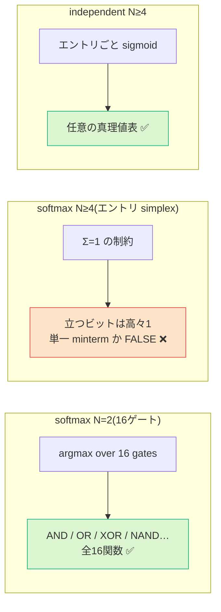
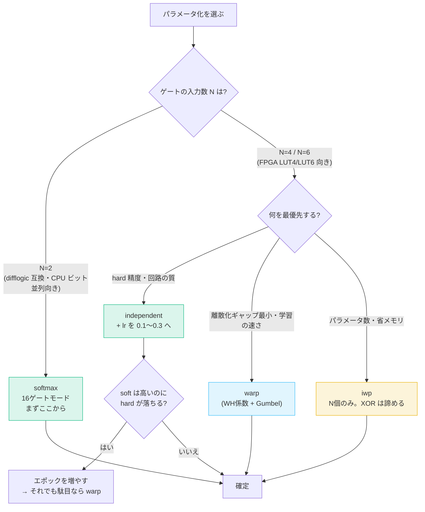

論理ゲートは本来「0 か 1 を返す早見表(LUT)」であって微分できない。
そこを **連続値のパラメータで包んで勾配を流す** のがパラメータ化方式であり、
本ライブラリは 5 種類を実装している。ここでの選択が精度・パラメータ数・
離散化後の回路の質をすべて左右する。

:::note[このページで分かること]
1. **5方式の違い** — softmax / independent / iwp / raw / warp が何をパラメータに持ち、何を表現できるか
2. **確定知見** — 「**N=2 は softmax、N≥4 は independent(+学習率を上げる)**」という結論と、その実験的根拠
3. **選び方** — 目的(精度 / FPGA 面積 / 学習速度)からの決定フロー
:::

## 前提: LUT と離散化

$N$ 入力 LUT は $2^N$ エントリの真理値表を持ち、$2^{2^N}$ 通りのブール関数を表せる。

| $N$ | エントリ数 $2^N$ | 表せる関数の数 $2^{2^N}$ | 対応 |
|---|---|---|---|
| 2 | 4 | 16 | difflogic の 16 ゲート |
| 4 | 16 | 65,536 | LUT4 |
| 6 | 64 | 約 $1.8\times10^{19}$ | **FPGA の LUT6 と同じ表現力** |

学習中はこの表を連続値で近似し、推論時に離散化して純粋な Boolean 表へ戻す。
一般形は次のとおりで、**違いは重み変換 $f$ だけ** である。

$$
y = \sum_{k=0}^{2^N-1} f(W)_k \prod_{j=0}^{N-1}\bigl(x_j \text{ if } \mathrm{bit}(k,j)=1 \text{ else } 1-x_j\bigr)
$$

## 5方式の比較

| 方式 | 重み変換 $f$ | パラメータ数/ゲート | hard 離散化 | 表せる hard 関数 | 由来 |
|---|---|---|---|---|---|
| `softmax` (**N=2**) | 16ゲート上の softmax | 16 | `argmax` → 16ゲート表 | **全 16 関数** | difflogic (DLGN) |
| `softmax` (N≥4) | $2^N$ エントリ上の softmax | $2^N$ | 確率 > 0.5 のエントリのみ 1 | **単一 minterm か FALSE のみ** | — |
| `independent` | エントリごとの sigmoid | $2^N$ | $\sigma(w)>0.5$ | **全 $2^{2^N}$ 関数** | BinaryBrain |
| `iwp` | 入力ごとの sigmoid、積で合成 | $N$ | $\sigma(w)>0.5$ | 積形の関数のみ(XOR 不可) | LDDLGN |
| `raw` | 重みを直接 $[0,1]$ で保持 | $2^N$ | HW 展開時に閾値 | 全 $2^{2^N}$ 関数 | BinaryBrain |
| `warp` | Walsh–Hadamard 係数、Gumbel 平滑化 | $2^N$ | ロジット > 0 | 全 $2^{2^N}$ 関数 | WARP |

### softmax — エントリ(またはゲート)が競合する

重みの合計が 1 に固定される。「100円を箱に分配する」形なので、
1 つを上げると他が自動的に下がる。勾配が全パラメータへ連動して届くのが利点。

**N=2 のときだけ特別扱い**で、真理値表 4 エントリではなく **16 個の完全ブール関数の上で
softmax を取る 16 ゲートモード**になる(`weights` の形状が `(out_dim, 16)`)。
argmax で選ばれるのは AND/OR/XOR/NAND… といった完成した関数そのものなので、
離散化しても表現力を失わない。

### independent — エントリが独立

各エントリが独立に「1 になる確率」を持つ($\sigma(w_k)$、合計は 1 にならない)。
**任意の真理値表をそのまま表現できる**ため、離散化しても表現力の欠落がない。
FPGA の LUT6 へ素直に対応する。

```
softmax(N≥4):  [0.01, 0.02, 0.07, 0.90] 合計=1 → 立てられるビットは高々1個
independent:   [0.10, 0.80, 0.30, 0.95] 独立   → 任意のビットパターンが作れる
```

### iwp — 入力ごとに 1 パラメータ

$2^N$ ではなく $N$ 個しか持たない。N=6 なら 64 → 6 でパラメータが 10 倍以上減り、
学習も速い。代償として **XOR のような「組み合わせが本質」の関数を表現できない**。
「学習済みモデルのゲートは大半が AND/OR/NOT に収束する」という観察に賭けた方式である。

### raw / warp

- `raw` — 重みを $[0,1]$ の実数のまま持つ(初期化 $\mathcal{N}(0.5, 0.01)$)。推論時も連続値を使い、**ハードウェア展開の段階で初めて離散化**する。
- `warp` — 真理値表そのものではなく **Walsh–Hadamard 基底の係数**を学習し、ロジットの符号で離散化する。離散化ギャップがほぼゼロ(実測 MNIST N=2 で **−0.06pp**、つまり hard が soft を上回る)になり、softmax の 11〜48% の FLOPs で回る。高次係数を捨てる度数キャップ(`wh_degree_cap`)で回路をさらに絞れる。

## 確定知見: N=2 は softmax、N≥4 は independent

:::tip[まずこれだけ覚える]
- **N=2** → `softmax`(16ゲートモード)
- **N=4 / N=6** → `independent`。加えて **学習率を上げる**(0.01 → 0.1〜0.3 で切り分ける)
:::

### なぜ N≥4 で softmax を使ってはいけないのか

N≥4 の softmax は 16 ゲート表ではなく **$2^N$ エントリ上の単体(simplex)** になる。
合計が 1 なので、離散化(確率 > 0.5)で立てられるビットは高々 1 個 —
つまり hard 表として作れるのは **単一 minterm か恒偽(FALSE)だけ** である。
パススルー・OR・XOR といった日常的な関数が構造的に表現できない。



**実験的根拠**: 畳み込み構成で `softmax`(エントリ simplex)を `independent` に替えただけの
対照実験で、**半分のエポック数にもかかわらず精度 +3.2pt** を得た。
全結合の MNIST でも softmax N=4 は hard 94.54% / 離散化ギャップ 1.12pp にとどまり、
同条件の warp N=4(95.50% / 0.14pp)に劣る。
表現力の欠落は学習量では埋まらない、というのがこの知見の要点である。

### なぜ学習率を上げる必要があるのか

`independent` は sigmoid 経由で、飽和気味の初期化(ロジット ±5 相当)と組み合わせると
**深い直列合成で勾配が急速に減衰する**。実測では全層の勾配ノルムが $10^{-5}$ 程度まで落ち、
既定の lr=0.02 では 10 エポック回しても soft 精度が 1 桁目から動かなかった。
**lr ≥ 0.3 で学習が進む**ことを確認しており、`independent` を使うときは
まず学習率を 1 桁上げて切り分けるのが定石である。

```bash
# N=6(FPGA LUT6 互換) + independent + 学習率を上げる
uv run griffith train configs/recipes/dlgn_mnist_quick.yaml \
    model.n_inputs=6 model.k=4000 model.parameterization=independent optim.lr=0.3
```

## 選び方フローチャート



## 実測リファレンス(MNIST・6層・τ=10・50エポック・bs=128・lr=0.01)

| | softmax N=2 | warp N=2 | warp N=4 | softmax N=4 |
|---|---|---|---|---|
| hard 精度 | **97.74%** | 96.11% | 95.50% | 94.54% |
| soft 精度 | 98.30% | 96.05% | 95.64% | 95.66% |
| 離散化ギャップ | 0.56pp | **−0.06pp** | **0.14pp** | 1.12pp |
| ゲート数 | 96,000 | 96,000 | **24,000** | **24,000** |
| パラメータ数 | 1,536,000 | **384,000** | **384,000** | **384,000** |
| 訓練時間 | 5.0 min | 3.1 min | **2.1 min** | 1.7 min |

読みどころ:

- **N=2 softmax が精度では頭一つ抜ける**。ただしパラメータは 4 倍重い。
- **warp は離散化ギャップがほぼゼロ**。soft の成績がそのまま回路の成績になる。
- **softmax N=4 だけギャップが大きい**(1.12pp)。上で述べた表現力の欠落がそのまま数字に出ている。
- 離散化後はどの方式も**同一の LUT 回路**になる。推論性能に差はなく、**違いは訓練時だけ**である。

## 指定方法

```yaml
# レシピ YAML
model:
  n_inputs: 6
  parameterization: independent
```

```bash
# CLI オーバーライド
uv run griffith train <recipe>.yaml model.parameterization=independent optim.lr=0.3
```

```python
# Python API
from griffith_logic.layers.lut import LutLayer

layer = LutLayer(in_dim=784, out_dim=4000, n_inputs=6,
                 parameterization='independent')
# LutLayer(in=784, out=4000, n_inputs=6, entries=64, param=independent)
print(layer)   # repr に選んだ方式がそのまま出る
```

`LutLayer.PARAMETERIZATIONS` に有効な値の一覧が定義されており、
未知の文字列は初期化時に即エラーになる。

## 補足: 推定器 `sin`(論文 IWP)と、LUT 以外のゲート

`independent` のエントリ確率 $\omega_k = \rho(\Omega_k)$ の推定器 $\rho$ は既定の sigmoid のほかに
`estimator: sin`($\rho(\Omega) = 0.5 + 0.5\sin\Omega$。論文 *Light Differentiable Logic Gate Networks* の
実験設定)を選べる。残差初期化は $\Omega \sim \mathcal N(\pm\mu, \sigma)$(既定 $\mu=1.2$, $\sigma=0.25$)になる。
`LutLayer` と `LutConv2d` の両方で同じ指定が効く(`LutConv2d(..., parameterization='independent',
estimator='sin')`)。

真理値表を直接持たないゲートとして **`LTTLayer`(線形閾値ゲート)** もある。ゲート j は
$y_j = 1[\sum_k w_{jk} x_{jk} + b_j > 0]$ で、パラメータはゲートあたり N+1 個。表現できるのは
線形分離可能なブール関数(N=2 なら XOR / XNOR 以外の 14 種)に限られるが、学習は常に硬い値 +
STE(`ste='clip'|'identity'|'sigmoid'`)で離散化ギャップが構造的に無く、IR では他のゲートと同じ
N 入力 LUT になる(`export/discretize.py::truth_tables_from_ltt` が全 $2^N$ パターンを列挙する)。

## 次に読む

- [何を使えばいいのか(選択ガイド)](/guides/choosing/) — パラメータ化を含む4つの選択を1ページで決める
- [学習を回す](/guides/training/) — 学習率・τ・エポック数の相場
- [LutLayerの数理](/explanation/lut-layer/) — Butterfly 基底とカスタム autograd の中身
- [DLGNの分類](/explanation/taxonomy/) — 各手法の系譜と位置づけ
- [IRを扱う](/guides/ir/) — 選んだパラメータ化が IR にどう記録されるか
