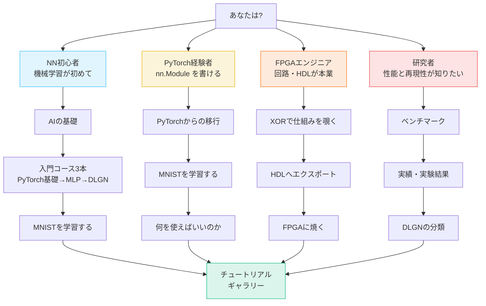

このサイトはページが 80 以上ある。**全部を順に読む必要はない**。
あなたの出発点によって最短経路が違うので、このページで
「**どこから読み、次に何を読むか**」だけを決めてほしい。

:::tip[3秒で決める]
- 機械学習が初めて → [AIの基礎](/explanation/ai-basics/)
- PyTorch を書ける → [PyTorchユーザーのための対応表](/guides/from-pytorch/)
- FPGA / 回路の人 → [付録: XORで仕組みを覗く](/tutorials/xor/)
- 研究者・性能が知りたい → [ベンチマーク](/reference/benchmarks/)
:::

## 4つの経路

### 経路A: NN初心者(機械学習が初めて)

論理ゲート NN は「普通の NN の重みが真理値表になったもの」なので、
まず **普通の NN の言葉**(層・損失・勾配)を持っておくと以降が全部速くなる。

| 順 | 読むもの | ここで分かること |
|---|---|---|
| 1 | [AIの基礎](/explanation/ai-basics/) | ニューラルネットとは何か、学習とは何をしているのか |
| 2 | [入門1. NNとPyTorchの基礎](/tutorials/nn-basics/) | テンソル・自動微分・学習ループを手を動かして一周する(DLGN は出てこない) |
| 3 | [入門2. PyTorchでMLPを組む](/tutorials/pytorch-mlp/) | `nn.Linear` 3枚で MNIST を解き、実数の重みを目で見る |
| 4 | [入門3. MLPをDLGNへ置き換える](/tutorials/mlp-to-dlgn/) | 同じ学習ループのまま `LutLayer` / `GroupSum` へ置き換える |
| 5 | [基本コンセプト](/getting-started/concepts/) | soft/hard・LutLayer・GroupSum・IR・HDL の5概念 |
| 6 | [インストール](/getting-started/installation/) → [クイックスタート](/getting-started/quickstart/) | 手元で動かす |
| 7 | [1. MNISTを学習する](/tutorials/mnist/) | 論理ゲート4000個が手書き数字を読む |
| 8 | [付録: XORで仕組みを覗く](/tutorials/xor/) | 16ゲートの最小構成で中身を全部見る |

:::tip[入門コースは3本セット]
2〜4 は「PyTorch の基礎 → 小さな MLP → 同じ問題を DLGN へ」と続く3本組で、
どれも CPU で数分。読み物で済ませたい場合は
[AIの基礎](/explanation/ai-basics/) と [NNからDLGNへ](/explanation/nn-to-dlgn/) だけでも先へ進める。
:::

### 経路B: PyTorch経験者

**このライブラリは普通の PyTorch である**(`nn.Module`・`loss.backward()`・`torch.optim`)。
だから覚えることは「差分」だけで済む。最大の落とし穴は `model.eval()` の意味の違い。

| 順 | 読むもの | ここで分かること |
|---|---|---|
| 1 | [PyTorchユーザーのための対応表](/guides/from-pytorch/) | `nn.Linear`→`LutLayer`、`model.eval()` の意味の違い |
| 2 | [1. MNISTを学習する](/tutorials/mnist/) | 最短で動く実例 |
| 3 | [何を使えばいいのか](/guides/choosing/) | アーキテクチャ・パラメータ化・fan-in・学習則の4択を決める |
| 4 | [学習を回す](/guides/training/) / [学習曲線の読み方](/guides/training-curves/) | CLI と Python API、soft/hard の読み分け |
| 5 | [チュートリアルギャラリー](/tutorials/) | 自分のモデルに近い例を探す(下の対応表も参照) |

### 経路C: FPGAエンジニア・回路設計者

学習の話より先に「**出てくる Verilog がどんな回路か**」を見たほうが早い。
最小の XOR から入り、IR(JSON)を経由して HDL が出るまでを一気に辿る。

| 順 | 読むもの | ここで分かること |
|---|---|---|
| 1 | [付録: XORで仕組みを覗く](/tutorials/xor/) | 16ゲートの回路が学習で決まる様子 |
| 2 | [3. HDLへエクスポート](/tutorials/hdl-export/) | IR 抽出 → Verilog/VHDL 生成 → 等価性検証 |
| 3 | [IRを扱う](/guides/ir/) / [IRスキーマ](/reference/ir-schema/) | 真実源である IR の構造 |
| 4 | [FPGAに焼く](/guides/fpga/) | Tang Nano 20K / DE0-CV で実機動作まで |
| 5 | [5. CNNのHDLエクスポート](/tutorials/cnn-hdl-export/) / [7. 通しチュートリアル](/tutorials/full-pipeline/) | 実用規模の回路を出す |

### 経路D: 研究者・性能を評価したい人

「どこまで出るのか」「何と比べたのか」を先に確認してから、理屈へ降りるのが速い。

| 順 | 読むもの | ここで分かること |
|---|---|---|
| 1 | [ベンチマーク](/reference/benchmarks/) | 実測の精度・速度 |
| 2 | [論文再現と改善](/explanation/results/dlgn-repro/) | difflogic 論文の再現状況 |
| 3 | [アーキテクチャ横断の到達点](/explanation/results/architecture-survey/) | 各アーキテクチャで何%まで出たか |
| 4 | [離散化ギャップ](/explanation/results/discretization-gap/) / [パラメータ化を決めた実験](/explanation/results/parameterization-study/) | soft→hard で落ちる量と、その対策 |
| 5 | [DLGNの分類と系譜](/explanation/taxonomy/) / [LutLayerの数理](/explanation/lut-layer/) | 3系統の違いと勾配の中身 |

---

## 一般名 → このサイトのチュートリアル

「**RNN のチュートリアルはあるか?**」に答えるための対応表。
本サイトのチュートリアル名はモデルの通称(LSTM・WaveNet 等)で付いているので、
一般的なアーキテクチャ名から引けるようにしてある。

| 探しているもの(一般名) | このサイトでの入口 |
|---|---|
| **MLP / 全結合ネットワーク** | [1. MNISTを学習する](/tutorials/mnist/)(`LutLayer` の積み重ね)、[付録: XOR](/tutorials/xor/) |
| **CNN / 畳み込み** | [5. CNNのHDLエクスポート](/tutorials/cnn-hdl-export/)、[物体検出(CenterNet)](/tutorials/detection/)、[U-Net](/tutorials/logic-unet/) |
| **RNN / 再帰型ネットワーク** | [RNN: LSTM / GRU](/tutorials/logic-lstm/)、[RNNでseq2seq](/tutorials/rddlgn-seq2seq/)、[リザバー計算](/tutorials/logic-reservoir/) |
| **LSTM / GRU / ゲート付きRNN** | [ゲーティングはブール演算である](/tutorials/logic-lstm/) |
| **seq2seq / encoder-decoder** | [RNNだけで作るseq2seq(RDDLGN)](/tutorials/rddlgn-seq2seq/) |
| **Reservoir Computing / ESN** | [回路を学習しないという選択](/tutorials/logic-reservoir/) |
| **Transformer / GPT / LLM** | [論理ゲートGPT](/tutorials/logic-gpt/)、[Transformerの論理化の梯子](/tutorials/logic-ladder/) |
| **Attention / self-attention** | [Attentionの4変種ツアー](/tutorials/attention-tour/)、[Transformerの論理化の梯子](/tutorials/logic-ladder/) |
| **TCN / 因果畳み込み / dilated conv** | [WaveNet(因果CNN)](/tutorials/logic-wavenet/) |
| **ResNet / 残差接続** | [論理NNの残差接続は恒等を厳密に作れる](/tutorials/logic-resnet/) |
| **U-Net / セグメンテーション / 密予測** | [論理ゲートU-Netで画素ごとに答える](/tutorials/logic-unet/) |
| **MLP-Mixer / token mixing** | [LogicMixer(MLP-Mixer)](/tutorials/logic-mixer/) |
| **VAE / オートエンコーダ / 表現学習** | [画像を96ビットに畳む — 二値潜在VAE](/tutorials/logic-vae/) |
| **GAN / 敵対的生成** | [乱数ビット列から画像を作る(LogicGAN)](/tutorials/logic-gan/) |
| **拡散モデル / Diffusion** | [拡散モデルを丸ごとブール回路にする](/tutorials/logic-diffusion/) |
| **物体検出 / YOLO・CenterNet系** | [乗算器ゼロの物体検出](/tutorials/detection/) |
| **テキスト分類 / n-gram / 文書分類** | [論理ゲート版TextCNN](/tutorials/textcnn/) |
| **BNN / 二値化ニューラルネット / WNN** | [DWN(温度計符号化)](/tutorials/dwn/)、[BinaryBrain互換API](/tutorials/binarybrain/) |
| **転移学習 / 既存モデルの一部だけ置換** | [2. ハイブリッドNNを作る](/tutorials/hybrid/) |
| **backprop以外の学習則(DFA / feedback alignment / ES)** | [6. 学習則(DFA/AP)](/tutorials/learning-rules/)、[学習則の解説](/explanation/learning-rules/) |

:::note[名前が違うのは意図的ではない]
論理ゲート NN では「LSTM の忘却ゲートが 2:1 マルチプレクサになる」のように、
**元のアーキテクチャの部品がそのままブール演算に対応する**。
チュートリアル名がその発見を主題にしているため一般名から離れているが、
中身は上表のとおり素直な RNN / CNN / Transformer である。
:::

## 目的から引く(逆引き)

| やりたいこと | 行き先 |
|---|---|
| とにかく動かす | [クイックスタート](/getting-started/quickstart/) |
| どの構成を選ぶか決める | [何を使えばいいのか](/guides/choosing/) |
| 学習が収束しない・精度が出ない | [トラブルシューティング](/guides/troubleshooting/) |
| soft は良いのに hard で崩れる | [離散化ギャップ](/explanation/results/discretization-gap/) |
| 回路にして FPGA へ載せる | [HDLエクスポート](/guides/hdl-export/) → [FPGAに焼く](/guides/fpga/) |
| ブラウザで構造を組み替える | [ビジュアルエディタ](/guides/editor/) |
| 引数・型を調べる | [Python API](/reference/api/) |
| 用語が分からない | [用語集](/explanation/glossary/) |

## 次に読む

- [チュートリアルギャラリー](/tutorials/) — 実行済み27本をサムネイルから選ぶ
- [何を使えばいいのか](/guides/choosing/) — 4つの選択を1ページで決める
- [DLGNとは](/explanation/dlgn/) — なぜ論理ゲートを直接学習するのか
- [よくある質問](/explanation/faq/) — 「本当に GPU なしで動くのか」等
