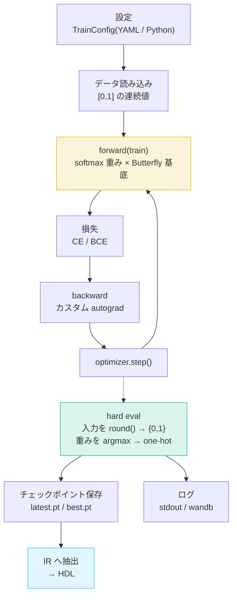
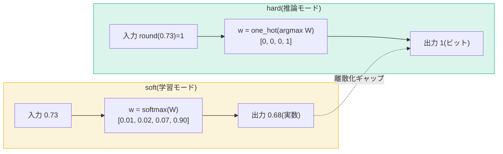

微分可能論理ゲートネットワークの学習は、**連続緩和した回路を勾配降下で最適化し、
最後に離散化して純粋な Boolean 回路に落とす** という流れをとる。
このページはその「回す側」の手順をまとめる。

:::note[このページで分かること]
1. **2つの入口** — 設定 YAML で回す `griffith train`(CLI)と、`TrainConfig` + `run_training()`(Python API)の使い分け
2. **主要ハイパーパラメータの相場** — 学習率・温度 τ・ニューロン数 k・層数・エポック数の実測ベースの目安
3. **soft 精度と hard 精度** — なぜ 2 つ報告されるのか、その差(離散化ギャップ)が何を意味するのか
:::

## 学習の全体フロー

学習ループそのものは通常のニューラルネットと変わらない。特有なのは
**「学習中の重みは確率分布、評価時の重みは 1 エントリだけの真理値表」** という二面性である。



上段(黄)が **soft = 学習モード**、下段(緑)が **hard = 推論モード**。
学習は soft でしか進まないが、**成績表として意味があるのは hard の方** である。

## 経路A: CLI で回す(`griffith train`)

再現性が要るとき、掃引を回すとき、クラウドへ投げるときはこちら。
設定は YAML に書き、細かい変更はコマンドラインのドット記法で上書きする。

```bash
# レシピをそのまま実行
uv run griffith train configs/recipes/dlgn_mnist_quick.yaml

# 一部だけ上書き(YAML は書き換えない)
uv run griffith train configs/recipes/dlgn_mnist_quick.yaml optim.lr=0.02 model.k=4000

# 期待メトリクス未達なら非0で終了(CI・自動化フロー向け)
uv run griffith train --strict configs/recipes/dlgn_mnist_quick.yaml
```

レシピ YAML はそのまま `TrainConfig` の構造に対応する。

```yaml
# configs/recipes/dlgn_mnist_quick.yaml
data:
  name: mnist
  batch_size: 128
model:
  kind: dlgn          # Flatten + LutLayer×layers + GroupSum
  k: 2000             # 1層あたりのニューロン(ゲート)数
  layers: 3           # LUT 層数
  n_inputs: 2         # 1ゲートの入力数(2 / 4 / 6)
  parameterization: softmax
  tau: 10.0           # GroupSum 温度
optim:
  name: adam
  lr: 0.01
run:
  epochs: 3
  seed: 42
  wandb: true
expected_metrics:     # 成功基準の数値化
  hard_acc_min: 0.90
```

| フラグ | 用途 |
|---|---|
| `config`(位置引数) | 設定 YAML のパス。省略すると既定値から始まる |
| `overrides`(可変長) | `model.k=8000` のようなドット記法の上書き |
| `--from-run DIR` | 既存 run の `config.yaml` を読み直して再実行する |
| `--out-dir DIR` | 出力先(既定 `outputs/<timestamp>_<run名>`) |
| `--strict` | `expected_metrics` 未達で非0 exit |

:::tip[再実行はディレクトリを指すだけ]
ランナーは実行時に**解決済みの設定**を `outputs/<run>/config.yaml` へ保存する。
同じスキーマなので `uv run griffith train outputs/<run>/config.yaml` でそのまま完全再現できる。
:::

出力されるディレクトリの中身:

```
outputs/20260903_120000_dlgn_mnist/
├── config.yaml            # 解決済み設定(再実行可能)
└── checkpoints/
    ├── latest.pt          # 最新
    └── best.pt            # hard acc が最良だった時点
```

### 配線・GroupSum・conv-DLGN のキー

既定値のままなら従来どおり固定ランダム配線の全結合 DLGN になる。構造を変えるキーは次のとおり。

| キー | 値 | 意味 |
|---|---|---|
| `model.connections` | `random` / `unique` / `{kind: ...}` | 配線。`kind` は `rot`(`s_a` / `s_b` と歩進 `step` の層ごとリスト)/ `perm` / `random_seeded` / `random_uniform` / `butterfly`(`strides` / `order`)/ `local1d`(`strides`)/ `local2d`(`grid` / `bits_per_cell` / `layer0_offsets` / `assign`)/ `per_layer`(各層に `rot` / `stretched_rot` / `perm` / `random_*` / `rot_n` / `butterfly` / `local1d` / `local2d`)。構造化配線は `dedupe: true` で重複ピンを潰せる |
| `model.group_assign` | `contig` / `stride` | GroupSum のクラス割当(ニューロン i → クラス i // m か i mod k)。IR では stride が転置 + group_sum になる |
| `model.estimator` | `sigmoid` / `sin` | `parameterization: independent` のエントリ確率の推定器(`sin` が論文 IWP。`residual_init: true` で Ω 空間の残差初期化) |
| `model.kind: conv_dlgn` + `model.conv` | `in_shape` / `channels` / `sampler`(`random` / `random8` / `cross5` / `dilated8` / `checker13`)/ `downsample`(`orpool` / `stride`)/ `head_dims` / `head_wiring`(`rot2` / `random` / `unique`) | 重み共有の論理ゲート木 conv + OR プール + 全結合頭部(cdlgn 型)。入力は画像テンソルのまま受け、IR は `export_ir(..., input_shape=in_shape, native_conv=True)` |

レシピ例: `configs/recipes/conv_dlgn_cifar10_s.yaml`(CIFAR-10、較正アンカー)、`configs/recipes/conv_dlgn_mnist_quick.yaml`(手元 1 エポックのスモーク)。

### 未知キーは即エラーになる

設定は pydantic の `extra='forbid'` で検証される。`model.kk=2000` のようなタイポは
学習が始まる前にバリデーションエラーになるので、**3時間回してから設定ミスに気づく事故が起きない**。

## 経路B: Python API で回す(`run_training`)

ノートブックから呼びたいとき、掃引を自前のコードで組みたいとき、
結果の辞書をそのまま後段の処理に渡したいときはこちら。

```python
from griffith_logic.training.config import TrainConfig, load_config
from griffith_logic.training.runner import run_training

# 1) Python オブジェクトから組み立てる
cfg = TrainConfig.model_validate({
    'data':  {'name': 'mnist', 'batch_size': 128},
    'model': {'kind': 'dlgn', 'k': 2000, 'layers': 3,
              'n_inputs': 2, 'parameterization': 'softmax', 'tau': 10.0},
    'optim': {'name': 'adam', 'lr': 0.01},
    'run':   {'epochs': 3, 'seed': 42},
})

# 2) YAML + オーバーライドから組み立てる(CLI と完全に同じ経路)
cfg = load_config('configs/recipes/dlgn_mnist_quick.yaml',
                  overrides=['optim.lr=0.02', 'model.k=4000'])

result = run_training(cfg, out_dir='outputs/my_run')
print(result['hard_acc'], result['best_hard_acc'], result['final_loss'])
```

`run_training()` の返り値は辞書で、少なくとも次を含む。

| キー | 意味 |
|---|---|
| `hard_acc` | 最終エポックの離散化精度(**回路としての性能**) |
| `best_hard_acc` | 学習を通じた hard acc の最良値 |
| `final_loss` | 最終ステップの損失 |
| `steps` | 総ステップ数 |
| `out_dir` / `checkpoint_latest` / `checkpoint_best` | 成果物のパス |
| `expected_metrics` | 期待メトリクスの照合結果(`{'ok': bool, 'checks': [...]}`) |

### 2経路の使い分け

| | `griffith train`(CLI) | `run_training()`(API) |
|---|---|---|
| 設定の出どころ | YAML + ドット記法 | `TrainConfig` オブジェクト |
| 向いている場面 | 再現・掃引・クラウド投入・CI | 解析、ノートブック、自作ループへの組み込み |
| 結果の受け取り | stdout / `outputs/` / wandb | 返り値の辞書 |
| 内部 | 同じ `run_training()` を呼ぶだけ | — |

**CLI は API の薄いラッパ**なので、どちらを選んでも学習の中身は完全に同一である。

## 主要ハイパーパラメータ

### 相場表

MNIST 系(28×28、10クラス)を基準にした実測ベースの目安。

| パラメータ | 記号/キー | 相場 | 効き方 |
|---|---|---|---|
| 学習率 | `optim.lr` | **0.01**(Adam)。`independent` 系や深い直列展開では 0.1〜0.3 まで上げる | 小さすぎると全ゲートが初期値付近で固まる |
| GroupSum 温度 | `model.tau` | **10**(k=8000, 6層, MNIST)。CIFAR 系は 100 前後 | ロジットのスケール。大きすぎると勾配が痩せる |
| ゲート数 | `model.k` | 2,000(スモーク)〜 64,000(論文再現) | 回路容量。増やすほど精度は上がり面積も増える |
| 層数 | `model.layers` | **6**(MNIST 論文水準)。3〜4 は短時間検証向け | 深いほど表現力は上がるが勾配が減衰しやすい |
| ゲート入力数 | `model.n_inputs` | 2 / 4 / 6 | → [パラメータ化を選ぶ](/guides/parameterization/) |
| エポック数 | `run.epochs` | 3(スモーク) / 50(標準) / 200+(論文再現) | 離散化ギャップは学習量とともに縮む |
| バッチサイズ | `data.batch_size` | 100〜128 | 大きくすると 1 エポックのステップ数が減る点に注意 |

### τ(GroupSum 温度)は精度に直接効く

`GroupSum` はニューロン出力をクラスごとに合計して τ で割るだけの層だが、
**τ の選び方だけで 1pt 級の差が出る**。

$$
\text{logit}_c = \frac{1}{\tau}\sum_{i \in \text{group}_c} y_i
$$

MNIST・6層・k=8000 での実測では、経験則 $\tau=\sqrt{k/C}\approx 28.3$ よりも
**固定値 τ=10 の方が約 1.0pt 高い**。まず 10 前後から試し、
損失が下がらない・ロジットが飽和する場合だけ動かすのが安全である。

### 学習量の目安

| 規模 | 設定例 | 所要 | 用途 |
|---|---|---|---|
| スモーク | `logic_xor.yaml`(k=16, 2層, 10ep, CPU) | 数秒 | 実装が壊れていないかの確認 |
| クイック | `dlgn_mnist_quick.yaml`(k=2000, 3層, 3ep) | 数分 | 設定変更の効き目を見る |
| 標準 | k=16,000 / 6層 / 50ep | 数分〜数十分(GPU) | 実験の主戦場。hard 97%台 |
| 論文再現 | k=64,000 / 6層 / 200ep〜 | 時間単位 | → [クラウドGPU](/guides/cloud-gpu/) |

## soft と hard — 2つの精度を読む

訓練スクリプトは毎回 2 種類の精度を報告する。この 2 つは**別々のモデルの成績**だと思ってよい。

| 表示 | `model.training` | 入力 | LUT 重み | 意味 |
|---|---|---|---|---|
| `test_acc(soft)` | `True` | 連続値 [0,1] | `softmax(W)`(全 $2^N$ エントリに配分) | 連続近似がどれだけフィットしているか |
| `test_acc` (hard) | `False` | `round()` で {0,1} | `one_hot(argmax(W))`(1エントリのみ) | **論理回路としての真の性能** |

内部で起きていることを並べるとこうなる。



通常は `soft > hard` となり、その差を **離散化ギャップ** と呼ぶ。

| ギャップ | 解釈 | 打ち手 |
|---|---|---|
| 0〜0.5pt | 健全。ゲートが特定のエントリに十分収束している | そのまま |
| 1pt 以上 | 連続近似には効いているが回路になると崩れる | エポックを増やす / パラメータ化を見直す |
| soft も低い | そもそも学習できていない | lr・τ・容量(k, 層数)を疑う |

実測例(MNIST・6層・50ep): softmax N=2 は soft 98.30% / hard 97.74%(ギャップ 0.56pt)。
学習量を増やすとゲートが一点に収束していくため、ギャップは自然に縮む傾向がある。

### 学習済みチェックポイントを hard 評価する

```bash
uv run griffith eval outputs/20260903_120000_dlgn_mnist/checkpoints/best.pt
```

モデル構成はチェックポイント内の設定から復元されるので、
評価時に構造を指定し直す必要はない。`--dataset` を渡せば別データでの評価もできる。

## つまずきどころ

| 症状 | 原因 | 対処 |
|---|---|---|
| 損失が初期値から動かない | 学習率が低すぎる。深い直列構成では特に起きる | `optim.lr` を 0.1〜0.3 まで上げて切り分ける |
| soft は高いが hard が大きく落ちる | 離散化ギャップ。学習量不足かパラメータ化の不一致 | エポック増 / [パラメータ化を選ぶ](/guides/parameterization/) |
| 精度が論文値に届かない | τ・接続方式・評価対象データ数の乖離であることが多い | τ を公式レシピ値へ、評価はテスト全件で行う |
| 設定変更が効いていない気がする | YAML を直したつもりで別ファイルを読んでいる | `outputs/<run>/config.yaml`(解決済み設定)を確認する |
| 学習は進むのに HDL に落ちない | 論理層以外(実数を返す層)が混ざっている | → [HDLエクスポート](/guides/hdl-export/) |

## 次に読む

- [パラメータ化を選ぶ](/guides/parameterization/) — `n_inputs` と `parameterization` の決め方
- [学習曲線の読み方](/guides/training-curves/) — soft/hard 曲線から何を診断するか
- [IRを扱う](/guides/ir/) — 学習結果を IR(JSON)へ落として検証する
- [クラウドGPU](/guides/cloud-gpu/) — 大規模学習をクラウドへ投げる
- [griffith CLI リファレンス](/reference/cli/) — 全サブコマンド・全フラグ
