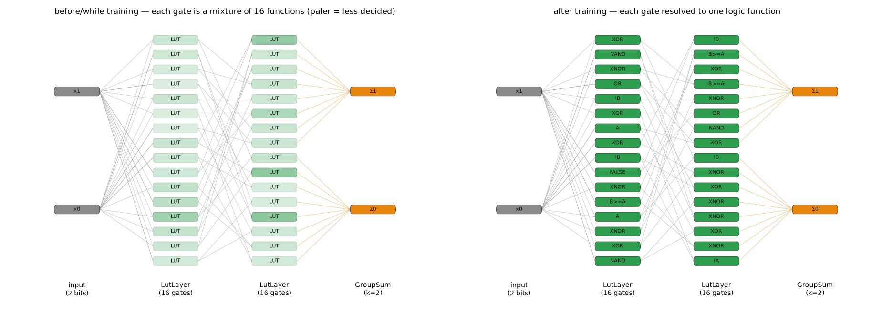
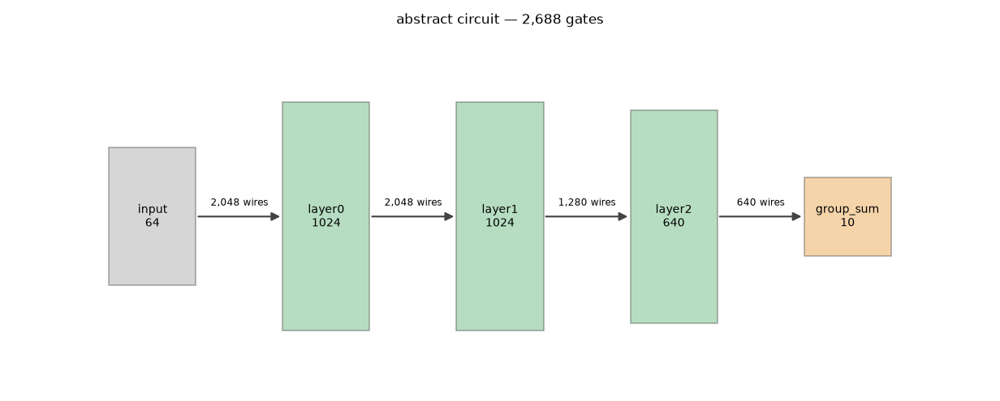

書いたコードが実際にはどんな回路なのかを、そのまま図にするためのモジュールが
`griffith_logic.analysis.circuit_viz` である。用途はふたつ。

- **コードと回路を対応づける** — `LutLayer(2, 16)` の1行が「16個のゲートと、そこへ入る配線」であることを見る
- **学習の進み具合を回路として見る** — 各ゲートが16種の論理関数のどれに決まったのか(まだ決まっていないのか)を見る

matplotlib を使うので `figures` extra が要る。

```bash
uv sync --extra cpu --extra figures
```

## 使い方: 学習前と学習後を並べる

`plot_circuit()` の引数は実質 `resolve` の1つだけ。学習前(混合)と学習後(確定)を
同じ関数で描き分ける。

```python
import copy
import matplotlib.pyplot as plt
import torch.nn as nn

from griffith_logic import GroupSum, LutLayer
from griffith_logic.analysis.circuit_viz import plot_circuit

model = nn.Sequential(
    LutLayer(2, 16, n_inputs=2),
    LutLayer(16, 16, n_inputs=2),
    GroupSum(k=2, tau=2.0),
)
model_init = copy.deepcopy(model)   # 学習前のスナップショット

...  # ここで学習する

fig, axes = plt.subplots(1, 2, figsize=(17, 6))
plot_circuit(model_init, resolve=False, ax=axes[0])  # 学習前: 混合
plot_circuit(model.eval(), resolve=True, ax=axes[1])  # 学習後: ゲート名が確定
fig.savefig('circuit.png', dpi=110)
```



| モード | ノードの表示 | 読み方 |
|---|---|---|
| `resolve=False` | `LUT`(名前は付かない) | 塗りの濃さ = ゲート分布の確定度(`1 - H/ln 16`)。**薄い = まだどの論理関数か決まっていない**。学習前は一面が薄く、学習が進むほど濃くなる |
| `resolve=True` | `AND` / `XOR` / `NAND` / `!A` / `A>=B` … | argmax で確定した16種の論理関数の名前。**この名前のゲートがそのまま HDL に焼かれる** |

配色はプロジェクト共通の記法に合わせている。

- **緑** — 論理ゲート(`LutLayer` のニューロン)
- **橙** — 実数部(`GroupSum` のクラススコアと、そこへ集約される配線)
- **灰** — 入力ビットと配線

## ゲート名は HDL と同じものを指す

`resolve=True` のラベルは、`plot_circuit` が独自に付けた名前ではない。
`truth_tables_from_lut_layer`(`griffith_logic/export/discretize.py`)—— `export_ir()` が
IR(真実源)を作るときに通す唯一の離散化経路 —— から真理値表を取り、
それを16ゲートID → 名前へ写している(ビジュアルエディタの
`GATE_NAMES` と同一定義)。したがって

> 図に `XOR` と書かれたノード = IR の当該ニューロン = 生成 Verilog のその1行

が保証される(`tests/test_circuit_viz.py` が IR の真理値表とラベルの一致を検査している)。
`n_inputs > 2` の LUT には16ゲート名が無いので、真理値表の16進表記(`LUT:9a` など)を表示する。

## 大きな網は俯瞰図へ落ちる

ゲート総数が `MAX_FULL_GATES`(256)を超えると、全ノードを描いても潰れるだけなので
`plot_circuit()` は自動的に俯瞰図へフォールバックする(`plot_abstract()` を直接呼んでもよい)。
層を箱(高さ ∝ log(幅))、層間を本数付きの矢印で表す。



```python
from griffith_logic.analysis.circuit_viz import plot_abstract

plot_abstract(model)                       # 明示的に俯瞰図
plot_circuit(model, auto_abstract=False)   # 巨大でも全ゲートを描く(潰れる覚悟で)
```

## チュートリアルで動かす

[通しチュートリアル](/tutorials/full-pipeline/)と[XORチュートリアル](/tutorials/xor/)に、
学習前後の回路図を並べて出すセルが入っている(ページ中の図は実際に実行された出力)。

## 入力バイパス構成の配線図(実験系)

`plot_circuit` は「入力 → LutLayer の直列 → GroupSum」という素直な構成を対象にしている。
これに対し、隠れ層の入力が `concat([h_prev, x, o_0, ...])` というプールになる
**入力バイパス(IALGN型)** 構成の配線分布を、インデックス範囲の分解として集計・描画する
`analysis/wiring_viz.py` が実験ブランチ `experiment/wiring-viz` にある
(`circuit_viz` の配線抽出と俯瞰図はこれを移植元にしている)。そちらでは配線の色が
接続の種類を表す。

- **灰** — 直列(直前の層から)
- **赤** — 入力側からのバイパス(元入力、および実数→ビットの二値化界面)
- **青** — 中間層からのバイパス

「層が深くなるほどバイパスが元入力と過去の中間層へ分散していく」といった性質は、
矢印の太さの変化として俯瞰図で読める。main への統合時に本ページへ統合する。

## 構造化配線も同じ図で見える

配線は IR の `indices` 表にしか残らないので、学習前に式で決める**構造化配線**も同じ図で見られる。
レシピの `model.connections.kind` には乱択(`random_seeded` / `random_uniform` / `perm`)と規則配線
(`rot`(歩進 `step` 付き)/ `stretched_rot`)のほかに、`butterfly`(循環 radix-N バタフライ。
層 0 は gather、層 l は stride N^(l−1))、`local1d`(比例写像した中心 + ストライド)、
`local2d`(画像格子とトーラス格子の近傍。層 0 は `grid` × `bits_per_cell`、隠れ層は ring 列を
`assign` で割当)がある。層ごとに混ぜるときは `kind: per_layer` の各要素に
`rot_n` / `butterfly` / `local1d` / `local2d` を書く。生成器は `griffith_logic.core.connections`
(`get_butterfly_connections` / `get_local1d_connections` / `get_local2d_connections` /
`get_rot_n_connections`)で、被覆率・使用回数は `connection_stats` で確かめられる。

## 関連

- [DLGNとは何か](/explanation/dlgn/) — 配線が固定ランダムであることの意味
- [ビジュアルエディタ](/guides/editor/) — IR グラフを対話的に見る別経路
- [HDLへエクスポート](/tutorials/hdl-export/) — 図のゲートが回路になるまで
