`griffith deploy` は、あなたのモデルを配るまでの途中で、いくつもの圧縮と最適化を行う。
このページはそれを **1 か所に全部並べた一覧** である。「勝手に何をされているのか」「切りたいときはどうするか」「本当に効くのか」がここで分かる。
使い方そのものは [デプロイキット クイックスタート](/guides/deploy-quickstart/)、モデルを用意する手順は [デモモデルを用意する](/guides/deploy-models/)、
GPU は [GPU へデプロイする](/guides/deploy-gpu/)、ブラウザは [ブラウザへデプロイする](/guides/deploy-web/) を参照。コマンドの全オプションは [CLI リファレンス](/reference/cli/)、バンドルの形式は [配布バンドル仕様](/reference/deploy-bundle/) にある。

:::note[まず安心してよいこと]
ここに載っているものは、**出力の整数値を変えない** ように作られている(学習済みモデルの精度は落ちない)。
変換のたびに、元の IR の `ir/simulate.py` と整数で突き合わせて確かめ、1 つでも違えば止まるか、その最適化だけを捨てる。
遅くなる実測が見つかったものは、既定では OFF にして「条件を満たしたときだけ自動 ON」か「自分で明示したときだけ ON」にしてある。
:::

## 一目でわかる表

まず全体の流れを 1 枚で示す(上から下へ進む)。箱の中の数字は、実在する 3 つのモデル(XOR / HAR k6000 / 顔検出)のゲート数が各段でどう減るかの実測である。

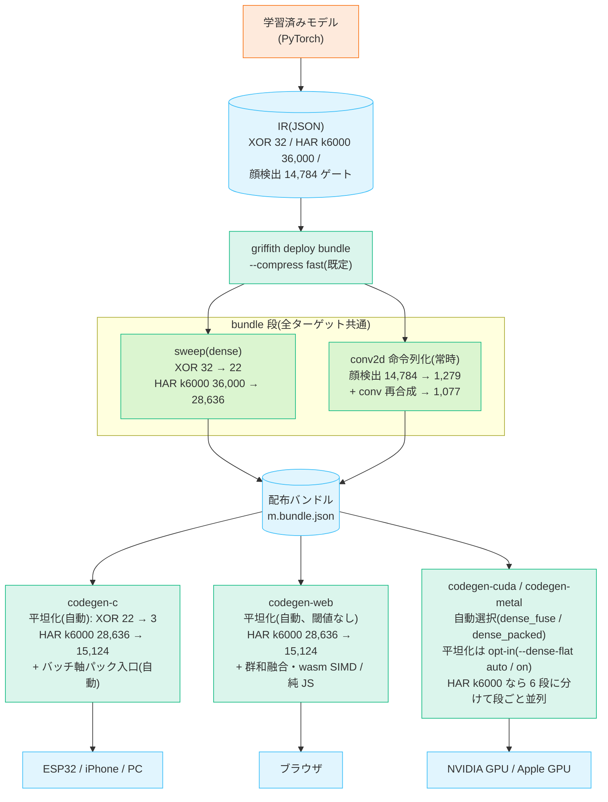

「段」は、変換がどこで起きるかを表す。`bundle` は配布バンドルを作る段(全ターゲット共通)、`codegen-*` は各ターゲット向けのコードを作る段である。
既定の欄の「自動」は、条件を満たすときだけ入るという意味。

### バンドル段と C 生成段

| 最適化(段) | 何をするか | 既定 | 変える・切る | 実測の効果 |
|---|---|---|---|---|
| conv2d 命令列化(`bundle`) | conv2d のゲートの木を、自明なゲートを畳んだ命令列に直す | 常に ON | 切れない(IR は変わらない) | 顔検出 14,784 → 1,077 ゲート。実モデルで 59.7〜95.1% 減 |
| sweep(`bundle`) | dense の定数・重複(CSE)・未参照ゲートを除く | 自動(dense のとき) | `--no-sweep` / `--compress none` | XOR 32 → 22、HAR k6000 36,000 → 28,636 |
| conv 再合成(`bundle`) | conv2d の木を、より少ないゲートで作り直す | 自動(conv2d のとき) | `--compress none`。深く探索するなら `--compress max` | 顔検出 1,279 → 1,077(1.2 秒)。速度は変わらない |
| 平坦化の焼き込み(`bundle`) | dense を平坦ネットリスト(`lut_flat`)にして IR に焼く | OFF | `bundle --dense-flat`(明示のみ) | 焼いた `lut_flat` は C / Web / CUDA / Metal のすべてで動く。各 `codegen-*` が生成時に自動で判定するので、通常は焼かなくてよい |
| 前処理の整数化(`bundle`) | 入力の符号化を整数だけの記述子にする | 対応する前処理のとき常に ON | 切れない | 前処理が浮動小数点ゼロで動く |
| 平坦化(`codegen-c`) | dense をパススルー・定数を除いた平坦ネットリストにして C を出す | 自動(削減率 25% 以上) | `--dense-flat off` / `on` / `--dense-flat-min-reduction R` | ESP32 の HAR k6000 は 26.60 → 12.69 ms(sweep と併用) |
| バッチ軸パック入口(`codegen-c`) | 32 枚を 1 ワードに詰めて同時に流す入口を足す | 自動(平坦化したとき) | `--dense-batch 0` / `--dense-batch N` | 32 枚で 1 枚ずつの 1.7〜5.9 倍のスループット |
| ビットスライス層カーネル(`codegen-c`) | 種類の違う 32 ゲートを 1 組の演算で処理する | 常に ON(平坦化しない dense) | `--dense-flat on` で平坦化に置き換える | HAR k6000 で 2.18 倍(1 コンテキスト) |
| 添字の 16 ビット化(`codegen-c`) | 添字表を `uint16_t` にして重みを小さくする | 自動(入力幅 65,536 以下) | 切るフラグなし | 重み(.rodata)33.5〜38.9% 減。速度は変わらない |
| 融合(`codegen-c --fuse`) | ゲート命令列を直線コードに展開する | OFF | `--fuse`(明示のみ) | conv 系で 2〜9% 速い。生成 C は 1.2〜2.3 倍 |
| SIMD(C ランタイム) | NEON / SSE2 / AVX2 を、コンパイル時に自動で選ぶ | 自動 | `-DMDL_NO_SIMD` | 整数出力は SIMD でもスカラーでも完全に同一 |

### GPU と Web

| 最適化(段) | 何をするか | 既定 | 変える・切る | 実測の効果 |
|---|---|---|---|---|
| conv_engine(`codegen-cuda` / `codegen-metal`) | conv2d の実行方式を `split` か `combined` にする | 自動(`split`。1 つでも枠が足りなければ `combined`) | `--conv-engine split\|combined` | `combined` にすると、`split` では生成できないモデル(1.6M ゲート)も生成できる |
| 平坦化(`codegen-cuda` / `codegen-metal`) | dense を平坦ネットリスト(`lut_flat`)にして段ごとに並列実行する | OFF(opt-in。大きいモデルで遅くなるため) | `--dense-flat auto`(削減率 25% 以上で採用) / `on`。`--dense-fuse` / `--dense-packed` 明示時は平坦化しない | Metal(M3)で平坦化しない最良に対して k600 1.02〜1.10 倍、k2400 0.85〜1.15 倍、k6000 は batch 128 以上で 0.47〜0.71 倍(遅くなる) |
| dense_fuse(同上) | 連続する dense 層と末尾の group_sum を 1 つのカーネルにする | 自動(平坦化しないとき〔既定〕で、batch 32 以上・融合できる鎖があるとき) | `--dense-fuse`(明示 ON) / `--no-auto` | batch 32 以上で 1.20〜2.01 倍 |
| dense_packed(同上) | batch 軸を 32 サンプル / ワードに詰める | 自動(平坦化しないときで、batch 128 以上で適格、dense_fuse が入らないとき) | `--dense-packed`(明示 ON) / `--no-auto` | batch 128 で多くのモデルが +10% 以上 |
| decode megakernel(同上) | RDDLGN のデコードを 1 つのカーネルにまとめる | ON(収まるときだけ) | 収まらなければ自動で従来経路に戻る(Python API の `megakernel=False` でも戻せる) | Metal 1.61〜2.10 倍、CUDA 1.71〜2.34 倍 |
| n_streams(同上) | ストリームを重ねて並べる | OFF | `--n-streams N`(明示のみ) | モデル次第で遅くなる実測があるため自動 ON にしない |
| conv_codegen(同上) | conv2d ごとの専用カーネルを生成する | OFF | `--conv-codegen`(明示のみ) | e2e はほぼ同じで、生成コードは 1.78〜6.65 倍になる |
| エンジン選択(`codegen-web`) | wasm(SIMD)を優先し、使えなければ純 JS にする | 自動 | `loadBundle` の `engine: 'js'` / `'wasm'` | 出力整数は両エンジンで完全一致 |
| 平坦化(`codegen-web`) | dense を平坦ネットリスト(`lut_flat`)にして配る | 自動(2 入力 `lut_layer` の列があれば常に) | `--dense-flat off` / `on` | HAR k6000 の内蔵ブラウザで 1 枚 248 → 28µs(wasm)、32 枚 243 → 6.0µs/枚 |

### 自分のモデルにどれが効くか

上の表を「自分のモデルとターゲット」から逆引きするための図である。dense は 2 入力 `lut_layer` の列、削減率は平坦化したときの実効ゲートの削減率を指す。上から順に答えていけば、既定で自動的に入る最適化と、自分で選ぶもの(C の入口の呼び分け)が分かる。

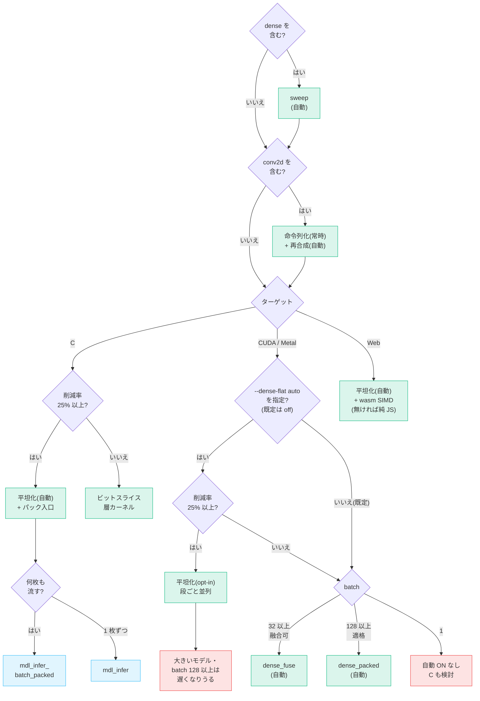

## バンドル段(`griffith deploy bundle`)

`bundle` は、モデルの JSON から **配布バンドル** を作る。バンドルは全ターゲット(C / CUDA / Metal / Web)が共通で読むので、ここで行う圧縮は **全ターゲットに効く**。
レベルは `--compress {none,fast,max}`(既定 `fast`)で選ぶ。モデルが dense でも conv2d でも同じ意味になる。

| レベル | 意味 |
|---|---|
| `none` | IR を書き換える圧縮をしない(圧縮導入前と 1 バイトも変わらない出力) |
| `fast`(既定) | 秒で終わる lossless 削減をすべて行う。dense は sweep、conv2d は再合成(探索上限 4) |
| `max` | `fast` に加えて、探索上限 5 と `ir/simulate` による追加検証を行う(実モデルで分オーダー) |

個別フラグ(`--sweep` / `--no-sweep` / `--resynth lossless`)は **指定すれば `--compress` より優先** される。
適用の順番は 再合成 → sweep(→ 平坦化を焼き込むなら最後)である。

### conv2d の命令列化(常時)

conv2d の重み共有ゲート木は、ゲート数をそのまま持たず、自明なゲート(定数・パススルーなど)を畳んだ **命令列** にしてバンドルの `programs` 節に焼く。
ターゲット側はこの命令列をそのまま実行するだけでよく、縮約を自分で実装しなくて済む。IR は変えない。
どのレベルでも行われ、結果は `about.compress.always` に記録される。

- 効果: 実モデルでゲート数が 59.7〜95.1% 減る(モデル依存)。顔検出では 14,784 → 1,077 ゲート(-92.7%)
- 検証: 書き出す前に、全木の真理値表を全数で照合する。`--no-verify` で省けるが、デバッグ用で通常は使わない

### sweep(dense のみ)

dense(`lut_layer` の列)から、定数に決まるゲート・同じ働きの重複ゲート(CSE)・誰にも使われないゲートを取り除く。
conv2d を含むモデルには掛けず、スキップした理由を `about.compress.skipped` に残す。

- 効果(`gates_before → gates_after`): XOR 32 → 22、HAR k6000 36,000 → 28,636、k600 2,400 → 1,989、MNIST 4,000 → 3,615(-10〜20%)
- 検証: 書き出す前に、ランダム入力(既定 8 件)と、あれば実データ(`demo_samples`)で元の IR と整数一致を確かめる。1 件でも違えば中止する
- 効かないもの: パススルー / NOT ゲートは層から除けない(平坦化の段で畳まれる)

下の図は、[デプロイキット クイックスタート](/guides/deploy-quickstart/)の `examples/06_deploy_c/export_model.py` と同じ手順で学習した XOR 回路に、実際に sweep を掛けた前後である。
左の灰色(定数)と黄色(重複)の 10 ゲートが第 1 層から消え、32 → 22 になる。右の点線の箱は「1 入力のゲート」で、層の形を保つために sweep では残り、後段の平坦化で配線に畳まれる。両側で class 0 / class 1 のスコアが同じことも確かめられる。

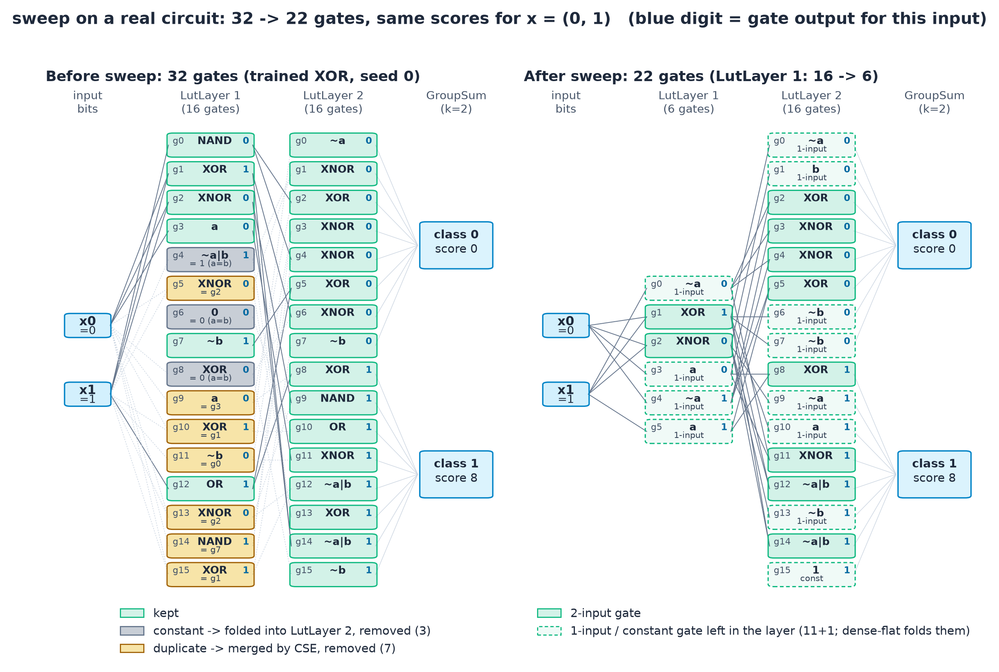

### conv2d の再合成(conv2d のみ)

conv2d の木を、同じ関数を **より少ないゲートで** 作り直す。ゲート数が下限に達している木は探索しない(厳密な下限スキップ)ので速い。

- 効果: 顔検出 1,279 → 1,077 ゲート(-15.8%)を 1.2 秒で(Apple M3。ブラウザデモ用の公開モデル `tools/webbench/public/models/det_face_lut_k256.json` での値。[デモモデルを用意する](/guides/deploy-models/) の顔検出は wandb の別チェックポイントから作るので、命令列化後 2,686 → 再合成後 2,319 と数が違う)。コードサイズ(model.c)-4〜7%、バイナリ -9〜10%、配信サイズはほぼ不変(-0.6〜1.7%)
- **速度(レイテンシ)は変わらない**。効くのはフラッシュが小さい環境
- 検証: `fast` は木ごとの真理値表の全数一致と、ランダム入力・実サンプルの前向き計算。`max` と `--resynth lossless` は `ir/simulate` による照合も加える

下の図は、顔検出モデル(`det_face_lut_k256`)の conv2d ノード `n6_lutconv2d`、出力チャネル 13 の木 1 本を追ったものである。
(a) 学習したままの深さ 3 の木は 7 ゲートだが、パススルーと未使用のゲートを畳むと (b) の 5 命令になり(命令列化)、再合成で (c) の 3 ゲートになる。(d) で 16 通りの入力すべてで 3 つの出力が一致すること、(e) で「入力 4 本に本当に依存する関数は 3 ゲート未満にできない」という下限により、多くの木は探索せずに飛ばせることが分かる。

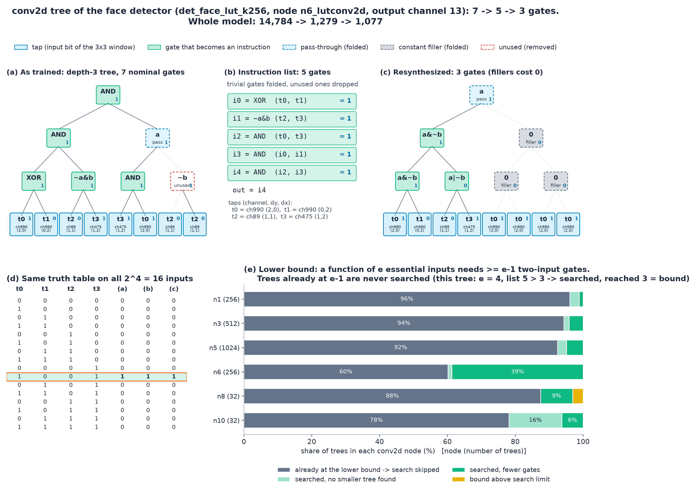

### 平坦化を IR に焼く(任意)

`bundle --dense-flat` は、次節の平坦化を **バンドルの IR に焼き込む** 互換経路である。焼いた `lut_flat` ノードは C / Web / CUDA / Metal のすべてで実行できる(Web と GPU は現在対応)。
通常は不要で、`codegen-c` / `codegen-web` の自動判定に任せればよい(バンドルは全ターゲット共通のまま保たれる)。

### 前処理の整数化(画像入力のみ)

画像入力モデルでは、入力の符号化(`preproc`)を **整数だけの記述子**(`preproc_desc`)にしてバンドルに焼く。
端末側は浮動小数点を使わずに前処理でき、C ランタイムはこの記述子をそのまま実行する。バンドルを読むときに、`preproc` から再構築した記述子との一致も確かめられる(`griffith deploy info --strict`)。

### 失敗したときの扱い(fail-safe)

自動で掛けた圧縮の途中で変換や検証が失敗した場合は、**その圧縮だけを捨てて続行** する(圧縮なしの IR は元から正しい)。
理由は `about.compress.skipped` に残り、警告が標準エラーに出る。`--sweep` や `--resynth lossless` のように **自分で明示したフラグの失敗は、そのままエラー** になる。

## C 生成段(`codegen-c` / `verify-c`)

C ランタイムは依存ゼロの C99 で、実行時のヒープ確保もない。ここでは、C のコードを作るときに入る最適化を挙げる。

### 平坦化 `--dense-flat`(自動)

dense を、パススルー・定数・NOT・重複を畳んだ **平坦ネットリスト**(`lut_flat`)にして、1 ゲート 1 回の表引きで実行する C を出す。
変換は C を作るときに **メモリ上だけ** で行い、バンドルのファイルは変わらない。

- 既定は `auto`。試しに平坦化して、**実効ゲートの削減率が 25% 以上** なら採用し、未満なら従来のカーネルにする。閾値はホスト実測の損益分岐(約 26%)に余裕を見た値
- 対象は 2 入力の `lut_layer` が並ぶ dense。この節は C の話で、Web(`codegen-web`)も既定で平坦化する(閾値なし、下の「Web」節)。CUDA / Metal も `lut_flat` を実行できるが、既定では平坦化しない(opt-in、下の「GPU での平坦化」節)
- 検証: 変換の前後の `simulate` を、ランダム入力 16 本と実データで整数比較してから使う。`verify-c` は元バンドルの `simulate` を基準にするので、この変換が lossless であることの実証にもなる
- 効果: ESP32 の実機で HAR k6000 は 26.60 ms → sweep で 21.17 ms → sweep と平坦化で 12.69 ms(全件スコア一致)。ホストでは、削減率 36.5% で 1.23 倍、55.0% で 1.66 倍、75.0% で 2.52 倍
- **代償**: 作業 RAM(`MDL_CTX_BYTES`)が増える(信号表のぶん。HAR 相当の合成で 12,000 B → 26,800 B)。RAM が厳しいマイコンでは `--dense-flat off`

下の図は、sweep 後の XOR 回路(22 ゲート、左)を平坦ネットリストにした結果(右)である。
左の青い点線(パススルー / NOT)と黄色(重複)はすべて右の信号表への参照になり、実際に計算するゲートは s3〜s5 の 3 つだけが残る。NOT はゲートを使わず、出力参照の極性ビット(赤い線と丸)で表す。

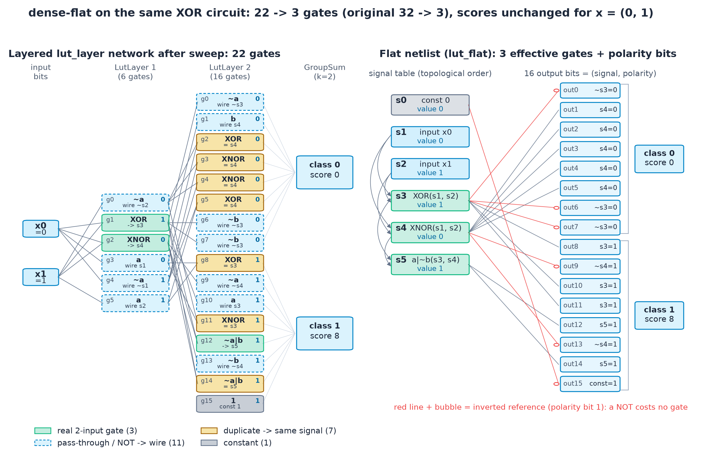

ESP32 実機での効き目は次のとおり。モデルごとに縦軸が違うので、棒の高さは各パネルの中で比べること。どのモデルでも、既定(sweep + 平坦化)が最も速く、整数のスコアは 3 通りとも一致した。

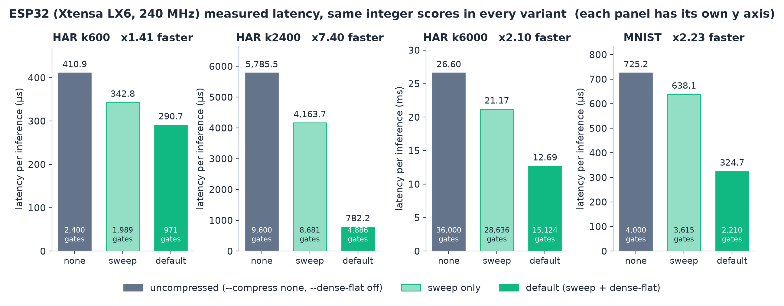

### バッチ軸パック入口 `mdl_infer_batch_packed`(自動)

平坦化を採用したときは、32 枚を 1 ワードに詰めて同時に評価する入口 `mdl_infer_batch_packed` も既定で生成される(`MDL_DENSE_BATCH=32`)。
ホスト(Apple M3)での 32 枚あたりのスループットは、1 枚ずつ流す `lut_flat` の HAR k600 で 1.7 倍、k2400 で 4.1 倍、k6000 で 5.9 倍、MNIST で 5.4 倍だった。
追加の flash は約 0.7KB、作業バッファは呼び出し側が `MDL_DENSE_WORK_BYTES` ぶん用意する。
`verify-c` はこの入口も、1 枚ずつの `mdl_infer` とは別に 33 枚で `simulate` と整数照合する。

下の図は、何をしているかを XOR の平坦ネットリスト(3 ゲート)で示したものである。
32 枚の入力を転置して「1 ワード = 1 つの信号の 32 枚ぶん」にすると、信号表の各ゲートは 32 ビットのワード演算 1 回で 32 枚を同時に計算する。橙の枠はサンプル 5 の列で、上から下まで追うとそのサンプルのスコアになる。

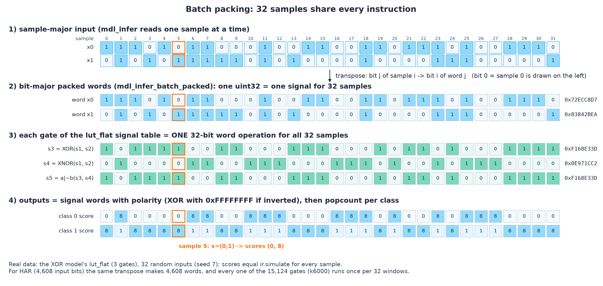

ホスト(Apple M3)で 32 枚を流したときの 1 枚あたりの時間は次のとおり。モデルが大きいほど(信号表が長いほど)効く。

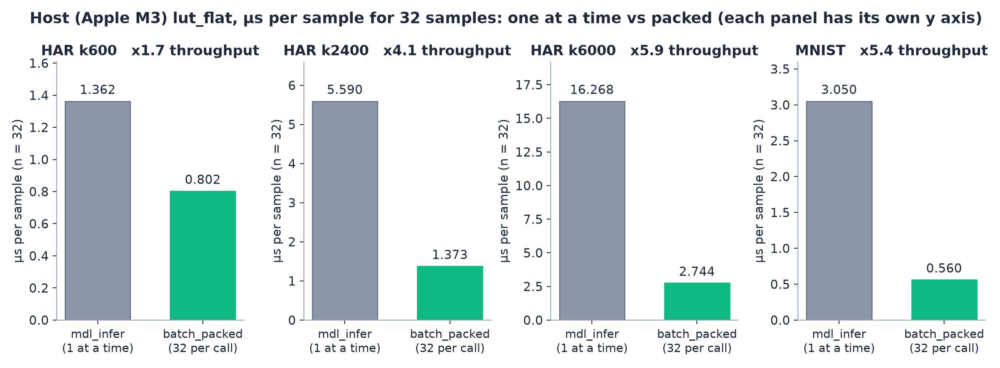

**1 枚だけ流す用途には使わない。** 1 枚で呼ぶと `mdl_infer` より 5〜12 倍遅い。遅延を重視するなら `mdl_infer` を使う。
`--dense-batch 0` で生成を止め、`--dense-batch N` で最大枚数を変えられる。平坦化しない dense でも `--dense-batch N` を明示すれば、層パックの入口が生成される。

### 常に入っているもの

| 最適化 | 内容 | 効果・注意 |
|---|---|---|
| ビットスライス層カーネル | 平坦化しない dense で、種類の違う 32 ゲートを 1 組の演算で処理する | HAR k6000 の 1 コンテキストで 2.18 倍の枚数 / 秒 |
| 添字の 16 ビット化 | 入力幅が 65,536 以下なら、dense の添字表を `uint16_t` にする。C / CUDA / Metal 共通 | 重み(.rodata)33.5〜38.9% 減(3 モデル)。レイテンシはノイズの範囲 |
| 群和のビットスライス計数 | group_sum を、ビットスライスの桁上げ(carry-save)カウンタで数える | 本ページでは実測値を載せていない |
| 静的な作業領域 | バッファはすべてコンパイル時に確定した `static`。コンテキスト版は呼び出し側が領域を渡す | ヒープ確保ゼロ。`-DMDL_NO_DEFAULT_CTX` で既定の static RAM もゼロ |
| 前処理の SIMD 化 | 前処理を NEON / SSE2 / AVX2 で動かす(K8) | 画像モデルの e2e が 2.3〜6.1 倍(顔検出 5.51 → 1.97 ms) |
| SIMD の自動選択 | NEON / SSE2 / AVX2 をコンパイル時に選び、無ければスカラー | **整数出力はどの経路でも完全に同一**。`-DMDL_NO_SIMD` で明示的に切れる |

### 明示したときだけ入るもの

`--fuse` は、ゲート命令列を直線コードに展開する。真理値表を生成時に確定させるので、conv 系のモデルが 2〜9% 速くなる。
そのかわり生成された C は 1.2〜2.3 倍に膨らむので、既定は OFF である。

### 試して採用しなかったもの

平坦化した `lut_flat` について、**ゲートの軸** で 32 ゲートを 1 ワードにパックする案も測った。
HAR k600 / k2400 / k6000 でレベルの充填率は 95〜99% あったが、1 ゲート 1 反復に対して SIMD で 0.94〜0.98 倍、スカラーで 0.85〜0.87 倍にしかならなかった。
ゲート 1 つあたりのコストは、2 回のバイト読み出しと 1 回の書き込みが支配的で、ビットスライスでは消えないためである。
そのためライブラリには入れていない。1 枚の遅延は、`lut_flat` と `mdl_infer` の組み合わせが最良のままである。

## GPU(`codegen-cuda` / `codegen-metal`)

GPU の最適化は「効くかどうかがモデルと batch で逆転する」ので、**実測で勝てた条件のときだけ自動で ON** にしてある(`auto='measured'`)。
上書きの方法は、明示フラグを付けるか、`--no-auto` で自動選択ごと切る(`--no-auto` では、指定しなかった項目が自動選択の導入前の値、つまり `split`・`dense_fuse` OFF・`dense_packed` OFF に戻る)。

| 最適化 | 自動で ON になる条件 | 明示 ON / OFF | 実測 |
|---|---|---|---|
| conv_engine(`split` / `combined`) | 既定は `split`。1 つでも conv2d ノードの出力チャネルあたりの枠が 8 を超えれば、モデル全体を `combined` にする | `--conv-engine` | 1.6M ゲートの実モデルが、`combined` で全段正常に生成・実行できた |
| dense_fuse | 平坦化しないとき(既定の `--dense-flat off`、または `auto` で削減率 25% 未満)で、batch 32 以上、かつ融合できる鎖がある | `--dense-fuse`(明示 ON) | batch 32 以上のe2e倍率は 1.20〜2.01 倍。batch=1 は「明確な勝ち」に届かないので自動 ON にしない |
| dense_packed | 平坦化しないときで、batch 128 以上、モデルが適格(非画像入力で dense と group_sum のみ)、dense_fuse が入らないとき | `--dense-packed`(明示 ON) | batch 32 では複数モデルで悪化(CUDA で 0.878〜0.891 倍)。batch 128 では悪化がほぼ消える |
| decode megakernel | RDDLGN のデコードで、共有メモリとバッファ引数の上限に収まるとき(既定 ON) | 収まらなければ自動で従来経路(Python API の `megakernel=False` でも戻せる) | Metal 1.61〜2.10 倍、CUDA 1.71〜2.34 倍。悪化ケースなし |
| n_streams | **自動 ON にしない** | `--n-streams N` | Metal で 0.66 倍、CUDA の batch=1 で 0.878 倍の悪化例がある |
| conv_codegen | **自動 ON にしない** | `--conv-codegen` | e2e は 1.00〜1.04 倍で、生成コードは 1.78〜6.65 倍に膨らむ |

`dense_fuse` と `dense_packed` は併用できない。両方の条件を満たすときは、実測で上回った `dense_fuse` が優先される。
`codegen-cuda` / `codegen-metal` は、C や Web と違って **既定では平坦化しない**(`--dense-flat off`。`auto` / `on` で opt-in)。平坦化すると `dense_fuse` / `dense_packed` は使われなくなり、Apple M3 の Metal では平坦化しない最良に対して 0.47〜1.15 倍(k6000 で遅くなる)だったためである(次節)。**batch=1 の遅延を求めるなら、GPU よりも C のほうが速い場面が多い** ので、詳しくは [GPU へデプロイする](/guides/deploy-gpu/) の「batch=1 で GPU を選ぶと遅くなる場面」を読むこと。
選ばれた結果とその理由は、生成時の標準出力 1 行と、生成ソース冒頭の ` auto-config` コメントに出る。

### GPU での平坦化(`lut_flat`、opt-in)

平坦ネットリストのゲートは「自分より前の信号」を参照するだけなので、そのままでは GPU の 1 スレッド = 1 ゲートで並べられない。
そこで生成時に、各ゲートへ **ASAP の段番号**(入力 = 0、ゲート = 1 + 入力の段の最大)を振り、段ごとにまとめ直す。同じ段のゲートは互いに依存しないので、段ごとに 1 回の起動(または 1 回のバリア)で全ゲートを同時に評価できる。
段数は元の `lut_layer` の層数を超えない。下の図は、HAR の実モデルで元の層・sweep 後の層・平坦化後の段のゲート数を並べたものである。

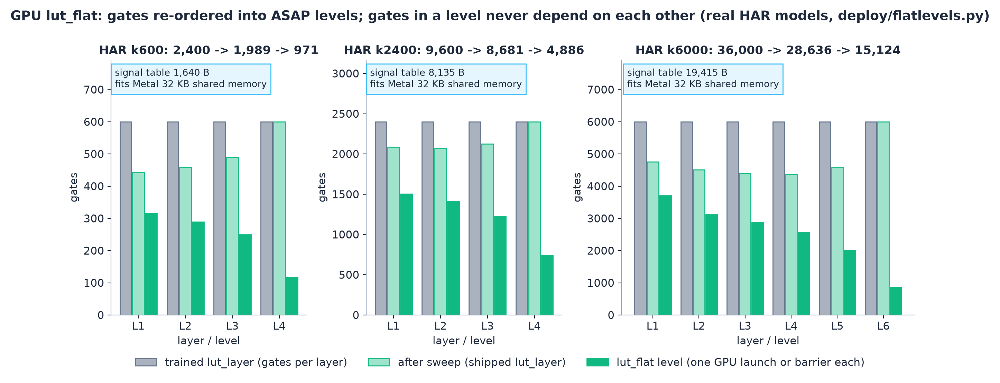

GPU の既定は平坦化しない(`--dense-flat off`)。使うときは `codegen-cuda` / `codegen-metal` / `verify-metal` に `--dense-flat auto`(削減率 25% 以上で採用)か `on` を付ける。`bundle --dense-flat` で焼いた `lut_flat` は既定にかかわらずこの方式で実行される。

実行方式は 3 通りある(Python API の `lut_flat_mode`)。既定の `auto` は、信号表が共有メモリ(Metal 32KB / CUDA 48KB)に収まれば `fused` を選ぶ。

| 方式 | 中身 |
|---|---|
| `fused` | 1 スレッドグループ = 1 枚。信号表を共有メモリに置き、段の間だけバリアを張る。起動は 1 回 |
| `levels` | 段ごとに 1 回起動する。信号表はデバイスメモリ |
| `packed` | 段ごとの起動で、32 枚を 1 語に詰めて評価する(batch 32 以上) |

ゲートは約半分になるが、GPU では速くなるとは限らない。Apple M3 の Metal で測ると、k600 はわずかに速く、k2400 は勝ち負けが混ざり、k6000 は平坦化しない最良(`dense_packed` / `dense_fuse`)より遅かった。
GPU は 1 回の推論でゲート数より起動・転送の固定費が大きく、batch=1 ではどの方式も 0.32〜0.40 ms である。
**遅くなる条件**: 数万ゲート級の大きいモデル(k6000 = 平坦化後 15,124 ゲート)を batch 128 以上で流すと、平坦化で 0.47〜0.71 倍に落ちた。小さいモデル(k600)や batch 32 前後ではほぼ同じか少し速い。CUDA の `lut_flat` は NVIDIA 実機で実行・計測していない(生成コードの構文検査まで)。平坦化を試すなら、自分のモデルと batch で既定(off)と比べてから選ぶこと(`scripts/bench_dense_gpu.py --dense-flat fused`)。

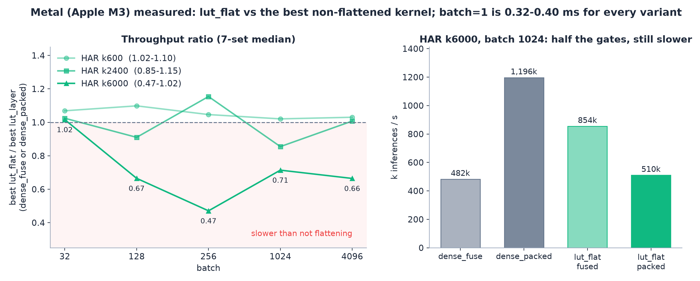

## Web(`codegen-web`)

ブラウザ向けは、実行体(TypeScript 製のエンジンと AssemblyScript 製の wasm カーネル)を最初から持っていて、`codegen-web` は「バンドル + ランタイム一式」をコピーして並べる。

| 項目 | 内容 | 既定 | 変える |
|---|---|---|---|
| エンジン選択 | wasm(SIMD)を試し、失敗したら理由を `notes` に残して純 JS に落ちる。出力整数は両エンジンで完全に一致する | `engine: 'auto'` | `loadBundle` の `engine: 'js'` / `'wasm'` |
| スレッド | `threads=1` が既定。SharedArrayBuffer 用の COOP / COEP ヘッダが要らず、素の静的配信で動く | 1 | `loadBundle` の `threads` |
| 配信サイズの計測 | `--gzip` で gzip 版も書き出して配信サイズを測る | OFF | `--gzip` |
| 平坦化 | dense を平坦ネットリスト(`lut_flat`)へ置き換えて配る。後段の group_sum と融合し、3 枚以上は 32 枚 / 語のバッチ軸パックで評価する。Web の従来経路は 1 ゲートあたりも遅いので閾値は設けない | 自動(列があれば常に) | `--dense-flat off` / `on`(`verify-web` も同じ) |
| 出荷ゲート | `verify-web` が、Node で同じバンドルを動かして整数一致を確かめる(1 枚ずつと、全ケースを 1 バッチにした実行の両方) | 手動で実行 | `griffith deploy verify-web` |

### Web の実測

平坦化の効果を、HAR の 3 モデルで、従来の `lut_layer` 経路と比べた。整数スコアは 4 通りとも一致した。k2400 と k6000 は内蔵ブラウザ(Chrome 152)、k600 は Node v25 での値である。

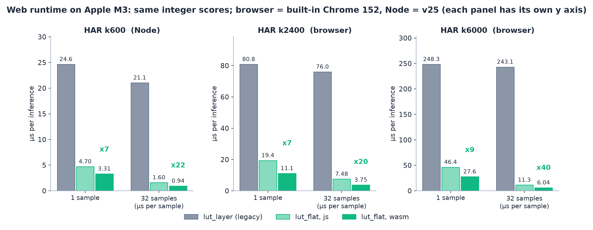

:::caution[`--slim` は圧縮ではない]
`codegen-web --slim` は、配布バンドルではなくモデルの doc そのものを書き出すデバッグ用のオプションである。ブラウザ側で IR から命令列を組み直すことになり、エクスポータ側の簡約の保証を手放す。サイズを減らす目的では使わない。
:::

## 何が適用されたかを確かめる

| 見る場所 | 分かること |
|---|---|
| `griffith deploy info m.bundle.json` | `about.compress` の 1 行(適用したパスとゲート数の前後、スキップした理由)と、`codegen-c` 既定の見込み |
| `bundle` の標準出力 | 同じ 1 行。conv2d では命令列化と、そのうち再合成の分が分けて出る |
| `codegen-c` の標準出力と `model.h` の先頭コメント | 平坦化の採否と削減率 |
| `model.h` の `MDL_DENSE_FLAT` | 平坦化を採用したら 1、しなければ 0。アプリ側の `#if MDL_DENSE_FLAT` で RAM 見積りを切り替えられる |
| `model.h` の `MDL_DENSE_BATCH` | バッチ軸パック入口を生成したときの最大枚数 |
| `codegen-cuda` / `codegen-metal` の標準出力 | GPU の自動選択の結果を 1 行で |
| `griffith deploy verify-c m.bundle.json` | `codegen-c` と同じ判定で C を作り、元のバンドルの `simulate` との整数一致を確かめる |

`about.compress` の形は `{level, applied, skipped, gates, always}` である。

```bash
uv run griffith deploy info m.bundle.json     # 圧縮の適用結果と codegen-c の見込み
uv run griffith deploy verify-c m.bundle.json # C が simulate と整数一致するかを検証
```

## 切りたいときのフラグ

| やりたいこと | フラグ |
|---|---|
| バンドルの圧縮を全部やめる | `bundle --compress none`(conv2d の命令列化だけは残る) |
| sweep だけやめる | `bundle --no-sweep` |
| 探索を深くして、さらに減らす | `bundle --compress max` |
| 平坦化をやめる(RAM 優先) | `codegen-c --dense-flat off`(`verify-c` も同様) |
| 平坦化を常に使う | `codegen-c --dense-flat on` |
| 平坦化の採用閾値を変える | `--dense-flat-min-reduction R`(既定 0.25) |
| バッチ軸パック入口をやめる | `codegen-c --dense-batch 0` |
| SIMD を使わない | `-DMDL_NO_SIMD` でコンパイル |
| GPU の自動選択をやめる | `codegen-cuda` / `codegen-metal` に `--no-auto` |
| GPU の個別の最適化を明示する | `--conv-engine` / `--dense-fuse` / `--dense-packed` / `--n-streams N` / `--conv-codegen` |

Python から `build_bundle()` や `generate_c()` を直接呼ぶときは、ここに挙げた **既定の自動適用は入らない**(圧縮なしの回路になる)。同じ結果にしたいときは CLI を使うか、`griffith_logic.deploy.compress.apply_compress` を自分で呼ぶ。
