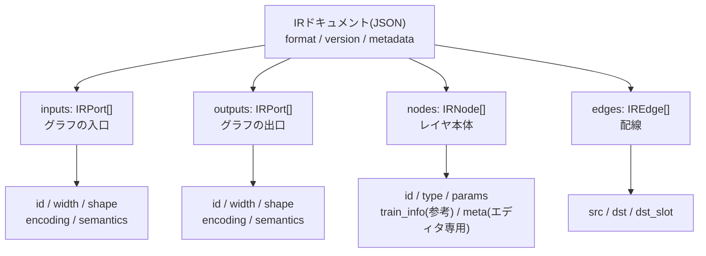
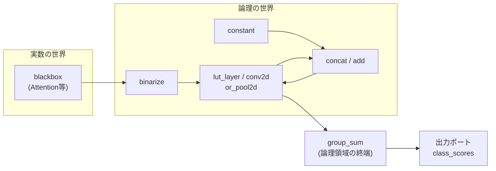
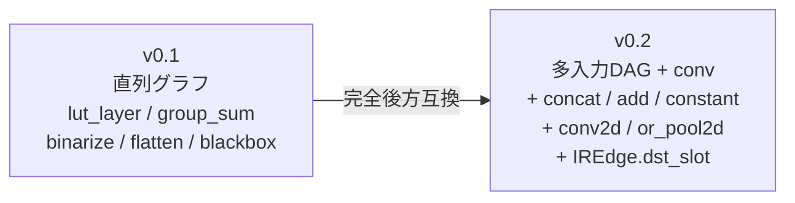

**IR(中間表現)は、このライブラリの真実源である。** PyTorch のモデルも、numpy の
ゴールデンシミュレータも、生成される Verilog / VHDL も、すべて同じ 1 個の JSON から派生する。
だから「PyTorch の出力 = シミュレータの出力 = 実際の回路の出力」を機械的に照合できる。

このページは **IR の仕様書** である。読み方・生成の手順は
[IRを扱う](/guides/ir/) を、なぜ IR を挟むのかは
[アーキテクチャ全体像](/explanation/architecture/) を参照してほしい。

真実源のコードは `griffith_logic/ir/schema.py`(dataclass 定義とビット規約の docstring)、
検証規則は `griffith_logic/ir/validate.py` にある。

---

## 1. ドキュメントの全体構造

IR は **1 個の JSON オブジェクト**である。中身は「ヘッダ」「境界(ポート)」「本体(グラフ)」の
3 ブロックに分かれる。



グラフ構造は **ノード集合 + エッジ集合** で表され、ノードの中に子ノードを持つ入れ子は無い。
ポートとノードは同じ id 空間を共有し、エッジの `src` / `dst` はノード id と
ポート id のどちらでもよい(だから入力ポートから直接ノードへ、ノードから直接出力ポートへ張れる)。

### トップレベルのフィールド

| フィールド | 型 | 意味 |
|---|---|---|
| `format` | string | 常に `"magicdelta-ir"`。読み込み時に検査され、違えば拒否される |
| `version` | string | スキーマ版(現行 `"0.2.0"`)。→ 下の「7. バージョニング方針」 |
| `metadata` | object | 自由記述。`name` / `created_at` などが入る。**意味論には一切影響しない** |
| `inputs` | IRPort[] | グラフの入力ポート |
| `outputs` | IRPort[] | グラフの出力ポート |
| `nodes` | IRNode[] | レイヤ本体。**順序に意味はない**(実行順はエッジから導く) |
| `edges` | IREdge[] | ノード間・ポート間の配線 |

### IRPort(境界)

| フィールド | 型 | 必須 | 意味 |
|---|---|---|---|
| `id` | string | ✓ | ポート識別子。エッジの端点になる(例 `"x"` / `"y"`) |
| `width` | int | ✓ | ビット幅。接続先の幅と一致しないと検証エラー |
| `shape` | int[] \| null | | 元テンソルの形状(例 `[1,28,28]`)。幅規約は常に flatten 後の `width` が正 |
| `encoding` | string \| null | | 入力の符号化(例 `"binary_threshold_0.5"` = 0.5 で二値化して入れる) |
| `semantics` | string \| null | | 出力の意味(例 `"class_scores"` = クラススコア、argmax で予測ラベル) |

`encoding` / `semantics` は **人間と外部ツールへの申し送り**で、シミュレータや HDL 生成は参照しない。
「この回路にどんなビット列を入れれば正しいのか」を IR 単体で判るようにするために置いている。

### IRNode(レイヤ)

| フィールド | 型 | 意味 |
|---|---|---|
| `id` | string | ノード識別子。**グラフ内で一意**(重複は検証エラー) |
| `type` | string | ノード種別。→ 下の「2. ノード種別一覧」 |
| `params` | object | 種別ごとの必須パラメータ。**ここだけが回路の意味を決める** |
| `train_info` | object | 学習時の参考情報(パラメータ化方式など)。**トランスパイラは読まない** |
| `meta` | object | ビジュアルエディタ専用の自由 namespace(座標・表示名等)。**完全に無視される** |

この 3 分割が設計の要である。`params` を書き換えれば回路が変わり、
`train_info` と `meta` はいくら書き換えても回路は 1 ビットも変わらない。
エディタが自由にノードを動かしても HDL 出力が揺れないのはこのためである。

### IREdge(配線)

| フィールド | 型 | 既定 | 意味 |
|---|---|---|---|
| `src` | string | — | 出力側。ノード id または入力ポート id |
| `dst` | string | — | 入力側。ノード id または出力ポート id |
| `dst_slot` | int | `0` | 多入力ノードの入力スロット番号(v0.2 で追加) |

- `dst_slot` が 0 のときは **JSON からキーごと省略する**(v0.1 とバイト列レベルで同じ表現になり、差分が安定する)
- **fanout(同じ `src` から複数のエッジ)は許容**される。分岐用の専用ノードは不要
- 多入力ノードでは slot 0..N-1 が **欠番なく 1 本ずつ** 埋まっている必要がある

---

## 2. ノード種別一覧

現行 v0.2 のノードは 11 種類(うち `lut_flat` は配備専用)。**「1 ノード = 1 レイヤ」の粒度**で、ゲート単位には展開しない
(ゲートビューは `indices` と `truth_tables` から導出できるので、IR に持たせると二重管理になる)。

| `type` | 追加版 | 主な `params` | 出力幅 | 役割 |
|---|---|---|---|---|
| `lut_layer` | v0.1 | `in_width`, `out_width`, `n_inputs`, `indices`, `truth_tables` | `out_width` | **中核**。N 入力ルックアップテーブル層 |
| `group_sum` | v0.1 | `in_width`, `k`, `tau`, `bias`(任意) | `k` | ビット列を k グループへ集計しクラススコアへ。`bias` はクラスごとの整数の判定バイアス(省略 = 全 0) |
| `binarize` | v0.1 | `width`, `threshold` | `width` | 実数を閾値で二値化(実数世界 → 論理世界の境界) |
| `flatten` | v0.1 | `in_shape`, `width` | `width` | 形状を潰すだけ。ビットは変えない |
| `blackbox` | v0.1 | `torch_class`, `config`, `in_width`, `out_width` | `out_width` | 非論理層(ハイブリッドモデルの実数部)。**HDL 生成不可** |
| `concat` | v0.2 | `in_widths`(slot 順) | `sum(in_widths)` | 複数入力のビット連結 |
| `add` | v0.2 | `width`, `mode`(`or`/`xor`/`sum`) | `width` | ビット合流 |
| `constant` | v0.2 | `width`, `bits` | `width` | 定数線。**入力を持たない**(arity 0)ルートノード |
| `conv2d` | v0.2 | `in_shape`, `out_channels`, `kernel_size`, `stride`, `padding`, `tree_depth`, `n_inputs`, `indices_flat`, `truth_tables` | `out_channels × H_out × W_out` | 論理ゲート畳み込み(ネイティブ表現) |
| `or_pool2d` | v0.2 | `in_shape`, `kernel_size`, `stride`, `padding` | `C × H_out × W_out` | OR プーリング |
| `lut_flat` | v0.2 | `in_width`, `out_width`, `gates`, `outputs` | `out_width` | **配備専用**。縮約済みの dense 平坦ネットリスト(`bundle --dense-flat` が作る。学習側からは作らない) |



`binarize` が実数側から論理側への入口、`group_sum` が論理側から実数側(スコア)への出口になる。
この 2 つに挟まれた区間だけが HDL へ落ちる、と覚えておくと構造が読みやすい。

### 2.1 `lut_layer` — 中核ノード

`out_width` 個のゲートが並び、**ゲート j** は入力ビット `indices[0][j] … indices[n_inputs-1][j]` を
読んで、真理値表 `truth_tables[j]` に従って 1 ビットを出す。

| params | 型 | 制約(検証で強制) |
|---|---|---|
| `in_width` | int | 入力ビット幅 |
| `out_width` | int | 出力ビット幅 = ゲート数 |
| `n_inputs` | int | 1 ゲートあたりの入力数 N |
| `indices` | int[N][out_width] | 形状は厳密に `(n_inputs, out_width)`。値は `0 ≤ v < in_width` |
| `truth_tables` | string[out_width] | hex 文字列。値域 `0 ≤ t < 2^(2^N)` |

**真理値表のビット規約**(全ノードで統一):

> 真理値表は「$2^N$ ビットの整数」。その **bit k** が、butterfly 基底順の入力パターン $k$
> (パターン $k$ の **bit j** = 入力スロット $j$ の値)に対する出力である。

例として N=2 のとき、`0x6` は 2 進で `0110`。

| 入力パターン k | スロット1 | スロット0 | 真理値表の bit k | 出力 |
|---|---|---|---|---|
| 0 | 0 | 0 | bit0 = 0 | 0 |
| 1 | 0 | 1 | bit1 = 1 | 1 |
| 2 | 1 | 0 | bit2 = 1 | 1 |
| 3 | 1 | 1 | bit3 = 0 | 0 |

つまり `0x6` は **XOR ゲート**である。同様に `0x8` = AND、`0xe` = OR、`0x9` = XNOR。
下の実物 JSON に出てくる 16 進はすべてこの規則で読める。

:::note[なぜ hex 文字列なのか]
N=6 のとき真理値表は 64 ビット整数になり、JSON の数値(JavaScript の安全整数 $2^{53}$)を超える。
言語をまたいで無損失に往復させるため、**真理値表だけは常に hex 文字列**として書く。
N は 6 より大きくてもよい(例: `ThermometerEncoder(input_bits=8)` の 8 入力 LUT は 256 ビット)。
`simulate` は N ≤ 6 を 64 ビット整数のシフトで、N > 6 は表を $(\text{out\_width}, 2^N)$ の
ビット行列に展開して引く。
:::

### 2.2 `group_sum` — 論理領域の終端

`in_width` ビットを `k` 個のグループへ等分し、各グループの 1 の個数を数えて `tau` で割る。
制約は `in_width % k == 0`。出力は **ビット列ではなく実数スコア**なので、
このノードから先は HDL の対象外になる(`tau` は学習時のロジット温度)。

任意の `bias`(長さ `k` の整数リスト)があれば、各グループの個数に足してからスコアにする
(2 クラス判定則 $s_1 > s_0 + t$ は `bias = [t, 0]`)。省略時は全 0 で、`simulate` と `build_torch`
が対応する。HDL 生成と C ランタイムは `bias` が非零だと**明示的に拒否**する(比較器 + 定数は回路側の
終端部品で付ける)。

### 2.3 `concat` / `add` — 多入力ノード(v0.2)

DAG 構造(直列でないグラフ)を表すために追加された 2 つ。どちらも `dst_slot` で
入力の順番を区別する。

- **`concat`**: `in_widths`(2 要素以上の正整数リスト)の順にビットを連結する
- **`add`**: 同じ幅の入力をビット演算で合流させる。`mode` は 3 種

| `mode` | 硬い(離散)意味 | 柔らかい(学習時)意味 | HDL |
|---|---|---|---|
| `or` | ビット OR | $1-(1-a)(1-b)$ | 生成可 |
| `xor` | ビット XOR | $a+b-2ab$ | 生成可 |
| `sum` | 整数和 | $a+b$ | **生成不可**(値が $\{0,1\}$ を超えるため) |

`mode='sum'` は `group_sum` の直前など**論理領域の終端専用**で、`validate(..., target='hdl')` が拒否する。

:::caution[concat のビット順は 3 実装で完全統一]
**slot 0 が出力ビット列の先頭(インデックス 0 側)= 整数パック時の下位ビット。**

| 実装 | 書き方 |
|---|---|
| numpy / torch | `concatenate([slot0, slot1, ...], axis=-1)` |
| Verilog | `assign w = {slotN-1, ..., slot1, slot0};`(`{}` は左が MSB) |
| VHDL | `w <= slotN-1 & ... & slot1 & slot0;`(`&` は左が MSB) |

HDL 側で左右が逆に見えるのは、Verilog / VHDL の連結が **左を MSB** と定めているため。
逆順に書いているのではなく、同じ規約を各言語の記法で表現している。
:::

### 2.4 `constant` — 定数線

`bits`(長さ = `width` の 0/1 リスト)を出すだけの、**入力エッジを持たないノード**。
`bits[j]` が出力ビット j(`concat` と同じく index 0 が下位)。
シミュレータでは定数行、torch ではバッチ方向へ expand、HDL ではハードワイヤ定数になる。

### 2.5 `conv2d` / `or_pool2d` — 畳み込み(v0.2)

**幅規約**: 入出力とも `width = C × H × W` の NCHW flatten。
つまり入力幅 = `prod(in_shape)`、出力幅 = `out_channels × H_out × W_out` で、
出力形状は通常の畳み込みと同じ式で決まる。

$$
H_{\text{out}} = \left\lfloor \frac{H + 2p_H - k_H}{s_H} \right\rfloor + 1
$$

- `indices_flat`: 形状 `(out_channels, n_inputs^tree_depth)`。受容野内のフラット位置を指す
- `truth_tables`: 長さ = `out_channels × 木の内部ノード数`。**oc 優先(oc-major)**で木のレベル順

**HDL 生成の前に `export/lowering.lower_to_primitives` で `lut_layer` の列へ展開する。**
conv をネイティブノードとして持つのは、エディタとシミュレータが「畳み込みである」ことを
見失わないため。展開後の巨大な `lut_layer` 列だけを IR に持つと、この情報が復元できなくなる。

### 2.6 `lut_flat` — 縮約済み dense 平坦ネットリスト(配備専用)

2 入力 `lut_layer` の直列鎖を `export/netlist_reduce.py` で **lossless に縮約**
(定数・パススルー・NOT・CSE・未参照の除去)した 1 枚の平坦 DAG。
`griffith deploy bundle --dense-flat`(実体は `deploy/flatten_dense.py`)が
`lut_layer` 列を置換して作る。**学習側から作るノードではなく、torch へも戻せない**
(`build_torch` は `NotImplementedError`)。HDL 生成の対象外で、C ランタイムだけが実行する。

`lut_flat` は**置換した最終 `lut_layer` と同じ `out_width` 本のビット列**を返す。
後段の `group_sum` は無改造で、整数スコア(グループ内 popcount)の意味論も変わらない。
縮約で定数・パススルー・反転に解決した最終層ゲートは、`outputs` の参照として
`lut_flat` の中で最終出力ビット列に再構成される。

| params | 意味 |
|---|---|
| `in_width` | 入力ビット数(前段の出力幅) |
| `out_width` | 出力ビット数(= 置換した最終層の幅 = `group_sum.in_width`) |
| `gates` | `[tt, a, b]` のリスト。`tt` は 0..15 の真理値表(`lut_layer` と同じ規約: bit index = `(b<<1)\|a`)、`a` / `b` は信号番号 |
| `outputs` | 長さ `out_width`。出力ビット i の参照 = `2*信号番号 + 極性`(極性 1 = 反転) |

**信号番号**(`a` / `b` / `outputs` が指す添字):

| 信号 | 意味 |
|---|---|
| `0` | 定数 0(定数 1 は信号 0 の反転 = `outputs` の値 `1`) |
| `1 … in_width` | 入力ビット k → 信号 `1+k` |
| `in_width+1 …` | ゲート g の出力 → 信号 `in_width+1+g` |

ゲート g の `a` / `b` は**自分より前の信号**(`< in_width+1+g`)のみを指せる(トポロジカル順)。
極性(NOT)はゲート入力側に持たない — 縮約器が下流ゲートの真理値表へ吸収済みで、
極性が残るのは `outputs` だけ。

---

## 3. 実物を見る — XOR 回路の IR

[チュートリアル 1](/tutorials/xor/) と同じ 2 層 LUT + GroupSum の XOR モデルを学習し、
`export_ir` で抽出した **実際の JSON** である(`examples/04_export_hdl.py` の生成物)。
長い `indices` は省略記号で畳んであるが、それ以外は生成されたそのままの形。

```json
{
 "format": "magicdelta-ir",
 "version": "0.2.0",
 "metadata": {
  "name": "xor",
  "created_at": "2026-09-03T20:39:42.145207+09:00"
 },
 "inputs": [
  { "id": "x", "width": 2, "shape": null,
    "encoding": "binary_threshold_0.5", "semantics": null }
 ],
 "outputs": [
  { "id": "y", "width": 2, "shape": null,
    "encoding": null, "semantics": "class_scores" }
 ],
 "nodes": [
  {
   "id": "n0_lutlayer",
   "type": "lut_layer",
   "params": {
    "in_width": 2,
    "out_width": 16,
    "n_inputs": 2,
    "indices": [
     [1, 1, 0, 0, 1, 0, 1, 0, 0, 0, 1, 0, 1, 0, 0, 1],
     [1, 0, 1, 1, 1, 1, 1, 0, 0, 0, 0, 1, 1, 1, 0, 0]
    ],
    "truth_tables": [
     "0x7", "0x6", "0x9", "0xa", "0xd", "0x9", "0x0", "0x3",
     "0x6", "0xa", "0x6", "0x3", "0xe", "0x9", "0x7", "0x6"
    ]
   },
   "train_info": { "parameterization": "softmax", "selection": "soft" },
   "meta": {}
  },
  {
   "id": "n1_lutlayer",
   "type": "lut_layer",
   "params": {
    "in_width": 16,
    "out_width": 16,
    "n_inputs": 2,
    "indices": [
     [10, 4, 9, 14,  0,  7, 8,  3, 12, 13, 10, 11, 13, 4, 2, 6],
     [ 7, 5, 0, 11, 14, 12, 1, 15,  9,  2,  6,  3, 15, 5, 1, 8]
    ],
    "truth_tables": [
     "0x5", "0x9", "0x6", "0x9", "0x9", "0x6", "0x9", "0x3",
     "0x6", "0x7", "0xe", "0x9", "0xd", "0x6", "0xd", "0x3"
    ]
   },
   "train_info": { "parameterization": "softmax", "selection": "soft" },
   "meta": {}
  },
  {
   "id": "n2_groupsum",
   "type": "group_sum",
   "params": { "in_width": 16, "k": 2, "tau": 2.0 },
   "train_info": {},
   "meta": {}
  }
 ],
 "edges": [
  { "src": "x",            "dst": "n0_lutlayer" },
  { "src": "n0_lutlayer",  "dst": "n1_lutlayer" },
  { "src": "n1_lutlayer",  "dst": "n2_groupsum" },
  { "src": "n2_groupsum",  "dst": "y" }
 ]
}
```

読みどころを 4 つ。

1. **幅が鎖のようにつながっている** — `x`(2)→ `n0`(in 2 / out 16)→ `n1`(in 16 / out 16)
   → `n2`(in 16 / k=2)→ `y`(2)。ここが 1 か所でもずれると `validate` が幅不整合で落ちる
2. **2 段目の `indices` は最大 15** — 入力幅 16 なので `0 ≤ v < 16`。1 段目は入力幅 2 なので 0/1 しか出ない
3. **真理値表が学習の成果物** — 2 段目に `0x6`(XOR)と `0x9`(XNOR)が並んでいる。
   学習後の `eval()` で各ゲートが 1 個の論理関数に**確定**した結果である
4. **`dst_slot` がどのエッジにも無い** — すべて単入力ノードで slot 0 だから、規約どおりキーが省略されている

:::tip[パラメータ化は IR に残らない]
`train_info.parameterization` は `"softmax"` と記録されているが、これは**参考情報**である。
`independent` でも `iwp` でも、学習方式が何であれ抽出後の IR は**真理値表の集まりに統一**される。
下流(シミュレータ・HDL)を学習方式から完全に切り離すための正規化であり、
[パラメータ化を選ぶ](/guides/parameterization/) の選択がここから先へ漏れることはない。
:::

### 大配列のサイドカー退避

MNIST 級のモデルでは `indices` が数十万要素になる。`save_ir` は要素数が
`inline_threshold`(既定 65536)を超える配列を **`.npz` サイドカーへ退避**し、
JSON 側には参照だけを残す。

```json
"indices": { "$data": "mnist.npz#n0_lutlayer_indices" }
```

`load_ir` は同じディレクトリの `.npz` を自動で解決する。**`truth_tables` は常に JSON 内にインライン**
(hex 文字列なので大きくならない)。
なお、エディタが HTTP でやり取りする経路(`ir_to_dict` / `ir_from_dict`)は
一括送受信のため常にインライン展開で、`$data` 参照には対応しない。

---

## 4. 検証ルール(`validate`)

`validate(ir, target=...)` は**エラーを例外で送出**し、**警告をリストで返す**。
HDL を書き出す前に必ず通す。ここで落とせば、合成ツールで初めて気づく事故を防げる。

```python
from griffith_logic.ir import validate

warnings = validate(ir, target='hdl')   # 'generic' | 'hdl'
```

| # | 検査 | 落ちる条件 |
|---|---|---|
| 1 | ノード型 | `NODE_TYPES` に無い `type` |
| 2 | id の一意性 | ノード id の重複 |
| 3 | エッジ端点 | `src` / `dst` が未定義の id を指す |
| 4 | ノード固有 params | 形状・値域違反(`indices` 形状、真理値表の値域、`in_width % k`、`bits` が 0/1 以外 …) |
| 5 | slot 整合 | 多入力ノードで slot が欠番・重複、単入力ノードに 2 本目のエッジ |
| 6 | 幅整合 | `src` の出力幅 ≠ `dst` の当該 slot の入力幅(出力ポートへの接続も含む) |
| 7 | DAG 性 | 循環、または到達不能な依存 |
| 8 | 未使用ノード | 出力がどこにも繋がっていない → **警告**(エラーではない) |
| 9 | HDL 追加制約 | `target='hdl'` のとき `blackbox` ノード、`add(mode='sum')`、`lut_flat` |

`lut_flat` の params は 4 で検査される(`gates` の `tt` が 0..15、`a` / `b` が前方参照でない、
`outputs` の長さ = `out_width` と信号数の範囲内)。
9 のうち `blackbox` と `add(mode='sum')` は「原理的に回路にできないもの」である。`blackbox` は実数の非論理層なので
**ハイブリッドモデルは論理部分だけを切り出してエクスポート**する。

---

## 5. 実行順序の決め方

`nodes` 配列の並びは実行順ではない。実行順は **エッジからトポロジカルソート**して決める
(`IRGraph.topological_order()`)。循環していれば検査 7 で落ちる。

「最終出力はどのノードか」も推測しない。`IRGraph.output_source()` が
**最初の出力ポートへ繋がっている `src`** を返し、シミュレータ・torch ビルド・HDL 生成の
3 者がこの同一のヘルパーを使う。直列グラフではトポロジ末尾ノードと一致するが、
fanout や未使用ノードがある DAG では「末尾 = 出力」が成り立たないため、規則を 1 か所に固定している。

---

## 6. 参照先 API

| 用途 | 関数 |
|---|---|
| ファイルへ保存 / 読み込み | `save_ir(graph, path)` / `load_ir(json_path)` |
| dict へ変換 / dict から構築(エディタ経路) | `ir_to_dict(graph)` / `ir_from_dict(doc)` |
| 検証 | `validate(graph, target=...)` |
| ゴールデン実行(numpy ビット厳密) | `simulate(graph, x)` |
| torch モデルへ復元 | `build_torch(graph)` |
| 真理値表 hex の相互変換 | `tt_to_hex(ints)` / `tt_from_hex(hexes)` |

シグネチャの詳細は [Python API リファレンス](/reference/api/core/) を参照。

---

## 7. バージョニング方針



- `IR_FORMAT` は `"magicdelta-ir"` 固定、`IR_VERSION` は現在 **`"0.2.0"`**
- **v0.2 は v0.1 を完全に読める。** `dst_slot` の無い v0.1 の JSON は読み込み時に 0 として扱われ、
  出力時も `dst_slot=0` はキーごと省略されるので、v0.1 相当のグラフは v0.1 と同じ JSON に戻る
- **後方互換の原則**: 新しいフィールドは**既定値つきの任意フィールド**として足し、
  既定値のときは JSON に書かない。これで「新機能を使っていない IR」は表現が変化せず、
  差分レビューもゴールデンデータも壊れない
- `format` が一致しないドキュメントは読み込み時に拒否される。
  一方 `version` は読み込みを止めない(前方互換は保証しないが、検査 1〜9 が実質のゲートになる)
- ノード種別の追加は**加算的**に行う。既存ノードの `params` の意味を変えるような破壊的変更は
  マイナー版を上げ、[設計判断の記録](/explanation/design-decisions/) に理由を残す

---

## 次に読む

- [IRを扱う](/guides/ir/) — 生成・検証・シミュレーションの実務手順
- [HDLエクスポートと等価性検証](/guides/hdl-export/) — IR から Verilog / VHDL を出し、3 段等価性で照合する
- [アーキテクチャ全体像](/explanation/architecture/) — なぜ IR を真実源に据えたのか
