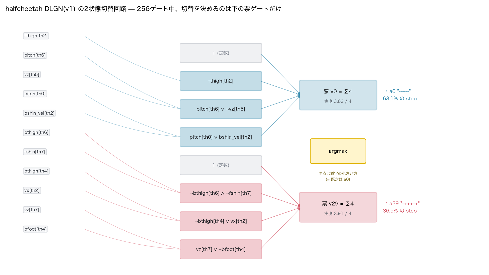
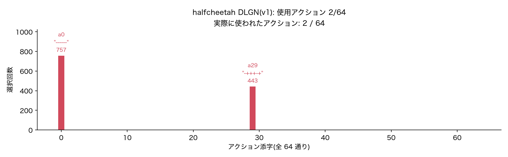

import ShowcaseVideo from '../../../components/ShowcaseVideo.astro';

体を動かす課題では、回路は「いつ、どの関節を、どちらへ動かすか」を毎ステップ決める。
周期的な歩き方を自分で見つけないと1歩も進めないので、ゲームより一段難しい。

## 虫が歩き出す

2本の脚に2つずつ関節を持つ平面の虫。物理は外部エンジンを使わず自作した。
**2入力ゲート32個の回路が、わずか4世代・22秒の進化で歩き始めた。**

<ShowcaseVideo
	name="bugwalker_dlgn.mp4"
	caption="論理回路(32ゲート)の歩行。前進距離20.6。"
/>

同じ課題を、実数の重みを持つ従来のNEAT(NN)でも進化させた。こちらは16パラメータで、前進距離は21.1。
速さはほぼ同じだ。

<ShowcaseVideo
	name="bugwalker_nn.mp4"
	caption="NN(16パラメータ)の歩行。前進距離21.1。"
/>

回路の大きさをざっくり「2入力の参照表(LUT)何個ぶんか」に換算すると、32個対1024個になる
(重み1本を8ビットの積和1回とみなす粗い見積もりで、実際に回路を合成した面積ではない)。
歩行を獲得できたのは2本中1本で、初期値によっては歩けないまま終わることもある。

## 蛇型ロボットが泳ぐ

MuJoCoのSwimmer。節をつないだ蛇のような体で、体をうねらせる波を作らないと前に進まない。
**37ゲートの回路が、うねりの波を作って400ステップで約5m進んだ。**

<ShowcaseVideo
	name="swimmer_dlgn.mp4"
	caption="論理回路(37ゲート)の遊泳。"
/>

<ShowcaseVideo
	name="swimmer_nn.mp4"
	caption="NN(21パラメータ)の遊泳。"
/>

2本ずつ走らせた平均の適応度は論理回路115.4、NN 129.7で、**わずかにNNが上**。
この環境は初期値によるばらつきが小さく(±8%以内)、この差は信頼できる。

## HalfCheetahの2状態ギャロップ

6つの関節を持つ平面のチーター。各関節を全力で曲げるか伸ばすかの組み合わせで、64通りの動きがある。
進化が見つけた回路は、**64通りのうち2つしか使わなかった**。

<ShowcaseVideo
	name="halfcheetah_dlgn_gallop.mp4"
	caption="2つの動きだけを切り替えて走る回路。"
/>

- 63%のステップで「全関節を曲げる」、37%のステップで「背中を曲げて前脚を伸ばす」を選ぶ
- どちらを選ぶかを決めているのは8個のゲートだけで、**切替を左右する生きた論理項は3つ**
- 回路には記憶も内部の発振器も無い。周期的な走りは「回路→体→センサー→回路」の閉じたループから生まれている
- 1000ステップあたり43.8m進む。条件を変えて独立にやり直した進化でも、同じ3項が再発見された

さらに速く走る個体も見つかっている。

<ShowcaseVideo
	name="halfcheetah_dlgn_run.mp4"
	caption="論理回路で最も速く走った個体。"
/>

ただし成績はNNの方が上だ。2本ずつの平均でNN 791.0、論理回路500.9。
回路の大きさも、64通りの動きそれぞれに4票ずつの出力を持たせたため256ゲートになり、NNの137パラメータより多い。
**この環境の見どころは成績ではなく、回路が人の目で読めることだ。**

## 二足歩行: 48個のLUTで前へ

BipedalWalker。4つの関節トルクは本来は連続値だが、各関節を「正か負か」の2択に落として16通りの動きにした。
それでも**2入力LUT 48個の回路が、前に進む歩き方を獲得した**。

<ShowcaseVideo
	name="bipedal_dlgn.mp4"
	caption="論理回路(48 LUT)の二足歩行。"
/>

固定した30通りの初期条件で平均した得点は+3.67で、ランダムに動かした場合の-109.55を大きく上回る。
NNも36パラメータで同じ課題を解いた。解決までの世代はNNが28、論理回路が41。

## Hopper・Ant・Humanoid: まだ歩けない

3Dの体ほど難しく、ここからは「動いた」と言い切れない結果が並ぶ。

### Hopper(1本脚で跳ぶ)

<ShowcaseVideo
	name="hopper_dlgn.mp4"
	caption="論理回路のHopper。転ばずに立ち続けるが、ほとんど前に進まない。"
/>

Hopperの得点の大半は「立っている間もらえる報酬」なので、転ばずに立っているだけでも高い点になる。
論理回路はこの罠に落ち、1000ステップで0.8〜1.5mしか進まなかった。
NNの1本は、跳んで前進しながら最後まで転ばない個体(4.4m)を見つけている。

### Ant(四足)

<ShowcaseVideo
	name="ant_dlgn_champion.mp4"
	caption="論理回路のAnt。"
/>

8つの関節の組み合わせを1つの出力で選ぶ方式では、すぐに転んでしまった。
関節ごとに「正・負・止める」を選ぶ出力に変えると、論理回路は400ステップ中最大9割の時間を倒れずに過ごせるようになった。
ただし前進は0.24〜0.61mで、「全関節を止めて何もしない」方策の得点にも届いていない。

### Humanoid(人型)

<ShowcaseVideo
	name="humanoid_dlgn.mp4"
	caption="論理回路(136ゲート)のHumanoid。倒れるまでの時間を延ばす姿勢制御。"
/>

17個の関節を持つ人型は、組み合わせを1つの出力で選ぶと13万通りを超えて回路が作れない。
関節ごとの出力にすると136ゲートで回せるようになり、倒れるまでの時間は19ステップから95〜114ステップまで延びた。
**ただし歩いてはいない**。前後に-0.47〜+0.23mふらつくだけだ。

## 間接符号化(HyperNEAT)は完敗した

回路を1ゲートずつ進化させる代わりに、「座標から配線を描く関数」を進化させるHyperNEATも試した。
左右対称な構造はきれいに作れたが、成績では**直接進化させる方式に完敗した**。

- 虫の歩行: 直接進化は論理回路が4世代、NNが6世代で攻略したが、HyperNEATは100世代で1本も攻略できなかった
- Ant: 4本すべてが「全関節を止めて直立する」方策に落ち着き、前進距離では直接進化に負けた
