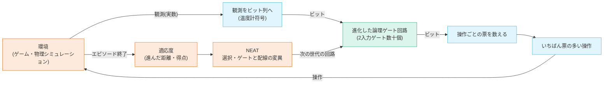

ショーケースの回路は、勾配降下ではなく**神経進化(NEAT)**で作っている。
ゲームやロボットには「この瞬間の正解の操作」が無く、得点が出るのはエピソードを最後まで走らせたあとだけなので、
誤差を逆伝播する代わりに、回路をたくさん作って走らせ、成績の良いものを残す。

## 全体像

色は他のページと同じ凡例で、橙が実数の世界、緑が論理ゲートの世界、青がビット列と入出力を表す。
1回のエピソードの中で回るのが左側のループ(観測→回路→操作→環境)で、
エピソードが終わるたびに回るのが右側のループ(適応度→NEAT→次の世代の回路)だ。

## 1. 観測をビットに変える

環境が返すのは関節の角度や速度などの実数だ。これを**温度計符号**でビット列にする。
値の範囲をいくつかの閾値で区切り、「閾値を超えていれば1」というビットを閾値の数だけ並べる方式だ。
スネークのように観測がもともと0/1の環境では、そのまま回路に入れる。

閾値の範囲が実際の値の分布より広すぎると、どのビットもほとんど変化せず解像度が消える。
そのため環境ごとに、ランダムに動かしたときの値の分布を測って範囲を決めている。

## 2. 回路が操作を選ぶ

回路の部品は**2入力の論理ゲート**だけだ。2入力で作れる論理関数は16通り(AND・OR・XOR・NANDなど)で、
各ゲートはそのうち1つになる。重みも掛け算も無い。

出力側では、操作ごとに数個の「票ゲート」を用意し、1を出した票の数がいちばん多い操作を選ぶ。
関節の多いロボットでは、関節の組み合わせ全体に票を割り当てると出力が指数的に増えるので、
関節ごとに「正・ゼロ・負」を選ぶ出力に切り替えている。

## 3. NEATが回路の形を育てる

NEAT(NeuroEvolution of Augmenting Topologies)は、ネットワークの**形そのもの**を進化させる手法だ。
各ゲートが2本の入力を持つ最小の回路から始めて、世代ごとにゲートや配線を足したり、
つなぎ方や中身を変えたりする変異を加え、成績の良い回路を親にして次の世代を作る。

元のNEATと同じく、似た形の回路どうしを「種」にまとめて競わせるので、新しく生まれた形がすぐに淘汰されず育つ余地がある。
実数の重みを持つ従来のNEAT(NN)との比較では、NN側も同じ最小構造から始めて、条件をそろえている。

## 4. 成績の確かめ方と、回路を縮める処理

- **別の初期条件で測り直す**: 進化中に一番だった個体を、進化で使わなかった初期条件で走らせ直した値を成績とする。偶然うまくいった個体を勝者にしないためだ
- **NNとの比較は同じ観測で**: NNも同じ情報を見ている(NNは実数のまま、論理回路はビットに変換して受け取る)
- **回路を縮める**: 検証の走行で通った入力に対して同じ操作を選ぶ、という条件を守ったまま、ゲートを減らす。マリオの回路は32ゲートから12ゲートに縮んだ。ただしこの「同じ」は見たことのある入力の範囲でだけ成り立つ

## 自分で動かすには

ショーケースの実験コードは順次公開予定です。
