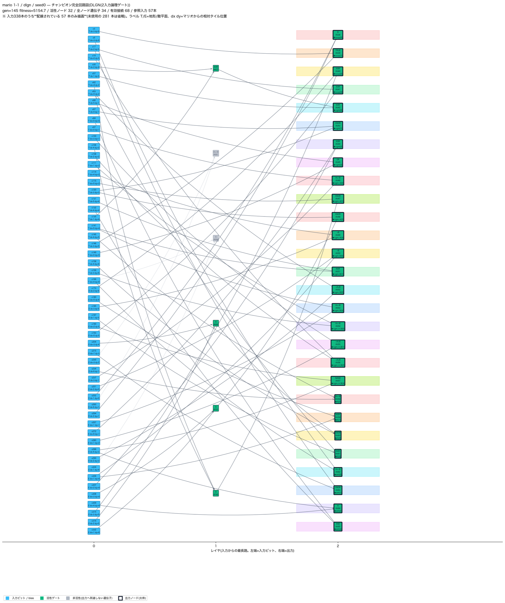

import ShowcaseVideo from '../../../components/ShowcaseVideo.astro';

**32個の2入力論理ゲートが、スーパーマリオブラザーズの1-1をクリアした。**
重みも掛け算も無い。ビットを受け取ってビットを返す小さな回路が、穴を飛び越え、敵を避けて旗まで走る。

<ShowcaseVideo
	name="mario_dlgn_clear.mp4"
	caption="クリアした回路の走行。ゲーム画面と一緒に、回路の入力ビットとゲートがリアルタイムに点灯する。"
	meta="32ゲート・第145世代でクリア"
/>

<small>ゲーム画面は Nintendo の著作物です。研究目的で引用しています。</small>

## 回路が見ているもの

回路はゲーム画面のピクセルを見ていない。ゲーム機のメモリ(RAM)から地形と敵の位置を読み、
**マリオを中心にした13×13マスのタイル図を2枚**(地形用と敵用)作って入力にしている。
1マスが1ビットなので、入力は合計338ビットになる。

この「ピクセルではなくマリオ中心のタイル図を見せる」という観測の作り方は、
NEATでマリオを遊ばせた先行例 MarI/O に倣ったものだ。

回路の出力は7通りの操作(何もしない・右・右+ジャンプなど)への投票で、
いちばん票を集めた操作を4フレームのあいだ押し続ける。

## 進化のタイムラプス

最初の世代の回路はほとんど前に進めない。NEATが世代ごとにゲートと配線を足し引きし、
うまく進めた個体を残していくと、到達距離が少しずつ伸びていく。

<ShowcaseVideo
	name="mario_dlgn_progress.mp4"
	caption="世代ごとの最良個体をつないだタイムラプス。各場面に世代と適応度のラベルが付く。"
/>

クリアした個体が見つかったのは第145世代、進化を始めてから2時間9分後だった。

## クリアした回路

進化が見つけた回路の全体図。左端が入力ビット、右端が操作ごとの投票ゲートだ。
338本の入力のうち、実際に配線されているのは**57本だけ**で、残りの281本は使われていない。
ラベルの `T dx+1 dy-3` は「地形の、マリオから右へ1マス・上へ3マスのタイル」を表す。

### 12ゲートまで縮む

進化が見つけた回路には、結果に効いていないゲートも混ざっている。
クリアまでの行動列を1ステップも変えないという条件で回路を削ると、
**32ゲートは12ゲートまで縮んだ**(-62%)。残った12個の内訳は定数3・入力を1本だけ使うゲート3・
本当に2入力を使うゲート6で、「クリアに必要な非自明な計算」は6ゲートに収まっている。

ただしこの「同じ動き」は、検証に使った走行で通った入力に対してだけ保証される。
見たことのない状況でも同じに振る舞うとは限らない。

## 同じ条件のNNとの比較

同じ338ビットの観測・同じ評価で、実数の重みを持つ従来のNEAT(NN)も進化させた。
結果は引き分けだ。

| | 論理回路(DLGN) | NN |
|---|---|---|
| クリアした本数 | 2本中1本(第145世代) | 2本中1本(第593世代) |
| クリアした個体の大きさ | 32ゲート | 51パラメータ |
| クリアできなかった1本 | 最後の階段で止まる | 穴に落ちる |

ゲート数とパラメータ数は単位が違うので、どちらが小さいとは言えない。
「338ビットの観測から、32個の論理ゲートでクリアする解が存在し、NEATでそこへたどり着ける」までが、この実験で言えることだ。

## 弱点: これは丸暗記に近い

1-1は毎回まったく同じように進む決定的なステージなので、
回路は「状況を見て反応する」よりも「決まった操作列をなぞる」方向へ育ちやすい。
実際、操作の一部をランダムに差し替えるとこのクリアは崩れる。

| 外乱(操作をランダムに置き換える割合) | クリア | 到達距離の中央値 |
|---|---|---|
| なし | 10回中10回 | ゴール(x=3161) |
| 1% | 10回中3回 | — |
| 5% | 10回中0回 | x=450 |

5%の外乱では適応度が88%下がる。これは論理回路だけの欠点ではなく、同じ評価で育てたNNにも共通する、
「決まった1面を1回だけ走らせて評価する」という育て方の限界だ。

外乱をかけた評価で育て直すと、5%の外乱の下では28ゲートの回路が、同じ計算時間で育てたNN(8〜533パラメータ)のどれよりも遠くまで進んだ。
ただし外乱が2%以下だとNNの小さな個体の方が上で、外乱の下でゴールまでたどり着いた個体は1つも出ていない。
**外乱に強いマリオ回路は、まだ作れていない。**

なお、NEATでスーパーマリオを攻略する研究には先行例がある(Sørensen, Olsen, Risi, IEEE CIG 2016)。
ここでの新しさは「重みを持つニューロンではなく、2入力の論理ゲートだけの回路で」という点にある。
