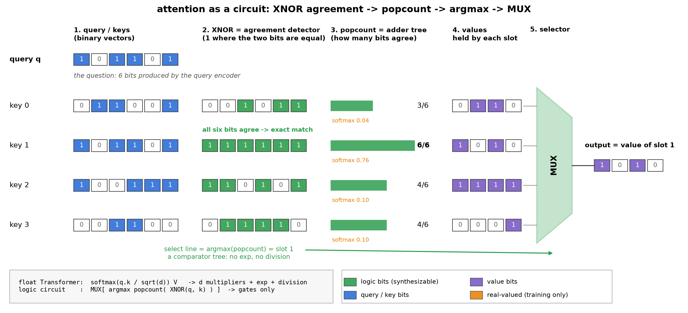
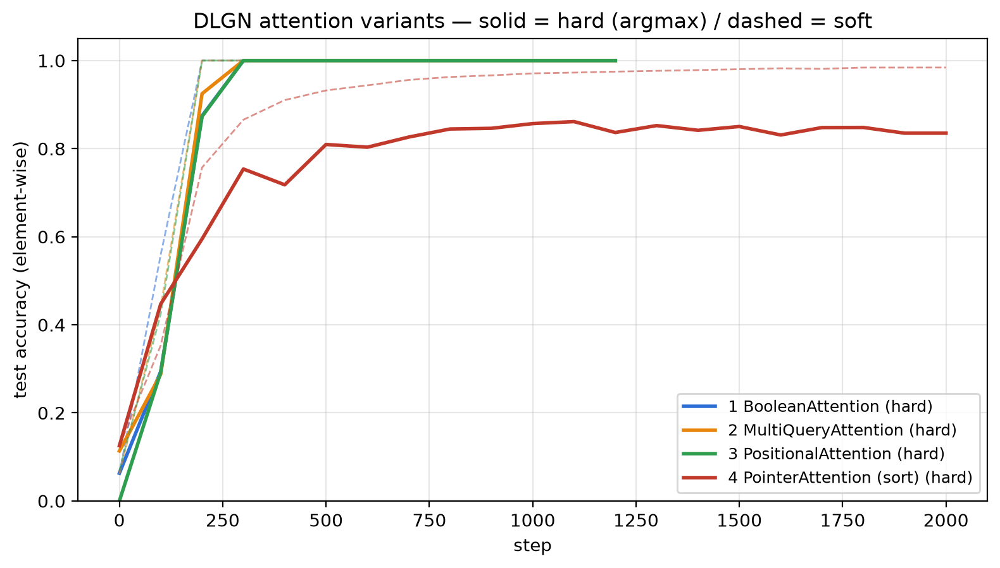
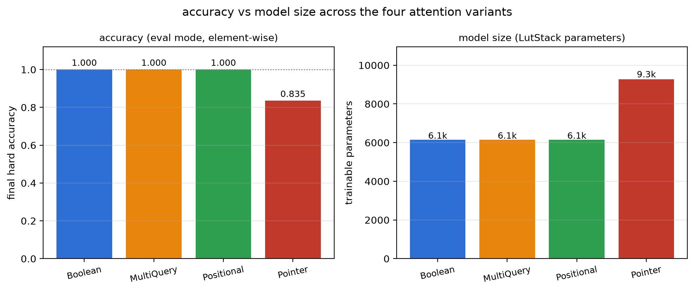
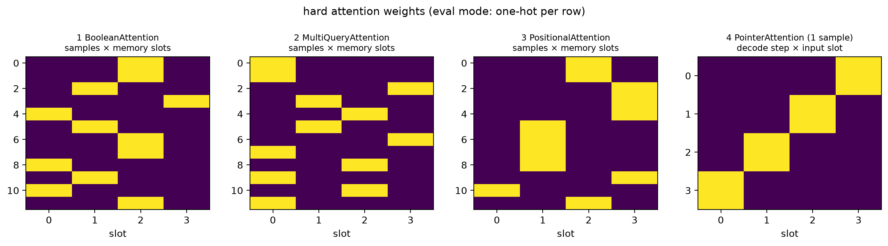

<!-- このファイルは scripts/build_tutorials.py が自動生成しています。
     直接編集せず、examples/20_attention_tour.py を編集して再生成してください。 -->

内積を **XNOR 類似度**に、softmax を **argmax** に置き換えた Attention の4変種を、
連想想起・位置ルックアップ・ソートの小タスクで一気に動かして比べるツアー。

Boolean / MultiQuery / Positional の3つは hard accuracy 1.000(6,144 params)で解け、
4要素ソートを解く Pointer だけが 0.835 に留まる。hard attention の重み行列を描くと
全行が one-hot になり、**Pointer では置換行列**が現れる ── 「どこを見るか」が
連続的な加重平均ではなく、離散的な選択として学習されていることが目で分かる。

:::tip[このページで学ぶこと]
1. 内積 → XNOR 類似度、softmax → argmax という Attention の置き換え方
2. 4変種(Boolean / MultiQuery / Positional / Pointer)の使い分けと得手不得手
3. hard attention の重み行列の読み方 ── one-hot 化と、Pointer に現れる置換行列

**前提**

- [Transformerを段階的に論理化](/tutorials/logic-ladder/) — なぜ softmax を捨てても解けるのか
- [Transformer(論理ゲートGPT)](/tutorials/logic-gpt/)
:::

:::note[このページについて]
所要時間の目安: **約7分** / 実行環境: CPU のみ(GPU 不要)
元スクリプト: [`examples/20_attention_tour.py`](https://github.com/tsukushi-gate/Griffith/blob/main/examples/20_attention_tour.py)
手元で試す: [`notebooks/20_attention_tour.ipynb`](https://github.com/tsukushi-gate/Griffith/blob/main/notebooks/20_attention_tour.ipynb)(このページと同じ内容の未実行ノートブック。`uv run --group docs jupyter lab notebooks/` で開ける)
コード出力はすべて **実際に実行した結果**をそのまま埋め込んでいます。
:::

<!-- Colabバッジ: リポジトリ public 化後、この span を data-colab-url を href に
     持つ <a> へ差し替えると「Colabで開く」が有効になる。 -->
<span class="colab-badge" data-colab-url="https://colab.research.google.com/github/tsukushi-gate/Griffith/blob/main/notebooks/20_attention_tour.ipynb">▶ Colabで開く(リポジトリ公開後に有効化)</span>

論理ゲート版Attentionの4変種を、連想想起(key-value lookup)系の小タスクで比較する。

MNIST(examples/06_mnist.py)までの例は「入力ビット列 → クラス」の素直な分類器だった。
ここでは**回路が「どこを見るか」を自分で決める**Attention機構に踏み込む。

論理ゲートNNのAttentionは、Transformerの内積+softmaxを次のように置き換える:

    内積類似度  →  XNOR類似度(popcount)   ... 一致ビット数を数えるだけ
    softmax     →  訓練時のみsoftmax、推論時はargmax(Hard Attention)

XNORとpopcountはどちらも純粋な組合せ回路なので、学習後の姿は「乗算器のない
連想メモリ(CAM)」そのものになる。訓練時だけ連続緩和(softmax)を使い、
eval()に入れた瞬間にargmaxの離散選択へ切り替わる——LutLayerのsoft/hardと同じ設計思想。

本サンプルで巡る4変種(griffith_logic.models.attention):

  1. DLGNBooleanAttention      単一クエリの連想想起。Attentionの最小形
  2. DLGNMultiQueryAttention   同じKVメモリに複数クエリを並列適用(multi-head的な拡張)
  3. DLGNPositionalAttention   キーが入力ではなく「固定の位置番号」。内容ではなく位置で引く
  4. DLGNPointerAttention      Pointer Network風。自己回帰+マスクで「引いては消す」を繰り返し
                               ソートを解く(=連想想起の反復適用)

4変種は「メモリの引き方」だけが違い、学習ループ・損失・データ形式は共通にできる。
どこを差し替えると何が解けるようになるのか、という対比がこのページの主題になる。

**Attentionを作る3つの部品(初心者向けの言い換え)**

- **XNOR = 一致検出器**。2本の線が同じ値なら1、違えば0を出す1個のゲート。
  ビット幅だけ並べると「どのビットが揃ったか」の地図になる
- **popcount = 多数決(1の本数を数える加算木)**。一致地図の1を数えれば
  「何ビット揃ったか」= 類似度。**掛け算器は1つも要らない**
- **MUX(マルチプレクサ)= 選択器**。「何番を通すか」の指示で入力を1本だけ出口へ通す
  交通整理のスイッチ。softmaxの加重平均の代わりに、勝ったスロットの値をそのまま通す

図1はこの3部品に**具体的なビット列**を流し、クエリ `101101` と4本のキーの一致数
(3/6・6/6・4/6・4/6)から、MUXがバリュー `1010` を選び出すまでを1枚で追う。

**4変種はどこが違うのか**

```mermaid
flowchart TB
  subgraph LEG["凡例(色の意味)"]
    direction LR
    lg["緑 = 論理ゲート<br/>ビットの世界・そのまま回路に焼ける"]
    lr["橙 = 実数<br/>訓練時のsoftmaxだけ・回路には残らない"]
  end
  subgraph V1["1 DLGNBooleanAttention — 内容で引く(連想メモリ / 6,144 params)"]
    direction LR
    a1["問い<br/>入力末尾のクエリ 4bit"]
    a2["照合<br/>4本のキーと XNOR<br/>完全一致が必ず最大popcount"]
    a3["選択<br/>MUX が V を1本<br/>→ LutStack デコーダ"]
    a1 --> a2 --> a3
  end
  subgraph V2["2 DLGNMultiQueryAttention — 同じメモリを2回引く(6,144 params)"]
    direction LR
    b1["問い<br/>クエリ2本"]
    b2["照合<br/>KVエンコーダは共有のまま<br/>スコアが (B,2,4) に伸びるだけ"]
    b3["選択<br/>クエリごとに MUX<br/>回路面積はほぼ据え置き"]
    b1 --> b2 --> b3
  end
  subgraph V3["3 DLGNPositionalAttention — 番地で引く(6,144 params)"]
    direction LR
    c1["問い<br/>位置番号 2bit"]
    c2["照合<br/>キーは入力に無い<br/>0..3 を符号化した定数キー"]
    c3["選択<br/>その番地のスロットを MUX<br/>位置符号が回路に焼き込まれる"]
    c1 --> c2 --> c3
  end
  subgraph V4["4 DLGNPointerAttention — 引いては消す(ソート / 9,280 params)"]
    direction LR
    d1["問い<br/>自己回帰デコーダが毎ステップ生成"]
    d2["照合<br/>入力スロットと XNOR<br/>+ 選択済みを抑圧する累積マスク"]
    d3["選択<br/>4ステップぶん MUX<br/>結果は置換行列になる"]
    d1 --> d2 --> d3
  end
  style lg fill:#10b98126,stroke:#10b981
  style lr fill:#f9731626,stroke:#f97316
  style a1 fill:#10b98126,stroke:#10b981
  style a2 fill:#10b98126,stroke:#10b981
  style a3 fill:#10b98126,stroke:#10b981
  style b1 fill:#10b98126,stroke:#10b981
  style b2 fill:#10b98126,stroke:#10b981
  style b3 fill:#10b98126,stroke:#10b981
  style c1 fill:#10b98126,stroke:#10b981
  style c2 fill:#10b98126,stroke:#10b981
  style c3 fill:#10b98126,stroke:#10b981
  style d1 fill:#10b98126,stroke:#10b981
  style d2 fill:#10b98126,stroke:#10b981
  style d3 fill:#10b98126,stroke:#10b981
```



違うのは「問いをどこから作るか」と「選んだ後に何をするか」だけで、真ん中の
XNOR+popcount+MUX は4変種で完全に共通である。1〜3は同じ幅の設定なので回路規模も
同じ(各 6,144 パラメータ)になり、Pointerだけ自己回帰セルとクエリ生成器のぶん
増える(9,280 パラメータ)。

出てくる図は4枚:

    図1  Q・K内積+softmax を XNOR+popcount+MUX に置き換える仕組み(具体ビットで追う)
    図2  4変種の学習曲線(hard と soft の重なり方を見る)
    図3  最終 hard accuracy とパラメータ数の比較(コスパの比較)
    図4  学習後のAttention重み(どのスロットを指しているか)

実行: uv run python examples/20_attention_tour.py
所要: CPUで2分前後(4タスク合計)。精度を狙う本格レシピは
      experiments/train_boolean_attention.py 系を参照
期待結果: 1〜3は hard accuracy 1.00(完全に解ける)、4(ソート)は要素単位0.85前後・系列完全一致0.65前後

## 準備: import と乱数種

使うのは PyTorch と matplotlib、そして `griffith_logic.models.attention` の4変種だけ。
soft(訓練時の連続緩和)と hard(推論時の離散選択)の切り替えはモデル側が持っているので、
学習コードには特別な仕掛けが一切要らない ── そこが以降のコードの読みどころになる。

```python
import matplotlib.pyplot as plt
import torch
import torch.nn.functional as F

from griffith_logic.models.attention import (
    BooleanAttentionConfig,
    DLGNBooleanAttention,
    DLGNMultiQueryAttention,
    DLGNPointerAttention,
    DLGNPositionalAttention,
    MultiQueryAttentionConfig,
    PointerAttentionConfig,
    PositionalAttentionConfig,
)
```

```python
# 配線(ランダム結線)とゲート初期値は乱数依存なので固定する。
torch.manual_seed(0)
```

### 共通ハイパーパラメータ

4タスクを合計で CPU 数分に収めるための縮小レシピ。`STEPS` と各エンコーダ幅を増やすほど
精度は上がるが、ここでは精度そのものより「4変種を同じ土俵で並べて比べる」ことを優先している。

```python
STEPS = 1200      # 1タスクあたりの学習イテレーション数
STEPS_PTR = 2000  # Pointer(自己回帰・ソート)だけは難しいので長めに回す
BATCH = 128       # ミニバッチサイズ
EVAL_EVERY = 100  # 学習曲線のサンプリング間隔
N_TRAIN = 20000   # 訓練サンプル数(その場で合成する)
N_TEST = 2000     # 評価サンプル数
LR = 0.01
```

## 心臓部の置き換え: 内積+softmax を XNOR+popcount+MUX へ

Transformer の attention は `softmax(q·k/√d)·V`、つまり**実数の内積**で問い合わせと記憶の
近さを測り、**softmax の加重平均**でバリューを混ぜる。乗算器と指数関数が要るので、
論理ゲートだけの回路には重い。論理ゲート版はこれを3つの部品で置き換える。

- **XNOR**(排他的論理和の否定)= **一致検出器**。2本の線が同じ値なら1、違えば0を出す1個のゲート。
  ビット幅だけ並べると「どのビットが揃ったか」の地図になる
- **popcount** = 立っているビットの本数を数える加算木。一致地図の1を数えれば
  「何ビット揃ったか」= 類似度になる。**掛け算器は1つも要らない**
- **MUX**(マルチプレクサ)= 選択器。「何番を通すか」の指示線で、入力を1本だけ出口へ通す
  交通整理のスイッチ。softmax の加重平均の代わりに、勝ったスロットの値をそのまま通す

**なぜこの置き換えが成立するのか**: 二値ベクトル同士の内積は「一致ビット数」そのもの
(= ハミング距離の裏返し)なので、内積が測っていた類似度の意味は失われない。
選択側も同じ発想で、訓練中だけ softmax(温度 `tau_attn`)で全スロットを混ぜて勾配を流し、
`eval()` では最大スコアのスロットだけを取る argmax に切り替える(= **hard attention**)。
LutLayer の soft/hard と完全に同じ設計思想である。

```python
# LutStackの幅。[隠れ層, 出力層] の2段。出力層が d_attn / d_val になる。
ENC = [64, 32]        # key/query エンコーダ(→ d_attn)
VENC = [64, 32]       # value エンコーダ(→ d_val)
DEC = [128, 64]       # 出力デコーダ(最終層は num_classes で割り切れること)

# 下の数値例は学習前の手書きベクトル。上で述べた2段の置き換え
# (内積 → popcount(XNOR) / softmax → argmax)を、そのまま数字で追えるようにしてある。

demo_query = torch.tensor([1.0, 0.0, 1.0, 1.0, 0.0, 1.0])
demo_keys = torch.tensor([
    [0.0, 1.0, 1.0, 0.0, 0.0, 1.0],   # 3ビット一致
    [1.0, 0.0, 1.0, 1.0, 0.0, 1.0],   # 全ビット一致(= 正解スロット)
    [1.0, 0.0, 0.0, 1.0, 1.0, 1.0],   # 4ビット一致
    [0.0, 0.0, 1.0, 1.0, 0.0, 0.0],   # 4ビット一致
])
demo_values = torch.tensor([          # 各スロットが持つバリュー(MUXが1本だけ通す中身)
    [0.0, 1.0, 1.0, 0.0],
    [1.0, 0.0, 1.0, 0.0],             # 勝者スロットのバリュー
    [1.0, 1.0, 1.0, 1.0],
    [0.0, 0.0, 0.0, 1.0],
])
demo_xnor = demo_query * demo_keys + (1 - demo_query) * (1 - demo_keys)
demo_scores = demo_xnor.sum(dim=-1)
demo_soft = F.softmax(demo_scores / 1.0, dim=-1)
demo_winner = int(demo_scores.argmax().item())
demo_hard = F.one_hot(demo_scores.argmax(-1), num_classes=demo_keys.shape[0]).float()
demo_out = demo_values[demo_winner]
q_str = ''.join(str(int(b)) for b in demo_query)
key_str = [''.join(str(int(b)) for b in row) for row in demo_keys]
xnor_str = [''.join(str(int(b)) for b in row) for row in demo_xnor]
val_str = [''.join(str(int(b)) for b in row) for row in demo_values]

print('=== 図1の数値例: XNOR一致検出 → popcount → MUX選択 ===')
print(f'query   = {q_str}')
for i, s in enumerate(demo_scores):
    print(f'key[{i}]  = {key_str[i]}  XNOR={xnor_str[i]}  popcount={int(s.item())}/6  '
          f'softmax={demo_soft[i]:.3f}  value={val_str[i]}')
print(f'argmax が選ぶスロット = {demo_winner} / MUX が出すバリュー = {val_str[demo_winner]}')
```

```text title="出力"
=== 図1の数値例: XNOR一致検出 → popcount → MUX選択 ===
query   = 101101
key[0]  = 011001  XNOR=001011  popcount=3/6  softmax=0.038  value=0110
key[1]  = 101101  XNOR=111111  popcount=6/6  softmax=0.757  value=1010
key[2]  = 100111  XNOR=110101  popcount=4/6  softmax=0.102  value=1111
key[3]  = 001100  XNOR=011110  popcount=4/6  softmax=0.102  value=0001
argmax が選ぶスロット = 1 / MUX が出すバリュー = 1010
```

### 図1: 具体ビットで追う「Attention = XNOR + popcount + MUX」

**この図で何を見るか**: 学習前の手書きベクトルを左から右へ流し、クエリ `101101` と
4本のキーの一致ビット数(3/6・6/6・4/6・4/6)から、MUX がバリュー `1010` を選び出すまでを
1枚で追う。ビットの箱は**塗り=1 / 白=0**。緑は論理(そのまま回路に焼ける部分)、
橙は実数(訓練時の softmax だけで、回路には残らない部分)を表す。

```python
# 描画順は回路を流れる順そのもの:
#   キー(6bit) → XNOR一致地図 → popcount(一致本数) → 重み → バリュー → MUX → 出力。
COLOR_LOGIC, COLOR_REAL, C_KEY, C_VAL = '#2e9e4f', '#e8850c', '#2e6fd6', '#7a5cc4'
BIT_W, BIT_H = 0.40, 0.36
X_KEY, X_XNOR, X_BAR, X_VAL, X_MUX, X_OUT = 1.55, 4.45, 7.35, 10.1, 12.0, 13.3
Y_Q, Y_TOP, Y_GAP = 7.5, 6.1, 1.2
key_y = [Y_TOP - i * Y_GAP for i in range(4)]
y_mid = (key_y[0] + key_y[3]) / 2
bit_rows = [(X_KEY, Y_Q, demo_query, C_KEY), (X_OUT, y_mid, demo_out, C_VAL)]
for i, y in enumerate(key_y):
    bit_rows += [(X_KEY, y, demo_keys[i], C_KEY), (X_XNOR, y, demo_xnor[i], COLOR_LOGIC),
                 (X_VAL, y, demo_values[i], C_VAL)]
fig, ax = plt.subplots(figsize=(13.5, 6.2))
for bx, by, vec, bcolor in bit_rows:
    for j, bit in enumerate(vec):
        one = float(bit) > 0.5
        ax.add_patch(plt.Rectangle((bx + j * BIT_W, by - BIT_H / 2), BIT_W * 0.88, BIT_H,
                                   facecolor=bcolor if one else 'white',
                                   edgecolor='#333', lw=0.8, alpha=0.9 if one else 1.0))
        ax.text(bx + j * BIT_W + BIT_W * 0.44, by, str(int(one)), ha='center', va='center',
                fontsize=8.5, color='white' if one else '#666')
ax.text(0.1, Y_Q, 'query q', ha='left', va='center', fontsize=10, weight='bold')
ax.text(X_KEY, Y_Q - 0.55, 'the question: 6 bits produced by the query encoder',
        ha='left', fontsize=9, style='italic', color='#555')
for i, y in enumerate(key_y):
    count = int(demo_scores[i].item())
    ax.text(0.1, y, f'key {i}', ha='left', va='center', fontsize=10)
    ax.add_patch(plt.Rectangle((X_BAR, y - 0.16), 1.9 * count / 6, 0.32,
                               facecolor=COLOR_LOGIC, alpha=0.85, edgecolor='none'))
    ax.text(X_BAR + 1.95, y, f'{count}/6', ha='left', va='center', fontsize=10,
            weight='bold' if i == demo_winner else 'normal')
    ax.text(X_BAR + 0.03, y - 0.5, f'softmax {demo_soft[i]:.2f}', ha='left', fontsize=8,
            color=COLOR_REAL)
    ax.plot([X_VAL + 4 * BIT_W, X_MUX], [y, y], color='#999', lw=1)
    if i == demo_winner:
        ax.text(X_XNOR + 1.25, y + 0.42, 'all six bits agree -> exact match',
                ha='center', fontsize=8.5, color=COLOR_LOGIC, weight='bold')
ax.add_patch(plt.Polygon([[X_MUX, key_y[0] + 0.55], [X_MUX + 0.8, key_y[0] - 0.35],
                          [X_MUX + 0.8, key_y[3] + 0.35], [X_MUX, key_y[3] - 0.55]],
                         closed=True, facecolor=COLOR_LOGIC, alpha=0.28,
                         edgecolor=COLOR_LOGIC, lw=1.6))
ax.text(X_MUX + 0.4, y_mid, 'MUX', ha='center', va='center', fontsize=11,
        weight='bold', rotation=90)
ax.annotate('', xy=(X_MUX + 0.4, key_y[3] - 0.85), xytext=(X_XNOR + 2.3, key_y[3] - 0.75),
            arrowprops={'arrowstyle': '-|>', 'color': COLOR_LOGIC, 'lw': 1.4})
ax.text(X_XNOR + 0.6, key_y[3] - 0.62,
        f'select line = argmax(popcount) = slot {demo_winner}\n'
        'a comparator tree: no exp, no division',
        ha='center', va='top', fontsize=9, color=COLOR_LOGIC)
ax.plot([X_MUX + 0.8, X_OUT], [y_mid, y_mid], color='#333', lw=1.2)
ax.text(X_OUT + 2 * BIT_W, y_mid + 0.55, f'output = value of slot {demo_winner}',
        ha='center', fontsize=9.5, weight='bold')
for x, label in [(X_KEY, '1. query / keys\n(binary vectors)'),
                 (X_XNOR, '2. XNOR = agreement detector\n(1 where the two bits are equal)'),
                 (X_BAR, '3. popcount = adder tree\n(how many bits agree)'),
                 (X_VAL, '4. values\nheld by each slot'),
                 (X_MUX - 0.15, '5. selector')]:
    ax.text(x, 8.5, label, ha='left', va='top', fontsize=9.5, weight='bold')
ax.add_patch(plt.Rectangle((0.1, 0.15), 7.3, 1.0, facecolor='#f7f7f7', edgecolor='#bbb'))
ax.text(0.3, 0.65,
        'float Transformer:  softmax(q.k / sqrt(d)) V   -> d multipliers + exp + division\n'
        'logic circuit    :  MUX[ argmax popcount( XNOR(q, k) ) ]  -> gates only',
        ha='left', va='center', fontsize=8.5, family='monospace')
ax.add_patch(plt.Rectangle((7.6, 0.15), 6.1, 1.0, facecolor='white', edgecolor='#bbb'))
legend_items = [(7.65, 0.78, COLOR_LOGIC, 'logic bits (synthesizable)'),
                (7.65, 0.38, C_KEY, 'query / key bits'),
                (10.5, 0.78, C_VAL, 'value bits'),
                (10.5, 0.38, COLOR_REAL, 'real-valued (training only)')]
for lx, ly, color, label in legend_items:
    ax.add_patch(plt.Rectangle((lx, ly - 0.12), 0.28, 0.24, facecolor=color, alpha=0.9,
                               edgecolor='#333', lw=0.6))
    ax.text(lx + 0.38, ly, label, va='center', fontsize=8.5)
ax.set_xlim(0, 15.3)
ax.set_ylim(0, 8.8)
ax.set_axis_off()
ax.set_title('attention as a circuit: XNOR agreement -> popcount -> argmax -> MUX',
             fontsize=13, weight='bold')
fig.tight_layout()
plt.show()
```

    

    

**読み取り**: 完全一致したキー1本だけが popcount 6/6 に届き、他は必ずそれ未満に収まる。
だから「最大 popcount のスロットを選ぶ」という**比較器だけの規則**で正解が確定する ──
指数関数も除算も現れない。ここが以降の4変種すべてに共通する心臓部である。

## データセット: 3つの小タスクをその場で合成する

Attention モデルの入力は「1本のフラットな二値ベクトル」で、どのビットがキーで
どこからがクエリかは Config の取り決めだけで決まる。つまり下の3つのジェネレータが、
そのまま各タスクの**入力レイアウトの定義**になっている。

```python
def to_bits(values: torch.Tensor, n_bits: int) -> torch.Tensor:
    """整数テンソルを MSB ファーストの二値テンソル (..., n_bits) にする。"""
    shifts = torch.arange(n_bits - 1, -1, -1)
    return ((values.unsqueeze(-1) >> shifts) & 1).float()
```

```python
def make_recall(n, num_pairs, key_bits, value_bits, num_queries=1):
    """連想想起: [K1,V1, ..., Kn,Vn, Q(,Q2...)] → クエリに一致するキーのバリュー。

    キーはサンプル内で重複しないよう、全キー空間をシャッフルして先頭num_pairs個を取る
    (同じキーが2つあると「正解」が定義できないため)。
    """
    n_keys = 2 ** key_bits
    keys = torch.rand(n, n_keys).argsort(dim=-1)[:, :num_pairs]        # (n, P) 重複なし
    values = torch.randint(0, 2 ** value_bits, (n, num_pairs))          # (n, P)
    q_idx = torch.randint(0, num_pairs, (n, num_queries))               # (n, Q)

    # メモリ部: ペアごとに [キービット, バリュービット] を連結して一列に並べる
    pair_bits = torch.cat([to_bits(keys, key_bits), to_bits(values, value_bits)], dim=-1)
    memory = pair_bits.reshape(n, -1)                                   # (n, P*(KB+VB))
    # クエリ部: 選んだペアのキーをそのまま問い合わせとして末尾に置く
    query = to_bits(torch.gather(keys, 1, q_idx), key_bits).reshape(n, -1)

    x = torch.cat([memory, query], dim=-1)
    y = torch.gather(values, 1, q_idx)                                  # (n, Q)
    return x, (y.squeeze(-1) if num_queries == 1 else y)
```

```python
def make_positional(n, pos_bits, value_bits):
    """位置指定ルックアップ: [V0, V1, ..., V(N-1), pos] → V_pos。

    連想想起との違いは「キーが入力に無い」こと。キーはスロット番号0..N-1に固定され、
    モデル側が定数として保持する(=位置エンコーディングが回路として焼き込まれている)。
    """
    num_slots = 2 ** pos_bits
    values = torch.randint(0, 2 ** value_bits, (n, num_slots))
    pos = torch.randint(0, num_slots, (n,))
    x = torch.cat([
        to_bits(values, value_bits).reshape(n, -1),
        to_bits(pos, pos_bits),
    ], dim=-1)
    y = torch.gather(values, 1, pos.unsqueeze(-1)).squeeze(-1)
    return x, y
```

```python
def make_sort(n, seq_len, value_bits):
    """ソート: [V0, ..., V(N-1)] → 昇順に並べ替えた列。

    Pointer Networkは「出力を作る」のではなく「入力のどれを指すか」を選ぶ。
    そのため教師信号は値の列(y)とポインタ列(ptr = argsort)の2本になる。
    """
    values = torch.randint(0, 2 ** value_bits, (n, seq_len))
    ptr = values.argsort(dim=-1)                       # どのスロットを何番目に出すか
    y = torch.gather(values, 1, ptr)                   # = sorted(values)
    x = to_bits(values, value_bits).reshape(n, -1)
    return x, y, ptr
```

## 共通の学習ループ

4モデルとも「forward して cross entropy」だけで学習できる。Attention の soft/hard 切り替えは
`model.train()` / `model.eval()` が面倒を見るので、**学習側の記述は4変種で完全に共通**になる。

評価では毎回 soft と hard の両方を測る。**soft** は訓練中に見えている姿(softmax の加重平均)、
**hard** は焼いたときの姿(argmax で1スロットだけ選ぶ)で、両者が重なるほど Attention が
1スロットへ決めきれている、という読み方をするための2本立てである。

```python
PARAM_COUNTS: dict[str, int] = {}
```

```python
def forward_logits(model, x, ptr=None):
    """モデル差(戻り値がtupleかどうか)を吸収してlogitsだけ取り出す。"""
    out = model(x) if ptr is None else model(x, target_pointers=ptr)
    return out[0] if isinstance(out, tuple) else out
```

```python
def accuracy(logits, y):
    """要素単位の正解率(系列タスクなら1トークンずつ数える)。"""
    return (logits.argmax(-1) == y).float().mean().item()
```

### 1タスクを回す train()

回路規模の比較は図3で行うので、`count_parameters()` の結果を `PARAM_COUNTS` に控えておく。

```python
def train(name, model, data, steps=STEPS):
    """1タスクを学習し、(step, soft acc, hard acc) の履歴を返す。"""
    train_x, train_y, train_ptr, test_x, test_y = data
    n_classes = model.config.num_classes
    opt = torch.optim.Adam(model.parameters(), lr=LR)
    history = []

    for step in range(steps + 1):
        if step % EVAL_EVERY == 0:
            with torch.no_grad():
                # soft = 訓練時の姿(softmax加重平均のAttention)
                model.train()
                soft = accuracy(forward_logits(model, test_x), test_y)
                # hard = 焼いた回路の姿(argmaxで1スロットだけ選ぶHard Attention)
                model.eval()
                hard = accuracy(forward_logits(model, test_x), test_y)
                model.train()
            history.append((step, soft, hard))

        idx = torch.randint(0, train_x.shape[0], (BATCH,))
        # Pointerだけは自己回帰デコーダなので、学習時は正解ポインタを流す
        # (teacher forcing)。評価時は target_pointers=None の free-running。
        ptr = None if train_ptr is None else train_ptr[idx]
        logits = forward_logits(model, train_x[idx], ptr)
        yb = train_y[idx]
        opt.zero_grad()
        loss = F.cross_entropy(logits.reshape(-1, n_classes), yb.reshape(-1))
        loss.backward()
        opt.step()

    gates = model.count_parameters()['total']
    PARAM_COUNTS[name] = gates
    print(f'{name:<22} soft={history[-1][1]:.4f}  hard={history[-1][2]:.4f}  '
          f'({gates:,} params)')
    return history
```

## 4変種を順に学習する

ここから4つの変種を上から順に回す。**違うのは「問いをどこから作るか」と「選んだ後に
何をするか」だけ**で、真ん中の XNOR + popcount + MUX は4変種で完全に共通である。

**1. BooleanAttention — Attention の最小形(内容で引く)**。置き換えたのは
内積 → XNOR popcount と、softmax → (eval 時)argmax の2点だけ。Q/K/V を作るエンコーダも
選んだ V を読むデコーダも普通の `LutStack` で、Transformer の骨格はそのまま残っている。
タスクは「4組の(キー,バリュー)と1つのクエリを渡し、一致するキーのバリューを答える」
**連想想起(key-value lookup)**。クエリキーはメモリ内のどれかと**完全一致**するので、
一致ビット数は正解スロットで最大(= `key_bits`)、他では必ずそれ未満になる。
学習で決まるのは類似度の式ではなく、キー/クエリのエンコーダが
「一致を際立たせる符号」へビットを散らす配線のほうである。

```python
print('\n=== 1. DLGNBooleanAttention (単一クエリ連想想起) ===')
cfg1 = BooleanAttentionConfig(
    num_pairs=4, key_bits=4, value_bits=4,
    encoder_sizes=ENC, value_encoder_sizes=VENC, decoder_sizes=DEC,
)
x1, y1 = make_recall(N_TRAIN, cfg1.num_pairs, cfg1.key_bits, cfg1.value_bits)
xt1, yt1 = make_recall(N_TEST, cfg1.num_pairs, cfg1.key_bits, cfg1.value_bits)
print(f'入力 {cfg1.input_dim} ビット = 4ペア×(4キー+4バリュー) + 4クエリ / '
      f'{cfg1.num_classes} クラス')
model1 = DLGNBooleanAttention(cfg1)
hist1 = train('BooleanAttention', model1, (x1, y1, None, xt1, yt1))

# ===========================================================================
# 2. Multi-Query Attention — 同じメモリに複数の問い合わせ
# ---------------------------------------------------------------------------
# 置き換えたもの: クエリを1本からQ本へ。KVエンコーダは共有のまま、クエリ軸を
# バッチ方向に畳んでブロードキャストするだけで済む。
#
# なぜそれで解けるのか: クエリ同士は独立で、参照するメモリだけが共通だから。
# スコア行列が (batch, Q, P) に伸びるだけで、選択規則(最大popcount)は1本のときと同一。
# 回路としては「同じCAMを時分割で複数回引く」ことに相当し、
# **面積(パラメータ)をほとんど増やさずに帯域を稼ぐ**のがこの変種の意味になる。
# 図3で Boolean とパラメータ数を比べると、その安さがそのまま見て取れる。
# ===========================================================================

print('\n=== 2. DLGNMultiQueryAttention (複数クエリ同時想起) ===')
cfg2 = MultiQueryAttentionConfig(
    num_pairs=4, num_queries=2, key_bits=4, value_bits=4,
    encoder_sizes=ENC, value_encoder_sizes=VENC, decoder_sizes=DEC,
)
x2, y2 = make_recall(N_TRAIN, cfg2.num_pairs, cfg2.key_bits, cfg2.value_bits,
                     num_queries=cfg2.num_queries)
xt2, yt2 = make_recall(N_TEST, cfg2.num_pairs, cfg2.key_bits, cfg2.value_bits,
                       num_queries=cfg2.num_queries)
print(f'入力 {cfg2.input_dim} ビット / 出力 (batch, {cfg2.num_queries}, '
      f'{cfg2.num_classes})')
model2 = DLGNMultiQueryAttention(cfg2)
hist2 = train('MultiQueryAttention', model2, (x2, y2, None, xt2, yt2))

# ===========================================================================
# 3. Positional Attention — キーを位置に固定する
# ---------------------------------------------------------------------------
# 置き換えたもの: キーの供給元。入力からキーを読むのをやめ、0..N-1 の位置インデックスを
# key_encoder に通した固定ベクトルをキーにする(入力にはバリュー列と位置番号しか無い)。
#
# なぜそれで解けるのか: 引きたいスロットは位置番号で名指しされているので、
# 「位置番号を符号化したクエリ」と「各スロット番号を符号化したキー」が
# 互いに遠いビットパターンになりさえすれば、popcount最大は必ず正しい番地を指す。
# 学習が進むと key_encoder は事実上、位置番号を散らす符号器になる——
# Transformerの位置エンコーディングが、加算されるベクトルではなく
# **回路として焼き込まれた定数キー**の形で現れる、という対比が見どころ。
# 内容アドレス(1・2)と番地アドレス(3)の違いは、図4のヒートマップの模様にも出る。
# ===========================================================================

print('\n=== 3. DLGNPositionalAttention (位置指定ルックアップ) ===')
cfg3 = PositionalAttentionConfig(
    pos_bits=2, value_bits=4,
    encoder_sizes=ENC, value_encoder_sizes=VENC, decoder_sizes=DEC,
)
x3, y3 = make_positional(N_TRAIN, cfg3.pos_bits, cfg3.value_bits)
xt3, yt3 = make_positional(N_TEST, cfg3.pos_bits, cfg3.value_bits)
print(f'入力 {cfg3.input_dim} ビット = {cfg3.num_slots}スロット×4ビット + 2位置ビット')
model3 = DLGNPositionalAttention(cfg3)
hist3 = train('PositionalAttention', model3, (x3, y3, None, xt3, yt3))

# ===========================================================================
# 4. Pointer Attention — 引いては消す、を繰り返す
# ---------------------------------------------------------------------------
# 置き換えたもの: 出力の作り方。上の3つは「1回引いて終わり」で、選んだバリューを
# デコーダで読むだけだった。Pointerは自己回帰デコーダを持ち、各ステップで
#   (a) デコーダ状態からクエリを作り
#   (b) XNOR類似度で入力スロットを1つ指し
#   (c) 選んだスロットを累積マスクで抑圧する
# を seq_len 回くり返す。出力は「新しい値」ではなく「入力のどれを指したか」。
#
# なぜそれでソートが解けるのか: 昇順に並べ替える操作は「まだ選んでいない中で最小の
# 要素を指す」の反復に等しく、マスクが二度選びを禁じるので、出力は必ず入力の置換になる。
# つまりソートを**連想想起の反復適用**に還元している。図4の右端で行にも列にも
# 高々1マスしか光らない(=置換行列になる)のがその証拠。
#
# ただし難度は段違いで、誤りが後続ステップへ伝播するうえ、学習は teacher forcing、
# 評価は free-running とズレもある。同じ予算では途中までしか上がらない。
# ===========================================================================

print('\n=== 4. DLGNPointerAttention (ポインタ選択によるソート) ===')
cfg4 = PointerAttentionConfig(
    seq_len=4, value_bits=3,
    value_encoder_sizes=VENC, key_encoder_sizes=ENC,
    decoder_cell_sizes=[64, 32], query_producer_sizes=ENC,
    output_decoder_sizes=DEC,
)
x4, y4, ptr4 = make_sort(N_TRAIN, cfg4.seq_len, cfg4.value_bits)
xt4, yt4, _ = make_sort(N_TEST, cfg4.seq_len, cfg4.value_bits)
print(f'入力 {cfg4.input_dim} ビット = {cfg4.seq_len}要素×{cfg4.value_bits}ビット / '
      f'出力は{cfg4.seq_len}ステップの系列')
model4 = DLGNPointerAttention(cfg4)
hist4 = train('PointerAttention', model4, (x4, y4, ptr4, xt4, yt4), steps=STEPS_PTR)
```

    
```text title="出力"
=== 1. DLGNBooleanAttention (単一クエリ連想想起) ===
入力 36 ビット = 4ペア×(4キー+4バリュー) + 4クエリ / 16 クラス

BooleanAttention       soft=1.0000  hard=1.0000  (6,144 params)

=== 2. DLGNMultiQueryAttention (複数クエリ同時想起) ===
入力 40 ビット / 出力 (batch, 2, 16)

MultiQueryAttention    soft=1.0000  hard=1.0000  (6,144 params)

=== 3. DLGNPositionalAttention (位置指定ルックアップ) ===
入力 18 ビット = 4スロット×4ビット + 2位置ビット

PositionalAttention    soft=1.0000  hard=1.0000  (6,144 params)

=== 4. DLGNPointerAttention (ポインタ選択によるソート) ===
入力 12 ビット = 4要素×3ビット / 出力は4ステップの系列

PointerAttention       soft=0.9843  hard=0.8351  (9,280 params)
```

### Pointer は「系列完全一致」でも測り直す

系列タスクは「全ステップ正解」で測ると難しさが分かりやすい。要素単位で 0.85 でも、
4要素すべてが正しい確率はその4乗近くまで落ちうるからである。
学習は教師ポインタを流す **teacher forcing**、評価は自分の出力を次の入力にする
**free-running** なので、そのズレも系列完全一致のほうに強く現れる。

```python
model4.eval()
with torch.no_grad():
    seq_pred = forward_logits(model4, xt4).argmax(-1)
exact = (seq_pred == yt4).all(dim=-1).float().mean().item()
print(f'  └ 要素単位 = {hist4[-1][2]:.4f} / 系列完全一致(全4要素が正しい割合) = {exact:.4f}')
```

```text title="出力"
  └ 要素単位 = 0.8351 / 系列完全一致(全4要素が正しい割合) = 0.6750
```

## 評価: 4変種の最終成績を並べる

以降の図は全部このテーブルから描く。連想想起系の3つ(1〜3)は同じ土俵に立っているので、
まとめて hard accuracy に下限を置いて「学べていない」ことだけを弾いておく。

```python
# 以降の図で使う共通テーブル。(表示名, 履歴, 色, PARAM_COUNTSのキー, 短縮ラベル)。
runs = [
    ('1 BooleanAttention', hist1, '#2e6fd6', 'BooleanAttention', 'Boolean'),
    ('2 MultiQueryAttention', hist2, '#e8850c', 'MultiQueryAttention', 'MultiQuery'),
    ('3 PositionalAttention', hist3, '#2e9e4f', 'PositionalAttention', 'Positional'),
    ('4 PointerAttention (sort)', hist4, '#c0392b', 'PointerAttention', 'Pointer'),
]
print('\n--- 最終 hard accuracy (eval=argmax Hard Attention) ---')
for name, hist, _, key, _ in runs:
    print(f'{name:<28} hard={hist[-1][2]:.4f}  params={PARAM_COUNTS[key]:,}')
```

    
```text title="出力"
--- 最終 hard accuracy (eval=argmax Hard Attention) ---
1 BooleanAttention           hard=1.0000  params=6,144
2 MultiQueryAttention        hard=1.0000  params=6,144
3 PositionalAttention        hard=1.0000  params=6,144
4 PointerAttention (sort)    hard=0.8351  params=9,280
```

```python
# 連想想起系の3つは同じ土俵で学べているはず(閾値は環境差を見て緩めに置く)。
for name, hist, _, _, _ in runs[:3]:
    assert hist[-1][2] > 0.5, f'{name}: hard acc={hist[-1][2]:.4f} が低すぎる'
```

## 可視化: 収束・回路規模・attention 重み

### 図2: 4変種の収束曲線を重ね描き

**この図で何を見るか**: 実線 = hard(argmax、焼いた回路の姿)、破線 = soft(softmax、
学習時の姿)。4変種を1枚に重ね、どれがいつ立ち上がるか、そして**実線と破線が
どれだけ重なるか**を見る。

```python
fig, ax = plt.subplots(figsize=(8, 4.6))
for name, hist, color, _, _ in runs:
    steps, soft, hard = zip(*hist, strict=True)
    ax.plot(steps, hard, '-', color=color, lw=2, label=f'{name} (hard)')
    ax.plot(steps, soft, '--', color=color, lw=1, alpha=0.55)
ax.set_xlabel('step')
ax.set_ylabel('test accuracy (element-wise)')
ax.set_ylim(0, 1.05)  # 1〜3は1.0に張り付くので上端に少しだけ余白を取る
ax.grid(alpha=0.3)
ax.legend(loc='lower right', fontsize=9)
ax.set_title('DLGN attention variants — solid = hard (argmax) / dashed = soft')
fig.tight_layout()
plt.show()
```

    

    

**読み取り**: 1〜3では実線と破線がほぼ重なる。Attention が既に1スロットへ決めきれていて、
softmax を argmax に置き換えても出力が変わらない、ということである。4(Pointer)だけは
2本が離れたまま伸び悩む ── まだ確信の持てない加重平均に留まっているサイン。

### 図3: 精度とパラメータ数を並べる

**この図で何を見るか**: 左が最終 hard accuracy、右がパラメータ数(= 回路規模の目安)。
「解けたか」と「そのためにいくら払ったか」を同じ並びで見るためのコスパ比較である。

```python
labels = [short for *_, short in runs]
final_hard = [hist[-1][2] for _, hist, *_ in runs]
colors = [color for _, _, color, _, _ in runs]
param_counts = [PARAM_COUNTS[key] for *_, key, _ in runs]
fig, axes = plt.subplots(1, 2, figsize=(10, 4.2))
axes[0].bar(labels, final_hard, color=colors)
axes[0].set_ylim(0, 1.12)
axes[0].axhline(1.0, color='gray', ls=':', lw=1)
axes[0].set_ylabel('final hard accuracy')
axes[0].set_title('accuracy (eval mode, element-wise)', fontsize=10)
axes[0].grid(axis='y', alpha=0.3)
for i, v in enumerate(final_hard):
    axes[0].text(i, v + 0.02, f'{v:.3f}', ha='center', fontsize=9)
axes[1].bar(labels, param_counts, color=colors)
axes[1].set_ylabel('trainable parameters')
axes[1].set_title('model size (LutStack parameters)', fontsize=10)
axes[1].grid(axis='y', alpha=0.3)
for i, v in enumerate(param_counts):
    axes[1].text(i, v * 1.01, f'{v / 1000:.1f}k', ha='center', fontsize=9)
axes[1].set_ylim(0, max(param_counts) * 1.18)
for ax in axes:
    ax.tick_params(axis='x', labelrotation=12, labelsize=9)
fig.suptitle('accuracy vs model size across the four attention variants', fontsize=12)
fig.tight_layout()
plt.show()
```

    

    

**読み取り**: 1〜3は同じ幅の設定なので規模もぴったり同じで、そのまま満点に届く。
つまりこの3タスクの難しさは**メモリの引き方**で決まっており、回路規模では決まっていない。
とくに MultiQuery は Boolean と同じ規模のままクエリを2本さばく ── KV エンコーダの共有が
タダで効いており、「面積を増やさずに帯域を稼ぐ」という変種の狙いがそのまま出ている。
Pointer だけは自己回帰セルとクエリ生成器のぶん規模が上がり、それでも精度が届かない。

### 図4: Attention が実際にどこを指しているか

**この図で何を見るか**(最後の図なので読み取り方も先に置く): `eval()` の Attention は
行ごとに1マスだけ1になる **one-hot**(1本だけ立ったベクトル)になる。左3枚は
「テストサンプル(縦) × メモリスロット(横)」で、サンプルごとに引くべき場所が変わるため
模様はばらばらになる ── 内容(1・2)や番地(3)で正しく引き分けている姿である。
右端は1サンプルの「デコードステップ(縦) × 入力スロット(横)」で、見どころは
**各行・各列に高々1マスしか光らない**こと。これは出力が入力の**置換行列**
(並べ替えを表す0/1行列)になったということで、累積マスクが二度選びを禁じている証拠であり、
ソートが「連想想起の反復適用」に還元できたことの確認になる。

```python
n_show = 12
panels = []
for name, model, xt in [
    ('1 BooleanAttention', model1, xt1),
    ('2 MultiQueryAttention', model2, xt2),
    ('3 PositionalAttention', model3, xt3),
]:
    model.eval()
    with torch.no_grad():
        forward_logits(model, xt[:n_show])
    attn = model.last_attention
    # Multi-Queryは (B, Q, P) なので先頭クエリの分だけ見る
    panels.append((f'{name}\nsamples × memory slots',
                   attn[:, 0] if attn.dim() == 3 else attn))

model4.eval()
with torch.no_grad():
    forward_logits(model4, xt4[:1])
panels.append(('4 PointerAttention (1 sample)\ndecode step × input slot',
               model4.last_attention[0]))

fig, axes = plt.subplots(1, 4, figsize=(13, 3.6))
for ax, (title, mat) in zip(axes, panels, strict=True):
    ax.imshow(mat.cpu(), cmap='viridis', vmin=0, vmax=1, aspect='auto')
    ax.set_title(title, fontsize=9)
    ax.set_xlabel('slot')
fig.suptitle('hard attention weights (eval mode: one-hot per row)', fontsize=11)
fig.tight_layout()
plt.show()
```

    


## 次に読む

- [Transformerを段階的に論理化](/tutorials/logic-ladder/) — なぜ softmax を捨てても解けるのかを段階的に確かめる
- [論理ゲートGPT](/tutorials/logic-gpt/) — 変種を言語モデルに載せる
- [LogicMixer(MLP-Mixer)](/tutorials/logic-mixer/) — attention を使わない混ぜ方
