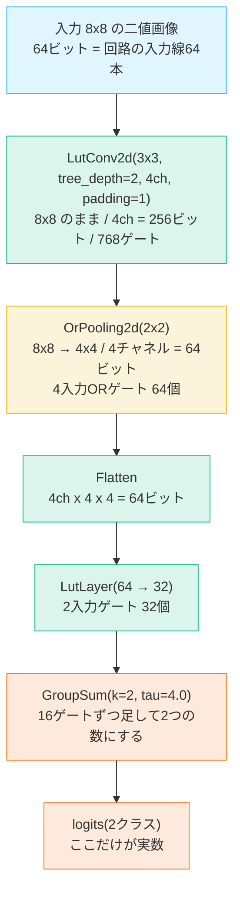
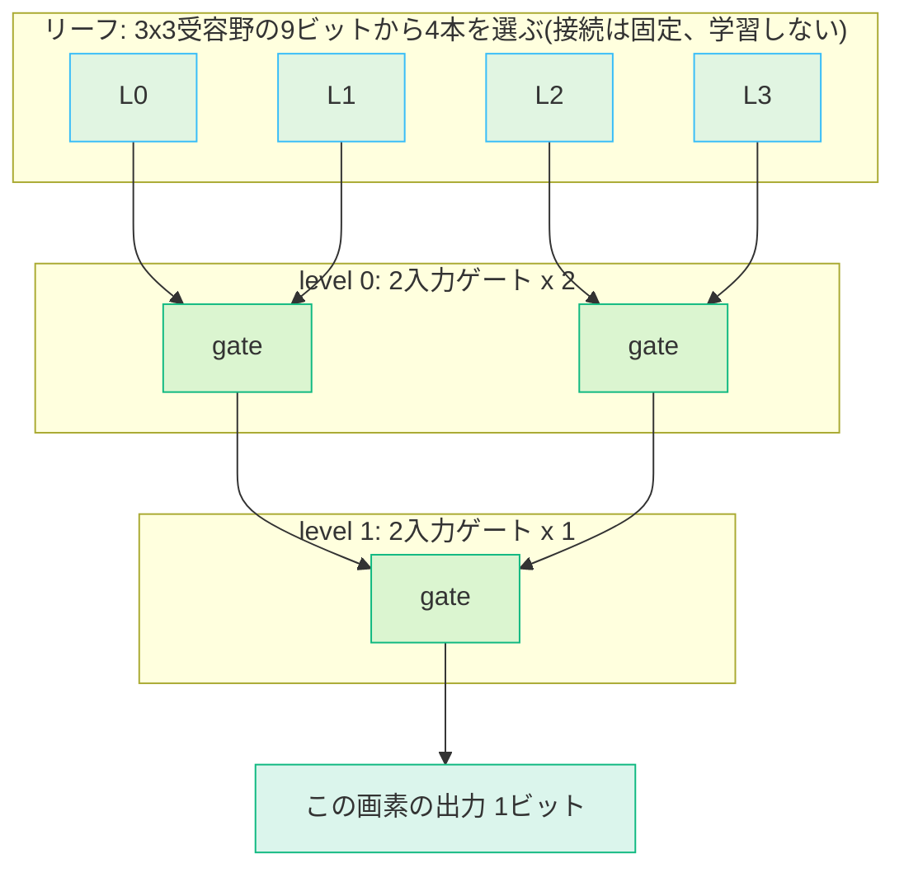
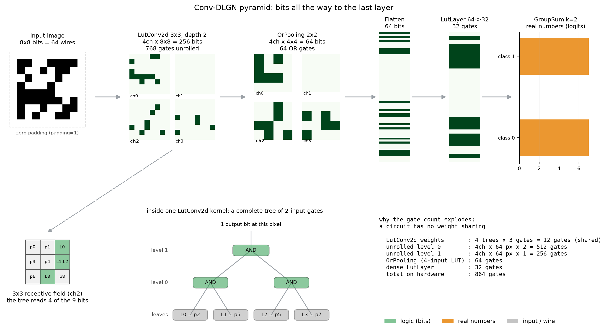
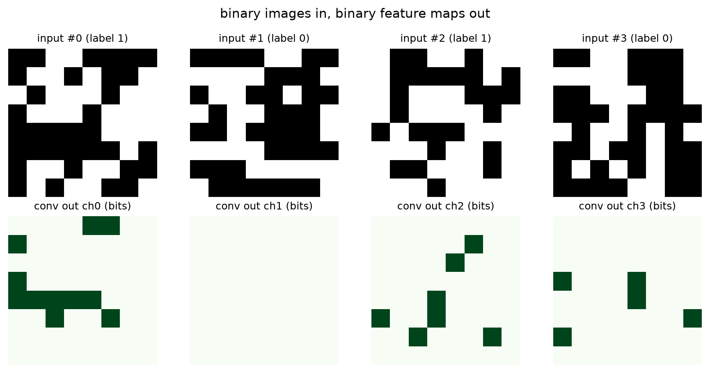
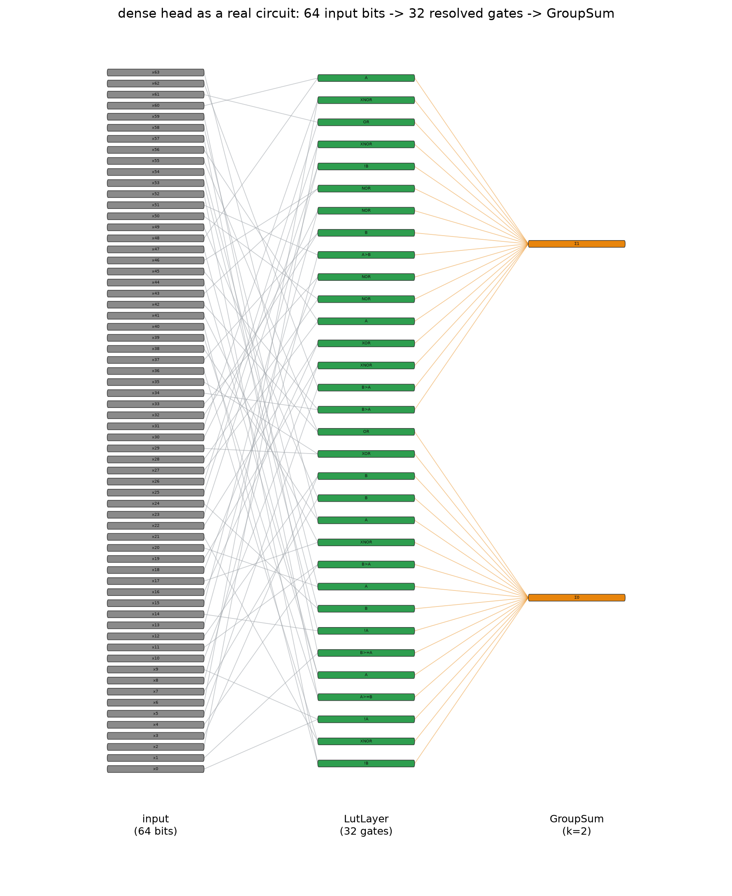
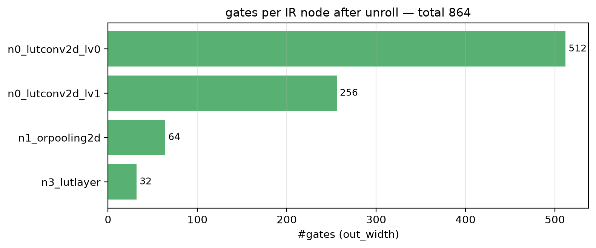
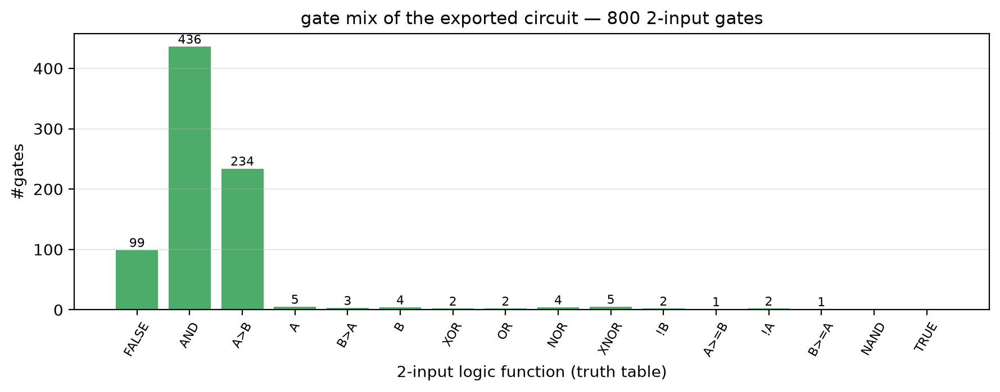
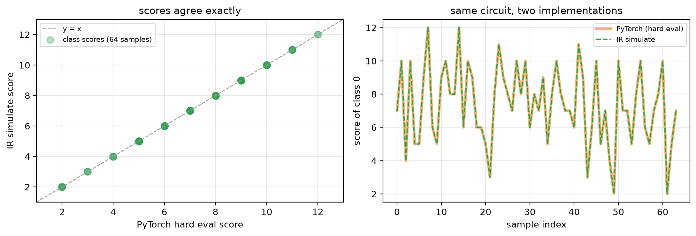

<!-- このファイルは scripts/build_tutorials.py が自動生成しています。
     直接編集せず、examples/05_cnn_export_hdl.py を編集して再生成してください。 -->

論理ゲート畳み込み(`LutConv2d`)+ OR プーリング + LUT 全結合の CNN を学習し、
丸ごと Verilog / VHDL へ変換する。畳み込みは IR 化の際に木レベルごとの
`lut_layer` へ unroll され、padding の境界処理は真理値表の特殊化に畳み込まれる。

:::tip[このページで学ぶこと]
1. `LutConv2d` + OR プーリング + LUT 全結合という論理ゲート CNN の組み方
2. 畳み込みが IR 化で木レベルごとの `lut_layer` へ unroll される様子
3. padding の境界処理が真理値表の特殊化へ畳み込まれること

**前提**

- [3. HDLへエクスポート](/tutorials/hdl-export/) — まず全結合の回路で出口を通す
- [1. MNISTを学習する](/tutorials/mnist/)
:::

:::note[このページについて]
所要時間の目安: **約10分** / 実行環境: CPU のみ(GPU 不要)
元スクリプト: [`examples/05_cnn_export_hdl.py`](https://github.com/tsukushi-gate/Griffith/blob/main/examples/05_cnn_export_hdl.py)
手元で試す: [`notebooks/05_cnn_export_hdl.ipynb`](https://github.com/tsukushi-gate/Griffith/blob/main/notebooks/05_cnn_export_hdl.ipynb)(このページと同じ内容の未実行ノートブック。`uv run --group docs jupyter lab notebooks/` で開ける)
コード出力はすべて **実際に実行した結果**をそのまま埋め込んでいます。
:::

<!-- Colabバッジ: リポジトリ public 化後、この span を data-colab-url を href に
     持つ <a> へ差し替えると「Colabで開く」が有効になる。 -->
<span class="colab-badge" data-colab-url="https://colab.research.google.com/github/tsukushi-gate/Griffith/blob/main/notebooks/05_cnn_export_hdl.ipynb">▶ Colabで開く(リポジトリ公開後に有効化)</span>

CNN(論理ゲート畳み込み)のHDLエクスポート例。

LutConv2d(木構造)+ ORプーリング + LUT全結合 + GroupSum のCNN分類器を
小タスクで学習し、丸ごとVerilog/VHDLへ変換する。paddingの境界処理は
真理値表特殊化で自動的に畳み込まれる。

04_export_hdl.py の全結合版に対して、こちらは**畳み込みを含むモデルでも
同じ手順がそのまま通る**ことを示す。畳み込みは「同じ重みを位置ごとに使い回す」
構造だが、回路には重みの共有という概念が無いため、IR化の際に全位置へ展開(unroll)
される。ゲート数がどれだけ膨らむかを実際に数えるのもこのスクリプトの目的。

**このモデルの形(実測値つき)**



緑が「ビット(0か1)しか流れない論理の世界」、橙が「実数」。
**実数が現れるのは最後の GroupSum だけ**で、それより手前は全部ゲートの網である。

**LutConv2d の中身(1画素ぶんの木)**



リーフ数は `n_inputs ** tree_depth = 2 ** 2 = 4`、内部ゲート数は 3。
この木を4チャネルぶん持ち、それを画像の全64画素に当てるので
`4ch x 64画素 x 3ゲート = 768ゲート`になる。

**どうやって実現しているか(専門用語はその場で言い換える)**

- **画像を最初から0/1にしている** — 論理ゲートに入るのは電圧のHigh/Lowだけなので、
  回路が読めるのは「ビット」だけ。実画像を使うときも、閾値処理や
  thermometer encoding(明るさを何段階かの目盛りビットに開く方法)で二値化してから入れる
- **畳み込み = 小さな窓を画像の上でずらしながら、同じ回路を当てること**。
  ここでは 3x3 の窓(受容野)を1画素ずつずらして、どの位置でも同じ木を評価する
- **木(tree) = ゲートを段重ねした小さな回路**。1段目で 4ビット→2ビット、
  2段目で 2ビット→1ビット。`tree_depth` はこの段数で、表現力のつまみになる
- **リーフの配線はランダムに固定される** — 9ビットのうちどの4本を見るかは
  層を作った瞬間に決まり、学習では動かない。学習で変わるのは各ゲートが
  「16種の2入力論理関数のどれになるか」だけ
- **プーリング = 近くの4ビットをまとめて1ビットに縮める操作**。実数NNの max pooling は
  ビットの世界では OR(どれか1つでも1なら1)そのもので、ORゲート1個で済む
- **padding = 画像の外側を0で埋めること**。境界では窓が画像からはみ出すが、
  はみ出した先は定数0なので、回路にするときは真理値表へそのまま畳み込まれて消える
- **unroll(展開) = 回路には重みの使い回しが無いので、位置の数だけ回路を複製すること**。
  PyTorch では 12ゲートぶんの重みでも、ハードウェアには 768ゲートが並ぶ
- **GroupSum = ゲートの出力ビットをクラスごとに足し算して点数にする出口**。
  ここで初めて実数になり、argmax でクラスを決める

図では、まずモデル全体を実データ付きのアーキテクチャ図で俯瞰し、次に回路が見ている
ビットの特徴マップ、全結合ヘッドの実回路、unroll後にどのIRノードでゲート数が膨らむか、
焼かれた回路の「部品表」(16種の2入力論理関数の内訳)、そして PyTorch の hard eval と
IR simulate がスコアまで完全一致することを順に見ていく。

実行: uv run python examples/05_cnn_export_hdl.py
期待結果: IR simulate予測がPyTorchと一致、(iverilogがあれば)照合ALLPASS

## 準備: 畳み込み版の出口に必要なAPI

[3. HDLへエクスポート](/tutorials/hdl-export/)の全結合版に、畳み込み用の部品が加わる。

- `LutConv2d` … **論理ゲート版の畳み込み**。3x3 の窓の中から数ビットを選び、
  2入力ゲートの木で1ビットを出す層
- `OrPooling2d` … ビットの世界での max pooling。近くの4ビットの OR を取るだけ
- `write_verilog` / `write_vhdl` … 同じ IR から2種類の HDL を書き出す
- `truth_tables_from_conv` / `gate_id_from_tt_n2` … 学習後のゲートを真理値表として
  取り出し、16種の2入力論理関数のどれかへ対応付ける(図の中でゲート名を出すのに使う)

```python
import matplotlib.pyplot as plt
import numpy as np
import torch
import torch.nn as nn
import torch.nn.functional as F
from matplotlib.patches import ConnectionPatch, FancyBboxPatch, Patch, Rectangle

from griffith_logic import GroupSum, LutConv2d, LutLayer
from griffith_logic.analysis.circuit_viz import GATE_NAMES, plot_circuit
from griffith_logic.export import export_ir
from griffith_logic.export.discretize import truth_tables_from_conv
from griffith_logic.export.verify import iverilog_available, run_iverilog_equivalence
from griffith_logic.export.verilog import write_verilog
from griffith_logic.export.vhdl import write_vhdl
from griffith_logic.ir import save_ir, simulate, validate
from griffith_logic.ir.weights import gate_id_from_tt_n2
from griffith_logic.pooling import OrPooling2d
```

```python
torch.manual_seed(0)
```

## データセット: 左右どちらが明るいかを当てる

8x8 の二値画像を作り、「左4列の1の個数 > 右4列の1の個数」をラベルにする。

**なぜこのタスクか** ── 局所的な窓を画像全体でずらしながら数を集める課題なので、
畳み込み + プーリングという構造がそのまま効く。しかも 8x8 と小さいので、
後段の IR 化・Verilog 生成・照合まで数秒で通せる。

入力を最初から 0/1 にしているのがポイント。論理ゲートに入れられるのは
電圧の High/Low だけなので、実画像を扱うときも閾値処理や thermometer encoding
(明るさを何段階かの目盛りビットに開く方法)で二値化してから入れる。

```python
# 8x8二値画像の合成タスク: 左半分と右半分どちらが明るいか
# 入力を最初から0/1にしているのがポイント。論理ゲート網の入力は「ビット」なので、
# 実画像を扱う場合も閾値処理や thermometer encoding で二値化してから入れる。
def make_data(n=512, seed=1):
    g = torch.Generator().manual_seed(seed)
    x = torch.randint(0, 2, (n, 1, 8, 8), generator=g).float()
    # ラベル: 左4列の1の個数 > 右4列の1の個数 なら1。
    # 「広い範囲を数える」タスクなので、局所的な畳み込み+プーリングが効く。
    y = (x[:, 0, :, :4].sum((1, 2)) > x[:, 0, :, 4:].sum((1, 2))).long()
    return x, y
```

## モデル定義: 論理ゲートCNN

4つの層を積むだけだが、実数 CNN の各部品がビットの世界で何に置き換わるかが
すべてここに現れている。

- `LutConv2d(1, 4, kernel_size=3, tree_depth=2, padding=1)` …
  3x3 の窓(**受容野**)の9ビットから4本を選び、2入力ゲートを2段積んだ**木**で
  1ビットを出す。`tree_depth` が木の段数=表現力のつまみ。
  どの4本を見るかは層を作った瞬間にランダムに決まり、**学習では動かない**
- `OrPooling2d(kernel_size=2)` … 実数 CNN の max pooling に対応する。
  ビットの世界では「どれか1つでも1なら1」= **OR** そのものなので、ORゲート1個で済む
  (平均プーリングは加算器が要るので使わない)
- `LutLayer(64, 32)` … 平坦化した64ビットを受ける全結合の LUT 層
- `GroupSum(k=2, tau=4.0)` … 32ゲートを2クラスへ集計する出口。**実数が現れるのはここだけ**

```python
model = nn.Sequential(
    # 論理ゲート版の畳み込み。カーネル内の9画素から2入力ゲートの木を作って1ビットを出す。
    # tree_depth=2 は木の深さ(=1出力あたり内部に何段ゲートを積むか)で、表現力のつまみ。
    # padding=1 で出力も8x8のまま。境界の定数0はIR化時に真理値表へ畳み込まれる。
    LutConv2d(1, 4, kernel_size=3, tree_depth=2, padding=1),
    # 論理回路の世界での max pooling。2x2の4ビットのORを取るだけなので、
    # ハードウェアではORゲート1個で済む(平均プーリングは加算器が要るので使わない)。
    OrPooling2d(kernel_size=2),
    nn.Flatten(),
    # 4ch × 4 × 4 = 64ビットを入力に、32ゲートの全結合LUT層。
    LutLayer(4 * 4 * 4, 32, n_inputs=2),
    # 32ゲートを2クラスへ集計。tauは16ゲート/クラスの合計スケールに合わせて4.0にしている。
    GroupSum(k=2, tau=4.0),
)
```

```python
# 論理ゲート層だけのモデルなので学習率は実数NNより1桁大きい0.02にする
# (ゲート選択のロジットはsoftmaxを通るぶん勾配が小さい)。
opt = torch.optim.Adam(model.parameters(), lr=0.02)
x, y = make_data()
print(f'データ: {tuple(x.shape)} 二値画像 / ラベル1の割合 {y.float().mean():.2f}')
```

```text title="出力"
データ: (512, 1, 8, 8) 二値画像 / ラベル1の割合 0.43
```

## 学習と hard 評価

学習は普通の PyTorch ループで300ステップ回すだけ。`train()` モードでは各ゲートが
「16種の論理関数の重み付き和」として連続的に振る舞うので勾配が流れる。

回路として固定されるのは `eval()` 以降で、そこで測る正解率が **hard accuracy**
(= 焼いた回路としての正解率)である。ここが下がるようなら soft → hard の
ギャップが大きい、という判断になる。

```python
# 学習中は train() モードで、各ゲートが「16種の論理関数の重み付き和」として
# 連続的に振る舞う(だから勾配が流れる)。回路として固定されるのは eval() 以降。
for step in range(300):
    opt.zero_grad()
    F.cross_entropy(model(x), y).backward()
    opt.step()
```

```python
# eval()で全ゲートを離散化(各ゲートがロジットのargmaxで1つの論理関数に確定)。
# 以降のaccは「回路としての正解率」(hard accuracy)であって、学習時のsoft出力の
# 正解率ではない。ここが下がるようならsoft→hardのギャップが大きいということ。
model.eval()
with torch.no_grad():
    acc = (model(x).argmax(-1) == y).float().mean()
print(f'CNN hard acc = {acc:.3f}')
```

```text title="出力"
CNN hard acc = 0.760
```

## 可視化: 実データが流れるアーキテクチャ図

**読み取り**: hard accuracy は 0.76 前後。総ゲート数1000未満・学習300ステップの
極小レシピで、「左右どちらが明るいか」という広域の集計が偶然(0.5)を大きく超えて解けている。

ここからが本ページの中心で、まず**実データを流し込んだアーキテクチャ図**を1枚作る。
以下の数セルはその図のための下ごしらえ(配色・ヘルパー関数・中間ビットの取り出し)である。

```python
# プロジェクト共通の配色。緑=論理(ビット) / 橙=実数 / 灰=入力・配線。
C_LOGIC, C_REAL, C_GREY = '#2e9e4f', '#e8850c', '#8a8a8a'
conv = model[0]
```

```python
# unroll後のゲート数を段ごとに数えておく(図の右下の内訳になる)。
# 木は「level 0 = 2ゲート」「level 1 = 1ゲート」で、それが4チャネル×64画素ぶん並ぶ。
n_lv0, n_lv1, n_pool, n_dense = 4 * 64 * 2, 4 * 64, 64, 32
```

```python
# 4チャネルのビット特徴マップを1枚の画像に並べるヘルパー(隙間はNaNで抜く)。
def montage(maps):
    ch_n, h, w = maps.shape
    out = np.full((2 * h + 1, 2 * w + 1), np.nan)
    for i in range(ch_n):
        r, q = divmod(i, 2)
        out[r * (h + 1):r * (h + 1) + h, q * (w + 1):q * (w + 1) + w] = maps[i]
    return out
```

```python
# 木・受容野の1ノードを角丸の箱で描くヘルパー。
def node(ax, xc, yc, w, h, text, color, alpha=0.55):
    ax.add_patch(FancyBboxPatch(
        (xc - w / 2, yc - h / 2), w, h,
        boxstyle='round,pad=0,rounding_size=0.08',
        facecolor=color, alpha=alpha, edgecolor='#333333', lw=0.9, zorder=2))
    ax.text(xc, yc, text, ha='center', va='center', fontsize=8,
            color='#111111', zorder=3)
```

```python
# 実際に1サンプルを層ごとに通して、各段のビットをそのまま図に載せる。
with torch.no_grad():
    img = x[0, 0].numpy()
    conv_out = model[0](x[:1])[0]
    pooled = model[1](conv_out[None])[0]
    flat = pooled.reshape(-1)
    dense = model[3](flat[None])[0]
    logits = (model[4](dense[None])[0] * 4.0).numpy()
```

### 図1: ビットが最後の層まで流れていく様子

上段は1枚の画像が層を通っていく実際のビット(入力8x8 → conv 4ch → プーリング →
平坦化 → 全結合 → 最後にGroupSumの実数スコア)。下段左は**受容野**のどの位置を
木のリーフ `L0`〜`L3` が見ているか、下段中央は**1画素ぶんの木の中身**
(実際に学習で確定したゲート名入り)、下段右は**unroll 後のゲート数の内訳**である。

**unroll(展開)** とは、回路には重みの使い回しが無いので、畳み込みを全出力位置ぶん
複製することを指す。PyTorch 側では 12 ゲート分の重みでも、ハードウェアには
768 ゲートが並ぶ ── その計算がこの図の右下に書き出されている。

```python
# 木のリーフが受容野のどこを見ているかは indices_flat に入っている(学習しない固定配線)。
# 図では、いちばん多くの位置を見ているチャネルを代表に選ぶ。
leaf_idx = conv.indices_flat.cpu().numpy()
ch = max(range(conv.out_channels), key=lambda k: len(set(leaf_idx[k].tolist())))
```

```python
# ゲート名は export/discretize の真理値表から取るので、生成Verilogのゲートと一致する。
gate_of_tree = [GATE_NAMES[gate_id_from_tt_n2(int(t))]
                for t in truth_tables_from_conv(conv)[ch]]
kh, kw = conv.kernel_size
used = {}
for slot, pos in enumerate(leaf_idx[ch]):
    used.setdefault(int(pos), []).append(slot)
cmap_bits = plt.get_cmap('Greens').copy()
cmap_bits.set_bad('#ffffff', alpha=0.0)

fig = plt.figure(figsize=(13.5, 7.6))
gs = fig.add_gridspec(2, 6, width_ratios=[1.0, 1.0, 1.0, 0.36, 0.36, 0.85],
                      height_ratios=[1.15, 1.0], hspace=0.45, wspace=0.6,
                      left=0.03, right=0.985, top=0.90, bottom=0.04)
ax_in, ax_cv, ax_pl = (fig.add_subplot(gs[0, i]) for i in range(3))
ax_fl, ax_dn, ax_sc0 = (fig.add_subplot(gs[0, i]) for i in range(3, 6))
ax_rf = fig.add_subplot(gs[1, 0])
ax_tr = fig.add_subplot(gs[1, 1:3])
ax_nt = fig.add_subplot(gs[1, 3:6])
ax_in.imshow(img, cmap='gray_r', vmin=0, vmax=1)
ax_in.add_patch(Rectangle((-1.5, -1.5), 10, 10, fill=False, ls='--', lw=1.0,
                          edgecolor=C_GREY))
ax_in.text(3.5, 9.0, 'zero padding (padding=1)', ha='center', va='top',
           fontsize=7.5, color='#555555')
ax_in.set_xlim(-2.2, 9.2)
ax_in.set_ylim(11.0, -2.0)
ax_in.set_title('input image\n8x8 bits = 64 wires', fontsize=9)
for ax_m, maps, hw in ((ax_cv, conv_out, 8), (ax_pl, pooled, 4)):
    ax_m.imshow(montage(maps.numpy()), cmap=cmap_bits, vmin=0, vmax=1)
    for i in range(4):
        r, q = divmod(i, 2)
        ax_m.text(q * (hw + 1) - 0.35, r * (hw + 1) + hw - 0.6, f'ch{i}',
                  fontsize=7, ha='left', va='top', color='#111111',
                  fontweight='bold' if i == ch else 'normal')
ax_cv.set_title(f'LutConv2d 3x3, depth 2\n4ch x 8x8 = 256 bits\n'
                f'{n_lv0 + n_lv1} gates unrolled', fontsize=9)
ax_pl.set_title(f'OrPooling 2x2\n4ch x 4x4 = 64 bits\n{n_pool} OR gates', fontsize=9)
ax_fl.imshow(flat.numpy()[:, None], cmap=cmap_bits, vmin=0, vmax=1, aspect='auto')
ax_fl.set_title('Flatten\n64 bits', fontsize=9)
ax_dn.imshow(dense.numpy()[:, None], cmap=cmap_bits, vmin=0, vmax=1, aspect='auto')
ax_dn.set_title(f'LutLayer 64->32\n{n_dense} gates', fontsize=9)
for ax_m in (ax_in, ax_cv, ax_pl, ax_fl, ax_dn):
    ax_m.set_axis_off()
ax_sc0.barh(['class 0', 'class 1'], logits, color=C_REAL, alpha=0.85, height=0.45)
ax_sc0.set_title('GroupSum k=2\nreal numbers (logits)', fontsize=9)
ax_sc0.tick_params(labelsize=8)
ax_sc0.grid(axis='x', alpha=0.3)
for side in ('top', 'right'):
    ax_sc0.spines[side].set_visible(False)
for ax_a, ax_b in ((ax_in, ax_cv), (ax_cv, ax_pl), (ax_pl, ax_fl),
                   (ax_fl, ax_dn), (ax_dn, ax_sc0)):
    fig.add_artist(ConnectionPatch(
        xyA=(1.06, 0.5), coordsA=ax_a.transAxes,
        xyB=(-0.10, 0.5), coordsB=ax_b.transAxes,
        arrowstyle='-|>', mutation_scale=13, color='#9aa0a6', lw=1.4))
fig.add_artist(ConnectionPatch(
    xyA=(0.5, -0.12), coordsA=ax_cv.transAxes,
    xyB=(0.5, 1.02), coordsB=ax_rf.transAxes,
    arrowstyle='-|>', mutation_scale=13, color='#9aa0a6', lw=1.2, ls='--'))
for pos in range(kh * kw):
    r, q = divmod(pos, kw)
    on = pos in used
    ax_rf.add_patch(Rectangle(
        (q, -r), 1, -1, facecolor=C_LOGIC if on else '#f0f0f0',
        alpha=0.55 if on else 1.0, edgecolor='#555555', lw=1.0))
    ax_rf.text(q + 0.5, -r - 0.5,
               ','.join(f'L{s}' for s in used[pos]) if on else f'p{pos}',
               ha='center', va='center', fontsize=7, color='#111111')
ax_rf.text(kw / 2, -kh - 0.45,
           f'3x3 receptive field (ch{ch})\nthe tree reads 4 of the 9 bits',
           ha='center', va='top', fontsize=9)
ax_rf.set_xlim(-1.4, kw + 1.4)
ax_rf.set_ylim(-kh - 1.9, 0.4)
ax_rf.set_aspect('equal')
ax_rf.set_axis_off()
for i in range(4):
    ax_tr.plot([float(i), 0.5 + 2.0 * (i // 2)], [0.0, 1.0],
               color='#9aa0a6', lw=1.2, zorder=1)
    node(ax_tr, float(i), 0.0, 0.86, 0.34, f'L{i} = p{int(leaf_idx[ch][i])}',
         C_GREY, 0.4)
for i in range(2):
    ax_tr.plot([0.5 + 2.0 * i, 1.5], [1.0, 2.0], color='#9aa0a6', lw=1.2, zorder=1)
    node(ax_tr, 0.5 + 2.0 * i, 1.0, 0.86, 0.34, gate_of_tree[i], C_LOGIC)
ax_tr.plot([1.5, 1.5], [2.0, 2.6], color='#9aa0a6', lw=1.2, zorder=1)
node(ax_tr, 1.5, 2.0, 0.9, 0.34, gate_of_tree[2], C_LOGIC)
ax_tr.text(1.5, 2.72, '1 output bit at this pixel', ha='center', va='bottom',
           fontsize=8)
for i, lab in enumerate(('leaves', 'level 0', 'level 1')):
    ax_tr.text(-0.55, float(i), lab, ha='right', va='center', fontsize=8,
               color='#555555')
ax_tr.set_xlim(-1.5, 3.7)
ax_tr.set_ylim(-0.45, 3.05)
ax_tr.set_axis_off()
ax_tr.set_title('inside one LutConv2d kernel: a complete tree of 2-input gates',
                fontsize=9)
ax_nt.set_axis_off()
ax_nt.text(0.0, 1.0, '\n'.join([
    'why the gate count explodes:',
    'a circuit has no weight sharing',
    '',
    f'  LutConv2d weights       : 4 trees x 3 gates = {conv.num_gates} gates (shared)',
    f'  unrolled level 0        : 4ch x 64 px x 2 = {n_lv0} gates',
    f'  unrolled level 1        : 4ch x 64 px x 1 = {n_lv1} gates',
    f'  OrPooling (4-input LUT) : {n_pool} gates',
    f'  dense LutLayer          : {n_dense} gates',
    f'  total on hardware       : {n_lv0 + n_lv1 + n_pool + n_dense} gates',
]), ha='left', va='top', fontsize=9, family='monospace',
    transform=ax_nt.transAxes)
ax_nt.legend(handles=[Patch(facecolor=C_LOGIC, alpha=0.6, label='logic (bits)'),
                      Patch(facecolor=C_REAL, alpha=0.85, label='real numbers'),
                      Patch(facecolor=C_GREY, alpha=0.5, label='input / wire')],
             loc='lower left', fontsize=9, frameon=False, ncol=3)
fig.suptitle('Conv-DLGN pyramid: bits all the way to the last layer', fontsize=12)
plt.show()
```

    

    

**読み取り**: 上段を左から右へ追うと、値が**最後まで 0/1 のまま**であることが分かる
(橙で描かれた右端の GroupSum スコアだけが実数)。下段右の内訳では、
共有された 12 ゲートが unroll で 768 ゲートへ、プーリングと全結合を足して
全体 864 ゲートに膨らむ。
**PyTorch のパラメータ数ではなく、この unroll 後のゲート数が FPGA の面積**である。

### 図2: 回路が見ている入力と、畳み込み層が出したビット

上段が入力の 8x8 二値画像(=回路の入力線64本)、下段が `LutConv2d` の4チャネル出力。
実数 CNN の特徴マップは実数だが、ここでは `eval()` なので**純粋な 0/1** である。

```python
# 論理ゲート畳み込みの出力は実数の特徴マップではなく **ビットの特徴マップ**。
# 上段: 入力の8x8二値画像(=回路の入力線64本)
# 下段: LutConv2d の4チャネル出力(eval()なので純粋な0/1)
with torch.no_grad():
    feat = model[0](x[:4])          # (4, 4ch, 8, 8) — 畳み込み層だけを通す
fig, axes = plt.subplots(2, 4, figsize=(9, 4.6))
for j in range(4):
    axes[0, j].imshow(x[j, 0], cmap='gray_r', vmin=0, vmax=1)
    axes[0, j].set_title(f'input #{j} (label {int(y[j])})', fontsize=9)
    axes[1, j].imshow(feat[0, j], cmap='Greens', vmin=0, vmax=1)
    axes[1, j].set_title(f'conv out ch{j} (bits)', fontsize=9)
for ax in axes.ravel():
    ax.set_axis_off()
fig.suptitle('binary images in, binary feature maps out', fontsize=11)
fig.tight_layout()
plt.show()
```

    

    

**読み取り**: 4つのチャネルはそれぞれ違う模様を出しており、同じ入力に対して
別々の論理関数の木が働いていることが分かる。入力も出力もビットなので、
このまま次の層(OR プーリング)へ配線として繋がる。

### 図3: 全結合ヘッドを実際の回路図として見る

モデル後半の全結合ヘッド(`LutLayer(64→32)` + `GroupSum(k=2)`)だけを取り出し、
**実際の回路図**として描く。灰の箱64個がプーリング後のビット、
緑の箱32個が確定したゲート、橙が2クラスの実数スコアである。

```python
# plot_circuit は「入力ビット列 → LutLayer → GroupSum」という直列構成しか描けないので、
# LutConv2d を含むモデル全体はそのまま渡せない。ここでは後半の全結合ヘッド
# (LutLayer(64→32) + GroupSum(k=2))だけを取り出して描く。
# 灰の箱64個がプーリング後のビット、緑の箱32個が確定したゲート、橙が2クラスの実数。
# ゲート名は export/discretize(=IR/Verilogが使う唯一の離散化経路)から取っているので、
# **この図に書かれたゲートが、そのまま生成されるVerilogのゲートになる**。
fig, ax = plt.subplots(figsize=(9, 11))
plot_circuit(nn.Sequential(model[3], model[4]), resolve=True, ax=ax,
             title='dense head as a real circuit: '
                   '64 input bits -> 32 resolved gates -> GroupSum')
fig.tight_layout()
plt.show()
```

    

    

**読み取り**: ノードに `XOR` や `NAND` といった具体的な論理関数の名前が入っている。
このゲート名は `export/discretize`(IR と Verilog が使う唯一の離散化経路)から
取っているので、**この図に描かれたゲートがそのまま生成される Verilog のゲートになる**。

## IR化とHDL生成

全結合版と手順は同じで、違いは `export_ir` に `input_shape=(1, 8, 8)` を渡すこと
だけである(展開に画像サイズが必要なため。全結合なら `input_width` で足りる)。

ここで畳み込みが**木のレベルごとの `lut_layer` へ unroll** される。
`padding=1` の境界処理も、はみ出した先が定数0であることを利用して
**真理値表の特殊化として畳み込まれ、回路からは消える**。
VHDL も同じ IR から生成できる ── ツールチェーンに合わせて選べばよい。

```python
# IR化(convは木レベルごとにlut_layerへunroll)+ HDL生成
# 回路には「重み共有」が無いので、畳み込みは全出力位置ぶんのゲートへ展開される。
# input_shape を渡すのは、展開に画像サイズが必要なため(全結合なら input_width で足りる)。
ir = export_ir(model, input_shape=(1, 8, 8), name='cnn_demo')
validate(ir, target='hdl')
save_ir(ir, 'out_examples/cnn_demo.json')
write_verilog(ir, 'out_examples/cnn_demo.v')
```

```python
# VHDLも同じIRから生成できる(下流を差し替えるだけ)。ツールチェーンに合わせて選ぶ。
write_vhdl(ir, 'out_examples/cnn_demo.vhdl')
```

```python
# unroll後の総ゲート数 = 実際にFPGAへ載るLUTの規模感。PyTorch側のパラメータ数ではなく
# こちらがハードウェアコストの指標になる。
n_gates = sum(n.params['out_width'] for n in ir.nodes if n.type == 'lut_layer')
n_torch_params = sum(p.numel() for p in model.parameters())
print(f'生成: out_examples/cnn_demo.{{json,v,vhdl}} (unroll後ゲート数: {n_gates})')
```

```text title="出力"
生成: out_examples/cnn_demo.{json,v,vhdl} (unroll後ゲート数: 864)
```

```python
# PyTorch側のパラメータ数と比べると、重み共有の展開でどれだけ増えたかが分かる。
print(f'PyTorchパラメータ数: {n_torch_params:,} → 回路のゲート数: {n_gates:,}')
```

```text title="出力"
PyTorchパラメータ数: 560 → 回路のゲート数: 864
```

### 図4: unrollでゲート数がどこで膨らむか

IR ノードごとのゲート数(`out_width`)を横棒で並べる。木の段(`tree_depth`)ごとに
`lut_layer` ノードが並ぶので、**どの段が面積を支配しているか**が一目で分かる。
これが FPGA 実装面積の見積もりそのものになる。

```python
# 回路には「重みの共有」が無いので、畳み込みは全出力位置ぶんのゲートに展開される。
# 木の段(tree_depth)ごとに lut_layer ノードが並び、そのどれが支配的かが一目で分かる。
# ここが FPGA 実装面積の見積もりそのものになる。
lut_nodes = [n for n in ir.nodes if n.type == 'lut_layer']
labels = [n.id for n in lut_nodes]
widths = [n.params['out_width'] for n in lut_nodes]
fig, ax = plt.subplots(figsize=(8, 0.45 * len(labels) + 1.6))
ax.barh(labels, widths, color='#2e9e4f', alpha=0.8)
for i, w in enumerate(widths):
    ax.text(w, i, f' {w:,}', va='center', fontsize=9)
ax.invert_yaxis()
ax.set_xlabel('#gates (out_width)')
ax.set_title(f'gates per IR node after unroll — total {sum(widths):,}', fontsize=11)
ax.grid(axis='x', alpha=0.3)
fig.tight_layout()
plt.show()
```

    

    

**読み取り**: 畳み込みの level 0(1画素あたり2ゲート × 4ch × 64画素 = 512)が
最も大きく、全結合ヘッドの32ゲートは誤差の範囲でしかない。
**面積を決めているのは層の「幅」ではなく、畳み込みを何画素ぶん展開するか**である。

### 図5: 焼かれた回路はどんなゲートで出来ているか

IR の各ゲートは真理値表を持つ。2入力なら16種の論理関数のどれか1つなので、
名前を付けて数えれば回路の**部品表**になる。生成 Verilog の
`4'h8 >> {a, b}` のような行と1対1に対応する情報である
(ORプーリングは4入力LUTなので、この集計からは外してある)。

```python
# IRの各ゲートは真理値表(truth_tables)を持つ。N=2なら16種の2入力論理関数の
# どれか1つなので、名前を付けて数えれば回路の「部品表」になる。
# 生成Verilogの `4'h8 >> {a, b}` のような行と1対1に対応する情報で、
# 定数(FALSE/TRUE)やパススルー(A/!B)が多いほど、後段の論理合成で削れる余地が大きい。
# ORプーリングは4入力LUT(0xfffe = 4入力OR)なので、この集計からは外している。
gate_names = [GATE_NAMES[gate_id_from_tt_n2(int(t, 16))]
              for n in ir.nodes
              if n.type == 'lut_layer' and n.params['n_inputs'] == 2
              for t in n.params['truth_tables']]
order = [GATE_NAMES[i] for i in range(16)]
counts = [gate_names.count(name) for name in order]
top = sorted(zip(order, counts, strict=True), key=lambda kv: -kv[1])[:3]
print('ゲート種別の上位3: ' + ', '.join(f'{k}={v}' for k, v in top))
fig, ax = plt.subplots(figsize=(9, 3.6))
ax.bar(order, counts, color='#2e9e4f', alpha=0.85)
for i, c in enumerate(counts):
    if c:
        ax.text(i, c, f'{c}', ha='center', va='bottom', fontsize=8)
ax.set_xlabel('2-input logic function (truth table)')
ax.set_ylabel('#gates')
ax.set_title(f'gate mix of the exported circuit — {len(gate_names):,} 2-input gates',
             fontsize=11)
ax.tick_params(axis='x', rotation=60, labelsize=8)
ax.grid(axis='y', alpha=0.3)
fig.tight_layout()
plt.show()
```

```text title="出力"
ゲート種別の上位3: AND=436, A>B=234, FALSE=99
```

    

    

**読み取り**: 16種のうち `AND` が突出し、次いで `A>B`(= A かつ not B)が多い ──
「その位置のビットが立っているか」を数える方向の関数が選ばれている。
一方で定数 `FALSE` やパススルーも1割前後残る。これらは実質的に無効ノードか配線なので、
**後段の論理合成ツールが削れる余地**であり、実際に載るゲート数はこの集計より小さくなる。

## golden model と照合する

全結合版と同じく、PyTorch hard eval と IR simulate を突き合わせる。
畳み込み版で1つだけ注意が要るのは**スケール合わせ**で、`GroupSum` は `tau` で割った
ロジットを返すのに対し IR のスコアは生の合計値なので、`tau=4.0` を掛け戻してから比べる。

判定は「だいたい合っている」ではなく**スコアがビット単位で一致すること**を要求する。
ここがズレるなら IR 変換のバグなので、閾値を緩めてはいけない。

```python
# 画像をフラットなビット列にしてIRへ入れる(回路の入力は1本のビットベクタ)。
x_flat = x[:64].flatten(1).numpy().astype(np.int64)
with torch.no_grad():
    # GroupSumはtauで割ったロジットを返すので、IRのスコア(生の合計値)と比べるため
    # tau=4.0 を掛け戻して同じスケールに揃える。
    torch_scores = model(x[:64]).numpy() * 4.0
sim_scores = simulate(ir, x_flat)
```

```python
# 「だいたい合っている」ではなく、スコアがビット単位で一致することを要求する。
# ここがズレるならIR変換のバグなので、閾値を緩めてはいけない。
assert np.abs(torch_scores - sim_scores).max() < 1e-3
print(f'IR simulate一致: 予測一致率 '
      f'{(torch_scores.argmax(-1) == sim_scores.argmax(-1)).mean():.0%}')
print(f'スコアの最大絶対差: {np.abs(torch_scores - sim_scores).max():.2e}')
```

```text title="出力"
IR simulate一致: 予測一致率 100%
スコアの最大絶対差: 0.00e+00
```

### 図6: PyTorch(hard eval)と IR simulate が同じ回路であること

同じ一致を2通りの見せ方で確かめる。左は64サンプル×2クラスのスコアの散布図
(横軸 PyTorch・縦軸 IR)、右はクラス0のスコアをサンプル順に並べた折れ線である。

**読み取り(この図が最後なので先に書く)**: 左では全点が破線の $y=x$ 上に乗り
(整数値なので点が重なる)、右では PyTorch の太線の上に IR simulate の破線が
完全に重なる。これが3段等価性の1段目と2段目 ── ズレた点が1つでもあれば
IR 変換のバグである。最後のセルで `iverilog` による3段目の照合結果も出力する。

```python
# 左 … 64サンプル×2クラスのスコアを散布図に。全点が y=x 上に乗る
#      (整数値なので点が重なる)。ズレた点が1つでもあればIR変換のバグ。
# 右 … クラス0スコアをサンプル順に並べた折れ線。PyTorch(太線)の上に
#      IR simulate(破線)が完全に重なる様子を、別の見せ方で確認する。
# これが「3段等価性(hard eval ⇔ simulate ⇔ HDL)」の1段目と2段目にあたる。
fig, (ax_sc, ax_ln) = plt.subplots(1, 2, figsize=(11, 3.8))
lim = [min(torch_scores.min(), sim_scores.min()) - 1,
       max(torch_scores.max(), sim_scores.max()) + 1]
ax_sc.plot(lim, lim, color='#999999', lw=1, ls='--', label='y = x')
ax_sc.scatter(torch_scores.ravel(), sim_scores.ravel(), s=60, alpha=0.35,
              color='#2e9e4f', label='class scores (64 samples)')
ax_sc.set_xlim(lim)
ax_sc.set_ylim(lim)
ax_sc.set_xlabel('PyTorch hard eval score')
ax_sc.set_ylabel('IR simulate score')
ax_sc.set_title('scores agree exactly', fontsize=11)
ax_sc.legend(fontsize=8)
ax_sc.grid(alpha=0.3)
ax_ln.plot(torch_scores[:, 0], color='#e8850c', lw=3, alpha=0.6,
           label='PyTorch (hard eval)')
ax_ln.plot(sim_scores[:, 0], color='#2e9e4f', lw=1.4, ls='--',
           label='IR simulate')
ax_ln.set_xlabel('sample index')
ax_ln.set_ylabel('score of class 0')
ax_ln.set_title('same circuit, two implementations', fontsize=11)
ax_ln.legend(fontsize=8)
ax_ln.grid(alpha=0.3)
fig.tight_layout()
plt.show()
```

    

    

```python
# 生成したVerilogを実際にシミュレートして golden model と突き合わせる(3段等価性の最後の1段)。
if iverilog_available():
    result = run_iverilog_equivalence(ir, x_flat, 'out_examples/verify_cnn')
    print('Verilog照合: ' + ('ALLPASS' if result['passed'] else '不一致'))
else:
    print('iverilog未導入のためVerilog照合はスキップ')
```

```text title="出力"
Verilog照合: ALLPASS
```

## 次に読む

- [IRを扱う](/guides/ir/) — IR の構造と操作
- [HDL等価性検証](/guides/hdl/)
- [乗算器ゼロの物体検出](/tutorials/detection/) — 同じ LutConv2d を検出タスクへ広げる
