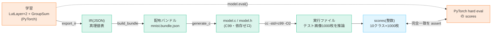
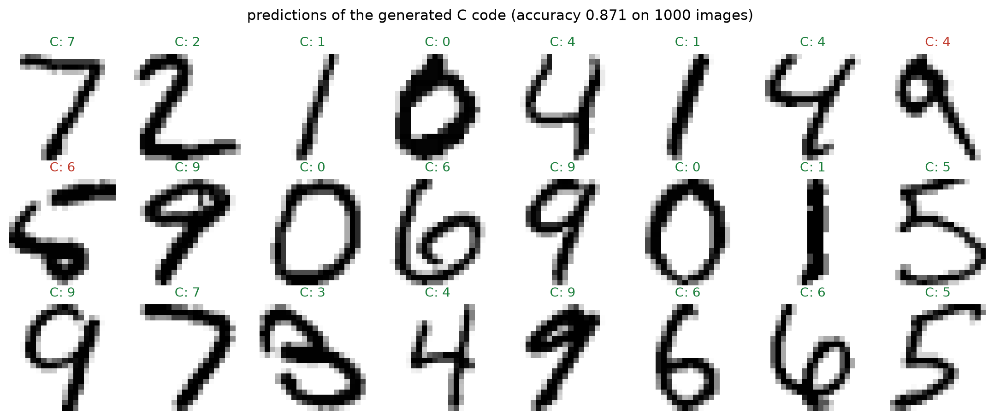
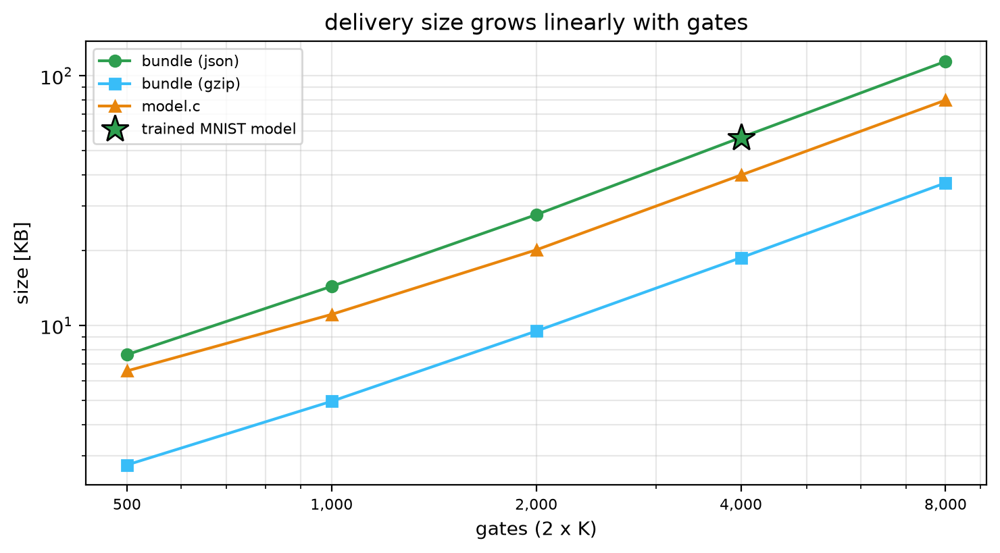

<!-- このファイルは scripts/build_tutorials.py が自動生成しています。
     直接編集せず、examples/29_deploy_mnist.py を編集して再生成してください。 -->

**学習した回路を、PyTorch なしで、手元の C コンパイラだけで動かす。**
[MNIST](/tutorials/mnist/) の「論理ゲート4000個」を、IR → 配布バンドル → C99 ソースの順に
書き出し、`cc` でビルドして、テスト画像1000枚を C だけで推論する。

このページの核心は **C が返す整数スコアが PyTorch の hard eval と1要素も違わない**こと。
学習した回路が、書き出し・コード生成・コンパイルを経ても「同じ回路のまま」であることを
`assert` で固定してから、配信サイズ(約58KB、gzip で約19KB)・実行時メモリ(4KB)を数える。
1枚あたりの推論時間は著者環境(Apple M1 Max・1コア・`cc -O2`)で約3マイクロ秒だった
(機種で変わる値なのでページの出力には載せず、`latency.json` へ書き出す)。最後はゲート数を
変えた回路を並べて、配信サイズがゲート数にほぼ比例することを確かめる。

この回路を ESP32 や iPhone に載せる手順は [ESP32 に載せる](/guides/deploy-esp32/)・
[iPhone に載せる](/guides/deploy-ios/) で続き、デプロイキットの全体像は
[デプロイキット クイックスタート](/guides/deploy-quickstart/) にある。

:::tip[このページで学ぶこと]
1. 学習済みモデル → IR → 配布バンドル → C ソース → 実行ファイル、という出口の全段
2. C の整数スコアが PyTorch hard eval・IR simulate と**完全一致**することの確かめ方
3. 配信サイズ・実行時メモリの測り方と、ゲート数に対するサイズの伸び方(µs/枚は機種依存なので `latency.json` に記録する)

**前提**

- [1. MNISTを学習する](/tutorials/mnist/) — ここで運ぶ回路そのもの
- [3. HDLへエクスポート](/tutorials/hdl-export/) — IR と3段等価性の考え方
- [デプロイキット クイックスタート](/guides/deploy-quickstart/) — 先に XOR で出口の全体を軽く通したいとき(任意)
:::

:::note[このページについて]
所要時間の目安: **約10分** / 実行環境: CPU のみ(GPU 不要)
元スクリプト: [`examples/29_deploy_mnist.py`](https://github.com/tsukushi-gate/Griffith/blob/main/examples/29_deploy_mnist.py)
手元で試す: [`notebooks/29_deploy_mnist.ipynb`](https://github.com/tsukushi-gate/Griffith/blob/main/notebooks/29_deploy_mnist.ipynb)(このページと同じ内容の未実行ノートブック。`uv run --group docs jupyter lab notebooks/` で開ける)
コード出力はすべて **実際に実行した結果**をそのまま埋め込んでいます。
:::

<!-- Colabバッジ: リポジトリ public 化後、この span を data-colab-url を href に
     持つ <a> へ差し替えると「Colabで開く」が有効になる。 -->
<span class="colab-badge" data-colab-url="https://colab.research.google.com/github/tsukushi-gate/Griffith/blob/main/notebooks/29_deploy_mnist.ipynb">▶ Colabで開く(リポジトリ公開後に有効化)</span>

MNISTを学習し、そのまま依存ゼロの C99 で動かす(デプロイキット)例。

[MNIST](/tutorials/mnist/) で学習した「論理ゲート4000個の回路」は、PyTorch の中でしか
動かせない。ここではその回路を **PyTorch なしで、手元の C コンパイラだけで動く形**に
包んで届けるところまでを、1本のスクリプトで通す。

道のりは次の6段で、すべてこのファイルの中で実行する。



橙が PyTorch の世界、緑が論理回路として扱う世界、青が整数のスコアである。
**最後の「完全一致」が主役**で、C が返す整数が PyTorch の hard eval と1個も違わないことを
確かめてから、配信サイズと速さを測る。

実行: uv run python examples/29_deploy_mnist.py
期待結果: hard accuracy 0.85前後 / C推論とPyTorchが1000枚×10クラスで完全一致
(Cコンパイラ cc / clang / gcc が必要。成果物は out_examples/deploy_mnist/ に出る)

## 準備: import・乱数種・出力先

学習側は [MNIST](/tutorials/mnist/) とまったく同じ道具立てで、デプロイ側に使うのは
`griffith_logic.deploy` の4つの部品である。

- `build_bundle` / `save_bundle` / `load_bundle` … 学習済みモデルを **配布バンドル**
  (回路の IR とクラス名を1ファイルにしたもの)へ包み、書き出し、読み戻す
- `generate_c` … バンドルから自己完結した C ソース(`model.c` / `model.h`)を生成する
- `verify_c_matches_simulate` … 生成した C を実際にビルドして、IR の参照実装
  (`simulate`)と整数で突き合わせる「出荷前ゲート」

乱数種を固定しているので、毎回**同じバイト列のバンドル**ができる
(ESP32 や iPhone のデモが読むファイルとして使えるように)。

```python
import gzip
import json
import platform
import re
import subprocess
from pathlib import Path

import matplotlib.pyplot as plt
import numpy as np
import torch
import torch.nn as nn
import torch.nn.functional as F
from matplotlib.ticker import NullFormatter
from torch.utils.data import DataLoader, Subset

from griffith_logic import GroupSum, LutLayer
from griffith_logic.datasets import load_mnist20x20
from griffith_logic.deploy import build_bundle, load_bundle, save_bundle
from griffith_logic.deploy.bundle import attach_bundle_sizes
from griffith_logic.deploy.cbackend import generate_c
from griffith_logic.deploy.verify import RUNTIME_C, find_cc, verify_c_matches_simulate
from griffith_logic.export import export_ir
from griffith_logic.ir import simulate, validate
from griffith_logic.ir.serialize import ir_to_dict
```

```python
# ゲートの初期分布は乱数依存なので、再現性のために固定する。
torch.manual_seed(0)
```

### 出力先とハイパーパラメータ

成果物はすべて `out_examples/deploy_mnist/` に出す。`mnist.bundle.json` という
ファイル名は固定してあり、他のデモ(組み込み・スマホ)がそのまま読む。
学習レシピは [MNIST](/tutorials/mnist/) と同じ縮小版(2層×2000ゲート・4000 iter)で、
CPU で1〜2分に収まる。

```python
OUT_DIR = Path('out_examples/deploy_mnist')
OUT_DIR.mkdir(parents=True, exist_ok=True)

K = 2000          # 1層あたりのゲート数(= 焼くゲート数の半分)
STEPS = 4000      # 学習イテレーション数
BATCH = 128       # ミニバッチサイズ
N_TRAIN = 20000   # 訓練に使う枚数(全60000のサブセット)
N_TEST = 2000     # 学習中の評価に使う枚数
N_C = 1000        # C で推論する枚数(テスト画像の先頭 N_C 枚)
cc = find_cc()
assert cc is not None, 'C コンパイラ(cc / clang / gcc)が見つからない'
print(f'出力先: {OUT_DIR}')
```

```text title="出力"
出力先: out_examples/deploy_mnist
```

## データセット: 画像を 8bit のまま持つ

MNIST の 20x20 を読む。[MNIST](/tutorials/mnist/) と違うのは、**画像を 0〜255 の
整数(u8)でも持っておく**点である。デバイスに届くのは「カメラやファイルから来た
8bit の画素」で、`0.37` のような実数ではないからだ。

PyTorch 側の hard eval は `x.round()` で二値化していた(0.5 を超えたら 1)。
画素値 `k/255 > 0.5` は `k >= 128` と同じなので、**C 側は u8 の画素を閾値 128 で
比べるだけ**で同じビット列が得られる。この1行の二値化を、後で書く C のドライバに
持たせる。

```python
train_set, test_set = load_mnist20x20(binarize_threshold=None)
```

```python
def materialize(dataset, n):
    """先頭n件を (N, 400) のテンソルとラベルにまとめる(毎stepの前処理を省く)。"""
    subset = Subset(dataset, range(n))
    x, y = next(iter(DataLoader(subset, batch_size=n)))
    return x.reshape(n, -1), y
```

```python
train_x, train_y = materialize(train_set, N_TRAIN)
test_x, test_y = materialize(test_set, N_TEST)
```

```python
# PyTorch hard eval の入力(ビット)と、デバイスに届く入力(u8 画素)の2通りを作る。
test_bits = test_x.round()
test_u8 = (test_x * 255).round().to(torch.uint8)
assert torch.equal((test_u8 >= 128).float(), test_bits), 'u8 の閾値128が round() と食い違う'
print(f'train={tuple(train_x.shape)} test={tuple(test_x.shape)} '
      f'(u8 画素 {tuple(test_u8.shape)} と round() のビットが一致)')
```

```text title="出力"
train=(20000, 400) test=(2000, 400) (u8 画素 (2000, 400) と round() のビットが一致)
```

## 学習: MNIST ページと同じ回路を作る

モデルも学習ループも [MNIST](/tutorials/mnist/) と同一で、`LutLayer` 2段 + `GroupSum`
を普通の PyTorch で回すだけである。ここで見るべきは精度ではなく、**学習が終わった
時点の `model.eval()`(= 離散化された回路)が、この先の出口すべての基準になる**こと。

```python
model = nn.Sequential(
    LutLayer(400, K, n_inputs=2),
    LutLayer(K, K, n_inputs=2),
    GroupSum(k=10, tau=10.0),
)
opt = torch.optim.Adam(model.parameters(), lr=0.01)
history = []  # (step, soft acc, hard acc)

for step in range(STEPS + 1):
    if step % 1000 == 0:
        # soft = 学習時の姿 / hard = argmax で確定した回路の姿。デプロイするのは hard。
        with torch.no_grad():
            model.train()
            soft_acc = (model(test_x).argmax(-1) == test_y).float().mean().item()
            model.eval()
            hard_acc = (model(test_bits).argmax(-1) == test_y).float().mean().item()
        model.train()
        history.append((step, soft_acc, hard_acc))
        print(f'step {step:>5}  soft acc={soft_acc:.4f}  hard acc={hard_acc:.4f}')
    idx = torch.randint(0, N_TRAIN, (BATCH,))
    opt.zero_grad()
    loss = F.cross_entropy(model(train_x[idx]), train_y[idx])
    loss.backward()
    opt.step()

model.eval()
final_hard = history[-1][2]
print(f'\n最終 hard acc={final_hard:.4f}(これから運ぶ回路の成績)')
assert final_hard > 0.80, f'hard acc={final_hard:.4f} が低すぎる'
```

```text title="出力"
step     0  soft acc=0.0815  hard acc=0.0990

step  1000  soft acc=0.8595  hard acc=0.8305

step  2000  soft acc=0.8745  hard acc=0.8555

step  3000  soft acc=0.8765  hard acc=0.8590

step  4000  soft acc=0.8765  hard acc=0.8670

最終 hard acc=0.8670(これから運ぶ回路の成績)
```

## IR とバンドル: 学習済みモデルを1つのファイルに包む

出口の最初の一歩は [HDLエクスポート](/tutorials/hdl-export/) と同じで、
`export_ir` が学習済みモデルを **IR(真理値表の集まり)** へ確定させる。
IR は PyTorch にも C にも依存しない、**全ターゲット共通の真実源**である。

`validate(ir, target='hdl')` は IR が回路として成立するか(ビット幅・配線の整合)を
検査する。ここで落ちるなら、C を作る前に直す。

```python
ir = export_ir(model, input_width=400, name='mnist')
validate(ir, target='hdl')
n_gates = sum(n.params['out_width'] for n in ir.nodes if n.type == 'lut_layer')
print(f'IR: ノード {[n.type for n in ir.nodes]} / 総ゲート数 {n_gates:,}')
```

```text title="出力"
IR: ノード ['lut_layer', 'lut_layer', 'group_sum'] / 総ゲート数 4,000
```

### 入力の約束と、モデルJSONの中身

バンドルに載せるのは IR と、クラス名(`labels`)である。**入力は 400 ビットの
0/1 列**(20×20 の画素を行優先に並べ、`画素 >= 128` なら 1)と決めておく。
画像の前処理(閾値・正規化)をバンドルに載せる道もあるが、それが使えるのは
畳み込み(`LutConv2d`)から始まる画像モデルで、**全結合の回路は C には
ビット列そのものを渡す**のが作法になる。ビット列にするのは Python か C のドライバの
仕事で、ここでは後者に1行で持たせる。

「`{'ir': ...}` だけを持つ辞書」が `griffith deploy bundle` の入力(モデルJSON)になる。

`export_ir` は IR のメタデータに**書き出した時刻**(`created_at`)を入れる。このままだと
実行のたびにバンドルのバイト列が変わる(gzip サイズも ±1B 揺れる)ので、下では
固定の時刻(`FIXED_TIME`)で上書きして、同じ学習結果なら**同じバイト列**にしている。

```python
LABELS = [str(d) for d in range(10)]
FIXED_TIME = '2026-01-01T00:00:00+09:00'
doc = {'ir': ir_to_dict(ir), 'labels': LABELS}
doc['ir']['metadata']['created_at'] = FIXED_TIME
(OUT_DIR / 'mnist_model.json').write_text(json.dumps(doc), encoding='utf-8')
```

### バンドルを作って書き出す

`build_bundle` が IR とラベルを束ね、`save_bundle` が1ファイルへ書く。
CLI なら `griffith deploy bundle mnist_model.json -o mnist.bundle.json` と同じ操作である。
配信サイズ(圧縮後)は gzip で測る。`gzip.compress` は既定だとヘッダに現在時刻を
入れるので、`mtime=0` で固定して**同じバンドルなら毎回同じバイト数**にする。

```python
bundle = build_bundle(doc)
attach_bundle_sizes(bundle)
bundle_path = OUT_DIR / 'mnist.bundle.json'
save_bundle(bundle, bundle_path)
bundle_bytes = bundle_path.stat().st_size
bundle_gz = gzip.compress(bundle_path.read_bytes(), compresslevel=6, mtime=0)
Path(str(bundle_path) + '.gz').write_bytes(bundle_gz)
bundle_gz_bytes = len(bundle_gz)
print(f'バンドル: {bundle_path.name} = {bundle_bytes:,} B(gzip {bundle_gz_bytes:,} B)')
```

```text title="出力"
バンドル: mnist.bundle.json = 57,862 B(gzip 18,864 B)
```

## C コード生成とビルド: model.c を作って cc に渡す

バンドルを読み戻し(読み込み時に構造を検証する)、`generate_c` で C ソースを作る。
生成物は `model.h`(公開 API とサイズ定数)と `model.c`(`static const` の真理値表と、
それを順に評価する直線コード)の2本だけで、**実行時のヒープ確保も浮動小数点もゼロ**。
公開 API は `mdl_infer(input_bits, scores)` で、400 個の 0/1 を渡すと 10 個の整数
スコアが返る。

論理ゲートの評価そのものは、ランタイム(`mdl_kernels.c`、ソースで約60KB)が32ゲートずつ
まとめてビット演算で行う。CLI なら `griffith deploy codegen-c` が同じことをする。

```python
loaded = load_bundle(bundle_path, validate=True, strict=True)
C_DIR = OUT_DIR / 'c'
C_DIR.mkdir(exist_ok=True)
for filename, text in generate_c(loaded, name='model', validate=False).items():
    (C_DIR / filename).write_text(text, encoding='utf-8')
```

```python
# ランタイムのソースを生成物と同じディレクトリへ並べる(これだけで自己完結する)。
for rel in ('include/mdl_kernels.h', 'include/mdl_simd.h', 'src/mdl_kernels.c'):
    (C_DIR / Path(rel).name).write_bytes((RUNTIME_C / rel).read_bytes())
model_c_bytes = (C_DIR / 'model.c').stat().st_size
model_h_bytes = (C_DIR / 'model.h').stat().st_size
header = (C_DIR / 'model.h').read_text(encoding='utf-8')
ctx_bytes = int(re.search(r'#define\s+MDL_CTX_BYTES\s+\(?(\d+)', header).group(1))
print(f'生成: model.c {model_c_bytes:,} B / model.h {model_h_bytes:,} B / '
      f'ランタイム mdl_kernels.c {(C_DIR / "mdl_kernels.c").stat().st_size:,} B')
print(f'MDL_CTX_BYTES = {ctx_bytes:,} B(推論1回に必要な作業RAM。これが実行時メモリの全て)')
```

```text title="出力"
生成: model.c 40,902 B / model.h 3,724 B / ランタイム mdl_kernels.c 62,113 B
MDL_CTX_BYTES = 4,000 B(推論1回に必要な作業RAM。これが実行時メモリの全て)
```

### ホスト用のドライバを書いてビルドする

生成された `mdl_infer(bits, scores)` を呼ぶだけの小さな `main` を用意する。
u8 の画像 N 枚をファイルから読み、**画素を 128 と比べて 400 ビットにしてから**推論する。
これを N 枚×`reps` 回まわして**ループ全体の時間**を測り(二値化の時間も含む)、
最後の周回のスコアをファイルへ書く。時間は `clock()`(C 標準)で測るので
追加の依存はない。ドライバだけは `malloc` を使うが、それはホスト用の都合で、
モデル自身は作業領域をコンテキストの中に持つ。

```python
DRIVER_C = r'''
#include <stdio.h>
#include <stdlib.h>
#include <time.h>
#include "model.h"

/* u8 の画素 → 0/1 のビット列(画素 >= 128 なら 1)。PyTorch の x.round() と同じ。 */
static void binarize(const uint8_t *img, uint8_t *bits) {
    for (int j = 0; j < MDL_INPUT_WIDTH; j++) bits[j] = img[j] >= 128;
}

int main(int argc, char **argv) {
    if (argc != 5) { fprintf(stderr, "usage: images.bin n reps scores.bin\n"); return 2; }
    int n = atoi(argv[2]), reps = atoi(argv[3]);
    uint8_t *images = malloc((size_t)n * MDL_INPUT_WIDTH);
    int32_t *scores = malloc((size_t)n * MDL_OUTPUT_WIDTH * sizeof(int32_t));
    uint8_t bits[MDL_INPUT_WIDTH];
    FILE *f = fopen(argv[1], "rb");
    if (!f || fread(images, 1, (size_t)n * MDL_INPUT_WIDTH, f) != (size_t)n * MDL_INPUT_WIDTH)
        return 3;
    fclose(f);
    for (int i = 0; i < n; i++) {                      /* 暖機運転 */
        binarize(images + (size_t)i * MDL_INPUT_WIDTH, bits);
        mdl_infer(bits, scores + (size_t)i * MDL_OUTPUT_WIDTH);
    }
    clock_t t0 = clock();
    for (int r = 0; r < reps; r++)
        for (int i = 0; i < n; i++) {
            binarize(images + (size_t)i * MDL_INPUT_WIDTH, bits);
            mdl_infer(bits, scores + (size_t)i * MDL_OUTPUT_WIDTH);
        }
    double us = (double)(clock() - t0) / CLOCKS_PER_SEC * 1e6 / ((double)reps * n);
    f = fopen(argv[4], "wb");
    fwrite(scores, sizeof(int32_t), (size_t)n * MDL_OUTPUT_WIDTH, f);
    fclose(f);
    printf("%.3f\n", us);
    return 0;
}
'''
(C_DIR / 'main.c').write_text(DRIVER_C, encoding='utf-8')
exe = C_DIR / 'mnist_demo'
cmd = [cc, '-std=c99', '-O2', f'-I{C_DIR}',
       str(C_DIR / 'model.c'), str(C_DIR / 'mdl_kernels.c'), str(C_DIR / 'main.c'),
       '-o', str(exe)]
build = subprocess.run(cmd, capture_output=True, text=True)
assert build.returncode == 0, build.stderr
print('ビルド: cc -std=c99 -O2 model.c mdl_kernels.c main.c -o mnist_demo -> 成功')
```

```text title="出力"
ビルド: cc -std=c99 -O2 model.c mdl_kernels.c main.c -o mnist_demo -> 成功
```

## C で推論し、PyTorch と整数で突き合わせる

テスト画像の先頭1000枚を u8 のまま書き出し、C の実行ファイルに食わせる
(二値化は C のドライバがやる)。
返ってくるのは 1000枚×10クラスの **整数スコア**(各クラスに割り当てた 200 ゲートのうち
1 を出した本数)である。

比べる相手は3つ。**PyTorch hard eval**(`model.eval()` の出力に `tau` を掛け戻した
もの)、**IR の参照実装 `simulate`**(numpy の整数ビット演算)、そして **C**。
3者が1要素も違わないことを `assert` で固定する ── 学習した回路が、書き出しと
コード生成と C コンパイルを経ても**同じ回路のまま**であることの証明である。

```python
images_path = OUT_DIR / 'test_images_u8.bin'
images_path.write_bytes(test_u8[:N_C].numpy().tobytes())
REPS = 20
scores_path = OUT_DIR / 'scores_c.bin'
run = subprocess.run([str(exe), str(images_path), str(N_C), str(REPS), str(scores_path)],
                     capture_output=True, text=True)
assert run.returncode == 0, run.stderr
us_per_image = float(run.stdout.strip())
c_scores = np.fromfile(scores_path, dtype=np.int32).reshape(N_C, 10).astype(np.int64)

with torch.no_grad():
    torch_logits = model(test_bits[:N_C])  # model.eval() 済み = hard eval
torch_scores = np.rint(torch_logits.numpy() * 10.0).astype(np.int64)  # tau=10 を掛け戻す
sim_scores = simulate(ir, test_bits[:N_C].numpy().astype(np.int64)).astype(np.int64)

assert np.array_equal(c_scores, torch_scores), 'C と PyTorch hard eval のスコアが食い違う'
assert np.array_equal(c_scores, sim_scores), 'C と IR simulate のスコアが食い違う'
c_pred = c_scores.argmax(1)
torch_pred = torch_logits.argmax(-1).numpy()
assert np.array_equal(c_pred, torch_pred)
c_acc = float((c_pred == test_y[:N_C].numpy()).mean())
n_mismatch = int((c_scores != torch_scores).sum())
print(f'C ⇔ PyTorch hard eval ⇔ IR simulate: {N_C}枚 × 10クラス = {c_scores.size:,} 要素のうち'
      f' 不一致 {n_mismatch} 個(予測ラベルも {N_C}/{N_C} 一致)')
print(f'C 推論の accuracy = {c_acc:.4f}({N_C}枚)')
```

```text title="出力"
C ⇔ PyTorch hard eval ⇔ IR simulate: 1000枚 × 10クラス = 10,000 要素のうち 不一致 0 個(予測ラベルも 1000/1000 一致)
C 推論の accuracy = 0.8710(1000枚)
```

### 出荷前ゲート: verify-c

上は「いま学習したモデル」を相手にした確認だった。`verify_c_matches_simulate` は
もっと機械的で、**ランダムなビット列**を何本か作り、バンドルから C を生成・ビルドして
IR の参照実装と突き合わせる(CLI の `griffith deploy verify-c`)。
手元のモデルや画像に依らず、**回路そのものが C で正しく再現される**ことを見る関門で、
CI や出荷前のスクリプトにそのまま組み込める。

```python
gate = verify_c_matches_simulate(loaded, n_samples=8, seed=1, verbose=False)
print(f'verify-c: {gate["n_samples"]}サンプル({gate["path"]}経路)'
      f' 最大差 {gate["max_abs_diff"]}')
```

```text title="出力"
verify-c: 8サンプル(bits経路) 最大差 0
```

## 配信サイズと速さ: 何バイトで、1枚あたり何マイクロ秒か

ここまでで「正しく動く」ことが分かったので、次は「どれだけ軽いか」を数える。
数字は3種類で、**運ぶもの**(バンドルのバイト数)、**ビルドするもの**(C ソース)、
**走らせるのに要るもの**(作業 RAM `MDL_CTX_BYTES`)と速さである。

速さ(µs/枚)は機種・実行ごとに揺れる数字なので、**このページの出力には焼き込まない**
(計測は上でしていて、`out_examples/deploy_mnist/latency.json` に書き出す)。
著者環境(Apple M1 Max、1コア、`cc -O2`)での実測は **約 3 µs/枚**(二値化込み、
約 33万枚/秒)で、手元で再実行すると桁は同じだが値は少し変わる。
バイト数のほうは回路が同じなら毎回同じ値である。

```python
print('項目                     値')
print(f'バンドル(JSON)           {bundle_bytes:>10,} B')
print(f'バンドル(gzip)           {bundle_gz_bytes:>10,} B')
print(f'model.c                  {model_c_bytes:>10,} B')
print(f'MDL_CTX_BYTES(作業RAM)   {ctx_bytes:>10,} B')
```

```text title="出力"
項目                     値
バンドル(JSON)               57,862 B
バンドル(gzip)               18,864 B
model.c                      40,902 B
MDL_CTX_BYTES(作業RAM)        4,000 B
```

## 可視化: C が読んだ数字と、ゲート数に対するコスト

最初の図は、C の実行ファイルが返した予測をテスト画像に重ねたもの。
緑が正解、赤が誤答で、PyTorch と完全に一致している以上、**赤はそのまま PyTorch hard
eval の誤答**でもある。

### 図1: C の予測をテスト画像に重ねる

24枚を並べる。画像は回路が受け取った 20×20 の画素(u8)そのものである。

```python
fig, axes = plt.subplots(3, 8, figsize=(11, 4.6))
for ax, i in zip(axes.ravel(), range(24), strict=True):
    ok = c_pred[i] == int(test_y[i])
    ax.imshow(test_u8[i].reshape(20, 20).numpy(), cmap='gray_r')
    ax.set_title(f'C: {c_pred[i]}', fontsize=10, color='#1b7f3b' if ok else '#c0392b')
    ax.set_axis_off()
fig.suptitle(f'predictions of the generated C code (accuracy {c_acc:.3f} on {N_C} images)',
             fontsize=11)
fig.tight_layout()
plt.show()
```

    

    

**読み取り**: 外れるのは 4 と 9、3 と 5 のような紛らわしい数字が中心で、
[MNIST](/tutorials/mnist/) の誤分類と同じ傾向である。C は新しい誤りを一つも作っていない。

### 図2: ゲート数に対する配信サイズと速さ

学習済みの回路は1つしか無いので、**幅 K を変えた回路**を作って並べる。サイズと速さは
回路の「形」だけで決まり、どの論理関数に学習されたかにはほとんど依らないので、
学習していない(乱数初期化の)回路で測ってよい。確かめるために、**本当に学習した
K=2000 の回路を星印**で重ねる ── 乱数の回路の線の上に載っていれば仮定は正しい。

各点は「export_ir → バンドル → C 生成 → ビルド → 1000枚で計時」を丸ごとやり直したものである。
計時の結果(µs/枚)は機種で変わるので図にも出力にも載せず、`latency.json` へ書き出す。
図は**サイズだけ**の決定的な図にしてある。

```python
SWEEP_KS = [250, 500, 1000, 2000, 4000]
sweep = []
for width in SWEEP_KS:
    torch.manual_seed(1)
    probe = nn.Sequential(LutLayer(400, width, n_inputs=2),
                          LutLayer(width, width, n_inputs=2), GroupSum(k=10, tau=10.0)).eval()
    probe_ir = export_ir(probe, input_width=400, name=f'mnist_k{width}')
    probe_doc = {'ir': ir_to_dict(probe_ir), 'labels': LABELS}
    probe_doc['ir']['metadata']['created_at'] = FIXED_TIME
    probe_bundle = build_bundle(probe_doc)
    attach_bundle_sizes(probe_bundle)
    work = OUT_DIR / 'sweep' / f'k{width}'
    work.mkdir(parents=True, exist_ok=True)
    probe_path = save_bundle(probe_bundle, work / 'bundle.json')
    for filename, text in generate_c(probe_bundle, name='model', validate=False).items():
        (work / filename).write_text(text, encoding='utf-8')
    for rel in ('include/mdl_kernels.h', 'include/mdl_simd.h', 'src/mdl_kernels.c'):
        (work / Path(rel).name).write_bytes((RUNTIME_C / rel).read_bytes())
    (work / 'main.c').write_text(DRIVER_C, encoding='utf-8')
    probe_exe = work / 'demo'
    subprocess.run([cc, '-std=c99', '-O2', f'-I{work}', str(work / 'model.c'),
                    str(work / 'mdl_kernels.c'), str(work / 'main.c'), '-o', str(probe_exe)],
                   check=True, capture_output=True)
    out = subprocess.run([str(probe_exe), str(images_path), str(N_C), '10',
                          str(work / 'scores.bin')], check=True, capture_output=True, text=True)
    sweep.append({
        'gates': 2 * width,
        'bundle_kb': probe_path.stat().st_size / 1024,
        'gzip_kb': len(gzip.compress(probe_path.read_bytes(), compresslevel=6, mtime=0)) / 1024,
        'model_c_kb': (work / 'model.c').stat().st_size / 1024,
        'us': float(out.stdout.strip()),
    })
    print(f'K={width:>5} ({2 * width:>5} ゲート): バンドル {sweep[-1]["bundle_kb"]:7.1f} KB / '
          f'gzip {sweep[-1]["gzip_kb"]:6.1f} KB / model.c {sweep[-1]["model_c_kb"]:7.1f} KB')

gates = [p['gates'] for p in sweep]
(OUT_DIR / 'latency.json').write_text(json.dumps({
    'unit': 'microseconds per image (single core, includes binarization)',
    'machine': platform.platform(), 'compiler': Path(cc).name, 'flags': '-std=c99 -O2',
    'trained_mnist_gates': n_gates, 'trained_mnist_us': us_per_image,
    'random_init_sweep': [{'gates': p['gates'], 'us': p['us']} for p in sweep],
}, indent=2), encoding='utf-8')
fig, ax_size = plt.subplots(1, 1, figsize=(7.5, 4.2))
ax_size.plot(gates, [p['bundle_kb'] for p in sweep], 'o-', color='#2e9e4f', label='bundle (json)')
ax_size.plot(gates, [p['gzip_kb'] for p in sweep], 's-', color='#38bdf8', label='bundle (gzip)')
ax_size.plot(gates, [p['model_c_kb'] for p in sweep], '^-', color='#e8850c', label='model.c')
ax_size.plot([n_gates], [bundle_bytes / 1024], '*', ms=15, color='#2e9e4f',
             markeredgecolor='black', label='trained MNIST model')
ax_size.set_xscale('log')
ax_size.set_yscale('log')
ax_size.set_xticks(gates, labels=[f'{g:,}' for g in gates], fontsize=8)
ax_size.xaxis.set_minor_formatter(NullFormatter())
ax_size.set_xlabel('gates (2 x K)')
ax_size.set_ylabel('size [KB]')
ax_size.set_title('delivery size grows linearly with gates')
ax_size.grid(alpha=0.3, which='both')
ax_size.legend(fontsize=8)
fig.tight_layout()
plt.show()
```

```text title="出力"
K=  250 (  500 ゲート): バンドル     7.6 KB / gzip    2.8 KB / model.c     6.6 KB

K=  500 ( 1000 ゲート): バンドル    14.3 KB / gzip    5.0 KB / model.c    11.1 KB

K= 1000 ( 2000 ゲート): バンドル    27.8 KB / gzip    9.5 KB / model.c    20.1 KB

K= 2000 ( 4000 ゲート): バンドル    56.5 KB / gzip   18.7 KB / model.c    40.0 KB

K= 4000 ( 8000 ゲート): バンドル   114.0 KB / gzip   37.2 KB / model.c    79.8 KB
```

    

    

**読み取り**: サイズは3本とも傾き1(ゲート数が2倍なら大きさも約2倍)で、
星印(学習済み)は乱数の回路の線にそのまま載る。速さも同じ向きに伸び、著者環境
(Apple M1 Max、1コア、`cc -O2`)では 500 ゲートで約 0.4 µs/枚、8,000 ゲートで約 6 µs/枚
だった(傾きの細部は機種で変わるので `latency.json` を見て各自で確かめる)。
**サイズと速さは回路の形で決まる**ので、運ぶ前に見積もれる ──
8,000ゲートでも配信は約110KB、gzip で約37KBである。

```python
per_gate = [p['bundle_kb'] * 1024 / p['gates'] for p in sweep]
gz_per_gate = [p['gzip_kb'] * 1024 / p['gates'] for p in sweep]
print(f'バンドル: 1ゲートあたり {min(per_gate):.1f}〜{max(per_gate):.1f} B'
      f'(gzip で {min(gz_per_gate):.1f}〜{max(gz_per_gate):.1f} B)')
```

```text title="出力"
バンドル: 1ゲートあたり 14.2〜15.6 B(gzip で 4.8〜5.7 B)
```

## 次に読む

- [デプロイキット クイックスタート](/guides/deploy-quickstart/) — XOR で通しで動かす。CUDA / Metal / Web への分岐もここから
- [デモモデルを用意する](/guides/deploy-models/) — MNIST / 行動認識 / 顔検出のバンドルを揃える手順
- [ESP32 に載せる](/guides/deploy-esp32/) — 同じバンドルをマイコンで動かす(実機実測つき)
- [iPhone に載せる](/guides/deploy-ios/) — Swift から生成 C を呼ぶ(シミュレータ実測つき)
- [行動認識(UCI-HAR)](/tutorials/har/) — スマホの加速度を温度計符号化して、同じ手順でCまで運ぶ
- [7. 通しチュートリアル](/tutorials/full-pipeline/) — 学習から Verilog / FPGA まで
- [付録: XORで仕組みを最小で覗く](/tutorials/xor/) — 運ぶ回路をもっと小さくして中身を全部見る
