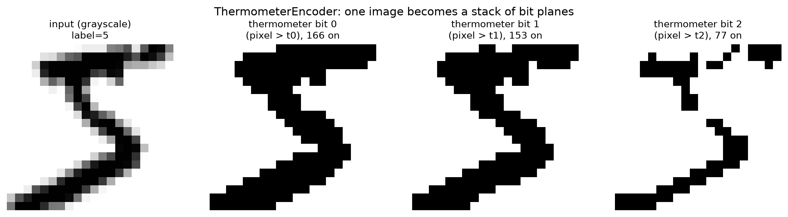
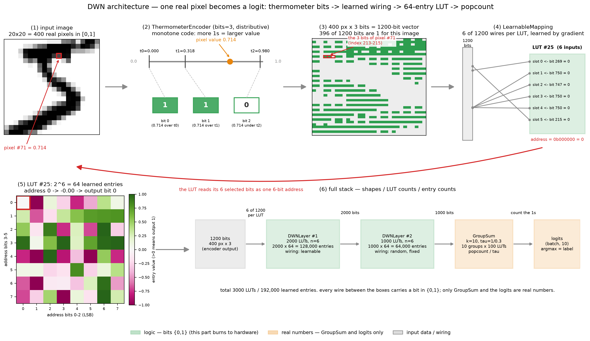
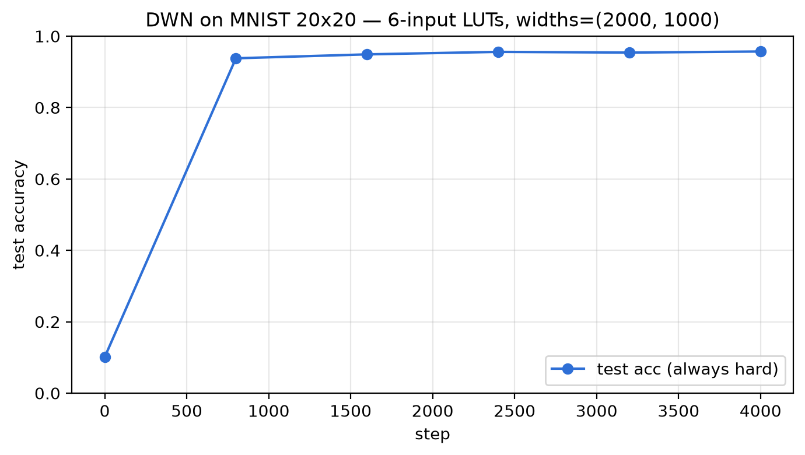
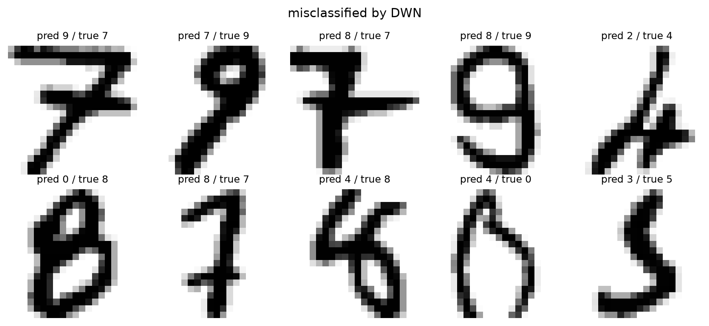

<!-- このファイルは scripts/build_tutorials.py が自動生成しています。
     直接編集せず、examples/16_dwn.py を編集して再生成してください。 -->

**離散化ギャップがゼロ**という、論理NN界の例外。実数画素を単調なビット列へ落とす
`ThermometerEncoder` と 64 エントリの n 入力 LUT を組み合わせた DWN
(Differentiable Weightless Neural Network)は、`train()` と `eval()` のロジット最大差が
**0.0** ── つまり学習中のモデルと焼かれる回路が最初から同一である。

test acc 0.958。他の多くのページで扱う「soft では出るのに hard で崩れる」問題が、
パラメータ化の選び方だけで消えることを見せる回。

:::tip[このページで学ぶこと]
1. `ThermometerEncoder` で実数画素を単調なビット列へ落とす二値化の作法
2. 64 エントリの n 入力 LUT を使う DWN の組み方(test acc 0.958)
3. **離散化ギャップが 0.0** になる仕組み ── 学習中のモデルと焼かれる回路が同一であること

**前提**

- [1. MNISTを学習する](/tutorials/mnist/) — 素の LutLayer と比較するための基準
- [パラメータ化を選ぶ](/guides/parameterization/)
:::

:::note[このページについて]
所要時間の目安: **約7分** / 実行環境: CPU のみ(GPU 不要)
元スクリプト: [`examples/16_dwn.py`](https://github.com/tsukushi-gate/Griffith/blob/main/examples/16_dwn.py)
手元で試す: [`notebooks/16_dwn.ipynb`](https://github.com/tsukushi-gate/Griffith/blob/main/notebooks/16_dwn.ipynb)(このページと同じ内容の未実行ノートブック。`uv run --group docs jupyter lab notebooks/` で開ける)
コード出力はすべて **実際に実行した結果**をそのまま埋め込んでいます。
:::

<!-- Colabバッジ: リポジトリ public 化後、この span を data-colab-url を href に
     持つ <a> へ差し替えると「Colabで開く」が有効になる。 -->
<span class="colab-badge" data-colab-url="https://colab.research.google.com/github/tsukushi-gate/Griffith/blob/main/notebooks/16_dwn.ipynb">▶ Colabで開く(リポジトリ公開後に有効化)</span>

DWN(Differentiable Weightless Neural Network)でMNISTを解く例。

06_mnist.py の DLGN は「2入力の論理ゲートを疎に配線した回路」だった。
DWN(Bacellar et al., ICML 2024)は同じ論理回路でも設計思想が違う:

  - ゲートではなく **n入力LUT(ルックアップテーブル)** を基本素子にする。
    n=6 なら 2^6=64 エントリの真理値表を丸ごと学習する(表現力はゲートの比ではない)。
  - 実数入力は **ThermometerEncoder(温度計符号化)** でビット列に落とす。
    「値の大きさ」を「立っているビットの本数」で表す単調な符号。
  - forwardは訓練中も **常にハード**(LUTは二値、接続はargmax)。
    そのため DLGN のような soft/hard の離散化ギャップが構造的に存在しない
    — 訓練中に見ている精度が、そのまま焼いた回路の精度になる。

**全体像: 1画素の実数がロジットになるまで**

数値はこのサンプルの実設定(BITS=3 / 400画素 / WIDTHS=(2000,1000) / N_INPUTS=6)と
実測値。画素#71は学習データ1枚目(ラベル5)の実際の画素で、しきい値も
`encoder.thresholds[:, 71]` の実測値である。

```mermaid
graph LR
  subgraph ENC["① ThermometerEncoder(実数 → ビット、bits=3, distributive)"]
    direction LR
    IMG["入力画像 20×20<br/>400画素の実数 [0,1]"]
    CMP["3本のしきい値と比較<br/>例: 画素#71 = 0.714<br/>t0=0.000 / t1=0.318 / t2=0.980"]
    BIT["ビット列 1 1 0<br/>t0・t1 は超え t2 に届かない<br/>= 単調(大きい値ほど1が増える)"]
    VEC["1枚の画像 = 1,200ビット<br/>400画素 × 3bit(この1枚は396本が1)"]
    IMG --> CMP --> BIT --> VEC
  end

  subgraph NET["② DWN本体(ここは全部ビットの世界)"]
    direction LR
    MAP["LearnableMapping<br/>W(1,200 × 12,000)の列ごとargmax<br/>各LUTへ6本選ぶ(配線も学習)"]
    L1["DWNLayer #1<br/>LUT 2,000個 × 6入力<br/>64エントリ(2^6)を学習<br/>計128,000 → 2,000ビット"]
    L2["DWNLayer #2<br/>LUT 1,000個 × 6入力(配線は固定)<br/>計64,000エントリ → 1,000ビット"]
    MAP --> L1 -->|"2,000ビット"| L2
  end

  subgraph OUT["③ 復号(ここだけ実数)"]
    direction LR
    GS["GroupSum k=10 τ=1/0.3<br/>1,000ビットを 100本×10クラスに分割<br/>1の本数を数える(重み無し)"]
    LOG["logits(10実数) → argmax = 予測ラベル"]
    GS -->|"(B, 10) 実数"| LOG
  end

  subgraph GAP["④ DWNに離散化ギャップが無い理由"]
    direction LR
    G1["LUT出力は訓練中も {0,1}<br/>接続は訓練中も argmax(1本に確定)"]
    G2["= 学習中のモデルが そのまま焼く回路<br/>train()とeval()でロジットが完全一致"]
    G1 --> G2
  end

  VEC --> MAP
  L2 --> GS
  L2 -.->|"forwardは常にハード"| G1

  style IMG fill:#38bdf826,stroke:#38bdf8
  style CMP fill:#eab30826,stroke:#eab308
  style BIT fill:#10b98126,stroke:#10b981
  style VEC fill:#10b98126,stroke:#10b981
  style MAP fill:#eab30826,stroke:#eab308
  style L1 fill:#10b98126,stroke:#10b981
  style L2 fill:#10b98126,stroke:#10b981
  style GS fill:#f9731626,stroke:#f97316
  style LOG fill:#38bdf826,stroke:#38bdf8
  style G1 fill:#10b98126,stroke:#10b981
  style G2 fill:#eab30826,stroke:#eab308
```



**どう実現しているか(NNを触ったことがない人向け)**

- **LUT(ルックアップテーブル)** = 入力の組み合わせごとに答えを書いた表。6入力なら
  組み合わせは 2^6 = 64通りなので、64個のマス目に0か1を書けば「6入力の任意の論理関数」を
  表せる。DWNが学習するのはこの**表の中身そのもの**で、掛け算の重みではない。
- **温度計符号化** = 「値の大きさ」を「立っているビットの本数」で表す書き方。
  0.714 → `1 1 0`、もっと濃い画素 → `1 1 1`。one-hot と違って順序が保たれるので、
  近い値が近いビット列になり、下流のLUTが大小関係を扱いやすい。
- **しきい値の置き方(distributive)** = しきい値を訓練データの分位点に置く。MNISTは
  画素の大半が0付近に固まっているので、等間隔に置くとビットがほとんど死ぬ。
- **配線を学習する(LearnableMapping)** = どのLUTがどの入力線を見るかは、普通は
  ランダムに決め打ちする。DWNは「入力1,200本 × 選択先12,000スロット」の行列を持ち、
  列ごとの argmax で1本を選ぶ。この行列にも勾配が流れるので**配線が学習される**。
- **EFD(Extended Finite Difference)** = 表を引く操作は階段状で微分できない。そこで
  「隣のマスの値」を使った有限差分を勾配の代わりに使う。これがDWNの核心アイデア。
- **GroupSum** = 最終層1,000本のビットを10クラス×100本に分け、1の本数を数えて
  温度τで割るだけ。学習可能な重みが1つも無いので "weightless" と呼ばれる。
- **離散化ギャップが構造的に0** = forwardが訓練中も常にハード(LUT出力は{0,1}、
  接続はargmax)。つまり**学習中に見ている精度がそのまま焼いた回路の精度**になる。
  DLGN(06_mnist.py)の soft/hard の乖離チェックが要らない。

このサンプルでは4枚の図を見る:
  1. 温度計符号化で1枚の画像がビット平面の束になる様子(図1)
  2. 学習済みの重みで描いたアーキテクチャ全体像(図2) — 1画素 → ビット列 → 配線 →
     64エントリの真理値表 → popcount → ロジット、を実際の数値で追う
  3. MNIST 20x20 での学習曲線(図3)と誤分類例(図4)

実行: uv run python examples/16_dwn.py
期待結果: test accuracy 0.95前後(CPUで2〜3分)

## 準備: import と乱数種

使うのは PyTorch と matplotlib、そして本ライブラリの `ThermometerEncoder` /
`DWNLayer` / `DWNClassifier` の3つだけである。

用語をここで確定しておく。**DWN**(Differentiable Weightless Neural Network)の
*weightless*(重みを持たない)とは、**掛け算の重み行列を1つも持たない**という意味である。
普通の NN が学習するのは「重み」だが、DWN が学習するのは
**LUT(ルックアップテーブル = 入力の組み合わせごとに答えを書いた表)の中身**そのものだ。
表を引く操作は掛け算ではないので、この回路はそのままハードウェアに焼ける。

```python
import matplotlib.pyplot as plt
import numpy as np
import torch
import torch.nn.functional as F
from matplotlib.patches import FancyArrowPatch, Patch, Rectangle
from torch.utils.data import DataLoader, Subset

from griffith_logic import DWNClassifier, DWNLayer, ThermometerEncoder
from griffith_logic.datasets import load_mnist20x20
```

```python
# LUTの初期エントリと接続はランダムなので、再現性のために固定する。
torch.manual_seed(0)
```

### ハイパーパラメータ

記号を先に定義しておく。以降ずっとこの意味で使う。

- **q** — 1つの画素が持つ**実数**の濃さ。MNIST では `[0, 1]` の連続値
- **z = BITS** — 1画素を何ビットに符号化するか。ここでは 3
- **t_1 … t_z** — 温度計符号化の**しきい値**。q をこれらと比べてビットにする
- **n = N_INPUTS** — 1つの LUT が見る入力線の本数。ここでは 6。
  入力の組み合わせは **2^n = 64通り**なので、**LUT は 64 個のエントリ(表のマス目)**を持つ
- **アドレス** — 引かれる表の**行番号**。n 本の入力ビットをそのまま n 桁の2進数と
  読んだ値で、`0 … 2^n - 1` の範囲に入る

つまり 1 個の LUT は「6 本のビットを 6 桁の2進数(=アドレス)と読んで、64 行の表を1回引く」
だけの素子である。**学習されるのはこの表の 64 マスの中身**であって、係数ではない。

```python
# CPUで1〜2分に収まるレシピ。BITS・幅・STEPSを増やすほど精度は上がる。
BITS = 3               # 1画素あたりの温度計ビット数(公式mnist.pyと同じ3)
WIDTHS = (2000, 1000)  # 各DWNLayerのLUT数(公式レシピと同じ)
N_INPUTS = 6           # 1LUTあたりの入力数 n → 真理値表は 2^6 = 64 エントリ
STEPS = 4000
BATCH = 128
N_TRAIN = 20000
N_TEST = 2000
```

## データ: 実数のまま渡す

06_mnist.py の DLGN では入力を先に 0/1 へ潰していたが、ここでは**潰さない**。
二値化は次の章の `ThermometerEncoder` の仕事であり、しかもその際に
**訓練データの分布を見てしきい値を決める**必要があるからである。
ここで先に潰してしまうと、その分布の情報が失われてしまう。

```python
# 06_mnist.py と同じ difflogic 互換の 20x20 MNIST。値は[0,1]の連続値のまま渡す
# (二値化は ThermometerEncoder の仕事なので、ここでは潰さない)。
train_set, test_set = load_mnist20x20(binarize_threshold=None)
```

```python
def materialize(dataset, n):
    """先頭n件を (N, 400) のテンソルとラベルにまとめる。"""
    subset = Subset(dataset, range(n))
    x, y = next(iter(DataLoader(subset, batch_size=n)))
    return x.reshape(n, -1), y
```

```python
train_x, train_y = materialize(train_set, N_TRAIN)
test_x, test_y = materialize(test_set, N_TEST)
print(f'train={tuple(train_x.shape)} test={tuple(test_x.shape)} '
      f'(20x20=400画素 / 10クラス)')
```

```text title="出力"
train=(20000, 400) test=(2000, 400) (20x20=400画素 / 10クラス)
```

## 温度計符号化: 実数を「近さが保たれるビット列」に落とす

**なぜ符号化が要るのか。** LUT は「ビットを並べてアドレスにする」素子なので、
実数の画素値 q をそのまま食わせることができない。どこかで二値化が必要になる。

**なぜ one-hot ではだめなのか。** 素朴に「値の区間ごとに1本立てる」one-hot にすると、
0.31 と 0.33 のように**近い値が、まったく離れたビット列**になってしまう。
表を引くだけの LUT には「このアドレスとあのアドレスは近い」という情報が無いので、
大小関係を扱う手がかりが下流に一切残らない。

**温度計符号化(thermometer encoding)** はここを解く。q が超えたしきい値の分だけ
下から順に 1 が立つ、つまり **1 の本数が単調に増えるだけ**の符号なので、
「近い値は近いビット列」という関係が保たれる。だから下流の LUT が大小関係を扱える。
名前のとおり、温度計の水銀柱がじわじわ伸びる様子と同じ形の符号である。

**なぜしきい値を経験分位点(実データを並べて何%地点かで区切った値)に置くのか。**
`mode='distributive'` は t_1 … t_z を訓練データの経験分位点に置く。MNIST の画素は
大半が真っ黒(0 付近)に偏っているので、しきい値を `0.25 / 0.5 / 0.75` のように
**等間隔に置くと、ほとんどの画素でどのビットも常に 0** になり、情報が何も乗らない。
分位点なら「データが実際に散らばっている場所」で切るので、全ビットが働く。

```python
# ThermometerEncoder(bits=z) は実数 q を z 本のしきい値と比べ、
#   T(q) = (1_{q>t_1}, ..., 1_{q>t_z})
# という「単調に1が増えるビット列」にする。one-hotと違い順序が保たれるので、
# 「近い値は近いビット列」になり、下流のLUTが大小関係を扱いやすい。
#
# mode='distributive' はしきい値を訓練データの経験分位点に置く
# (MNISTのように0付近に画素が偏るデータでは等間隔より遥かに有効)。
encoder = ThermometerEncoder(bits=BITS, mode='distributive').fit(train_x)
print(f'\n温度計しきい値 shape={tuple(encoder.thresholds.shape)} '
      f'(bits × 画素数) 例: 画素[210]のしきい値='
      f'{[round(v, 3) for v in encoder.thresholds[:, 210].tolist()]}')
```

    
```text title="出力"
温度計しきい値 shape=(3, 400) (bits × 画素数) 例: 画素[210]のしきい値=[0.0, 0.49, 0.992]
```

### 図1: 1枚の画像がビット平面の束になる

**この図で何を見るか。** 一番左が元のグレースケール画像、右の3枚が
`T(q) = (1_{q>t_1}, …, 1_{q>t_z})` の各ビットを 20x20 に戻したもの(=ビット平面)である。
見るべきは **右へ行くほど黒い点が減っていくか**。しきい値 t_b は b が進むほど高いので、
単調性が正しく効いていれば、生き残るのは濃い画素だけになるはずである。

```python
# 1枚の画像 (400,) → (400*bits,) のビット列。ビット平面ごとに戻して並べる。
sample = train_x[0]
code = encoder.encode(sample)          # (400, bits)
print(f'1枚の画像: 400画素 → {code.numel()} ビット '
      f'(立っているビット {int(code.sum())} 本)')

fig, axes = plt.subplots(1, BITS + 1, figsize=(3.0 * (BITS + 1), 3.2))
axes[0].imshow(sample.reshape(20, 20), cmap='gray_r', vmin=0, vmax=1)
axes[0].set_title(f'input (grayscale)\nlabel={int(train_y[0])}', fontsize=10)
axes[0].set_axis_off()
for b in range(BITS):
    # bit b は「画素値 > t_b」を意味する。bが進むほどしきい値が高く、
    # 生き残るのは濃い画素だけ → 1が減っていく(単調性がそのまま絵に出る)。
    axes[b + 1].imshow(code[:, b].reshape(20, 20), cmap='gray_r', vmin=0, vmax=1)
    axes[b + 1].set_title(f'thermometer bit {b}\n(pixel > t{b}), '
                          f'{int(code[:, b].sum())} on', fontsize=10)
    axes[b + 1].set_axis_off()
fig.suptitle('ThermometerEncoder: one image becomes a stack of bit planes',
             fontsize=12)
fig.tight_layout()
plt.show()
```

```text title="出力"
1枚の画像: 400画素 → 1200 ビット (立っているビット 396 本)
```

    

    

**読み取り。** タイトルの `N on` の数字が bit 0 → bit 2 と進むにつれて確実に減っている。
これが温度計符号の**単調性**そのもので、bit b が 1 の画素の集合は bit b+1 が 1 の集合を
必ず含む(入れ子になる)。3 枚の絵は「別々の特徴」ではなく、**同じ数字を濃さのしきい値で
輪切りにした地層**だと読むのが正しい。元画像の輪郭が全ビットで保たれていることも重要で、
二値化しても形の情報が失われていないことを意味する。

## DWNLayer: n入力LUTを並べただけの層

ここからは**すべてビットの世界**になる。`DWNLayer` が何をする層なのか、
いきなり分類器に組み込む前に 8 個だけの小さな層で単体確認しておく。

**EFD(Extended Finite Difference = 拡張有限差分)** についてもここで触れておく。
表を引く操作は「アドレスが 1 変わると出力が飛ぶ」階段状の関数なので、そのままでは
微分できない(勾配がどこでも 0 になる)。DWN は微分の代わりに
**隣のマス(アドレスが 1 ビット違うエントリ)との差**を勾配として流す。
これが有限差分であり、DWN の核心アイデアである。

```python
# DWNLayer(in_bits, out_luts, n_inputs=n) は「n本の入力線を選び、2^n エントリの
# 真理値表を引く」LUTを out_luts 個並べた層。学習されるのは
#   (a) 各LUTの 2^n 個のエントリ値
#   (b) mapping='learnable' のとき、どの入力線を引くかの接続
# の2つ。EFD(Extended Finite Difference)という有限差分で、離散なLUT引きに
# 勾配を与えるのがDWNの核心アイデア。
probe = DWNLayer(in_bits=400 * BITS, n_luts=8, n_inputs=N_INPUTS,
                 mapping='learnable')
with torch.no_grad():
    probe_out = probe(encoder(train_x[:4]))
print(f'\nDWNLayer単体: 入力{400 * BITS}ビット → 出力{tuple(probe_out.shape)}, '
      f'LUTエントリ数/個={2 ** N_INPUTS}, 出力は常に二値='
      f'{bool(((probe_out == 0) | (probe_out == 1)).all())}')
```

    
```text title="出力"
DWNLayer単体: 入力1200ビット → 出力(4, 8), LUTエントリ数/個=64, 出力は常に二値=True
```

## 分類器の組み立て: encoder → LUT 2層 → GroupSum

部品が揃ったので直列につなぐ。ここで残る語をまとめて定義しておく。

- **LearnableMapping(学習される配線)** — 「どの LUT が入力のどのビット線を見るか」は
  普通ランダムに決め打ちする。DWN は「入力 1,200 本 × 選択先 12,000 スロット」の行列を
  持ち、列ごとの argmax で 1 本を選ぶ。この行列にも勾配が流れるので**配線自体が学習される**
- **GroupSum / popcount(1 の本数を数える操作)** — 最終層 1,000 本のビットを
  10 クラス × 100 本に分け、各グループで立っているビットを**数えるだけ**。
  数えた値を温度 τ で割ってロジットにする。学習可能な重み付き和が 1 つも無いことが、
  この手法が weightless と呼ばれる理由である

```python
# 中身は上で見た部品の直列: encoder → DWNLayer×2 → GroupSum。
# GroupSum は最終層1000個のLUT出力を10クラス×100個に分け、popcount(=1の本数)を
# tauで割ってロジットにする。学習可能な重み付き和は一切使わない(=weightless)。
model = DWNClassifier(
    in_features=400,
    n_classes=10,
    layer_widths=WIDTHS,
    bits=BITS,
    encoder_mode='distributive',
    n_inputs=N_INPUTS,
    mapping='learnable',   # 第1層だけ接続も学習(公式READMEの推奨)
)
```

```python
# 分類器が内部に持つencoderにも同じしきい値を学習させる。
model.fit_encoder(train_x)
print(model)
```

```text title="出力"
DWNClassifier(
  (encoder): ThermometerEncoder(bits=3, mode=distributive, fitted=True)
  (layers): ModuleList(
    (0): DWNLayer(
      in_bits=1200, n_luts=2000, n_inputs=6, entries=64, mapping=learnable, efd=paper, ste=True
      (learnable_mapping): LearnableMapping(in=1200, out=12000, tau=0.001)
    )
    (1): DWNLayer(in_bits=2000, n_luts=1000, n_inputs=6, entries=64, mapping=random, efd=paper, ste=True)
  )
  (group_sum): GroupSum(k=10, tau=3.3333333333333335)
)
```

## 学習: 中身は普通の PyTorch ループ

特別な学習則は要らない。Adam で `cross_entropy` を下げるだけである。
ただし 01_xor.py や 06_mnist.py と決定的に違う点が 1 つある ──
**soft accuracy を測る場所が無い**。DWN の forward は学習中も常にハードな表引きなので、
測れる精度は最初から 1 種類しか存在しない。

```python
# ここも普通のPyTorch。DWNのforwardは常にハードなので、
# eval()/train() を切り替えても精度は変わらない(下で実際に確認する)。
opt = torch.optim.Adam(model.parameters(), lr=0.01)
history = []

for step in range(STEPS + 1):
    if step % 800 == 0:
        model.eval()
        with torch.no_grad():
            acc = (model(test_x).argmax(-1) == test_y).float().mean().item()
        model.train()
        history.append((step, acc))
        print(f'step {step:>5}  test acc={acc:.4f}')

    idx = torch.randint(0, N_TRAIN, (BATCH,))
    opt.zero_grad()
    loss = F.cross_entropy(model(train_x[idx]), train_y[idx])
    loss.backward()
    opt.step()

steps, accs = zip(*history, strict=True)
final_acc = accs[-1]
```

```text title="出力"
step     0  test acc=0.1010

step   800  test acc=0.9380

step  1600  test acc=0.9490

step  2400  test acc=0.9560

step  3200  test acc=0.9540

step  4000  test acc=0.9570
```

## 離散化ギャップの確認: なぜ DWN ではギャップが 0 なのか

**離散化ギャップ**とは「学習中に見ていた精度」と「回路に焼いたあとの精度」の差である。
用語を対にしておくと、**soft eval** は連続緩和したままの評価(`train()` モード)、
**hard eval** は離散化して確定させた評価(`eval()` モード)を指す。

**なぜ DLGN にはギャップが出るのか。** DLGN(06_mnist.py)の 1 ゲートは学習中、
2 入力論理関数 16 種の**ソフト混合**であり、「7 割 XOR・3 割 AND」のような中間状態を
取れる。焼くときは argmax で 1 種類に確定させるので、**学習していたモデルと
焼かれる回路が別物**になる。ゆえに乖離チェックが必須だった。

**なぜ DWN はギャップが 0 なのか。** DWN の forward は学習中も**常にハードな表引き**で、
LUT の出力は必ず {0,1}、配線も常に argmax で 1 本に確定している。中間状態が存在しない。
勾配だけを EFD(有限差分)で近似的に流しているので、
**学習しているモデルと焼かれる回路が最初から同一**なのである。

主張が本当かを下で機械的に確かめる。同じ重みを `train()` と `eval()` の両モードで
評価し、ロジットの最大差が **厳密に 0.0** であることを assert する。

```python
# 離散化ギャップが無いことの確認: 同じ重みを train()モードと eval()モードで
# 評価すると、DWNでは出力が **ビット単位で完全一致** する
# (DLGN=06_mnist.py では soft と hard で数%ずれる)。
model.train()
with torch.no_grad():
    logits_train_mode = model(test_x)
model.eval()
with torch.no_grad():
    logits_eval_mode = model(test_x)
gap = (logits_train_mode - logits_eval_mode).abs().max().item()
print(f'\n最終 test acc={final_acc:.4f}')
print(f'train()モードと eval()モードのロジット最大差 = {gap} '
      f'(DWNは離散化ギャップが構造的に存在しない)')
assert gap == 0.0, f'離散化ギャップが発生している: {gap}'
assert final_acc > 0.90, f'test acc={final_acc:.4f} が低すぎる'
```

    
```text title="出力"
最終 test acc=0.9570
train()モードと eval()モードのロジット最大差 = 0.0 (DWNは離散化ギャップが構造的に存在しない)
```

## 可視化: 1画素の運命・学習曲線・誤分類

### 図2の材料: 学習済みモデルから「1画素の運命」を取り出す

ここから 3 枚の図を見る。まず、抽象的な説明を実測値に置き換えるための材料を集める。
追跡するのは画素 #71 ただ 1 点で、その実数値 q・3 本のしきい値 t_1…t_3・
温度計ビット・LearnableMapping が実際に選んだ 6 本の入力線・引かれたアドレスと
エントリの値を、**すべて学習済みモデルから読み出す**(図中の数字は全部この実測値)。

```python
# 画素#71(学習データ1枚目の左上寄りの1点)を追跡対象にする。
# ここで集めるのは全て実測値: 画素値・しきい値・温度計ビット・
# LearnableMappingが選んだ6本の入力線・引かれた真理値表のアドレスと値。
PIXEL = 71
px_row, px_col = divmod(PIXEL, 20)
px_value = float(sample[PIXEL])
px_thresholds = [float(v) for v in model.encoder.thresholds[:, PIXEL]]
px_bits = [int(px_value > t) for t in px_thresholds]
code_flat = model.encoder(sample.unsqueeze(0))[0].detach()   # (1200,)
n_bits_on = int(code_flat.sum())
px_bit_ids = [PIXEL * BITS + b for b in range(BITS)]
```

```python
# 学習済みの配線: W(1200 × 12000)の列ごとargmax → (LUT数, 6)の入力線インデックス
wires = model.layers[0].learnable_mapping.weights.detach().argmax(dim=0)
wires = wires.reshape(WIDTHS[0], N_INPUTS)
```

```python
# 画素#71のビットを実際に見ているLUTを1個選ぶ(無ければ0番)
hits = (wires.unsqueeze(-1) == torch.tensor(px_bit_ids)).any(-1).any(-1)
hit_ids = hits.nonzero(as_tuple=True)[0]
LUT_ID = int(hit_ids[0]) if hit_ids.numel() else 0
lut_wires = [int(i) for i in wires[LUT_ID]]
lut_in_bits = [int(code_flat[i]) for i in lut_wires]
lut_addr = sum(b << j for j, b in enumerate(lut_in_bits))
lut_table = model.layers[0].luts.detach()[LUT_ID]
lut_entry = float(lut_table[lut_addr])
lut_out = int(lut_entry > 0)

print(f'\n追跡する画素 #{PIXEL} 値={px_value:.3f} '
      f'しきい値={[round(t, 3) for t in px_thresholds]} → ビット {px_bits}')
print(f'画素#{PIXEL}のビットを見ているLUT = #{LUT_ID} '
      f'(入力線 {lut_wires} / 値 {lut_in_bits})')
print(f'  → アドレス {lut_addr} (0b{lut_addr:06b}) のエントリ = {lut_entry:+.3f} '
      f'→ 出力ビット {lut_out}')
```

    
```text title="出力"
追跡する画素 #71 値=0.714 しきい値=[0.0, 0.318, 0.98] → ビット [1, 1, 0]
画素#71のビットを見ているLUT = #25 (入力線 [269, 750, 747, 750, 750, 215] / 値 [0, 0, 0, 0, 0, 0])
  → アドレス 0 (0b000000) のエントリ = -0.004 → 出力ビット 0
```

### 図2: 1画素の実数がロジットになるまで(全体像)

```python
def draw_dwn_architecture():
    """学習済みDWNのアーキテクチャを1枚に描く。

    左上から右下へ「1画素の実数 → 温度計ビット → 1200ビット → 学習された配線
    → 64エントリの真理値表 → 2層のLUT → popcount → ロジット」を追う。
    各段に形状・LUT数・エントリ数を注記する。
    図中の文字は英字のみ(matplotlib既定フォントに日本語グリフが無いため)。
    """
    c_logic, c_real, c_wire = '#2e9e4f', '#e8850c', '#8a8a8a'
    c_mark = '#d62728'
    fig = plt.figure(figsize=(16.0, 9.0))
    fig.suptitle(
        'DWN architecture — one real pixel becomes a logit: '
        'thermometer bits -> learned wiring -> 64-entry LUT -> popcount',
        fontsize=13, y=0.975,
    )

    def arrow(p0, p1, rad=0.0, color=c_wire):
        fig.add_artist(FancyArrowPatch(
            p0, p1, transform=fig.transFigure, arrowstyle='-|>',
            mutation_scale=20, lw=1.8, color=color, zorder=5,
            connectionstyle=f'arc3,rad={rad}',
        ))

    # (1) 入力画像と追跡画素
    ax1 = fig.add_axes([0.035, 0.595, 0.155, 0.28])
    ax1.imshow(sample.reshape(20, 20), cmap='gray_r', vmin=0, vmax=1)
    ax1.add_patch(Rectangle((px_col - 0.5, px_row - 0.5), 1, 1,
                            fill=False, ec=c_mark, lw=2.2))
    ax1.annotate(f'pixel #{PIXEL} = {px_value:.3f}',
                 xy=(px_col, px_row + 0.6), xytext=(-0.5, 22.6),
                 fontsize=8.5, color=c_mark, annotation_clip=False,
                 arrowprops=dict(arrowstyle='->', color=c_mark, lw=1.3))
    ax1.set_xticks([])
    ax1.set_yticks([])
    ax1.set_title('(1) input image\n20x20 = 400 real pixels in [0,1]', fontsize=10)

    # (2) 温度計符号化: しきい値と比べてビット列にする
    ax2 = fig.add_axes([0.245, 0.595, 0.235, 0.28])
    ax2.set_xlim(-0.14, 1.14)
    ax2.set_ylim(-1.25, 1.05)
    ax2.axis('off')
    ax2.plot([0, 1], [0.5, 0.5], color=c_wire, lw=2.5, solid_capstyle='round')
    ax2.text(-0.11, 0.5, '0.0', fontsize=7.5, va='center', ha='right', color=c_wire)
    ax2.text(1.11, 0.5, '1.0', fontsize=7.5, va='center', ha='left', color=c_wire)
    box_x = [0.14, 0.5, 0.86]
    for b, (t, bit) in enumerate(zip(px_thresholds, px_bits, strict=True)):
        ax2.plot([t, t], [0.36, 0.64], color='#444444', lw=1.6)
        ax2.text(t, 0.72, f't{b}={t:.3f}', fontsize=7.5, ha='center')
        ax2.plot([t, box_x[b]], [0.34, -0.36], color='#bbbbbb', lw=0.9, ls='--')
        face = c_logic if bit else '#ffffff'
        ax2.add_patch(Rectangle((box_x[b] - 0.11, -0.72), 0.22, 0.36,
                                fc=face, alpha=0.85 if bit else 1.0,
                                ec=c_logic, lw=1.6))
        ax2.text(box_x[b], -0.54, str(bit), fontsize=13, ha='center', va='center',
                 weight='bold', color='#ffffff' if bit else '#333333')
        rel = 'over' if bit else 'under'
        ax2.text(box_x[b], -0.86, f'bit {b}\n({px_value:.3f} {rel} t{b})',
                 fontsize=7, ha='center', va='top')
    ax2.plot([px_value], [0.5], 'o', ms=10, color=c_real, zorder=6)
    ax2.annotate(f'pixel value {px_value:.3f}', xy=(px_value, 0.58),
                 xytext=(px_value - 0.30, 0.98), fontsize=8.5, color=c_real,
                 arrowprops=dict(arrowstyle='->', color=c_real, lw=1.3))
    ax2.set_title('(2) ThermometerEncoder (bits=3, distributive)\n'
                  'monotone code: more 1s = larger value', fontsize=10)

    # (3) 画像全体が1200ビットのベクトルになる
    ax3 = fig.add_axes([0.535, 0.595, 0.185, 0.28])
    grid = code_flat.reshape(40, 30).numpy()
    rgb = np.empty((40, 30, 3))
    rgb[grid > 0.5] = [0.18, 0.62, 0.31]
    rgb[grid <= 0.5] = [0.93, 0.93, 0.93]
    ax3.imshow(rgb, interpolation='nearest', aspect='auto')
    for bid in px_bit_ids:
        br, bc = divmod(bid, 30)
        ax3.add_patch(Rectangle((bc - 0.5, br - 0.5), 1, 1,
                                fill=False, ec=c_mark, lw=1.8))
    ax3.annotate(f'the 3 bits of pixel #{PIXEL}\n(index {px_bit_ids[0]}-{px_bit_ids[-1]})',
                 xy=(px_bit_ids[1] % 30, px_bit_ids[1] // 30 - 0.6),
                 xytext=(9.0, 2.0), fontsize=8, color=c_mark,
                 bbox=dict(fc='white', ec='none', alpha=0.88, pad=1.5),
                 arrowprops=dict(arrowstyle='->', color=c_mark, lw=1.3))
    ax3.set_xticks([])
    ax3.set_yticks([])
    ax3.set_title(f'(3) 400 px x 3 bits = 1200-bit vector\n'
                  f'{n_bits_on} of 1200 bits are 1 for this image', fontsize=10)

    # (4) LearnableMapping: 1200本から6本を選ぶ(学習済みの実接続)
    ax4 = fig.add_axes([0.775, 0.555, 0.205, 0.32])
    ax4.set_xlim(0, 1)
    ax4.set_ylim(0, 1)
    ax4.axis('off')
    ax4.add_patch(Rectangle((0.02, 0.08), 0.08, 0.84, fc='#eeeeee', ec=c_wire, lw=1.2))
    ax4.text(0.06, 0.955, '1200\nbits', fontsize=7.5, ha='center', va='center')
    ax4.add_patch(Rectangle((0.55, 0.14), 0.44, 0.72,
                            fc=c_logic, alpha=0.16, ec=c_logic, lw=1.8))
    ax4.text(0.77, 0.905, f'LUT #{LUT_ID}  (6 inputs)', fontsize=8.5,
             ha='center', weight='bold')
    for j, (bidx, bval) in enumerate(zip(lut_wires, lut_in_bits, strict=True)):
        ys = 0.90 - 0.84 * bidx / (400 * BITS)
        yd = 0.79 - j * 0.105
        col = c_logic if bval else c_wire
        ax4.plot([0.10, 0.55], [ys, yd], color=col, lw=1.4, alpha=0.95)
        ax4.plot([0.10], [ys], 'o', ms=3.5, color=col)
        ax4.plot([0.55], [yd], 'o', ms=3.5, color=col)
        ax4.text(0.575, yd, f'slot {j} <- bit {bidx} = {bval}', fontsize=7,
                 va='center', ha='left')
    ax4.text(0.77, 0.075, f'address = 0b{lut_addr:06b} = {lut_addr}',
             fontsize=8, ha='center', color=c_mark)
    ax4.set_title('(4) LearnableMapping\n6 of 1200 wires per LUT, learned by gradient',
                  fontsize=10)

    # (5) 学習済みの64エントリ真理値表
    ax5 = fig.add_axes([0.055, 0.105, 0.175, 0.32])
    im = ax5.imshow(lut_table.reshape(8, 8).numpy(), cmap='PiYG', vmin=-1, vmax=1)
    ax5.set_xticks(range(8))
    ax5.set_yticks(range(8))
    ax5.tick_params(labelsize=7)
    ax5.set_xlabel('address bits 0-2 (LSB)', fontsize=8)
    ax5.set_ylabel('address bits 3-5', fontsize=8)
    ar, ac = divmod(lut_addr, 8)
    ax5.add_patch(Rectangle((ac - 0.5, ar - 0.5), 1, 1, fill=False, ec=c_mark, lw=2.6))
    ax5.set_title(f'(5) LUT #{LUT_ID}: 2^6 = 64 learned entries\n'
                  f'address {lut_addr} -> {lut_entry:+.2f} -> output bit {lut_out}',
                  fontsize=10)
    cax = fig.add_axes([0.238, 0.105, 0.009, 0.32])
    cb = fig.colorbar(im, cax=cax)
    cb.ax.tick_params(labelsize=7)
    cb.set_label('entry value (>0 means output 1)', fontsize=7.5)

    # (6) 2層のLUT → GroupSum → logits
    ax6 = fig.add_axes([0.345, 0.105, 0.625, 0.32])
    ax6.set_xlim(0, 1)
    ax6.set_ylim(0, 1)
    ax6.axis('off')
    stack = [
        (0.00, 0.13, c_wire, '1200 bits\n400 px x 3\n(encoder output)'),
        (0.185, 0.19, c_logic,
         'DWNLayer #1\n2000 LUTs, n=6\n2000 x 64 = 128,000 entries\nwiring: learnable'),
        (0.43, 0.19, c_logic,
         'DWNLayer #2\n1000 LUTs, n=6\n1000 x 64 = 64,000 entries\nwiring: random, fixed'),
        (0.675, 0.15, c_real,
         'GroupSum\nk=10, tau=1/0.3\n10 groups x 100 LUTs\npopcount / tau'),
        (0.88, 0.12, c_real, 'logits\n(batch, 10)\nargmax = label'),
    ]
    for x0, w, col, label in stack:
        ax6.add_patch(Rectangle((x0, 0.33), w, 0.44, fc=col, alpha=0.16,
                                ec=col, lw=1.8))
        ax6.text(x0 + w / 2, 0.55, label, fontsize=8, ha='center', va='center')
    edge_labels = ['6 of 1200\nper LUT', '2000 bits', '1000 bits', 'count the 1s']
    for (x0, w, _, _), (x1, _, _, _), lab in zip(
            stack[:-1], stack[1:], edge_labels, strict=True):
        ax6.annotate('', xy=(x1, 0.55), xytext=(x0 + w, 0.55),
                     arrowprops=dict(arrowstyle='-|>', color=c_wire, lw=1.6))
        ax6.text((x0 + w + x1) / 2, 0.83, lab, fontsize=7.5, ha='center', va='center')
    ax6.text(0.5, 0.13,
             'total 3000 LUTs / 192,000 learned entries. '
             'every wire between the boxes carries a bit in {0,1}; '
             'only GroupSum and the logits are real numbers.',
             fontsize=8.5, ha='center', va='center')
    ax6.set_title('(6) full stack — shapes / LUT counts / entry counts', fontsize=10)

    arrow((0.198, 0.735), (0.238, 0.735))
    arrow((0.487, 0.735), (0.528, 0.735))
    arrow((0.727, 0.735), (0.768, 0.735))
    arrow((0.910, 0.560), (0.150, 0.505), rad=-0.10, color=c_mark)
    fig.text(0.42, 0.434, 'the LUT reads its 6 selected bits as one 6-bit address',
             fontsize=8.5, ha='center', color=c_mark,
             bbox=dict(fc='white', ec='none', alpha=0.9, pad=2.0))
    arrow((0.280, 0.265), (0.338, 0.265))

    fig.legend(
        handles=[
            Patch(facecolor=c_logic, alpha=0.3, edgecolor=c_logic,
                  label='logic — bits {0,1} (this part burns to hardware)'),
            Patch(facecolor=c_real, alpha=0.3, edgecolor=c_real,
                  label='real numbers — GroupSum and logits only'),
            Patch(facecolor='#dddddd', edgecolor=c_wire,
                  label='input data / wiring'),
        ],
        loc='lower center', ncol=3, frameon=False, fontsize=9,
        bbox_to_anchor=(0.5, 0.005),
    )
    plt.show()
```

**この図で何を見るか。** 6 つのパネルを (1) → (6) の順にたどると、
**1 個の実数の画素が 1 本のロジットになるまで**が全部つながる。
(1) 追跡する画素 q を画像上で赤枠にする → (2) 3 本のしきい値と比べてビット列 T(q) にする
→ (3) 画像全体が 1,200 ビットのベクトルになる → (4) LearnableMapping が
1,200 本から 6 本を選び、それを 6 桁の2進数=**アドレス**と読む →
(5) そのアドレスで 64 エントリの表を 1 回引く → (6) 2 層の LUT と popcount を経てロジット。

特に **(4) から (5) へ伸びる赤い矢印**に注目してほしい。「選んだ 6 ビットを 1 つの
アドレスと読んで表を引く」という、DWN の唯一の演算がそこに描かれている。
緑の箱はビットしか流れない領域(そのままハードウェアに焼ける)、
橙の箱は実数の領域で、**橙は GroupSum とロジットだけ**である。

```python
draw_dwn_architecture()
```

    

    

**読み取り。** (5) の表を見ると、64 マスが濃い緑と濃い紫にはっきり分かれている。
つまり学習は「表の中身を中間値のまま濁らせる」のではなく、
**各マスを 0 側か 1 側かに振り切らせる**方向に進む。赤枠のマスがこの画像に対する答えで、
表のどこを引くかは (4) で選ばれた 6 本のビットだけで決まっている。
(6) の脚注にあるとおり総計 3,000 個の LUT / 192,000 エントリが学習対象で、
**箱と箱の間を流れるのは全部 {0,1} のビット**、実数はいちばん右の 2 箱だけである。

### 図3: 学習曲線(引ける線が1本しかない)

**この図で何を見るか。** 01_xor.py の学習曲線は soft と hard の 2 本だったが、
ここは **1 本しか引けない**。DWN には soft eval が存在しないからで、
この「線が 1 本しか無い」ことこそが離散化ギャップ 0 の視覚的な帰結である。
見どころは立ち上がりの速さと、最終的にどこで頭打ちになるかである。

```python
# DLGNの図(soft/hardの2本)と違い、DWNは1本しか引けない。それが利点である。
fig, ax = plt.subplots(figsize=(7, 4))
ax.plot(steps, accs, 'o-', color='#2e6fd6', label='test acc (always hard)')
ax.set_xlabel('step')
ax.set_ylabel('test accuracy')
ax.set_ylim(0, 1)
ax.grid(alpha=0.3)
ax.legend(loc='lower right')
ax.set_title(f'DWN on MNIST 20x20 — {N_INPUTS}-input LUTs, widths={WIDTHS}')
fig.tight_layout()
plt.show()
```

    

    

**読み取り。** 最初の数百ステップで 0.9 付近まで一気に立ち上がり、その後はゆるやかに
0.95 前後へ収束する。ここで表示されている値は `eval()` の値であると同時に
**学習中のモデルそのものの値**でもある(上で最大差 0.0 を確認済み)。
つまりこの曲線は「あとで焼いたら落ちるかもしれない暫定値」ではなく、
**回路の精度そのもの**を最初から示している。DLGN のように soft の高さに一喜一憂して
hard で裏切られる、という事故がこの手法では原理的に起きない。

### 図4: 回路が間違えた数字

**この図で何を見るか、そして何が読み取れるか。** 3,000 個の LUT でできた回路が
取りこぼした 10 枚を並べる。各図のタイトルは `pred(予測) / true(正解)` である。
見るべきは「回路特有の変な壊れ方をしていないか」で、実際に並ぶのは
**4 と 9、3 と 5、7 と 1 のような、人間が見ても紛らわしい字形**が中心になる。
誤り方が人間の感覚と地続きであることは、ビット列と表引きだけで組んだ回路が
数字の形をきちんと捉えられている証拠である。
逆に、もし無関係な字がランダムに混ざるなら符号化かしきい値の設定を疑うべきところだ。

```python
with torch.no_grad():
    pred = model(test_x).argmax(-1)
wrong = (pred != test_y).nonzero(as_tuple=True)[0][:10]
print(f'誤分類 {int((pred != test_y).sum())} / {N_TEST} 枚(先頭10枚を表示)')

fig, axes = plt.subplots(2, 5, figsize=(9, 4.2))
for ax, i in zip(axes.ravel(), wrong.tolist(), strict=False):
    ax.imshow(test_x[i].reshape(20, 20), cmap='gray_r', vmin=0, vmax=1)
    ax.set_title(f'pred {int(pred[i])} / true {int(test_y[i])}', fontsize=9)
    ax.set_axis_off()
for ax in axes.ravel()[len(wrong):]:
    ax.set_axis_off()
fig.suptitle('misclassified by DWN', fontsize=11)
fig.tight_layout()
plt.show()
```

```text title="出力"
誤分類 87 / 2000 枚(先頭10枚を表示)
```

    


## 次に読む

- [パラメータ化を選ぶ](/guides/parameterization/) — 離散化ギャップがパラメータ化で決まる理由
- [BinaryBrain互換API](/tutorials/binarybrain/) — 逆に、ギャップが大きく開く実例
- [1. MNISTを学習する](/tutorials/mnist/) — 素の LutLayer との比較
