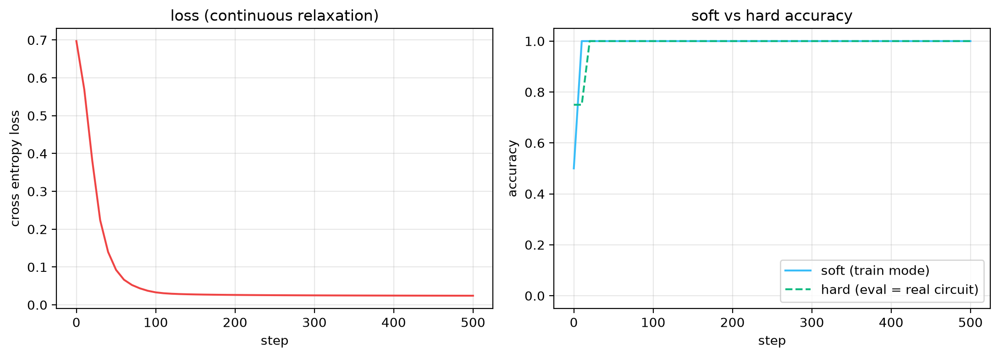
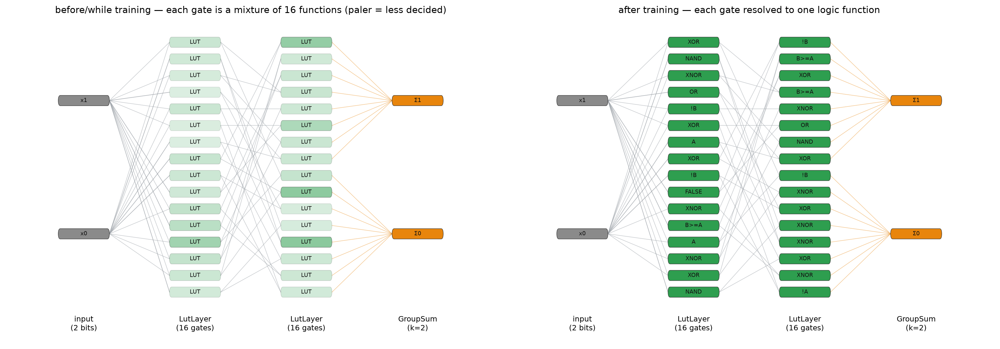
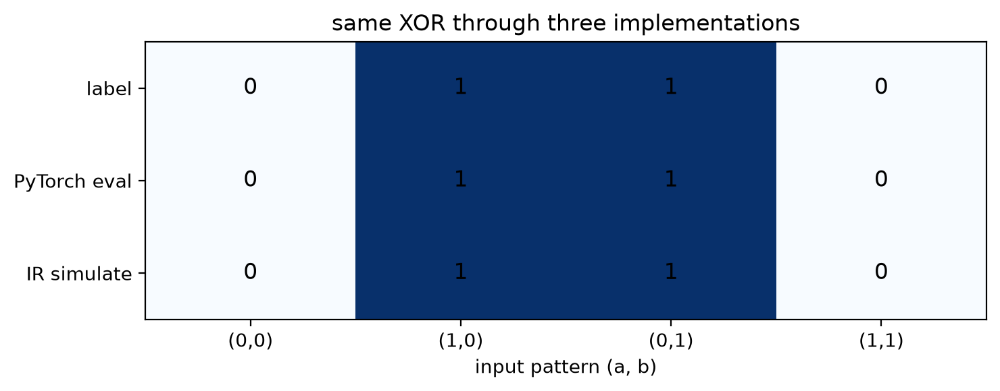

<!-- このファイルは scripts/build_tutorials.py が自動生成しています。
     直接編集せず、scripts/build_tutorials.py の FULL_PIPELINE_SOURCE を編集して再生成してください。 -->

学習 → 損失ログの読み方 → HDL エクスポート → FPGA 実装への接続、までを
1本の流れで通す**通しチュートリアル**。題材は最小の XOR に絞ってあるので、
個別ページ([MNIST](/tutorials/mnist/) / [HDLエクスポート](/tutorials/hdl-export/))を
先に読んでいなくても、このページだけで「学習してから回路になるまで」の全体像がつかめる。

:::tip[このページで学ぶこと]
1. 学習 → 損失ログ → IR → Verilog → FPGA 実装まで、途切れない1本の流れ
2. 各段でどの API を呼ぶか(このページだけで最後まで動く)
3. 深掘りしたくなったとき、どの個別ページへ戻ればよいかの地図

**前提**

- なし ── このページから読み始められる
:::

:::note[このページについて]
所要時間の目安: **約15分** / 実行環境: CPU のみ(GPU 不要)
元スクリプト: なし(`examples/01_xor.py` と `examples/04_export_hdl.py` を合成)
手元で試す: [`notebooks/07_full_pipeline.ipynb`](https://github.com/tsukushi-gate/Griffith/blob/main/notebooks/07_full_pipeline.ipynb)(このページと同じ内容の未実行ノートブック。`uv run --group docs jupyter lab notebooks/` で開ける)
コード出力はすべて **実際に実行した結果**をそのまま埋め込んでいます。
:::

<!-- Colabバッジ: リポジトリ public 化後、この span を data-colab-url を href に
     持つ <a> へ差し替えると「Colabで開く」が有効になる。 -->
<span class="colab-badge" data-colab-url="https://colab.research.google.com/github/tsukushi-gate/Griffith/blob/main/notebooks/07_full_pipeline.ipynb">▶ Colabで開く(リポジトリ公開後に有効化)</span>

## 1. データとモデル

XOR は「線形分離できない最小の問題」で、論理ゲート回路の表現力を測る定番のタスク。
`griffith_logic.datasets.xor2()` は4パターンを butterfly 規約の順で列挙したデータセットを返す。
モデルは `LutLayer` 2段 + `GroupSum`(クラスごとにゲート出力を集約)という最小構成。

```python
import copy
from pathlib import Path

import matplotlib.pyplot as plt
import numpy as np
import torch
import torch.nn as nn
import torch.nn.functional as F

from griffith_logic import GroupSum, LutLayer
from griffith_logic.datasets import xor2
from griffith_logic.export import export_ir
from griffith_logic.export.verify import iverilog_available, run_iverilog_equivalence
from griffith_logic.export.verilog import write_verilog
from griffith_logic.ir import save_ir, simulate, validate

# 乱数種の固定。各ゲートが「どの論理関数寄りから学習を始めるか」は乱数依存なので、
# 固定しないと実行ごとに収束の速さが変わる。
torch.manual_seed(0)

# xor2() は4パターンを butterfly 規約の順で列挙したデータセットを返す。
# XORは4通りしかないので訓練=テストで構わない(暗記ではなく真理値表の正しさを見る)。
x, y_bits = xor2().dataset.tensors
y = y_bits.squeeze(-1).long()  # cross_entropy が要求するクラスラベル{0,1}へ

model = nn.Sequential(
    # 入力2ビット → 16ゲート。各ゲートは2入力の論理関数(AND/OR/XOR等16種)の
    # ソフト混合として学習される。どの入力線を見るかの配線は初期化時に固定される。
    LutLayer(2, 16, n_inputs=2),   # 16ゲートsoftmax(difflogic互換)
    # 2段目。XORのような非線形は、この「ゲートの合成」によって表現される。
    LutLayer(16, 16, n_inputs=2),
    # 最終層16ゲートの出力を2クラスへ均等に分けて集計(グループ和)。
    # tau はロジットの温度で、大きいほど softmax がなだらかになる。
    GroupSum(k=2, tau=2.0),
)
print(model)

# 学習前の回路を後で図にするためのスナップショット(学習は元の model で進める)。
model_init = copy.deepcopy(model)
```

```text title="出力"
Sequential(
  (0): LutLayer(in=2, out=16, n_inputs=2, entries=4, param=softmax/16gate)
  (1): LutLayer(in=16, out=16, n_inputs=2, entries=4, param=softmax/16gate)
  (2): GroupSum(k=2, tau=2.0)
)
```

## 2. 学習と損失ログの読み方

学習は通常の PyTorch そのもの(`cross_entropy` + Adam)。特有なのは
**soft(学習時)と hard(離散回路)で精度が別物になりうる**点で、
損失だけを見ていると「soft では下がっているのに回路にすると壊れる」状況を見逃す。
そこで損失と一緒に **hard accuracy(`model.eval()` での精度)も同じ間隔でログする**。

```python
# 最適化対象は「各ゲートがどの論理関数か」を表す連続パラメータ。配線は固定なので、
# 学習しているのは実質的に真理値表の中身だけ。
opt = torch.optim.Adam(model.parameters(), lr=0.05)
history = []
for step in range(501):
    opt.zero_grad()
    # loss はクラス分類の cross entropy。backward() で GroupSum → 2段目 → 1段目 の順に
    # ゲート分布へ勾配が流れる(連続緩和しているので微分可能)。
    loss = F.cross_entropy(model(x), y)
    loss.backward()
    opt.step()
    if step % 10 == 0:
        # eval() に切り替えると各ゲートが argmax で1つの論理関数に確定する。
        # つまりここで測っているのは「今この瞬間の回路」の正解率。
        model.eval()
        with torch.no_grad():
            hard_acc = (model(x).argmax(-1) == y).float().mean().item()
        model.train()  # 学習は連続緩和の状態に戻して続ける
        with torch.no_grad():
            soft_acc = (model(x).argmax(-1) == y).float().mean().item()
        history.append((step, loss.item(), soft_acc, hard_acc))

print(f"{'step':>6} {'loss':>10} {'soft acc':>10} {'hard acc':>10}")
for step, loss_value, soft_acc, hard_acc in history[::10]:
    print(f'{step:>6} {loss_value:>10.4f} {soft_acc:>10.2f} {hard_acc:>10.2f}')
```

```text title="出力"
  step       loss   soft acc   hard acc
     0     0.6972       0.50       0.75
   100     0.0330       1.00       1.00
   200     0.0262       1.00       1.00
   300     0.0250       1.00       1.00
   400     0.0245       1.00       1.00
   500     0.0241       1.00       1.00
```

### 図1: 損失と soft/hard 精度の推移

表だけでは「いつ回路が決まったのか」が見えにくいので、同じ履歴を1枚の図にする。
左が損失、右が精度で、**soft(連続緩和のまま)と hard(argmax で確定した回路)を
重ねて描く**。この2本が離れているあいだは「学習中のモデルは解けているが、
焼いた回路は解けていない」状態である。

```python
steps = [h[0] for h in history]
fig, axes = plt.subplots(1, 2, figsize=(11, 4))
axes[0].plot(steps, [h[1] for h in history], color='#ef4444')
axes[0].set_xlabel('step')
axes[0].set_ylabel('cross entropy loss')
axes[0].set_title('loss (continuous relaxation)')
axes[0].grid(alpha=0.3)
axes[1].plot(steps, [h[2] for h in history], label='soft (train mode)', color='#38bdf8')
axes[1].plot(steps, [h[3] for h in history], label='hard (eval = real circuit)',
             color='#10b981', linestyle='--')
axes[1].set_xlabel('step')
axes[1].set_ylabel('accuracy')
axes[1].set_ylim(-0.05, 1.05)
axes[1].set_title('soft vs hard accuracy')
axes[1].legend(loc='lower right')
axes[1].grid(alpha=0.3)
fig.tight_layout()
plt.show()
```

    

    

読み方の要点:

- **loss が下がりきる前に hard acc が 1.00 に到達する**ことが多い。回路としての正解は
  離散化後の argmax で決まるため、損失の絶対値そのものは目標ではない。
- loss は下がるのに hard acc が上がらない場合、連続緩和が「中間的な確率分布」に
  居座っている(離散化で壊れる)サイン。温度 `tau` や学習率、層幅を疑う。
- 逆に hard acc が 1.00 で振動する場合は、既に十分学習できているので早期終了してよい。

```python
# train(): 各ゲートは16種の論理関数の「確率的な混合」のまま(=連続緩和)。
model.train()
acc_soft = (model(x).argmax(-1) == y).float().mean()
# eval(): 各ゲートが1つの論理関数に確定する。ここから先はもう学習用の近似ではなく、
# FPGAに焼けるのと同じ純粋なBoolean回路。
model.eval()  # 離散化(argmaxで完全なBoolean回路に崩壊)
acc_hard = (model(x).argmax(-1) == y).float().mean()
print(f'XOR: soft acc={acc_soft:.2f}, hard acc={acc_hard:.2f}')
# hard が 1.00 であることが本質。soft だけ高い場合は回路として決めきれていない。
assert acc_hard == 1.0
```

```text title="出力"
XOR: soft acc=1.00, hard acc=1.00
```

## 3. 同じコードがこの回路になる

ここまでで書いたのは `nn.Sequential(LutLayer(2, 16), LutLayer(16, 16), GroupSum(k=2))`
という3行だけだが、実体は **16個のゲートのノードと、それを結ぶ配線** である。
`plot_circuit()` はモデルからその回路をそのまま図にする。

### 図2: 学習前と学習後の回路図

- **左(`resolve=False`)** — 学習前。各ノードは16種の論理関数(AND/OR/XOR/…)の
  **混合**なので `LUT` としか呼べない。色の濃さがゲート分布の確定度で、
  薄いほど「まだどの関数か決まっていない」。
- **右(`resolve=True`)** — 学習後。argmax で1つに確定した論理関数の名前
  (`AND` / `XOR` / `NAND` / `!A` / `A>=B` …)がノードに入る。

**学習とは、16の候補からゲートを1つずつ選び切る作業**である、という主張が
そのまま絵になっている。ノードの名前は後段の `export_ir()` が Verilog を吐くときに
使う真理値表から導いているので、この図のゲートは**実際に焼かれる回路のゲート**と同一。

```python
import matplotlib.pyplot as plt

from griffith_logic.analysis.circuit_viz import plot_circuit

fig, axes = plt.subplots(1, 2, figsize=(17, 6))
# 緑=論理ゲート、橙=実数部(GroupSum のクラススコア)、灰=入力ビットと配線。
plot_circuit(model_init, resolve=False, ax=axes[0])
plot_circuit(model, resolve=True, ax=axes[1])
fig.tight_layout()
plt.show()
```

    

    

ゲート数が数百を超える実モデルでは全ノードを描いても潰れるだけなので、
`plot_circuit()` は自動的に俯瞰図(層=箱、配線=本数付き矢印)へ切り替わる
(`plot_abstract()` を直接呼んでもよい)。読み方は
[配線の可視化](/guides/wiring-visualization/) を参照。

## 4. IR へ抽出する

`export_ir()` は学習済み `nn.Module` を走査し、どのパラメータ化で学習していても
**真理値表へ万能離散化**した IR(JSON)にする。IR がハードウェア側の真実源であり、
Verilog / VHDL / シミュレータはすべてここから派生する。`validate(ir, target='hdl')`
で HDL 生成に必要な制約(ビット幅・トポロジ順序など)を先に検査しておく。

```python
# export_ir はモデルを走査し、層の種類・配線・確定した真理値表をJSONへ落とす。
# どのパラメータ化(softmax / independent / iwp …)で学習していても、
# 出てくるIRは「真理値表の集まり」に正規化される。
ir = export_ir(model, input_width=2, name='xor_full_pipeline')
# ビット幅・トポロジ順序・未対応ノードの不在を先に検査しておく。
# ここで落とせば、合成ツールで初めて気づく事故を防げる。
validate(ir, target='hdl')
save_ir(ir, 'out_examples/xor_full_pipeline.json')
print(f'IR ノード数: {len(ir.nodes)}')
for node in ir.nodes:
    print(f'  - {node.type}: {node.params.get("out_width", "-")}')
```

```text title="出力"
IR ノード数: 3
  - lut_layer: 16
  - lut_layer: 16
  - group_sum: -
```

## 5. Verilog を生成して照合する

`write_verilog()` で合成可能な Verilog を書き出し、`simulate()`(numpy のビット厳密な
golden model)と突き合わせる。`iverilog` が入っていれば、生成した Verilog 自体を
シミュレートして golden model と全パターン一致するかまで自動検証できる。

```python
# IR から合成可能な RTL を書き出す(Vivado / Quartus にそのまま投げられる)。
write_verilog(ir, 'out_examples/xor_full_pipeline.v')
# simulate() は IR を numpy の整数ビット演算で解釈実行する参照実装。浮動小数の近似が
# 入らないので「回路としてこう動くはず」という基準(golden model)になる。
scores = simulate(ir, x.numpy().astype(np.int64))
print(f'IR simulate 予測: {scores.argmax(-1).tolist()} (正解 {y.tolist()})')

# 生成した Verilog 自体をシミュレートして golden model と全パターン照合する。
# PyTorch hard eval ⇔ IR simulate ⇔ HDLシミュレーション の3段等価性の最後の1段。
if iverilog_available():
    result = run_iverilog_equivalence(
        ir, x.numpy().astype(np.int64), 'out_examples/verify_full_pipeline',
    )
    print('Verilog照合: ' + ('ALLPASS' if result['passed'] else '不一致'))
else:
    print('iverilog未導入のためVerilog照合はスキップ(brew install icarus-verilog)')
```

```text title="出力"
IR simulate 予測: [0, 1, 1, 0] (正解 [0, 1, 1, 0])
Verilog照合: ALLPASS
```

ここまでで、同じ XOR が**3つの別々の実装**を通った:
PyTorch の `model.eval()`、numpy 実装の `simulate()`、そして Verilog シミュレータ。
この3つが全入力パターンで一致することが「学習したモデル = 焼かれる回路」の保証になる。
4パターンしかないので、3段の予測を並べて全部見てしまう。

### 図3: 同じ XOR を3つの実装で通す

行が「教師ラベル / PyTorch eval / IR simulate」、列が4つの入力パターン。
セルの数字が予測クラスである。

```python
model.eval()
with torch.no_grad():
    torch_pred = model(x).argmax(-1).numpy()
ir_pred = simulate(ir, x.numpy().astype(np.int64)).argmax(-1)
rows = np.vstack([y.numpy(), torch_pred, ir_pred])
labels = ['label', 'PyTorch eval', 'IR simulate']
fig, ax = plt.subplots(figsize=(7.5, 3.0))
ax.imshow(rows, cmap='Blues', vmin=0, vmax=1, aspect='auto')
ax.set_xticks(range(4))
ax.set_xticklabels([f'({int(a)},{int(b)})' for a, b in x.numpy()])
ax.set_yticks(range(len(labels)))
ax.set_yticklabels(labels)
ax.set_xlabel('input pattern (a, b)')
ax.set_title('same XOR through three implementations')
for row in range(rows.shape[0]):
    for col in range(rows.shape[1]):
        ax.text(col, row, int(rows[row, col]), ha='center', va='center', fontsize=12)
fig.tight_layout()
plt.show()
```

    

    

**読み取り**: 3行が同じ並び `0 1 1 0` で埋まる ── 教師ラベルどおりの XOR を、
PyTorch の離散化経路と numpy の整数ビット演算がまったく同じように再現している。
1マスでも食い違えば、それはエクスポートのバグである。

### 生成された Verilog を覗く

最後に、書き出された RTL の冒頭を表示する(そのまま論理合成に掛けられる)。

```python
verilog = Path('out_examples/xor_full_pipeline.v').read_text().splitlines()
print('\n'.join(verilog[:20]))
```

```text title="出力"
// griffith-logic 自動生成 (source: xor_full_pipeline)
// 入力: 2bit / 出力: 8bit (score_bits=4)
module logic_core (
    input  wire [1:0] x,
    output wire [7:0] y
);

    // n0_lutlayer: lut_layer N=2, out=16
    wire [15:0] w_n0_lutlayer;
    assign w_n0_lutlayer[0] = 4'h7 >> {x[1], x[1]};
    assign w_n0_lutlayer[1] = 4'h6 >> {x[0], x[1]};
    assign w_n0_lutlayer[2] = 4'h9 >> {x[1], x[0]};
    assign w_n0_lutlayer[3] = 4'ha >> {x[1], x[0]};
    assign w_n0_lutlayer[4] = 4'hd >> {x[1], x[1]};
    assign w_n0_lutlayer[5] = 4'h9 >> {x[1], x[0]};
    assign w_n0_lutlayer[6] = 4'h0 >> {x[1], x[1]};
    assign w_n0_lutlayer[7] = 4'h3 >> {x[0], x[0]};
    assign w_n0_lutlayer[8] = 4'h6 >> {x[0], x[0]};
    assign w_n0_lutlayer[9] = 4'ha >> {x[0], x[0]};
    assign w_n0_lutlayer[10] = 4'h6 >> {x[0], x[1]};
```

## 6. ここから FPGA へ

生成した `.v` はベンダーツール(Vivado / Quartus 等)へそのまま投げられる合成可能 RTL。
ピン割り当て・クロック・ビットストリーム生成といった実機側の手順は
[HDL等価性検証ガイド](/guides/hdl/) を参照。

## 次に読む

- [HDL等価性検証](/guides/hdl/) — FPGA 実装と等価性の担保
- [IRを扱う](/guides/ir/) — 生成された IR を読む・書き換える
- [クラウドGPU](/guides/cloud-gpu/) — 大きなモデルを学習する
