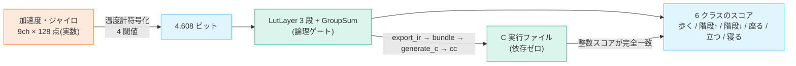
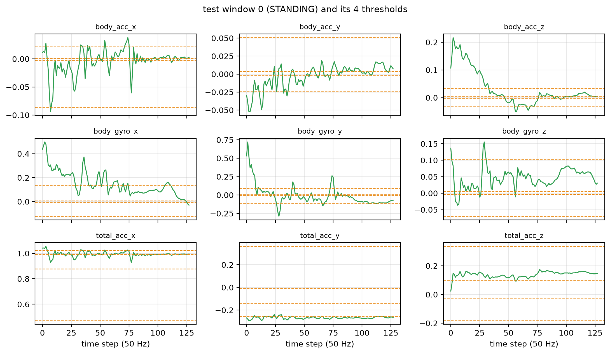
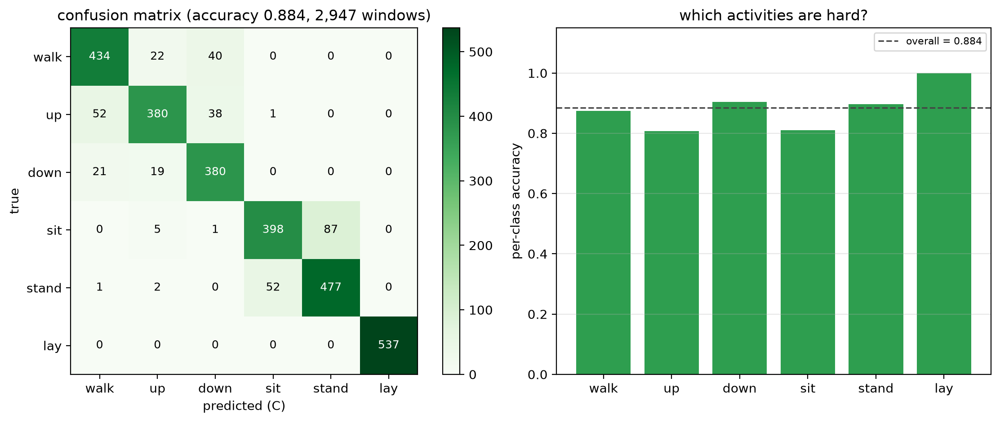

<!-- このファイルは scripts/build_tutorials.py が自動生成しています。
     直接編集せず、examples/27_har.py を編集して再生成してください。 -->

**スマホの加速度から「歩く・座る・階段を上る」を当てる**。腰につけたスマートフォンの
9 チャネル × 128 サンプル(2.56 秒)の生信号を、4 閾値の**温度計符号化**で 4,608 ビットにして、
9,000 ゲートの論理回路へ入れる。画像ではなく**センサの時系列**を論理ゲートが受け取る最小の例である。

実測は hard accuracy 0.885(テスト 2,947 窓・訓練に居ない 9 人)。後半は
[デプロイする](/tutorials/deploy-mnist/) と同じ出口を通し、学習した回路を C99 に書き出して
**テスト窓すべてを C だけで推論 → PyTorch の hard eval と整数で完全一致**を確かめ、
配信サイズ(約140KB)と実行時メモリ(6KB)を数える。1窓あたりの推論時間は著者環境
(Apple M1 Max・1コア・`cc -O2`)で約6.7マイクロ秒だった(機種で変わる値なのでページの出力には
載せず、`latency.json` へ書き出す)。

この回路を ESP32 や iPhone に載せる手順は [ESP32 に載せる](/guides/deploy-esp32/)・
[iPhone に載せる](/guides/deploy-ios/) で続く。

:::tip[このページで学ぶこと]
1. 実数のセンサ信号を温度計符号化(閾値は訓練データの分位点)で 0/1 の入力線にする方法
2. 9ch × 128 点 × 4 閾値 = 4,608 ビットを受ける論理回路で、未知の被験者の行動を分類する流れ
3. 同じ回路を C99 へ運び、テスト窓すべてで PyTorch hard eval と整数一致させる確かめ方

**前提**

- [4. デプロイする](/tutorials/deploy-mnist/) — 後半の出口と同じ手順
- [1. MNISTを学習する](/tutorials/mnist/) — LutLayer + GroupSum の基本
:::

:::note[このページについて]
所要時間の目安: **約10分** / 実行環境: CPU のみ(GPU 不要)
元スクリプト: [`examples/27_har.py`](https://github.com/tsukushi-gate/Griffith/blob/main/examples/27_har.py)
手元で試す: [`notebooks/27_har.ipynb`](https://github.com/tsukushi-gate/Griffith/blob/main/notebooks/27_har.ipynb)(このページと同じ内容の未実行ノートブック。`uv run --group docs jupyter lab notebooks/` で開ける)
コード出力はすべて **実際に実行した結果**をそのまま埋め込んでいます。
:::

<!-- Colabバッジ: リポジトリ public 化後、この span を data-colab-url を href に
     持つ <a> へ差し替えると「Colabで開く」が有効になる。 -->
<span class="colab-badge" data-colab-url="https://colab.research.google.com/github/tsukushi-gate/Griffith/blob/main/notebooks/27_har.ipynb">▶ Colabで開く(リポジトリ公開後に有効化)</span>

スマホの加速度から行動を当てる ── UCI-HAR を論理ゲートで学習して C へ運ぶ例。

腰につけたスマートフォンの加速度・ジャイロ(9 チャネル × 128 サンプル = 2.56 秒の窓)から、
**歩く・階段を上る・階段を下りる・座る・立つ・横になる**の 6 行動を当てる。
画像ではなく**センサの時系列**を、論理ゲート網がどう受け取るかを見るページである。

論理ゲートが受け取れるのは 0/1 だけなので、実数の信号は入口で**温度計符号化**する。
各チャネルの値を 4 つの閾値(訓練データの 20/40/60/80 パーセンタイル)と比べ、
超えたかどうかの 4 ビットに置き換える。9ch × 128 点 × 4 閾値 = **4,608 ビット**が、
そのまま回路の入力線になる。

後半は [デプロイする](/tutorials/deploy-mnist/) と同じ出口を通す。
学習した回路を IR → 配布バンドル → C99 ソースへ書き出し、`cc` でビルドして、
**テスト窓 2,947 本すべてを C だけで推論**し、PyTorch の hard eval と
整数で完全一致することを確かめる。



橙が実数のセンサ信号、青が 0/1 のビット列とクラススコア、緑が論理回路である。

実行: uv run python examples/27_har.py
期待結果: hard accuracy 0.80 以上 / C 推論と PyTorch が 2,947 窓 × 6 クラスで完全一致
(初回は UCI の zip(約 60MB)を data-uci-har/ へダウンロードする。Cコンパイラ cc が必要)

## 準備: import・乱数種・出力先

学習側で使うのは `load_uci_har`(生信号の読み込み)と `thermometer_encode`
(温度計符号化)の 2 つの新しい部品で、残りは [MNIST](/tutorials/mnist/) と同じ
`LutLayer` + `GroupSum` である。出口側は [デプロイする](/tutorials/deploy-mnist/)
と同じ `griffith_logic.deploy` の部品を使う。

```python
import gzip
import json
import platform
import re
import subprocess
from pathlib import Path

import matplotlib.pyplot as plt
import numpy as np
import torch
import torch.nn as nn
import torch.nn.functional as F

from griffith_logic import GroupSum, LutLayer
from griffith_logic.datasets import (
    UCI_HAR_CHANNELS,
    UCI_HAR_LABELS,
    fit_thermometer_thresholds,
    load_uci_har,
    thermometer_encode,
)
from griffith_logic.deploy import build_bundle, load_bundle, save_bundle
from griffith_logic.deploy.bundle import attach_bundle_sizes
from griffith_logic.deploy.cbackend import generate_c
from griffith_logic.deploy.verify import RUNTIME_C, find_cc, verify_c_matches_simulate
from griffith_logic.export import export_ir
from griffith_logic.ir import simulate, validate
from griffith_logic.ir.serialize import ir_to_dict
```

```python
# ゲートの初期分布は乱数依存なので、再現性のために固定する。
torch.manual_seed(0)
```

### 出力先とハイパーパラメータ

成果物は `out_examples/har/` に出す(`har.bundle.json` はファイル名固定)。
回路は `LutLayer` を `DEPTH` 段重ねて、最後に 6 クラスへ集計する。**入力が 4,608 ビットと
広い**ので、MNIST(400 ビット)より 1 段目のゲートを多めに取る。
CPU で 3 分以内に収まる規模である。

```python
OUT_DIR = Path('out_examples/har')
OUT_DIR.mkdir(parents=True, exist_ok=True)

N_THRESHOLDS = 4   # 1 チャネル・1 時刻あたりの温度計ビット数
K = 3000           # 1 段あたりのゲート数
DEPTH = 3          # LutLayer の段数
STEPS = 2000       # 学習イテレーション数
BATCH = 128        # ミニバッチサイズ
cc = find_cc()
assert cc is not None, 'C コンパイラ(cc / clang / gcc)が見つからない'
print(f'出力先: {OUT_DIR}')
```

```text title="出力"
出力先: out_examples/har
```

## データセット: 生の加速度・ジャイロ信号

`load_uci_har` は生の Inertial Signals を `(N, 9, 128)` の float32 で返す
(初回だけダウンロードして `data-uci-har/har_raw.npz` にキャッシュする)。
9 つのチャネルは、体の加速度(`body_acc`、重力を除いた動き)・ジャイロ(`body_gyro`)・
全加速度(`total_acc`、重力込み)の x/y/z である。ラベルは 0〜5 の行動番号。

**被験者で分かれている**点が大事で、訓練とテストに同じ人の窓は混ざらない
(初見の人でも当てられるかを測る設定)。

データの出典: Jorge Reyes-Ortiz, Davide Anguita, Alessandro Ghio, Luca Oneto, Xavier Parra,
"Human Activity Recognition Using Smartphones", UCI Machine Learning Repository, 2013
([doi:10.24432/C54S4K](https://doi.org/10.24432/C54S4K))。ライセンスは
[CC BY 4.0](https://creativecommons.org/licenses/by/4.0/)。
データはリポジトリに同梱せず、UCI から取得する。

```python
x_train, y_train, x_test, y_test, subj_train, subj_test = load_uci_har(return_subjects=True)
print(f'train {x_train.shape} / test {x_test.shape}(9 チャネル × 128 点)')
print(f'被験者: 訓練 {len(set(subj_train.tolist()))} 人 / テスト {len(set(subj_test.tolist()))} 人'
      f'(重複 {len(set(subj_train.tolist()) & set(subj_test.tolist()))} 人)')
print('クラス別の窓数(訓練/テスト):')
for c, name in enumerate(UCI_HAR_LABELS):
    print(f'  {c} {name:<19} {int((y_train == c).sum()):>5} / {int((y_test == c).sum()):>4}')
```

```text title="出力"
train (7352, 9, 128) / test (2947, 9, 128)(9 チャネル × 128 点)
被験者: 訓練 21 人 / テスト 9 人(重複 0 人)
クラス別の窓数(訓練/テスト):
  0 WALKING              1226 /  496
  1 WALKING_UPSTAIRS     1073 /  471
  2 WALKING_DOWNSTAIRS    986 /  420
  3 SITTING              1286 /  491
  4 STANDING             1374 /  532
  5 LAYING               1407 /  537
```

## 温度計符号化: 実数の信号を 4,608 ビットにする

閾値は**訓練データだけ**から、チャネルごとに 20/40/60/80 パーセンタイルで決める
(`fit_thermometer_thresholds`)。テストの分布を使うと評価が楽観的になるので、
テスト側にも**同じ閾値**を当てる。分位点で切るので、どのビットも訓練データの
約 80/60/40/20% で 1 になり、偏りなく情報を使える。

`thermometer_encode` は `(N, 9, 128)` を `(N, 9, 128, 4)` の 0/1 に変える。`reshape` で
一列に並べたものが回路の入力線(チャネル → 時刻 → 閾値の順)で、**4,608 本**になる。

```python
thresholds = fit_thermometer_thresholds(x_train, N_THRESHOLDS)
bits_train = thermometer_encode(x_train, thresholds=thresholds).reshape(len(x_train), -1)
bits_test = thermometer_encode(x_test, thresholds=thresholds).reshape(len(x_test), -1)
IN_BITS = bits_train.shape[1]
assert IN_BITS == 9 * 128 * N_THRESHOLDS
print(f'入力: {IN_BITS:,} ビット = 9ch × 128 点 × {N_THRESHOLDS} 閾値'
      f'(1 になっている割合: 訓練 {bits_train.mean():.3f} / テスト {bits_test.mean():.3f})')
```

```text title="出力"
入力: 4,608 ビット = 9ch × 128 点 × 4 閾値(1 になっている割合: 訓練 0.500 / テスト 0.499)
```

### 温度計になっているかの確認

閾値は昇順なので、ある点で「高い閾値を超えた」なら必ず「低い閾値も超えている」。
この単調性(`0001` のような並びが出ない)を全データで確かめる。

```python
levels = bits_train.reshape(len(x_train), 9, 128, N_THRESHOLDS)
assert (np.diff(levels, axis=-1) <= 0).all(), '温度計になっていない'
print('温度計の単調性: OK(高い閾値のビットが立てば、低い閾値のビットも必ず立っている)')
```

```text title="出力"
温度計の単調性: OK(高い閾値のビットが立てば、低い閾値のビットも必ず立っている)
```

## モデルと学習: 普通の PyTorch ループ

モデルは `LutLayer` を `DEPTH` 段と `GroupSum(k=6)` で、MNIST のときと形は同じである。
`GroupSum` は最終段のゲートを 6 組に分け、各組で 1 が立っている本数を数えて
6 クラスのスコアにする。学習ループも `cross_entropy` + `Adam` の普通の PyTorch で、
500 ステップごとに soft(学習中の姿)と hard(離散化した回路)の精度を並べて測る。

```python
train_x, train_y = torch.from_numpy(bits_train), torch.from_numpy(y_train)
test_x, test_y = torch.from_numpy(bits_test), torch.from_numpy(y_test)
layers = [LutLayer(IN_BITS, K, n_inputs=2)]
layers += [LutLayer(K, K, n_inputs=2) for _ in range(DEPTH - 1)]
model = nn.Sequential(*layers, GroupSum(k=6, tau=10.0))
opt = torch.optim.Adam(model.parameters(), lr=0.01)
history = []  # (step, soft acc, hard acc)

for step in range(STEPS + 1):
    if step % 500 == 0:
        with torch.no_grad():
            model.train()
            soft_acc = (model(test_x).argmax(-1) == test_y).float().mean().item()
            model.eval()
            hard_acc = (model(test_x).argmax(-1) == test_y).float().mean().item()
        model.train()
        history.append((step, soft_acc, hard_acc))
        print(f'step {step:>5}  soft acc={soft_acc:.4f}  hard acc={hard_acc:.4f}')
    idx = torch.randint(0, len(train_x), (BATCH,))
    opt.zero_grad()
    loss = F.cross_entropy(model(train_x[idx]), train_y[idx])
    loss.backward()
    opt.step()

model.eval()
final_hard = history[-1][2]
print(f'\n最終 hard acc={final_hard:.4f}(テスト {len(test_x):,} 窓。これから運ぶ回路の成績)')
assert final_hard >= 0.80, f'hard acc={final_hard:.4f} が低すぎる'
```

```text title="出力"
step     0  soft acc=0.1598  hard acc=0.1985

step   500  soft acc=0.8487  hard acc=0.8283

step  1000  soft acc=0.8846  hard acc=0.8643

step  1500  soft acc=0.8911  hard acc=0.8792

step  2000  soft acc=0.8948  hard acc=0.8853

最終 hard acc=0.8853(テスト 2,947 窓。これから運ぶ回路の成績)
```

## IR とバンドル: 学習済みモデルを1つのファイルに包む

手順は [デプロイする](/tutorials/deploy-mnist/) と同じ。`export_ir` が回路を
IR へ確定させ、`build_bundle` / `save_bundle` が IR とクラス名を `har.bundle.json` へ包む。
**入力は 4,608 ビットの 0/1 列**(温度計符号化した結果)で、この符号化(閾値)は
Python 側の仕事になる。閾値の表も `har_thresholds.json` に一緒に出しておく。

配信サイズ(圧縮後)は gzip で測る。`gzip.compress` は既定だとヘッダに現在時刻を入れるので、
`mtime=0` で固定する。さらに `export_ir` は IR のメタデータに**書き出した時刻**(`created_at`)
を入れるので、これも固定の時刻で上書きして、
**同じ学習結果なら毎回同じバイト列・同じバイト数**にする。

```python
ir = export_ir(model, input_width=IN_BITS, name='har')
validate(ir, target='hdl')
n_gates = sum(n.params['out_width'] for n in ir.nodes if n.type == 'lut_layer')
print(f'IR: ノード {[n.type for n in ir.nodes]} / 総ゲート数 {n_gates:,}')

LABELS = list(UCI_HAR_LABELS)
doc = {'ir': ir_to_dict(ir), 'labels': LABELS}
doc['ir']['metadata']['created_at'] = '2026-01-01T00:00:00+09:00'  # 書き出し時刻を固定
(OUT_DIR / 'har_model.json').write_text(json.dumps(doc), encoding='utf-8')
(OUT_DIR / 'har_thresholds.json').write_text(json.dumps({
    'channels': list(UCI_HAR_CHANNELS), 'n_thresholds': N_THRESHOLDS,
    'thresholds': thresholds.tolist(),
    'bit_order': 'channel, time(128), threshold(ascending); bit = x > threshold',
}), encoding='utf-8')
bundle = build_bundle(doc)
attach_bundle_sizes(bundle)
bundle_path = OUT_DIR / 'har.bundle.json'
save_bundle(bundle, bundle_path)
bundle_bytes = bundle_path.stat().st_size
bundle_gz = gzip.compress(bundle_path.read_bytes(), compresslevel=6, mtime=0)
Path(str(bundle_path) + '.gz').write_bytes(bundle_gz)
bundle_gz_bytes = len(bundle_gz)
print(f'バンドル: {bundle_path.name} = {bundle_bytes:,} B(gzip {bundle_gz_bytes:,} B)')
```

```text title="出力"
IR: ノード ['lut_layer', 'lut_layer', 'lut_layer', 'group_sum'] / 総ゲート数 9,000
バンドル: har.bundle.json = 139,569 B(gzip 47,663 B)
```

## C コード生成とビルド

バンドルを読み戻して `generate_c` で `model.c` / `model.h` を作り、ランタイムと一緒に
`cc` に渡す。ドライバは「ビット列のファイルを読んで `mdl_infer` を回し、
ループ全体の時間を測る」だけの小さな `main` である。

```python
loaded = load_bundle(bundle_path, validate=True, strict=True)
C_DIR = OUT_DIR / 'c'
C_DIR.mkdir(exist_ok=True)
for filename, text in generate_c(loaded, name='model', validate=False).items():
    (C_DIR / filename).write_text(text, encoding='utf-8')
for rel in ('include/mdl_kernels.h', 'include/mdl_simd.h', 'src/mdl_kernels.c'):
    (C_DIR / Path(rel).name).write_bytes((RUNTIME_C / rel).read_bytes())
model_c_bytes = (C_DIR / 'model.c').stat().st_size
header = (C_DIR / 'model.h').read_text(encoding='utf-8')
ctx_bytes = int(re.search(r'#define\s+MDL_CTX_BYTES\s+\(?(\d+)', header).group(1))
print(f'生成: model.c {model_c_bytes:,} B / MDL_CTX_BYTES = {ctx_bytes:,} B(作業RAM)')

DRIVER_C = r'''
#include <stdio.h>
#include <stdlib.h>
#include <time.h>
#include "model.h"

int main(int argc, char **argv) {
    if (argc != 5) { fprintf(stderr, "usage: bits.bin n reps scores.bin\n"); return 2; }
    int n = atoi(argv[2]), reps = atoi(argv[3]);
    uint8_t *bits = malloc((size_t)n * MDL_INPUT_WIDTH);
    int32_t *scores = malloc((size_t)n * MDL_OUTPUT_WIDTH * sizeof(int32_t));
    FILE *f = fopen(argv[1], "rb");
    if (!f || fread(bits, 1, (size_t)n * MDL_INPUT_WIDTH, f) != (size_t)n * MDL_INPUT_WIDTH)
        return 3;
    fclose(f);
    for (int i = 0; i < n; i++)                        /* 暖機運転 */
        mdl_infer(bits + (size_t)i * MDL_INPUT_WIDTH, scores + (size_t)i * MDL_OUTPUT_WIDTH);
    clock_t t0 = clock();
    for (int r = 0; r < reps; r++)
        for (int i = 0; i < n; i++)
            mdl_infer(bits + (size_t)i * MDL_INPUT_WIDTH, scores + (size_t)i * MDL_OUTPUT_WIDTH);
    double us = (double)(clock() - t0) / CLOCKS_PER_SEC * 1e6 / ((double)reps * n);
    f = fopen(argv[4], "wb");
    fwrite(scores, sizeof(int32_t), (size_t)n * MDL_OUTPUT_WIDTH, f);
    fclose(f);
    printf("%.3f\n", us);
    return 0;
}
'''
(C_DIR / 'main.c').write_text(DRIVER_C, encoding='utf-8')
exe = C_DIR / 'har_demo'
build = subprocess.run(
    [cc, '-std=c99', '-O2', f'-I{C_DIR}', str(C_DIR / 'model.c'),
     str(C_DIR / 'mdl_kernels.c'), str(C_DIR / 'main.c'), '-o', str(exe)],
    capture_output=True, text=True)
assert build.returncode == 0, build.stderr
print('ビルド: cc -std=c99 -O2 model.c mdl_kernels.c main.c -o har_demo -> 成功')
```

```text title="出力"
生成: model.c 99,890 B / MDL_CTX_BYTES = 6,000 B(作業RAM)

ビルド: cc -std=c99 -O2 model.c mdl_kernels.c main.c -o har_demo -> 成功
```

## C で全テスト窓を推論し、PyTorch と整数で突き合わせる

テスト窓すべて(2,947 本)の 4,608 ビットをファイルに書き、C の実行ファイルに食わせる。
返ってくる 6 クラスの整数スコアを、**PyTorch hard eval**・**IR の参照実装 `simulate`**・
**C** の 3 者で比べ、1 要素も違わないことを `assert` で固定する。

```python
bits_path = OUT_DIR / 'test_bits.bin'
bits_path.write_bytes(bits_test.astype(np.uint8).tobytes())
N_C = len(bits_test)
scores_path = OUT_DIR / 'scores_c.bin'
run = subprocess.run([str(exe), str(bits_path), str(N_C), '5', str(scores_path)],
                     capture_output=True, text=True)
assert run.returncode == 0, run.stderr
us_per_window = float(run.stdout.strip())
c_scores = np.fromfile(scores_path, dtype=np.int32).reshape(N_C, 6).astype(np.int64)

with torch.no_grad():
    torch_logits = model(test_x)  # model.eval() 済み = hard eval
torch_scores = np.rint(torch_logits.numpy() * 10.0).astype(np.int64)  # tau=10 を掛け戻す
sim_scores = simulate(ir, bits_test.astype(np.int64)).astype(np.int64)

assert np.array_equal(c_scores, torch_scores), 'C と PyTorch hard eval のスコアが食い違う'
assert np.array_equal(c_scores, sim_scores), 'C と IR simulate のスコアが食い違う'
c_pred = c_scores.argmax(1)
assert np.array_equal(c_pred, torch_logits.argmax(-1).numpy())
c_acc = float((c_pred == y_test).mean())
n_mismatch = int((c_scores != torch_scores).sum())
print(f'C ⇔ PyTorch hard eval ⇔ IR simulate: {N_C:,}窓 × 6クラス = {c_scores.size:,} 要素のうち'
      f' 不一致 {n_mismatch} 個(予測ラベルも {N_C:,}/{N_C:,} 一致)')
print(f'C 推論の accuracy = {c_acc:.4f}({N_C:,}窓)')
gate = verify_c_matches_simulate(loaded, n_samples=4, seed=1, verbose=False)
print(f'verify-c: {gate["n_samples"]}サンプル({gate["path"]}経路) 最大差 {gate["max_abs_diff"]}')
```

```text title="出力"
C ⇔ PyTorch hard eval ⇔ IR simulate: 2,947窓 × 6クラス = 17,682 要素のうち 不一致 0 個(予測ラベルも 2,947/2,947 一致)
C 推論の accuracy = 0.8843(2,947窓)

verify-c: 4サンプル(bits経路) 最大差 0
```

## 配信サイズと速さ: 2.56 秒の窓を何マイクロ秒で判定できるか

センサの 1 窓は 2.56 秒ぶんの記録なので、**判定に使える時間は 2.56 秒**ある。
それに対して C の推論はどれだけ速いか、運ぶものは何バイトか、を数える。

速さ(µs/窓)は機種・実行ごとに揺れる数字なので、**このページの出力には焼き込まない**
(計測は上でしていて、`out_examples/har/latency.json` に書き出す)。
著者環境(Apple M1 Max、1コア、`cc -O2`)での実測は **約 6.7 µs/窓**で、
判定に使える 2.56 秒の**約 38 万分の 1**(およそ 1e-6 倍)の時間である。
バイト数のほうは回路が同じなら毎回同じ値になる。

```python
print('項目                     値')
print(f'バンドル(JSON)           {bundle_bytes:>10,} B')
print(f'バンドル(gzip)           {bundle_gz_bytes:>10,} B')
print(f'model.c                  {model_c_bytes:>10,} B')
print(f'MDL_CTX_BYTES(作業RAM)   {ctx_bytes:>10,} B')
(OUT_DIR / 'latency.json').write_text(json.dumps({
    'unit': 'microseconds per 2.56 s window (single core)',
    'machine': platform.platform(), 'compiler': Path(cc).name, 'flags': '-std=c99 -O2',
    'gates': n_gates, 'us_per_window': us_per_window,
}, indent=2), encoding='utf-8')
```

```text title="出力"
項目                     値
バンドル(JSON)              139,569 B
バンドル(gzip)               47,663 B
model.c                      99,890 B
MDL_CTX_BYTES(作業RAM)        6,000 B
```

## 可視化: 波形と温度計ビット、そして混同行列

最初の図は、1 つの窓(テスト窓の先頭)の 9 チャネルの波形である。破線が
訓練データから決めた 4 本の閾値で、波形がどの線を超えているかが、そのまま
入力ビットになる。

### 図1: 9 チャネルの波形と閾値

行は体の加速度(上)・ジャイロ(中)・全加速度(下)、列は x/y/z。
この窓は「立っている」(STANDING)で、動きのチャネルは小さく揺れるだけである。
閾値の線が値域を 5 つの帯に切っている。

```python
win = 0
fig, axes = plt.subplots(3, 3, figsize=(11, 6.4), sharex=True)
for c, ax in enumerate(axes.ravel()):
    ax.plot(x_test[win, c], color='#2e9e4f', lw=1.2)
    for t in range(N_THRESHOLDS):
        ax.axhline(thresholds[c, t], color='#e8850c', ls='--', lw=0.9)
    ax.set_title(UCI_HAR_CHANNELS[c], fontsize=9)
    ax.grid(alpha=0.3)
for ax in axes[-1]:
    ax.set_xlabel('time step (50 Hz)')
fig.suptitle(f'test window 0 ({UCI_HAR_LABELS[int(y_test[win])]}) and its 4 thresholds',
             fontsize=11)
fig.tight_layout()
plt.show()
```

    

    

**読み取り**: 波形が破線を何本またぐかで、各時刻の符号(0000 / 0001 / ... / 1111)が決まる。
閾値は分位点なので、よく動くチャネルほど線の間隔が広く、静かなチャネルでは
値が小さな範囲にぎっしり集まる ── 同じ「4 ビット」でも、信号の大きさに合わせて目盛りが
付いている。

### 図2: 混同行列と、行動ごとの正解率

C の予測と正解ラベルの対応表。**行が正解、列が予測**で、数字は窓の数。
PyTorch と完全に一致しているので、これは PyTorch hard eval の混同行列でもある。

```python
conf = np.zeros((6, 6), dtype=int)
for t_, p_ in zip(y_test, c_pred, strict=True):
    conf[t_, p_] += 1
per_class = conf.diagonal() / conf.sum(1)
fig, (ax_conf, ax_acc) = plt.subplots(
    1, 2, figsize=(12, 4.8), gridspec_kw={'width_ratios': [1.15, 1]})
im = ax_conf.imshow(conf, cmap='Greens')
for i in range(6):
    for j in range(6):
        ax_conf.text(j, i, conf[i, j], ha='center', va='center', fontsize=9,
                     color='white' if conf[i, j] > conf.max() * 0.55 else 'black')
short = ['walk', 'up', 'down', 'sit', 'stand', 'lay']
ax_conf.set_xticks(range(6), short)
ax_conf.set_yticks(range(6), short)
ax_conf.set_xlabel('predicted (C)')
ax_conf.set_ylabel('true')
ax_conf.set_title(f'confusion matrix (accuracy {c_acc:.3f}, {N_C:,} windows)')
fig.colorbar(im, ax=ax_conf, fraction=0.046)
ax_acc.bar(range(6), per_class, color='#2e9e4f')
ax_acc.axhline(c_acc, color='#444', ls='--', lw=1.2, label=f'overall = {c_acc:.3f}')
ax_acc.set_xticks(range(6), short)
ax_acc.set_ylim(0, 1.15)
ax_acc.set_ylabel('per-class accuracy')
ax_acc.set_title('which activities are hard?')
ax_acc.grid(alpha=0.3, axis='y')
ax_acc.legend(loc='upper right', fontsize=8)
fig.tight_layout()
plt.show()
```

    

    

**読み取り**: 間違いは「座る ↔ 立つ」と「歩く / 階段を上る / 階段を下りる」の
2つの仲間内に集中し、仲間をまたぐ取り違えはほとんど無い。腰につけたスマホでは座るも
立つも体がほぼ静止し、重力の向きがわずかに違うだけだからで、一方「横になる」は
重力の向きが大きく変わるので全窓を当てている。つまり回路の誤りは
**センサから見て本当に紛らわしい行動**に偏っている。

```python
worst = int(np.argmin(per_class))
print(f'最も苦手な行動: {UCI_HAR_LABELS[worst]}(正解率 {per_class[worst]:.3f})')
```

```text title="出力"
最も苦手な行動: WALKING_UPSTAIRS(正解率 0.807)
```

## 次に読む

- [4. デプロイする](/tutorials/deploy-mnist/) — 同じ出口を画像分類で通す
- [DWN(二値NN・温度計符号化)](/tutorials/dwn/) — 温度計符号化を層として組み込む流儀
- [3. HDLへエクスポート](/tutorials/hdl-export/) — 同じ回路を Verilog へ
- [論理ゲート版TextCNN](/tutorials/textcnn/) — 系列データを論理ゲートで解く別の例
- [デモモデルを用意する](/guides/deploy-models/) — この行動認識モデルを含むデモバンドルの作り方
- [ESP32 に載せる](/guides/deploy-esp32/) — 行動認識をマイコン(ESP32)で動かす
- [iPhone に載せる](/guides/deploy-ios/) — 行動認識を iPhone アプリへ同梱する
