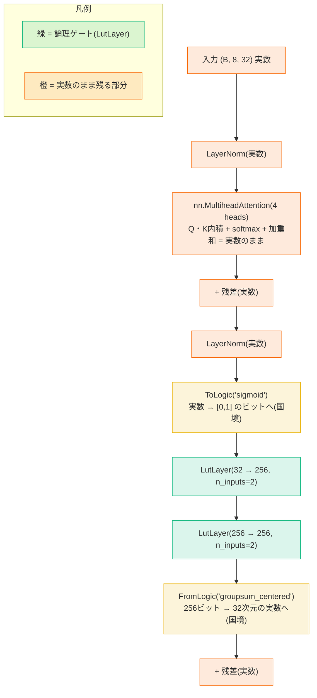
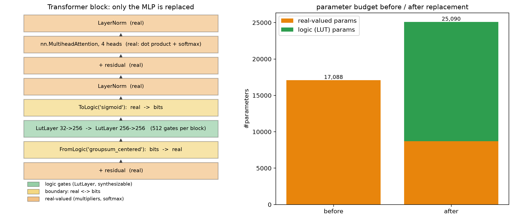
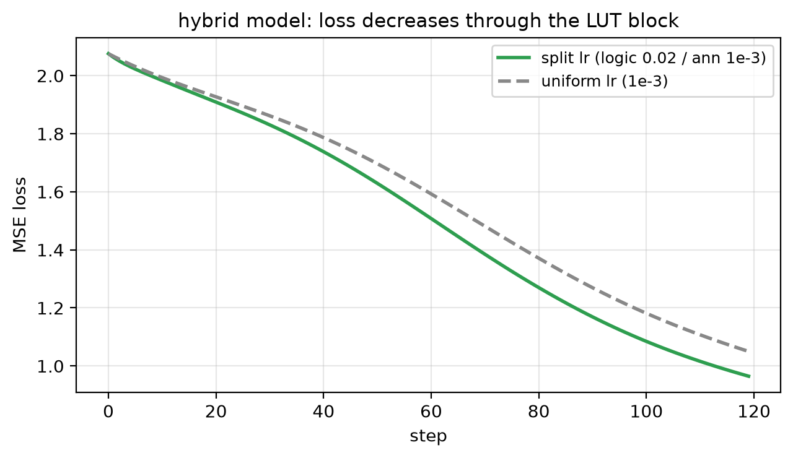
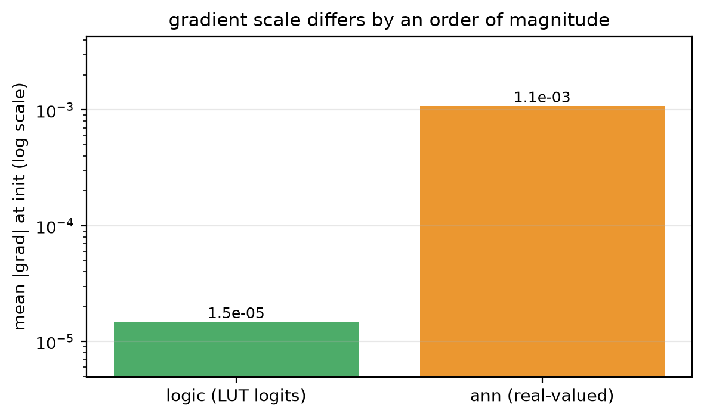
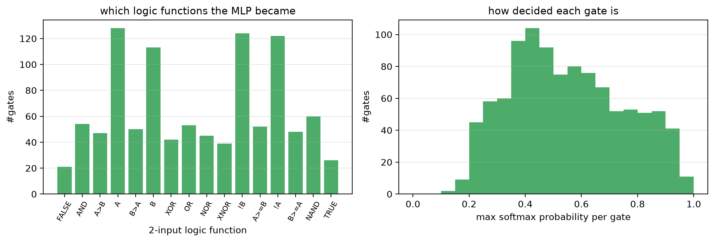

<!-- このファイルは scripts/build_tutorials.py が自動生成しています。
     直接編集せず、examples/02_hybrid_llvit.py を編集して再生成してください。 -->

既存の Transformer ブロックの **MLP 部分だけ**を LUT ベースの論理ゲートへ置換する
(LL-ViT 型ハイブリッド)。Attention と LayerNorm は PyTorch の実数層のまま残し、
論理系と実数系で学習率を分けて同時に学習する。

:::tip[このページで学ぶこと]
1. Transformer ブロックの **MLP 部分だけ**を LUT へ置換する組み方(LL-ViT 型)
2. Attention・LayerNorm を実数のまま残し、論理系と実数系で学習率を分ける理由
3. 「全部を論理ゲートにしない」という設計判断がどこで効くか

**前提**

- [1. MNISTを学習する](/tutorials/mnist/) — 全部が論理ゲートの場合を先に見る
- [PyTorchからの移行](/guides/from-pytorch/) — 層の対応表
:::

:::note[このページについて]
所要時間の目安: **約5分** / 実行環境: CPU のみ(GPU 不要)
元スクリプト: [`examples/02_hybrid_llvit.py`](https://github.com/tsukushi-gate/Griffith/blob/main/examples/02_hybrid_llvit.py)
手元で試す: [`notebooks/02_hybrid_llvit.ipynb`](https://github.com/tsukushi-gate/Griffith/blob/main/notebooks/02_hybrid_llvit.ipynb)(このページと同じ内容の未実行ノートブック。`uv run --group docs jupyter lab notebooks/` で開ける)
コード出力はすべて **実際に実行した結果**をそのまま埋め込んでいます。
:::

<!-- Colabバッジ: リポジトリ public 化後、この span を data-colab-url を href に
     持つ <a> へ差し替えると「Colabで開く」が有効になる。 -->
<span class="colab-badge" data-colab-url="https://colab.research.google.com/github/tsukushi-gate/Griffith/blob/main/notebooks/02_hybrid_llvit.ipynb">▶ Colabで開く(リポジトリ公開後に有効化)</span>

ハイブリッドNN(LL-ViT型)の例。

既存のTransformerブロックの「MLP部分だけ」をLUTベース論理ゲートに
置換する。Attention・LayerNormはPyTorch実数層のまま。

Transformer全体を論理ゲート化するのは難しいが、**パラメータの大半を占めるMLPだけ**を
論理回路に落とせば、推論コストの大部分をGPUから剥がせる。このスクリプトは
「既存モデルに1行差し込むだけで部分置換できる」ことと、置換後も普通に勾配が流れて
損失が下がることを確認する。

このページで確認するのは次の4点。
どこが論理ゲートに変わりどこが実数のまま残るか、パラメータ予算がどう動くか、
論理系と実数系で学習率を分けるとなぜ効くのか、そして置換されたMLPが最終的に
どんな2入力論理ゲートの集まりになるのか。

**どこが実数のまま残り、どこがLUTになるのか**

橙 = 実数(浮動小数点の掛け算・LayerNorm・softmax が要る部分)、
緑 = 論理ゲート(LutLayer。真理値表そのものなのでHDLへ焼ける)。
`Binarize`(ToLogic)と `GroupSum`(FromLogic)が2つの世界の**国境**で、
ここで実数 ⇄ ビットを行き来する。



置換されるのは各ブロックの `mlp` だけで、**1ブロックあたり 512 ゲート
(LutLayer 32→256 と 256→256)、2ブロックで 1,024 ゲート**。
実数パラメータは **17,088 → 8,706**(約半分)に減り、代わりに
論理パラメータ 16,384(= 1,024ゲート × 16種の論理関数のロジット)が付く。
Attention を実数のまま残しているので、この構成は「LL-ViT 型」と呼ばれる
部分論理化になる ── Attention まで論理にする道は
[Transformerを段階的に論理化](/tutorials/logic-ladder/)で扱う。

実行: uv run python examples/02_hybrid_llvit.py
期待結果: 置換2箇所、損失が減少

## 準備: import と置換API

本ライブラリから使うのは4つ。**既存モデルを書き換えずに部分置換する**ための道具立てである。

- `replace_mlp_with_lut` … モデルを再帰的に走査し、MLP と判定できた部分だけを
  LUT ブロックへ差し替える
- `LogicSpec` … 置換後の論理回路の形(1ゲートの入力数・段数・幅)の指定
- `split_param_groups` … パラメータを論理系(`logic`)と実数系(`ann`)に自動で振り分ける
- `LutLayer` / `gate_labels` … 置換で挿入される層と、そのゲート名の取得

```python
import copy

import matplotlib.pyplot as plt
import torch
import torch.nn as nn
import torch.nn.functional as F

from griffith_logic import (
    LogicSpec,
    LutLayer,
    replace_mlp_with_lut,
    split_param_groups,
)
from griffith_logic.analysis.circuit_viz import GATE_NAMES, gate_labels
```

```python
DIM = 32
```

## 置換される「既存モデル」を用意する

置換の出発点となる、ごく普通の **Pre-LN Transformer ブロック**を素の PyTorch で書く。
ここには本ライブラリ由来のものが**何も入っていない** ── 手元にある既存モデルを
そのまま持ち込めることを示すために、あえてこうしている。

構成は `LayerNorm → MultiheadAttention → 残差 → LayerNorm → MLP → 残差`。
このうち置換の標的は `self.mlp`(`Linear-GELU-Linear`)だけで、
**Transformer のパラメータの約2/3をこの MLP が占める**ため、ここを論理化するだけで
実数パラメータの大半を剥がせる。

```python
class Block(nn.Module):
    """ごく普通のPre-LN Transformerブロック(置換される「既存モデル」の役)。

    ここには griffith_logic 由来のものは何も無い。手元の実装をそのまま
    持ち込めることを示すために、あえて素のPyTorchだけで書いている。
    """

    def __init__(self):
        super().__init__()
        self.norm1 = nn.LayerNorm(DIM)
        self.attn = nn.MultiheadAttention(DIM, 4, batch_first=True)
        self.norm2 = nn.LayerNorm(DIM)
        # このmlp(Linear-GELU-Linear)が置換のターゲット。
        # Transformerのパラメータの約2/3はこのMLPが占める。
        self.mlp = nn.Sequential(
            nn.Linear(DIM, DIM * 2), nn.GELU(), nn.Linear(DIM * 2, DIM),
        )

    def forward(self, x):
        h = self.norm1(x)
        a, _ = self.attn(h, h, h)
        x = x + a
        return x + self.mlp(self.norm2(x))
```

```python
torch.manual_seed(0)
model = nn.Sequential(Block(), Block())
```

```python
# 置換前の姿を控えておく(後でパラメータ数を比べる)。
model_orig = copy.deepcopy(model)
```

## 部分置換: MLPだけをLUTへ差し替える

置換は関数呼び出し1回で終わる。`LogicSpec` が置換後の回路の形を決める。

- `n_inputs=2` … 1ゲートあたり2入力(difflogic 互換の16種の論理関数)
- `depth=2` … LUT 層を2段重ねる。ゲートの合成で非線形性を作る
- `neurons_per_output=8` … 出力1次元あたり8ゲートを割り当てる。表現力とコストのつまみ

戻り値の `replaced` に置換したモジュール名が入るので、**意図した箇所だけが
置換されたか**をコードで検証できる(黙って全部置き換わる事故を防ぐ)。

```python
# モデルを再帰的に走査し、MLPと判定できたSequentialをLUTブロックへ差し替える。
# spec は置換後の論理回路の形:
#   n_inputs=2           … 1ゲートあたり2入力(difflogic互換の16種論理関数)
#   depth=2              … LUT層を2段重ねる(ゲートの合成で非線形性を作る)
#   neurons_per_output=8 … 出力1次元あたり8ゲートを割り当てる(表現力とコストのつまみ)
# 戻り値の replaced に置換したモジュール名が入るので、意図した箇所だけ置換できたか検証できる。
hybrid, replaced = replace_mlp_with_lut(
    model, spec=LogicSpec(n_inputs=2, depth=2, neurons_per_output=8),
)
print(f'置換されたモジュール: {replaced}')
```

```text title="出力"
置換されたモジュール: ['0.mlp', '1.mlp']
```

### 置換後にどんな層が入ったかを確認する

挿入された `LutLayer` の入出力幅がそのまま**ゲート本数**であり、
ハードウェアコストの単位になる。出力を見ると 1ブロックあたり
`32→256` と `256→256` の2層 = **512ゲート**、2ブロックで1,024ゲートだと分かる。

```python
# 置換後のブロックがどんな形になったかを覗いておく。MLP(Linear-GELU-Linear)は
# 「実数→ビット化 → LutLayer × depth → ビットを実数へ戻す」という小さな回路に
# 置き換わっている。各LutLayerの入出力幅(=ゲート本数)がハードウェアコストの単位。
for name, module in hybrid.named_modules():
    if isinstance(module, LutLayer):
        print(f'  {name}: LutLayer(in={module.in_dim}, out={module.out_dim},'
              f' n_inputs={module.n_inputs}) → {module.out_dim}ゲート')
```

```text title="出力"
  0.mlp.luts.0: LutLayer(in=32, out=256, n_inputs=2) → 256ゲート
  0.mlp.luts.1: LutLayer(in=256, out=256, n_inputs=2) → 256ゲート
  1.mlp.luts.0: LutLayer(in=32, out=256, n_inputs=2) → 256ゲート
  1.mlp.luts.1: LutLayer(in=256, out=256, n_inputs=2) → 256ゲート
```

## 学習タスク: 勾配が通ることだけを確かめる

**なぜランダムなターゲットへの回帰なのか** ── このページで確かめたいのは精度ではなく、
「実数層 → 論理層 → 実数層」と異種の層をまたいでも1本の `backward()` が
最後まで通るか、という一点である。実データを使うとタスクの難易度が結果に混ざるので、
**ノイズを丸暗記させるだけ**の課題にして、置換そのものの影響だけを見る。

```python
# ここでの狙いは精度ではなく「ハイブリッドでも勾配が最後まで流れること」の確認なので、
# タスクはランダムなターゲットへの回帰(=ノイズを丸暗記させるだけ)で十分。
# データセットの都合で結果が変わる余地を消して、置換そのものの影響だけを見る。
x = torch.randn(64, 8, DIM)
target = torch.randn(64, 8, DIM)
```

```python
def run_training(net, opt, steps: int = 120):
    """1本のbackwardで実数層と論理層をまとめて更新し、各ステップの損失を返す。

    Attention(実数)→ LUTブロック(論理)→ Attention と異種の層をまたぐが、
    呼び出し側に特別な扱いは要らない。ここが「ハイブリッドが使える」の実体。
    """
    history = []
    for _ in range(steps):
        opt.zero_grad()
        loss = F.mse_loss(net(x), target)
        loss.backward()
        opt.step()
        history.append(loss.item())
    return history
```

## なぜ学習率を分けるのか(勾配スケールの実測)

ハイブリッドで最初につまずくのがここである。**論理系と実数系では勾配の大きさが桁で違う**。

論理ゲートのパラメータは「16種の論理関数に対するロジット」で、softmax を通ってから
出力に効くため勾配が小さくなりやすい。一方 Attention や LayerNorm の実数重みは
出力へ直接効く。同じ学習率で回すと、論理側だけがほとんど動かないまま終わる。

職人芸に見えるこの調整を、まず**初期状態で1回 backward して平均 $|\mathrm{grad}|$ を測る**
という形で数値にしておく。

```python
# 論理ゲートのパラメータは「16種の論理関数に対するロジット」で、softmaxを通ってから
# 出力に効くため勾配が小さくなりやすい。一方 Attention や LayerNorm の実数重みは
# 出力へ直接効く。両者を同じlrで回すと、論理側だけがほとんど動かない。
# 実際に初期状態で1回backwardして、グループごとの平均|grad|を測ってみる。
probe = copy.deepcopy(hybrid)
F.mse_loss(probe(x), target).backward()
grad_groups = split_param_groups(probe)
grad_mean = {
    g['name']: float(torch.cat([p.grad.abs().flatten() for p in g['params']
                                if p.grad is not None]).mean())
    for g in grad_groups
}
print(f'初期の平均|grad|: logic={grad_mean["logic"]:.2e} /'
      f' ann={grad_mean["ann"]:.2e}'
      f' (比 {grad_mean["ann"] / grad_mean["logic"]:.1f}倍)')
```

```text title="出力"
初期の平均|grad|: logic=1.48e-05 / ann=1.08e-03 (比 73.0倍)
```

## 学習: 学習率を分けた場合と分けない場合

上の実測が示すとおり実数側の勾配が1桁大きいので、`split_param_groups` で
パラメータを2群に分け、**論理側だけ学習率を上げる**(経験則は
`logic_lr` ≈ 0.01〜0.05、`ann_lr` ≈ 1e-3)。手でモジュール名を列挙する必要はない。

比較のため、**同じ初期値**から「全パラメータ一律 lr=1e-3」でも回し、
置換前と同じ設定のまま学習すると何が起きるかを並べて見る。

### 最適化器: LUT系と実数系で学習率を分ける

```python
# split_param_groups が LutLayer/DWNLayer 配下のパラメータを 'logic' グループへ、
# それ以外を 'ann' グループへ自動で振り分ける。手でモジュール名を列挙しなくてよい。
# 経験則は logic_lr ≈ 0.01〜0.05、ann_lr ≈ 1e-3(1桁以上の差)。
opt = torch.optim.AdamW(split_param_groups(hybrid, logic_lr=0.02, ann_lr=1e-3))
losses = run_training(hybrid, opt)
```

```python
# 比較用: 全パラメータを同じlr(実数層向けの1e-3)で回した場合。
# 置換前と同じ設定のまま学習すると何が起きるかを、同じ初期値から確かめる。
uniform = copy.deepcopy(probe)
uniform.zero_grad(set_to_none=True)
losses_uniform = run_training(uniform, torch.optim.AdamW(uniform.parameters(),
                                                         lr=1e-3))

print(f'lr分離あり loss: {losses[0]:.4f} → {losses[-1]:.4f}')
print(f'lr分離なし loss: {losses_uniform[0]:.4f} → {losses_uniform[-1]:.4f}')
```

```text title="出力"
lr分離あり loss: 2.0758 → 0.9647
lr分離なし loss: 2.0758 → 1.0501
```

```python
# 損失が下がっていれば、論理ゲート層を挟んでも学習が成立している証拠。
assert losses[-1] < losses[0]
```

## 可視化: 何が置換され、何が残ったか

**読み取り**: 上の出力で、lr を分けたほうが損失の落ち方が良いことが数値で確認できる。
一律 lr でも損失自体は下がる ── 実数側だけで帳尻を合わせてしまうためで、
「動いていないのに動いているように見える」のがこの失敗の厄介なところである。

以下、置換の結果を4枚の図で見る。まずパラメータ数を数えるヘルパーを用意する。

### パラメータを論理/実数に分けて数えるヘルパー

```python
# 橙 = 実数の世界(MAC・勾配)、緑 = 論理の世界(ビット・ゲート)というサイト共通の色規約。
# 図は左右2枚:
#   左 … Transformerブロックの構成図。置換されたのは MLP だけで、
#        Attention / LayerNorm / 残差は PyTorch の実数層のまま残っている。
#   右 … パラメータ数の内訳(置換前後)。MLPが2/3を占めるので、そこだけ論理化しても
#        実数パラメータの大半を剥がせる、というのがハイブリッド化の狙い。
def count_params(module, logic: bool):
    """module 配下のパラメータ数を、論理ゲート層(LutLayer)とそれ以外に分けて数える。"""
    logic_ids = {id(p) for m in module.modules() if isinstance(m, LutLayer)
                 for p in m.parameters()}
    return sum(p.numel() for p in module.parameters()
               if (id(p) in logic_ids) == logic)
```

### 図1: どこが実数のまま残り、どこが論理ゲートになったか

左は Transformer ブロックの構成図。橙=実数、緑=論理ゲート、黄=両者の**国境**
(`ToLogic` / `FromLogic`。ここで実数 ⇄ ビットを行き来する)。
右は置換前後のパラメータ内訳を積み上げた棒グラフである。

```python
# 図は1つのセルで描き切る(途中で分割すると空の Figure が表示されてしまう)。
COLOR_REAL = '#e8850c'   # 橙 = 実数部
COLOR_LOGIC = '#2e9e4f'  # 緑 = 論理部
before_real = count_params(model_orig, logic=False)
after_real = count_params(hybrid, logic=False)
after_logic = count_params(hybrid, logic=True)
print(f'実数パラメータ: {before_real:,} → {after_real:,}'
      f' / 論理パラメータ: {after_logic:,}')
COLOR_BORDER = '#eab308'  # 黄 = 実数とビットの国境(ToLogic / FromLogic)
blocks = [
    ('LayerNorm  (real)', COLOR_REAL),
    ('nn.MultiheadAttention, 4 heads  (real: dot product + softmax)', COLOR_REAL),
    ('+ residual  (real)', COLOR_REAL),
    ('LayerNorm  (real)', COLOR_REAL),
    ("ToLogic('sigmoid'):  real  ->  bits", COLOR_BORDER),
    ('LutLayer 32->256  ->  LutLayer 256->256   (512 gates per block)', COLOR_LOGIC),
    ("FromLogic('groupsum_centered'):  bits  ->  real", COLOR_BORDER),
    ('+ residual  (real)', COLOR_REAL),
]
fig, (ax_blk, ax_bar) = plt.subplots(1, 2, figsize=(12, 5.2))
for i, (label, color) in enumerate(blocks):  # 左: ブロック図(上から下へ)
    y = len(blocks) - i - 1
    ax_blk.add_patch(plt.Rectangle((0, y + 0.1), 1, 0.8, facecolor=color,
                                   alpha=0.35, edgecolor='#333', lw=1.2))
    ax_blk.text(0.5, y + 0.5, label, ha='center', va='center', fontsize=8.5)
    if i:
        ax_blk.annotate('', xy=(0.5, y + 0.9), xytext=(0.5, y + 1.1),
                        arrowprops=dict(arrowstyle='<|-', color='#444'))
for dy, color, label in [(0.0, COLOR_REAL, 'real-valued (multipliers, softmax)'),
                         (0.35, COLOR_BORDER, 'boundary: real <-> bits'),
                         (0.7, COLOR_LOGIC, 'logic gates (LutLayer, synthesizable)')]:
    ax_blk.add_patch(plt.Rectangle((0.02, -0.95 + dy), 0.06, 0.22, facecolor=color,
                                   alpha=0.5, edgecolor='#333', lw=0.8))
    ax_blk.text(0.11, -0.84 + dy, label, va='center', fontsize=8)
ax_blk.set_xlim(-0.1, 1.1)
ax_blk.set_ylim(-1.1, len(blocks))
ax_blk.set_axis_off()
ax_blk.set_title('Transformer block: only the MLP is replaced', fontsize=11)
ax_bar.bar(['before', 'after'], [before_real, after_real],  # 右: パラメータ内訳
           color=COLOR_REAL, label='real-valued params')
ax_bar.bar(['before', 'after'], [0, after_logic], bottom=[0, after_real],
           color=COLOR_LOGIC, label='logic (LUT) params')
for i, total in enumerate([before_real, after_real + after_logic]):
    ax_bar.text(i, total, f'{total:,}', ha='center', va='bottom', fontsize=9)
ax_bar.set_ylabel('#parameters')
ax_bar.set_title('parameter budget before / after replacement', fontsize=11)
ax_bar.legend()
fig.tight_layout()
plt.show()
```

```text title="出力"
実数パラメータ: 17,088 → 8,706 / 論理パラメータ: 16,384
```

    

    

**読み取り**: 左を上から下へ追うと、緑(論理)なのは中央の `LutLayer` 2枚だけで、
Attention・LayerNorm・残差はすべて橙のまま残っている。これが「LL-ViT 型」と呼ばれる
部分論理化である。右では実数パラメータが 17,088 → 8,706 と**約半分**に減り、
代わりに論理パラメータ 16,384(= 1,024ゲート × 16種の論理関数)が乗っている。
論理側の数は増えるが、これは**掛け算に使う数ではなく真理値表の選択**なので、
焼いたあとには乗算器として残らない。

### 図2: ハイブリッドでも勾配は最後まで流れる

学習曲線を2本重ねる。緑が lr 分離あり、灰の破線が一律 lr。同じ初期値・同じデータで、
**違うのは学習率の与え方だけ**である。まず「損失が下がること自体」が、
異種の層をまたいで勾配が通っている証拠になる。

```python
# Attention(実数)→ LUTブロック(論理)→ Attention をまたいで1本のbackwardが通る。
# 損失が下がっていれば、異種の層を混ぜても学習が成立している証拠。
# 2本の曲線は同じ初期値・同じデータで、違うのは学習率の与え方だけ:
#   緑 … logic_lr=0.02 / ann_lr=1e-3(split_param_groups)
#   灰 … 全パラメータ一律 lr=1e-3(置換前と同じ設定のまま回した場合)
# 一律lrでも損失は下がるが、論理側がほとんど動かないぶん落ち方が鈍い。
fig, ax = plt.subplots(figsize=(6.5, 3.8))
ax.plot(losses, color=COLOR_LOGIC, lw=2, label='split lr (logic 0.02 / ann 1e-3)')
ax.plot(losses_uniform, color='#888888', lw=2, ls='--', label='uniform lr (1e-3)')
ax.set_xlabel('step')
ax.set_ylabel('MSE loss')
ax.set_title('hybrid model: loss decreases through the LUT block', fontsize=11)
ax.legend(fontsize=9)
ax.grid(alpha=0.3)
fig.tight_layout()
plt.show()
```

    

    

**読み取り**: 2本とも右下がりで、LUT ブロックを挟んでも学習は成立している。
ただし緑のほうが速く深く落ちる ── 灰(一律 lr)は論理側がほとんど動かないぶん鈍い。

### 図3: なぜ学習率を分ける必要があるのか

前の節で測った平均 $|\mathrm{grad}|$ を対数軸の棒グラフにする。
縦軸が対数であることに注意 ── 差は「少し」ではなく**桁**である。

```python
# 初期状態で1回だけbackwardしたときの、グループごとの平均|grad|(対数軸)。
# 論理ゲートのロジットはsoftmaxを挟むぶん勾配が桁で小さく、同じlrでは動かない。
# 「lrを分ける」は職人芸ではなく、この勾配スケールの差を埋める操作。
fig, ax = plt.subplots(figsize=(6.0, 3.6))
names = ['logic (LUT logits)', 'ann (real-valued)']
values = [grad_mean['logic'], grad_mean['ann']]
bars = ax.bar(names, values, color=[COLOR_LOGIC, COLOR_REAL], alpha=0.85)
for bar, v in zip(bars, values, strict=True):
    ax.text(bar.get_x() + bar.get_width() / 2, v, f'{v:.1e}',
            ha='center', va='bottom', fontsize=9)
ax.set_yscale('log')
ax.set_ylim(min(values) / 3, max(values) * 4)  # 棒の上の数値ラベルに余白
ax.set_ylabel('mean |grad| at init (log scale)')
ax.set_title('gradient scale differs by an order of magnitude', fontsize=11)
ax.grid(axis='y', alpha=0.3)
fig.tight_layout()
plt.show()
```

    

    

**読み取り**: 実数側(橙)の勾配が論理側(緑)より1桁大きい。
「lr を分ける」は勘ではなく、**この差を埋めるための機械的な操作**である。

### 図4: MLPは結局どんな論理回路になったのか

最後に、置換された MLP が**どんなゲートの集まりになったか**を見る。左は16種の
2入力論理関数それぞれが何個選ばれたか、右は各ゲートの**確信度**
(softmax 後の最大確率。1.0 に近いほど「自分は XOR だ」と言い切れている)の分布である。

**読み取り(この図が最後なので先に書く)**: 今回のターゲットは乱数なので、
ゲート種別の分布は特定の関数へ偏らず比較的平らなままになる(意味のあるタスクでは
AND / XOR などへ偏っていく)。右の確信度が 1.0 側へ寄っているほど soft と hard の
差が小さく、離散化しても壊れにくい ── ここが 0.5 付近に密集していたら、
学習は進んでいてもハードウェアには落とせない、という判断になる。

```python
# 学習後の各ゲートは16種の2入力論理関数のどれか1つに確定する(ロジットのargmax)。
# gate_labels は IR / Verilog へ焼かれるのと同じ真理値表から名前を付けるので、
# ここに出る分布は「実際に生成される回路のゲート構成」そのもの。
# 左 … ゲート種別のヒストグラム(どの論理関数が選ばれたか)。今回のターゲットは
#      乱数なので分布は一様に近いままだが、意味のあるタスクでは AND/XOR など
#      特定のゲートに偏っていく。
# 右 … 確信度 = softmax後の最大確率の分布。1.0に寄っているほど、
#      soft(学習時)とhard(回路)の差が小さい = 離散化しても壊れにくい。
lut_layers = [m for m in hybrid.modules() if isinstance(m, LutLayer)]
labels_all = [name for layer in lut_layers for name in gate_labels(layer)]
confidence = torch.cat([
    torch.softmax(layer.weights.detach(), dim=-1).max(dim=-1).values
    for layer in lut_layers
])
order = [GATE_NAMES[i] for i in range(16)]
counts = [labels_all.count(name) for name in order]
print(f'ゲート総数 {len(labels_all)} / 最頻ゲート '
      f'{order[counts.index(max(counts))]} ({max(counts)}個)')
fig, (ax_hist, ax_conf) = plt.subplots(1, 2, figsize=(11, 3.8))
ax_hist.bar(order, counts, color=COLOR_LOGIC, alpha=0.85)
ax_hist.set_ylabel('#gates')
ax_hist.set_xlabel('2-input logic function')
ax_hist.tick_params(axis='x', rotation=60, labelsize=8)
ax_hist.set_title('which logic functions the MLP became', fontsize=11)
ax_hist.grid(axis='y', alpha=0.3)
ax_conf.hist(confidence.numpy(), bins=20, range=(0, 1), color=COLOR_LOGIC,
             alpha=0.85)
ax_conf.set_xlabel('max softmax probability per gate')
ax_conf.set_ylabel('#gates')
ax_conf.set_title('how decided each gate is', fontsize=11)
ax_conf.grid(axis='y', alpha=0.3)
fig.tight_layout()
plt.show()
```

```text title="出力"
ゲート総数 1024 / 最頻ゲート A (128個)
```

    


## 次に読む

- [3. HDLへエクスポート](/tutorials/hdl-export/) — 学習済みモデルを回路にする
- [学習則(BP/AP/DFA/ES)](/explanation/learning-rules/) — 層ごとに学習ルールを変える
- [アーキテクチャ全体像](/explanation/architecture/)
- [Transformerを段階的に論理化](/tutorials/logic-ladder/) — 「どこまで論理ゲート化するか」を1段ずつ測る
