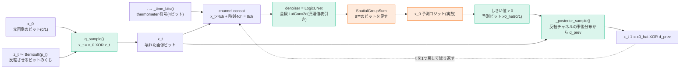
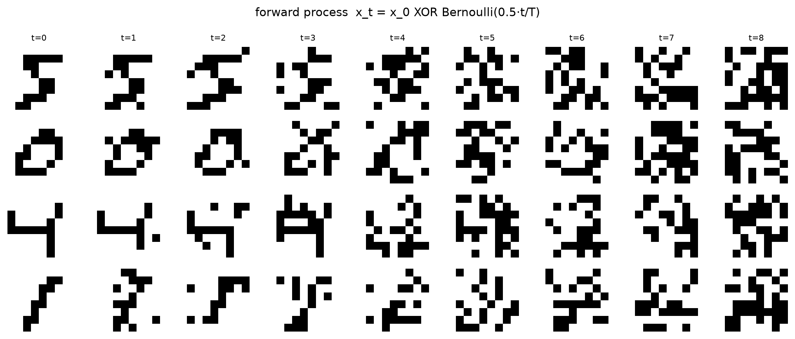
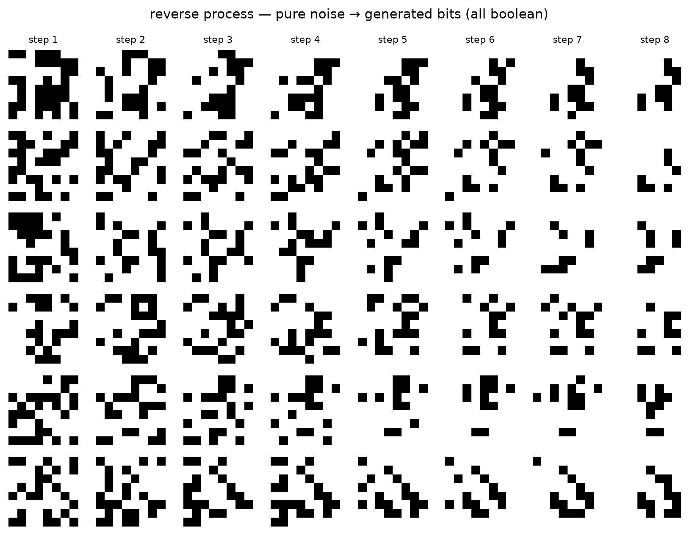
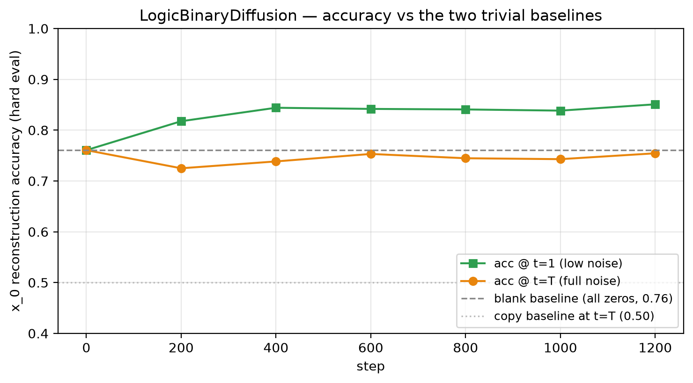
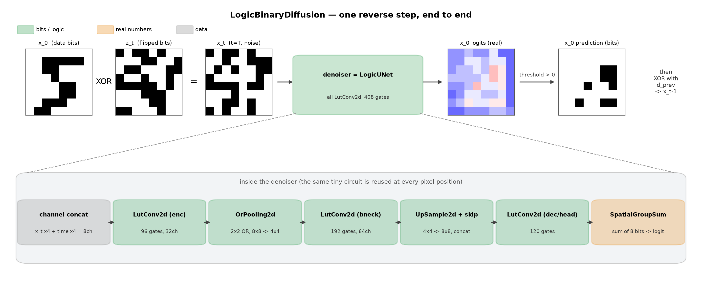
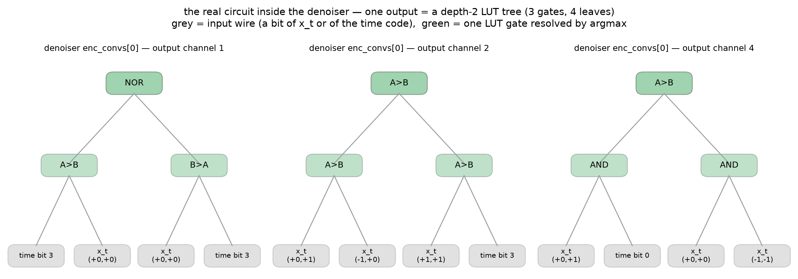

<!-- このファイルは scripts/build_tutorials.py が自動生成しています。
     直接編集せず、examples/17_logic_diffusion.py を編集して再生成してください。 -->

拡散モデルを丸ごとブール回路にする。前向き過程のノイズ付加は **XOR**、デノイザは
**LUT**、逆過程のビット組み直しも論理演算 ── 生成の全工程が乗算なしで閉じる。

**ベースラインの取り方まで含めて教材にしている**: 当初 "denoise margin" を主指標に
していたが、学習前から +0.26 出てしまう(=「全画素0」の自明解の分)ことが実測で判明した。
そこで **blank(全画素0)ベースライン**を明示し、「acc@t1 が blank を超える = 回路が
$x_t$ を実際に読んでいる」を合格条件に据え直した。完全ノイズからの再構成が
まだ blank 近傍に留まる現状も、誇張せずそのまま書いている。

:::tip[このページで学ぶこと]
1. 前向き過程 = XOR、デノイザ = LUT、逆過程 = ビット組み直し、という拡散の論理化
2. 自明解(全画素0)に勝てているかを判定する blank ベースラインの置き方
3. 生成モデルの指標を「誇張せずに」報告するとはどういうことか

**前提**

- [1. MNISTを学習する](/tutorials/mnist/)
- [学習曲線の見方](/guides/training-curves/) — ベースラインの取り方
:::

:::note[このページについて]
所要時間の目安: **約6分** / 実行環境: CPU のみ(GPU 不要)
元スクリプト: [`examples/17_logic_diffusion.py`](https://github.com/tsukushi-gate/Griffith/blob/main/examples/17_logic_diffusion.py)
手元で試す: [`notebooks/17_logic_diffusion.ipynb`](https://github.com/tsukushi-gate/Griffith/blob/main/notebooks/17_logic_diffusion.ipynb)(このページと同じ内容の未実行ノートブック。`uv run --group docs jupyter lab notebooks/` で開ける)
コード出力はすべて **実際に実行した結果**をそのまま埋め込んでいます。
:::

<!-- Colabバッジ: リポジトリ public 化後、この span を data-colab-url を href に
     持つ <a> へ差し替えると「Colabで開く」が有効になる。 -->
<span class="colab-badge" data-colab-url="https://colab.research.google.com/github/tsukushi-gate/Griffith/blob/main/notebooks/17_logic_diffusion.ipynb">▶ Colabで開く(リポジトリ公開後に有効化)</span>

LogicBinaryDiffusion — 拡散モデルを丸ごとブール回路にする例。

拡散モデルの正体は「ノイズを足す前向き過程」と「ノイズを取り除く逆過程」の対である。
普通の拡散モデル(DDPM)は前向きにガウスノイズを足し、デノイザに巨大なU-Netを使う。
ここではその **3つ全部** を論理演算に置き換える:

    前向き過程 : x_t = x_0 XOR z_t     ← 足し算ではなく **XOR**。z_t は反転ビット
    デノイザ   : LogicUNet(全段 LutConv2d)← 中身も全部 LUT(真理値表)
    逆過程     : 予測 x̂_0 と反転指示子の事後分布からビットを組み直す

先行研究の BDPM(Kinakh & Voloshynovskiy, arXiv:2501.13915)はXORノイズ拡散を提案したが、
デノイザ自体は通常のCNN/Transformerだった。**デノイザまで論理ゲートで閉じた拡散モデル**の
先行研究は 2026-09 時点で確認できていない(最近接は上記 BDPM)。主張の強度・最近接文献は
[世界初主張の監査](/explanation/results/world-firsts/)を参照し、対外的な文言はそちらの
限定形に従うこと(実装の詳細は griffith_logic/models/logic_diffusion.py の冒頭docstring を参照)。
乗算も浮動小数もどこにも現れず、生成の全工程がXORと真理値表引きだけで進む。

## 全体データフロー(実クラス名つき)



緑が **ビットのまま進む経路(論理)**、橙が **実数が現れる唯一の場所**。
実数はゲートの出力を足してロジットにするところだけに現れ、しきい値を通すと
すぐビットへ戻る(周辺FP方針)。

## どう実現しているか(4行で)

1. **ノイズを足す = XOR**。反転率 p_t = 0.5·t/T のくじを引き、当たったビットだけ
   0↔1 を入れ替える。t=T では半分のビットが反転し、完全にランダムなビット列になる。
2. **時刻の伝え方 = thermometer 符号**。t を「左から順に1が増える単調なビット列」に
   直し、画像とチャネル方向に並べる。LUT は「今どれくらい壊れているか」を配線として読める。
3. **デノイザ = 論理回路**。LogicUNet の全段が LutConv2d で、1出力は深さ2のLUT木
   (リーフ4本 → ゲート3個)。受容野 3x3 × 入力チャネルからランダムに選ばれた
   4本のビットだけを見て、1ビットを吐く。
4. **ノイズを取る = 事後分布からのXOR祖先サンプリング**。予測 x0_hat と、いま何ビットが
   反転しているかの指示子 d_t = (x_t ≠ x0_hat) から、1つ手前の指示子 d_prev の確率を
   厳密に計算し、x_t-1 = x0_hat XOR d_prev を組み直す。

使う数式は3本だけ:

- 前向き: x_t = x_0 ⊕ z_t、z_t 〜 Bernoulli(p_t)、p_t = 0.5·t/T
- 1ステップ反転率 β: (1 − 2p_t) = (1 − 2p_t-1)(1 − 2β)
- 事後分布: P(d_prev=1 | d_t) ∝ P(d_t | d_prev=1)·p_t-1

初めて見る言葉:

- **ロジット** — 「大きいほど1らしい」という実数のスコア。sigmoid を通すと確率になる。
- **祖先サンプリング** — 逆過程を1ステップずつ確率的に巻き戻していく生成の作り方。
- **thermometer 符号** — 数を棒温度計のように「単調に増える 0/1 列」で表す符号化。

## 普通の拡散モデル(DDPM)との違い

| 見るところ | 普通のDDPM | LogicBinaryDiffusion |
|---|---|---|
| ノイズ | ガウス雑音の加算 x_t = √ᾱ_t·x_0 + √(1−ᾱ_t)·ε | ビット反転(XOR) |
| 予測するもの | 乗せたノイズ ε | x_0 のビットそのもの |
| デノイザ | U-Net(畳み込み = 積和) | LogicUNet(LutConv2d = 真理値表引き) |
| 逆過程 | ガウス事後分布からサンプル | 反転チャネルの Bernoulli 事後分布から XOR |
| 損失 | MSE | BCEWithLogits |
| 必要な演算 | 浮動小数の乗算 | XOR と表引き(実数は最後の和だけ) |

ページ末尾に、実データが流れる**アーキテクチャ図**と、学習後のデノイザから取り出した
**実回路(LUT木)**の図を置いた。「どこが論理回路か」はそこで確認できる。

このサンプルの縮小レシピ:
    本走(experiments/train_logic_diffusion.py)は 28x28 binary MNIST を4エポック回し、
    acc@t1 0.886 に到達する。ここはCPUで3〜4分に収まるよう
    「8x8 に縮小・T=8・訓練6000枚・1200 step」まで削った。
    到達点は **「数字の塊としての形が見え始める」レベル** であって、はっきりした
    数字にはならない。生成品質を狙うレシピは本走スクリプトを参照。

ベースラインの読み方(この例で一番大事なところ):
    二値画像の復元精度は、2つの自明解と比べないと意味を持たない。
      - copy   : 何もせず x_t をそのまま出す(t=T では ≈0.50)
      - blank  : 全画素0と答える(= 1 − 前景率。この8x8データでは ≈0.75)
    「精度0.84」のような数字は blank(0.75)を超えて初めて意味がある。
    実測では低ノイズ(t=1)で 0.851 と blank(0.761)を明確に超える一方、
    完全ノイズ(t=T)では 0.754 と blank 近傍に留まる —— つまり
    **回路は x_t を確かに読んでいるが、完全ノイズからの再構成はまだ
    「MNISTらしい塊」を出すのが精一杯** である。これが現在地であり、誇張せず提示する。
    (学習前は acc@t1 が blank と完全に一致する 0.761 から始まる。この動きを追うと
    「自明解から抜け出した瞬間」が見える。)

実行: uv run python examples/17_logic_diffusion.py
期待結果(seed=0 実測・CPU約50秒): acc@t1=0.851(blank 0.761 / copy 0.938)、
          acc@tT=0.754(copy 0.501)、生成画像の前景率 0.156(訓練データ 0.250)

## 準備: import と乱数種

使うのは PyTorch と matplotlib、そして本ライブラリから拡散モデル本体
(`LogicBinaryDiffusion`)・LUT畳み込み(`LutConv2d`)・MNIST・真理値表の取り出しだけ。
拡散モデル専用のフレームワークは要らない。

先に3つの言葉だけ決めておく。**拡散モデル(DDPM)** は「画像を少しずつ壊していく
**前向き過程**」と「壊れた画像から元を復元する **逆過程**」の対で作る生成モデルで、
逆過程で復元を担当するネットワークを **デノイザ** と呼ぶ。このページはその3つ全部を
論理演算に置き換える。

```python
import matplotlib.pyplot as plt
import torch
import torch.nn.functional as F
from matplotlib.patches import FancyBboxPatch
from torch.utils.data import DataLoader

from griffith_logic.analysis.circuit_viz import GATE_NAMES, tt_to_gate_id_n2
from griffith_logic.conv import LutConv2d
from griffith_logic.datasets import load_mnist
from griffith_logic.export.discretize import truth_tables_from_conv
from griffith_logic.models import LogicBinaryDiffusion, LogicDiffusionConfig
```

```python
# LUTの初期真理値・ランダム配線・XORノイズすべてが乱数依存なので固定する。
torch.manual_seed(0)
```

### ハイパーパラメータ

**t / T** — t は拡散ステップ番号、T は総ステップ数(ここでは `TIMESTEPS = 8`)。
t=0 が元画像、t=T が完全に壊れた状態で、逆過程は t=T から t=0 へ1ステップずつ戻る。

```python
IMG = 8           # 画像サイズ(28x28の中央24x24を3x3平均プーリングで8x8へ)
TIMESTEPS = 8     # 拡散ステップ数 T
BASE_CH = 32      # デノイザ(LogicUNet)の最浅stageの論理チャネル幅
DEPTH = 1         # デノイザの down/up 段数(8x8 では1段で十分)
TIME_BITS = 4     # 時刻 t を表す thermometer 符号のビット数
STEPS = 1200      # 学習イテレーション数(実測ではstep 400あたりで頭打ちになる)
BATCH = 64
N_TRAIN = 6000
```

## データ: 二値 MNIST を 8x8 のビット列にする

**x_0** — **元画像のビット列**。学習データの画像を 0/1 に二値化したもので、この
ページでは 8×8 = **64 ビット**である。以降 x_0 と書いたら常にこれを指す。

データを二値にするのは趣味ではなく必然で、前向き過程が XOR だからである。
**0.3 のような中間値は XOR できない** —— 厳密に 0 か 1 でなければ演算が定義されない。

もうひとつ、**28×28 のままでは学習が自明解に落ちる**。前景(白い画素)が 13% しか
ないので、デノイザは「全部 0 と答える」だけで 87% を取れてしまう。中央 24×24 を
3×3 平均プーリングで 8×8 へ潰すと前景率が 25% まで上がり、自明解が割に合わなくなる
—— これがこの縮小レシピの肝である。

```python
train_set, _test_set = load_mnist(binarize_threshold=None)
raw, _labels = next(iter(DataLoader(train_set, batch_size=N_TRAIN)))
data = (F.avg_pool2d(raw[:, :, 2:26, 2:26], 3) > 0.3).float()   # (N,1,8,8) {0,1}
print(f'data={tuple(data.shape)} 前景画素率={data.mean():.3f} '
      f'({IMG}x{IMG}={IMG * IMG}ビット / T={TIMESTEPS})')
```

```text title="出力"
data=(6000, 1, 8, 8) 前景画素率=0.250 (8x8=64ビット / T=8)
```

## モデル: 拡散を作る3つの要素

拡散モデルは「前向き過程 / デノイザ / 逆過程」の3点セットで決まり、ここではその全部が
論理演算に置き換わっている。以下がこのページで繰り返し出てくる記号である。

- **z_t** — **どのビットを反転させるかを決めたマスク**(0/1 の「くじ」)。
  `z_t 〜 Bernoulli(p_t)`、`p_t = 0.5·t/T`。**Bernoulli** は「確率 p で 1、
  そうでなければ 0」を返すコイン投げの分布で、1 が立った位置のビットだけがひっくり返る
- **x_t** — **t ステップ分ノイズが乗った画像**。`x_t = x_0 XOR z_t`。t が大きいほど
  反転したビットが増え、`t=T` では半分が反転して**完全なランダムビット列**になる
- **β(1ステップ反転率)** — 隣り合う2ステップの間で反転する確率。
  `(1 − 2p_t) = (1 − 2p_t-1)(1 − 2β)` から決まる
- **時刻ビット(thermometer 符号)** — t を「左から順に 1 が増える単調なビット列」に
  したもの(棒温度計のイメージ)。画像とチャネル方向に並べて LUT に読ませることで、
  回路は「今どれくらい壊れているか」を**配線として**受け取れる
- **logits(ロジット)** — 「**大きいほどそのビットは 1 らしい**」という実数のスコア。
  sigmoid を通すと確率になり、しきい値 `> 0` でビットへ戻す。
  **このページで実数が現れるのはここだけ**である
- **x0_hat(x̂_0)** — デノイザが予測した x_0 のビット列。`x0_hat = (logits > 0)`
- **d_t / d_prev** — 「いま x_t と x̂_0 のどのビットが食い違っているか」を表す
  **反転指示子**。`d_t = (x_t ≠ x0_hat)`。1つ手前の指示子 d_prev の確率を**事後分布**
  (観測 d_t を見たうえでの d_prev の確率分布)から計算し、
  `x_t-1 = x0_hat XOR d_prev` でビットを組み直す。これを t=T から t=0 まで繰り返すのが
  **祖先サンプリング**(逆過程を1ステップずつ確率的に巻き戻す生成の作り方)である

```python
model = LogicBinaryDiffusion(LogicDiffusionConfig(
    image_size=IMG,
    in_channels=1,
    timesteps=TIMESTEPS,
    flip_prob_max=0.5,      # t=T で反転率0.5 = 完全ノイズ(一様ランダムビット)
    base_channels=BASE_CH,
    depth=DEPTH,
    n_inputs=2,
    time_embed_bits=TIME_BITS,
))
n_params = sum(p.numel() for p in model.parameters())
print(f'LogicBinaryDiffusion: base_channels={BASE_CH} depth={DEPTH} '
      f'params={n_params:,}(デノイザは全段 LutConv2d)')
```

```text title="出力"
LogicBinaryDiffusion: base_channels=32 depth=1 params=1,633(デノイザは全段 LutConv2d)
```

## 学習と評価: 2つの自明解を基準にする

二値画像の復元精度は、**自明解と比べないと意味を持たない**。ここでは2つ置く。

- **blank ベースライン** — 「全画素 0 と答える」自明解。値は `1 − 前景率`
  (この 8x8 データでは約 0.75)。**二値画像で一番騙されやすい相手**
- **copy ベースライン** — 「x_t をそのまま出して何もしない」自明解(t=T では約 0.50)

「精度 0.84」のような数字は、blank を超えて初めて「回路が入力を読んでいる」証拠になる。
測るときは **hard eval**(各 LUT を argmax で1つの論理関数に確定させた、FPGA に焼けるのと
同じ純ブール回路としての評価経路)を使う。

```python
@torch.no_grad()
def evaluate(n: int = 512) -> dict:
    """eval(純ブール回路)経路でのデノイズ性能を測る。

    - acc@t1  : 低ノイズ(t=1)での x_0 復元精度
    - acc@tT  : 完全ノイズ(t=T)での x_0 復元精度
    - copy@t* : 「何もせず x_t をそのまま出す」ベースライン
    - blank   : 「全画素0と答える」ベースライン(= 1 − 前景率)
    """
    model.eval()
    x0 = data[:n]
    gen = torch.Generator().manual_seed(1)
    x_t1 = model.q_sample(x0, 1, generator=gen)
    x_tT = model.q_sample(x0, TIMESTEPS, generator=gen)
    acc_t1 = ((model(x_t1, 1) > 0).float() == x0).float().mean().item()
    acc_tT = ((model(x_tT, TIMESTEPS) > 0).float() == x0).float().mean().item()
    model.train()
    return {
        'acc_t1': acc_t1,
        'acc_tT': acc_tT,
        'copy_t1': (x_t1 == x0).float().mean().item(),
        'copy_tT': (x_tT == x0).float().mean().item(),
        'blank': 1.0 - x0.mean().item(),
    }
```

### 学習ループ

学習そのものは**普通の PyTorch**である。`model.loss(x0)` が「ランダムな t を引く →
`q_sample` で XOR ノイズを乗せる → デノイザに x_0 を当てさせる → **BCEWithLogits**」を
一括でやってくれる。BCEWithLogits は**ロジットを直接受け取る2値クロスエントロピー損失**で、
「各ビットが 1 か 0 か」を1ビットずつ当てにいく損失だと思えばよい。

予測する対象が「乗せたノイズ」ではなく **x_0 のビットそのもの**である点が、普通の DDPM と
違うところ(x_0 予測型。先行研究 BDPM 準拠)。

```python
opt = torch.optim.Adam(model.parameters(), lr=0.05)
history = []  # (step, loss, acc_t1, acc_tT)

for step in range(STEPS + 1):
    if step % 200 == 0:
        m = evaluate()
        with torch.no_grad():
            probe_loss = model.loss(data[:256])['loss'].item()
        history.append((step, probe_loss, m['acc_t1'], m['acc_tT']))
        if step % 400 == 0:
            print(f'step {step:>5}  loss={probe_loss:.4f}  '
                  f'acc@t1={m["acc_t1"]:.4f}  acc@tT={m["acc_tT"]:.4f}  '
                  f'(blank={m["blank"]:.4f} / copy@tT={m["copy_tT"]:.4f})')

    x0 = data[torch.randint(0, N_TRAIN, (BATCH,))]
    loss = model.loss(x0)['loss']
    opt.zero_grad()
    loss.backward()
    opt.step()

final = evaluate()
steps, loss_hist, acc1_hist, accT_hist = zip(*history, strict=True)
print(f'\n最終 acc@t1={final["acc_t1"]:.4f}(blank={final["blank"]:.4f} / '
      f'copy@t1={final["copy_t1"]:.4f}) / '
      f'acc@tT={final["acc_tT"]:.4f}(copy@tT={final["copy_tT"]:.4f})')
```

```text title="出力"
step     0  loss=0.9839  acc@t1=0.7606  acc@tT=0.7606  (blank=0.7606 / copy@tT=0.5007)

step   400  loss=0.3910  acc@t1=0.8441  acc@tT=0.7384  (blank=0.7606 / copy@tT=0.5007)

step   800  loss=0.3908  acc@t1=0.8407  acc@tT=0.7447  (blank=0.7606 / copy@tT=0.5007)

step  1200  loss=0.3897  acc@t1=0.8508  acc@tT=0.7544  (blank=0.7606 / copy@tT=0.5007)

最終 acc@t1=0.8508(blank=0.7606 / copy@t1=0.9380) / acc@tT=0.7544(copy@tT=0.5007)
```

上の数字の読み方はこうである。**acc@t1 は blank を明確に超え、acc@tT は blank 近傍に
留まる**。つまり低ノイズなら回路は確かに x_t のビットを読んでいるが、完全ノイズからの
再構成はまだ「MNIST らしい塊」を出すのが精一杯 —— これが現在地であり、誇張せず提示する。

```python
# 本命は「低ノイズで blank(全画素0)ベースラインを明確に超えているか」。
# ここを超えて初めて、デノイザが x_t のビットを実際に読んでいると言える。
assert final['acc_t1'] > final['blank'] + 0.05, (
    f'blank ベースライン({final["blank"]:.4f})を超えていない: '
    f'acc@t1={final["acc_t1"]:.4f}')
```

## 可視化: 前向き過程と逆過程

### 図1: XOR でビットが壊れていく

**なぜ XOR なのか。** ガウス拡散の「ノイズを足して、あとで引く」に対応するビット版の
演算が **XOR** である。XOR は**自己逆元**、つまり `(x XOR z) XOR z = x` が常に成り立つ。
**ノイズを乗せる操作と取り除く操作がまったく同じ演算**になるので、前向き過程と逆過程を
1つの演算で閉じられる。実数の足し算・引き算のように 0.5 のような中間値を作ることも
ないので、**画像がビットのまま壊れて、ビットのまま戻る**。

下の図で見るのは、その壊れ方そのものである。行=4枚のサンプル、列=t=0(元画像)から
t=T まで。t が進むごとに反転率 `p_t = 0.5·t/T` が上がり、反転したビットが増えていく。

```python
fwd_gen = torch.Generator().manual_seed(11)
x0_ref = data[:4]
fig, axes = plt.subplots(4, TIMESTEPS + 1, figsize=(11, 4.6))
for row in range(4):
    axes[row, 0].imshow(x0_ref[row, 0], cmap='gray_r', vmin=0, vmax=1)
    for t in range(1, TIMESTEPS + 1):
        x_t = model.q_sample(x0_ref[row:row + 1], t, generator=fwd_gen)
        axes[row, t].imshow(x_t[0, 0], cmap='gray_r', vmin=0, vmax=1)
for t in range(TIMESTEPS + 1):
    axes[0, t].set_title(f't={t}', fontsize=8)
for ax in axes.ravel():
    ax.set_axis_off()
fig.suptitle('forward process  x_t = x_0 XOR Bernoulli(0.5·t/T)', fontsize=11)
fig.tight_layout()
plt.show()
```

    

    

ガウス拡散の「だんだんぼやける」とは見た目がまるで違い、**ビットがパラパラと反転して
いく**のが XOR ノイズ拡散の壊れ方である。右端の t=T では反転率が 0.5、つまり元画像の
情報が消えた一様ランダムビット列になっている。ここが逆過程の出発点になる。

### 図2: 逆過程(完全ノイズ → 生成)

今度は逆向きに見る。行=サンプル、列=逆過程のステップで、一番左が `Bernoulli(0.5)` の
完全ノイズ、最後の列が生成結果である。1ステップの中身は「デノイザで x0_hat を予測 →
事後分布から d_prev を引く → `x_t-1 = x0_hat XOR d_prev` で組み直す」の繰り返し
(= 祖先サンプリング)で、**全工程が LUT 引きと XOR だけ**で進んでいる。

```python
model.eval()
_final_x, trajectory = model.sample(
    6, generator=torch.Generator().manual_seed(3), return_trajectory=True)
n_show = len(trajectory)
fig, axes = plt.subplots(6, n_show, figsize=(1.05 * n_show, 6.4))
for row in range(6):
    for col, x_step in enumerate(trajectory):
        axes[row, col].imshow(x_step[row, 0], cmap='gray_r', vmin=0, vmax=1)
        axes[row, col].set_axis_off()
for col in range(n_show):
    axes[0, col].set_title(f'step {col + 1}', fontsize=8)
fig.suptitle('reverse process — pure noise → generated bits (all boolean)',
             fontsize=11)
fig.tight_layout()
plt.show()
gen_fg = _final_x.mean().item()
print(f'生成画像の前景画素率={gen_fg:.3f}(訓練データは{data.mean():.3f})')
```

    

    

```text title="出力"
生成画像の前景画素率=0.156(訓練データは0.250)
```

左端の一様ノイズが右へ進むほどまとまり、最後には**数字らしい塊**が浮かぶ。縮小レシピ
なので**はっきりした数字にはならない**が、生成画像の前景率が訓練データの前景率に近い値へ
寄っていることが、「真っ黒にも真っ白にも潰れていない」ことの数値的な裏付けになる。

```python
# 生成画像が真っ黒/真っ白に潰れていないこと(教材として最低限の合格条件)。
assert 0.05 < gen_fg < 0.60, f'生成画像が潰れている(前景率={gen_fg:.3f})'
```

## 可視化: 学習曲線とベースライン

### 図3: 学習曲線を2つの自明解と一緒に見る

縦軸は hard eval での x_0 復元精度、横軸は学習ステップ。緑が低ノイズ(t=1)、橙が完全
ノイズ(t=T)、灰の破線が blank、灰の点線が copy。**ベースラインを描かずに精度だけ出すと
数字の意味が読めなくなる**ので、この図では常に4本を一緒に描く。

```python
fig, ax = plt.subplots(figsize=(7.5, 4.2))
ax.plot(steps, acc1_hist, 's-', color='#2e9e4f', label='acc @ t=1 (low noise)')
ax.plot(steps, accT_hist, 'o-', color='#e8850c', label='acc @ t=T (full noise)')
ax.axhline(final['blank'], color='#888', ls='--', lw=1.2,
           label=f'blank baseline (all zeros, {final["blank"]:.2f})')
ax.axhline(final['copy_tT'], color='#bbb', ls=':', lw=1.2,
           label=f'copy baseline at t=T ({final["copy_tT"]:.2f})')
ax.set_xlabel('step')
ax.set_ylabel('x_0 reconstruction accuracy (hard eval)')
ax.set_ylim(0.4, 1.0)
ax.grid(alpha=0.3)
ax.legend(loc='lower right', fontsize=9)
ax.set_title('LogicBinaryDiffusion — accuracy vs the two trivial baselines')
fig.tight_layout()
plt.show()
```

    

    

緑は blank の破線を明確に追い越して伸びる = **回路は x_t のビットを実際に読んでいる**。
一方の橙は blank 近傍に張り付いたままで、完全ノイズからの再構成が今後の課題であることが
そのまま見える。緑が学習開始時に blank とぴったり一致する点から出発しているのも重要で、
そこから離れていく瞬間が「**自明解から抜け出した瞬間**」である。

## アーキテクチャ図解と実回路

ここからは「どこが論理回路なのか」を実データと実回路で確かめる。まずは図を描くための
小さなヘルパー(角丸の箱・矢印・小画像)を用意する。

```python
def draw_block(ax, x, y, w, h, name, sub, color):
    """アーキテクチャ図の部品: 角丸の箱にクラス名と規模(ゲート数)を書く。"""
    ax.add_patch(FancyBboxPatch(
        (x - w / 2, y - h / 2), w, h,
        boxstyle='round,pad=0.004,rounding_size=0.012',
        facecolor=color, alpha=0.25, edgecolor=color, lw=1.4, zorder=2))
    ax.text(x, y + h * 0.17, name, ha='center', va='center', fontsize=8.2,
            fontweight='bold', zorder=3)
    ax.text(x, y - h * 0.22, sub, ha='center', va='center', fontsize=7.2,
            color='#333333', zorder=3)
```

```python
def draw_arrow(ax, x0, y0, x1, y1, text=''):
    """ブロック間の矢印(必要なら上にラベルを添える)。"""
    ax.annotate('', xy=(x1, y1), xytext=(x0, y0),
                arrowprops=dict(arrowstyle='-|>', color='#444444', lw=1.3))
    if text:
        ax.text((x0 + x1) / 2, (y0 + y1) / 2 + 0.015, text, ha='center',
                va='bottom', fontsize=7.5, color='#444444')
```

```python
def put_image(fig, img, rect, caption, cmap='gray_r', vmin=0.0, vmax=1.0):
    """アーキテクチャ図の中に実データの小さな画像を貼る。"""
    ax = fig.add_axes(rect)
    ax.imshow(img, cmap=cmap, vmin=vmin, vmax=vmax)
    ax.set_xticks([])
    ax.set_yticks([])
    for spine in ax.spines.values():
        spine.set_edgecolor('#555555')
    ax.set_title(caption, fontsize=7.8)
    return ax
```

### 図4: 逆過程の1ステップに実データを流す

上段は実際のテンソルが左から右へ流れる様子(`x_0` → `z_t` → `x_t` → ロジット →
`x0_hat`)、下段はデノイザの中身を開いたものである。色は**緑=ビットのまま進む論理の
経路、橙=実数が現れる唯一の場所**。

下段に出てくる部品を1行ずつ: **LutConv2d** は畳み込みの積和を LUT木(真理値表引き)に
置き換えた層、**OrPooling** は 2x2 の OR で解像度を半分にする論理版プーリング、
**SpatialGroupSum** は最終段の 8 本のビットを足してロジットにする出口である。
LutConv2d のゲート数は「出力チャネル数 × ツリー内部ノード数」で、同じ木が全空間位置で
使い回される(だから 8x8 でも 64x64 でもゲート数は変わらない)。

```python
C_LOGIC, C_REAL, C_DATA = '#2e9e4f', '#e8850c', '#8a8a8a'
model.eval()
arch_gen = torch.Generator().manual_seed(21)
x0_arch = data[:1]
xt_arch = model.q_sample(x0_arch, TIMESTEPS, generator=arch_gen)
flip_arch = (x0_arch + xt_arch) % 2
with torch.no_grad():
    logits_arch = model(xt_arch, TIMESTEPS)
x0hat_arch = (logits_arch > 0).float()

conv_gates = {name: m.out_channels * m.n_internal
              for name, m in model.denoiser.named_modules()
              if isinstance(m, LutConv2d)}
total_gates = sum(conv_gates.values())
print('デノイザの論理ゲート総数=' + f'{total_gates}個(' +
      ' / '.join(f'{k}:{v}' for k, v in conv_gates.items()) + ')')

fig = plt.figure(figsize=(14, 5.8))
bg = fig.add_axes([0, 0, 1, 1])
bg.set_xlim(0, 1)
bg.set_ylim(0, 1)
bg.set_axis_off()
bg.text(0.5, 0.955, 'LogicBinaryDiffusion — one reverse step, end to end',
        ha='center', fontsize=12, fontweight='bold')
for i, (label, color) in enumerate((('bits / logic', C_LOGIC),
                                    ('real numbers', C_REAL),
                                    ('data', C_DATA))):
    bg.add_patch(FancyBboxPatch((0.02 + 0.115 * i, 0.90), 0.02, 0.025,
                                boxstyle='round,pad=0.002',
                                facecolor=color, alpha=0.3, edgecolor=color))
    bg.text(0.045 + 0.115 * i, 0.9125, label, va='center', fontsize=8)

put_image(fig, x0_arch[0, 0], [0.030, 0.60, 0.096, 0.26], 'x_0  (data bits)')
bg.text(0.143, 0.73, 'XOR', ha='center', va='center', fontsize=11)
put_image(fig, flip_arch[0, 0], [0.160, 0.60, 0.096, 0.26],
          'z_t  (flipped bits)')
bg.text(0.273, 0.73, '=', ha='center', va='center', fontsize=13)
put_image(fig, xt_arch[0, 0], [0.290, 0.60, 0.096, 0.26], 'x_t  (t=T, noise)')
draw_arrow(bg, 0.392, 0.73, 0.418, 0.73)
draw_block(bg, 0.510, 0.72, 0.180, 0.20, 'denoiser = LogicUNet',
           f'all LutConv2d, {total_gates} gates', C_LOGIC)
draw_arrow(bg, 0.602, 0.73, 0.634, 0.73)
put_image(fig, logits_arch[0, 0].detach(), [0.640, 0.60, 0.096, 0.26],
          'x_0 logits (real)', cmap='bwr', vmin=-6, vmax=6)
draw_arrow(bg, 0.742, 0.73, 0.796, 0.73, 'threshold > 0')
put_image(fig, x0hat_arch[0, 0], [0.800, 0.60, 0.096, 0.26],
          'x_0 prediction (bits)')
bg.text(0.955, 0.73, 'then\nXOR with\nd_prev\n-> x_t-1', ha='center',
        va='center', fontsize=7.8, color='#333333')

bg.add_patch(FancyBboxPatch((0.02, 0.10), 0.96, 0.31,
                            boxstyle='round,pad=0.004,rounding_size=0.02',
                            facecolor='#f2f4f6', edgecolor='#cccccc', zorder=0))
bg.plot([0.420, 0.030], [0.620, 0.412], color='#999999', ls='--', lw=1.0)
bg.plot([0.600, 0.970], [0.620, 0.412], color='#999999', ls='--', lw=1.0)
bg.text(0.5, 0.375, 'inside the denoiser (the same tiny circuit is reused at '
        'every pixel position)', ha='center', fontsize=8.5, color='#555555')
stage_x = [0.085 + 0.1383 * i for i in range(7)]
stages = [
    ('channel concat', f'x_t x{model.image_repeat} + time x{TIME_BITS} = '
     f'{model.image_repeat + TIME_BITS}ch', C_DATA),
    ('LutConv2d (enc)', f"{conv_gates['enc_convs.0']} gates, 32ch", C_LOGIC),
    ('OrPooling2d', '2x2 OR, 8x8 -> 4x4', C_LOGIC),
    ('LutConv2d (bneck)', f"{conv_gates['bottleneck']} gates, 64ch", C_LOGIC),
    ('UpSample2d + skip', '4x4 -> 8x8, concat', C_LOGIC),
    ('LutConv2d (dec/head)',
     f"{conv_gates['dec_convs.0'] + conv_gates['head_conv']} gates", C_LOGIC),
    ('SpatialGroupSum', 'sum of 8 bits -> logit', C_REAL),
]
for i, (name, sub, color) in enumerate(stages):
    draw_block(bg, stage_x[i], 0.24, 0.126, 0.15, name, sub, color)
    if i:
        draw_arrow(bg, stage_x[i - 1] + 0.063, 0.24, stage_x[i] - 0.063, 0.24)
plt.show()
```

```text title="出力"
デノイザの論理ゲート総数=408個(enc_convs.0:96 / bottleneck:192 / dec_convs.0:96 / head_conv:24)
```

    

    

実数(橙)が現れるのは右端の SpatialGroupSum ただ1か所で、しきい値 `> 0` を通すと
すぐビットへ戻る。そして下段の全体が、上段の巨大に見える処理の正体である ——
巨大な U-Net の代わりに、**数百ゲートの小さな回路が全画素位置で使い回されている**。

### 図5: デノイザから取り出した実回路(LUT木)

```python
enc_conv = model.denoiser.enc_convs[0]
tables = truth_tables_from_conv(enc_conv)
leaf_idx = enc_conv.indices_flat
```

最後に、学習後のデノイザから**実際に取り出した回路**を描く。`LutConv2d` の1出力は
「深さ2の LUT木」= ゲート3個・リーフ4本で、下の図の1枚がその1本の木にあたる。

読み取り方はこうである。**灰色のリーフ**は受容野 3x3 と入力チャネルからランダムに
選ばれた入力配線で、`x_t (+dy,+dx)` と `time bit k` が**同じ木に混ざって入っている** ——
つまり回路は画像ビットと時刻ビットを1つのゲートの中で突き合わせている。**緑の箱**は
学習後に argmax で確定した論理関数の名前(AND / XOR / NAND など)で、
**ここに出る名前は IR や Verilog に焼かれる名前とそのまま同じ**である。
したがってこの絵は概念図ではなく、**焼ける回路そのもの**を写したものになっている。

```python
# 画像ビットと時刻ビットの両方を見ているツリーを選ぶ(片方だけの木は絵として退屈)
n_img_leaf = (leaf_idx // 9 < model.image_repeat).sum(dim=1)
mixed = [oc for oc in range(enc_conv.out_channels) if 2 <= int(n_img_leaf[oc]) <= 3]
show_channels = (mixed + [0, 1, 2])[:3]
fig, axes = plt.subplots(1, len(show_channels), figsize=(12, 4.2))
for ax, oc in zip(axes, show_channels, strict=True):
    leaf_x = [0.10, 0.37, 0.63, 0.90]
    gate_x = [0.235, 0.765]
    for g, gx in enumerate(gate_x):
        for leaf in (2 * g, 2 * g + 1):
            ax.plot([leaf_x[leaf], gx], [0.13, 0.47], color='#9aa0a6', lw=1.0)
        ax.plot([gx, 0.5], [0.53, 0.87], color='#9aa0a6', lw=1.0)
    for leaf, lx in enumerate(leaf_x):
        flat = int(leaf_idx[oc, leaf])
        ch, off = flat // 9, flat % 9
        dy, dx = off // 3 - 1, off % 3 - 1
        src = (f'x_t\n({dy:+d},{dx:+d})' if ch < model.image_repeat
               else f'time bit {ch - model.image_repeat}')
        ax.add_patch(FancyBboxPatch((lx - 0.11, 0.03), 0.22, 0.10,
                                    boxstyle='round,pad=0.005,rounding_size=0.03',
                                    facecolor=C_DATA, alpha=0.25,
                                    edgecolor='#555555', lw=0.8))
        ax.text(lx, 0.08, src, ha='center', va='center', fontsize=7.5)
    names = [GATE_NAMES[tt_to_gate_id_n2(int(tables[oc, g]))] for g in range(3)]
    for g, gx in enumerate(gate_x):
        ax.add_patch(FancyBboxPatch((gx - 0.11, 0.47), 0.22, 0.10,
                                    boxstyle='round,pad=0.005,rounding_size=0.03',
                                    facecolor=C_LOGIC, alpha=0.3,
                                    edgecolor='#333333', lw=0.8))
        ax.text(gx, 0.52, names[g], ha='center', va='center', fontsize=9)
    ax.add_patch(FancyBboxPatch((0.39, 0.87), 0.22, 0.10,
                                boxstyle='round,pad=0.005,rounding_size=0.03',
                                facecolor=C_LOGIC, alpha=0.45,
                                edgecolor='#333333', lw=0.8))
    ax.text(0.5, 0.92, names[2], ha='center', va='center', fontsize=9)
    ax.set_title(f'denoiser enc_convs[0] — output channel {oc}', fontsize=9)
    ax.set_xlim(-0.02, 1.02)
    ax.set_ylim(0.0, 1.05)
    ax.set_axis_off()
fig.suptitle('the real circuit inside the denoiser — one output = a depth-2 '
             'LUT tree (3 gates, 4 leaves)\ngrey = input wire (a bit of x_t or '
             'of the time code),  green = one LUT gate resolved by argmax',
             fontsize=10.5)
fig.tight_layout()
plt.show()
print(f'この木が{enc_conv.out_channels}チャネルぶん並び、'
      f'8x8の全画素位置で同じ木が使い回される(重み共有)。'
      f'デノイザ全体でも論理ゲートは{total_gates}個しかない。')
```

    

    

```text title="出力"
この木が32チャネルぶん並び、8x8の全画素位置で同じ木が使い回される(重み共有)。デノイザ全体でも論理ゲートは408個しかない。
```

## 次に読む

- [二値潜在VAE](/tutorials/logic-vae/) — 別の生成モデルを論理ゲート化する
- [LogicGANの安定化](/tutorials/logic-gan/) — 敵対学習の壊れ方
- [学習曲線の見方](/guides/training-curves/) — ベースラインの取り方
