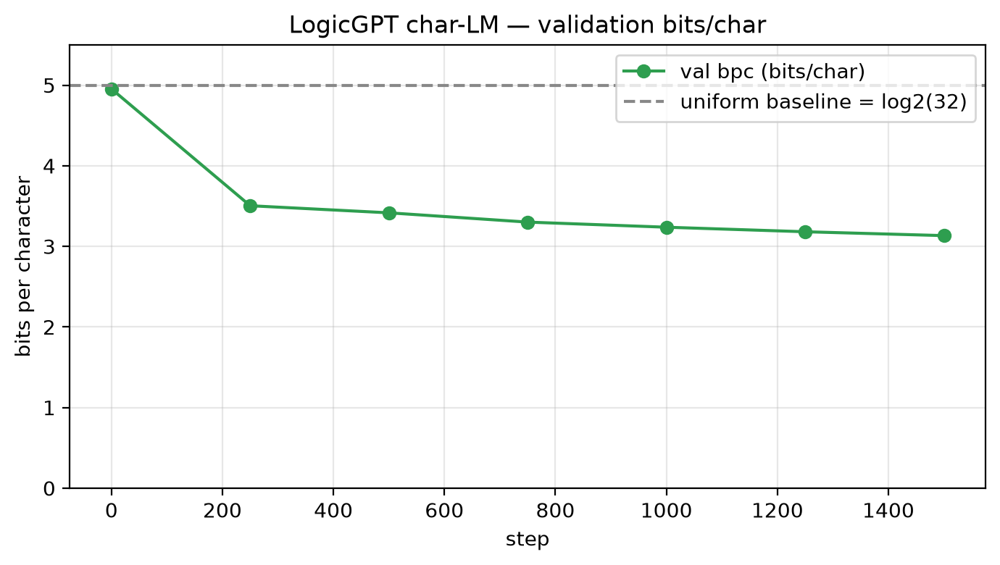
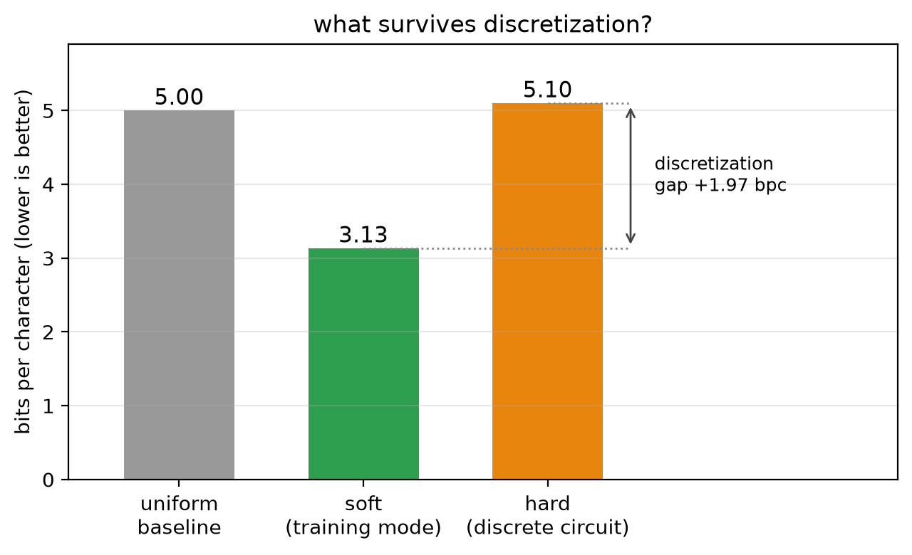
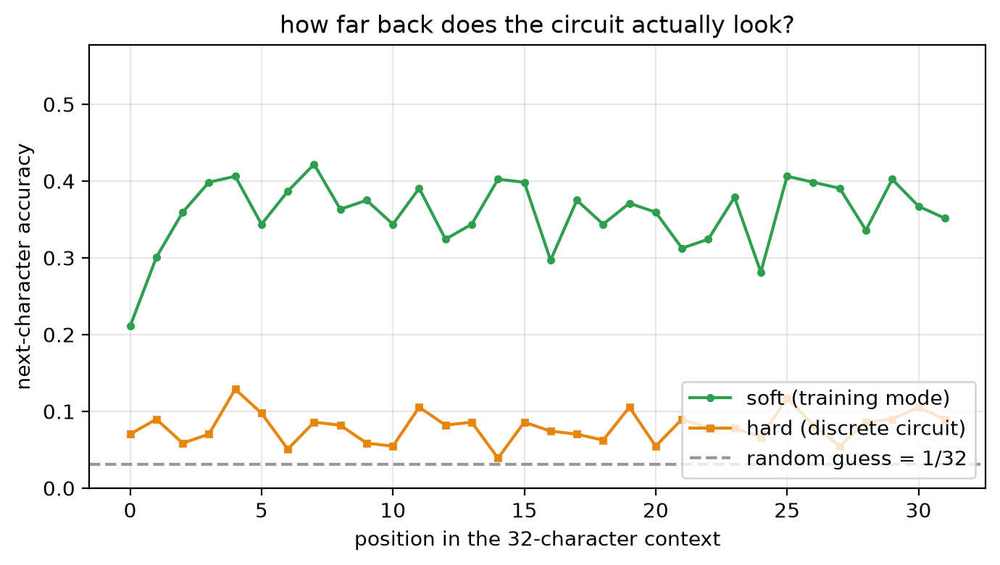
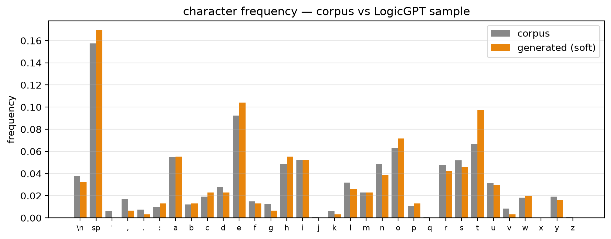
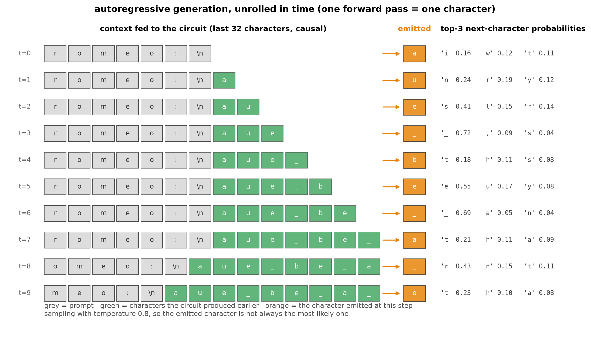

<!-- このファイルは scripts/build_tutorials.py が自動生成しています。
     直接編集せず、examples/07_logic_gpt.py を編集して再生成してください。 -->

**Attention も FFN も出力ヘッドも、全部が論理ゲート**の decoder-only Transformer で
シェイクスピアを書く。実数の行列積を一切持たない `LogicGPT` を Tiny Shakespeare の
文字レベル言語モデルとして学習し、uniform baseline の 5.00 bpc から **3.13 bpc** まで
落ちていく様子と、生成されたテキスト(話者行・単語らしい綴り・改行構造まで出る)を見る。

同時に、このページは**離散化ギャップの一番わかりやすい実例**でもある。soft(学習時の
連続緩和)では読める文が出るのに、hard(argmax で確定した離散回路)にすると崩れる ──
言語モデルという難しいタスクほど、この差が正直に出る。

:::tip[このページで学ぶこと]
1. attention・FFN・出力ヘッドまで全部が論理ゲートの decoder-only Transformer の構成
2. 文字レベル言語モデルの指標 bpc の読み方(uniform baseline 5.00 → 3.13)
3. 言語モデルでは離散化ギャップ(soft は読めるのに hard で崩れる)が最も正直に出ること

**前提**

- [1. MNISTを学習する](/tutorials/mnist/) — soft/hard の読み分けを先に体験する
- [学習曲線の見方](/guides/training-curves/)
:::

:::note[このページについて]
所要時間の目安: **約10分** / 実行環境: CPU のみ(GPU 不要)
元スクリプト: [`examples/07_logic_gpt.py`](https://github.com/tsukushi-gate/Griffith/blob/main/examples/07_logic_gpt.py)
手元で試す: [`notebooks/07_logic_gpt.ipynb`](https://github.com/tsukushi-gate/Griffith/blob/main/notebooks/07_logic_gpt.ipynb)(このページと同じ内容の未実行ノートブック。`uv run --group docs jupyter lab notebooks/` で開ける)
コード出力はすべて **実際に実行した結果**をそのまま埋め込んでいます。
:::

<!-- Colabバッジ: リポジトリ public 化後、この span を data-colab-url を href に
     持つ <a> へ差し替えると「Colabで開く」が有効になる。 -->
<span class="colab-badge" data-colab-url="https://colab.research.google.com/github/tsukushi-gate/Griffith/blob/main/notebooks/07_logic_gpt.ipynb">▶ Colabで開く(リポジトリ公開後に有効化)</span>

LogicGPT で文字レベル言語モデルを学習し、シェイクスピア風テキストを生成する例。

MNIST(examples/06_mnist.py)では「画像を分類する回路」を作った。ここでは同じ
論理ゲートで **decoder-only Transformer(GPT)** を組み、次の1文字を予測する
言語モデルを学習する。attention も FFN も出力ヘッドも、内部の値はすべて
[0,1] の論理域で動く(浮動小数点の行列積で「意味」を作っていない)。

    LogicEmbedding → 位置符号を soft-XOR で注入 → LogicTransformerBlock×2(causal)
    → LutStack ヘッド → GroupSum で各位置の文字ロジット

**LogicGPT の全体像(実クラス名とゲート数つき)**

このサンプルの構成(d_model=192・2層・語彙32文字)で、学習されるゲートは
**合計 2,560 ゲート / 48,640 パラメータ**。緑が論理ゲート(そのまま回路になる)、
橙が実数演算(訓練の都合で残っている部分で、IR では blackbox 扱いになる)。


**Attention をどう回路にしているか(初心者向けの言い換え)**

- **XNOR = 一致検出器**。2本の線が同じ値なら1を出す1個のゲート。クエリとキーの
  ビットを1本ずつ突き合わせる
- **popcount = 多数決(加算木)**。一致した本数を数えれば「どれくらい似ているか」。
  実数Transformerの内積(掛け算の山)がこれに置き換わる
- **MUX = 選択器**。softmax の加重平均をやめ、eval では一番似ているスロットの
  中身だけを1本通す。`LogicAttention(mode='hard')` の argmax がこれにあたる

置き換えの理屈を1段ずつ確かめる回は
[Transformerを段階的に論理化](/tutorials/logic-ladder/)、
4つの引き方を比べる回は
[論理ゲートAttentionの4変種ツアー](/tutorials/attention-tour/)にある。

このサンプルは CPU で3〜4分に収まるよう、d_model=192・2層・コンテキスト32文字・
1500 step まで縮めてある(本気のレシピは configs/recipes/logic_gpt_shakespeare.yaml、
実験結果は[モデル一覧](/reference/model-zoo/)を参照)。
その規模でも「単語らしい綴り・改行・`ROMEO:` のような話者行」までは出てくる。

読みどころは3つある:

  1. **bpc が下がるか**(図1)。bpc = bits per character は「次の1文字を当てるのに
     何ビット必要か」で、32文字を当てずっぽうに選ぶと log2(32)=5.0 bpc。
     ここから下がった分だけ、回路が文字の並びの規則を覚えたことになる。
  2. **soft と hard の差**(図2)。学習中はゲートを連続緩和して微分するが、
     実際にFPGAへ焼くのは argmax で確定した離散回路。この2つの性能差が
     「離散化ギャップ」で、論理NN最大の関門。縮小レシピでは差が残る。
  3. **どこまで過去を見ているか**(図3)。causal self-attention なので、系列の先頭は
     手がかりが1文字も無く、後ろへ行くほど当てやすくなるはず。位置ごとの正解率を
     見ると、最初の数文字で急に立ち上がってすぐ頭打ちになる ── この規模の回路が
     実際に使えている文脈の長さが、そのまま形に出る。

実行: uv run python examples/07_logic_gpt.py
期待結果: val bpc(bits per character)が 5.0 → 3.1 前後まで下がり、
          最後に生成テキストが表示される(ランダム文字列ではないことが目で分かる)

## 準備: import と乱数種

必要なのは PyTorch と matplotlib、そして本ライブラリの `LogicGPT` / `LogicGPTConfig` の2つだけ。
学習ループも生成ループも**通常の GPT とまったく同じ書き方**で、差し替わっているのは
モデルの中身(行列積 → 論理ゲート)だけである。

```python
import math
from pathlib import Path

import matplotlib.pyplot as plt
import torch
import torch.nn.functional as F

from griffith_logic import LogicGPT, LogicGPTConfig
```

ゲートの**初期配線**(各ゲートが前段のどの2本の線を見るか)と初期の真理値表は乱数で決まる。
配線は学習中も固定されたままなので、種を変えると回路そのものが別物になり、bpc の
落ち方も変わる。比較できる結果にするため、最初に種を固定しておく。

```python
torch.manual_seed(0)
```

## 設定とデータ: 縮小レシピと Tiny Shakespeare

### ハイパーパラメータ

このページは CPU で3〜4分に収まる**縮小レシピ**である。`D_MODEL` は1文字を表す
ビット幅(=回路を流れる論理線の本数)、`BLOCK` は**文脈長**(次の1文字を予測するのに
何文字さかのぼるか)。増やすほど文章は良くなるが、そのぶん学習時間も伸びる。

`REG_LAMBDA` は埋め込みを $\{0,1\}$ へ押し付ける正則化の強さで、あとで見る
「離散化ギャップ」に直接効くつまみである。

```python
# CPUで3〜4分に収める縮小レシピ。D_MODEL/N_LAYERS/STEPS を増やすほど文章は良くなる。
D_MODEL = 192      # 1トークンを表すビット幅(=論理線の本数)
N_LAYERS = 2       # Transformerブロックの段数
BLOCK = 32         # コンテキスト長(何文字さかのぼって次を予測するか)
BATCH = 64
STEPS = 1500
LR = 0.02
REG_LAMBDA = 0.1   # 埋め込みを{0,1}へ寄せる二値化正則化の重み
N_CHARS = 200_000  # 学習に使う文字数(Tiny Shakespeare 全体は約110万文字)
```

### データ: Tiny Shakespeare

学習コーパスは Tiny Shakespeare(戯曲の台詞を集めた約110万文字のテキスト)。
リポジトリに置いていない環境でも動くよう、無ければ下の埋め込みサンプルへ自動で切り替える。

```python
# data-shakespeare/ にコーパスがあればそれを使う。無い環境でも自己完結するよう、
# 数KBの埋め込みサンプル(下部の FALLBACK_TEXT)へ自動で切り替える。
# ノートブックでは __file__ が未定義なので、その場合はカレントディレクトリを
# リポジトリルートとみなす(examples はリポジトリルートから実行する規約)。
REPO_ROOT = Path(__file__).resolve().parents[1] if '__file__' in globals() else Path.cwd()
CORPUS = REPO_ROOT / 'data-shakespeare' / 'tinyshakespeare' / 'input.txt'

FALLBACK_TEXT = """first citizen:
before we proceed any further, hear me speak.
all:
speak, speak.
first citizen:
you are all resolved rather to die than to famish?
all:
resolved. resolved.
first citizen:
first, you know caius marcius is chief enemy to the people.
all:
we know't, we know't.
menenius:
i tell you, friends, most charitable care
have the patricians of you. for your wants,
your suffering in this dearth, you may as well
strike at the heaven with your staves as lift them
against the roman state.
romeo:
he jests at scars that never felt a wound.
but, soft! what light through yonder window breaks?
it is the east, and juliet is the sun.
arise, fair sun, and kill the envious moon,
who is already sick and pale with grief.
juliet:
o romeo, romeo! wherefore art thou romeo?
deny thy father and refuse thy name;
or, if thou wilt not, be but sworn my love,
and i'll no longer be a capulet.
hamlet:
to be, or not to be: that is the question:
whether 'tis nobler in the mind to suffer
the slings and arrows of outrageous fortune,
or to take arms against a sea of troubles.
"""
```

**語彙**(vocabulary)= モデルが扱う文字の種類。ここでは大文字を落として記号を絞り、
32文字まで縮める。出力ヘッドのゲート数は語彙サイズに比例する(`vocab × head_group_factor`)
ので、語彙を小さくすることは**回路を小さくすること**とほぼ同義である。

```python
def load_text() -> str:
    """コーパスを読み、語彙を小さくするために正規化する。

    大文字を落とし、使う記号を絞って **語彙32文字** まで縮める。
    語彙が小さいほど出力ヘッド(vocab×head_group_factor ゲート)が軽くなり、
    短い学習でも文字の分布を掴みやすい(教材用の割り切り)。
    """
    if CORPUS.exists():
        raw = CORPUS.read_text(encoding='utf-8')
        source = f'{CORPUS.name}(Tiny Shakespeare)'
    else:
        # コーパスが無い環境でも動くよう、埋め込みサンプルを繰り返して使う。
        raw = FALLBACK_TEXT * 60
        source = '埋め込みサンプル(data-shakespeare/ が無いため)'
    keep = set("abcdefghijklmnopqrstuvwxyz .,':\n")
    text = ''.join(c if c in keep else ' ' for c in raw.lower())
    print(f'コーパス: {source} / 使用 {min(len(text), N_CHARS):,} 文字')
    return text[:N_CHARS]
```

文字を ID の列へ変換し、前半90%を学習用・後半10%を検証用に分ける。言語モデルの
検証は「見たことのない続きをどれだけ当てられるか」なので、時間方向で切るのが定石である。

```python
text = load_text()
chars = sorted(set(text))
stoi = {c: i for i, c in enumerate(chars)}
VOCAB = len(chars)
data = torch.tensor([stoi[c] for c in text], dtype=torch.long)
n_split = int(len(data) * 0.9)
train_data, val_data = data[:n_split], data[n_split:]
print(f'語彙 {VOCAB} 文字: {"".join(chars)!r}')
```

```text title="出力"
コーパス: input.txt(Tiny Shakespeare) / 使用 200,000 文字
語彙 32 文字: "\n ',.:abcdefghijklmnopqrstuvwxyz"
```

学習データの作り方も普通の GPT と同じ。入力 `x` は連続する32文字、正解 `y` はそれを
**1文字だけ右にずらした列**である。こうすると1回の forward で32個の位置すべてについて
「次の1文字」を同時に学習でき、causal マスク(後述)が未来のカンニングを防ぐ。

```python
def get_batch(
    src: torch.Tensor, size: int, generator: torch.Generator,
) -> tuple[torch.Tensor, torch.Tensor]:
    """(x, y) を作る。y は x を1文字ずらしたもの=「次の文字」の正解。"""
    idx = torch.randint(0, len(src) - BLOCK - 1, (size,), generator=generator)
    x = torch.stack([src[i:i + BLOCK] for i in idx])
    y = torch.stack([src[i + 1:i + BLOCK + 1] for i in idx])
    return x, y
```

## モデル定義: 論理ゲート版 GPT

骨格は普通の GPT(埋め込み → 位置符号 → causal self-attention × N → 出力ヘッド)で、
**中身の演算子だけが総入れ替え**になっている。なぜそんな置き換えが可能なのかは、
実数 Transformer の各部品を「何をしている装置か」で読み替えると分かる。

- **内積(類似度)→ XNOR + popcount**。内積は「2本のベクトルがどれだけ揃っているか」を
  測る装置にすぎない。ビット列なら、各桁を XNOR(一致なら1を出すゲート)に通して
  1の本数を数えれば同じことができる。**popcount** = 立っているビットの本数を数える加算木
- **softmax の加重平均 → MUX(選択器)**。加重平均は「どのスロットの中身をどれだけ通すか」の
  装置。eval では一番似ているスロットだけを通す 2:1 マルチプレクサの木に置き換わる
- **Linear + 活性化 → LutLayer**。1ニューロン = 1枚の真理値表(LUT)

つまり attention は「注目度で重みを付ける魔法」ではなく、**一致検出 → 本数を数える →
選ぶ**という3段の回路であり、そのどれもが論理ゲートで書ける。

```python
# 通常のGPTと同じ骨格(埋め込み+位置+causal self-attention×N+ヘッド)。
# 違いは中身がすべて論理ゲート(LutLayer)で、値が[0,1]に閉じていること。
# 実数GPTの各部品が論理版でどう置き換わるかを対応させると:
#
#   nn.Embedding        → LogicEmbedding(文字IDを D_MODEL 本のビット列に引く)
#   位置エンコーディング → 位置番号の2進符号を soft-XOR でビット列に混ぜる
#   softmax attention   → [0,1]に閉じたスコアで過去の位置を重み付け(causalマスク)
#   FFN(Linear+GELU)    → LutStack(4段のLutLayer。mlp_ratio 倍に広げて戻す)
#   出力の Linear       → LutStack + GroupSum(VOCAB×8 本のビットを8本ずつ足して
#                          各文字のロジットにする。行列積は一切登場しない)
#
# pos_width は位置符号のビット数で、block_size <= 2^pos_width が必要(32 <= 2^5)。
# tau は GroupSum の温度で、ロジットのスケール(=softmaxの鋭さ)を決める。
config = LogicGPTConfig(
    vocab_size=VOCAB,
    d_model=D_MODEL,
    n_layers=N_LAYERS,
    n_heads=1,
    block_size=BLOCK,
    mlp_ratio=2,
    pos_width=5,
    head_group_factor=8,  # ヘッド幅 = VOCAB × 8 ゲート → GroupSum で各文字のロジットへ
    tau=1.0,
)
model = LogicGPT(config)
counts = model.count_parameters()
print(f'パラメータ: 埋め込み {counts["embedding"]:,} / ブロック {counts["blocks"]:,} / '
      f'ヘッド {counts["head"]:,} / 合計 {counts["total"]:,}')
```

```text title="出力"
パラメータ: 埋め込み 6,144 / ブロック 38,400 / ヘッド 4,096 / 合計 48,640
```

## 学習ループ

中身は完全に普通の PyTorch で、特別な学習則は要らない(そこがこの手法の実用上の利点)。
違いは損失が2本あることだけ: 通常の cross entropy に加えて、`forward` が返す
`emb_reg_loss`(埋め込みのビットを 0 か 1 に押し付ける正則化)を `REG_LAMBDA` 倍して足す。

**なぜ正則化が要るのか**: 学習中の埋め込みは 0.5 のような中間値を取れてしまうが、
実際の回路にそんな値は存在しない。中間値に依存した解を学習すると、argmax で確定した
瞬間に性能が崩れる。あらかじめ端へ寄せておくことが、次章で測る離散化ギャップを縮める。

```python
# 中身は普通のPyTorch。GPTの学習ループそのままで、モデルだけ論理ゲート版に差し替えている。
# forward は (logits, emb_reg_loss) を返す。emb_reg_loss は埋め込みを{0,1}へ寄せる
# 正則化項で、これを一緒に下げると「回路として焼ける」重みに近づく
# (=学習後に argmax で確定しても壊れにくくなる。図2の離散化ギャップに直接効く)。
opt = torch.optim.Adam(model.parameters(), lr=LR)
rng = torch.Generator().manual_seed(1)
history = []  # (step, train loss, val bpc)

for step in range(STEPS + 1):
    x, y = get_batch(train_data, BATCH, rng)
    model.train()
    logits, emb_reg = model(x)
    # 全位置で同時に「次の文字」を当てる(causalマスクのおかげでカンニングは起きない)。
    loss = F.cross_entropy(logits.reshape(-1, VOCAB), y.reshape(-1))
    opt.zero_grad()
    (loss + REG_LAMBDA * emb_reg).backward()
    opt.step()

    if step % 250 == 0:
        with torch.no_grad():
            xv, yv = get_batch(val_data, 256, torch.Generator().manual_seed(99))
            val_loss = F.cross_entropy(model(xv)[0].reshape(-1, VOCAB), yv.reshape(-1)).item()
        # bpc(bits per character)= 1文字あたり何ビット必要か。
        # 32文字を当てずっぽうに選ぶと log2(32)=5.0 bpc。ここから下がれば学習できている。
        bpc = val_loss / math.log(2)
        history.append((step, loss.item(), bpc))
        print(f'step {step:>5}  train loss={loss.item():.3f}  val bpc={bpc:.3f}')

final_bpc = history[-1][2]
print(f'\n最終 val bpc={final_bpc:.3f}(ランダム = log2({VOCAB}) = {math.log2(VOCAB):.2f} bpc)')
assert final_bpc < 4.2, f'bpc={final_bpc:.3f} が高すぎる(学習できていない)'
```

```text title="出力"
step     0  train loss=3.488  val bpc=4.954

step   250  train loss=2.362  val bpc=3.504

step   500  train loss=2.288  val bpc=3.416

step   750  train loss=2.187  val bpc=3.301

step  1000  train loss=2.154  val bpc=3.238

step  1250  train loss=2.103  val bpc=3.182

step  1500  train loss=2.045  val bpc=3.134

最終 val bpc=3.134(ランダム = log2(32) = 5.00 bpc)
```

## 評価: soft と hard の離散化ギャップ

ここで使う指標が **bpc**(bits per character、1文字あたりのビット数)である。
「次の1文字を言い当てるのに何ビットの情報が要るか」で、小さいほど良い。32文字から
当てずっぽうに選ぶなら $\log_2 32 = 5.00$ bpc で、そこからの差が学習した分になる。
(言語モデルでよく見る **ppl**(perplexity)は $2^{\text{bpc}}$ で、同じものの別表現。)

そして論理ゲート NN では、精度を必ず**2通り**で測る。`train()` と `eval()` が
ドロップアウトの有無ではなく**回路そのものの姿**を切り替えるからである。

```python
# `model.train()` と `model.eval()` は LogicGPT では「ドロップアウトの有無」ではなく
# **回路そのものの姿**を切り替える。
#
#   train モード(soft) … 各ゲートは16種の2入力論理関数の softmax 重み付き平均。
#                         微分できるが、この重ね合わせはハードウェアに焼けない。
#   eval モード(hard)  … 各ゲートを重み最大の1種類に argmax で確定し、入力も
#                         Heaviside で {0,1} 化する。これが実際に焼ける回路。
#
# 学習は soft の世界で行われるので、hard に落とした瞬間に性能が落ちる。
# その落差が「離散化ギャップ」で、下の図2はまさにそれを可視化する。
# ついでに位置ごとの正解率も返し、文脈が効いているか(図3)を見る。
@torch.no_grad()
def evaluate(soft: bool) -> tuple[float, torch.Tensor]:
    """検証バッチ256本を評価し、(bpc, 位置ごとの正解率 (BLOCK,)) を返す。"""
    model.train(mode=soft)
    xv, yv = get_batch(val_data, 256, torch.Generator().manual_seed(99))
    logits = model(xv)[0]
    nll = F.cross_entropy(logits.reshape(-1, VOCAB), yv.reshape(-1)).item()
    acc_by_pos = (logits.argmax(dim=-1) == yv).float().mean(dim=0)
    return nll / math.log(2), acc_by_pos
```

同じ検証バッチ256本を soft / hard の両方で流し、bpc と「次の1文字の的中率」を並べる。
出力の3行目に出る **離散化ギャップ** = hard の bpc − soft の bpc が、
「soft で得た性能のうち、ハードウェアに持ち込めなかった分」である。

```python
soft_bpc, soft_acc = evaluate(soft=True)
hard_bpc, hard_acc = evaluate(soft=False)
uniform_bpc = math.log2(VOCAB)
print(f'soft(連続緩和・学習時の姿) : val bpc={soft_bpc:.3f}  '
      f'次文字の的中率={soft_acc.mean().item():.1%}')
print(f'hard(argmaxで確定した回路) : val bpc={hard_bpc:.3f}  '
      f'次文字の的中率={hard_acc.mean().item():.1%}')
print(f'離散化ギャップ = {hard_bpc - soft_bpc:+.3f} bpc'
      f'(0に近いほど「そのまま焼ける」モデル)')
```

```text title="出力"
soft(連続緩和・学習時の姿) : val bpc=3.134  次文字の的中率=35.8%
hard(argmaxで確定した回路) : val bpc=5.099  次文字の的中率=8.0%
離散化ギャップ = +1.966 bpc(0に近いほど「そのまま焼ける」モデル)
```

## テキスト生成: 回路に続きを書かせる

bpc は数字なので、実際に文章を吐かせて目でも確かめる。**自己回帰生成**とは
「直近32文字を回路に入れて次の1文字を得る → それを末尾に継ぎ足して窓を1つ右へずらす」を
繰り返すこと。1文字ごとに回路を1回通すだけで、特別な仕掛けは無い。

```python
# LogicGPT は forward だけを持つ素のモデルなので、自己回帰ループは自分で書く。
# 「直近BLOCK文字を入れて末尾位置のロジットを取り、1文字サンプルして継ぎ足す」だけ。
@torch.no_grad()
def generate(prompt: str, n_new: int = 300, temperature: float = 0.8,
             soft: bool = True, seed: int = 0) -> str:
    """prompt に続く n_new 文字を生成する。

    soft=True は学習時と同じ連続緩和モード(model.train())、
    soft=False はゲートを argmax/Heaviside で確定した **実際に焼ける回路** の姿
    (model.eval())。この2つを見比べるのがこのサンプルの肝。
    """
    torch.manual_seed(seed)
    model.train(mode=soft)
    ids = [stoi.get(c, stoi[' ']) for c in prompt]
    for _ in range(n_new):
        ctx = torch.tensor([ids[-BLOCK:]], dtype=torch.long)
        step_logits = model(ctx)[0][0, -1]          # 末尾位置のロジット (VOCAB,)
        probs = torch.softmax(step_logits / temperature, dim=-1)
        ids.append(int(torch.multinomial(probs, 1)))
    return ''.join(chars[i] for i in ids)
```

**温度**(temperature)は次の1文字の選び方の大胆さを決める割り算の分母で、1.0 が
モデルの確率そのまま。下げるほど確信の高い文字ばかり選ぶ(綴りは安定するが同じ語を
繰り返しやすい)。soft と hard の2通りで同じプロンプトから書かせて、下に並べて出す。

```python
# temperature は次の1文字の選び方の大胆さ。1.0 がモデルの確率そのままで、
# 下げるほど確信の高い文字ばかり選ぶ(綴りは安定するが同じ語を繰り返しやすい)。
# 話者行を手がかりにさせるため、プロンプトには `romeo:` の書式をそのまま与える。
PROMPT = 'romeo:\n'
soft_sample = generate(PROMPT, n_new=300, temperature=0.8, soft=True)
hard_sample = generate(PROMPT, n_new=300, temperature=0.8, soft=False)

print('\n' + '=' * 68)
print('生成テキスト(soft = 学習時の連続緩和モード)')
print('=' * 68)
print(soft_sample)
print('\n' + '=' * 68)
print('生成テキスト(hard = ゲートを確定した離散回路モード)')
print('=' * 68)
print(hard_sample)
print('=' * 68)
```

    
```text title="出力"
====================================================================
生成テキスト(soft = 学習時の連続緩和モード)
====================================================================
romeo:
aue be a ods o she thest ereear cont, gofr han
fic ton betble that that senet my ppa twit.

swhakidll:
had your tom it the cillse 
cominivianius:
or the the from corious of pere: shat,
the with my ou would the won the a and tin tie silles your
the prouband ce
aringesece to ind twoute sthate mey ares

====================================================================
生成テキスト(hard = ゲートを確定した離散回路モード)
====================================================================
romeo:
aoen mia ousmousgt tmustielaearicoureeeourmdtu
fmd mumd'ttbteelaari aay m,
 ti w mpa twsa.
ag mwkidl
 m
  md:ou moureay mreeel
see
 tm'dovkaa
 ousorete
 e
' fmdraaou'pary may mu:i   a,

aae
  m
 mus.iouhs

 tmkcyti cu
a
 aousfntt ee
 l
eleyous
's,ty

 o,ououe
ay muhsecttturieen w ui
 sictti m,y aayg
====================================================================
```

## 可視化: 何を学び、離散化で何を失ったか

### 図1: 学習曲線(val bpc)

**この図で見るのは「どれだけ学んだか」の総量**。縦軸は検証データの bpc、破線は
何も学んでいない状態(32文字から等確率で選ぶ 5.00 bpc)。破線からどれだけ下へ
離れたかが、そのまま回路が覚えた文字の並びの規則性である。

```python
steps, train_hist, bpc_hist = zip(*history, strict=True)
fig, ax = plt.subplots(figsize=(7, 4))
ax.plot(steps, bpc_hist, 'o-', color='#2e9e4f', label='val bpc (bits/char)')
ax.axhline(math.log2(VOCAB), color='#888', ls='--',
           label=f'uniform baseline = log2({VOCAB})')
ax.set_xlabel('step')
ax.set_ylabel('bits per character')
ax.set_ylim(0, math.log2(VOCAB) + 0.5)
ax.grid(alpha=0.3)
ax.legend(loc='upper right')
ax.set_title('LogicGPT char-LM — validation bits/char')
fig.tight_layout()
plt.show()
```

    

    

**読み取り**: 序盤で一気に落ちてから 3.1 bpc 付近で寝る。落ちた約1.9 bpc ぶんが
学習量で、寝るのは 1500 step という縮小レシピの上限に当たっているためである
(本番レシピではここからさらに下がる)。曲線がまだ下向きなら学習を延ばす余地がある、
という読み方をする図でもある。

### 図2: 離散化ギャップ(soft vs hard)

**このページで一番見てほしい図**。棒は3本で、左が「何も学ばない」基準線、中央が
学習時の連続緩和モデル(soft)、右が argmax で確定した実際に焼ける回路(hard)。
棒は低いほど良い。中央と右の差=離散化ギャップが、この分野の最大の関門である。

```python
bars = [('uniform\nbaseline', uniform_bpc, '#999999'),
        ('soft\n(training mode)', soft_bpc, '#2e9e4f'),
        ('hard\n(discrete circuit)', hard_bpc, '#e8850c')]
fig, ax = plt.subplots(figsize=(6.5, 4))
for i, (name, value, color) in enumerate(bars):
    ax.bar(i, value, width=0.6, color=color)
    ax.text(i, value + 0.08, f'{value:.2f}', ha='center', fontsize=11)
ax.annotate('', xy=(2.45, hard_bpc), xytext=(2.45, soft_bpc),
            arrowprops={'arrowstyle': '<->', 'color': '#444'})
ax.plot([1, 2.45], [soft_bpc] * 2, ls=':', color='#888', lw=1)
ax.plot([2, 2.45], [hard_bpc] * 2, ls=':', color='#888', lw=1)
ax.text(2.58, (soft_bpc + hard_bpc) / 2,
        f'discretization\ngap {hard_bpc - soft_bpc:+.2f} bpc',
        va='center', fontsize=9)
ax.set_xticks(range(len(bars)))
ax.set_xticklabels([b[0] for b in bars])
ax.set_xlim(-0.6, 3.9)
ax.set_ylim(0, uniform_bpc + 0.9)
ax.set_ylabel('bits per character (lower is better)')
ax.grid(alpha=0.3, axis='y')
ax.set_title('what survives discretization?')
fig.tight_layout()
plt.show()
```

    

    

**読み取り**: soft は基準線から大きく下がっているのに、hard はそのかなり手前で止まる。
つまり soft の性能の一部は、実回路に存在しない中間値の上に乗っていた。分類課題(MNIST)より
言語モデルでギャップが大きく出るのは、次の文字の確率という**細かい差**を扱うためで、
論理ゲート NN の弱点が最も正直に現れるのがこのタスクである。縮めるには
`REG_LAMBDA` を上げて埋め込みを $\{0,1\}$ へ強く寄せ、より長く学習する。

### 図3: 位置ごとの的中率

**この図で見るのは「どこまで過去を使えているか」**。横軸は32文字の文脈の中の位置、
縦軸はその位置での次文字的中率。causal self-attention は各位置が**自分より左しか
見られない**制約なので、左端(position 0)は手がかりゼロ、右へ行くほど有利になるはず。
右上がりなら文脈を使っており、平坦なら文字の出現頻度だけで当てていることになる。

```python
positions = range(BLOCK)
fig, ax = plt.subplots(figsize=(7, 4))
ax.plot(positions, soft_acc, 'o-', ms=3, color='#2e9e4f', label='soft (training mode)')
ax.plot(positions, hard_acc, 's-', ms=3, color='#e8850c', label='hard (discrete circuit)')
ax.axhline(1 / VOCAB, color='#999', ls='--', label=f'random guess = 1/{VOCAB}')
ax.set_xlabel('position in the 32-character context')
ax.set_ylabel('next-character accuracy')
ax.set_ylim(0, max(soft_acc.max().item(), hard_acc.max().item()) * 1.25 + 0.05)
ax.grid(alpha=0.3)
ax.legend(loc='lower right')
ax.set_title('how far back does the circuit actually look?')
fig.tight_layout()
plt.show()
```

    

    

**読み取り**: soft は最初の数文字で急に立ち上がり、すぐ頭打ちになる ── この規模の
回路が実際に使えている文脈は数文字ぶんしかない(以降の凹凸は検証バッチの揺らぎ)。
一方 hard はほぼ平坦で、**離散化で真っ先に壊れるのが文脈の利用**だと分かる。
図2 のギャップの正体が「文脈を失うこと」だ、というのがこの2枚を並べた結論である。

### 図4: 学習した文字分布

**この図で見るのは「一番易しい部分は学べたか」**。コーパスの文字頻度(灰)と、
生成テキストの文字頻度(橙)を文字ごとに並べる。並びを覚える前に、まず英文の
文字統計を覚えるのが言語モデルの第一歩なので、その到達を確認する。

```python
corpus_freq = torch.bincount(data, minlength=VOCAB).float()
corpus_freq /= corpus_freq.sum()
gen_ids = torch.tensor([stoi[c] for c in soft_sample], dtype=torch.long)
gen_freq = torch.bincount(gen_ids, minlength=VOCAB).float()
gen_freq /= gen_freq.sum()

fig, ax = plt.subplots(figsize=(9, 3.6))
pos = range(VOCAB)
ax.bar([p - 0.2 for p in pos], corpus_freq, width=0.4, color='#888', label='corpus')
ax.bar([p + 0.2 for p in pos], gen_freq, width=0.4, color='#e8850c', label='generated (soft)')
ax.set_xticks(list(pos))
ax.set_xticklabels([{'\n': '\\n', ' ': 'sp'}.get(c, c) for c in chars], fontsize=8)
ax.set_ylabel('frequency')
ax.grid(alpha=0.3, axis='y')
ax.legend()
ax.set_title('character frequency — corpus vs LogicGPT sample')
fig.tight_layout()
plt.show()
```

    

    

**読み取り**: 2本の棒がおおむね同じ形なら、空白・`e`・`t` といった頻度の階層は
回路の中に入っている。逆に空白と `e` だけが突出していたら、頻度は覚えたが並びは
覚えていない兆候で、これは離散化ギャップが大きいときに典型的に起きる崩れ方である。

### 図5: 自己回帰生成を時間方向に展開する

最後に、生成が実際どう進むのかを1ステップずつ切り出して並べる。次のセルでは、
各ステップの文脈・出した文字・そのとき上位だった3文字の確率を記録している。

```python
GEN_STEPS = 10
WINDOW_SHOWN = 14
unroll_ids = [stoi.get(c, stoi[' ']) for c in PROMPT]
n_prompt = len(unroll_ids)
model.train(mode=True)
torch.manual_seed(0)
unroll_rows = []
with torch.no_grad():
    for _ in range(GEN_STEPS):
        ctx = torch.tensor([unroll_ids[-BLOCK:]], dtype=torch.long)
        probs = torch.softmax(model(ctx)[0][0, -1] / 0.8, dim=-1)
        nxt = int(torch.multinomial(probs, 1))
        top = torch.topk(probs, 3)
        unroll_rows.append((
            list(unroll_ids), nxt,
            [(chars[int(i)], float(p))
             for p, i in zip(top.values, top.indices, strict=True)],
        ))
        unroll_ids.append(nxt)
print('展開に使った生成:', repr(''.join(chars[i] for i in unroll_ids)))
```

```text title="出力"
展開に使った生成: 'romeo:\naue be a o'
```

**この図の見方と読み取り**(このページ最後の図)。各行が1ステップで、上から下へ時間が進む。
灰色がプロンプト、緑がそれ以前に回路自身が出した文字、橙がそのステップで出した1文字。
右端は上位3文字とその確率である。

読み取りどころは2つ。**(1) 橙の文字が次の行の右端に入り、窓が1マスずつ右へ滑る** ──
これが自己回帰そのもので、回路は文章を一度に書かず1文字ずつしか出さない。
**(2) 出した文字が必ずしも上位1位ではない** ── 温度 0.8 で確率的に選んでいるためで、
同じ回路・同じプロンプトでも種を変えれば別の文章になる。

```python
# 描画は1セルで完結させる(セルを割ると書きかけの図が出てしまう)。
CHAR_LABEL = {'\n': '\\n', ' ': '_'}
fig, ax = plt.subplots(figsize=(11.5, 6.4))
for t, (ids, nxt, top3) in enumerate(unroll_rows):
    y = len(unroll_rows) - t
    shown = ids[-WINDOW_SHOWN:]
    offset = len(ids) - len(shown)
    for j, cid in enumerate(shown):
        generated = offset + j >= n_prompt
        ax.add_patch(plt.Rectangle((j * 0.62, y - 0.3), 0.56, 0.6,
                                   facecolor='#2e9e4f' if generated else '#dddddd',
                                   alpha=0.75 if generated else 1.0,
                                   edgecolor='#555', lw=0.7))
        ax.text(j * 0.62 + 0.28, y, CHAR_LABEL.get(chars[cid], chars[cid]),
                ha='center', va='center', fontsize=9,
                color='white' if generated else '#333')
    ax.annotate('', xy=(WINDOW_SHOWN * 0.62 + 0.5, y),
                xytext=(WINDOW_SHOWN * 0.62 - 0.02, y),
                arrowprops={'arrowstyle': '-|>', 'color': '#e8850c', 'lw': 1.3})
    ax.add_patch(plt.Rectangle((WINDOW_SHOWN * 0.62 + 0.55, y - 0.3), 0.56, 0.6,
                               facecolor='#e8850c', alpha=0.85, edgecolor='#333'))
    ax.text(WINDOW_SHOWN * 0.62 + 0.83, y, CHAR_LABEL.get(chars[nxt], chars[nxt]),
            ha='center', va='center', fontsize=9, color='white')
    ax.text(WINDOW_SHOWN * 0.62 + 1.5, y,
            '   '.join(f"'{CHAR_LABEL.get(c, c)}' {p:.2f}" for c, p in top3),
            ha='left', va='center', fontsize=8.5, family='monospace', color='#444')
    ax.text(-0.35, y, f't={t}', ha='right', va='center', fontsize=8.5, color='#666')
ax.text(WINDOW_SHOWN * 0.31, len(unroll_rows) + 0.85,
        f'context fed to the circuit (last {BLOCK} characters, causal)',
        ha='center', fontsize=10, weight='bold')
ax.text(WINDOW_SHOWN * 0.62 + 0.83, len(unroll_rows) + 0.85, 'emitted',
        ha='center', fontsize=10, weight='bold', color='#e8850c')
ax.text(WINDOW_SHOWN * 0.62 + 1.5, len(unroll_rows) + 0.85,
        'top-3 next-character probabilities', ha='left', fontsize=10, weight='bold')
ax.text(0, 0.15, 'grey = prompt   green = characters the circuit produced earlier   '
        'orange = the character emitted at this step\n'
        'sampling with temperature 0.8, so the emitted character is not always the '
        'most likely one', fontsize=9, color='#555')
ax.set_xlim(-1.0, WINDOW_SHOWN * 0.62 + 5.2)
ax.set_ylim(-0.55, len(unroll_rows) + 1.4)
ax.set_axis_off()
ax.set_title('autoregressive generation, unrolled in time '
             '(one forward pass = one character)', fontsize=12, weight='bold')
fig.tight_layout()
plt.show()
```

    


## 次に読む

- [Transformerを段階的に論理化](/tutorials/logic-ladder/) — attention をどこまで論理回路にできるか段階的に確かめる
- [RNNだけで作るseq2seq(RDDLGN)](/tutorials/rddlgn-seq2seq/) — attention を持たない系列変換と比べる
- [学習曲線の見方](/guides/training-curves/) — soft/hard の読み分け
