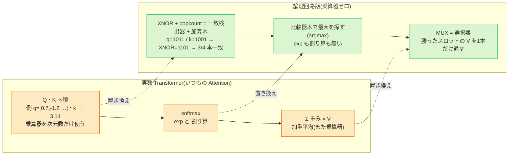
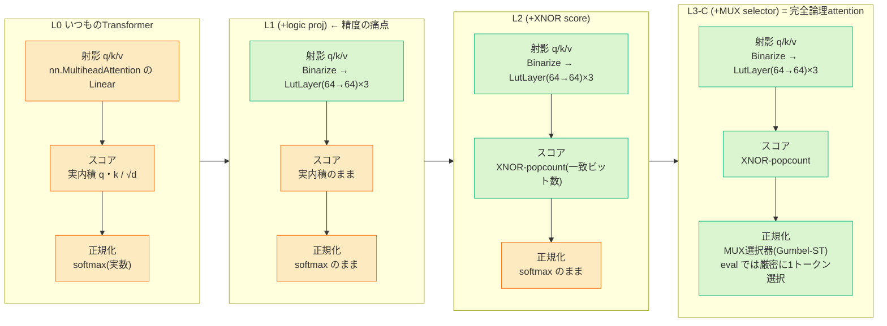
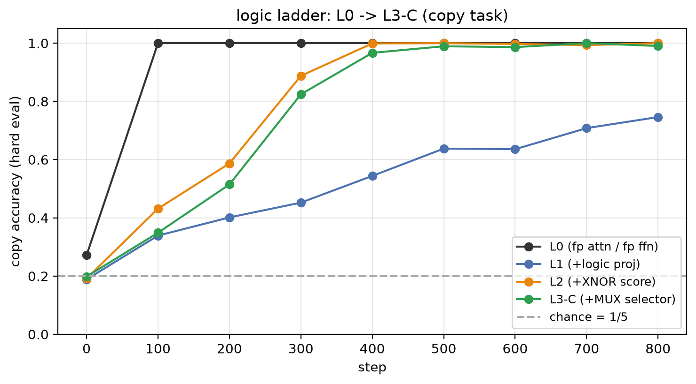
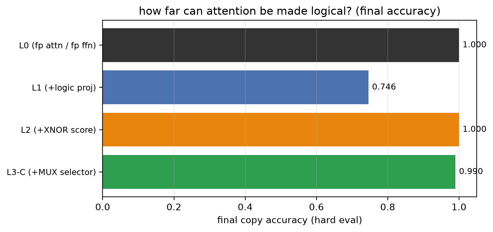
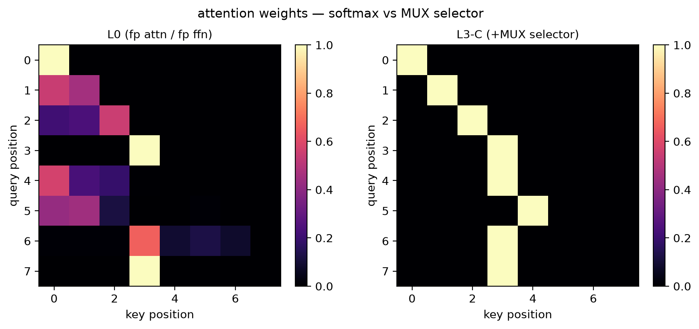
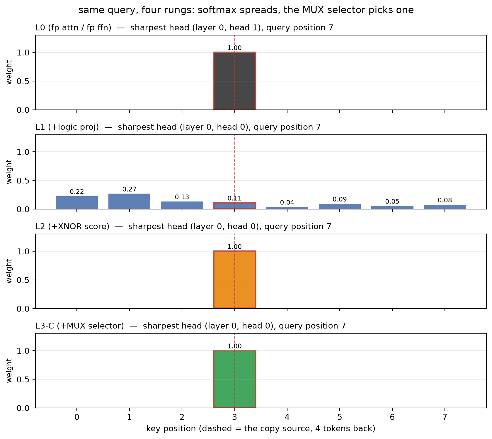

<!-- このファイルは scripts/build_tutorials.py が自動生成しています。
     直接編集せず、examples/12_logic_ladder_gpt.py を編集して再生成してください。 -->

**attention はどこまで論理回路にできるのか**を、1段ずつ登って確かめる梯子。
普通の浮動小数点 Transformer(L0)から、射影のゲート化(L1)→ XNOR-popcount スコア(L2)
→ MUX 選択器(L3-C)へ順に置き換え、コピー課題の精度と attention マップで比較する。

結論は直感に反する。**一番落ちるのは L1(射影のゲート化)であり、XNOR 化と softmax の
除去はほぼ無料**(L2 で 1.000 に戻り、L3-C でも 0.990)。L3-C の attention マップは
各行で1マスだけが点灯する ── つまり **attention とは学習された MUX** だった、という絵。

:::tip[このページで学ぶこと]
1. 浮動小数点 Transformer(L0)から MUX 選択器(L3-C)まで、1段ずつ論理化する道筋
2. どの段で精度が落ちるか ── 一番効くのは射影のゲート化(L1)であること
3. attention マップが one-hot になる = **attention とは学習された MUX** という見方

**前提**

- [Transformer(論理ゲートGPT)](/tutorials/logic-gpt/) — 登りきった先の完成形
- [2. ハイブリッドNNを作る](/tutorials/hybrid/) — 途中の段で止める設計
:::

:::note[このページについて]
所要時間の目安: **約8分** / 実行環境: CPU のみ(GPU 不要)
元スクリプト: [`examples/12_logic_ladder_gpt.py`](https://github.com/tsukushi-gate/Griffith/blob/main/examples/12_logic_ladder_gpt.py)
手元で試す: [`notebooks/12_logic_ladder_gpt.ipynb`](https://github.com/tsukushi-gate/Griffith/blob/main/notebooks/12_logic_ladder_gpt.ipynb)(このページと同じ内容の未実行ノートブック。`uv run --group docs jupyter lab notebooks/` で開ける)
コード出力はすべて **実際に実行した結果**をそのまま埋め込んでいます。
:::

<!-- Colabバッジ: リポジトリ public 化後、この span を data-colab-url を href に
     持つ <a> へ差し替えると「Colabで開く」が有効になる。 -->
<span class="colab-badge" data-colab-url="https://colab.research.google.com/github/tsukushi-gate/Griffith/blob/main/notebooks/12_logic_ladder_gpt.ipynb">▶ Colabで開く(リポジトリ公開後に有効化)</span>

「論理化の梯子」— attention をどこまで論理回路にできるかを段階比較する例。

examples/07_logic_gpt.py は「最初から全部論理ゲート」のGPTだった。ここでは逆に、
**普通の浮動小数点Transformer(L0)から出発して、attention を1段ずつ論理化**し、
どこで性能が落ちるかを測る。これが `LogicLadderGPT`(D1)の梯子である。

    L0  : attention=FP / FFN=FP                       … 普通のTransformer(天井)
    L1  : q/k/v 射影を論理ゲート化(スコアは実内積, softmax)
    L2  : + スコアを XNOR-popcount(ハミング距離)に置換
    L3-C: + softmax を MUX選択器(argmax 1トークン, Gumbel-ST)に置換 … 完全論理attention

L3-C まで来ると attention は「論理ゲート + 比較器 + MUX」だけで書ける。
つまり **softmax の exp/除算が消え、そのまま回路に焼ける**。
研究上の主張「attention = 学習されたマルチプレクサ(MUX)」の実証で、
sMNIST/Shakespeare での本格結果は experiments/attention_ladder/REPORT.md にある。

**Attentionを回路にする3つの置き換え(具体値つき)**

Attentionは「問い(Q)に一番近い相手(K)を探して、その中身(V)を取り出す」操作である。
実数のTransformerはこれを掛け算・指数関数でやるが、論理回路には掛け算器が無い。
そこで各段を、初心者の言葉でいえば次の部品に置き換える。



- **XNOR = 一致検出器**: 2本の線が同じなら1を出す1個のゲート。ビット幅ぶん並べる
- **popcount = 多数決(加算木)**: 1の本数を数えれば「何ビット揃ったか」= 類似度。
  二値ベクトル同士の内積は一致数と同じものなので、**類似度の意味は失われない**
- **MUX = 選択器**: 「何番を通すか」で入力を1本だけ出口へ通す交通整理のスイッチ

**梯子: 各段で何が実数のまま残り、何が回路になるか**

橙 = 実数(乗算器・exp が要る) / 緑 = 論理ゲート(そのまま回路に焼ける)。
このサンプルの構成は d_model=64・n_heads=2・n_layers=2・qk_bits=v_bits=64。
L1以降の論理部は **896 ゲート**(LutLayer の出力本数の合計。射影 64×3×2層 +
FFN (128+128)×2層)で、モデル全体のパラメータは **L0 の 68,422 に対し L3-C は 5,578**
(うち LutLayer が 3,584)。乗算器を捨てると規模も1桁落ちる。



実装は `griffith_logic/blocks/causal_attention.py` の `LadderAttention` 1クラスで、
`score`(fp_dot / xnor_popcount)と `norm`(softmax / mux_gumbel)の2つの文字列を
切り替えるだけで段を移動できる。射影は `_LogicProjection`(Binarize + LutLayer)、
FFN は L1 以降どの段も `LogicMLP` に固定して「1段=1変数」を守っている。

タスクは「コピー課題」: 乱数列 → 区切り記号 → 同じ列、を次トークン予測させる。
コピーするには「K+1個前を見る」attention が必須なので、attention の質が
そのまま精度に出る(FFNだけでは解けない)。CPUで2〜3分に収まる小サイズ。

実行: uv run python examples/12_logic_ladder_gpt.py
期待結果: L0 = コピー精度1.00、L1 ≈ 0.7、L2 / L3-C ≈ 1.00 付近まで回復

## 準備: import と乱数種

4段ぶんのモデルはすべて `LogicLadderGPT` 1クラスで作る。段の違いは設定辞書だけで
表現され、実装を切り替えたりはしない ── これが「1段=1変数」を守るための仕掛けである。

```python
import matplotlib.pyplot as plt
import torch
import torch.nn.functional as F

from griffith_logic.models import LogicLadderGPT, LogicLadderGPTConfig
```

段どうしを比べるページなので、初期条件は全段で揃える。ここで固定するのは
データ生成と重み初期化の両方で、あとで段ごとにも同じ種を引き直す。

```python
torch.manual_seed(0)
```

## タスク: コピー課題

乱数列 → 区切り記号 → **同じ列**、という系列を次トークン予測させる。後半の K 個は
「$K+1$ 個前のトークンをそのまま写す」だけで当たるので、attention が正しい位置を
引けているかを精度が直接映す ── FFN をいくら厚くしても解けない、最小の induction 課題。

```python
# 例(K=4, 記号5種): [3,1,4,1] + [SEP] + [3,1,4,1]
K = 4                 # コピーする列の長さ
N_SYM = 5             # 記号の種類数
SEP = N_SYM           # 区切り記号のID
VOCAB = N_SYM + 1
SEQ_LEN = 2 * K + 1   # 列 + 区切り + 列

BATCH = 64
STEPS = 800
LR = 5e-3
EVAL_EVERY = 100
AUX_LAMBDA = 0.01     # 選択器の補助損失(L3系のみ効く)
TEMP_START, TEMP_END = 2.0, 0.5  # 選択器の温度アニーリング(soft→hard へ寄せる)
```

バッチ生成は3行。前半 K 個の乱数列、区切り記号 `SEP`、そして同じ列をもう一度連結する。
採点は後半 K 個だけを対象にする ── 前半は乱数なので、そもそも当てようがない。

```python
def make_batch(size: int, generator: torch.Generator) -> torch.Tensor:
    """(size, 2K+1) のコピー課題バッチを作る。"""
    seq = torch.randint(0, N_SYM, (size, K), generator=generator)
    sep = torch.full((size, 1), SEP, dtype=torch.long)
    return torch.cat([seq, sep, seq], dim=1)
```

## 梯子の各段: 何を1段ずつ論理化するか

梯子は4段で、上へ登るほど attention が回路に近づく。

- **L0** — 普通の `nn.MultiheadAttention` + 実数 FFN。論理化ゼロの天井(比較の基準)
- **L1** — q/k/v の**射影**だけを LutLayer にし、出力を $\{0,1\}$ へ二値化する。
  スコアはまだ実数の内積、正規化も softmax のまま
- **L2** — スコアを **XNOR-popcount** へ。乗算器が消え、「ビットが何本一致したか」の
  勘定になる(XNOR = 一致なら1を出すゲート、popcount = 立ったビットを数える加算木)
- **L3-C** — softmax の加重平均を **MUX 選択器**へ。最も似ているキーを1本だけ通す

**なぜ MUX で選べるのか**: softmax の加重平均は、突き詰めれば「どのスロットの中身を
どれだけ通すか」を決める装置である。重みが1本に集中していれば、それは 2:1 マルチプレクサ
(選択線で2入力の片方を通す素子)の木と同じ働きになる。L3-C はその極限を**構造として
最初から強制**しており、だからこそ「attention とは学習された MUX である」と言える。

差分は attention 側だけで、`d_model` などの骨格は全段そろえてある。これを崩すと、
性能差が論理化のせいなのか容量差のせいなのか分からなくなる。

```python
BASE = {'d_model': 64, 'n_heads': 2, 'n_layers': 2, 'mlp_ratio': 2, 'dropout': 0.0}
LOGIC_PROJ = {
    'attention': 'logic_proj',  # q/k/v 射影を LutLayer(論理ゲート)で作り、{0,1}へ二値化
    'ffn': 'logic',             # FFN も論理ゲート(L1以降は共通=attentionだけを変数にする)
    'qk_bits': 64, 'v_bits': 64,
    'n_inputs': 2,              # DLGN標準の2入力ゲート
    'parameterization': 'warp',
    'proj_depth': 1,
    'tau': 1.0,
}
RUNGS = {
    # L0: 普通の nn.MultiheadAttention + FP FFN。論理化ゼロの天井。
    'L0 (fp attn / fp ffn)': dict(BASE, attention='fp', ffn='fp'),
    # L1: 射影だけゲート化。スコアは実内積、正規化は softmax のまま。
    'L1 (+logic proj)': dict(BASE, **LOGIC_PROJ, score='fp_dot', norm='softmax'),
    # L2: スコアも XNOR-popcount へ。乗算器が消え、ビット一致数の勘定になる。
    'L2 (+XNOR score)': dict(BASE, **LOGIC_PROJ, score='xnor_popcount', norm='softmax'),
    # L3-C: softmax を MUX選択器へ。attention が「1トークンを選ぶMUX」になる。
    'L3-C (+MUX selector)': dict(BASE, **LOGIC_PROJ, score='xnor_popcount', norm='mux_gumbel'),
}
```

## 学習ループ(4段に共通)

同じループを4段すべてに使う。段ごとに違う処理は一切書かず、設定辞書の差だけで
挙動が変わるようにしてある。押さえるべき仕掛けは2つ。

- **温度アニーリング** — 選択器の温度を 2.0 → 0.5 へ徐々に下げ、「ぼんやり混ぜる」から
  「1本を選ぶ」硬い挙動へ寄せていく。最初から硬くすると勾配が流れず学習が始まらない
- **補助損失** — 選択を鋭くする項を `AUX_LAMBDA` 倍して足す。L0〜L2 では 0 になるので、
  全段で同じ式のまま書ける

評価は必ず `eval()`(選択器が決定的な hard argmax になる=焼いた回路の姿)で行う。

```python
def train_rung(name: str, model_cfg: dict) -> tuple[list[int], list[float], LogicLadderGPT]:
    """1段ぶんを学習し、(step列, コピー精度列, モデル) を返す。"""
    torch.manual_seed(0)          # 段どうしを同じ初期条件から比較する
    rng = torch.Generator().manual_seed(1)
    cfg = LogicLadderGPTConfig.from_model_cfg(model_cfg, vocab_size=VOCAB, seq_len=SEQ_LEN)
    model = LogicLadderGPT(cfg)
    opt = torch.optim.Adam(model.parameters(), lr=LR)

    steps, accs = [], []
    for step in range(STEPS + 1):
        # 温度を 2.0 → 0.5 へ下げ、選択器を徐々に「1本を選ぶ」硬い挙動へ寄せる
        # (fp/softmax の段では no-op なので、全段で同じループが使える)。
        model.set_temperature(TEMP_START + (TEMP_END - TEMP_START) * step / STEPS)
        model.train()
        x = make_batch(BATCH, rng)
        logits = model(x[:, :-1])                       # 最後のトークンは入力に使わない
        loss = F.cross_entropy(logits.reshape(-1, VOCAB), x[:, 1:].reshape(-1))
        # 選択器の補助損失(選択を鋭くする項)を取り出して足す。fp段では 0。
        aux = model.pop_aux_loss()
        opt.zero_grad()
        (loss + AUX_LAMBDA * aux).backward()
        opt.step()

        if step % EVAL_EVERY == 0:
            # eval() にすると選択器は決定的な hard argmax になる=焼いた回路の姿。
            model.eval()
            with torch.no_grad():
                xv = make_batch(256, torch.Generator().manual_seed(99))
                pred = model(xv[:, :-1]).argmax(-1)
                # コピー領域(後半K個)だけを採点する。前半は当てようがない乱数。
                acc = (pred[:, K:] == xv[:, K + 1:]).float().mean().item()
            steps.append(step)
            accs.append(acc)
            print(f'  {name:<22} step {step:>4}  loss={loss.item():.3f}  copy acc={acc:.3f}')
    return steps, accs, model
```

## 実行: 4段を同じ初期条件で登る

4段を順に学習し、最後にコピー精度を並べる。注目するのは**絶対値ではなく段差**で、
「どの段で落ちるか」がそのまま「論理化のコストがどこにあるか」の答えになる。

```python
results = {}
models = {}
for rung_name, rung_cfg in RUNGS.items():
    print(f'--- {rung_name} ---')
    rung_steps, rung_accs, rung_model = train_rung(rung_name, rung_cfg)
    results[rung_name] = (rung_steps, rung_accs)
    models[rung_name] = rung_model

print('\n最終コピー精度(hard eval):')
for rung_name, (_, accs) in results.items():
    print(f'  {rung_name:<22} {accs[-1]:.3f}')

l0_acc = results['L0 (fp attn / fp ffn)'][1][-1]
l3c_acc = results['L3-C (+MUX selector)'][1][-1]
print(f'\nL0(浮動小数点) {l0_acc:.3f} → L3-C(完全論理attention) {l3c_acc:.3f}'
      f'  差 {l0_acc - l3c_acc:+.3f}')
assert l0_acc > 0.95, f'L0 が解けていない: {l0_acc:.3f}'
assert l3c_acc > 0.80, f'L3-C が低すぎる: {l3c_acc:.3f}'
```

```text title="出力"
--- L0 (fp attn / fp ffn) ---

  L0 (fp attn / fp ffn)  step    0  loss=1.913  copy acc=0.271

  L0 (fp attn / fp ffn)  step  100  loss=0.616  copy acc=1.000

  L0 (fp attn / fp ffn)  step  200  loss=0.606  copy acc=1.000

  L0 (fp attn / fp ffn)  step  300  loss=0.608  copy acc=1.000

  L0 (fp attn / fp ffn)  step  400  loss=0.602  copy acc=1.000

  L0 (fp attn / fp ffn)  step  500  loss=0.603  copy acc=1.000

  L0 (fp attn / fp ffn)  step  600  loss=0.605  copy acc=1.000

  L0 (fp attn / fp ffn)  step  700  loss=0.597  copy acc=1.000

  L0 (fp attn / fp ffn)  step  800  loss=0.606  copy acc=1.000
--- L1 (+logic proj) ---
  L1 (+logic proj)       step    0  loss=1.988  copy acc=0.188

  L1 (+logic proj)       step  100  loss=1.400  copy acc=0.339

  L1 (+logic proj)       step  200  loss=1.395  copy acc=0.401

  L1 (+logic proj)       step  300  loss=1.345  copy acc=0.452

  L1 (+logic proj)       step  400  loss=1.302  copy acc=0.544

  L1 (+logic proj)       step  500  loss=1.232  copy acc=0.638

  L1 (+logic proj)       step  600  loss=1.138  copy acc=0.636

  L1 (+logic proj)       step  700  loss=1.103  copy acc=0.708

  L1 (+logic proj)       step  800  loss=1.046  copy acc=0.746
--- L2 (+XNOR score) ---
  L2 (+XNOR score)       step    0  loss=1.990  copy acc=0.191

  L2 (+XNOR score)       step  100  loss=1.391  copy acc=0.432

  L2 (+XNOR score)       step  200  loss=1.347  copy acc=0.587

  L2 (+XNOR score)       step  300  loss=1.143  copy acc=0.888

  L2 (+XNOR score)       step  400  loss=0.877  copy acc=0.999

  L2 (+XNOR score)       step  500  loss=0.799  copy acc=1.000

  L2 (+XNOR score)       step  600  loss=0.737  copy acc=0.997

  L2 (+XNOR score)       step  700  loss=0.682  copy acc=0.993

  L2 (+XNOR score)       step  800  loss=0.654  copy acc=1.000
--- L3-C (+MUX selector) ---
  L3-C (+MUX selector)   step    0  loss=1.985  copy acc=0.198

  L3-C (+MUX selector)   step  100  loss=1.397  copy acc=0.349

  L3-C (+MUX selector)   step  200  loss=1.342  copy acc=0.515

  L3-C (+MUX selector)   step  300  loss=1.160  copy acc=0.824

  L3-C (+MUX selector)   step  400  loss=0.961  copy acc=0.967

  L3-C (+MUX selector)   step  500  loss=0.816  copy acc=0.989

  L3-C (+MUX selector)   step  600  loss=0.728  copy acc=0.986

  L3-C (+MUX selector)   step  700  loss=0.704  copy acc=1.000

  L3-C (+MUX selector)   step  800  loss=0.734  copy acc=0.990

最終コピー精度(hard eval):
  L0 (fp attn / fp ffn)  1.000
  L1 (+logic proj)       0.746
  L2 (+XNOR score)       1.000
  L3-C (+MUX selector)   0.990

L0(浮動小数点) 1.000 → L3-C(完全論理attention) 0.990  差 +0.010
```

## 可視化: どこで落ちて、どこで戻るか

### 図1: 梯子の学習曲線

**この図で何を見るか**: 4段の学習曲線を1枚に重ねる。縦軸はコピー精度(hard eval)、
破線がでたらめに答えたときの水準 $1/5$。見るべきは到達点そのものより、
**どの段の曲線が他から離れるか**である。

```python
colors = ['#333333', '#4c72b0', '#e8850c', '#2e9e4f']
fig, ax = plt.subplots(figsize=(7.5, 4.2))
for (rung_name, (rung_steps, accs)), color in zip(results.items(), colors, strict=True):
    ax.plot(rung_steps, accs, 'o-', color=color, label=rung_name)
ax.axhline(1.0 / N_SYM, color='#aaa', ls='--', label=f'chance = 1/{N_SYM}')
ax.set_xlabel('step')
ax.set_ylabel('copy accuracy (hard eval)')
ax.set_ylim(0, 1.05)
ax.grid(alpha=0.3)
ax.legend(loc='lower right', fontsize=9)
ax.set_title('logic ladder: L0 -> L3-C (copy task)')
fig.tight_layout()
plt.show()
```

    

    

**読み取り**: 落ちるのは **L1(射影のゲート化)** だけで、そこから上の L2・L3-C は
ほとんど無料で通る。つまり論理化のコストは「スコアの計算方法」でも「softmax を捨てること」
でもなく、**ベクトルをビットに落とすところ**に集中している。attention の仕組みそのものは
回路と相性が良い、というのがこの梯子の結論である。

### 図2: 最終精度の比較バー

**この図で何を見るか**: 図1の終点だけを横棒にして、段差を数値で読めるようにしたもの。
曲線が重なって見分けにくい部分を、最終値の並びとして確認するための図である。

```python
fig, ax = plt.subplots(figsize=(7.5, 3.6))
names = list(results)
finals = [results[n][1][-1] for n in names]
ax.barh(range(len(names)), finals, color=colors)
ax.set_yticks(range(len(names)))
ax.set_yticklabels(names, fontsize=9)
ax.invert_yaxis()
ax.set_xlim(0, 1.05)
ax.set_xlabel('final copy accuracy (hard eval)')
for i, value in enumerate(finals):
    ax.text(value + 0.01, i, f'{value:.3f}', va='center', fontsize=9)
ax.grid(alpha=0.3, axis='x')
ax.set_title('how far can attention be made logical? (final accuracy)')
fig.tight_layout()
plt.show()
```

    

    

**読み取り**: L0 と L3-C の差はごくわずかで、L1 だけが一段くぼむ。**完全に論理化した
attention が、浮動小数点の attention とほぼ並ぶ**ことがこの1枚で言える。
逆に L1 の窪みは、射影の二値化をどう設計するかがこの分野の実質的な争点だと示している。

### 図3: attention の中身

**この図で何を見るか**: L0(softmax)と L3-C(MUX 選択器)の attention 重みを、
同じ入力で並べたヒートマップ。縦がクエリ位置、横がキー位置で、明るいほど重みが大きい。
コピー課題の正解は「$K+1$ 個前を見る」なので、**主対角から $K+1$ ずれた斜め線**が
出ていれば正しく引けている。

```python
sample = make_batch(1, torch.Generator().manual_seed(7))
fig, axes = plt.subplots(1, 2, figsize=(9, 4))
for ax, key in zip(axes, ['L0 (fp attn / fp ffn)', 'L3-C (+MUX selector)'], strict=True):
    m = models[key]
    m.eval()
    with torch.no_grad():
        m(sample[:, :-1])
    attn = m.last_attn_weights[-1][0, 0]   # 最終層・head0 の (Sq, Sk)
    im = ax.imshow(attn.numpy(), cmap='magma', vmin=0, vmax=1)
    ax.set_title(key, fontsize=10)
    ax.set_xlabel('key position')
    ax.set_ylabel('query position')
    fig.colorbar(im, ax=ax, fraction=0.046)
fig.suptitle('attention weights — softmax vs MUX selector', fontsize=11)
fig.tight_layout()
plt.show()
```

    

    

**読み取り**: どちらにも斜め線が出るが、質が違う。L0 は線の周りがぼんやり滲むのに対し、
L3-C は**1マスだけが点灯し、残りは真っ黒**である。加重平均ではなく選択だからで、
「ぼかす自由度」が構造的に存在しない。同じタスクを、片方は平均で、片方は選択で
解いていることが1枚で見える。

### 図4: 同じ1行を4段で読み比べる(具体的な重みの数値)

**この図の見方と読み取り**(このページ最後の図)。図3のヒートマップから
**最後のクエリ位置の1行**だけを取り出し、4段を縦に並べて棒グラフにする。各段とも
全レイヤ・全ヘッドのうち最も鋭い1本を選んで描くので、「その段がコピー元を指せているか」を
1行で判定できる。赤い破線がコピー元の正解位置である。

読み取りどころは4段の対比。**L0** は正解位置に 1.00 で張り付く。**L1** は山を作れず
散らばる(=精度が落ちる段の正体がここに映る)。**L2** は XNOR スコアでも再び 1.00 に戻る。
そして **L3-C** は MUX なので**構造的に必ず1本**になる ── L0・L2 の 1.00 が
「softmax がたまたま鋭くなった結果」なのに対し、L3-C は選択そのものが離散である。
「attention とは学習された MUX」という主張が、重みの数値として読める最後の1枚。

```python
sample4 = make_batch(1, torch.Generator().manual_seed(7))
q_pos = SEQ_LEN - 2                       # 最後のクエリ位置(入力は x[:, :-1])
target_pos = q_pos - K                    # コピー元のキー位置(= 正解)
fig, axes = plt.subplots(4, 1, figsize=(8.5, 7.6), sharex=True)
for ax, (rung_name, color) in zip(axes, zip(list(results), colors, strict=True),
                                  strict=True):
    m = models[rung_name]
    m.eval()
    with torch.no_grad():
        m(sample4[:, :-1])
    best = max(
        ((layer_i, head_i, w[0, head_i, q_pos])
         for layer_i, w in enumerate(m.last_attn_weights)
         for head_i in range(w.shape[1])),
        key=lambda item: float(item[2].max()),
    )
    layer_i, head_i, row = best[0], best[1], best[2].numpy()
    bars = ax.bar(range(len(row)), row, color=color, alpha=0.9)
    bars[target_pos].set_edgecolor('#c0392b')
    bars[target_pos].set_linewidth(2)
    ax.axvline(target_pos, color='#c0392b', ls='--', lw=1)
    for i, v in enumerate(row):
        if v > 0.02:
            ax.text(i, v + 0.04, f'{v:.2f}', ha='center', fontsize=8)
    ax.set_ylim(0, 1.3)
    ax.set_ylabel('weight', fontsize=9)
    ax.set_title(f'{rung_name}  —  sharpest head (layer {layer_i}, head {head_i}), '
                 f'query position {q_pos}', fontsize=10, loc='left')
    ax.grid(axis='y', alpha=0.25)
axes[-1].set_xlabel(f'key position (dashed = the copy source, {K} tokens back)')
axes[-1].set_xticks(range(SEQ_LEN - 1))
fig.suptitle('same query, four rungs: softmax spreads, the MUX selector picks one',
             fontsize=12)
fig.tight_layout()
plt.show()
```

    


## 次に読む

- [論理ゲートAttentionの4変種ツアー](/tutorials/attention-tour/) — 登りきった先の Attention 実装を並べて比べる
- [論理ゲートGPT](/tutorials/logic-gpt/) — 全部論理ゲートにした言語モデル
- [2. ハイブリッドNNを作る](/tutorials/hybrid/) — 途中の段で止める設計
