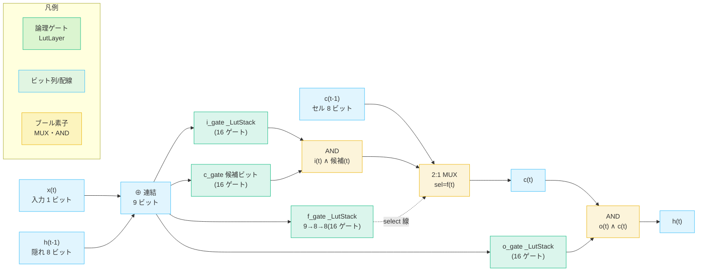
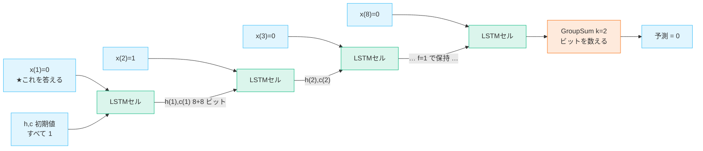
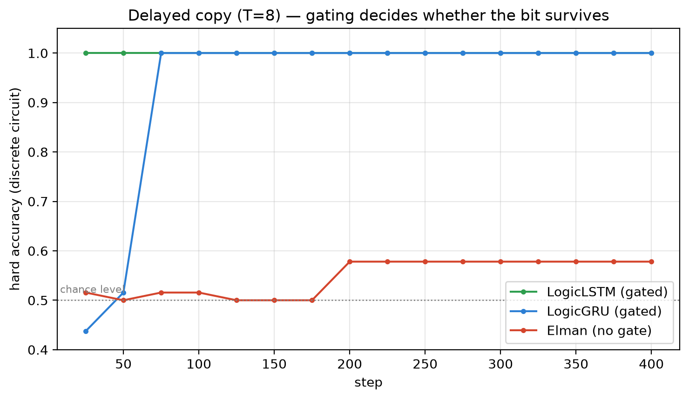
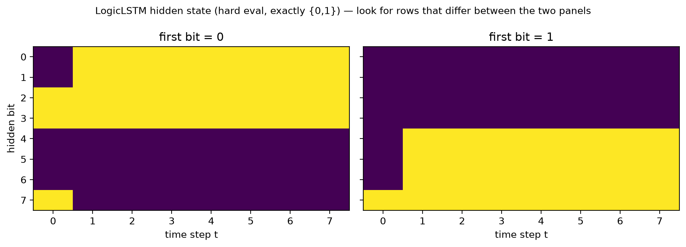
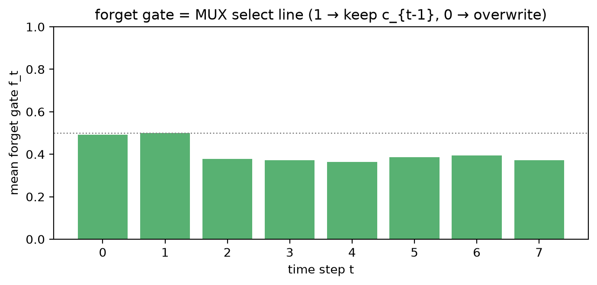
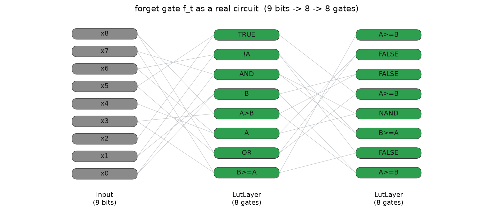

<!-- このファイルは scripts/build_tutorials.py が自動生成しています。
     直接編集せず、examples/09_logic_lstm.py を編集して再生成してください。 -->

**LSTM の忘却ゲートは 2:1 マルチプレクサそのもの、出力ゲートはビット AND そのもの**である。
$\{0,1\}$ 上ではゲーティングの掛け算が論理演算に化ける ── その同型性を、遅延コピー
タスクで LogicLSTM / LogicGRU / ゲートなし Elman の3者を比べて確かめる。

ゲートを持つ2つは hard acc 1.000、ゲートなし Elman は 0.578 で頭打ちになる。
隠れ状態は hard eval で厳密に $\{0,1\}$ に閉じ、忘却ゲートの開度は時刻ごとに
「いつ記憶を保持し、いつ捨てるか」を数値で見せてくれる。

:::tip[このページで学ぶこと]
1. 忘却ゲート = 2:1 マルチプレクサ、出力ゲート = ビット AND という同型性
2. ゲートあり(LSTM/GRU)と無し(Elman)の差が、遅延コピー課題でどう出るか
3. hard eval で隠れ状態が厳密に $\{0,1\}$ に閉じることの確かめ方

**前提**

- [RNNだけで作るseq2seq(RDDLGN)](/tutorials/rddlgn-seq2seq/) — ゲートを持たない再帰回路を先に見る
- [基本コンセプト](/getting-started/concepts/)
:::

:::note[このページについて]
所要時間の目安: **約5分** / 実行環境: CPU のみ(GPU 不要)
元スクリプト: [`examples/09_logic_lstm.py`](https://github.com/tsukushi-gate/Griffith/blob/main/examples/09_logic_lstm.py)
手元で試す: [`notebooks/09_logic_lstm.ipynb`](https://github.com/tsukushi-gate/Griffith/blob/main/notebooks/09_logic_lstm.ipynb)(このページと同じ内容の未実行ノートブック。`uv run --group docs jupyter lab notebooks/` で開ける)
コード出力はすべて **実際に実行した結果**をそのまま埋め込んでいます。
:::

<!-- Colabバッジ: リポジトリ public 化後、この span を data-colab-url を href に
     持つ <a> へ差し替えると「Colabで開く」が有効になる。 -->
<span class="colab-badge" data-colab-url="https://colab.research.google.com/github/tsukushi-gate/Griffith/blob/main/notebooks/09_logic_lstm.ipynb">▶ Colabで開く(リポジトリ公開後に有効化)</span>

論理ゲート版LSTM/GRU: 「ゲーティング=MUX/AND」を体感する例。

前のサンプル(08_rddlgn_seq2seq.py)のRDDLGNは、リカレント部が

    k_t = K([ n_t ; k_{t-1} ])

という **Elman型** だった。毎ステップ、状態を丸ごと作り直す形である。
この形には弱点がある: 「1ステップ目に見たビットを8ステップ後まで保持する」ような
純粋な記憶タスクだと、状態を運ぶ経路が毎回LUTの層を通って書き換わってしまい、
情報が持たない。

普通のニューラルネットはこれをLSTM/GRUのゲーティングで解決した。本サンプルの主張は:

    **ゲーティングは、そもそもブール演算である。**

    忘却ゲート付きのセル更新   c_t = f_t * c_{t-1} + (1 - f_t) * (i_t * c̃_t)
    は、f_t が {0,1} に落ちればそのまま 2:1 マルチプレクサ(MUX)であり、
    出力ゲート                 h_t = o_t * c_t
    は そのまま ビットAND である。

つまりLSTMのゲート構造は、論理回路へ落とすときに「近似」でなく「一致」する。
eval(hard)時、LogicLSTMCell の h と c は厳密に {0,1} になる —— これも本サンプルで確認する。

タスクは **遅延コピー**: 長さT=8のランダムビット列を読み、最後に「1ステップ目の
ビット」を答える。途中の7ビットは全部ノイズなので、latch(掛け金)が要る。
tests/test_logic_recurrent.py で較正済みの通り、LogicLSTMCell は200step以内に
hard accuracy 100% に達し、同条件のElman型は最後まで100%に届かない。
この対比が教材の核である。

## アーキテクチャ図解 1: セルの中身(LogicLSTMCell)

まず1時刻ぶんの中身を開く。ゲート f/i/o と候補 c̃ は、どれも
**`cat([x_t, h_(t-1)])` を入力に取る LutLayer 2段のスタック**(`_LutStack`)で、
本サンプルの構成では入力9ビット(=x 1 + h 8)→ 8ゲート → 8ゲートである。
出てきた4本のビット列を、MUX と AND という **2つの部品だけ** で組み合わせる。



    f(t)=1 なら MUX は c(t-1) 側を選ぶ = **記憶を保持**(latch)
    f(t)=0 なら MUX は i∧候補 側を選ぶ = **上書き**
    o(t)=0 なら h(t)=0 で外へ出さない(ゲートを閉じる)

学習中の f/i/o は 0〜1 の連続値なので上式は「重み付き平均」だが、
eval(hard)では f/i/o が {0,1} に落ちるため、**近似ではなく厳密に**
2:1マルチプレクサとビットANDの回路へ崩壊する。ここが本サンプルの主張。

## アーキテクチャ図解 2: 時間展開(遅延コピー T=8)

実データ1件目のビット列 `0 1 0 1 0 1 0 0` を流し、最後に **1ステップ目の 0** を
答えさせる。答えるべきビットは t=1 で入ってきたきり二度と現れないので、
セルの中のどこかがそれを掴んだまま7ステップ運ぶ必要がある。



**どう実現しているか**(初めて読む人向けの要点)

- **ゲート1本 = LutLayer 2段**。行列積も sigmoid も使わない。f/i/o/c̃ の4本ぶんで
  1セルあたり 4×16 = 64 ゲート(hidden=8 の構成)。
- **ゲーティング = 配線の選択**。MUX は「2本の入力のうち片方を通す」だけの素子で、
  FPGA なら 1 LUT に収まる。LSTM の「掛け算」はここに一致する。
- **latch(記憶)の正体**: f(t)=1 が続く限り c(t) は変化しない。回路としては
  「フィードバックのある保持回路」そのもの。学習は「いつ f を閉じるか」を覚える。
- **Elman型との違い**: ゲート無しの再帰 h(t)=L2(L1([x,h])) は毎時刻すべての
  ビットを作り直すため、保持専用の経路が無い。図の MUX がまるごと欠けた形になる。
- **最後の読み出し**: GroupSum が隠れビットを2グループに割り、それぞれの1の個数を
  数えてロジットにする(学習パラメータを持たない)。数える部分だけが実数。

実行: uv run python examples/09_logic_lstm.py
期待結果: LSTM=1.00 / GRU=1.00 / Elman は1.00に届かない(0.6前後。CPUで20秒程度)

## 準備: import とハイパーパラメータ

`LogicLSTMCell` / `LogicGRUCell` がゲート付きの再帰セル、`scan_cell` が時間方向の
ループを回すヘルパー。比較用のゲート無し Elman 型は `LutLayer` から自分で組む。

```python
import matplotlib.pyplot as plt
import torch
import torch.nn as nn
import torch.nn.functional as F

from griffith_logic import GroupSum, LutLayer
from griffith_logic.analysis.circuit_viz import plot_circuit
from griffith_logic.blocks import LogicGRUCell, LogicLSTMCell, scan_cell
```

### ハイパーパラメータ

`T=8` が系列長で、答えるべきビットは 7 ステップ運ばれる。`HIDDEN=8` は隠れ状態の
ビット幅 ── 1ビットを保持するだけなら 8 本もあれば十分すぎるので、「容量が足りない
から解けない」という言い訳を先に潰してある。差が出るなら**構造の差**だけが理由になる。

```python
SEED = 0
T = 8          # 系列長。1ステップ目のビットをT-1ステップ後まで運ぶ必要がある
N_DATA = 64    # 全パターンを使うのではなくランダム64本(記憶の一般化を見る)
HIDDEN = 8     # 隠れ状態のビット幅。8ビットもあれば1ビットのlatchは足りる
STEPS = 400    # 学習イテレーション数
LR = 0.05
CHECK = 25     # 何stepごとにhard accuracyを測るか
DATA_SEED = 123
```

## タスク: 遅延コピー(最初に見たビットを最後に答える)

長さ8のランダムなビット列を読み、最後に**1ステップ目のビット**を答えさせる。
途中の7ビットは全部ノイズなので、回路は最初のビットを掴んだまま7ステップ運ぶ必要がある。

**なぜ「最初」なのか**: 「最後に見たもの」を答えるタスクにすると、直近の入力さえ
反映できれば解けてしまい、記憶の有無で差が出ない。保持そのものを試すには、
答えが二度と現れない形にするしかない。

```python
def delayed_copy_data() -> tuple[torch.Tensor, torch.Tensor]:
    """遅延コピー: xs=(N,T,1) のランダムビット列、y = xs[:,0] (最初のビット)。

    「最後に見たもの」ではなく「最初に見たもの」を答えさせるのが肝。
    直近だけ覚えれば済むタスクにすると、ゲートの有無で差が出ない。
    """
    gen = torch.Generator().manual_seed(DATA_SEED)
    xs = (torch.rand(N_DATA, T, 1, generator=gen) > 0.5).float()
    return xs, xs[:, 0, 0].long()
```

## モデル定義: ゲート付き vs ゲート無し

### 初期状態をビットで作る

再帰回路には「t=0 の状態」が要る。既定値の 0.5 は「論理的に不定」を表す中立値で
学習には都合がよいが、hard 評価では**回路に存在しない値**になってしまう。
中間値を受けた LUT は 0.25 や 0.75 を返し、それが時間方向へ伝播して隠れ状態全体を
連続値に汚す。初期状態も 1.0(=ビット1)に固定して、回路を最初から閉じさせる。

```python
def binary_init_state(cell: nn.Module, batch: int):
    """再帰セルの初期状態を **ビット** で作る(hard評価を閉じさせるため)。

    cell.init_state() の既定値は 0.5 ——「論理的に不定」を表す中立値で、
    学習には都合がよい。ところが eval(hard)時にこれを使うと、
    0.5 を受け取ったLUTが 0.25 / 0.75 … と中間値を返し、それが時間方向へ
    伝播して「離散回路のはずの隠れ状態が連続値」という状態になってしまう。
    ここでは初期状態も 1.0(=ビット1)に固定し、回路が最初から最後まで
    純粋なブール演算で閉じるようにする。
    """
    state = cell.init_state(batch)
    if isinstance(state, tuple):
        return tuple(torch.ones_like(s) for s in state)
    return torch.ones_like(state)
```

### ゲート付きセル + GroupSum の分類器

最終時刻の隠れ状態を `GroupSum` で2クラスのロジットに集計するだけの最小構成。
`GroupSum` は学習パラメータを持たず「ビットをクラス数のグループに割って1の個数を
数える」だけなので、**判定まで含めて回路**として焼ける。

```python
class CellClassifier(nn.Module):
    """再帰セル(LSTM/GRU)+ GroupSum の最小分類器。

    最終時刻の隠れ状態 h_T を GroupSum で2クラスのロジットに集計する。
    GroupSum は「隠れビットをクラス数のグループに割って各グループの1の個数を数える」
    だけの層で、学習パラメータを持たない。つまり **判定まで含めて回路** になる。
    """

    def __init__(self, cell: nn.Module, hidden: int):
        super().__init__()
        self.cell = cell
        # tau はロジットの温度。グループ幅の平方根に取るのが本ライブラリの定石。
        self.readout = GroupSum(k=2, tau=max(1.0, (hidden // 2) ** 0.5))

    def forward(self, xs: torch.Tensor) -> torch.Tensor:
        # scan_cell が時間方向のループを回す(outputs, final_state を返す)。
        state = binary_init_state(self.cell, xs.shape[0])
        outputs, _final = scan_cell(self.cell, xs, state)
        return self.readout(outputs[:, -1, :])
```

### 比較対象: ゲート無しの Elman 型

$h_t = L_2(L_1([x_t ; h_{t-1}]))$ ── 毎時刻、状態を丸ごと作り直す形である
(RDDLGN の K層・P層と同じ)。**保持専用の経路が無い**ことがこのモデルの弱点で、
冒頭のセル図から MUX がまるごと抜け落ちた形にあたる。読み出しも学習条件も
ゲート付き側と完全に揃えてあるので、差が出るなら再帰の作り方だけが原因になる。

```python
class ElmanClassifier(nn.Module):
    """ゲートなしElman型(LutLayer2段の再帰)。比較のベースライン。

    h_t = L2(L1([ x_t ; h_{t-1} ]))
    RDDLGNのK層/P層と同じ形。状態を保つ専用の経路が無いことに注目。
    """

    def __init__(self, hidden: int, seed: int):
        super().__init__()
        torch.manual_seed(seed)
        self.l1 = LutLayer(1 + hidden, hidden, n_inputs=2)
        self.l2 = LutLayer(hidden, hidden, n_inputs=2)
        self.hidden = hidden
        self.readout = GroupSum(k=2, tau=max(1.0, (hidden // 2) ** 0.5))

    def forward(self, xs: torch.Tensor) -> torch.Tensor:
        batch, seq_len, _ = xs.shape
        # 初期状態はビット1。LSTM/GRU側と条件を完全に揃える(上の
        # binary_init_state と同じ理由で 0.5 は使わない)。
        h = torch.ones(batch, self.hidden)
        for t in range(seq_len):
            h = self.l2(self.l1(torch.cat([xs[:, t, :], h], dim=-1)))
        return self.readout(h)
```

## 学習ループ

普通の Adam + cross entropy。ひとつだけ作法があって、**記録するのは常に hard(eval)側**
の精度である。soft accuracy だけ上がっても、argmax で確定した回路が同じ答えを
出さなければ意味がない ── 論理ゲート NN で最も多い自己欺瞞がここなので、最初から
hard しか見ないようにしておく。

```python
def train(model: nn.Module, xs, y) -> list[tuple[int, float]]:
    """学習し、(step, hard accuracy) の履歴を返す。"""
    opt = torch.optim.Adam(model.parameters(), lr=LR)
    history = []
    for step in range(STEPS):
        model.train()
        opt.zero_grad()
        F.cross_entropy(model(xs), y).backward()
        opt.step()
        if (step + 1) % CHECK == 0:
            # 記録するのは常に hard(eval)側。soft accだけ上がっても、
            # 焼いた回路が同じ答えを出さなければ意味がない。
            model.eval()
            with torch.no_grad():
                acc = (model(xs).argmax(-1) == y).float().mean().item()
            history.append((step + 1, acc))
    return history
```

## 実行: 同じ条件で3モデルを比べる

### データ

実際のビット列を1件だけ表示して、タスクの形を目で確かめておく。

```python
xs, y = delayed_copy_data()
print(f'遅延コピー: xs={tuple(xs.shape)} (T={T}) / 目標=1ステップ目のビット')
print(f'例: 入力ビット列 {xs[0, :, 0].int().tolist()} → 正解 {int(y[0])}')
```

```text title="出力"
遅延コピー: xs=(64, 8, 1) (T=8) / 目標=1ステップ目のビット
例: 入力ビット列 [0, 1, 0, 1, 0, 1, 0, 0] → 正解 0
```

### 3モデルを同条件で学習

種・データ・step 数・学習率・読み出しをすべて揃え、**違うのは再帰の作り方だけ**にする。
代表値に「学習中の最高値」を使うのは、hard accuracy が離散化の都合で step 間を
行き来するためで、最終値だけ見ると実力を過小評価しやすいからである。

```python
builders = {
    'LogicLSTM (gated)': lambda: CellClassifier(
        LogicLSTMCell(1, HIDDEN, seed=SEED), HIDDEN),
    'LogicGRU (gated)': lambda: CellClassifier(
        LogicGRUCell(1, HIDDEN, seed=SEED), HIDDEN),
    'Elman (no gate)': lambda: ElmanClassifier(HIDDEN, seed=SEED),
}

histories = {}
finals = {}
models = {}
for name, build in builders.items():
    torch.manual_seed(SEED)
    model = build()
    hist = train(model, xs, y)
    histories[name] = hist
    # 「学習中に一度でも到達した最高値」を代表値にする。hard accは離散化の都合で
    # step間を行き来するので、最終値だけ見ると実力を過小評価しやすい。
    finals[name] = max(a for _s, a in hist)
    models[name] = model
    n_params = sum(p.numel() for p in model.parameters())
    print(f'{name:<20} best hard acc = {finals[name]:.4f}  ({n_params:,} params)')
```

```text title="出力"
LogicLSTM (gated)    best hard acc = 1.0000  (1,024 params)

LogicGRU (gated)     best hard acc = 1.0000  (768 params)

Elman (no gate)      best hard acc = 0.5781  (256 params)
```

上の出力で、ゲート付き(LSTM / GRU)は 1.0000、ゲート無し(Elman)は 1.0 に届かない。
パラメータ数はむしろ Elman のほうが少ないくらいで、差は容量ではなく**構造**から来ている。
下の2つの assert が、その対比そのものを機械的な受入条件として固定している。

```python
# ゲート付きは満点、ゲート無しは満点に届かない —— これが本サンプルの主張。
assert finals['LogicLSTM (gated)'] == 1.0, 'LogicLSTM が遅延コピーを解けていない'
assert finals['Elman (no gate)'] < 1.0, 'Elman型が満点(比較の前提が崩れた)'
```

## 可視化: ゲートは実際に何をしているか

### 図1: 学習曲線(ゲートの有無で分かれる)

**この図で何を見るか**: 縦軸は hard accuracy(離散回路のまま測った正解率)、点線が
コイントス水準の 0.5。3本の線が同じ図に乗っているので、**ゲートの有無だけで結果が
分岐する**かどうかがそのまま読める。

```python
fig, ax = plt.subplots(figsize=(7.5, 4.4))
colors = {'LogicLSTM (gated)': '#2e9e4f', 'LogicGRU (gated)': '#2d7fd4',
          'Elman (no gate)': '#d4452d'}
for name, hist in histories.items():
    steps, accs = zip(*hist, strict=True)
    ax.plot(steps, accs, 'o-', ms=3, color=colors[name], label=name)
ax.axhline(0.5, color='gray', ls=':', lw=1)
ax.text(STEPS * 0.02, 0.515, 'chance level', color='gray', fontsize=8)
ax.set_xlabel('step')
ax.set_ylabel('hard accuracy (discrete circuit)')
ax.set_ylim(0.4, 1.05)
ax.grid(alpha=0.3)
ax.legend(loc='lower right')
ax.set_title(f'Delayed copy (T={T}) — gating decides whether the bit survives')
fig.tight_layout()
plt.show()
```

    

    

**読み取り**: LSTM / GRU は 100 step 前後で **階段状に 1.0 へ跳ぶ**。じわじわ上がるのでは
なく跳ぶのは、「どのビットを latch(掛け金)にするか」が決まった瞬間に回路が完成する
ためで、連続的な近似の改善ではない。一方 Elman は 0.5 から少しずつ上がって天井に当たる
── 保持の経路が無いので、途中の7ビットのノイズに毎回上書きされている。

### 図2: 隠れ状態は本当にビットか

**この図で何を見るか**(次のセルで描く): 隠れ状態を時間×ビットのマス目にして、
1ステップ目の入力が 0 だったサンプルと 1 だったサンプルで左右に並べる。
**左右で色が違う行**があれば、それが「最初のビットを最後まで保ち続けたビット」=
回路が見つけた latch である。その前に、状態が厳密に $\{0,1\}$ かを assert で確かめる。

```python
lstm = models['LogicLSTM (gated)']
lstm.eval()
with torch.no_grad():
    state = binary_init_state(lstm.cell, 32)
    outputs, _ = scan_cell(lstm.cell, xs[:32], state)
uniq = torch.unique(outputs)
print(f'hidden state の出現値 = {uniq.tolist()}')
assert bool(((outputs == 0.0) | (outputs == 1.0)).all()), \
    'hard eval なのに隠れ状態が二値でない'
```

```text title="出力"
hidden state の出現値 = [0.0, 1.0]
```

出現値が `[0.0, 1.0]` の2つだけであることが上の出力で確認できた ── ゲート $f,i,o$ が
$\{0,1\}$ に落ちれば MUX も AND も厳密なビット演算になるので、これは近似ではない。

```python
fig, axes = plt.subplots(1, 2, figsize=(10, 3.6), sharey=True)
for ax, bit in zip(axes, (0, 1), strict=True):
    sel = outputs[y[:32] == bit]                 # (n, T, HIDDEN)
    ax.imshow(sel.mean(0).T, cmap='viridis', vmin=0, vmax=1, aspect='auto')
    ax.set_xlabel('time step t')
    ax.set_title(f'first bit = {bit}')
    ax.set_xticks(range(T))
axes[0].set_ylabel('hidden bit')
fig.suptitle('LogicLSTM hidden state (hard eval, exactly {0,1}) — '
             'look for rows that differ between the two panels', fontsize=10)
fig.tight_layout()
plt.show()
```

    

    

**読み取り**: 左右のパネルを見比べると、ほとんどの行は同じ模様なのに、いくつかの行だけ
色が反転している。その行が latch を担当したビットで、**t=0 から t=7 まで一定の色**を
保っていることが「7ステップ運べた」ことの直接の証拠になる。残りの行は入力の一時的な
処理に使われており、8ビットの中で自然に分業が起きている。

### 図3: ゲートは実際に「閉じて」いるか

**この図で何を見るか**: 忘却ゲート $f_t$ の平均開度を時刻ごとに棒で並べる。
$f_t=1$ なら MUX は過去側 $c_{t-1}$ を選ぶ(=**保持**)、$f_t=0$ なら候補で上書きする。
棒の高さは「その時刻に保持側へ倒れたビットの割合」である。

```python
lstm_cell = lstm.cell
with torch.no_grad():
    lstm_cell.eval()
    h, c = binary_init_state(lstm_cell, 32)   # {0,1}で始めないとhard経路が閉じない
    forget_rate = []
    for t in range(T):
        z = torch.cat([xs[:32, t, :], h], dim=-1)
        f_t = lstm_cell.f_gate(z)       # (32, HIDDEN) — {0,1}
        forget_rate.append(f_t.mean().item())
        h, c = lstm_cell(xs[:32, t, :], (h, c))

fig, ax = plt.subplots(figsize=(7, 3.4))
ax.bar(range(T), forget_rate, color='#2e9e4f', alpha=0.8)
ax.axhline(0.5, color='gray', ls=':', lw=1)
ax.set_xlabel('time step t')
ax.set_ylabel('mean forget gate f_t')
ax.set_ylim(0, 1)
ax.set_xticks(range(T))
ax.set_title('forget gate = MUX select line (1 → keep c_{t-1}, 0 → overwrite)')
fig.tight_layout()
plt.show()
```

    

    

**読み取り**: 棒は 1.0 にも 0.0 にも張り付かず、中間の高さに落ち着く。全ビットが
一斉に保持するのではなく、**一部のビットだけが閉じて残りは開いている**からである
── 平均を取っているので、その分業の比率がそのまま高さになる。時刻が進んでも高さが
大きく崩れないことが、latch が途中で外れていないことを示す。

### 図4: 忘却ゲートの「実物」

**この図の見方と読み取り**(このページ最後の図)。ここまでは振る舞いの図だったので、
最後に学習後の忘却ゲートを**回路そのもの**として描く。左端が入力9ビット
($[x_t ; h_{t-1}]$)、中央と右が LutLayer 2段の8ゲートずつで、箱の中の文字が argmax で
確定したゲート名(`AND` / `XOR` / `NAND` …)である。

読み取りどころは、**箱に `LUT` ではなく具体的なゲート名が入っていること**。この配線と
ゲート名は `export_ir` が Verilog を吐くときと同じ離散化経路から取っているので、
「LSTM の忘却ゲート」がそのまま合成可能な組み合わせ回路になっている、という主張の
いちばん直接的な証拠になる。

```python
fig, ax = plt.subplots(figsize=(9.5, 4.2))
plot_circuit(lstm.cell.f_gate, resolve=True, ax=ax,
             title='forget gate f_t as a real circuit  (9 bits -> 8 -> 8 gates)')
fig.tight_layout()
plt.show()

print('\n--- まとめ ---')
for name, acc in finals.items():
    print(f'{name:<20} hard acc = {acc:.4f}')
print(f'forget gate の平均開度(時刻順) = '
      f'{[round(v, 3) for v in forget_rate]}')
```

    

    

    
```text title="出力"
--- まとめ ---
LogicLSTM (gated)    hard acc = 1.0000
LogicGRU (gated)     hard acc = 1.0000
Elman (no gate)      hard acc = 0.5781
forget gate の平均開度(時刻順) = [0.492, 0.5, 0.379, 0.371, 0.363, 0.387, 0.395, 0.371]
```

## 次に読む

- [因果convolutionを論理ゲートで](/tutorials/logic-wavenet/) — 再帰を使わずに履歴を見る
- [リザバー計算(学習しないRNN)](/tutorials/logic-reservoir/) — 再帰回路を学習しないという選択
- [RNNだけで作るseq2seq(RDDLGN)](/tutorials/rddlgn-seq2seq/)
