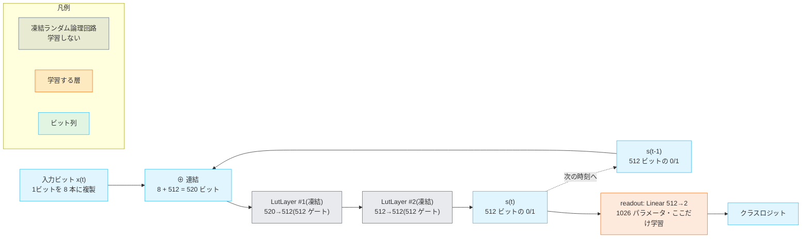
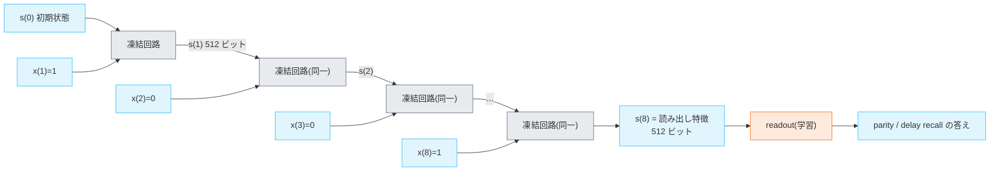
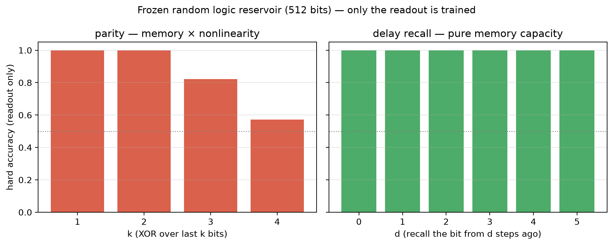
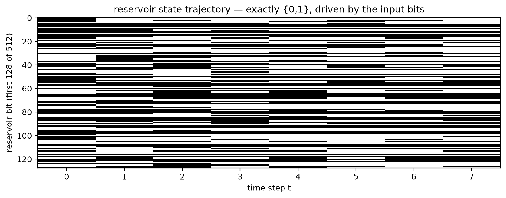
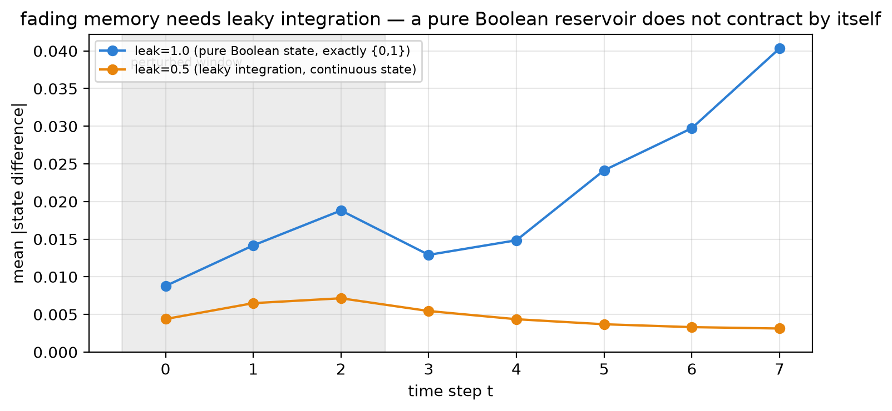
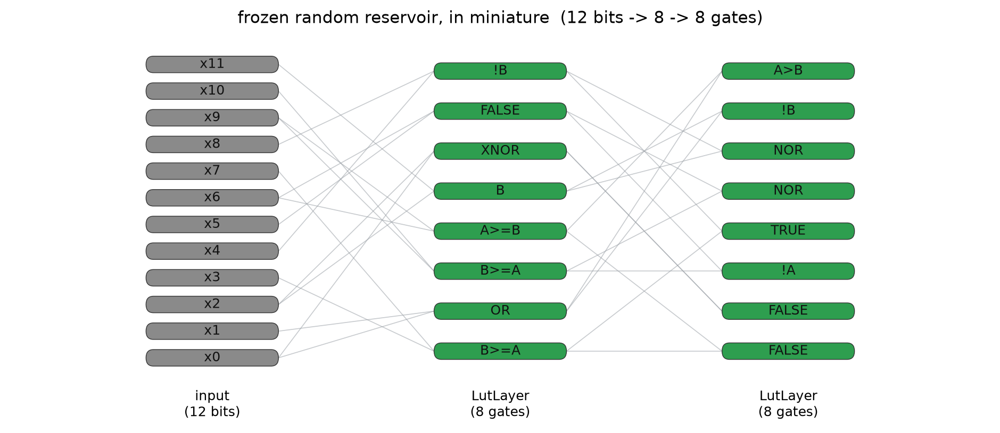

<!-- このファイルは scripts/build_tutorials.py が自動生成しています。
     直接編集せず、examples/11_logic_reservoir.py を編集して再生成してください。 -->

**回路を学習しない、という選択**。512ビットの凍結ランダム論理回路に系列を流し込み、
学習するのは readout(全体の 5.9%)だけ ── それでも parity や遅延再生は解けてしまう。

このページの主題は「リザバーが持っているのは**記憶**であって、**記憶への非線形演算**では
ない」こと。delay-d recall は d=0..5 すべて満点なのに、parity は k が増えるほど劣化する。
さらに **hard 化した純ブール回路(leak=1.0)は有界だが収縮しない**(1ビットの差がむしろ
拡散する)ことを摂動カーブで示し、fading memory とハードウェア化のトレードオフを扱う。

:::tip[このページで学ぶこと]
1. 凍結したランダム論理回路 + readout だけの学習(全体の 5.9%)で何が解けるか
2. リザバーが持っているのは**記憶**であって、記憶への非線形演算ではないこと
3. hard 化した純ブール回路が「有界だが収縮しない」という、ハードウェア化の落とし穴

**前提**

- [RNN: LSTM / GRU の論理化](/tutorials/logic-lstm/) — 学習する再帰回路と比べる
:::

:::note[このページについて]
所要時間の目安: **約5分** / 実行環境: CPU のみ(GPU 不要)
元スクリプト: [`examples/11_logic_reservoir.py`](https://github.com/tsukushi-gate/Griffith/blob/main/examples/11_logic_reservoir.py)
手元で試す: [`notebooks/11_logic_reservoir.ipynb`](https://github.com/tsukushi-gate/Griffith/blob/main/notebooks/11_logic_reservoir.ipynb)(このページと同じ内容の未実行ノートブック。`uv run --group docs jupyter lab notebooks/` で開ける)
コード出力はすべて **実際に実行した結果**をそのまま埋め込んでいます。
:::

<!-- Colabバッジ: リポジトリ public 化後、この span を data-colab-url を href に
     持つ <a> へ差し替えると「Colabで開く」が有効になる。 -->
<span class="colab-badge" data-colab-url="https://colab.research.google.com/github/tsukushi-gate/Griffith/blob/main/notebooks/11_logic_reservoir.ipynb">▶ Colabで開く(リポジトリ公開後に有効化)</span>

LogicReservoir: 回路を **学習しない** という選択肢(リザバーコンピューティング)。

ここまでの系列モデル(08 RDDLGN / 09 LogicLSTM / 10 LogicWaveNet)は、
どれも回路そのものを勾配で学習していた。本サンプルはまったく逆の発想を試す:

    **巨大なランダム論理回路を凍結したまま使い、読み出し(readout)だけを学習する。**

これがリザバーコンピューティング。回路(リザバー)は乱数で1回作ったら二度と
触らない。系列を流し込むと、リザバーの内部状態が入力の履歴を
「高次元のビットパターン」へ勝手に広げてくれる。学習するのは、その状態から
答えを取り出す最後の線形層だけである。

なぜ本ライブラリの物語と噛み合うか:

    * 学習コストが極端に安い。逆伝播はreadoutの1層ぶんしか流れない
      (リザバーは requires_grad=False + no_grad で完全に切り離される)
    * リザバーは **hard化した純ブール回路** として走る。状態は厳密に{0,1}で、
      連続値の発散が原理的に起きない(状態空間が有界であることが構造で保証される)
    * 凍結ランダム回路はそのままHDLに焼ける。学習が要るのは端の小さな層だけ

タスクは **parity(排他的論理和)**。系列の末尾 k ビットのXORを答える。
parityは「記憶 × 非線形」の合わせ技で、線形readoutにとって最も苦手な形の
問題であり、リザバーの能力の限界を測る古典的なベンチマークである。
併せて、リザバーの記憶容量そのものを測る **遅延再生(delay-k recall)** も回す。

## アーキテクチャ図解: 学習するのは端の1層だけ

いちばん大事な絵は「**どこが凍っていて、どこが学習されるか**」である。
灰色の箱(リザバー)は乱数で作られたきり一度も更新されない。学習の勾配は
橙の readout にしか流れず、灰色の箱へは1本も戻らない。



時間方向に展開すると、同じ凍結回路を8回くり返し通しているだけになる
(実データ1件目のビット列 `1 0 0 1 0 1 0 1` を流したときの図)。



**どう実現しているか**(初めて読む人向けの要点)

- **回路は乱数で1回だけ作る**。`LogicReservoirConfig.seed` から決まる配線と真理値表を
  生成した直後に `requires_grad=False` を立て、状態計算も `no_grad` で回す。
  だから逆伝播は readout の1層ぶんしか流れない ── 学習が極端に安い理由。
- **状態は毎時刻まるごと作り直される**。`s(t) = 凍結回路([x(t) ⊕ s(t-1)])`。
  LSTM のような保持専用の経路は無いが、512ビットもの広い状態にランダムな配線で
  ばらまかれるため、過去の入力の痕跡がしばらく残る。
- **状態は厳密に 0/1**。leak=1.0 では完全置換なので、リザバーは純ブール回路のまま。
  発散も飽和も原理的に起きない(状態空間が有限)。
- **学習するのは読み出しだけ**。512ビットから2クラスへの線形写像(1,026パラメータ)で、
  回路本体の 16,384 パラメータは凍ったまま(学習対象は全体の約6%)。
- **限界も見える**: 線形 readout は「覚えている」ことは読めるが、
  「覚えたものを XOR する」のは苦手。parity で k を増やすと崩れるのはそのため。

実行: uv run python examples/11_logic_reservoir.py
期待結果: parity は k=1,2 で 1.00・k=3,4 で劣化 / delay recall は d=0..5 で 1.00
          (CPUで15秒程度)

## 準備: import とハイパーパラメータ

使うのは `LogicReservoir` と、その構成を決める `LogicReservoirConfig`。最後に回路図を
描くので `plot_circuit` も読み込む。

```python
import matplotlib.pyplot as plt
import torch
import torch.nn.functional as F

from griffith_logic.analysis.circuit_viz import plot_circuit
from griffith_logic.models import LogicReservoir, LogicReservoirConfig
```

### ハイパーパラメータ

目を引くのは `RESERVOIR = 512` ── **入力は1ステップあたり1ビットしかないのに、
状態は512ビットある**。この「勝手に広がる高次元空間」がリザバー計算の道具立てで、
そこへ入力履歴を写し取り、読み出しだけを学習する。

```python
SEED = 0
T = 8            # 系列長
N_DATA = 512     # サンプル数
WIDTH = 8        # 入力ビット幅(1本のビットストリームを8本に複製して入れる)
RESERVOIR = 512  # リザバー状態のビット幅。ここが「勝手に広がる高次元空間」
STEPS = 600      # readout の学習イテレーション数
LR = 0.05
```

## データ: ランダムビット列

長さ8のランダムなビット列を512本作るだけ。教師信号はこの列から後で何通りにも
作れるので、**リザバーの状態は1回計算すれば全タスクで使い回せる**(それが速さの正体)。

1ビットを8本に複製して入れているのは、512ビットの状態に対して1本では駆動力が
弱すぎ、状態が入力を無視した固定パターンに落ちてしまうためである。

```python
def bit_stream() -> tuple[torch.Tensor, torch.Tensor]:
    """ランダムビット列を作る。

    Returns:
        xs: (N, T, WIDTH) リザバーへの入力。1ビットを WIDTH 本に複製している。
            1本だけだと512ビットのリザバーに対して入力の駆動力が弱すぎて、
            状態が入力を無視した固定パターンに落ちてしまう。
        bits: (N, T) 元の1ビット列(教師信号を作るのに使う)
    """
    gen = torch.Generator().manual_seed(1)
    bit = (torch.rand(N_DATA, T, 1, generator=gen) > 0.5).float()
    return bit.repeat(1, 1, WIDTH), bit[:, :, 0]
```

## モデル定義: 凍結リザバー + 学習する readout

**リザバー計算**(reservoir computing)は、再帰回路の中身を**まったく学習しない**という
設計である。乱数で作った再帰回路に入力を流し込み、そこに現れた状態を特徴量とみなして、
**読み出し(readout)の1層だけ**を学習する。

**なぜ学習しなくても成立するのか**: 再帰回路に求められる仕事は「過去の入力を、
互いに区別できる形で状態へ写し取る」ことである。写し方が読みやすい向きであれば、
それが**設計された写像である必要はない** ── ランダムな高次元写像でも、線形な読み出しが
後から必要な成分を取り出せる。学習の負担を再帰から読み出しへ丸ごと移す、という発想。

`leak=1.0` は「毎時刻、状態を完全に置き換える」の意味で、このとき状態は厳密に
$\{0,1\}$ のまま ── つまりリザバー全体が純粋なブール回路になる。図3でここを揺さぶる。

```python
def build() -> LogicReservoir:
    """凍結ランダム論理リザバー + 線形readout。"""
    torch.manual_seed(SEED)
    return LogicReservoir(LogicReservoirConfig(
        input_size=WIDTH,
        reservoir_size=RESERVOIR,
        num_classes=2,
        depth=2,          # 状態更新1回あたりのLutLayer段数
        leak=1.0,         # 1.0 = 完全置換。状態は厳密に{0,1}のまま
        readout='group_sum',  # 状態ビット → クラスロジットの学習線形写像
        # リザバー回路はこのseedだけで決まる(大域RNGから独立)。
        # 同じseedなら誰が実行しても同じ回路が出る = 再現可能。
        seed=0,
    ))
```

### readout だけを学習する

逆伝播が流れるのは readout の1層ぶんだけで、リザバーの中へは1歩も入らない。
だから状態は一度計算すれば使い回せて、タスクを変えても再計算が要らない。

```python
def train_readout(model: LogicReservoir, feat: torch.Tensor,
                  y: torch.Tensor) -> float:
    """凍結済み特徴 feat から readout だけを学習し、hard accuracy を返す。

    リザバーは学習しないので、状態は **一度計算すれば使い回せる**。
    これがリザバーコンピューティングが速い理由そのもの
    (毎stepの逆伝播はreadout1層ぶんしか流れない)。
    """
    opt = torch.optim.Adam(model.trainable_parameters(), lr=LR)
    for _ in range(STEPS):
        model.train()
        opt.zero_grad()
        F.cross_entropy(model.readout(feat), y).backward()
        opt.step()
    model.eval()
    with torch.no_grad():
        return (model.readout(feat).argmax(-1) == y).float().mean().item()
```

タスクごとに**まっさらな readout** を用意して解かせる。リザバーは毎回同じ(seed 固定で
決定的に再生成される)なので、タスク間の差は純粋に「その特徴が読めるかどうか」になる。

```python
def solve(y: torch.Tensor, feat: torch.Tensor) -> float:
    """毎回まっさらなreadoutを用意して1タスクを解く。"""
    model = build()
    return train_readout(model, feat, y)
```

## リザバー状態を一度だけ計算する

まず学習対象の内訳を出す。全パラメータのうち readout が占める割合が、そのまま
「このモデルで学習されている部分」の大きさである(実測で約 5.9%)。

```python
xs, bits = bit_stream()
model = build()
n_frozen = sum(p.numel() for p in model.reservoir.parameters())
n_train = sum(p.numel() for p in model.trainable_parameters())
print(f'凍結リザバー {n_frozen:,} パラメータ / 学習するreadout {n_train:,} パラメータ '
      f'(学習対象は全体の {100 * n_train / (n_frozen + n_train):.1f}%)')
```

```text title="出力"
凍結リザバー 16,384 パラメータ / 学習するreadout 1,026 パラメータ (学習対象は全体の 5.9%)
```

続いて全時刻の状態をまとめて計算する。`states()` の内部は `no_grad` + `detach` なので
計算グラフはここで完全に切れており、**この先どんなタスクを解いても再計算されない**。

```python
# states() は全時刻の状態を返す。内部は no_grad + detach なので、
# ここで計算グラフは完全に切れている。
states = model.states(xs)
print(f'リザバー状態 {tuple(states.shape)} / 出現値 = '
      f'{torch.unique(states).tolist()}')
```

```text title="出力"
リザバー状態 (512, 8, 512) / 出現値 = [0.0, 1.0]
```

出現値が `[0.0, 1.0]` の2つだけであることを確かめる ── `leak=1.0` のリザバーは
純ブール回路なので、状態に中間値が現れたらそれ自体が不具合である。最終時刻の状態を
「読み出し用の特徴」として取り出し、以降のすべてのタスクでこれを使い回す。

```python
# leak=1.0 のリザバーは純ブール回路。状態は厳密に{0,1}でなければならない。
assert bool(((states == 0.0) | (states == 1.0)).all()), 'リザバー状態が二値でない'
feat = states[:, -1, :]   # 最終時刻の状態が「読み出し用の特徴」
```

## 実験: parity と遅延再生

### 実験1: parity(末尾kビットのXOR)

**parity(パリティ)** = ビット列の1の個数が偶数か奇数か、つまり XOR を並べたもの。
$k=1$ は「最後のビットをそのまま答える」なので簡単だが、$k$ が増えるほど
「$k$ 個を覚えたうえで XOR する」ことが要る。**記憶と非線形演算の両方**を試す課題である。

```python
parity_ks = [1, 2, 3, 4]
parity_acc = []
for k in parity_ks:
    y = bits[:, T - k:].sum(1).long() % 2
    acc = solve(y, feat)
    parity_acc.append(acc)
    print(f'parity(末尾{k}ビットXOR)  hard acc = {acc:.4f}')
```

```text title="出力"
parity(末尾1ビットXOR)  hard acc = 1.0000
parity(末尾2ビットXOR)  hard acc = 1.0000

parity(末尾3ビットXOR)  hard acc = 0.8223
parity(末尾4ビットXOR)  hard acc = 0.5723
```

### 実験2: 遅延再生(memory capacity)

「$d$ ステップ前に入ってきたビットをそのまま答えよ」。XOR が要らないので**純粋な
記憶容量**のテストになり、リザバー研究では memory capacity と呼ばれる古典的な指標である。
実験1と対にすることで、「記憶が無いのか」「非線形演算ができないのか」を切り分けられる。

```python
delays = list(range(6))
delay_acc = []
for d in delays:
    y = bits[:, T - 1 - d].long()
    acc = solve(y, feat)
    delay_acc.append(acc)
    print(f'delay-{d} recall            hard acc = {acc:.4f}')
```

```text title="出力"
delay-0 recall            hard acc = 1.0000
delay-1 recall            hard acc = 1.0000

delay-2 recall            hard acc = 1.0000
delay-3 recall            hard acc = 1.0000

delay-4 recall            hard acc = 1.0000
delay-5 recall            hard acc = 1.0000
```

## 凍結の確認

「リザバーは学習しない」は口約束では意味がないので、機械的に確かめる。学習の前後で
リザバーの `state_dict` が **bitwise に一致する**ことを assert し、さらに同じ seed で
作り直した回路とも一致することを見る ── 回路が乱数種だけで決まるなら、
誰が実行しても同じ回路になり、そのままハードウェアの設計図として配れる。

```python
before = {k: v.clone() for k, v in model.reservoir.state_dict().items()}
_ = solve(bits[:, -1].long(), feat)
after = build().reservoir.state_dict()
for key, val in before.items():
    assert torch.equal(val, after[key]), f'リザバー {key} が変化した'
print('リザバーのパラメータは bitwise 不変(凍結されている)')

assert parity_acc[1] > 0.95, f'parity(k=2) が解けていない: {parity_acc[1]:.4f}'
assert all(a == 1.0 for a in delay_acc), f'delay recall が満点でない: {delay_acc}'
```

```text title="出力"
リザバーのパラメータは bitwise 不変(凍結されている)
```

## 可視化: 何が持てて、何が持てないか

### 図1: parity は k が増えると崩れる / delay recall は崩れない

**この図で何を見るか**: 左が parity($k$ を増やす)、右が遅延再生($d$ を増やす)で、
どちらも縦軸は hard accuracy、点線がコイントス水準。**2枚の崩れ方の違い**が主役で、
片方だけが崩れるならリザバーの限界がどちら側にあるかが分かる。

```python
fig, axes = plt.subplots(1, 2, figsize=(10, 4), sharey=True)
axes[0].bar([str(k) for k in parity_ks], parity_acc, color='#d4452d', alpha=0.85)
axes[0].set_xlabel('k (XOR over last k bits)')
axes[0].set_title('parity — memory × nonlinearity')
axes[1].bar([str(d) for d in delays], delay_acc, color='#2e9e4f', alpha=0.85)
axes[1].set_xlabel('d (recall the bit from d steps ago)')
axes[1].set_title('delay recall — pure memory capacity')
for ax in axes:
    ax.axhline(0.5, color='gray', ls=':', lw=1)
    ax.set_ylim(0, 1.05)
    ax.grid(alpha=0.3, axis='y')
axes[0].set_ylabel('hard accuracy (readout only)')
fig.suptitle(f'Frozen random logic reservoir ({RESERVOIR} bits) — '
             'only the readout is trained', fontsize=11)
fig.tight_layout()
plt.show()
```

    

    

**読み取り**: 右(遅延再生)は $d=0$ から $d=5$ まで満点のまま崩れない ── 8ステップの
履歴はまるごと512ビットの中に残っている。一方 左(parity)は $k=3,4$ で急に落ちる。
つまり**足りないのは記憶ではなく、記憶に対する非線形演算**である。リザバーが提供するのは
「過去を区別できる形で保持すること」までで、そこから先(XOR のような合成)は
線形な読み出しの仕事にはならない ── これがこのページの結論である。

### 図2: リザバーの状態そのもの

**この図で何を見るか**: 1サンプルぶんの状態の時間発展を白黒で描く(縦=状態ビット、
横=時刻、黒が1)。入力は1ステップ1ビットしかないのに状態が512ビットあるので、
「ランダム回路が入力履歴を高次元へ写している」様子がそのまま絵になる。

```python
fig, ax = plt.subplots(figsize=(9, 3.6))
ax.imshow(states[0, :, :128].T, cmap='binary', aspect='auto',
          interpolation='nearest')
ax.set_xlabel('time step t')
ax.set_ylabel(f'reservoir bit (first 128 of {RESERVOIR})')
ax.set_xticks(range(T))
ax.set_title('reservoir state trajectory — exactly {0,1}, driven by the input bits')
fig.tight_layout()
plt.show()
```

    

    

**読み取り**: 灰色の一様な帯ではなく、時刻ごとに模様が切り替わる ── 入力ビットに
駆動されて状態が動いている証拠である。逆にどの時刻も同じ縦縞なら、入力を無視した
固定パターンに落ちており(入力の駆動力不足)、読み出しが何も取り出せない状態になる。
中間の灰色が1つも無いことも、ここが純ブール回路であることの確認になる。

### 図3: fading memory と leak のトレードオフ

**この図で何を見るか**(数セル先で描く): **fading memory**(echo state property)=
「大昔の入力や初期条件の影響が時間とともに薄れる」性質。これが無いとリザバーは
初期状態をいつまでも引きずり、同じ入力に対して安定した特徴を出せない。

測り方は簡単で、先頭3ステップだけ差し替えた系列を用意し、元の系列との**状態の差**が
時刻とともに減るかを見る。青(`leak=1.0`、純ブール)と橙(`leak=0.5`、leaky 統合)を
重ねて、減衰するのはどちらかを比べる。

```python
gen = torch.Generator().manual_seed(456)
perturbed = xs.clone()
perturbed[:, :3, :] = (
    torch.rand(N_DATA, 3, WIDTH, generator=gen) > 0.5
).float()
```

`leak` は状態の上書き速度を決めるつまみで、$s_t = \mathrm{leak}\cdot\text{new} +
(1-\mathrm{leak})\cdot s_{t-1}$ という低域通過フィルタである。1.0 なら完全置換(=純ブール)、
1 未満だと過去の状態が混ざる代わりに、状態は厳密な $\{0,1\}$ でなくなる。

```python
def perturbation_curve(leak: float) -> torch.Tensor:
    """元の系列と摂動系列の状態差を、時刻ごとに測る。"""
    torch.manual_seed(SEED)
    m = LogicReservoir(LogicReservoirConfig(
        input_size=WIDTH, reservoir_size=RESERVOIR, num_classes=2,
        depth=2, leak=leak, readout='group_sum', seed=0,
    ))
    return (m.states(xs) - m.states(perturbed)).abs().mean(dim=(0, 2))
```

2つの leak で状態差の推移を出す。数値を先に見ておくと、次の図がどちらへ倒れるかが
印刷された数字の並びからも読める。

```python
curves = {1.0: perturbation_curve(1.0), 0.5: perturbation_curve(0.5)}
for leak, curve in curves.items():
    print(f'leak={leak} の状態差 = {[round(v, 4) for v in curve.tolist()]}')
```

```text title="出力"
leak=1.0 の状態差 = [0.0088, 0.0142, 0.0188, 0.0129, 0.0149, 0.0241, 0.0297, 0.0403]
leak=0.5 の状態差 = [0.0044, 0.0065, 0.0071, 0.0055, 0.0044, 0.0037, 0.0033, 0.0031]
```

**読み取り**(次に出る図3): 橙(`leak=0.5`)は摂動窓を抜けたあと右下がりに減衰するが、
青(`leak=1.0`)は下がらない ── ランダム論理回路は1ビットの違いを層をまたいで
**拡散させる**方向にも働くので、有界ではあってもそれだけでは収縮しないのである。

ここがハードウェア化の落とし穴になる。fading memory が欲しければ leak を下げるしかないが、
下げた瞬間に状態は $\{0,1\}$ を外れ、「純ブール回路のまま焼ける」という利点を失う。
**fading memory と純ブール性は綱引きの関係にある** ── これがこのページ最後の教訓である。

```python
# leaky統合は摂動を減衰させ、純ブール(leak=1.0)は減衰させない。
assert curves[0.5][-1] < curves[0.5][2], 'leaky統合でも状態差が減衰していない'

fig, ax = plt.subplots(figsize=(7.5, 3.8))
for leak, color, label in (
    (1.0, '#2d7fd4', 'leak=1.0 (pure Boolean state, exactly {0,1})'),
    (0.5, '#e8850c', 'leak=0.5 (leaky integration, continuous state)'),
):
    ax.plot(range(T), curves[leak].numpy(), 'o-', color=color, label=label)
ax.axvspan(-0.5, 2.5, color='gray', alpha=0.15)
ax.text(-0.4, ax.get_ylim()[1] * 0.9, 'perturbed window', color='dimgray',
        fontsize=8)
ax.set_xlabel('time step t')
ax.set_ylabel('mean |state difference|')
ax.set_xticks(range(T))
ax.set_ylim(bottom=0)
ax.grid(alpha=0.3)
ax.legend(fontsize=8, loc='upper left')
ax.set_title('fading memory needs leaky integration — '
             'a pure Boolean reservoir does not contract by itself')
fig.tight_layout()
plt.show()
```

    

    

### 図4: 凍結ランダム回路の「実物」

**この図の見方と読み取り**(このページ最後の図)。512ビットのリザバーは大きすぎて
全ゲートを描けないので、同じ作り方でうんと小さいリザバー(状態8ビット・depth=2)を
生成して回路図にする。左端が入力($[x_t ; s_{t-1}]$ の12ビット)、中央と右が
LutLayer 2段の8ゲートずつ、箱の中の文字が確定したゲート名である。

読み取りどころは、**学習していないのに具体的なゲート名が付いていること**。乱数で引いた
真理値表がそのまま回路として意味を持っているので、このモデルは「作った瞬間から焼ける
回路」であり、学習で変わるのはこの図の**外側**にある readout だけである。

```python
small = LogicReservoir(LogicReservoirConfig(
    input_size=4, reservoir_size=8, num_classes=2, depth=2,
    leak=1.0, readout='group_sum', seed=0,
))
fig, ax = plt.subplots(figsize=(9.5, 4.2))
plot_circuit(small.reservoir, resolve=True, ax=ax,
             title='frozen random reservoir, in miniature  (12 bits -> 8 -> 8 gates)')
fig.tight_layout()
plt.show()

print('\n--- まとめ ---')
print('parity  : ' + ' / '.join(
    f'k={k}:{a:.3f}' for k, a in zip(parity_ks, parity_acc, strict=True)))
print('delay   : ' + ' / '.join(
    f'd={d}:{a:.3f}' for d, a in zip(delays, delay_acc, strict=True)))
print(f'学習したのは {n_train:,} パラメータだけ'
      f'(回路本体 {n_frozen:,} は凍結)')
```

    

    

    
```text title="出力"
--- まとめ ---
parity  : k=1:1.000 / k=2:1.000 / k=3:0.822 / k=4:0.572
delay   : d=0:1.000 / d=1:1.000 / d=2:1.000 / d=3:1.000 / d=4:1.000 / d=5:1.000
学習したのは 1,026 パラメータだけ(回路本体 16,384 は凍結)
```

## 次に読む

- [6. 学習則を切り替える(DFA / AP法)](/tutorials/learning-rules/) — 「どこを学習するか」を変える別の道
- [RNN: LSTM / GRU の論理化](/tutorials/logic-lstm/) — 学習する再帰回路と比べる
- [FPGAに焼く](/guides/fpga/) — 凍結回路をそのまま実装するときの前提
