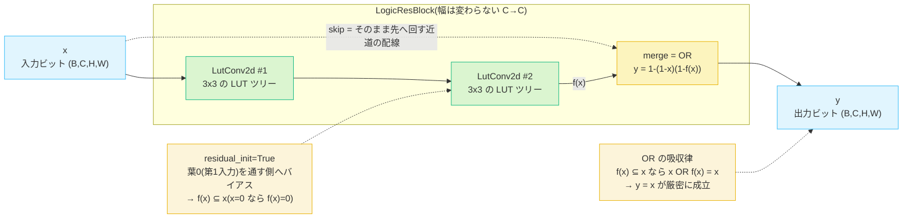
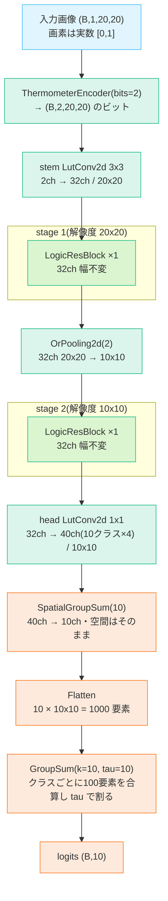
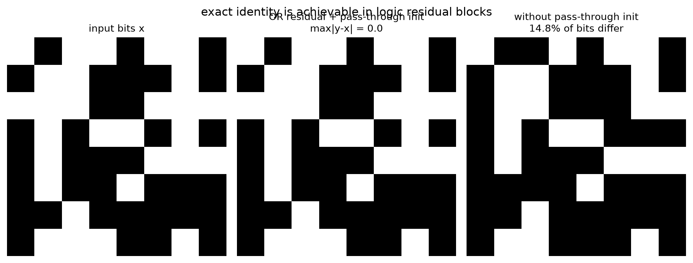
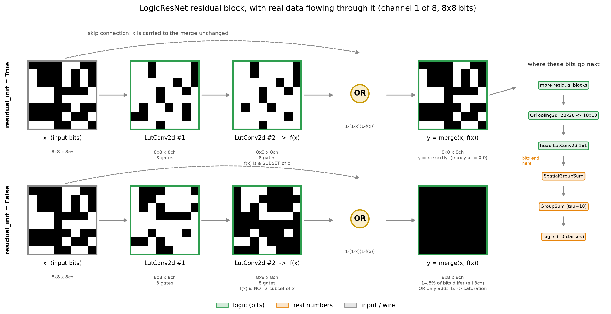
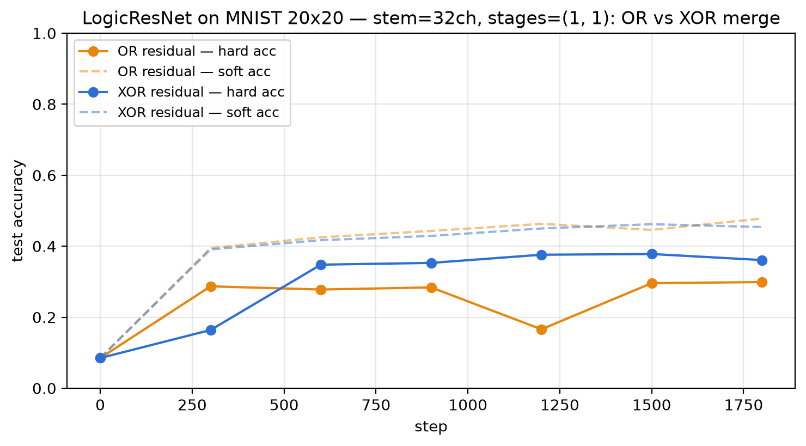
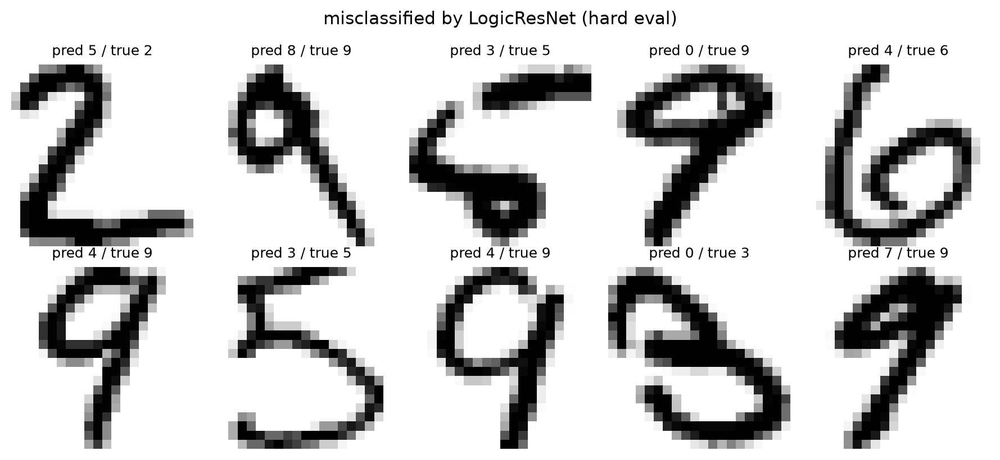

<!-- このファイルは scripts/build_tutorials.py が自動生成しています。
     直接編集せず、examples/14_logic_resnet.py を編集して再生成してください。 -->

**論理NNの残差接続は、恒等写像を「厳密に」作れる**。OR 残差と pass-through 初期化を
組み合わせると $\max|y - x| = 0.0$ ── 近似ではなくビット単位の完全一致で入力が
そのまま出る。実数の ResNet が初期化で近似的に狙うものが、ここでは厳密に成立する。

ただし代償がある。OR は一度立ったビットを落とせないので**飽和する**。同一 seed で
比べると hard acc は XOR 残差 0.361 > OR 残差 0.299 で、恒等の厳密さと学習しやすさが
トレードオフになっていることが学習曲線に出る。

:::tip[このページで学ぶこと]
1. OR 残差 + pass-through 初期化で、恒等写像が**厳密に**($\max|y-x| = 0$)作れること
2. その代償 ── OR は立ったビットを落とせないので飽和する、というトレードオフ
3. OR 残差と XOR 残差を同一 seed で比べた学習曲線の読み方

**前提**

- [1. MNISTを学習する](/tutorials/mnist/)
- [LutLayerの数理](/explanation/lut-layer/) — 残差が効く仕組みの背景
:::

:::note[このページについて]
所要時間の目安: **約8分** / 実行環境: CPU のみ(GPU 不要)
元スクリプト: [`examples/14_logic_resnet.py`](https://github.com/tsukushi-gate/Griffith/blob/main/examples/14_logic_resnet.py)
手元で試す: [`notebooks/14_logic_resnet.ipynb`](https://github.com/tsukushi-gate/Griffith/blob/main/notebooks/14_logic_resnet.ipynb)(このページと同じ内容の未実行ノートブック。`uv run --group docs jupyter lab notebooks/` で開ける)
コード出力はすべて **実際に実行した結果**をそのまま埋め込んでいます。
:::

<!-- Colabバッジ: リポジトリ public 化後、この span を data-colab-url を href に
     持つ <a> へ差し替えると「Colabで開く」が有効になる。 -->
<span class="colab-badge" data-colab-url="https://colab.research.google.com/github/tsukushi-gate/Griffith/blob/main/notebooks/14_logic_resnet.ipynb">▶ Colabで開く(リポジトリ公開後に有効化)</span>

LogicResNet(残差論理ConvNet)でMNISTを解く例。

深いネットワークが学習できるのは、ResNet の「skip接続」が
「何もしない(恒等写像)」を初期状態として無料で用意してくれるからだ。
実数NNではこれは ``x + f(x)`` と書き、``f`` の重みを0に初期化すれば恒等になる。

**論理ゲートNNには「0」に相当する重みが無い。** ゲートは真理値表であって
係数ではないので、「効果を0にする」という初期化ができない。ではどうするか。

    LogicResNet は残差の合流を **OR** で行う:  merge(x, f(x)) = 1-(1-x)(1-f(x))
    そして LutConv2d を **pass-through 初期化**(residual_init=True)する。
    pass-through とは「ツリーの葉0(=第1入力)をそのまま出す」ゲート A 側へバイアスすること。

このとき f(x) は x に **含まれる**(x が 0 の位置では f(x) も必ず 0)。OR は吸収律

    merge(x, f(x)) = x OR f(x) = x    (f(x) ⊆ x のとき)  ← 恒等写像が **厳密に** 成立

を持つので、合流すると x がそのまま戻ってくる。バイアスが完全に効いて f(x) = x
まで行った場合は、OR の冪等性 x OR x = x による特別な場合にあたる
(既定の parameterization='softmax' では eval で各ゲートが「葉0 かつ 葉1でない」を
選ぶため、f(x) は x の真部分集合になる。図2で実物を確かめる)。

浮動小数の誤差込みで「ほぼ恒等」ではなく、ビット単位で完全に一致する。
これが論理NN固有の面白さで、このサンプルの前半(図1・図2)で実際に確かめる。

## アーキテクチャ図解 1: 残差ブロックの中身(OR で合流する)

残差ブロック1個の中身は「2枚の畳み込み → 元の入力と OR で合流」だけである。
下の図の **破線が skip 接続** ── 入力 x を加工せずそのまま合流点まで運ぶ近道の配線で、
これがあるおかげで「何もしない」が初期状態として選べる。



## アーキテクチャ図解 2: LogicResNet 全体(どこまでがビットか)

緑の段は入力も出力も **ビット(0か1)**、橙の段は **実数**(ビットを数え上げた整数と、
それを割ったロジット)。ビットのまま head まで進み、SpatialGroupSum で初めて
「1の個数を数える」実数の世界に出る、というのがこのモデルの形である。
数値は本サンプルの縮小レシピ(stem 32ch / stage_blocks=(1,1) / encode_bits=2)。



**どう実現しているか**(NNを触ったことがない人向けの要点)

- **ビット = 0か1しか取らない信号**。普通のNNが実数を運ぶ配線を、このモデルは
  0/1 の線として扱う。だから「掛け算・足し算」ではなく AND / OR / XOR で計算できる。
- **LutConv2d = 画像の上を滑らせる小さな真理値表(LUT)の束**。3x3 の窓から
  数本のビットを選び、「この入力ならこの出力」という表を1枚引く。表の中身が
  学習対象で、実数の重みの代わりに「どの表を使うか」を連続値で持ち、
  eval(推論)時に argmax で1枚に確定させる ── これが「焼いた回路」。
- **残差接続(skip接続) = 入力をそのまま先へ回す近道の配線**。深い網でも
  「素通し」が常に選べるので、段を積んでも学習が壊れにくい。
- **pass-through 初期化 = 学習開始時のゲートを『素通し』寄りに置くこと**。
  実数NNは重みを0にすれば素通しになるが、真理値表には「0の重み」が無い。
  代わりに「葉0(第1入力)を通す」ゲートへバイアスし、f(x) が x に収まるようにする。
- **吸収律 = 「元より小さいもの」を OR しても元のまま**という性質。
  f(x) ⊆ x なら x OR f(x) = x。f(x)=x まで一致した場合は
  **冪等(べきとう)**(同じものを2回入れても変わらない性質、x OR x = x)の特別な場合。
- **ThermometerEncoder = 濃さを目盛りに変える符号化**。実数の画素値を
  「閾値をいくつ超えたか」の 0/1 の並びに直し、以降を論理の世界に持ち込む。
- **GroupSum = 最後に1の個数を数える復号**。クラスごとに割り当てた出力ビットの
  本数を数え、tau で割ってロジットにする。**実数が出てくるのはここだけ**。

**ただし、この恒等性はタダではない。** OR は単調(x OR f(x) ≧ x)なので、
段を重ねるほど1が増えて飽和し、勾配が細る。もう一つの選択肢 'xor'
(a XOR b = a+b-2ab)は飽和しない代わりに、pass-through 初期化しても
恒等にはならない(恒等の条件が f(x)=0 になるため)。

    'or'  … 恒等を初期状態に置ける / 飽和して学習が鈍る
    'xor' … 恒等は初期状態にできない / 飽和せず学習が速い

後半では、この2つを同じ条件で MNIST に流して学習曲線を比べる(図3)。
本サンプルの主目的は恒等性の観察なので、精度を狙うレシピは
experiments/train_logic_resnet.py(20000 step)を参照。

実行: uv run python examples/14_logic_resnet.py
期待結果: 恒等性 max|y-x| = 0.0、hard accuracy は XOR 0.35前後 > OR 0.28前後
          (CPUで2〜3分の縮小レシピ)

## 準備: import と乱数種

使う部品は3つだけ ── `LogicResNet`(モデル本体)、`LogicResNetConfig`(その設定)、
`LogicResBlock`(残差ブロック単体。前半ではこれを1個だけ取り出して調べる)。
残りは MNIST の読み込みと作図の道具である。

このページで使う記号を先に決めておく。

- **x** … 残差ブロックへの**入力ビット**(0か1しか取らない信号)
- **h** … ブロック内 1枚目の `LutConv2d` の出力ビット
- **f(x)** … 残差枝(`LutConv2d` 2枚)を通り抜けた**出力ビット**
- **y** … 残差ブロックの**出力ビット**。`y = merge(x, f(x))`

```python
import matplotlib.pyplot as plt
import torch
import torch.nn.functional as F
from matplotlib.patches import ConnectionPatch, Patch
from torch.utils.data import DataLoader, Subset

from griffith_logic.datasets import load_mnist20x20
from griffith_logic.models import LogicResNet, LogicResNetConfig
from griffith_logic.models.logic_resnet import LogicResBlock
```

```python
torch.manual_seed(0)
```

## 前半: OR 残差で「厳密な恒等写像」を作る

ここからしばらくは学習をしない。**初期状態のブロックが何をするか**だけを見る。

実数の ResNet では残差の合流は足し算 `y = x + f(x)` で、`f` の重みを 0 に初期化すれば
`y = x`(**恒等写像** = 入力をそのまま返す写像)が無料で手に入る。ところがビットの世界で
足し算をすると `1 + 1 = 2` が出てしまい、値が {0,1} からはみ出す。

そこで LogicResNet は合流に **OR** を使う: `y = x OR f(x) = 1-(1-x)(1-f(x))`。
OR は **{0,1} に閉じた「足し算」**であり、しかも `f(x)=0` の位置では `y=x` に戻る。
これに **pass-through 初期化**(= 学習開始時のゲートを「葉0(第1入力)をそのまま通す」側へ
寄せる初期化。真理値表には「重み 0」が無いので、実数NNの零初期化の代用として用意された)を
組み合わせると `f(x) ⊆ x` になり、OR の吸収律で **`y = x` が厳密に(max|y-x| = 0 で)成立する**。

「ほぼ恒等」ではなく**ビット単位で完全一致**する ── それをこの節で実際に確かめる。

```python
# 検証しやすいように極小構成にする。
#   kernel_size=1 … 空間のズレを作らない(近傍を混ぜない)
#   tree_depth=1  … LUTツリーは「2枚の葉 → 1ノード」の最小形
#   n_inputs=2    … 各ノードは2入力(ゲート'A'は葉0をそのまま通す)
IDENT_CHANNELS = 8
ident_config = LogicResNetConfig(
    in_channels=1, encode_bits=1, stem_channels=IDENT_CHANNELS,
    stage_blocks=(1,), residual_mode='or', n_inputs=2,
    num_classes=10, kernel_size=1, tree_depth=1, residual_init=True,
)
block = LogicResBlock(ident_config, IDENT_CHANNELS)
block.eval()  # eval = 真理値表をargmaxで確定した「焼いた回路」の姿
```

```python
# pass-through初期化は「葉0を通すゲート」を選ぶようバイアスするだけで、
# 「葉0が自分自身のチャネルか」は配線(indices_flat)次第。
# ここでは配線をチャネル恒等に固定して、ブロック全体を恒等にする。
for conv in block.residual.inner:
    with torch.no_grad():
        conv.indices_flat[:, 0] = torch.arange(IDENT_CHANNELS)

x_bits = (torch.rand(1, IDENT_CHANNELS, 8, 8) > 0.5).float()
with torch.no_grad():
    y_bits = block(x_bits)
max_err = (y_bits - x_bits).abs().max().item()
print(f'OR残差 + pass-through初期化 の恒等性: max|y-x| = {max_err}')
print(f'ビット単位で完全一致: {torch.equal(y_bits, x_bits)}')
assert torch.equal(y_bits, x_bits), 'OR残差ブロックが恒等写像になっていない'
```

```text title="出力"
OR残差 + pass-through初期化 の恒等性: max|y-x| = 0.0
ビット単位で完全一致: True
```

### 対照実験: pass-through 初期化を切る

恒等が成立したのが「OR のおかげ」なのか「pass-through 初期化のおかげ」なのかを分けるため、
**配線も構成もそのままで初期化だけを切った**ブロックを作って比べる。OR は `f(x)` が
何であっても 1 を足す方向にしか働かないので、`f(x)` が x と無関係になった途端に
出力は入力から離れていく。

```python
# 対照実験: pass-through初期化を切る(residual_init=False)と、
# 同じ配線でも初期ゲートがランダムなので出力は入力から離れる。
random_config = LogicResNetConfig(
    **{**ident_config.__dict__, 'residual_init': False}
)
random_block = LogicResBlock(random_config, IDENT_CHANNELS)
random_block.eval()
for conv in random_block.residual.inner:
    with torch.no_grad():
        conv.indices_flat[:, 0] = torch.arange(IDENT_CHANNELS)
with torch.no_grad():
    y_random = random_block(x_bits)
random_diff = (y_random != x_bits).float().mean().item()
print(f'pass-through初期化なしの同構成: 入力と異なるビットの割合 = {random_diff:.3f}')
```

```text title="出力"
pass-through初期化なしの同構成: 入力と異なるビットの割合 = 0.148
```

### 図1: 恒等性を目で見る

**この図で見るもの**: 同じ入力ビット x を、初期化の異なる2つの残差ブロックに通した結果を
並べる。左が入力 x、中央が pass-through 初期化ありの出力 y、右が初期化なしの出力。
3枚がチャネル0の 8x8 ビットで、黒が 1・白が 0 である。
**中央が左と1ピクセルの狂いもなく一致するか**だけを見ればよい。

```python
# 左=入力ビット / 中=pass-through初期化のOR残差ブロック出力(完全一致) /
# 右=初期化なしの出力(壊れている)。チャネル0の8x8を表示する。
fig, axes = plt.subplots(1, 3, figsize=(10, 3.8))
for ax, img, title in (
    (axes[0], x_bits[0, 0], 'input bits x'),
    (axes[1], y_bits[0, 0], f'OR residual + pass-through init\nmax|y-x| = {max_err}'),
    (axes[2], y_random[0, 0],
     f'without pass-through init\n{random_diff:.1%} of bits differ'),
):
    ax.imshow(img, cmap='gray_r', vmin=0, vmax=1)
    ax.set_title(title, fontsize=10)
    ax.set_axis_off()
fig.suptitle('exact identity is achievable in logic residual blocks', fontsize=12)
fig.tight_layout()
plt.show()
```

    

    

**読み取り**: 中央は左と完全に同じ絵になっている。浮動小数の誤差込みで「ほぼ一致」なのでは
なく `max|y-x| = 0`、つまり**ビット単位で厳密に恒等**である。右は同じ配線・同じ構造なのに
黒(1)が明らかに増えている ── OR は 1 を足す方向にしか働けないので、`f(x)` が x と
無関係になると**入力に無かった 1 が上乗せされる**。恒等を作っているのは OR 単体ではなく、
**OR と pass-through 初期化の組み合わせ**だと分かる。

## 残差ブロックの中を1枚の図で解剖する

図1 は入口と出口しか見ていない。次はブロックの**内部**、つまり
x → h → f(x) → (skip の x と OR で合流) → y という流れを実データのまま追う。
そのためにまず、1枚目の `LutConv2d` の出力 h と、2枚目まで通した f(x) を取り出しておく。

```python
# ブロックの内部は LutConv2d が2枚。1枚目の出力 h と、2枚目まで通した f(x) を
# 取り出しておくと、x → h → f(x) → (skip x と OR で合流) → y を1枚の図に描ける。
with torch.no_grad():
    h_pt = block.residual.inner[0](x_bits)
    f_pt = block.residual.inner[1](h_pt)
    h_rd = random_block.residual.inner[0](x_bits)
    f_rd = random_block.residual.inner[1](h_rd)

SUBSET_PT = bool((f_pt <= x_bits).all())
SUBSET_RD = bool((f_rd <= x_bits).all())
print(f'pass-through初期化あり: f(x) ⊆ x か = {SUBSET_PT} / なし = {SUBSET_RD}')

GATES_PER_CONV = block.residual.inner[0].num_gates
SHAPE_NOTE = f'{x_bits.shape[-2]}x{x_bits.shape[-1]} x {IDENT_CHANNELS}ch'
```

```text title="出力"
pass-through初期化あり: f(x) ⊆ x か = True / なし = False
```

### 図2 を描くための部品

以下は図2 のための描画ヘルパ(パネル・注記・配線)で、モデルの中身とは関係がない。
読み飛ばして図2 の説明へ進んでよい。ひとつだけ選択がある ── 8チャネルのうち
**どのチャネルを見せるか**で、包含関係(`f(x) ⊆ x`)と違反の両方が読み取れる
チャネルを自動で選んでいる。

```python
# 表示するチャネルの選び方: 上段で f(x) に1が残っていて(真っ白だと包含関係が見えない)、
# かつ下段で「x に無い1」が多く出ているチャネルを選ぶ。両段の対比が1枚で読み取れる。
_pt_ones = f_pt.sum(dim=(0, 2, 3))
_violations = (f_rd > x_bits).float().sum(dim=(0, 2, 3))
VIEW_CH = int(torch.where(_pt_ones > 0, _violations, -torch.ones_like(_violations)).argmax())
COLOR_LOGIC = '#2e9e4f'   # 緑 — 論理(ビット)の段
COLOR_REAL = '#e8850c'    # 橙 — 実数になる段
COLOR_WIRE = '#8a8a8a'    # 灰 — 入力と配線
```

```python
def show_bits(ax, img, edge):
    """ビットマップを、その段の性質を表す枠色つきで描く。"""
    ax.imshow(img, cmap='gray_r', vmin=0, vmax=1)
    ax.set_xticks([])
    ax.set_yticks([])
    for spine in ax.spines.values():
        spine.set_edgecolor(edge)
        spine.set_linewidth(2.2)
```

```python
def caption(ax, head, sub):
    """パネル下の注記(上段=段の名前 / 下段=解像度・チャネル数・ゲート数)。"""
    ax.text(0.5, -0.09, head, transform=ax.transAxes,
            ha='center', va='top', fontsize=8.5)
    ax.text(0.5, -0.30, sub, transform=ax.transAxes,
            ha='center', va='top', fontsize=7, color='#555555')
```

```python
def wire(fig, src, dst):
    """パネル間の配線(実線=計算経路)。"""
    con = ConnectionPatch(
        xyA=(1.04, 0.5), coordsA=src.transAxes,
        xyB=(-0.04, 0.5), coordsB=dst.transAxes,
        arrowstyle='-|>', mutation_scale=11, linewidth=1.3,
        color=COLOR_WIRE,
    )
    fig.add_artist(con)
```

```python
def skip_wire(fig, src, dst):
    """x を加工せず合流点まで運ぶ近道の配線(上を回す破線)。"""
    con = ConnectionPatch(
        xyA=(0.55, 1.04), coordsA=src.transAxes,
        xyB=(0.5, 1.10), coordsB=dst.transAxes,
        arrowstyle='-|>', mutation_scale=11, linewidth=1.3,
        color=COLOR_WIRE, linestyle='--',
        connectionstyle='arc3,rad=-0.10',
    )
    fig.add_artist(con)
```

図2 の右端には「このブロックの出力ビットがこの先どこへ流れるか」の縦ストリップを添える。
登場する段の意味は次のとおり。

- **OrPooling2d** … 2x2 の窓を OR でまとめて解像度を半分にする間引き。実数CNNの max pooling に
  あたる操作で、これを挟むほど1つの出力ビットが見ている入力範囲(**受容野**)が広がる
- **head LutConv2d 1x1** … 分類用の出力ビットを作る最後の論理層
- **SpatialGroupSum** … クラスごとに割り当てたチャネル群の 1 の本数を数える段。
  **ここが論理(ビット)と実数の境目**で、以降は整数・ロジットの世界になる
- **GroupSum(tau)** … 数え上げた本数を温度 **tau** で割ってロジットにする復号

```python
# 右端の縦ストリップ: このブロックの出力ビットがこの先どこへ流れるか。
# head まではビットのまま(緑)、SpatialGroupSum 以降で実数になる(橙)。
DOWNSTREAM = [
    ('more residual blocks', COLOR_LOGIC),
    ('OrPooling2d  20x20 -> 10x10', COLOR_LOGIC),
    ('head LutConv2d 1x1', COLOR_LOGIC),
    ('SpatialGroupSum', COLOR_REAL),
    ('GroupSum (tau=10)', COLOR_REAL),
    ('logits (10 classes)', COLOR_REAL),
]
```

```python
def draw_downstream(ax):
    """縦に積んだ小箱で「この先の段」を描く(色が論理/実数の境目を示す)。"""
    ax.set_xlim(0, 1)
    ax.set_ylim(0, 1)
    ax.axis('off')
    ax.text(0.5, 0.99, 'where these bits go next', ha='center', va='top',
            fontsize=8.5, color='#333333')
    top, gap = 0.87, 0.155
    for i, (label, color) in enumerate(DOWNSTREAM):
        y = top - i * gap
        ax.text(0.5, y, label, ha='center', va='center', fontsize=7,
                bbox={'boxstyle': 'round,pad=0.34', 'facecolor': color + '26',
                      'edgecolor': color, 'linewidth': 1.2})
        if i < len(DOWNSTREAM) - 1:
            ax.annotate('', xy=(0.5, y - gap + 0.045), xytext=(0.5, y - 0.045),
                        arrowprops={'arrowstyle': '-|>', 'color': COLOR_WIRE,
                                    'linewidth': 1.0})
    ax.text(0.015, top - 2.5 * gap, 'bits end\nhere', ha='left', va='center',
            fontsize=6.5, color=COLOR_REAL)
```

### 図2: 残差ブロックを実データで解剖する

**この図で見るもの**: 残差ブロックの構造図に、実際のビットを流し込んだもの。
左から x → h(1枚目の LutConv2d の出力)→ f(x)(2枚目まで通した残差枝の出力)→
OR(合流点)→ y と並び、**上を回る破線が skip 接続**(= 入力 x を加工せず合流点まで
運ぶ近道の配線)である。上段が pass-through 初期化あり、下段がなし。

見どころは f(x) のパネルで、**上段の f(x) の黒(1)が x の黒の範囲に収まっているか**
(`f(x) ⊆ x`)を見る。収まっていれば OR の吸収律で y は x に戻る。
下段は x に無い位置にも 1 が出るので、OR は 1 を積み増すだけになる。

```python
# 上段=pass-through初期化あり(f(x) が x に含まれるので OR で合流しても x のまま)、
# 下段=初期化なし(f(x) が x と無関係になり、OR で1が増えて出力が入力から離れる)。
# 中央の OR が合流点で、そこへ上から回り込む破線が skip 接続。
ROWS = (
    ('residual_init = True', h_pt, f_pt, y_bits,
     'f(x) is a SUBSET of x' if SUBSET_PT else 'f(x) is not a subset of x',
     f'y = x exactly  (max|y-x| = {max_err})'),
    ('residual_init = False', h_rd, f_rd, y_random,
     'f(x) is a SUBSET of x' if SUBSET_RD else 'f(x) is NOT a subset of x',
     f'{random_diff:.1%} of bits differ (all 8ch)\nOR only adds 1s -> saturation'),
)
fig = plt.figure(figsize=(13.0, 6.6))
gs = fig.add_gridspec(2, 6, width_ratios=[1, 1, 1, 0.72, 1, 1.25],
                      left=0.05, right=0.98, top=0.80, bottom=0.18,
                      wspace=0.5, hspace=0.78)
ax_down = fig.add_subplot(gs[:, 5])
draw_downstream(ax_down)
for r, (row_label, h_mid, f_out, y_out, f_note, verdict) in enumerate(ROWS):
    ax_x = fig.add_subplot(gs[r, 0])
    ax_h = fig.add_subplot(gs[r, 1])
    ax_f = fig.add_subplot(gs[r, 2])
    ax_or = fig.add_subplot(gs[r, 3])
    ax_y = fig.add_subplot(gs[r, 4])
    show_bits(ax_x, x_bits[0, VIEW_CH], COLOR_WIRE)
    show_bits(ax_h, h_mid[0, VIEW_CH], COLOR_LOGIC)
    show_bits(ax_f, f_out[0, VIEW_CH], COLOR_LOGIC)
    show_bits(ax_y, y_out[0, VIEW_CH], COLOR_LOGIC)
    caption(ax_x, 'x  (input bits)', SHAPE_NOTE)
    caption(ax_h, 'LutConv2d #1', f'{SHAPE_NOTE}\n{GATES_PER_CONV} gates')
    caption(ax_f, 'LutConv2d #2  ->  f(x)',
            f'{SHAPE_NOTE}\n{GATES_PER_CONV} gates\n{f_note}')
    caption(ax_y, 'y = merge(x, f(x))', f'{SHAPE_NOTE}\n{verdict}')
    ax_or.set_xlim(0, 1)
    ax_or.set_ylim(0, 1)
    ax_or.axis('off')
    ax_or.text(0.5, 0.52, 'OR', ha='center', va='center', fontsize=11,
               fontweight='bold',
               bbox={'boxstyle': 'circle,pad=0.42', 'facecolor': '#eab30833',
                     'edgecolor': '#c99a06', 'linewidth': 1.8})
    ax_or.text(0.5, 0.02, '1-(1-x)(1-f(x))', ha='center', va='bottom', fontsize=6.5,
               color='#555555')
    ax_x.text(-0.30, 0.5, row_label, transform=ax_x.transAxes, rotation=90,
              ha='center', va='center', fontsize=9, fontweight='bold')
    wire(fig, ax_x, ax_h)
    wire(fig, ax_h, ax_f)
    wire(fig, ax_f, ax_or)
    wire(fig, ax_or, ax_y)
    skip_wire(fig, ax_x, ax_or)
    if r == 0:
        ax_x.text(1.9, 1.36, 'skip connection: x is carried to the merge unchanged',
                  transform=ax_x.transAxes, ha='center', va='bottom', fontsize=8,
                  color='#555555')
        con_down = ConnectionPatch(
            xyA=(1.04, 0.5), coordsA=ax_y.transAxes,
            xyB=(-0.05, 0.86), coordsB=ax_down.transAxes,
            arrowstyle='-|>', mutation_scale=11, linewidth=1.3, color=COLOR_WIRE,
        )
        fig.add_artist(con_down)
fig.legend(handles=[
    Patch(facecolor=COLOR_LOGIC + '33', edgecolor=COLOR_LOGIC, label='logic (bits)'),
    Patch(facecolor=COLOR_REAL + '33', edgecolor=COLOR_REAL, label='real numbers'),
    Patch(facecolor=COLOR_WIRE + '33', edgecolor=COLOR_WIRE, label='input / wire'),
], loc='lower center', ncol=3, frameon=False, fontsize=9)
fig.suptitle('LogicResNet residual block, with real data flowing through it '
             f'(channel {VIEW_CH} of {IDENT_CHANNELS}, 8x8 bits)',
             fontsize=12, y=0.975)
plt.show()
```

    

    

**読み取り**: 上段では f(x) の黒が x の黒の内側にしか出ておらず、OR で合流した y は
x とまったく同じ絵になる ── 恒等が保たれている。下段は f(x) が x と無関係な位置にも
1 を出し、y は x より黒が増える。

ここで **OR の代償**がはっきりする。OR は一度立ったビットを**絶対に落とせない**単調な演算
(`x OR f(x) ≧ x`)なので、段を積むほど 1 が増えて**飽和**する ── 出力がほとんど 1 で
埋まってしまい、入力を変えても出力が動かなくなる状態で、こうなると勾配もほぼ流れない。

もう一つの選択肢が **XOR 残差**(`a XOR b = a + b - 2ab`)である。XOR は片方の入力を反転すると
出力も必ず反転する(自己逆元で、情報を潰さない)ため、深く積んでも飽和せず勾配が消えない。
代わりに `f(x)=0` でない限り恒等にならないので、**初期状態を恒等に置けない**。

- **OR** … 恒等を初期状態に置ける / 飽和して学習が鈍る
- **XOR** … 恒等は初期状態にできない / 飽和せず学習が速い

このトレードオフが実際にどう出るかを、次の後半で同じ条件の学習曲線として見る。

## 後半: MNIST で OR 残差と XOR 残差を比べる

後半は普通の画像分類である。20x20 に縮小した MNIST を、`residual_mode` だけを
差し替えた2つの LogicResNet で学習し、テスト精度の伸び方を比べる。
CPU で2〜3分に収まる縮小レシピなので絶対精度は低いが、**2モードの差**は再現する。

### ハイパーパラメータ

```python
# CPUで2〜3分に収まる縮小レシピ。stem_channels / stage_blocks / STEPS を
# 増やすほど強くなる(フルレシピは experiments/train_logic_resnet.py)。
STEM_CHANNELS = 32
STAGE_BLOCKS = (1, 1)   # stage間に OrPooling2d が1回入り 20x20 → 10x10
ENCODE_BITS = 2
```

設定のうち3つは論理ゲートNN固有なので補足しておく。

- **encode_bits** … `ThermometerEncoder` の目盛り数。実数の画素値を「閾値をいくつ超えたか」の
  0/1 の並びに直して、以降を論理の世界に持ち込む
- **tree_depth / n_inputs** … 1つの出力ビットを作る **LUT木**(小さな真理値表を木状に積んだ塊。
  葉が入力ビット、根が出力ビット)の深さと各ノードの入力本数
- **tau(温度)** … `GroupSum` が数え上げた本数を割る定数。ここでは1クラスあたり
  `head_group_size(4) × 10x10` = 最大 400 まで数が伸びるので、tau=1 のままだとロジットが
  数百に飛んで softmax が飽和し勾配が消える。**群の大きさに合わせて割る**のが肝である

```python
# GroupSum の温度。SpatialGroupSum → Flatten の後、1クラスの群は
# head_group_size(4) × 空間(10x10) を合算した 0〜400 の整数になる。
# tau=1(既定)のままだとロジットが数百に飛んでsoftmaxが飽和し勾配が消える。
# 群の大きさに合わせて割るのが肝(実測でも tau=1 や tau=40 より tau=10 が良い)。
TAU = 10.0
STEPS = 1800
BATCH = 32
N_TRAIN = 8000
N_TEST = 1000

train_set, test_set = load_mnist20x20(binarize_threshold=None)
```

```python
def materialize(dataset, n):
    """先頭n件を (N, 1, 20, 20) のテンソルとラベルにまとめる。"""
    return next(iter(DataLoader(Subset(dataset, range(n)), batch_size=n)))
```

```python
train_x, train_y = materialize(train_set, N_TRAIN)
test_x, test_y = materialize(test_set, N_TEST)
print(f'\ntrain={tuple(train_x.shape)} test={tuple(test_x.shape)}')
```

    
```text title="出力"
train=(8000, 1, 20, 20) test=(1000, 1, 20, 20)
```

```python
def train_resnet(residual_mode):
    """指定した残差モードで LogicResNet を学習し、(履歴, モデル)を返す。"""
    torch.manual_seed(0)  # 2モードを同じ初期条件で比べる
    config = LogicResNetConfig(
        in_channels=1,
        encode_bits=ENCODE_BITS,
        stem_channels=STEM_CHANNELS,
        stage_blocks=STAGE_BLOCKS,
        residual_mode=residual_mode,
        n_inputs=2,
        num_classes=10,
        kernel_size=3,
        tree_depth=1,
        tau=TAU,
        residual_init=True,   # pass-through初期化(前半で見たあれ)
    )
    model = LogicResNet(config)
    opt = torch.optim.Adam(model.parameters(), lr=0.05)
    history = []

    for step in range(STEPS + 1):
        if step % 300 == 0:
            with torch.no_grad():
                model.train()
                soft = (model(test_x).argmax(-1) == test_y).float().mean().item()
                model.eval()
                hard = (model(test_x).argmax(-1) == test_y).float().mean().item()
            model.train()
            history.append((step, soft, hard))
            print(f'  [{residual_mode}] step {step:>4}  soft={soft:.4f}  hard={hard:.4f}')

        idx = torch.randint(0, N_TRAIN, (BATCH,))
        opt.zero_grad()
        loss = F.cross_entropy(model(train_x[idx]), train_y[idx])
        loss.backward()
        opt.step()
    return history, model
```

```python
print('\n=== 残差モードの比較(同一seed・同一ハイパーパラメータ) ===')
results = {mode: train_resnet(mode) for mode in ('or', 'xor')}
model = results['xor'][1]   # 誤分類例の表示にはXOR側を使う

finals = {}
for mode, (history, _) in results.items():
    finals[mode] = history[-1][2]
    print(f'{mode:>3} 残差: 最終 soft={history[-1][1]:.4f} / hard={history[-1][2]:.4f}')
print(f'総ゲート数(LutConv2dのツリー内部ノード合計): {model.num_gates:,}')
```

    
```text title="出力"
=== 残差モードの比較(同一seed・同一ハイパーパラメータ) ===

  [or] step    0  soft=0.0850  hard=0.0850

  [or] step  300  soft=0.3950  hard=0.2870

  [or] step  600  soft=0.4250  hard=0.2780

  [or] step  900  soft=0.4430  hard=0.2840

  [or] step 1200  soft=0.4630  hard=0.1660

  [or] step 1500  soft=0.4460  hard=0.2960

  [or] step 1800  soft=0.4780  hard=0.2990

  [xor] step    0  soft=0.0850  hard=0.0850

  [xor] step  300  soft=0.3910  hard=0.1640

  [xor] step  600  soft=0.4170  hard=0.3480

  [xor] step  900  soft=0.4290  hard=0.3530

  [xor] step 1200  soft=0.4500  hard=0.3760

  [xor] step 1500  soft=0.4620  hard=0.3780

  [xor] step 1800  soft=0.4540  hard=0.3610
 or 残差: 最終 soft=0.4780 / hard=0.2990
xor 残差: 最終 soft=0.4540 / hard=0.3610
総ゲート数(LutConv2dのツリー内部ノード合計): 200
```

## 学習結果: 恒等を捨てた XOR のほうが勝つ

上の出力に **soft** と **hard** の2つの精度が出ている。**soft** は `train()` モードで、
各ゲートが候補となる論理関数の連続的な混合のまま(= 勾配が流れる学習用の姿)。
**hard** は `eval()` モードで、各ゲートを argmax で1枚の真理値表に確定させた
「焼いた回路」の姿である。**本命は hard** で、soft だけ高い状態は「回路として決めきれて
いない」サインになる。

結果は XOR の勝ちである。**恒等写像という強い初期状態を持っているのは OR のほうなのに、
最終精度では飽和しない XOR が上回る** ── 初期状態の良さより、学習の間ずっと勾配が
流れ続けることのほうが効く、というのがこのサンプルの結論である。

```python
# 恒等を初期状態に置けるのはORだが、飽和するぶん学習は鈍い。実測でもXORが勝つ。
assert finals['xor'] > 0.20, f"xor hard acc={finals['xor']:.4f} が低すぎる"
```

### 図3: OR 残差と XOR 残差の学習曲線

**この図で見るもの**: 同一 seed・同一ハイパーパラメータで、合流の演算だけを変えた
2本の学習曲線。橙が OR、青が XOR で、実線が hard(焼いた回路)、破線が soft(連続混合)。
横軸が学習ステップ、縦軸がテスト精度である。

見どころは**2色の実線の開き方**。OR / XOR のトレードオフ(恒等な初期状態か、
飽和しない勾配か)がそのまま曲線の形になって現れる。

```python
# OR は「壊さない」初期状態から始まる代わりに、1が増える一方で飽和する。
# XOR は初期状態こそ恒等でないが、a XOR b は入力の反転で出力も反転する
# (勾配が消えない)ため、同じ予算でより遠くまで行ける。
fig, ax = plt.subplots(figsize=(7.5, 4.2))
colors = {'or': '#e8850c', 'xor': '#2e6fd6'}
for mode, (history, _) in results.items():
    steps, soft_hist, hard_hist = zip(*history, strict=True)
    ax.plot(steps, hard_hist, 'o-', color=colors[mode],
            label=f'{mode.upper()} residual — hard acc')
    ax.plot(steps, soft_hist, '--', color=colors[mode], alpha=0.5,
            label=f'{mode.upper()} residual — soft acc')
ax.set_xlabel('step')
ax.set_ylabel('test accuracy')
ax.set_ylim(0, 1)
ax.grid(alpha=0.3)
ax.legend(loc='upper left', fontsize=9)
ax.set_title(f'LogicResNet on MNIST 20x20 — stem={STEM_CHANNELS}ch, '
             f'stages={STAGE_BLOCKS}: OR vs XOR merge')
fig.tight_layout()
plt.show()
```

    

    

**読み取り**: 青(XOR)の実線が橙(OR)を早い段階で追い越し、以降ずっと上を走る。
OR は序盤こそ恒等から出発できるが、層を通るたびに 1 が増えて飽和し、
出力が入力の変化に反応しなくなるので伸びが鈍る。XOR は恒等から始められない代わりに
情報を潰さないので、同じ予算でより遠くまで行ける。soft(破線)と hard(実線)が
大きく離れていないことも見ておくとよい ── 離散化しても壊れていない、ということである。

## 何を間違えたのかを見る

最後に、勝った XOR モデルが取りこぼした画像を並べる。

### 図4: 誤分類された手書き数字

**この図で見るもの**: hard eval(焼いた回路の姿)で誤分類したテスト画像を先頭から10枚。
各タイトルの `pred` が予測、`true` が正解ラベルである。

**読み取り**: 縮小レシピの精度は3割前後なので誤りは多いが、並ぶのは人が見ても
崩れている字や、線の太さ・傾きが極端な字が中心になる。20x20 に縮めたうえ
`encode_bits=2` の粗い目盛りでビット化しているため、細い線の情報が符号化の段階で
落ちていることが効いている。精度を狙うレシピは `experiments/train_logic_resnet.py`
(20000 step)を参照。

```python
model.eval()
with torch.no_grad():
    pred = model(test_x).argmax(-1)
wrong = (pred != test_y).nonzero(as_tuple=True)[0][:10]
print(f'誤分類 {int((pred != test_y).sum())} / {N_TEST} 枚(先頭10枚を表示)')

fig, axes = plt.subplots(2, 5, figsize=(9, 4.2))
for ax, i in zip(axes.ravel(), wrong.tolist(), strict=False):
    ax.imshow(test_x[i, 0], cmap='gray_r', vmin=0, vmax=1)
    ax.set_title(f'pred {int(pred[i])} / true {int(test_y[i])}', fontsize=9)
    ax.set_axis_off()
for ax in axes.ravel()[len(wrong):]:
    ax.set_axis_off()
fig.suptitle('misclassified by LogicResNet (hard eval)', fontsize=11)
fig.tight_layout()
plt.show()
```

```text title="出力"
誤分類 639 / 1000 枚(先頭10枚を表示)
```

    


## 次に読む

- [LogicMixer(MLP-Mixer)](/tutorials/logic-mixer/) — 別の混ぜ方(token/channel mixing)
- [論理ゲートU-Net](/tutorials/logic-unet/) — skip接続を密予測で使う
- [LutLayerの数理](/explanation/lut-layer/)
