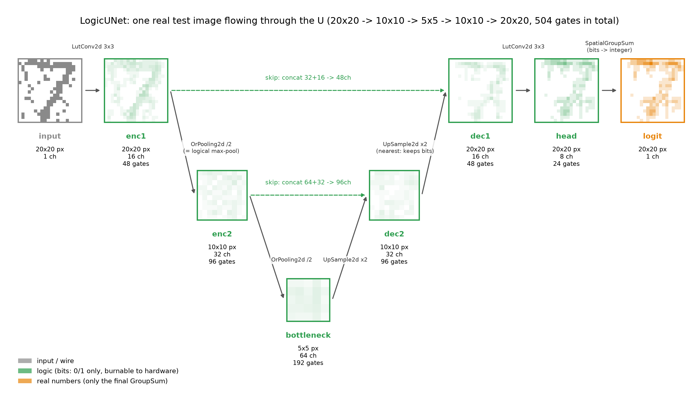
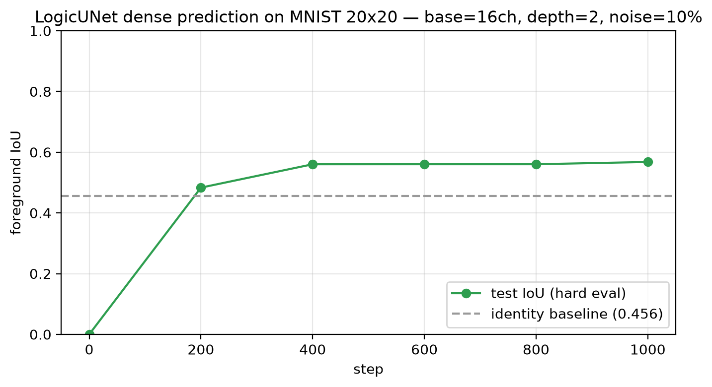
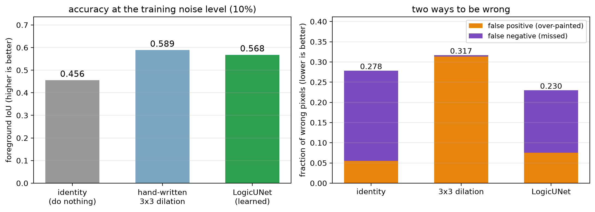
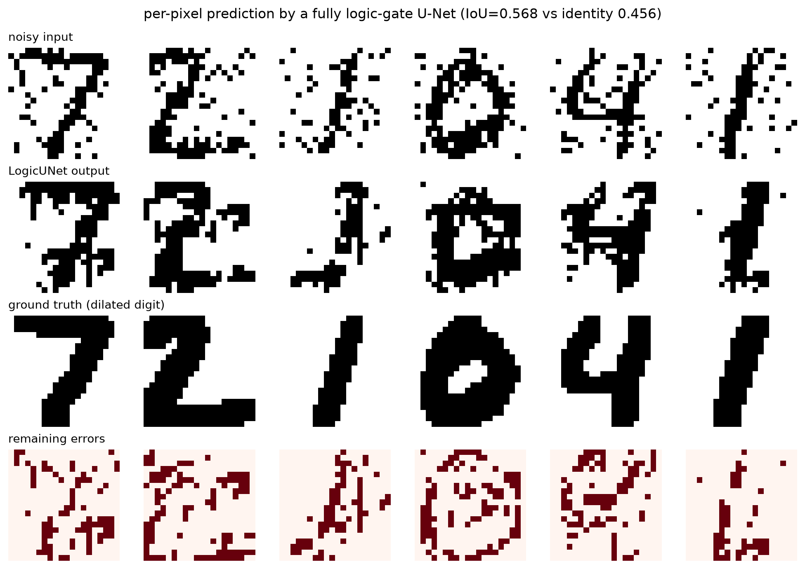
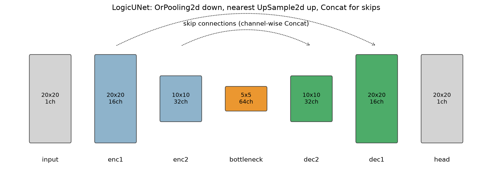

<!-- このファイルは scripts/build_tutorials.py が自動生成しています。
     直接編集せず、examples/13_logic_unet.py を編集して再生成してください。 -->

分類ではなく**画素ごとに答える**(密予測)を論理ゲートで行う。ノイズ入り MNIST から
数字の領域マスクを復元する U-Net を、OR プーリング + nearest アップサンプル +
Concat skip で組み、**ビットを壊さないまま**エンコーダ・デコーダを往復させる。

前景 IoU 0.568(恒等ベースライン 0.456)に到達し、eval 時の中間表現は厳密に
$\{0,1\}$ のまま。実数の U-Net で当たり前に使う補間や平均プーリングを、
論理回路で何に置き換えるのかがこのページの核心。

:::tip[このページで学ぶこと]
1. 分類ではなく**画素ごとに答える**(密予測)を論理ゲートで組む方法
2. 実数 U-Net の平均プーリング・補間を、OR プーリング・nearest へ置き換える理由
3. Concat skip を通してもビットが壊れず、中間表現が $\{0,1\}$ に閉じることの確認

**前提**

- [5. CNNをHDLへエクスポート](/tutorials/cnn-hdl-export/) — 論理ゲート畳み込みの基礎
- [1. MNISTを学習する](/tutorials/mnist/)
:::

:::note[このページについて]
所要時間の目安: **約6分** / 実行環境: CPU のみ(GPU 不要)
元スクリプト: [`examples/13_logic_unet.py`](https://github.com/tsukushi-gate/Griffith/blob/main/examples/13_logic_unet.py)
手元で試す: [`notebooks/13_logic_unet.ipynb`](https://github.com/tsukushi-gate/Griffith/blob/main/notebooks/13_logic_unet.ipynb)(このページと同じ内容の未実行ノートブック。`uv run --group docs jupyter lab notebooks/` で開ける)
コード出力はすべて **実際に実行した結果**をそのまま埋め込んでいます。
:::

<!-- Colabバッジ: リポジトリ public 化後、この span を data-colab-url を href に
     持つ <a> へ差し替えると「Colabで開く」が有効になる。 -->
<span class="colab-badge" data-colab-url="https://colab.research.google.com/github/tsukushi-gate/Griffith/blob/main/notebooks/13_logic_unet.ipynb">▶ Colabで開く(リポジトリ公開後に有効化)</span>

LogicUNet で MNIST の密予測(ノイズ除去つき領域セグメンテーション)を解く例。

06_mnist.py までは「画像1枚 → クラス1個」の分類だった。ここでは
**画素ごとに答えを出す密予測** を、全段が論理ゲートの U-Net で行う。

課題設定:

    入力   … 二値化MNISTの画素を10%の確率で反転させたノイズ画像
    正解   … ノイズのない数字マスクを3x3で1画素ぶん膨張させた「筆跡の領域マスク」
    評価   … 前景 IoU(intersection over union)

「ノイズを消す」だけでも「太らせる」だけでもなく、両方を同時にやらせるのがミソ。
入力をそのまま答えにする手抜き(=恒等写像)では IoU 0.46 程度にしかならないので、
回路が本当に近傍を見て推論しているかが数字で分かる。

## アーキテクチャ図解: U字に降りて、また昇る

下図はこのサンプルの設定(base_channels=16 / depth=2 / 入力 20x20)そのままの構造。
画像は左から入ってまず 20x20 → 10x10 → 5x5 と縮み、そこから 10x10 → 20x20 へ
戻ってくる。この「降りて昇る」形が U の字に見えるので U-Net と呼ぶ。
点線が **skip接続**(縮める前の細かい形を、戻ってきた側へ渡す近道)である。

```mermaid
flowchart LR
    IN["入力画像<br/>ノイズ付き二値マスク<br/>1ch · 20x20 ビット"]
    subgraph ENC["encoder(縮めながら広い範囲を見る)"]
        direction TB
        E1["enc1 · LutConv2d 3x3<br/>16ch · 20x20<br/>48ゲート"]
        P1["OrPooling2d ÷2<br/>16ch · 10x10"]
        E2["enc2 · LutConv2d 3x3<br/>32ch · 10x10<br/>96ゲート"]
        P2["OrPooling2d ÷2<br/>32ch · 5x5"]
        E1 --> P1 --> E2 --> P2
    end
    subgraph BOT["bottleneck(いちばん狭く、いちばん厚い)"]
        B["LutConv2d 3x3<br/>64ch · 5x5<br/>192ゲート"]
    end
    subgraph DEC["decoder(戻しながら細部を復元する)"]
        direction TB
        U2["UpSample2d ×2 nearest<br/>64ch · 10x10"]
        C2["Concat 64+32 = 96ch<br/>10x10"]
        D2["dec2 · LutConv2d 3x3<br/>32ch · 10x10<br/>96ゲート"]
        U1["UpSample2d ×2 nearest<br/>32ch · 20x20"]
        C1["Concat 32+16 = 48ch<br/>20x20"]
        D1["dec1 · LutConv2d 3x3<br/>16ch · 20x20<br/>48ゲート"]
        U2 --> C2 --> D2 --> U1 --> C1 --> D1
    end
    subgraph HEAD["head(ビットを数えて実数にする)"]
        direction TB
        H["head · LutConv2d 3x3<br/>8ch · 20x20<br/>24ゲート"]
        G["SpatialGroupSum<br/>画素ごとに8ビットを数える"]
        H --> G
    end
    OUT["出力<br/>画素ごとのロジット<br/>1ch · 20x20 実数"]
    IN --> E1
    P2 --> B
    B --> U2
    D1 --> H
    G --> OUT
    E1 -. "skip: 20x20 の16chをそのまま渡す" .-> C1
    E2 -. "skip: 10x10 の32chをそのまま渡す" .-> C2

    classDef logic fill:#10b98126,stroke:#10b981
    classDef real fill:#f9731626,stroke:#f97316
    classDef io fill:#38bdf826,stroke:#38bdf8
    class E1,P1,E2,P2,B,U2,C2,D2,U1,C1,D1,H logic
    class G real
    class IN,OUT io
```



緑の箱はすべて **0/1 のビットしか流れない**(=そのままFPGAに焼ける)世界で、
実数が現れるのは最後の橙の箱、SpatialGroupSum の足し算ただ1か所だけである。

## どう実現しているか(NNが初めての人向けの語彙で)

- **チャネル(ch)** … 同じ大きさの白黒画像を何枚重ねて持つか。ここでの1枚は
  「ある論理式の答えを画素ごとに書き出した 0/1 の紙」で、16ch なら紙が16枚ある。
  深いstageほどチャネルを倍にするのは、「位置の細かさを捨てる代わりに、
  種類の多さで補う」という交換をしているから。
- **LutConv2d(緑の箱)** … 実数CNNの畳み込みが「近所の画素に重みを掛けて足す」のに対し、
  こちらは近所 3x3 の中からビットを2本ずつ選び、**2入力の真理値表**(16通りのうちどれか)
  を学習して 1 ビットを出す。同じ配線・同じ真理値表を画像全体に滑らせる点だけが
  畳み込みと同じ。学習後はそのまま LUT としてハードウェアに焼ける。
- **プーリングが OR**(緑・`OrPooling2d`) … 実数CNNの max pool は「4つのうち最大」だが、
  0/1 の世界での最大とは「どれか1つでも1なら1」、つまり **OR そのもの**。
  だから OrPooling2d は max pool の厳密な論理版で、ビットをビットのまま半分に縮める。
- **アップサンプルは nearest 固定**(緑・`UpSample2d`) … 1画素を2x2にコピーして倍に戻す。
  bilinear(周囲を混ぜる方式)だと 0.5 のような中間値が生まれてビットでなくなるので使えない。
- **skip接続の合流は Concat**(緑・点線の行き先) … 実数U-Netは足し算で合流するが、
  ビット同士を足すと 2 になってしまう。そこでチャネル方向に**並べて**、
  次の LutConv2d に「縮める前の紙」と「戻ってきた紙」の両方を見せる。
- **SpatialGroupSum(橙の箱)** … 最後だけは判断の強さを表す実数が要る。
  head が出した8枚のビットを画素ごとに数え上げ(0〜8)、中央を引いて符号付きにする。
  この数字が大きいほど「ここは筆跡だ」と回路が確信している。

結果として、eval時の中間表現はすべて厳密に {0,1} のまま流れる(下で実際に確認する)。

図は5枚出る:

    図1 … アーキテクチャ図。学習済みの回路にテスト画像を1枚通し、
           各stageの実際の特徴マップを U 字に並べる(解像度が縮んで戻る様子)
    図2 … 学習曲線(test IoU)。恒等ベースラインをいつ追い越すか
    図3 … 「何もしない」「手書きの3x3膨張」との比較と、誤りの内訳。
           出しすぎと取りこぼしに割ると、各手法の失敗の仕方の違いが見える
    図4 … 入力/出力/正解/誤りの定性図。数字として目で確かめる
    図5 … 図1を数字だけの模式図にしたもの(解像度とチャネル幅の推移)

実行: uv run python examples/13_logic_unet.py
期待結果: 前景 IoU 0.57前後(恒等ベースライン 0.46 を明確に上回る / CPUで2〜3分)

## 準備: 密予測というタスクと道具立て

**密予測(dense prediction)** とは、画像1枚につき答えを1個返す分類とは違い、
**画素1つ1つに答えを返す**タスクのこと。ここでの答えは「この画素は筆跡の領域か否か」の
0/1 なので、出力もまた入力と同じ 20x20 の画像になる。

使うのは PyTorch と matplotlib、そして本ライブラリの `LogicUNet`(論理ゲートだけで
組んだ U-Net)と `load_mnist20x20`(20x20 に縮めた MNIST)だけである。

```python
import matplotlib.patches as mpatches
import matplotlib.pyplot as plt
import torch
import torch.nn as nn
import torch.nn.functional as F
from matplotlib.colors import LinearSegmentedColormap
from torch.utils.data import DataLoader, Subset

from griffith_logic.datasets import load_mnist20x20
from griffith_logic.models import LogicUNet, LogicUNetConfig
```

乱数種を固定する。各ゲートがどの論理関数寄りから学習を始めるかも、あとで入力に
散らすノイズの位置も乱数で決まるので、固定しないと実行ごとに結果が揺れる。

```python
torch.manual_seed(0)
```

### ハイパーパラメータ

`BASE_CHANNELS` は最も浅い段の論理チャネル幅、`DEPTH` は画像を半分に縮める段数、
`NOISE` は入力画素を反転させる確率。**CPU で1〜2分に収まる縮小レシピ**にしてあり、
これらと `STEPS` を増やすほど精度は上がる(フルレシピは
`experiments/train_logic_unet.py`)。

```python
BASE_CHANNELS = 16   # 最浅stageの論理チャネル幅(深いstageで倍化)
DEPTH = 2            # ダウン/アップサンプルの段数
NOISE = 0.10         # 画素反転ノイズ率
STEPS = 1000
BATCH = 32
N_TRAIN = 2048
N_TEST = 256
```

## データセット: ノイズ入力と膨張マスク

**二値マスク**(binary mask)とは、各画素が 0 か 1 しか取らない画像のこと。
`binarize_threshold=0.5` で MNIST を「数字=1 / 背景=0」の二値マスクに変換する。
論理ゲートNNの入力はビットでなければならないので、**この二値化は前処理ではなく必須要件**
である。28x28 版ではなく 20x20 版を使うのは、密予測が画素ごとに計算する分だけ重く、
面積が約半分になると学習が約2倍速くなるため。

```python
train_set, test_set = load_mnist20x20(binarize_threshold=0.5)
```

### 入力と正解を作る3つの道具

データ作りは小さな関数3つに分ける。`materialize` が二値マスクを取り出し、
`add_noise` が**入力**を汚し、`dilate` が**正解**を作る。

```python
def materialize(dataset, n):
    """先頭n件を (N, 1, 20, 20) の二値マスクにまとめる(クラスラベルは使わない)。"""
    x, _ = next(iter(DataLoader(Subset(dataset, range(n)), batch_size=n)))
    return x
```

ノイズは値を**足す**のではなく**反転させる**。ガウスノイズを足すと 0.3 のような中間値が
生まれてビットでなくなるからで、反転(mod 2 の足し算 = XOR)なら 0/1 のまま汚せる。
結果として背景には白い点が散り、筆跡には黒い穴が空く。1画素だけを見ていては
どちらがノイズか判別できないので、回路は必ず周囲の文脈を使う必要が出てくる。

```python
def add_noise(mask, seed):
    """各画素を確率NOISEで反転させる(mod 2 の足し算 = XOR)。

    ガウスノイズを足すのではなく反転させるのは、値をビットのまま保つため。
    背景には白い点が散り、筆跡には黒い穴が空く。近傍を見ずに1画素だけ見ていては
    どちらがノイズか判別できないので、回路は必ず周囲の文脈を使う必要がある。
    """
    g = torch.Generator().manual_seed(seed)
    flip = (torch.rand(mask.shape, generator=g) < NOISE).float()
    return (mask + flip) % 2
```

正解は「ノイズの無い数字マスク」そのものではなく、それを 3x3 で1画素ぶん太らせた
**膨張マスク**にする。こうすると課題が「入力をきれいに写す」から
「**近傍を見て領域を広げる**」に変わり、入力をそのまま出す手抜き解(恒等写像)が
最適でなくなる。膨張は近傍9画素の OR なので、二値では `max_pool2d` がそのまま OR になる。

```python
def dilate(mask):
    """3x3 の膨張(=近傍9画素のOR)。max_pool2d は二値ではORそのもの。

    正解をノイズ無しマスクそのものではなく「膨張させたもの」にすることで、
    課題が「入力をきれいに写す」から「近傍を見て領域を広げる」に変わる。
    このひと手間で、恒等写像という手抜き解が最適でなくなる。
    """
    return F.max_pool2d(mask, kernel_size=3, stride=1, padding=1)
```

道具がそろったので、訓練用とテスト用のそれぞれについて
「ノイズ入力」と「膨張正解」の組を作る。以下の出力で、正解マスクの前景率(画像の何割が
筆跡の領域か)と、ノイズで実際に壊れた画素の割合が確認できる。

```python
train_clean = materialize(train_set, N_TRAIN)
test_clean = materialize(test_set, N_TEST)
train_input, test_input = add_noise(train_clean, 1), add_noise(test_clean, 2)
train_target, test_target = dilate(train_clean), dilate(test_clean)

print(f'train={tuple(train_input.shape)} test={tuple(test_input.shape)} '
      f'noise={NOISE:.0%}')
print(f'正解マスクの前景率={test_target.mean().item():.3f} / '
      f'ノイズで壊れた画素={(test_input != test_clean).float().mean().item():.3f}')
```

```text title="出力"
train=(2048, 1, 20, 20) test=(256, 1, 20, 20) noise=10%
正解マスクの前景率=0.456 / ノイズで壊れた画素=0.101
```

## モデル定義: 論理ゲートだけで組んだ U-Net

`LogicUNet` は実数の U-Net と同じ「降りて昇る」骨格を持つが、**部品がすべて論理演算に
置き換わっている**。まず語彙を3つ決めておく。

- **受容野**(receptive field) … 出力1画素が「見ている」入力側の範囲。3x3 の畳み込みを
  重ねて画像を縮めるほど、1画素が見る範囲は実質的に広がる
- **LUT木** … `LutConv2d` は実数CNNのように受容野の画素へ重みを掛けて足すのではなく、
  受容野 3x3 の中からビットをランダムに選び、それを葉として **N入力LUT(ルックアップ
  テーブル=真理値表)の完全木**を組み、木の出力1ビットを出力チャネルの値とする。
  真理値表は全空間位置で共有される(これが畳み込みであることの意味)。`n_inputs=2` なら
  各ゲートは2入力=16種の真理値表のどれかを学ぶので、学習後そのまま FPGA に焼ける
- **ボトルネック**(bottleneck) … U の字のいちばん底、最も解像度が小さく最もチャネルが
  厚い段。ここでは 5x5 で 64ch になる

実数 U-Net の部品をそのまま使えない理由が、この例のいちばんの見どころである。

- **なぜ OR プーリングなのか** … 実数 U-Net の平均プーリングは 0.5 のような中間値を作り、
  ビットが壊れてしまう。0/1 の世界での「最大」とは「近傍にビットが1つでも立っていれば1」、
  つまり **OR そのもの**。`OrPooling2d` は max pool の厳密な論理版で、
  **{0,1} に閉じたまま**画像を半分に縮められる
- **なぜ nearest アップサンプルなのか** … 双線形補間(bilinear)は周囲を混ぜて中間値を作る
  ので使えない。nearest は 1 画素を 2x2 に**複製する**だけなのでビットが壊れない
- **なぜ Concat skip なのか** … **skip接続**とは、縮める前の細かい形を、戻ってきた側へ
  渡す近道のこと。実数 U-Net はこれを加算で合流させるが、ビット同士を足すと 1+1=2 に
  なってしまう。連結(Concat)ならビットはビットのまま**チャネル方向に横に並ぶだけ**で、
  次の `LutConv2d` に「縮める前の紙」と「戻ってきた紙」の両方を見せられる

```python
config = LogicUNetConfig(
    in_channels=1,
    base_channels=BASE_CHANNELS,
    depth=DEPTH,
    n_inputs=2,       # 1ゲートが見るビット数(=学習される真理値表の大きさ)
    out_channels=1,   # 前景/背景の1チャネル(BCEWithLogitsで学習)
    use_skip=True,    # skipを切ると細部が戻らなくなる(アブレーション用フラグ)
)
model = LogicUNet(config)
```

### 解像度とチャネル幅の推移

組み上がった回路が実際にどう縮んで戻るかを数字で出しておく。20 → 10 → 5 → 10 → 20 と
往復するこの形が U の字に見えるので U-Net と呼ぶ。深い段ほどチャネルを倍にするのは、
**位置の細かさを捨てる代わりに、種類の多さで補う**という交換をしているから。

```python
# 解像度がどう縮んで戻るかを表示する(U-Netの"U"の字)。
sizes = [20]
for _ in range(DEPTH):
    sizes.append(sizes[-1] // 2)
print(f'\nencoder解像度: {" -> ".join(str(s) for s in sizes)} (OrPooling2d x{DEPTH})')
print(f'decoder解像度: {" -> ".join(str(s) for s in reversed(sizes))} '
      f'(UpSample2d x{DEPTH} + skip Concat)')
print(f'チャネル幅: {[BASE_CHANNELS * 2 ** i for i in range(DEPTH + 1)]}')
```

    
```text title="出力"
encoder解像度: 20 -> 10 -> 5 (OrPooling2d x2)
decoder解像度: 5 -> 10 -> 20 (UpSample2d x2 + skip Concat)
チャネル幅: [16, 32, 64]
```

## 学習: 損失・指標・2つのベースライン

密予測なので、損失は画像1枚につき1個ではなく**画素ごと**に計算する。前景か背景かの
2択なので `BCEWithLogitsLoss`(ロジットを受け取る二値交差エントロピー)を使い、
20x20=400 画素ぶんの損失の平均を最小化する。

```python
opt = torch.optim.Adam(model.parameters(), lr=0.1)
loss_fn = nn.BCEWithLogitsLoss()
```

### 指標: 前景 IoU

**IoU**(Intersection over Union、日本語では「重なり率」)は密予測の定番指標で、
**IoU = 予測と正解が両方とも前景だった画素数 / どちらか一方でも前景だった画素数**。
正解率(accuracy)と違い、背景が広い画像で「全部背景」と答えても 0 のままなので、
手抜き解を見逃さない。1.0 が完全一致である。

```python
def foreground_iou(logits, target, threshold=0.0):
    """前景(ロジット>threshold)の IoU。密予測の定番指標。

    IoU = 重なった画素数 / どちらかが前景だった画素数。正解率と違い、
    背景が広い画像で「全部背景」と答えても稼げないのが利点。
    """
    pred = (logits > threshold).float()
    inter = (pred * target).sum()
    union = ((pred + target) > 0).float().sum()
    return (inter / union.clamp(min=1)).item()
```

### 2つのベースライン

「学習した回路がベースラインを超えた」だけでは何を学んだのか分からないので、課題を
2つの成分に分け、それぞれを固定の演算で解いた場合の IoU を先に測っておく。

- **恒等** … ノイズ入力をそのまま出す。ノイズ除去も膨張もしない**下限**
- **手書き膨張** … ノイズ入力に 3x3 の OR(=正解の作り方と同じ操作)を掛ける。
  膨張はできるが、ノイズ点まで一緒に太らせてしまう

後者は「正解の作り方そのもの」を人手で与えた極めて強い比較対象で、ノイズが無ければ
IoU 1.0 になる反則気味の相手である。この縮小レシピの回路はここと互角どまりだが、
**失敗の仕方が別物になる**(あとで図3の右に分解して見る)。

```python
baseline_iou = foreground_iou(test_input * 2 - 1, test_target)
dilate_iou = foreground_iou(dilate(test_input) * 2 - 1, test_target)
print(f'\n恒等ベースライン(入力をそのまま出す)  の IoU = {baseline_iou:.4f}')
print(f'手書き膨張ベースライン(3x3のORを掛ける)の IoU = {dilate_iou:.4f}')

history = []
```

    
```text title="出力"
恒等ベースライン(入力をそのまま出す)  の IoU = 0.4556
手書き膨張ベースライン(3x3のORを掛ける)の IoU = 0.5887
```

### 学習ループ

学習は **soft eval**、評価は **hard eval** で行う。soft とは `train()` モードのことで、
各ゲートが16種の論理関数の連続的な混合のまま動く状態(勾配が流れる代わりに、まだ回路では
ない)。hard とは `eval()` モード、つまり **argmax で各ゲートを1つの論理関数に確定させた、
実際に焼けるのと同じ純粋な Boolean 回路**である。

分類と違って密予測は画素ごとに判定するので、離散化で少しでも崩れれば IoU に即座に出る。
200 ステップおきに hard eval で測り、この2つが乖離しないことを確かめながら進める。

```python
for step in range(STEPS + 1):
    if step % 200 == 0:
        model.eval()  # eval = 焼いた論理回路の姿
        with torch.no_grad():
            iou = foreground_iou(model(test_input), test_target)
        model.train()
        history.append((step, iou))
        print(f'step {step:>4}  test IoU={iou:.4f}')

    idx = torch.randint(0, N_TRAIN, (BATCH,))
    opt.zero_grad()
    loss = loss_fn(model(train_input[idx]), train_target[idx])
    loss.backward()
    opt.step()

steps, ious = zip(*history, strict=True)
final_iou = ious[-1]
print(f'\n最終 test IoU={final_iou:.4f}(恒等={baseline_iou:.4f} / 手書き膨張={dilate_iou:.4f})')
assert final_iou > baseline_iou, 'ノイズ入力をそのまま出すより悪い'
```

```text title="出力"
step    0  test IoU=0.0000

step  200  test IoU=0.4833

step  400  test IoU=0.5603

step  600  test IoU=0.5604

step  800  test IoU=0.5604

step 1000  test IoU=0.5678

最終 test IoU=0.5678(恒等=0.4556 / 手書き膨張=0.5887)
```

## 評価: 誤りの内訳と、ビットが壊れていないことの確認

### 誤りを2種類に割る

IoU は1つの数字なので、3者の差がどこから来るのかまでは教えてくれない。誤りを2種類に
割ると、それぞれの手法の「失敗の仕方」がはっきりする。

- **false positive(FP、偽陽性)** … 背景なのに前景と答えた画素(= 前景を**出しすぎ**)
- **false negative(FN、偽陰性)** … 前景なのに背景と答えた画素(= 前景の**取りこぼし**)

予想としては、恒等は膨張しないぶん取りこぼし(FN)が多く、手書き膨張はノイズ点まで
3x3 の塊に太らせるぶん出しすぎ(FP)が多いはず。学習した回路がその両方を同時に
抑えられていれば、**固定の演算では書けない処理**を獲得したことになる。

```python
model.eval()
with torch.no_grad():
    model_pred = (model(test_input) > 0).float()
predictions = [('identity', test_input),
               ('3x3 dilation', dilate(test_input)),
               ('LogicUNet', model_pred)]
errors = []
for name, pred in predictions:
    fp = ((pred == 1) & (test_target == 0)).float().mean().item()
    fn = ((pred == 0) & (test_target == 1)).float().mean().item()
    errors.append((name, fp, fn))

print('\n誤り画素の内訳(全画素に対する割合):')
for name, fp, fn in errors:
    print(f'  {name:<14} 出しすぎ FP={fp:.3f} / 取りこぼし FN={fn:.3f} '
          f'/ 合計={fp + fn:.3f}')
```

    
```text title="出力"
誤り画素の内訳(全画素に対する割合):
  identity       出しすぎ FP=0.055 / 取りこぼし FN=0.223 / 合計=0.278
  3x3 dilation   出しすぎ FP=0.314 / 取りこぼし FN=0.003 / 合計=0.317
  LogicUNet      出しすぎ FP=0.076 / 取りこぼし FN=0.154 / 合計=0.230
```

### 中間表現が {0,1} を保つことの確認

「全段が論理ゲート」という主張は、口で言うだけでなく**実行時に確かめられる**。
hard eval のまま encoder を1段ずつ流し、各段の出力が厳密に 0 か 1 だけであることを
`assert` で検査する。OrPooling(= max)も UpSample(nearest)も Concat もビットを
壊さない設計なので、ここを通れば「FPGA に焼いたときと同じ値」が流れている証拠になる。

```python
model.eval()
with torch.no_grad():
    h = test_input[:8]
    for conv in model.enc_convs:
        h = conv(h)
        assert torch.all((h == 0) | (h == 1)), 'encoderの中間表現がビットでない'
        h = model.pool(h)
        assert torch.all((h == 0) | (h == 1)), 'OrPooling後がビットでない'
print('eval時のencoder中間表現・OrPooling出力はすべて厳密に {0,1}: OK')
```

```text title="出力"
eval時のencoder中間表現・OrPooling出力はすべて厳密に {0,1}: OK
```

## 可視化: 学習した回路の中を見る

### 図1の材料: 各stageの特徴マップを捕まえる

ここからは図を5枚出す。まず1枚目のために、学習済みの回路にテスト画像を1枚通し、
各段(stage)の途中経過を取り出しておく。`forward` を段ごとに手で辿り直しているだけで、
モデル本体と同じ順序・同じ部品を呼んでいる。各段はチャネルが複数枚あるので、表示は
チャネル方向の平均(= その位置で 1 を出している「紙」の割合)にする。

```python
# forward を段ごとに手で辿り直すことで、途中の中身をそのまま取り出せる
# (logic_unet.py の forward と同じ順序・同じ部品を呼んでいるだけ)。
# 各stageのチャネルは複数枚あるので、表示はチャネル方向の平均(=その位置で
# 「1」を出している紙の割合)にする。0に近いほど白、1に近いほど濃い。
LOGIC_GREEN = '#2e9e4f'   # 論理(ビットだけが流れる部分)
REAL_ORANGE = '#e8850c'   # 実数(SpatialGroupSum 以降)
WIRE_GRAY = '#8a8a8a'     # 入力・配線
STAGE_CMAPS = {
    'input': LinearSegmentedColormap.from_list('i', ['#ffffff', WIRE_GRAY]),
    'logic': LinearSegmentedColormap.from_list('l', ['#ffffff', LOGIC_GREEN]),
    'real': LinearSegmentedColormap.from_list('r', ['#ffffff', REAL_ORANGE]),
}
STAGE_EDGE = {'input': WIRE_GRAY, 'logic': LOGIC_GREEN, 'real': REAL_ORANGE}

model.eval()
stages = []  # (表示名, その段のテンソル, ゲート数, 種別)
with torch.no_grad():
    probe = test_input[0:1]
    h = probe
    stages.append(('input', h, 0, 'input'))
    probe_skips = []
    for i, conv in enumerate(model.enc_convs):
        h = conv(h)
        probe_skips.append(h)
        stages.append((f'enc{i + 1}', h, conv.num_gates, 'logic'))
        h = model.pool(h)
    h = model.bottleneck(h)
    stages.append(('bottleneck', h, model.bottleneck.num_gates, 'logic'))
    for i, conv in enumerate(model.dec_convs):
        skip = probe_skips[DEPTH - 1 - i]
        h = model.up(h)
        assert h.shape[-2:] == skip.shape[-2:], '偶数解像度なら寸法合わせは不要'
        h = conv(torch.cat([h, skip], dim=1))
        stages.append((f'dec{DEPTH - i}', h, conv.num_gates, 'logic'))
    head_bits = model.head_conv(h)
    assert torch.all((head_bits == 0) | (head_bits == 1)), 'head直前がビットでない'
    stages.append(('head', head_bits, model.head_conv.num_gates, 'logic'))
    stages.append(('logit', model(probe), 0, 'real'))
```

```python
# 各stageの描画情報を先に決める。行(縦位置)は解像度で決まり、20x20が上段、
# 5x5(ボトルネック)が下段。これで箱の並びがそのまま "U" の字になる。
FIG_W, FIG_H = 13.5, 7.6
ROW_Y = {20: 0.78, 10: 0.51, 5: 0.24}
boxes = []  # (中心x, 中心y, 箱幅, 箱高さ, 表示名, 特徴マップ, 解像度, ch, ゲート数, 種別)
for i, (name, tensor, gates, kind) in enumerate(stages):
    res, ch = tensor.shape[-1], tensor.shape[1]
    bw = 0.052 + 0.040 * (res / 20)          # 解像度が小さい箱は物理的にも小さく描く
    bh = bw * FIG_W / FIG_H
    fmap = tensor[0].mean(dim=0).numpy()
    boxes.append((0.065 + i * 0.125, ROW_Y[res], bw, bh, name, fmap,
                  res, ch, gates, kind))
```

```python
# stage間の矢印につける操作名。図の中の文字は英字のみ(日本語グリフが無いため)。
# (文字列, 矢印上の位置0-1, 横ずらし, 縦ずらし)。ずらし量は箱や注記と重ならない実測値。
ARROW_OPS = [('LutConv2d 3x3', 0.5, 0.0, 0.112),
             ('OrPooling2d /2\n(= logical max-pool)', 0.55, 0.04, 0.0),
             ('OrPooling2d /2', 0.62, 0.03, 0.0),
             ('UpSample2d x2', 0.38, 0.0, 0.0),
             ('UpSample2d x2\n(nearest: keeps bits)', 0.45, -0.04, 0.0),
             ('LutConv2d 3x3', 0.5, 0.0, 0.112),
             ('SpatialGroupSum\n(bits -> integer)', 0.5, 0.0, 0.112)]
SKIP_LINKS = [(1, 5, 'skip: concat 32+16 -> 48ch'),
              (2, 4, 'skip: concat 64+32 -> 96ch')]
```

### 図1: 実データが流れているアーキテクチャ図

**何を見る図か**: 学習済みの回路にテスト画像を1枚通したときの、各段の中身そのもの。
模式図ではなく**本物の信号**である。上段が 20x20、中段が 10x10、下段が 5x5 で、左から
降りてボトルネックを通り、右へ昇って元の解像度に戻る。箱の色は緑=論理(ビットだけが
流れる)、橙=実数(最後の `SpatialGroupSum` 以降)、灰=入力。破線の水平矢印が
skip接続で、縮める前の特徴マップを decoder 側の Concat へ直接渡している。

```python
# 上段が 20x20、中段が 10x10、下段が 5x5。左から降りて底(bottleneck)を通り、
# 右へ昇って元の解像度に戻る。各パネルは学習済み回路に実際のテスト画像を1枚
# 通したときの中身(チャネル平均)で、模式図ではなく本物の信号である。
# 破線の水平矢印が skip接続で、縮める前の特徴マップを decoder 側の Concat へ直接渡す。
fig = plt.figure(figsize=(FIG_W, FIG_H))
ax_bg = fig.add_axes((0.0, 0.0, 1.0, 1.0))
ax_bg.set_xlim(0, 1)
ax_bg.set_ylim(0, 1)
ax_bg.set_axis_off()
ax_bg.patch.set_alpha(0.0)
for cx, cy, bw, bh, name, fmap, res, ch, gates, kind in boxes:
    axp = fig.add_axes((cx - bw / 2, cy - bh / 2, bw, bh))
    vmin = 0.0 if kind != 'real' else float(fmap.min())
    vmax = 1.0 if kind != 'real' else float(fmap.max())
    axp.imshow(fmap, cmap=STAGE_CMAPS[kind], vmin=vmin, vmax=vmax,
               interpolation='nearest')
    axp.set_xticks([])
    axp.set_yticks([])
    for spine in axp.spines.values():
        spine.set_edgecolor(STAGE_EDGE[kind])
        spine.set_linewidth(1.8)
    ax_bg.text(cx, cy - bh / 2 - 0.028, name, ha='center', va='top',
               fontsize=10.5, fontweight='bold', color=STAGE_EDGE[kind])
    detail = f'{res}x{res} px\n{ch} ch'
    if gates:
        detail += f'\n{gates} gates'
    ax_bg.text(cx, cy - bh / 2 - 0.062, detail, ha='center', va='top', fontsize=8.5)
for i, (op, t, dx, dy) in enumerate(ARROW_OPS):
    ax0, ay, aw = boxes[i][0], boxes[i][1], boxes[i][2]
    bx, by, bw2 = boxes[i + 1][0], boxes[i + 1][1], boxes[i + 1][2]
    start = (ax0 + aw / 2 + 0.004, ay)
    end = (bx - bw2 / 2 - 0.004, by)
    ax_bg.annotate('', xy=end, xytext=start,
                   arrowprops={'arrowstyle': '-|>', 'color': '#555555', 'lw': 1.4})
    mx = start[0] + (end[0] - start[0]) * t + dx
    my = start[1] + (end[1] - start[1]) * t + dy
    ax_bg.text(mx, my, op, ha='center', va='center', fontsize=8, color='#333333',
               bbox={'facecolor': 'white', 'alpha': 0.85, 'edgecolor': 'none',
                     'pad': 1.5})
for src, dst, label in SKIP_LINKS:
    sx, sy, sw = boxes[src][0], boxes[src][1], boxes[src][2]
    dx, dw = boxes[dst][0], boxes[dst][2]
    ax_bg.annotate('', xy=(dx - dw / 2 - 0.004, sy), xytext=(sx + sw / 2 + 0.004, sy),
                   arrowprops={'arrowstyle': '-|>', 'ls': '--', 'color': LOGIC_GREEN,
                               'lw': 1.3})
    ax_bg.text((sx + dx) / 2, sy + 0.024, label, ha='center', va='bottom',
               fontsize=8.5, color=LOGIC_GREEN,
               bbox={'facecolor': 'white', 'alpha': 0.85, 'edgecolor': 'none',
                     'pad': 1.5})
ax_bg.legend(handles=[
    mpatches.Patch(facecolor=WIRE_GRAY, alpha=0.7, label='input / wire'),
    mpatches.Patch(facecolor=LOGIC_GREEN, alpha=0.7,
                   label='logic (bits: 0/1 only, burnable to hardware)'),
    mpatches.Patch(facecolor=REAL_ORANGE, alpha=0.7,
                   label='real numbers (only the final GroupSum)'),
], loc='lower left', bbox_to_anchor=(0.01, 0.005), frameon=False, fontsize=9.5)
fig.suptitle('LogicUNet: one real test image flowing through the U '
             f'(20x20 -> 10x10 -> 5x5 -> 10x10 -> 20x20, {sum(b[8] for b in boxes)} '
             'gates in total)', fontsize=13, y=0.97)
plt.show()
```

    

    

**読み取り**: 左端の入力にあった孤立ノイズが、enc1・enc2 と進むにつれて消え、
数字の形だけが残っていく。ボトルネック(5x5)ではもはや筆跡の細部は失われ、
「どのあたりに文字があるか」だけが残る。それでも右側で 20x20 の輪郭が戻ってくるのは、
破線の skip接続が縮める前の細かい形を渡しているからである。橙の `logit` だけが実数で、
**緑の箱を流れた値はすべて厳密に 0/1** だった(直前の assert で確認済み)。

### 図2: 学習曲線(IoU)

**何を見る図か**: hard eval(= 焼ける回路の姿)で測った test IoU が、学習ステップに
つれてどう上がるか。灰色の破線が「何もしない(恒等)」の下限で、**この線を追い越した
時点で初めて「近傍を見た推論」が成立した**ことになる。

```python
# 破線が「何もしない」下限。step 0 では初期化された乱数回路なのでほぼゼロから始まり、
# 破線を追い越した時点で初めて「近傍を見た推論」が成立したことになる。
fig, ax = plt.subplots(figsize=(7, 4))
ax.plot(steps, ious, 'o-', color='#2e9e4f', label='test IoU (hard eval)')
ax.axhline(baseline_iou, color='#999999', ls='--',
           label=f'identity baseline ({baseline_iou:.3f})')
ax.set_xlabel('step')
ax.set_ylabel('foreground IoU')
ax.set_ylim(0, 1)
ax.grid(alpha=0.3)
ax.legend(loc='lower right')
ax.set_title(f'LogicUNet dense prediction on MNIST 20x20 — '
             f'base={BASE_CHANNELS}ch, depth={DEPTH}, noise={NOISE:.0%}')
fig.tight_layout()
plt.show()
```

    

    

**読み取り**: step 0 の初期回路は乱数なので IoU はほぼゼロから始まり、数百ステップで
破線を追い越して 0.57 前後で頭打ちになる。**これは soft ではなく hard eval の曲線**
である点が重要で、連続緩和で学習した結果が離散化後もそのまま残っていることを意味する。

### 図3: ベースライン比較と誤りの内訳

**何を見る図か**: 左は3者(恒等 / 手書き膨張 / 学習した回路)の IoU 比較、右はその差の
中身を FP(出しすぎ)と FN(取りこぼし)に分解した積み上げ棒。棒が低いほど良い。

```python
# 左: IoU の3者比較。回路は「何もしない」を大きく上回る。手書き膨張は
#     正解の作り方そのものを人手で与えた強い比較対象で、この縮小レシピでは互角。
# 右: その差の中身。棒を出しすぎ(FP)と取りこぼし(FN)に割ると、恒等は取りこぼし型、
#     手書き膨張は出しすぎ型と、失敗の仕方が正反対なのが見える。
#     学習した回路はどちらにも偏らない位置に立っている。
comparison = [('identity\n(do nothing)', baseline_iou, '#999999'),
              ('hand-written\n3x3 dilation', dilate_iou, '#7aa6c2'),
              ('LogicUNet\n(learned)', final_iou, '#2e9e4f')]
fig, (ax_bar, ax_err) = plt.subplots(1, 2, figsize=(11, 4))
for i, (name, value, color) in enumerate(comparison):
    ax_bar.bar(i, value, width=0.6, color=color)
    ax_bar.text(i, value + 0.015, f'{value:.3f}', ha='center', fontsize=11)
ax_bar.set_xticks(range(len(comparison)))
ax_bar.set_xticklabels([c[0] for c in comparison])
ax_bar.set_ylim(0, max(c[1] for c in comparison) * 1.25)
ax_bar.set_ylabel('foreground IoU (higher is better)')
ax_bar.grid(alpha=0.3, axis='y')
ax_bar.set_title(f'accuracy at the training noise level ({NOISE:.0%})')
ax_err.bar(range(len(errors)), [e[1] for e in errors], width=0.6,
           color='#e8850c', label='false positive (over-painted)')
ax_err.bar(range(len(errors)), [e[2] for e in errors], width=0.6,
           bottom=[e[1] for e in errors],
           color='#7a4bbf', label='false negative (missed)')
for i, (name, fp, fn) in enumerate(errors):
    ax_err.text(i, fp + fn + 0.004, f'{fp + fn:.3f}', ha='center', fontsize=10)
ax_err.set_xticks(range(len(errors)))
ax_err.set_xticklabels([e[0] for e in errors])
ax_err.set_ylim(0, max(e[1] + e[2] for e in errors) * 1.3)
ax_err.set_ylabel('fraction of wrong pixels (lower is better)')
ax_err.grid(alpha=0.3, axis='y')
ax_err.legend(loc='upper right', fontsize=9)
ax_err.set_title('two ways to be wrong')
fig.tight_layout()
plt.show()
```

    

    

**読み取り**: 左の棒グラフでは、学習した回路が「何もしない」を大きく上回り、正解の
作り方そのものを人手で与えた手書き膨張とほぼ互角になる。しかし右を見ると**失敗の仕方が
正反対**なのが分かる。恒等は膨張しないので取りこぼし(FN・紫)に偏り、手書き膨張は
ノイズ点まで太らせるので出しすぎ(FP・橙)に偏る。学習した回路だけが**どちらにも
偏らない位置**に立っており、これが固定の演算では書けない処理を得たことの証拠になる。

### 図4: 入力・出力・正解の並び

**何を見る図か**: 数字として目で確かめる定性図。上から「ノイズ入力 / 回路の出力 /
正解マスク / 残った誤り」の4行を、テスト画像6枚ぶん並べる。**4行目(赤)が黒いほど良い**。

```python
# 上から「ノイズ入力 / 回路の出力 / 正解マスク / 残った誤り」。
# 4行目が黒いほど良い。孤立ノイズが消え、筆跡が太い領域として塗られていれば成功。
# 誤りは輪郭に沿って薄く残りやすい(膨張の境界1画素ぶんの判断が難しいため)。
# 逆に背景の真ん中に赤い点が散っていたら、ノイズ除去が効いていない。
model.eval()
with torch.no_grad():
    pred_mask = (model(test_input[:6]) > 0).float()

rows = [
    ('noisy input', test_input[:6], 'gray_r'),
    ('LogicUNet output', pred_mask, 'gray_r'),
    ('ground truth (dilated digit)', test_target[:6], 'gray_r'),
    ('remaining errors', (pred_mask != test_target[:6]).float(), 'Reds'),
]
fig, axes = plt.subplots(len(rows), 6, figsize=(10, 7))
for r, (name, imgs, cmap) in enumerate(rows):
    for c in range(6):
        axes[r, c].imshow(imgs[c, 0], cmap=cmap, vmin=0, vmax=1)
        axes[r, c].set_axis_off()
    axes[r, 0].set_title(name, fontsize=10, loc='left')
fig.suptitle(f'per-pixel prediction by a fully logic-gate U-Net '
             f'(IoU={final_iou:.3f} vs identity {baseline_iou:.3f})', fontsize=12)
fig.tight_layout()
plt.show()
```

    

    

**読み取り**: 1行目に散っていた孤立ノイズが2行目では消え、筆跡が3行目の正解と同じ
太い領域として塗られていれば成功である。4行目の誤りは**輪郭に沿って薄く残りやすい**
── 膨張の境界1画素ぶんは、そもそも判断が難しいため。逆に背景の真ん中に赤い点が
散っているとしたら、それはノイズ除去が効いていないサインになる。

## アーキテクチャ図解: U 字の形と skip 接続

### 図5: 解像度とチャネル幅の推移(数字だけの模式図)

**何を見る図か**: 最後に、図1から実データを取り払って骨格だけにした模式図で全体を
おさらいする。箱の高さが特徴マップの解像度、箱の中の数字が解像度とチャネル幅で、
点線が skip接続である。

**読みどころ**は2つ。1つは、**縮むほど箱が低くなり、代わりにチャネル数が倍々に増える**
こと ── 「広い範囲を見る代わりに位置の細かさを捨て、その分を表現の幅で補う」という
U-Net の定石そのものである。もう1つは、縮小の過程で失った位置情報は二度と戻らないため、
**同じ解像度の encoder 出力を decoder へ点線で渡して輪郭の細部を復元している**こと。
実数 U-Net との唯一にして決定的な違いは、この合流が加算ではなく Concat であることだ
(ビットは足せない)。

```python
# 箱の高さ=特徴マップの解像度、箱の中の数字=解像度とチャネル幅。
# 縮小するほどチャネル(=論理線の本数)を倍にするのがU-Netの定石で、
# 「広い範囲を見る代わりに位置の細かさを捨て、その分だけ表現の幅で補う」という交換。
# ただし縮小の過程で失った位置情報は戻らないので、skip接続(点線)で
# 同じ解像度のencoder出力をdecoderへConcatし、輪郭の細部を復元する。
# 実数U-Netとの違いは、この合流が加算ではなくConcatであること(ビットを足せない)。
stage_h = [('input', 20, 1)]
stage_h += [(f'enc{i + 1}', 20 // 2 ** i, BASE_CHANNELS * 2 ** i) for i in range(DEPTH)]
stage_h += [('bottleneck', 20 // 2 ** DEPTH, BASE_CHANNELS * 2 ** DEPTH)]
stage_h += [(f'dec{i + 1}', 20 // 2 ** i, BASE_CHANNELS * 2 ** i)
            for i in reversed(range(DEPTH))]
stage_h += [('head', 20, 1)]
skip_pairs = [(1 + i, len(stage_h) - 2 - i) for i in range(DEPTH)]
colors = {'input': '#cccccc', 'head': '#cccccc', 'bottleneck': '#e8850c'}

fig, ax = plt.subplots(figsize=(11, 4.2))
for x, (name, res, ch) in enumerate(stage_h):
    height = res / 20
    color = colors.get(name, '#7aa6c2' if name.startswith('enc') else '#2e9e4f')
    ax.add_patch(mpatches.FancyBboxPatch(
        (x - 0.3, -height / 2), 0.6, height, boxstyle='round,pad=0.02',
        facecolor=color, edgecolor='#333', alpha=0.85))
    ax.text(x, 0, f'{res}x{res}\n{ch}ch', ha='center', va='center', fontsize=9)
    ax.text(x, -0.72, name, ha='center', va='center', fontsize=10)
for src, dst in skip_pairs:
    ax.annotate('', xy=(dst, 0.62), xytext=(src, 0.62),
                arrowprops={'arrowstyle': '->', 'ls': ':', 'color': '#444',
                            'connectionstyle': 'arc3,rad=-0.25'})
ax.text((1 + len(stage_h) - 2) / 2, 0.86, 'skip connections (channel-wise Concat)',
        ha='center', fontsize=10)
ax.set_xlim(-0.7, len(stage_h) - 0.3)
ax.set_ylim(-0.95, 1.0)
ax.set_axis_off()
ax.set_title('LogicUNet: OrPooling2d down, nearest UpSample2d up, Concat for skips')
fig.tight_layout()
plt.show()
```

    


## 次に読む

- [乗算器ゼロの物体検出](/tutorials/detection/) — 密予測ヘッドをそのまま検出へ使う
- [論理NNの残差接続](/tutorials/logic-resnet/) — skip接続の厳密な性質
- [5. CNNをHDLへエクスポート](/tutorials/cnn-hdl-export/)
