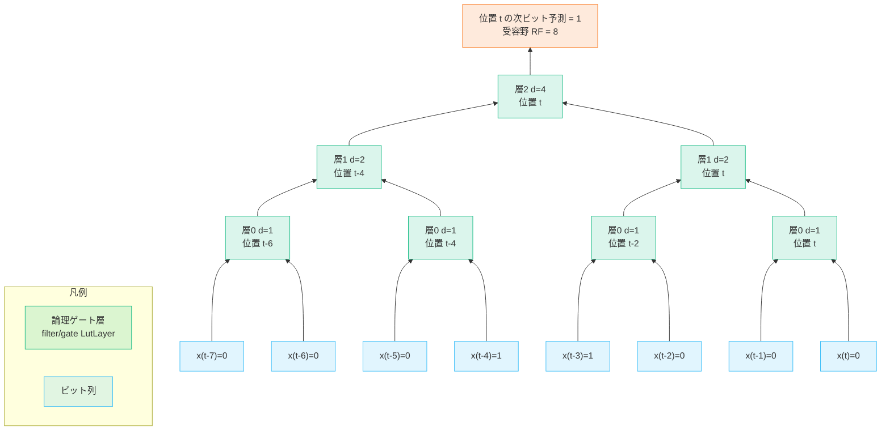
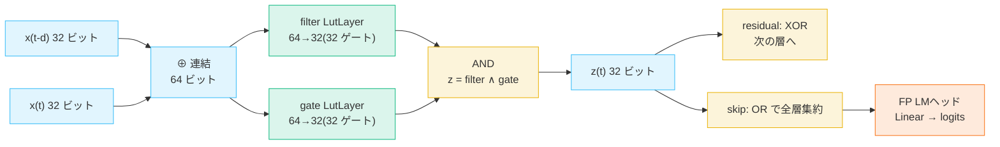
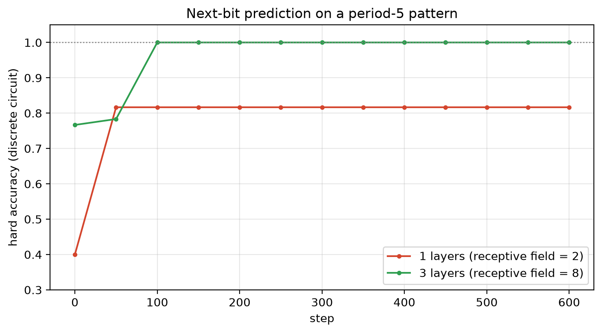
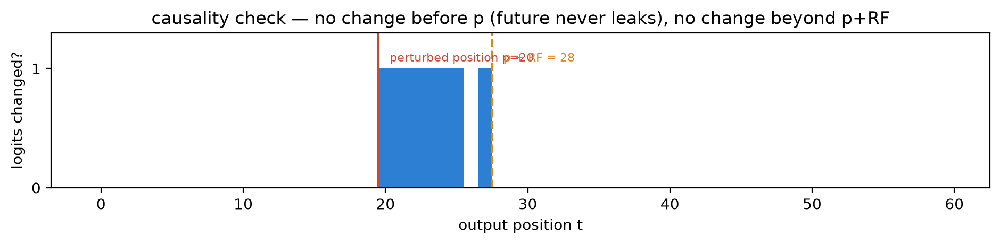
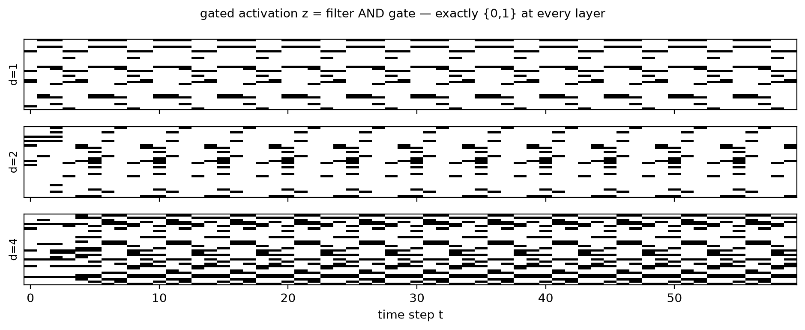

<!-- このファイルは scripts/build_tutorials.py が自動生成しています。
     直接編集せず、examples/10_logic_wavenet.py を編集して再生成してください。 -->

WaveNet のゲート付き活性 $z = \tanh(\cdot) \odot \sigma(\cdot)$ は、
$\{0,1\}$ 上では **ビット AND と同型**になる。この事実を使って因果 convolution を
論理ゲートで組み、周期ビットパターンの次トークン予測で**受容野の効き方**を ablation する。

1層(受容野 RF=2)では直前1ビットからは決まらず 0.817 で頭打ち、3層(RF=8)で 1.000。
さらに位置 $p$ の入力を反転して「変化した出力が $[p, p+RF)$ だけである」ことを実測し、
因果性が回路レベルで保たれていることを確かめる。

:::tip[このページで学ぶこと]
1. ゲート付き活性 $\tanh \odot \sigma$ が $\{0,1\}$ 上でビット AND と同型になること
2. 受容野(RF)を層数で伸ばす ablation の読み方(RF=2 で 0.817 → RF=8 で 1.000)
3. 入力を1ビット反転して、因果性が回路レベルで保たれていることを実測する方法

**前提**

- [RNN: LSTM / GRU の論理化](/tutorials/logic-lstm/) — 再帰で履歴を持つ場合
- [5. CNNをHDLへエクスポート](/tutorials/cnn-hdl-export/) — 論理ゲート畳み込みの基礎
:::

:::note[このページについて]
所要時間の目安: **約5分** / 実行環境: CPU のみ(GPU 不要)
元スクリプト: [`examples/10_logic_wavenet.py`](https://github.com/tsukushi-gate/Griffith/blob/main/examples/10_logic_wavenet.py)
手元で試す: [`notebooks/10_logic_wavenet.ipynb`](https://github.com/tsukushi-gate/Griffith/blob/main/notebooks/10_logic_wavenet.ipynb)(このページと同じ内容の未実行ノートブック。`uv run --group docs jupyter lab notebooks/` で開ける)
コード出力はすべて **実際に実行した結果**をそのまま埋め込んでいます。
:::

<!-- Colabバッジ: リポジトリ public 化後、この span を data-colab-url を href に
     持つ <a> へ差し替えると「Colabで開く」が有効になる。 -->
<span class="colab-badge" data-colab-url="https://colab.research.google.com/github/tsukushi-gate/Griffith/blob/main/notebooks/10_logic_wavenet.ipynb">▶ Colabで開く(リポジトリ公開後に有効化)</span>

LogicWaveNet: 「因果convolution」を論理ゲートで組む例。

09_logic_lstm.py の再帰(LSTM/GRU)は、時間方向にループを回して状態を運んだ。
系列を扱うもう一つの定番が **dilated causal convolution** —— WaveNet
(van den Oord et al., 2016)の方式である。ループを持たず、
各位置が「自分と、指数的に離れた過去のタップ」だけを見る:

    層0 (dilation 1): x_t は  x_{t-1}, x_t   を見る
    層1 (dilation 2): x_t は  x_{t-2}, x_t   を見る
    層2 (dilation 4): x_t は  x_{t-4}, x_t   を見る
        ...
    → 層をL段積むと 受容野 = 2^L(kernel_size=2 のとき)

WaveNetの各層は **ゲート付き活性** z = tanh(Wf·x) ⊙ σ(Wg·x) を使う。
LogicWaveNetの主張は、09と同じ筋の話である:

    **z = filter ⊙ gate は、{0,1}の上では z = AND(filter, gate) と同型。**

なので tanh も sigmoid も要らない。filter も gate も LutLayer で作り、
掛け算をそのままビットANDとして読める。eval(hard)時、z は厳密に {0,1} になる。

学習するのは「周期ビットパターンの次トークン予測」。周期5の 0,0,1,1,0 を
延々と繰り返す列を与え、各位置で次のビットを当てさせる。
直前1ビットだけでは決まらない(同じ 0 の次が 1 のときも 0 のときもある)ので、
**受容野が足りているかどうか** が正否を分ける —— そこを ablation で見せる。

## アーキテクチャ図解 1: 受容野(dilation 1, 2, 4 の三角形)

3層構成(kernel_size=2)で位置 t の予測が **どの入力まで遡って見ているか** を、
そのまま木として描いたのが下の図。層を1つ上がるたびに手が届く距離が倍になり、
3層で 2³ = 8 ステップぶんの受容野になる。図に書いた 0/1 は実データ
(`0 0 1 1 0` の繰り返し)から切り出した8ビットで、正解の次ビットは 1 である。



木が **左にしか伸びない** ことに注目。これが「因果(causal)」の意味で、
位置 t の出力は t より未来の入力に一度も触れない(左ゼロパディングで実装)。
1層だけ(RF=2)にすると木は `x(t-1), x(t)` の2枚しか掴めず、周期5のパターンでは
`(0,0)` の次が 1 のときと 0 のときの両方が現れて決めきれない ── これが ablation の中身。

## アーキテクチャ図解 2: 1層の中身(ゲート付き活性 = ビットAND)

各層の中身は「連結 → filter と gate の2本 → AND → residual/skip」だけである。
本サンプルの構成では d_channels=32、conv_depth=1 なので、filter も gate も
`64 ビット(=2タップ×32ch)→ 32 ゲート` の LutLayer が1枚ずつ。



普通の WaveNet は `tanh(...) ⊙ σ(...)` という掛け算だが、{0,1} の上では
掛け算はビットANDそのもの。**活性化関数を近似しているのではなく、一致している**。

**どう実現しているか**(初めて読む人向けの要点)

- **再帰を使わない**。時間方向のループが無いので、全位置を一度に計算できる
  (09 の LSTM とはここが対照的)。
- **dilated = 飛ばし読み**。層 l は `d = 2^l` ステップ前だけを見る。連続する
  過去を全部見るのではなく指数的に飛ばすので、少ない層数で遠くまで届く。
- **重みは全位置で共有**。1枚の LutLayer を全時刻に使い回す(1次元 conv と同じ)。
  つまり回路としては「1組のゲートを時間方向に並べる」だけで済む。
- **residual は XOR、skip は OR**。実数NNの足し算に当たる部分も、ここでは
  情報を潰さないブール演算に置き換えてある。
- **端だけ実数**: 埋め込みと最後の LM ヘッドは FP のまま(LogicGPT と同じ方針)。
  中間の畳み込みは全て LUT。

実行: uv run python examples/10_logic_wavenet.py
期待結果: RF=8(3層)で hard accuracy 1.00 / RF=2(1層)は 0.8 で頭打ち(CPUで20秒程度)

## 準備: import とハイパーパラメータ

使うのは `LogicWaveNet` と、その構成を決める `LogicWaveNetConfig` だけ。
再帰が無いモデルなので、時間方向のループを回すヘルパーも要らない。

```python
import matplotlib.pyplot as plt
import torch
import torch.nn.functional as F

from griffith_logic.models import LogicWaveNet, LogicWaveNetConfig
```

### ハイパーパラメータ

学習データは周期5のビットパターンを繰り返しただけの系列。`D_CHANNELS` は各位置を
表すビット数(=論理チャネル幅)で、実数 NN のチャネル数にあたる。このページで
動かすのは層数だけで、他はすべて固定して比較する。

```python
SEED = 0
UNIT = [0, 0, 1, 1, 0]   # 周期5のビットパターン
SEQ_LEN = 60             # 学習に使う系列長(周期12回ぶん)
D_CHANNELS = 32          # 論理チャネル幅(=各位置のビット数)
STEPS = 600
LR = 0.01
```

## データ: 周期5のビット列で「次の1ビット」を当てる

入力は `0 0 1 1 0` を繰り返した60ステップの系列で、正解はそれを1つ左へずらしたもの。
つまり各位置で「1つ先のビット」を当てる次トークン予測である。

**なぜ周期5なのか**: このパターンでは `(0,0)` の次が `1` のときと `0` のときの両方が
存在する。だから直前の1ビットだけでは原理的に決めきれず、**どれだけ過去を見られるか**が
そのまま正解率になる ── 受容野の効き方を測るのにちょうどよい仕掛けである。

```python
def periodic_data() -> tuple[torch.Tensor, torch.Tensor]:
    """周期パターンの (入力, 次トークン正解) を作る。

    x = data[0:T], y = data[1:T+1]。つまり各位置で「1つ先」を当てる。
    バッチは1本だけ。系列そのものが十分な数の訓練例(60位置)を含んでいる。
    """
    data = torch.tensor(UNIT * 40, dtype=torch.long)
    x = data[:SEQ_LEN].unsqueeze(0)
    y = data[1:SEQ_LEN + 1].unsqueeze(0)
    return x, y
```

## モデル定義: dilated causal convolution

用語を3つ先に決めておく。

- **causal(因果)** — 位置 $t$ の出力が $t$ より未来を見ないこと。次トークン予測では
  これが破れると答えを直接カンニングできてしまうので、設計上の絶対条件である
- **dilation(飛ばし読みの幅)** — 層 $l$ は $d = 2^l$ ステップ前だけを見る。連続する過去を
  全部なめるのではなく指数的に飛ばすので、少ない層数で遠くまで届く
- **受容野(RF, receptive field)** — 出力1点が実際に見ている過去の長さ。2タップ・
  dilation が $1,2,4,\dots$ と倍々なら、$n$ 層で $\mathrm{RF} = 2^n$ になる

**ゲート付き活性がなぜ AND になるのか**: WaveNet の $\tanh(\cdot) \odot \sigma(\cdot)$ は
掛け算だが、値が $\{0,1\}$ に閉じているなら掛け算はビット AND そのものである。
活性化関数を近似しているのではなく**一致している**、というのがこのモデルの要点。
足し算にあたる residual も XOR、skip の集約も OR と、情報を潰さないブール演算にしてある。

```python
def build(n_layers: int) -> LogicWaveNet:
    """n_layers段のLogicWaveNetを決定的に作る。

    語彙は2(ビットそのもの)。埋め込みとLMヘッドだけは通常の浮動小数
    (LogicGPTと同じ「周辺だけFP」方針)で、中間の畳み込みは全てLUTである。
    """
    torch.manual_seed(SEED)
    return LogicWaveNet(LogicWaveNetConfig(
        vocab_size=2,
        d_channels=D_CHANNELS,
        n_layers=n_layers,
        kernel_size=2,        # 各層は「現在」と「d だけ過去」の2タップ
        skip_mode='or',       # 全層のskip出力をORで集約
        residual_mode='xor',  # residualはXOR(情報を潰さないため)
    ))
```

## 学習ループ

再帰が無いので全位置を一度に計算でき、系列を $(T, 2)$ に潰して普通の cross entropy を
取るだけで済む(バッチは1本だが、系列そのものが60個の訓練例を含んでいる)。
記録するのは hard(eval)側の精度のみ ── 焼いた回路が同じ答えを出すことだけを見る。

```python
def train(model: LogicWaveNet, x, y) -> list[tuple[int, float]]:
    """学習し、(step, hard accuracy) の履歴を返す。"""
    opt = torch.optim.AdamW(model.parameters(), lr=LR)
    history = []
    for step in range(STEPS + 1):
        if step % 50 == 0:
            model.eval()
            with torch.no_grad():
                acc = (model(x).argmax(-1) == y).float().mean().item()
            history.append((step, acc))
        model.train()
        logits = model(x)
        # 位置ごとの2値分類。系列を (T, 2) に潰して cross entropy。
        loss = F.cross_entropy(logits.reshape(-1, 2), y.reshape(-1))
        opt.zero_grad()
        loss.backward()
        opt.step()
    return history
```

## 実行: 受容野を変えて比べる

### データ

入力と正解の先頭15ステップを並べて、「1つずれた同じ列」であることを目で確かめる。

```python
x, y = periodic_data()
print(f'周期パターン {UNIT} × 繰り返し / 系列長 {SEQ_LEN}')
print(f'入力(先頭15) = {x[0, :15].tolist()}')
print(f'正解(先頭15) = {y[0, :15].tolist()}')
```

```text title="出力"
周期パターン [0, 0, 1, 1, 0] × 繰り返し / 系列長 60
入力(先頭15) = [0, 0, 1, 1, 0, 0, 0, 1, 1, 0, 0, 0, 1, 1, 0]
正解(先頭15) = [0, 1, 1, 0, 0, 0, 1, 1, 0, 0, 0, 1, 1, 0, 0]
```

### 受容野 ablation

**ablation(切除実験)** = 部品を1つだけ削って結果の変化を見る比較のこと。ここでは
層数だけを 1 と 3 に変え、受容野を RF=2 と RF=8 にして同じタスクを解かせる。
1層は「直前1ビットと自分」しか見えないので周期5のパターンは原理的に決めきれず、
3層なら周期をまたいで見えるので一意に決まる ── その予測が当たるかを確かめる。

```python
results = {}
for n_layers in (1, 3):
    model = build(n_layers)
    rf = model.receptive_field
    counts = model.count_parameters()
    print(f'\n[{n_layers}層] 受容野 RF={rf} / dilations={model.dilations} / '
          f'ゲートパラメータ filters={counts["filters"]:,} gates={counts["gates"]:,}')
    hist = train(model, x, y)
    results[n_layers] = (rf, hist, model)
    print(f'[{n_layers}層] 最終 hard acc = {hist[-1][1]:.4f}')

rf_small, hist_small, _ = results[1]
rf_big, hist_big, model_big = results[3]
final_small = hist_small[-1][1]
final_big = hist_big[-1][1]
```

    
```text title="出力"
[1層] 受容野 RF=2 / dilations=[1] / ゲートパラメータ filters=512 gates=512

[1層] 最終 hard acc = 0.8167

[3層] 受容野 RF=8 / dilations=[1, 2, 4] / ゲートパラメータ filters=1,536 gates=1,536

[3層] 最終 hard acc = 1.0000
```

上の出力で、RF=8 は 1.0000、RF=2 は 0.8 前後で止まっている。**足りないのは表現力では
なく、見えている範囲**である ── 同じゲート種・同じ学習則で、窓の広さだけが結果を分けた。
下の2つの assert がこの対比を受入条件として固定している。

```python
# 受容野が足りていれば満点、足りなければ頭打ち。これが本サンプルの主張。
assert final_big == 1.0, f'RF={rf_big} でも満点に届かない: {final_big}'
assert final_small < 1.0, f'RF={rf_small} で満点(ablationの前提が崩れた): {final_small}'
```

## 可視化: 受容野・因果性・ビット性

### 図1: 受容野が足りるかどうかで結果が分かれる

**この図で何を見るか**: 縦軸は hard accuracy、赤が1層(RF=2)、緑が3層(RF=8)。
点線が満点の位置である。見どころは「緑が 1.0 に届くか」ではなく、
**赤がどれだけ学習しても 1.0 に届かないこと**のほうにある。

```python
fig, ax = plt.subplots(figsize=(7.5, 4.2))
for n_layers, color in ((1, '#d4452d'), (3, '#2e9e4f')):
    rf, hist, _ = results[n_layers]
    steps, accs = zip(*hist, strict=True)
    ax.plot(steps, accs, 'o-', ms=3, color=color,
            label=f'{n_layers} layers (receptive field = {rf})')
ax.axhline(1.0, color='gray', ls=':', lw=1)
ax.set_xlabel('step')
ax.set_ylabel('hard accuracy (discrete circuit)')
ax.set_ylim(0.3, 1.05)
ax.grid(alpha=0.3)
ax.legend(loc='lower right')
ax.set_title(f'Next-bit prediction on a period-{len(UNIT)} pattern')
fig.tight_layout()
plt.show()
```

    

    

**読み取り**: 赤は 0.8 付近で平らになる。周期5のパターンのうち「直前1ビットでは
区別できない場面」の割合がちょうどそのくらいで、学習が足りないのではなく
**情報が届いていない**ことによる天井である。緑は満点まで到達し、そこで止まる。
精度が伸びないときにまず疑うべきは学習率でも層幅でもなく受容野だ、という教訓の図。

### 図2: 因果性の実測(未来は本当に漏れていないか)

**この図で何を見るか**: 位置 $p=20$ の入力だけを1ビット反転させ、どの位置の出力が
変わったかを棒で塗り分ける。期待される絵は「$p$ より**左は真っ白**(未来が過去に
漏れていない)、$p$ から RF ぶんだけ黒(影響が届く範囲)」である。

因果性はコードの構造で保証されている性質だが、**設計の主張を実測で確かめる**のが
ここでの狙い。回路として焼いたあとも同じ検査がそのまま使える。

```python
model_big.eval()
p = 20
with torch.no_grad():
    base = model_big(x)
    x_mod = x.clone()
    x_mod[0, p] = 1 - x_mod[0, p]     # 語彙2なのでビット反転
    mod = model_big(x_mod)
changed = (base != mod).any(-1)[0].float().numpy()

fig, ax = plt.subplots(figsize=(9.5, 2.4))
ax.bar(range(SEQ_LEN), changed, width=1.0, color='#2d7fd4')
ax.axvline(p - 0.5, color='#d4452d', lw=1.5)
ax.axvline(p + rf_big - 0.5, color='#e8850c', lw=1.5, ls='--')
ax.text(p + 0.3, 1.06, f'perturbed position p={p}', color='#d4452d', fontsize=8)
ax.text(p + rf_big + 0.3, 1.06, f'p + RF = {p + rf_big}',
        color='#e8850c', fontsize=8)
ax.set_xlabel('output position t')
ax.set_ylabel('logits changed?')
ax.set_yticks([0, 1])
ax.set_ylim(0, 1.3)
ax.set_title('causality check — no change before p (future never leaks), '
             'no change beyond p+RF')
fig.tight_layout()
plt.show()
```

    

    

**読み取り**: 赤い縦線($p$)より左に棒が1本も立たない ── 未来の情報が過去へ漏れて
いないことの実測である。橙の破線($p + \mathrm{RF}$)より右にも棒が無く、影響がちょうど
受容野の幅で止まっている。この2つを下の assert が機械的に固定している。

```python
# 因果性は設計の保証。実測でも確かめておく。
assert changed[:p].sum() == 0, '位置pより前のlogitsが変化した(因果性の破れ)'
assert changed[p + rf_big:].sum() == 0, '受容野の外まで影響が届いた'
print(f'因果性OK: 変化した位置は [{p}, {p + rf_big}) の範囲のみ')
```

```text title="出力"
因果性OK: 変化した位置は [20, 28) の範囲のみ
```

### 図3: ゲート付き活性 z = filter AND gate は本当にビットか

**この図の見方と読み取り**(このページ最後の図)。各層のゲート付き活性 $z$ を
時間×チャネルの白黒画像にして、上から dilation の小さい順に積む。黒が1、白が0。

読み取りどころは2つ。**(1) 灰色が1つも無いこと** ── $z$ が厳密に $\{0,1\}$ である、
つまり「$\tanh \odot \sigma$ はビット AND と一致する」という主張の実測にあたる
(直前の assert が同じことを機械的に確かめている)。**(2) 下の層ほど模様が粗いこと**
── dilation が倍々に広がるので、深い層ほど長い周期の構造を捉えている。

```python
with torch.no_grad():
    emb = model_big.embed(x)                      # (1,T,C) ブール緩和済み
    batch, seq_len, _ = emb.shape
    zs = []
    h = emb
    for dilation, filt, gate, res in zip(
        model_big.dilations, model_big.filters, model_big.gates,
        model_big.residual_merges, strict=True,
    ):
        concat = model_big._dilated_concat(h, dilation)
        flat = concat.reshape(batch * seq_len, -1)
        z = (filt(flat) * gate(flat)).reshape(batch, seq_len, -1)
        zs.append(z)
        h = res([h, z])                            # 次層へ渡すresidual

for dilation, z in zip(model_big.dilations, zs, strict=True):
    assert bool(((z == 0.0) | (z == 1.0)).all()), \
        f'dilation={dilation} の z が二値でない'
print(f'ゲート付き活性 z は全層で厳密に {{0,1}}({len(zs)}層ぶん確認)')

fig, axes = plt.subplots(len(zs), 1, figsize=(9.5, 1.3 * len(zs)), sharex=True)
for ax, dilation, z in zip(axes, model_big.dilations, zs, strict=True):
    ax.imshow(z[0].T, cmap='binary', aspect='auto', interpolation='nearest')
    ax.set_ylabel(f'd={dilation}', fontsize=9)
    ax.set_yticks([])
axes[-1].set_xlabel('time step t')
fig.suptitle('gated activation z = filter AND gate — exactly {0,1} at every layer',
             fontsize=10)
fig.tight_layout()
plt.show()

print('\n--- まとめ ---')
print(f'1層 (RF={rf_small}): hard acc = {final_small:.4f}(受容野不足で頭打ち)')
print(f'3層 (RF={rf_big}): hard acc = {final_big:.4f}')
```

```text title="出力"
ゲート付き活性 z は全層で厳密に {0,1}(3層ぶん確認)
```

    

    

    
```text title="出力"
--- まとめ ---
1層 (RF=2): hard acc = 0.8167(受容野不足で頭打ち)
3層 (RF=8): hard acc = 1.0000
```

## 次に読む

- [論理ゲートU-Net](/tutorials/logic-unet/) — 同じ畳み込みを2次元の密予測へ広げる
- [RNN: LSTM / GRU の論理化](/tutorials/logic-lstm/) — 再帰型と比べる
- [5. CNNをHDLへエクスポート](/tutorials/cnn-hdl-export/) — 畳み込みが回路へ unroll される様子
